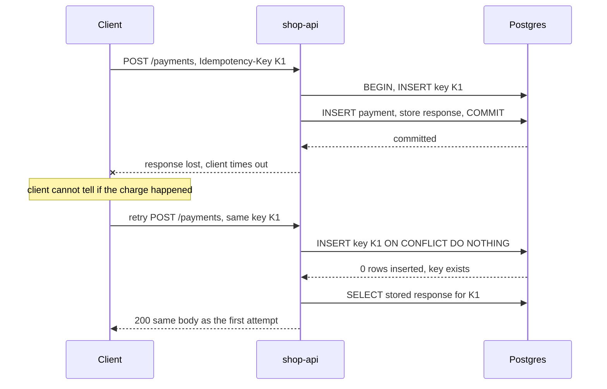
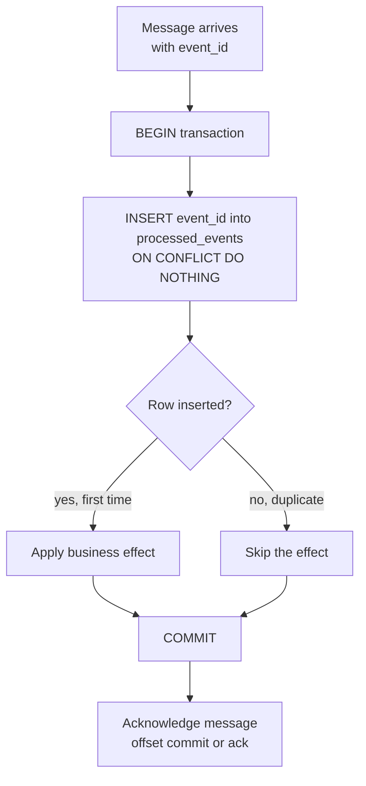

# L13.14 — Idempotency

> **Level 13: Databases & Distributed Systems** · Topic 14 of 15 · ⏱ ~5 hours · Difficulty: Advanced

## 1. What it is

An operation is **idempotent** if doing it once or doing it many times leaves the system in the same state. `SET balance = 50` is
idempotent; `ADD 10 TO balance` is not. In HTTP, `GET`, `PUT` and `DELETE` are defined as idempotent while `POST` is not, which is why
"create a payment" is the classic hard case.

Idempotency matters because networks and queues **retry**. A client that times out cannot know whether the server did the work and the reply
got lost, or never received the request at all. The only safe client behaviour is to try again, so the server must make "again" harmless.
The common building blocks are an **idempotency key** (a unique ID the client attaches to one logical operation, reused on every retry),
**deduplication** (remembering IDs already handled) and **at-least-once delivery** (a messaging guarantee that every message arrives one or
more times, never zero). Combined: at-least-once delivery plus an idempotent consumer behaves like exactly-once *processing*.

## 2. Why it matters in DevOps

- **Double charges and duplicate emails** are the visible symptom; the cause is a retry, a redelivered message or a replayed webhook that was not deduplicated.
- **Retries are everywhere you configure them:** load balancers, service meshes, SDKs, queue consumers, Kubernetes Jobs and CI runners all retry on your behalf.
  Turning on a retry policy without idempotent handlers converts a transient blip into data corruption.
- **Recovery depends on it.** Replaying a Kafka topic, restoring from backup and re-running a failed pipeline are only safe if the handlers can be re-run.
- **Infrastructure tools are built on it.** Terraform plans, Ansible tasks and `kubectl apply` are designed to be idempotent; scripts that are not (`mkdir` without `-p`, `INSERT` without a guard) break re-runs.
- See [Rollback](../level-05-cicd/07-rollback.md) and [Database Migrations](../level-05-cicd/09-database-migrations.md): re-runnable migrations are idempotent migrations.

## 3. Real-world system example

- **Stripe** documents an `Idempotency-Key` request header for `POST` requests: the first request's status code and body are stored under the key
  and returned for any retry with the same key (including errors), and a retry whose parameters differ from the original is rejected.
  Stripe's docs say keys may be removed from the system after they are at least 24 hours old. An IETF draft, *The Idempotency-Key HTTP Header Field*, is working to standardise the pattern.
- **Amazon SQS** standard queues deliver at least once, and AWS recommends idempotent consumers. **FIFO queues** add a `MessageDeduplicationId`
  and drop duplicates sent within a five-minute deduplication interval.
- **Apache Kafka** producers with `enable.idempotence=true` use producer IDs and sequence numbers so broker-side retries do not write duplicates to a partition.
  Kafka transactions give exactly-once semantics for read-process-write *inside Kafka*; a consumer that also writes to an external database still needs its own
  idempotent write (see [Kafka](08-kafka.md)).
- **AWS Lambda** event sources (SQS, S3, EventBridge) can invoke a function more than once for the same event; AWS guidance is to write handlers to be idempotent. **Powertools for AWS Lambda** ships an idempotency utility built on this pattern.
- **Kubernetes** is idempotent by design at the API layer: applying the same manifest twice converges to the same state, and controllers re-run reconcile loops continuously.
- **GitHub, Shopify and many SaaS products** deliver webhooks at least once and include a delivery ID so receivers can deduplicate.

## 4. Diagram

A client retry that would double-charge without a key, and does not with one:



The consumer side: a message may arrive twice, so the dedup record and the business effect commit together:



## 5. How it works

### Delivery guarantees and what they cost

| Guarantee | Meaning | How it fails | Needs idempotent consumer? |
|-----------|---------|--------------|----------------------------|
| **At-most-once** | Never redelivered; may be lost | message lost if the consumer crashes after receive, before processing | no, but you lose data |
| **At-least-once** | Never lost; may be duplicated | duplicate if the ack is lost or the consumer crashes after processing | **yes** |
| **Exactly-once (delivery)** | Delivered exactly one time | not achievable end-to-end in general, because the ack itself can be lost | n/a |
| **Exactly-once (processing)** | at-least-once delivery + idempotent effect | achievable and standard | built from the two above |

Most queues (SQS standard, RabbitMQ with manual acks, Kafka with commit-after-process) are at-least-once. The crash window is
always the same: *effect done, acknowledgement not yet recorded*. After the restart the message comes again (see
[RabbitMQ](09-rabbitmq.md) for redelivery and [Kafka](08-kafka.md) for offset commits).

### Four ways to make an effect idempotent

| Technique | Example | Notes |
|-----------|---------|-------|
| **Naturally idempotent write** | `UPDATE orders SET status='shipped' WHERE id=7` or `PUT` of a full resource | safe to repeat; beware `status = status + 1` |
| **Unique constraint / upsert** | `INSERT ... ON CONFLICT DO NOTHING`, `ON CONFLICT DO UPDATE` | the database enforces the dedup atomically |
| **Dedup table (inbox)** | `processed_events(event_id PRIMARY KEY)` in the same transaction as the effect | the general solution for consumers |
| **Conditional / versioned write** | `UPDATE ... WHERE version = 5`, compare-and-set | rejects stale or repeated updates |

### Designing an idempotency key

- **Client-generated** (a UUID created once per logical operation, reused for every retry), not generated per attempt.
- **Scoped** to a user or tenant and an operation, so a key cannot collide across customers.
- **Bound to the request:** store a hash of the parameters; same key with different parameters is a client bug, return `422` or `409`.
- **Stored with the outcome** (status and body), so retries receive the *same* answer, including a deterministic failure.
- **Expire eventually** (hours to days) so the table does not grow forever; a key reused after expiry is treated as new.
- **Atomic with the effect** when the effect lives in the same database. When the effect is an external call (a card charge), store an `in_progress` row first, pass the provider *its own* idempotency key, and handle crashes by retrying with that same key.

### Retries done right

Retry only operations that are idempotent (or keyed), with **exponential backoff and jitter** so thousands of clients do not retry in lockstep, a cap on attempts and a
total deadline. Without jitter, a short outage causes a retry storm that extends the outage; see [Circuit Breakers](../level-12-advanced-networking/14-circuit-breakers.md).

## 6. Step-by-step guide

**Prerequisites:** Docker and Python 3.9+ with `pip install psycopg2-binary`. Cost: free. Time: ~60 minutes. All code and SQL below was run
against PostgreSQL 16.15 started natively on a Linux VM (Docker is the portable way for you to start the same server); output with numbers such as payment IDs will differ ("similar to").

1. **Start a database.**
   ```bash
   docker run -d --name pg-idem -e POSTGRES_PASSWORD=<YOUR_PASSWORD> -p 127.0.0.1:5432:5432 postgres:16
   export PRIMARY_DSN="postgresql://postgres:<YOUR_PASSWORD>@127.0.0.1:5432/postgres"
   until docker exec pg-idem pg_isready -U postgres; do sleep 1; done
   ```

2. **See the dedup primitive in plain SQL.** The second insert is rejected silently:
   ```bash
   docker exec pg-idem psql -U postgres -c "CREATE TABLE processed_events (event_id uuid PRIMARY KEY, processed_at timestamptz DEFAULT now());"
   docker exec pg-idem psql -U postgres -c "INSERT INTO processed_events (event_id) VALUES ('11111111-1111-1111-1111-111111111111') ON CONFLICT DO NOTHING;"
   docker exec pg-idem psql -U postgres -c "INSERT INTO processed_events (event_id) VALUES ('11111111-1111-1111-1111-111111111111') ON CONFLICT DO NOTHING;"
   ```
   ```text
   INSERT 0 1
   INSERT 0 0
   ```
   `INSERT 0 0` (zero rows inserted) is the signal "I have seen this event before". Applications check the row count.

3. **Write the idempotent charge function.** Save as `idem.py`. The key row, the payment and the stored response commit in one transaction:
   ```python
   import hashlib, json, os, threading, psycopg2

   DSN = os.environ["PRIMARY_DSN"]

   SCHEMA = """
   CREATE TABLE IF NOT EXISTS idempotency_keys (
     key          text PRIMARY KEY,
     request_hash text NOT NULL,
     response     jsonb,
     created_at   timestamptz NOT NULL DEFAULT now()
   );
   CREATE TABLE IF NOT EXISTS payments (
     id bigserial PRIMARY KEY, customer_id int NOT NULL, amount_cents int NOT NULL
   );
   """

   def charge(key, customer_id, amount_cents):
       body = json.dumps([customer_id, amount_cents])
       h = hashlib.sha256(body.encode()).hexdigest()
       with psycopg2.connect(DSN) as conn, conn.cursor() as cur:
           cur.execute("INSERT INTO idempotency_keys (key, request_hash) VALUES (%s, %s) "
                       "ON CONFLICT (key) DO NOTHING", (key, h))
           if cur.rowcount == 0:                       # key seen before (waits if the first request is still committing)
               cur.execute("SELECT request_hash, response FROM idempotency_keys WHERE key = %s", (key,))
               old_hash, response = cur.fetchone()
               if old_hash != h:
                   return 422, {"error": "idempotency key reused with different parameters"}
               return 200, response | {"replayed": True}
           cur.execute("INSERT INTO payments (customer_id, amount_cents) VALUES (%s, %s) RETURNING id",
                       (customer_id, amount_cents))
           response = {"payment_id": cur.fetchone()[0], "amount_cents": amount_cents}
           cur.execute("UPDATE idempotency_keys SET response = %s WHERE key = %s", (json.dumps(response), key))
           return 200, response                        # effect + key + response commit together

   if __name__ == "__main__":
       with psycopg2.connect(DSN) as c, c.cursor() as cur:
           cur.execute(SCHEMA)
       key = "6f1c2a9e-order-1042"
       print("first   :", charge(key, 7, 4999))
       print("retry   :", charge(key, 7, 4999))        # client never saw the first response
       print("mismatch:", charge(key, 7, 9999))
       out = []
       ts = [threading.Thread(target=lambda: out.append(charge("race-key", 8, 1500))) for _ in range(8)]
       [t.start() for t in ts]; [t.join() for t in ts]
       print("race    :", sum(1 for s, r in out if "replayed" not in r), "executed,",
             sum(1 for s, r in out if "replayed" in r), "replayed")
       with psycopg2.connect(DSN) as c, c.cursor() as cur:
           cur.execute("SELECT customer_id, count(*) FROM payments GROUP BY 1 ORDER BY 1")
           print("payments rows per customer:", cur.fetchall())
   ```
   ```bash
   python3 idem.py
   ```
   ```text
   first   : (200, {'payment_id': 1, 'amount_cents': 4999})
   retry   : (200, {'payment_id': 1, 'amount_cents': 4999, 'replayed': True})
   mismatch: (422, {'error': 'idempotency key reused with different parameters'})
   race    : 1 executed, 7 replayed
   payments rows per customer: [(7, 1), (8, 1)]
   ```
   Four things to notice: the retry returns the *same* `payment_id`; reuse with different parameters is rejected; eight concurrent requests with one key
   create one payment (the unique index makes the others wait for the first transaction, then see the conflict); and there is exactly one payment row per customer.

4. **Prove the retry problem and the fix together.** Save as `retry.py` next to `idem.py`. It loses 60% of replies after the server has committed, and retries with backoff and jitter:
   ```python
   import random, time, uuid
   import psycopg2
   from idem import charge, DSN

   def count(customer):
       with psycopg2.connect(DSN) as c, c.cursor() as cur:
           cur.execute("SELECT count(*) FROM payments WHERE customer_id = %s", (customer,))
           return cur.fetchone()[0]

   def lose_reply(result):
       if random.random() < 0.6:                        # the server committed, but the client never hears back
           raise TimeoutError("response lost on the way back")
       return result

   def naive_charge(customer, cents):                   # no key: every attempt is a brand-new payment
       with psycopg2.connect(DSN) as c, c.cursor() as cur:
           cur.execute("INSERT INTO payments (customer_id, amount_cents) VALUES (%s, %s)", (customer, cents))
       return lose_reply((200, {"ok": True}))

   def keyed_charge(key, customer, cents):
       return lose_reply(charge(key, customer, cents))

   def with_retries(fn, *args, attempts=8, base=0.05, cap=1.0):
       for n in range(1, attempts + 1):
           try:
               return n, fn(*args)
           except TimeoutError:
               time.sleep(random.uniform(0, min(cap, base * 2 ** n)))   # exponential backoff with full jitter
       raise RuntimeError("gave up")

   random.seed(4)
   before = count(42)
   n, _ = with_retries(naive_charge, 42, 2500)
   print(f"naive : client needed {n} attempts, rows created = {count(42) - before}")

   random.seed(4)
   before, key = count(43), str(uuid.uuid4())           # ONE key for the whole logical operation
   n, res = with_retries(keyed_charge, key, 43, 2500)
   print(f"keyed : client needed {n} attempts, rows created = {count(43) - before}, final reply = {res[1]}")
   ```
   ```bash
   python3 retry.py
   ```
   ```text
   naive : client needed 4 attempts, rows created = 4
   keyed : client needed 4 attempts, rows created = 1, final reply = {'payment_id': 9, 'amount_cents': 2500, 'replayed': True}
   ```
   The same four attempts created four charges without a key and one with it. (The seed makes the attempt count repeatable; remove `random.seed` to see it vary. The `payment_id` depends on earlier runs.)

5. **Inspect the stored keys.**
   ```bash
   docker exec pg-idem psql -U postgres -c "SELECT key, left(request_hash, 8) AS hash, response FROM idempotency_keys ORDER BY created_at;"
   ```
   Each logical operation has one row holding the outcome that retries replay. In production add a scheduled `DELETE ... WHERE created_at < now() - interval '24 hours'`.

6. **Break it: put the dedup outside the transaction.** In `idem.py`, commit the key row first (a separate `with psycopg2.connect` block), then insert the payment in a second transaction, and `raise SystemExit` between them on the first call.
   The retry then finds the key with no stored response and never creates the payment: the key says "done" while nothing was done (in this code `None | {...}` raises a `TypeError`;
   a more forgiving implementation would happily return success). This is why the key and the effect must be one atomic unit, or the `in_progress` state must be handled explicitly.

7. **Clean up.**
   ```bash
   docker rm -f pg-idem
   ```

## 7. Real-world scenario

*Illustrative, not a documented incident.* `shop-api` sends "order shipped" emails from a queue consumer. During a deploy the consumer pods are killed while
processing a batch; the broker redelivers every unacknowledged message to the new pods. *Symptom:* about 1,800 customers receive the same shipping email twice,
and support gets a spike of "is this a scam?" replies. *Investigation:* logs show each message processed twice with the same `order_id` and the same `event_id`, minutes apart; the handler sends the email, then acknowledges, and the pod died in between.
*Fix:* a `processed_events` table keyed on `event_id`; the handler inserts the key, and only if the insert succeeds does it enqueue the email to the provider, passing the provider's own idempotency key (the `event_id`) as well.
*Lesson:* the redelivery was correct broker behaviour; the missing piece was an idempotent handler. The team also added a test that delivers every message twice in CI, and a graceful-shutdown hook so deploys finish in-flight work first.

## 8. Common mistakes and best practices

**Don't**

- Generate a new idempotency key for each retry attempt (it defeats the point).
- Record "I handled it" in a different transaction, or a different datastore, than the effect without an `in_progress` protocol.
- Dedupe in memory or in a cache with a short TTL when the broker can redeliver days later.
- Retry non-idempotent operations blindly, or retry with no backoff, jitter or attempt limit.
- Assume the broker's "exactly-once" label covers your database write or your third-party API call.
- Return a *different* response for a replayed request (a replay should look like the original).

**Do**

- Make every consumer and webhook receiver idempotent from day one, and test by delivering each message twice.
- Use natural keys: unique constraints on `(provider, external_id)` are free deduplication.
- Pass your key through to downstream providers that support their own idempotency keys.
- Expire dedup records on a schedule that exceeds your longest retry and redelivery window.
- Log the idempotency key on every request so a duplicate can be traced end to end (see [Correlation IDs](../level-10-observability/07-correlation-ids.md)).
- Use the transactional outbox on the producing side so an event exists if and only if the state change committed (see [Distributed Locks and Queues](15-distributed-locks-and-queues.md)).

## 9. Tasks

- [ ] **T1 — Dedup with SQL only** *(≈15 min, beginner)*
  - **Goal:** see the `INSERT 0 0` signal.
  - **Steps:**
    1. Do step 1 and step 2.
    2. Insert three different event IDs and one repeated, then `SELECT count(*) FROM processed_events;`.
  - **Done when:** the table holds 3 rows after 4 inserts and you can explain why the fourth reported `INSERT 0 0`.

- [ ] **T2 — Run the keyed charge** *(≈25 min, beginner)*
  - **Goal:** run the idempotent API function and read its output.
  - **Steps:**
    1. Create `idem.py` and run it.
    2. Run it a second time without clearing tables.
  - **Done when:** the second run replays both keys (`replayed: True` for `6f1c2a9e-order-1042`) and the payments table has not grown for customers 7 and 8.

- [ ] **T3 — Show the damage without a key** *(≈25 min, intermediate)*
  - **Goal:** reproduce duplicate charges from retries.
  - **Steps:**
    1. Create `retry.py` and run it.
    2. Change the seed and the loss probability (`0.6`) and rerun five times.
  - **Done when:** you have five runs where the naive row count equals the attempts and the keyed count is always 1.

- [ ] **T4 — Break it: split the transaction** *(≈30 min, advanced)*
  - **Goal:** demonstrate why key and effect must be atomic.
  - **Steps:**
    1. Follow step 6 to commit the key before the payment and crash in between.
    2. Retry and record what the client receives and what the database contains.
    3. Fix it by restoring the single transaction (or add an `in_progress` status and a recovery path).
  - **Done when:** you captured the inconsistent state (key present, no payment) and the fixed run where retry completes the payment.

- [ ] **T5 — Idempotent consumer for a webhook** *(≈45 min, advanced)*
  - **Goal:** automate dedup for incoming events.
  - **Steps:**
    1. Write a tiny HTTP receiver (Flask or `http.server`) for `POST /webhooks` that reads an `event_id` and applies an effect using the `processed_events` pattern.
    2. Send the same payload ten times with `curl` in parallel (`xargs -P`).
  - **Done when:** the effect (a counter row) increased by exactly 1 and the logs show 1 `applied` and 9 `duplicate`.

- [ ] **T6 — Prove it: design the key lifecycle** *(≈40 min, advanced)*
  - **Goal:** explain end-to-end exactly-once processing.
  - **Steps:**
    1. Without the guide, draw the sequence of a `POST /payments` that calls an external card API: where the key row is written, which key goes to the provider, and what happens if the server crashes after the provider call but before the commit.
    2. State the TTL for stored keys and justify it.
  - **Done when:** your design survives each crash point you can name, and a teammate cannot find a window that charges twice.

## 10. Self-check questions

1. Which HTTP methods are idempotent, and why is `POST` not?
2. A queue is at-least-once. Where exactly can a duplicate come from?
3. Why must the dedup record and the business effect commit in the same transaction?
4. What should a server do when it receives a known idempotency key with different parameters?
5. Why add jitter to retry backoff?

<details>
<summary>Answers</summary>

1. `GET`, `HEAD`, `PUT`, `DELETE` (and `OPTIONS`) are idempotent by definition; `POST` creates a new resource or triggers a side effect each time unless the server adds a key.
2. When the consumer processes a message but crashes, times out or loses the connection before the acknowledgement (ack or offset commit) is recorded, the broker redelivers it. Producer retries after a lost send-acknowledgement can also duplicate a message.
3. If they are separate, a crash between them leaves "marked done but not done" (lost effect) or "done but not marked" (duplicate on retry). One transaction makes them succeed or fail together.
4. Reject it (typically `422` or `409`): it is a client bug, and returning the old response would hide that the client changed the request.
5. Without jitter all clients retry at the same instants and re-create the overload (a retry storm); random delays spread the load.
</details>

## 11. Further reading

- Stripe API documentation: *Idempotent requests*.
- IETF draft *The Idempotency-Key HTTP Header Field* (httpapi working group).
- Amazon Builders' Library: *Making retries safe with idempotent APIs* and *Timeouts, retries, and backoff with jitter*.
- *Designing Data-Intensive Applications* by Martin Kleppmann: the chapters on end-to-end argument, exactly-once and fault tolerance.
- Chris Richardson, *Microservices Patterns*: Idempotent Consumer and Transactional Outbox.
- Apache Kafka documentation: producer idempotence and transactions. AWS SQS documentation: FIFO deduplication.

<!-- nav -->
---
← Previous: [Eventual Consistency](13-eventual-consistency.md) · [Level 13 index](README.md) · Next: [Distributed Locks and Queues](15-distributed-locks-and-queues.md) →
