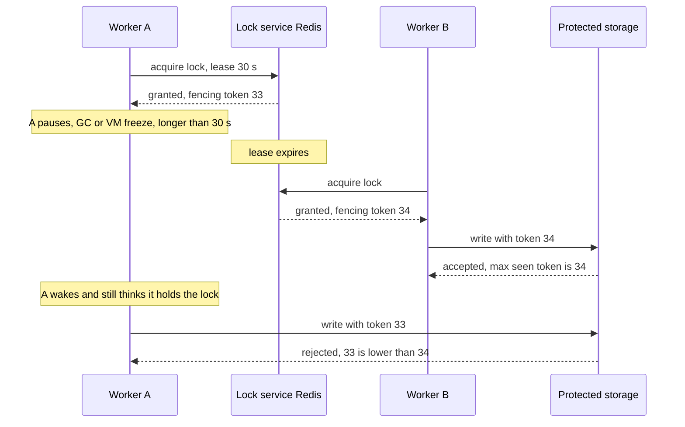
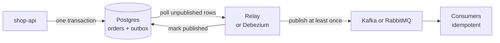

# L13.15 — Distributed Locks and Queues

> **Level 13: Databases & Distributed Systems** · Topic 15 of 15 · ⏱ ~6 hours · Difficulty: Advanced

## 1. What it is

A **distributed lock** lets many processes on many machines agree that only one of them is doing a particular thing right now: running the nightly
report, being the leader, rebuilding a cache entry, updating a record. Unlike a lock inside one program, the holder can crash, freeze or be cut off from the
network while still believing it owns the lock. For that reason practical distributed locks are **leases**: a lock with an expiry time that the holder must renew,
so a dead holder cannot block everyone forever.

A **work queue** is the other tool for the same goal from the opposite angle: instead of fighting over who does a job, producers put jobs in a queue and
competing workers each take one. The queue hands each job to one worker at a time and gives it back if that worker disappears. Add the **outbox pattern**
(write the event to a table in the same database transaction as the state change, and publish it afterwards) and you can publish messages reliably without
a distributed transaction between your database and your broker.

## 2. Why it matters in DevOps

- **Duplicate cron jobs.** Run a scheduled task on three replicas and, without a lock or leader election, you send three invoices. Every Kubernetes CronJob/Deployment decision runs into this.
- **Stale lock holders corrupt data.** A pause (garbage collection, a VM live migration, an overloaded node) outlives the lease; a second worker takes over; then the first wakes up and writes. A naive Redis lock cannot stop that; a **fencing token** can.
- **Queues smooth load and isolate failure,** but bring the delivery semantics from [Idempotency](14-idempotency.md): jobs may run twice, and a job stuck in "processing" must be re-queued.
- **The dual-write bug** (update the database, then publish an event, and crash in between) silently loses events. The outbox pattern is the standard fix.
- Operating all of this means monitoring queue depth, oldest-job age, lock contention and lease expiries; see [Observability](../level-00-what-devops-is/10-observability.md).

## 3. Real-world system example

- **Kubernetes leader election.** Controllers such as `kube-scheduler` and `kube-controller-manager` run several replicas but only one is active; the active one holds a
  `Lease` object (API group `coordination.k8s.io`) and renews it periodically. If renewal stops, another replica acquires the lease. The Lease is stored in etcd, which gives
  it consensus-backed correctness (see [Cluster Architecture](../level-08-kubernetes/01-cluster-architecture.md)).
- **Google Chubby** (OSDI 2006 paper) is the lock service behind much of Google's infrastructure; it introduced "sequencers", which are the same idea as fencing tokens.
  **Apache ZooKeeper**, **etcd** and **HashiCorp Consul** offer lock and leader-election recipes built on consensus and sessions or leases.
- **Redis as a lock and queue store.** Sidekiq (Ruby) and many other job libraries use Redis lists; the Redis documentation describes `SET key value NX PX` for locks and the
  Redlock algorithm for multi-node setups. Martin Kleppmann's "How to do distributed locking" and Redis author Salvatore Sanfilippo's reply are the standard public debate
  about whether Redlock is safe for correctness-critical locks (Kleppmann's argument: you need fencing tokens regardless).
- **PostgreSQL as a queue.** `SELECT ... FOR UPDATE SKIP LOCKED` (PostgreSQL 9.5 and later) lets many workers pull different rows without blocking each other. Job libraries such as Oban, GoodJob and River
  are built on it, and advisory locks (`pg_advisory_lock`) give cheap cross-process mutual exclusion inside a database you already run.
- **Amazon SQS** uses a **visibility timeout**: a received message is hidden for a period; if the worker does not delete it in time it reappears. That is a lease on a message.
- **Debezium** (open source, CNCF-hosted ecosystem) reads the database's change log and publishes it to Kafka, and documents an **outbox event router** for the pattern described here (see [Kafka](08-kafka.md)).

## 4. Diagram

The lock-expiry hazard and how a fencing token closes it:



The outbox pattern, which avoids writing to the database and the broker as two separate steps:



## 5. How it works

### Locks: correctness versus efficiency

Ask what happens if two workers hold the lock at once:

- **Efficiency lock:** the work is wasted but harmless (two workers rebuild the same cache). A single Redis node with a TTL is fine.
- **Correctness lock:** data is damaged (double payment, corrupted file). A lease alone is *not enough*, because leases can expire while the holder is paused. Use a fencing token checked by the
  protected resource, or better, avoid the lock and use a conditional write (`UPDATE ... WHERE version = n`) or a consensus-backed system.

### The Redis lock recipe

| Piece | Why |
|-------|-----|
| `SET lock:name <random-token> NX PX 30000` | `NX` = only if absent (mutual exclusion), `PX` = expires after 30 s (a crashed holder cannot block forever), token = identifies the holder |
| Release with a **Lua script**: delete only if the value equals my token | prevents deleting a lock that expired and was acquired by someone else |
| Renew (extend `PX`) while working, only if the token still matches | long jobs keep the lease; a "watchdog" thread does this |
| `INCR fence:name` at acquisition | a monotonically increasing **fencing token** to send with every write |
| Never `SETNX` then `EXPIRE` as two commands | a crash in between leaves a lock that never expires |

Caveats worth knowing: with a single Redis node, a failover can lose the lock (asynchronous replication, see [CAP](12-cap-theorem-and-consistency.md) and [Redis](07-redis.md));
Redlock tries to fix that using several independent nodes but remains debated for correctness locks; clock jumps and pauses still break lease assumptions.

### Lock options compared

| Option | Strength | Weakness |
|--------|----------|----------|
| Redis `SET NX PX` | fast, simple, already deployed | not consensus-backed, pauses and failover can break it |
| PostgreSQL advisory lock (`pg_try_advisory_lock`) | released automatically when the session ends, no extra system | tied to a connection (watch connection poolers, see [Connection Pooling](06-db-connection-pooling.md)) |
| etcd / ZooKeeper / Consul | consensus-backed leases and sessions | more infrastructure, still needs fencing for external side effects |
| Kubernetes `Lease` | built-in leader election for pods | coarse (seconds), for controller-style leadership |
| Database row with version check | no separate lock service | not a lock: it detects conflicts after the fact |

### Work queues: patterns and their lease mechanism

| Queue | Claim | Lease / recovery | Notes |
|-------|-------|------------------|-------|
| Redis list (reliable queue) | `LMOVE jobs processing RIGHT LEFT` | a sweeper moves old items from `processing` back | plain `RPOP` loses the job if the worker dies |
| Redis Streams + consumer group | `XREADGROUP` | `XPENDING` lists unacked, `XAUTOCLAIM` reassigns idle ones, `XACK` completes | built-in acknowledgement tracking |
| Postgres table | `UPDATE ... WHERE id = (SELECT ... FOR UPDATE SKIP LOCKED LIMIT 1)` | `claimed_at` plus a sweeper | transactional with your data; modest throughput |
| SQS | `ReceiveMessage` | visibility timeout | delete after success |
| RabbitMQ | consume with manual ack, `prefetch` | unacked messages requeue when the channel closes | see [RabbitMQ](09-rabbitmq.md) |
| Kafka | consumer group assigns partitions | rebalance when a consumer misses heartbeats | ordering per partition, see [Kafka](08-kafka.md) |

Everything above is **at-least-once**: pair it with idempotent handlers.

### The outbox pattern

The *dual-write problem*: `COMMIT` the order, then `publish(event)`. Crash between them and the event is lost; publish first, then commit fails, and a phantom event exists.
Instead, in **one** database transaction insert the order *and* a row into an `outbox` table. A separate relay reads unpublished rows, publishes them and marks them done (or a
change-data-capture tool like Debezium streams the table). A crash after publish but before marking re-publishes, so the event carries a stable `event_id` for consumers to deduplicate.

## 6. Step-by-step guide

**Prerequisites:** Docker; Python 3.9+ with `pip install redis psycopg2-binary` for the fencing and queue scripts. Cost: free. Time: ~75 minutes. Commands and scripts were run against Redis 7.0.15
and PostgreSQL 16.15 started natively; Docker versions are the standard equivalent, and ids, timings and tokens will differ ("similar to").

1. **Start Redis and Postgres.**
   ```bash
   docker run -d --name redis -p 127.0.0.1:6379:6379 redis:7
   docker run -d --name pg -e POSTGRES_PASSWORD=<YOUR_PASSWORD> -p 127.0.0.1:5432:5432 postgres:16
   docker exec redis redis-cli ping            # PONG
   ```

2. **Take a lock, contend for it, release it safely.**
   ```bash
   docker exec redis redis-cli SET lock:report-42 tokenA NX PX 30000     # OK  (A holds it)
   docker exec redis redis-cli SET lock:report-42 tokenB NX PX 30000     # (nil)  B is refused
   docker exec redis redis-cli PTTL lock:report-42                       # about 29990 ms left
   docker exec redis redis-cli EVAL "if redis.call('get',KEYS[1])==ARGV[1] then return redis.call('del',KEYS[1]) else return 0 end" 1 lock:report-42 tokenB
   docker exec redis redis-cli EVAL "if redis.call('get',KEYS[1])==ARGV[1] then return redis.call('del',KEYS[1]) else return 0 end" 1 lock:report-42 tokenA
   ```
   The first `EVAL` (B's token) returns `0`: B cannot release A's lock. The second returns `1`. The compare-and-delete must be one atomic script, otherwise there is a race between `GET` and `DEL`.

3. **Watch a lease expire.**
   ```bash
   docker exec redis redis-cli SET lock:x t NX PX 100
   sleep 0.2; docker exec redis redis-cli GET lock:x      # (nil): expired, someone else could now take it
   ```

4. **Reproduce the stale-holder problem and fix it with a fencing token.** Save as `fence.py`:
   ```python
   import time, uuid, redis

   r = redis.Redis(port=6379, decode_responses=True)
   RELEASE = "if redis.call('get',KEYS[1])==ARGV[1] then return redis.call('del',KEYS[1]) else return 0 end"

   class Storage:                                   # stands in for the resource the lock protects
       def __init__(self, check_fence): self.check, self.max_fence, self.data = check_fence, 0, None
       def write(self, who, fence, data):
           if self.check and fence < self.max_fence:
               print(f"  storage: REJECT {who} (fence {fence} < {self.max_fence})"); return
           self.max_fence, self.data = max(self.max_fence, fence), data
           print(f"  storage: accept {who} (fence {fence})")

   def acquire(ttl_ms=500):
       token = uuid.uuid4().hex                     # unique per holder, so only the holder can release
       if r.set("lock:report", token, nx=True, px=ttl_ms):
           return token, r.incr("fence:report")     # strictly increasing fencing token
       return None, None

   def race(check_fence):
       r.delete("lock:report", "fence:report")
       store = Storage(check_fence)
       ta, fa = acquire();  print("  A got the lock, fence", fa)
       time.sleep(0.7)                              # A stalls (GC pause, VM freeze) past its 500 ms lease
       tb, fb = acquire();  print("  B got the lock, fence", fb)
       store.write("B", fb, "written by B")
       store.write("A", fa, "written by A")         # A wakes up and still believes it holds the lock
       print("  final data:", store.data)
       print("  A release ->", r.eval(RELEASE, 1, "lock:report", ta), "| B release ->", r.eval(RELEASE, 1, "lock:report", tb))

   print("Without a fencing check:"); race(False)
   print("With a fencing check:");    race(True)
   ```
   ```bash
   python3 fence.py
   ```
   ```text
   Without a fencing check:
     A got the lock, fence 1
     B got the lock, fence 2
     storage: accept B (fence 2)
     storage: accept A (fence 1)
     final data: written by A
     A release -> 0 | B release -> 1
   With a fencing check:
     A got the lock, fence 1
     B got the lock, fence 2
     storage: accept B (fence 2)
     storage: REJECT A (fence 1 < 2)
     final data: written by B
     A release -> 0 | B release -> 1
   ```
   In the first run the lock held for A, expired, and A still overwrote B: the lock gave no safety. In the second run the *resource* refuses the old token. Note that the safe release (`A release -> 0`) is not enough on its own.

5. **Build a reliable Redis list queue (and see why `RPOP` is not reliable).**
   ```bash
   docker exec redis redis-cli LPUSH jobs job1 job2 job3
   docker exec redis redis-cli LMOVE jobs processing RIGHT LEFT      # "job1": claimed, now in the processing list
   docker exec redis redis-cli LRANGE processing 0 -1                # job1
   docker exec redis redis-cli LREM processing 1 job1                # 1: worker finished, ack by removal
   ```
   If the worker crashed instead, `job1` would still sit in `processing`; a sweeper moves it back with `LMOVE processing jobs RIGHT LEFT` after a timeout. With plain `RPOP`, the job would just be gone.

6. **Use Redis Streams for built-in tracking of unacknowledged work.**
   ```bash
   docker exec redis redis-cli XGROUP CREATE jobs:stream workers '$' MKSTREAM
   docker exec redis redis-cli XADD jobs:stream '*' task resize:1
   docker exec redis redis-cli XREADGROUP GROUP workers w1 COUNT 1 STREAMS jobs:stream '>'     # w1 receives it, never acks (crash)
   sleep 1.2
   docker exec redis redis-cli XAUTOCLAIM jobs:stream workers w2 1000 0-0 COUNT 10             # w2 takes over anything idle over 1000 ms
   ```
   `XAUTOCLAIM` returns the stalled entry (`task resize:1`) now owned by `w2`; after processing, `XACK jobs:stream workers <id>` clears it from the pending list (check with `XPENDING jobs:stream workers`).

7. **Build a Postgres work queue with `SKIP LOCKED`.** Save as `q.py`:
   ```python
   import os, threading, time, psycopg2
   DSN = os.environ["PRIMARY_DSN"]        # e.g. postgresql://postgres:<YOUR_PASSWORD>@127.0.0.1:5432/postgres
   with psycopg2.connect(DSN) as c, c.cursor() as cur:
       cur.execute("DROP TABLE IF EXISTS jobs; CREATE TABLE jobs (id bigserial PRIMARY KEY, payload text, state text NOT NULL DEFAULT 'queued', claimed_by text, claimed_at timestamptz)")
       cur.execute("INSERT INTO jobs (payload) SELECT 'email-' || g FROM generate_series(1, 20) g")
   CLAIM = """UPDATE jobs SET state='running', claimed_by=%s, claimed_at=now()
    WHERE id = (SELECT id FROM jobs WHERE state='queued' ORDER BY id FOR UPDATE SKIP LOCKED LIMIT 1)
    RETURNING id"""
   done = {}
   def worker(name):
       conn = psycopg2.connect(DSN); got = []
       while True:
           with conn, conn.cursor() as cur:
               cur.execute(CLAIM, (name,)); row = cur.fetchone()
           if not row: break
           got.append(row[0]); time.sleep(0.01)
       done[name] = got
   ts = [threading.Thread(target=worker, args=(f"w{i}",)) for i in range(4)]
   [t.start() for t in ts]; [t.join() for t in ts]
   allids = sorted(i for g in done.values() for i in g)
   print({k: len(v) for k, v in sorted(done.items())}, "total", len(allids), "unique", len(set(allids)))
   ```
   ```bash
   export PRIMARY_DSN="postgresql://postgres:<YOUR_PASSWORD>@127.0.0.1:5432/postgres"
   python3 q.py
   ```
   ```text
   {'w0': 5, 'w1': 5, 'w2': 5, 'w3': 5} total 20 unique 20
   ```
   Four workers drained 20 jobs with no job claimed twice and no worker blocked by another (the split between workers varies run to run). The `state='running'` rows with an old `claimed_at` are the ones a sweeper would reset to `queued`.

8. **Try a Postgres advisory lock** (a lock tied to a session). In two `psql` sessions, run `SELECT pg_try_advisory_lock(42);` in the first (`t`), then in the second (`f`); close the first session and
   run it again in the second (`t`). Because the lock disappears when its connection ends, it self-heals after a crash, but a connection pooler in transaction mode would break the assumption (use `pg_advisory_xact_lock` inside a transaction there).

9. **Implement the outbox.** One transaction writes the order and the event; a rolled-back transaction leaves neither.
   ```bash
   docker exec -i pg psql -U postgres <<'SQL'
   CREATE TABLE orders (id bigserial PRIMARY KEY, customer_id int NOT NULL, total_cents int NOT NULL);
   CREATE TABLE outbox (id bigserial PRIMARY KEY, event_id uuid NOT NULL DEFAULT gen_random_uuid(),
                        topic text NOT NULL, payload jsonb NOT NULL,
                        created_at timestamptz NOT NULL DEFAULT now(), published_at timestamptz);
   BEGIN;
   INSERT INTO orders (customer_id, total_cents) VALUES (7, 4999);
   INSERT INTO outbox (topic, payload)
     VALUES ('orders.created', jsonb_build_object('order_id', currval('orders_id_seq'), 'customer_id', 7));
   COMMIT;
   BEGIN;
   INSERT INTO orders (customer_id, total_cents) VALUES (8, 100);
   INSERT INTO outbox (topic, payload) VALUES ('orders.created', '{"order_id": 2}');
   ROLLBACK;
   SELECT count(*) AS orders FROM orders;
   SELECT id, topic, payload, published_at IS NULL AS pending FROM outbox;
   SQL
   ```
   ```text
    orders
   --------
         1
    id |     topic      |              payload              | pending
   ----+----------------+-----------------------------------+---------
     1 | orders.created | {"order_id": 1, "customer_id": 7} | t
   ```
   Now the relay's claim step, which several relays can run safely at once:
   ```bash
   docker exec pg psql -U postgres -c "BEGIN; SELECT id, payload FROM outbox WHERE published_at IS NULL ORDER BY id LIMIT 100 FOR UPDATE SKIP LOCKED; UPDATE outbox SET published_at = now() WHERE id IN (1); COMMIT;"
   ```
   In a real relay, you would publish the selected rows to the broker *before* the `UPDATE`. A crash between the two means the next run republishes: that is why the event has an `event_id` and consumers dedupe. The capstone wires this end to end.

10. **Clean up.**
    ```bash
    docker rm -f redis pg
    ```

## 7. Real-world scenario

*Illustrative, not a documented incident.* `shop-api` has a nightly job that generates invoices; it runs inside the API process on each of three replicas, guarded by `SET lock:invoices NX PX 60000`.
*Symptom:* a customer is invoiced twice, once at 02:00:01 and again at 02:01:30, with identical totals but different invoice numbers.
*Investigation:* logs show replica 1 acquired the lock at 02:00:00. A stop-the-world garbage collection pause of about 70 seconds (a heap-size misconfiguration) let the 60-second lease expire; replica 2 acquired the lock and began generating invoices; replica 1 woke up and carried on from where it stopped, believing it still held the lock.
*Fix:* short term, an `invoices` table with `UNIQUE (customer_id, billing_period)` so the second insert fails harmlessly (idempotency beats locking); medium term, the job moved to a single Kubernetes CronJob with `concurrencyPolicy: Forbid`, and the lock now returns a fencing token that the invoice writer checks.
*Lesson:* a lease only bounds how long a *dead* holder blocks others; it cannot stop a *paused* one. Correctness has to be enforced where the data lives.

## 8. Common mistakes and best practices

**Don't**

- Use `SETNX` followed by `EXPIRE`, a lock with no expiry, or a fixed token such as `1`.
- Release a lock with plain `DEL`: you may delete someone else's lock after your lease expired.
- Rely on a lock for correctness when the protected resource cannot check a fencing token or version.
- Use `RPOP`/`BRPOP` for jobs you cannot lose (a crash loses the job).
- Publish to the broker and write to the database as two independent steps.
- Hold a lock across slow external calls without renewing, or assume wall clocks agree across machines.

**Do**

- Prefer designs that need no lock: unique constraints, conditional updates, idempotent handlers, partitioning work by key.
- Use a random token per acquisition, Lua compare-and-delete to release, a TTL longer than the worst normal run, and a renewal watchdog for long work.
- Send a fencing token with each write to the resource and reject lower ones.
- Use consensus-backed leases (etcd, ZooKeeper, Kubernetes Lease) for leader election of important components.
- Make every worker idempotent, set visibility timeouts or ack deadlines above the normal job time, and sweep stuck jobs.
- Use the outbox plus a stable `event_id`, and monitor queue depth, oldest job age and outbox lag.

## 9. Tasks

- [ ] **T1 — Take and release a Redis lock correctly** *(≈20 min, beginner)*
  - **Goal:** use `SET NX PX` and a token-checked release.
  - **Steps:**
    1. Run step 2 with two tokens.
    2. Observe `PTTL` count down, then let a lock expire (step 3).
  - **Done when:** B is refused, B's release returns 0, A's release returns 1, and an expired key returns `(nil)`.

- [ ] **T2 — Reproduce and fix the stale holder** *(≈30 min, intermediate)*
  - **Goal:** see a lock fail and a fencing token save the data.
  - **Steps:**
    1. Run `fence.py` as in step 4.
    2. Change the stall to `0.3` s (shorter than the lease). B is now refused, so add a guard in `race()`: `if tb is None: print("  B refused"); return`.
    3. Explain why the short-stall run is safe even without the check (A's lease is still valid) while the long-stall run needs it.
  - **Done when:** you can show the output for the long stall with and without the check, and the short-stall run, and your explanation matches.

- [ ] **T3 — Build and crash a reliable queue** *(≈40 min, intermediate)*
  - **Goal:** prove no job is lost when a worker dies.
  - **Steps:**
    1. Push 10 jobs; write a worker that uses `LMOVE ... processing`, sleeps 1 s, then `LREM`s.
    2. Kill the worker mid-job (Ctrl+C), then write a sweeper that moves jobs back after 5 s.
    3. Start a second worker and run to completion.
  - **Done when:** all 10 jobs are completed exactly once from your log, and `LLEN processing` is 0.

- [ ] **T4 — Break it: duplicate delivery** *(≈30 min, advanced)*
  - **Goal:** show at-least-once in action and neutralise it.
  - **Steps:**
    1. In the Streams demo, have a worker read but not ack, let `w2` `XAUTOCLAIM` it, and process the entry in both workers.
    2. Add a `processed_events` insert (see [Idempotency](14-idempotency.md)) so the second processing is skipped.
  - **Done when:** the effect (a counter) increments once even though two workers handled the message.

- [ ] **T5 — Outbox with a crashing relay** *(≈50 min, advanced)*
  - **Goal:** demonstrate no lost events and tolerated duplicates.
  - **Steps:**
    1. Create the outbox (step 9), insert 5 orders and write a relay that prints events and then marks them published.
    2. Raise an exception after printing but before the `UPDATE` once; run the relay again.
    3. Count how often each `event_id` was printed.
  - **Done when:** all 5 events were delivered, at least one was delivered twice, and a dedup set of `event_id`s reduces it to exactly 5.

- [ ] **T6 — Prove it: choose the mechanism** *(≈40 min, advanced)*
  - **Goal:** justify lock versus queue versus constraint.
  - **Steps:**
    1. Without the guide, choose and justify a mechanism for: nightly invoice generation, cache stampede on a hot key, leader of a stream processor, sending one welcome email per signup.
    2. For each, state what happens when a worker freezes for twice the lease.
  - **Done when:** each choice names the failure case and the control (fencing, idempotency key, unique constraint, consensus lease) that handles it.

## 10. Self-check questions

1. Why must the lock value be a random token, and why must release be a script?
2. A worker holds a Redis lock with a 30 s TTL and pauses for 45 s. What goes wrong, and what stops the damage?
3. When is a plain Redis `SET NX PX` lock good enough, and when is it not?
4. What is the dual-write problem, and how does the outbox solve it?
5. A job was claimed by a worker that crashed. How does each of SQS, RabbitMQ and a Postgres queue get the job back?

<details>
<summary>Answers</summary>

1. The token identifies the holder so you never release (or renew) a lock that expired and now belongs to someone else. Compare-and-delete must be atomic, so it runs as one Lua script; separate `GET` and `DEL` leave a race.
2. The lease expires at 30 s, another worker takes the lock, and the first resumes and writes with no idea it lost the lock. A fencing token checked by the resource (or a conditional write) rejects the stale write.
3. Good enough for efficiency locks where duplicate work is harmless. Not enough for correctness locks (money, files, leadership) unless the resource enforces fencing, because failover, pauses and clock issues break the guarantee.
4. Updating the database and publishing to a broker are two operations that cannot be made atomic; a crash between them loses or invents an event. The outbox writes the event in the same transaction as the state change and a relay publishes it afterwards, at least once.
5. SQS: the visibility timeout expires and the message reappears. RabbitMQ: the unacked message is requeued when the consumer's channel or connection closes. Postgres: a sweeper resets rows whose `claimed_at` is too old (or the transaction rolls back if the claim and work share one).
</details>

## 11. Further reading

- Redis documentation: distributed locks with Redis (Redlock) and the Streams and `SET` command pages.
- Martin Kleppmann, *How to do distributed locking* (blog) and *Designing Data-Intensive Applications*, chapter on the trouble with distributed systems.
- Mike Burrows, *The Chubby Lock Service for Loosely-Coupled Distributed Systems* (OSDI 2006).
- Kubernetes documentation: leases and leader election.
- PostgreSQL documentation: explicit locking (advisory locks) and `SELECT ... FOR UPDATE SKIP LOCKED`.
- Chris Richardson, *Microservices Patterns* and microservices.io: the Transactional Outbox pattern. Debezium documentation: Outbox Event Router.

<!-- nav -->
---
← Previous: [Idempotency](14-idempotency.md) · [Level 13 index](README.md) · Next: [Level capstone project](99-capstone-project.md) →
