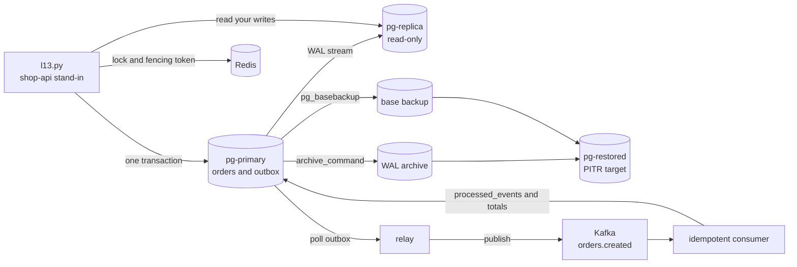
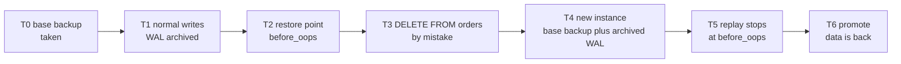

# L13 Capstone — Postgres, Redis and Kafka under failure

> **Level 13: Databases & Distributed Systems** · Capstone · ⏱ ~12 hours

## 1. Goal and outcome

Build a small but real data platform for the `shop-api` sample app on your laptop, then **break it on purpose** and prove you understand what happens:

- **PostgreSQL primary + streaming replica**, with WAL archiving and a base backup.
- **Redis** for caching and a fenced distributed lock.
- **Kafka** (KRaft mode, one broker) fed through a **transactional outbox**, with an **idempotent consumer**.
- Three demonstrations the roadmap asks for: **replication lag** (and a read-your-writes fix), an **idempotent consumer** that survives duplicate delivery, and a **point-in-time recovery (PITR) restore** that undoes a destructive `DELETE`.

When you finish you will have exercised all 15 topics of Level 13, a repeatable lab, and evidence (command output) for each claim.

| Topics exercised | Where |
|------------------|-------|
| [01 Indexes](01-postgresql-indexes.md), [03 MVCC](03-mvcc.md), [11 Partitioning](11-partitioning-and-sharding.md) | Milestone 1 |
| [04 Replication](04-replication.md), [13 Eventual consistency](13-eventual-consistency.md), [10 Scaling](10-horizontal-and-vertical-scaling.md) | Milestone 2 |
| [07 Redis](07-redis.md), [15 Locks and queues](15-distributed-locks-and-queues.md) | Milestone 3 |
| [08 Kafka](08-kafka.md), [14 Idempotency](14-idempotency.md), [02 Transactions](02-transactions-and-locks.md), [09 RabbitMQ](09-rabbitmq.md) | Milestone 4 |
| [05 Backups and PITR](05-backups-and-pitr.md) | Milestone 5 |
| [12 CAP](12-cap-theorem-and-consistency.md), [06 Connection pooling](06-db-connection-pooling.md) | Milestone 6 |

## 2. Architecture



The life of one order, and the PITR timeline that rescues you from a bad delete:



## 3. Prerequisites and cost

- **Cost:** free. Everything runs in containers on your machine; no cloud account is needed.
- **Machine:** 8 GB RAM free recommended, about 5 GB disk, Docker with Compose v2, Python 3.9+, `psql` client (optional but handy).
- **Python packages:** `pip install psycopg2-binary redis confluent-kafka`.
- **Prior reading:** the topic files linked above; you can do the capstone with the guides open.
- **Verification note:** the SQL, WAL archiving and PITR settings, lag measurement, the Python script, the Redis commands and the Kafka commands in this capstone were run
  natively on PostgreSQL 16.15, Redis 7.0.15, Apache Kafka 3.9.0 (KRaft) and Python 3.13 with psycopg2, redis-py and confluent-kafka 2.x. The Docker and Compose wrappers are the
  standard forms, but they were not run in the authoring sandbox (no Docker daemon), so container names, IP addresses, LSNs, timings and IDs in the sample output will differ ("similar to").
  All passwords are placeholders.

## 4. Build it step by step

### Milestone 0 — Start the lab

Create a working directory (`mkdir l13-lab && cd l13-lab`) and save this as `compose.yaml`:

```yaml
name: l13
services:
  init-volumes:                       # volumes are created root-owned; the postgres user has uid 999 in the official image
    image: busybox:1.36
    command: ["chown", "-R", "999:999", "/archive", "/backup"]
    volumes: ["pg-archive:/archive", "pg-backup:/backup"]
  pg-primary:
    image: postgres:16
    container_name: pg-primary
    depends_on:
      init-volumes: { condition: service_completed_successfully }
    environment:
      POSTGRES_PASSWORD: ${PG_PASSWORD:?export PG_PASSWORD first}
      POSTGRES_DB: shop
    command:
      - postgres
      - -c
      - wal_level=replica
      - -c
      - max_wal_senders=10
      - -c
      - max_replication_slots=10
      - -c
      - wal_log_hints=on
      - -c
      - archive_mode=on
      - -c
      - archive_command=test ! -f /archive/%f && cp %p /archive/%f
    ports: ["127.0.0.1:5432:5432"]
    volumes: ["pg-primary-data:/var/lib/postgresql/data", "pg-archive:/archive", "pg-backup:/backup"]
  redis:
    image: redis:7
    container_name: redis
    ports: ["127.0.0.1:6379:6379"]
  kafka:
    image: apache/kafka:3.9.0         # single-node KRaft broker, advertises localhost:9092
    container_name: kafka
    ports: ["127.0.0.1:9092:9092"]
networks:
  default:
    name: l13net
volumes:
  pg-primary-data:
  pg-archive:
  pg-backup:
```

```bash
export PG_PASSWORD=<YOUR_PASSWORD>
docker compose up -d
docker exec pg-primary pg_isready -U postgres -d shop
docker exec redis redis-cli ping
docker exec kafka /opt/kafka/bin/kafka-topics.sh --bootstrap-server localhost:9092 --list    # empty list, no error
```

Expect `accepting connections`, `PONG`, and no error from Kafka (the broker may need ~15 seconds on first start).

Now the schema. Save as `schema.sql` and load it:

```sql
CREATE TABLE orders (
  id          bigserial PRIMARY KEY,
  customer_id int NOT NULL,
  item        text NOT NULL,
  created_at  timestamptz NOT NULL DEFAULT now()
);
CREATE TABLE outbox (                       -- Milestone 4: events written in the same transaction as the order
  id           bigserial PRIMARY KEY,
  event_id     uuid NOT NULL DEFAULT gen_random_uuid(),
  topic        text NOT NULL,
  payload      jsonb NOT NULL,
  created_at   timestamptz NOT NULL DEFAULT now(),
  published_at timestamptz
);
CREATE TABLE processed_events (             -- Milestone 4: the consumer's dedup table (inbox)
  event_id     uuid PRIMARY KEY,
  processed_at timestamptz NOT NULL DEFAULT now()
);
CREATE TABLE order_totals (
  customer_id int PRIMARY KEY,
  orders_seen int NOT NULL DEFAULT 0
);
```

```bash
docker exec -i pg-primary psql -U postgres -d shop < schema.sql
```

### Milestone 1 — Indexes, MVCC and partitioning (topics 01, 03, 11)

```bash
psqlp() { docker exec -i pg-primary psql -U postgres -d shop "$@"; }     # helper used in the next milestones
psqlp -c "INSERT INTO orders (customer_id, item) SELECT (random()*10000)::int, 'item-' || g FROM generate_series(1, 300000) g" -c "ANALYZE orders"
psqlp -c "EXPLAIN (ANALYZE, COSTS OFF, TIMING OFF) SELECT * FROM orders WHERE customer_id = 4242"
```

Expect a `Seq Scan` (possibly parallel) that removes about 300,000 rows by filter and runs in roughly 10-50 ms. Create the index and ask again:

```bash
psqlp -c "CREATE INDEX orders_customer_id_idx ON orders (customer_id)"
psqlp -c "EXPLAIN (ANALYZE, COSTS OFF, TIMING OFF) SELECT * FROM orders WHERE customer_id = 4242"
```

```text
 Bitmap Heap Scan on orders (actual rows=35 loops=1)
   Recheck Cond: (customer_id = 4242)
   Heap Blocks: exact=34
   ->  Bitmap Index Scan on orders_customer_id_idx (actual rows=35 loops=1)
         Index Cond: (customer_id = 4242)
 Execution Time: 0.256 ms
```

Now see MVCC (an `UPDATE` writes a *new row version*, it does not overwrite):

```bash
psqlp -c "SELECT ctid, xmin, xmax FROM orders WHERE id = 1" -c "UPDATE orders SET item = 'changed' WHERE id = 1" -c "SELECT ctid, xmin, xmax FROM orders WHERE id = 1"
```

The row's `ctid` (physical location) and `xmin` (creating transaction) change, e.g. `(0,1)` and `818` become `(2205,121)` and `821`. The old version is a dead tuple until `VACUUM`.

Finally, partition a time-series table so old data can be dropped instantly:

```bash
psqlp <<'SQL'
CREATE TABLE page_views (id bigserial, viewed_at timestamptz NOT NULL, path text NOT NULL, PRIMARY KEY (id, viewed_at)) PARTITION BY RANGE (viewed_at);
CREATE TABLE page_views_2026_09 PARTITION OF page_views FOR VALUES FROM ('2026-09-01') TO ('2026-10-01');
CREATE TABLE page_views_2026_10 PARTITION OF page_views FOR VALUES FROM ('2026-10-01') TO ('2026-11-01');
INSERT INTO page_views (viewed_at, path) SELECT '2026-09-01'::timestamptz + (g || ' minutes')::interval, '/p/' || (g % 50) FROM generate_series(1, 80000) g;
ANALYZE page_views;
EXPLAIN (COSTS OFF) SELECT count(*) FROM page_views WHERE viewed_at >= '2026-10-05' AND viewed_at < '2026-10-06';
SQL
```

The plan scans only `page_views_2026_10` (partition pruning). Retention is then `ALTER TABLE page_views DETACH PARTITION page_views_2026_09; DROP TABLE page_views_2026_09;`, instant, with no `DELETE` and no bloat.

### Milestone 2 — Replica, lag and read-your-writes (topics 04, 13, 10)

Create the replication role, allow it in `pg_hba.conf`, and seed a standby with `pg_basebackup` (same method as [Replication](04-replication.md)):

```bash
docker exec pg-primary psql -U postgres -c "CREATE ROLE replicator WITH REPLICATION LOGIN PASSWORD '<REPL_PASSWORD>';"
docker exec pg-primary bash -c "echo 'host replication replicator all scram-sha-256' >> /var/lib/postgresql/data/pg_hba.conf"
docker exec pg-primary psql -U postgres -c "SELECT pg_reload_conf();"
docker volume create pg-replica-data
docker run --rm --network l13net --user postgres -e PGPASSWORD=<REPL_PASSWORD> \
  -v pg-replica-data:/var/lib/postgresql/data postgres:16 \
  pg_basebackup -h pg-primary -U replicator -D /var/lib/postgresql/data -R -C -S replica1 -X stream -c fast -P
docker run -d --name pg-replica --network l13net -p 127.0.0.1:5433:5432 -v pg-replica-data:/var/lib/postgresql/data postgres:16
sleep 5
docker exec pg-primary psql -U postgres -x -c "SELECT application_name, state, sync_state, replay_lag FROM pg_stat_replication;"
```

```text
application_name | walreceiver
state            | streaming
sync_state       | async
replay_lag       | 00:00:00.000249
```

(`application_name` is `walreceiver` unless you set one in `primary_conninfo`; the slot is `replica1`.) The replica is read-only and in recovery:

```bash
docker exec pg-replica psql -U postgres -d shop -c "SELECT pg_is_in_recovery();" -c "SELECT count(*) FROM orders;"
```

Now save the lab script as `l13.py` (it is used by Milestones 2-4). Set the connection strings first (replace the placeholder password):

```bash
export PRIMARY_DSN="postgresql://postgres:<YOUR_PASSWORD>@127.0.0.1:5432/shop"
export REPLICA_DSN="postgresql://postgres:<YOUR_PASSWORD>@127.0.0.1:5433/shop"
```

```python
#!/usr/bin/env python3
"""L13 capstone lab: outbox relay, idempotent consumer, lag probe, fenced Redis lock."""
import json, os, sys, time, uuid
import psycopg2, redis
from confluent_kafka import Consumer, Producer

PRIMARY = os.getenv("PRIMARY_DSN", "postgresql://postgres:<YOUR_PASSWORD>@127.0.0.1:5432/shop")
REPLICA = os.getenv("REPLICA_DSN", "postgresql://postgres:<YOUR_PASSWORD>@127.0.0.1:5433/shop")
KAFKA = os.getenv("KAFKA", "127.0.0.1:9092")
TOPIC = "orders.created"
R = redis.Redis.from_url(os.getenv("REDIS_URL", "redis://127.0.0.1:6379/0"), decode_responses=True)


def order(customer_id, item):
    """Outbox pattern: the order row and the event row commit atomically."""
    with psycopg2.connect(PRIMARY) as c, c.cursor() as cur:
        cur.execute("INSERT INTO orders (customer_id, item) VALUES (%s, %s) RETURNING id", (customer_id, item))
        oid = cur.fetchone()[0]
        cur.execute("INSERT INTO outbox (topic, payload) VALUES (%s, %s)",
                    (TOPIC, json.dumps({"order_id": oid, "customer_id": customer_id, "item": item})))
    with psycopg2.connect(PRIMARY) as c, c.cursor() as cur:   # AFTER the commit: LSN at or beyond our commit record
        cur.execute("SELECT pg_current_wal_lsn()")
        return oid, cur.fetchone()[0]


def relay():
    """Publish unpublished outbox rows. A crash after publish but before UPDATE re-sends them: at-least-once."""
    p = Producer({"bootstrap.servers": KAFKA, "enable.idempotence": True})
    with psycopg2.connect(PRIMARY) as c, c.cursor() as cur:
        cur.execute("SELECT id, event_id, payload FROM outbox WHERE published_at IS NULL "
                    "ORDER BY id LIMIT 100 FOR UPDATE SKIP LOCKED")
        rows = cur.fetchall()
        for _id, event_id, payload in rows:
            p.produce(TOPIC, key=str(payload["customer_id"]), value=json.dumps(payload),
                      headers=[("event_id", str(event_id).encode())])
        p.flush()
        cur.execute("UPDATE outbox SET published_at = now() WHERE id = ANY(%s)", ([r[0] for r in rows],))
    print(f"relayed {len(rows)} events")


def handle(conn, event_id, payload):
    """Idempotent handler: dedup row and business effect share ONE transaction."""
    with conn.cursor() as cur:
        cur.execute("INSERT INTO processed_events (event_id) VALUES (%s) ON CONFLICT DO NOTHING", (event_id,))
        if cur.rowcount == 0:
            conn.commit()
            return "duplicate-skipped"
        cur.execute("INSERT INTO order_totals (customer_id, orders_seen) VALUES (%s, 1) "
                    "ON CONFLICT (customer_id) DO UPDATE SET orders_seen = order_totals.orders_seen + 1",
                    (payload["customer_id"],))
    conn.commit()
    return "applied"


def consume(max_idle=10):
    c = Consumer({"bootstrap.servers": KAFKA, "group.id": "totals", "auto.offset.reset": "earliest",
                  "enable.auto.commit": False})
    c.subscribe([TOPIC])
    conn, idle, seen = psycopg2.connect(PRIMARY), 0, {"applied": 0, "duplicate-skipped": 0}
    while idle < max_idle:
        m = c.poll(1.0)
        if m is None or m.error():
            idle += 1
            continue
        idle = 0
        event_id = dict(m.headers())["event_id"].decode()
        seen[handle(conn, event_id, json.loads(m.value()))] += 1
        c.commit(message=m)          # offset commit AFTER the database commit
    c.close()                        # leave the group cleanly so the next run does not wait for a session timeout
    print(seen)


def lag_probe(customer_id=999):
    oid, lsn = order(customer_id, "probe")
    with psycopg2.connect(REPLICA) as r, r.cursor() as cur:
        cur.execute("SELECT count(*) FROM orders WHERE id = %s", (oid,))
        print("naive replica read sees row:", cur.fetchone()[0] == 1)
        t0 = time.time()
        while True:                  # read-your-writes: wait until the replica replayed past our LSN
            cur.execute("SELECT pg_wal_lsn_diff(pg_last_wal_replay_lsn(), %s) >= 0", (lsn,))
            if cur.fetchone()[0]:
                break
            time.sleep(0.05)
        cur.execute("SELECT count(*) FROM orders WHERE id = %s", (oid,))
        print(f"after waiting {time.time()-t0:.2f}s replica sees row:", cur.fetchone()[0] == 1)


RELEASE = "if redis.call('get',KEYS[1])==ARGV[1] then return redis.call('del',KEYS[1]) else return 0 end"


def lock_demo():
    with psycopg2.connect(PRIMARY) as c, c.cursor() as cur:
        cur.execute("CREATE TABLE IF NOT EXISTS job_state (id int PRIMARY KEY, fence bigint NOT NULL, data text)")
        cur.execute("INSERT INTO job_state VALUES (1, 0, NULL) ON CONFLICT DO NOTHING")

    def acquire(name):
        token = str(uuid.uuid4())
        if R.set("lock:job", token, nx=True, px=1000):       # 1 s lease
            return token, R.incr("fence:job")                # fencing token: strictly increasing
        return None, None

    def write(name, fence):
        with psycopg2.connect(PRIMARY) as c, c.cursor() as cur:
            cur.execute("UPDATE job_state SET fence=%s, data=%s WHERE id=1 AND fence < %s", (fence, name, fence))
            print(f"{name}: write with fence {fence} ->", "ACCEPTED" if cur.rowcount else "REJECTED (stale)")

    ta, fa = acquire("A"); print("A holds lock, fence", fa)
    time.sleep(1.2)                                          # A pauses (GC, VM stall) and its lease expires
    tb, fb = acquire("B"); print("B holds lock, fence", fb)
    write("B", fb)
    write("A", fa)                                           # A wakes up and still believes it holds the lock
    print("A release:", R.eval(RELEASE, 1, "lock:job", ta), "(0 = lock was not ours any more)")
    print("B release:", R.eval(RELEASE, 1, "lock:job", tb))


if __name__ == "__main__":
    cmd, args = sys.argv[1], sys.argv[2:]
    {"order": lambda: print(order(int(args[0]), args[1])), "relay": relay, "consume": consume,
     "lag": lag_probe, "lock": lock_demo}[cmd]()
```

**Demonstrate replication lag.** Freeze replay on the replica, write on the primary, and compare:

```bash
docker exec pg-replica psql -U postgres -c "SELECT pg_wal_replay_pause();"
docker exec pg-primary psql -U postgres -d shop -c "INSERT INTO orders (customer_id, item) SELECT 7, 'widget' FROM generate_series(1,1000);"
docker exec pg-primary psql -U postgres -d shop -c "SELECT application_name, pg_size_pretty(pg_wal_lsn_diff(pg_current_wal_lsn(), replay_lsn)) AS replay_gap FROM pg_stat_replication;"
docker exec pg-replica psql -U postgres -d shop -c "SELECT pg_last_wal_receive_lsn() > pg_last_wal_replay_lsn() AS received_not_applied;" \
  -c "SELECT now() - pg_last_xact_replay_timestamp() AS apparent_lag;"
```

The primary reports a replay gap of some KB (it was 161 kB in the authoring run), and the standby says `received_not_applied = t`: the WAL has arrived but is not applied, so reads are stale. Then run the lag probe
while a background command ends the pause after three seconds:

```bash
( sleep 3; docker exec pg-replica psql -U postgres -c "SELECT pg_wal_replay_resume();" >/dev/null ) &
python3 l13.py lag
```

```text
naive replica read sees row: False
after waiting 2.84s replica sees row: True
```

The first line is the stale read (a user would see "order not found"). The second is **read-your-writes**: the script recorded the primary's WAL position (LSN) *after* its commit and waited until the replica replayed past it.
With replay running normally, both lines say `True` and the wait is near 0.00 s.

### Milestone 3 — Redis: cache and a fenced lock (topics 07, 15)

Cache-aside with a TTL, the cheapest form of horizontal read scaling:

```bash
docker exec redis redis-cli SET order:1 '{"id":1,"item":"widget"}' EX 30
docker exec redis redis-cli GET order:1
docker exec redis redis-cli TTL order:1            # counts down from 30
```

Now the lock demo: worker A takes a one-second lease, stalls for 1.2 seconds, worker B takes the lock, and both write to a database row that accepts only increasing fencing tokens:

```bash
python3 l13.py lock
```

```text
A holds lock, fence 1
B holds lock, fence 2
B: write with fence 2 -> ACCEPTED
A: write with fence 1 -> REJECTED (stale)
A release: 0 (0 = lock was not ours any more)
B release: 1
```

(On a repeat run the fence numbers keep increasing.) The lock did not protect the data; the **fencing token checked by the database** did. See the [Distributed Locks and Queues](15-distributed-locks-and-queues.md) discussion of leases.

### Milestone 4 — Kafka, outbox and an idempotent consumer (topics 08, 14, 15, 02)

```bash
docker exec kafka /opt/kafka/bin/kafka-topics.sh --bootstrap-server localhost:9092 --create --topic orders.created --partitions 3
for i in 1 2 3 4 5; do python3 l13.py order $((i % 2 + 1)) widget$i; done     # each prints (order_id, lsn)
python3 l13.py relay
python3 l13.py consume
docker exec pg-primary psql -U postgres -d shop -c "SELECT * FROM order_totals ORDER BY 1" -c "SELECT count(*) AS processed FROM processed_events"
```

Expect `relayed 5 events`, then `{'applied': 5, 'duplicate-skipped': 0}`, then totals that add up to the number of orders (for example `orders_seen` of 2 and 3) and `processed = 5`. (A harmless librdkafka warning about the idempotence PID being retried can appear on the first publish.)

Each `order` call wrote the order and the outbox row in **one transaction**, so there is never an event without an order or an order without an event. The relay publishes with the `event_id` as a header; the consumer commits its dedup row and business effect together, and commits the Kafka offset only afterwards.

**Now simulate the crash window:** the relay "forgot" it published (as if it died before its `UPDATE`), so it publishes the same five events again:

```bash
docker exec pg-primary psql -U postgres -d shop -c "UPDATE outbox SET published_at = NULL"
python3 l13.py relay
python3 l13.py consume
docker exec pg-primary psql -U postgres -d shop -c "SELECT * FROM order_totals ORDER BY 1" -c "SELECT count(*) AS processed FROM processed_events"
```

```text
relayed 5 events
{'applied': 0, 'duplicate-skipped': 5}
```

The totals and `processed = 5` are **unchanged**: five duplicate deliveries, zero duplicate effects. If the consumer prints nothing for about a minute, a previous consumer in the same group exited without leaving it and the group is waiting out its session timeout; run it again after a minute (the script now closes its consumer cleanly to avoid this).

### Milestone 5 — Backups and point-in-time recovery (topic 05)

The primary already archives every finished WAL segment to the `pg-archive` volume (`archive_mode=on`). Take a base backup, make some changes, set a named restore point, then destroy the table:

```bash
docker exec -u postgres pg-primary pg_basebackup -U postgres -D /backup/base1 -X stream -c fast
docker exec pg-primary psql -U postgres -d shop -c "INSERT INTO orders (customer_id, item) SELECT 100+g, 'late-order' FROM generate_series(1,50) g;"
docker exec pg-primary psql -U postgres -d shop -Atc "SELECT count(*) FROM orders;"                  # note this number (about 301056 if you followed every step)
docker exec pg-primary psql -U postgres -d shop -c "SELECT pg_create_restore_point('before_oops');"
docker exec pg-primary psql -U postgres -d shop -c "DELETE FROM orders;"                              # the mistake
docker exec pg-primary psql -U postgres -d shop -c "SELECT pg_switch_wal();"                          # force the last segment into the archive
sleep 3
docker exec pg-primary psql -U postgres -d shop -Atc "SELECT count(*) FROM orders;"                  # 0
```

(`DELETE FROM orders` also removes the rows from the replica within moments, so the replica is *not* a backup.) Now restore into a **new** volume with a recovery target, leaving the damaged primary untouched:

```bash
docker volume create pg-restored
cat > recovery-snippet.conf <<'CFG'
restore_command = 'cp /archive/%f %p'
recovery_target_name = 'before_oops'
recovery_target_action = 'promote'
CFG
docker run --rm --user root -v pg-backup:/backup:ro -v pg-restored:/restore -v "$PWD/recovery-snippet.conf:/snippet:ro" postgres:16 \
  bash -c 'cp -a /backup/base1/. /restore/ && cat /snippet >> /restore/postgresql.conf && touch /restore/recovery.signal && chown -R postgres:postgres /restore && chmod 700 /restore'
docker run -d --name pg-restored --network l13net -v pg-restored:/var/lib/postgresql/data -v pg-archive:/archive:ro postgres:16
sleep 8
docker exec pg-restored psql -U postgres -d shop -c "SELECT count(*) AS orders_restored FROM orders;" -c "SELECT pg_is_in_recovery();"
docker logs pg-restored 2>&1 | grep -E "restored log file|recovery stopping|promote"
```

```text
 orders_restored
-----------------
          301056
 pg_is_in_recovery
-------------------
 f
... LOG:  restored log file "000000010000000000000004" from archive
... LOG:  recovery stopping at restore point "before_oops", time ...
```

The restored instance replayed archived WAL on top of the base backup, **stopped exactly at the named restore point**, and was promoted. Every row from before the `DELETE` is back, including the 50 `late-order` rows written *after* the backup was taken. That is the difference between a restore and a point-in-time restore. (In a real incident you would then copy the lost rows back to the primary, or switch traffic to the restored instance.)

### Milestone 6 — Break it: CAP and pooling (topics 12, 06)

**Choose consistency over availability.** Make the primary wait for a standby on every commit, then take the standby away:

```bash
docker exec pg-primary psql -U postgres -c "ALTER SYSTEM SET synchronous_standby_names = 'ANY 1 (*)';" -c "SELECT pg_reload_conf();"
docker exec pg-primary psql -U postgres -c "SELECT application_name, sync_state FROM pg_stat_replication;"      # sync_state = quorum
docker stop pg-replica
timeout 5 docker exec pg-primary psql -U postgres -d shop -c "INSERT INTO orders (customer_id, item) VALUES (1,'hang');"; echo "exit=$?"
docker exec pg-primary psql -U postgres -c "SELECT wait_event, left(query,30) FROM pg_stat_activity WHERE wait_event = 'SyncRep';"
```

The insert does not return (`exit=124` from `timeout`), and `wait_event = SyncRep` shows the commit waiting for the standby: this is the **CP choice**, refusing to acknowledge a write that exists on only one machine. Restore availability:

```bash
docker start pg-replica
docker exec pg-primary psql -U postgres -c "ALTER SYSTEM RESET synchronous_standby_names;" -c "SELECT pg_reload_conf();"
```

**Connection pooling.** PgBouncer (`sudo apt-get install pgbouncer`, or `brew install pgbouncer`) multiplexes many client connections onto a few server connections. Save as `pgbouncer.ini` and adjust the password:

```ini
[databases]
shop = host=127.0.0.1 port=5432 dbname=shop user=postgres password=<YOUR_PASSWORD>

[pgbouncer]
listen_addr = 127.0.0.1
listen_port = 6432
auth_type = trust
auth_file = userlist.txt
pool_mode = transaction
default_pool_size = 5
max_client_conn = 200
admin_users = postgres
```

```bash
echo '"postgres" ""' > userlist.txt            # lab only: trust auth on a loopback listener
pgbouncer -d pgbouncer.ini
for i in $(seq 1 60); do psql -h 127.0.0.1 -p 6432 -U postgres -d shop -qAtc "SELECT pg_sleep(1)" & done; sleep 1.5
psql -h 127.0.0.1 -p 6432 -U postgres -d pgbouncer -c "SHOW POOLS"
wait
```

Sixty clients ran at once, but `SHOW POOLS` shows `sv_active = 5` and most clients in `cl_waiting`: only five real PostgreSQL backends were used (the pooled run in the authoring sandbox showed 5 active servers and about 50 waiting clients).
`auth_type = trust` and the empty userlist password are for a loopback-only lab; use `scram-sha-256` and a real userlist in any shared environment.

## 5. Tasks

- [ ] **T1 — Index and read the plan** *(≈30 min, beginner; topics 01, 03)*
  - **Goal:** prove an index changes the plan and the time, and see an MVCC row version move.
  - **Steps:**
    1. Run Milestone 1 `EXPLAIN (ANALYZE)` before and after `CREATE INDEX`.
    2. Run the `ctid`/`xmin` query around an `UPDATE`.
    3. Run `VACUUM (VERBOSE) orders` and find the removed dead row versions in the output.
  - **Done when:** you have both plans with their execution times, and can say why `ctid` changed.

- [ ] **T2 — Provoke a lock wait and a deadlock** *(≈40 min, intermediate; topic 02)*
  - **Goal:** observe row locks in `pg_stat_activity`/`pg_locks`, then break it.
  - **Steps:**
    1. In session 1: `BEGIN; UPDATE orders SET item='a' WHERE id=2;` (leave open). In session 2: `UPDATE orders SET item='b' WHERE id=2;` and watch it hang; from a third session query `pg_stat_activity` for `wait_event_type = 'Lock'`.
    2. Create a deadlock by updating rows 2 and 3 in opposite order in the two sessions.
    3. Rewrite the outbox claim with `FOR UPDATE SKIP LOCKED` (already in `relay()`) and show two relays running in parallel never block each other.
  - **Done when:** you captured the waiting query, the PostgreSQL `deadlock detected` error, and two relay runs that claim disjoint rows.

- [ ] **T3 — Partition and retire data** *(≈30 min, intermediate; topic 11)*
  - **Goal:** use pruning and drop a month instantly.
  - **Steps:**
    1. Do the partition step in Milestone 1 and confirm pruning with `EXPLAIN`.
    2. Detach and drop the oldest partition and note the elapsed time versus `DELETE FROM page_views WHERE viewed_at < '2026-10-01'` on a copy.
    3. Explain which Kafka mechanism plays the same role as a shard key for `orders.created` (hint: the message key and partition count).
  - **Done when:** you have the pruned plan, both timings, and a one-sentence answer for Kafka.

- [ ] **T4 — Measure and fix replication lag** *(≈45 min, intermediate; topics 04, 13, 10)*
  - **Goal:** quantify lag and make a feature read-your-writes safe.
  - **Steps:**
    1. Run the pause, write and `lag` sequence from Milestone 2.
    2. Change the pause length to 1 s and 6 s and record the "after waiting" time each time.
    3. Add a 0.5 s timeout to the wait loop in `lag_probe` that falls back to reading the primary, and show it taking the fallback on the 6 s run.
    4. Write down which `shop-api` reads may go to the replica (product listing) and which may not (order confirmation).
  - **Done when:** you have three timings that track your pause lengths and a working fallback.

- [ ] **T5 — Duplicate delivery, zero duplicate effects** *(≈45 min, advanced; topics 08, 14, 15)*
  - **Goal:** prove the consumer is idempotent under redelivery and under a crash.
  - **Steps:**
    1. Run the Milestone 4 flow, then reset `published_at` and re-relay three times.
    2. Add `os._exit(1)` in `consume()` after `handle(...)` but before `c.commit(...)`; run it, then remove the line and run again.
    3. Compare `order_totals` with the true event counts: `SELECT (payload->>'customer_id')::int AS customer_id, count(*) FROM outbox GROUP BY 1 ORDER BY 1`.
  - **Done when:** the totals equal the true order counts after all duplicates and the crash, and you can show the `duplicate-skipped` count.

- [ ] **T6 — Redis lock under pressure, then a cache failure** *(≈40 min, advanced; topics 07, 12, 15)*
  - **Goal:** connect locks, fencing and the cache's consistency limits.
  - **Steps:**
    1. Run `python3 l13.py lock` twice and explain why the fencing numbers grow.
    2. Change the lease to 5 s (`px=5000`) and remove the stall; confirm B is now refused (add a guard for `None`) and no write is rejected.
    3. Update an order in Postgres but not in Redis and read the stale cache entry; fix it with delete-on-write.
  - **Done when:** you have output for the stalled and non-stalled runs and a stale-then-fresh cache read.

- [ ] **T7 — Run the PITR drill and time it** *(≈60 min, advanced; topic 05)*
  - **Goal:** recover to a named point and to a timestamp.
  - **Steps:**
    1. Repeat Milestone 5 and time it from "oops" to a verified row count.
    2. Redo the restore into a fresh volume with `recovery_target_time = '<timestamp just before the DELETE>'` instead of the named point (record the time with `SELECT now()` before deleting).
    3. Write down your measured recovery time and the data you could lose (the RPO) if the archive had stopped five minutes earlier.
  - **Done when:** both recovery targets bring the count back and you have a measured restore time in minutes.

- [ ] **T8 — Take away the standby, then the pooler** *(≈45 min, advanced; topics 12, 06, 04)*
  - **Goal:** classify the stack and compare failure modes.
  - **Steps:**
    1. Do the synchronous commit experiment in Milestone 6 and capture `SyncRep`.
    2. Switch to `ANY 1 (*)` with a second replica (add another `pg_basebackup` standby) and show that stopping one standby no longer blocks commits.
    3. Run the PgBouncer experiment and compare backend counts with and without the pooler (`SELECT count(*) FROM pg_stat_activity`).
  - **Done when:** you have the blocked-commit evidence, the unblocked run with two standbys, and the backend counts.

- [ ] **T9 — Swap Kafka for RabbitMQ** *(≈60 min, advanced; topic 09)*
  - **Goal:** keep the outbox and the idempotent consumer, change the broker, and see the different semantics.
  - **Steps:**
    1. Start `rabbitmq:3.13-management-alpine` as in [RabbitMQ](09-rabbitmq.md); declare a durable queue `orders.created`.
    2. Change `relay()` to publish persistent messages with the `event_id` as the message ID (publisher confirms on), and `consume()` to ack only after the database commit.
    3. Kill the consumer mid-message and watch the message be redelivered; confirm `order_totals` stays correct.
  - **Done when:** the redelivered message is a duplicate at the broker but not in `order_totals`, and you can state one difference between acks and Kafka offsets.

- [ ] **T10 — Prove it: break and explain the platform** *(≈90 min, advanced; all topics)*
  - **Goal:** demonstrate mastery without the guide.
  - **Steps:**
    1. Run the teardown, rebuild the whole lab from your saved files, and explain in writing what each of the three demonstrations (lag, idempotent consumer, PITR) proves.
    2. Kill Kafka (`docker stop kafka`) while creating five orders, bring it back, and show that no order is lost and no event is duplicated in `order_totals`.
    3. Write a half-page runbook: "primary is gone, replica is behind by 30 seconds": what you check, what you promote, what data you might have lost, and why.
  - **Done when:** a teammate can follow your runbook and your outputs show all three demonstrations working from a rebuilt lab.

## 6. Verification checklist

- [ ] `pg_stat_replication` shows `state = streaming` and the replica answers `pg_is_in_recovery() = t`.
- [ ] A replica read after a write returned stale data while replay was paused, and the LSN-gated read returned the row.
- [ ] The `orders` query switched from a sequential scan to an index scan after `CREATE INDEX`, and a partition-pruned plan touches one partition.
- [ ] Writing an order created exactly one `orders` row and one `outbox` row, and a rolled-back attempt created neither.
- [ ] After re-publishing the same five events, `order_totals` and `processed_events` did not change (`duplicate-skipped: 5`).
- [ ] `python3 l13.py lock` printed `REJECTED (stale)` for the stale writer.
- [ ] The restored instance returned the pre-`DELETE` row count, stopped at the `before_oops` restore point, and is no longer in recovery.
- [ ] A commit hung with `wait_event = SyncRep` while the only standby was down, and recovered when it came back.
- [ ] PgBouncer served 60 clients with about 5 server connections.
- [ ] You recorded a measured replication lag, restore time and queue/consumer lag (`kafka-consumer-groups.sh --describe --group totals`).

## 7. Teardown

```bash
pkill pgbouncer 2>/dev/null; rm -f userlist.txt pgbouncer.ini recovery-snippet.conf
docker rm -f pg-replica pg-restored 2>/dev/null
docker compose down -v                       # stops primary, Redis, Kafka and removes their volumes
docker volume rm pg-replica-data pg-restored 2>/dev/null
docker network rm l13net 2>/dev/null
unset PG_PASSWORD PRIMARY_DSN REPLICA_DSN
```

Check with `docker ps -a` and `docker volume ls` that nothing named `pg-*`, `redis` or `kafka` remains.

## 8. Stretch goals and what to learn next

- Replace the manual pause with a failure drill: kill `pg-primary`, promote `pg-replica` (`SELECT pg_promote();`), fence the old primary and rebuild it with `pg_rewind` (see [Replication](04-replication.md)).
- Add Patroni or Postgres operators for automatic failover, and observe the CAP trade-off in their health checks.
- Replace the polling relay with change data capture (Debezium's outbox event router).
- Add a Kafka consumer lag exporter and a replication-lag alert, then wire both into the dashboards from [Level 10](../level-10-observability/03-grafana-dashboards.md).
- Model a CRDT counter for page views across two regions and compare it with `order_totals` (see [Eventual Consistency](13-eventual-consistency.md)).
- Shard `orders` by `customer_id` with Citus or application-level routing and measure the cost of cross-shard queries ([Partitioning and Sharding](11-partitioning-and-sharding.md)).

**Next:** [Level 14 — Site Reliability Engineering](../level-14-sre/01-slis.md) turns lag, queue depth and restore time into SLIs, SLOs and error budgets, and
[Level 15 — Disaster Recovery](../level-15-disaster-recovery/01-backups.md) formalises the backup, failover and PITR drills you just ran into RPO/RTO targets and rehearsed procedures.

<!-- nav -->
---
← Previous: [Distributed Locks and Queues](15-distributed-locks-and-queues.md) · [Level 13 index](README.md) · Next level: [Level 14 — SRE](../level-14-sre/README.md) →
