# Level 13 — Databases & Distributed Systems

> **Goal:** Reason about data stores, messaging and distributed-systems trade-offs when operating production systems.

| | |
|---|---|
| **Recommended time** | 4-6 weeks |
| **Topics** | 15 |
| **Practice / capstone** | Run Postgres primary+replica, Redis and Kafka (or RabbitMQ) locally; demonstrate replication lag, an idempotent consumer and a PITR restore. |

## Topics

| # | Topic | What you will learn |
|---|-------|---------------------|
| 1 | [PostgreSQL Indexes](01-postgresql-indexes.md) | B-tree/GIN/partial, EXPLAIN ANALYZE, index cost |
| 2 | [Transactions and Locks](02-transactions-and-locks.md) | ACID, isolation levels, row/table locks, deadlocks |
| 3 | [MVCC](03-mvcc.md) | snapshots, xmin/xmax, vacuum, bloat, long-running transaction danger |
| 4 | [Replication](04-replication.md) | streaming replication, sync vs async, replicas, lag, failover tools |
| 5 | [Backups and Point-in-Time Recovery](05-backups-and-pitr.md) | pg_dump vs base backup + WAL, PITR, pgBackRest/WAL-G, restore drills |
| 6 | [Database Connection Pooling](06-db-connection-pooling.md) | PgBouncer modes, max_connections, pool sizing math |
| 7 | [Redis](07-redis.md) | data structures, caching patterns, persistence RDB/AOF, eviction, Sentinel/Cluster |
| 8 | [Kafka](08-kafka.md) | topics, partitions, consumer groups, offsets, retention, ordering |
| 9 | [RabbitMQ](09-rabbitmq.md) | exchanges, queues, acks, DLQ, vs Kafka |
| 10 | [Horizontal and Vertical Scaling](10-horizontal-and-vertical-scaling.md) | when each, stateless vs stateful, read replicas |
| 11 | [Partitioning and Sharding](11-partitioning-and-sharding.md) | table partitioning, shard keys, hotspots, resharding |
| 12 | [Consistency, Availability and the CAP Theorem](12-cap-theorem-and-consistency.md) | CAP/PACELC, linearizability, real systems classified |
| 13 | [Eventual Consistency](13-eventual-consistency.md) | convergence, read-your-writes, conflict resolution, CRDTs intro |
| 14 | [Idempotency](14-idempotency.md) | idempotency keys, at-least-once delivery, dedup, retries |
| 15 | [Distributed Locks and Queues](15-distributed-locks-and-queues.md) | Redis locks, fencing tokens, leases, work queues, outbox pattern |
| ★ | [Level capstone project](99-capstone-project.md) | Run Postgres primary+replica, Redis and Kafka (or RabbitMQ) locally; demonstrate replication lag, an idempotent consumer and a PITR restore. |

## How to work through this level

1. Read each topic in order: *what it is → why it matters → real-world example → diagram → guide*.
2. Do **every task** in the topic's *Tasks* section and tick the box (`- [x]`) in your own fork or notes.
3. Answer the *Self-check questions* without looking, then reveal the answers.
4. Finish with the **capstone project**, which combines all topics of the level.
5. Move on only when you can do the capstone's *Prove it* task without the guide.

## Topic flow

```mermaid
flowchart LR
    T1["1. PostgreSQL Indexes"]
    T2["2. Transactions and Locks"]
    T3["3. MVCC"]
    T4["4. Replication"]
    T5["5. Backups and Point-in-Time Recovery"]
    T6["6. Database Connection Pooling"]
    T7["7. Redis"]
    T8["8. Kafka"]
    T9["9. RabbitMQ"]
    T10["10. Horizontal and Vertical Scaling"]
    T11["11. Partitioning and Sharding"]
    T12["12. Consistency, Availability and the CAP Theorem"]
    T13["13. Eventual Consistency"]
    T14["14. Idempotency"]
    T15["15. Distributed Locks and Queues"]
    CAP(["Capstone"])
    T1 --> T2 --> T3 --> T4 --> T5 --> T6 --> T7 --> T8 --> T9 --> T10 --> T11 --> T12 --> T13 --> T14 --> T15 --> CAP
```

---
← [Level 12 — Advanced Networking](../level-12-advanced-networking/README.md) · [Roadmap home](../README.md) · [Level 14 — SRE](../level-14-sre/README.md) →
