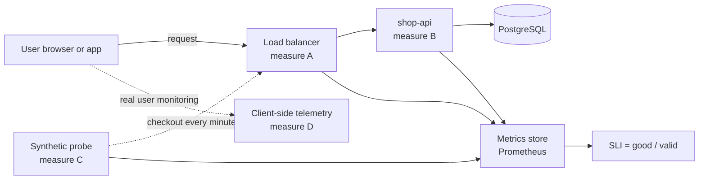
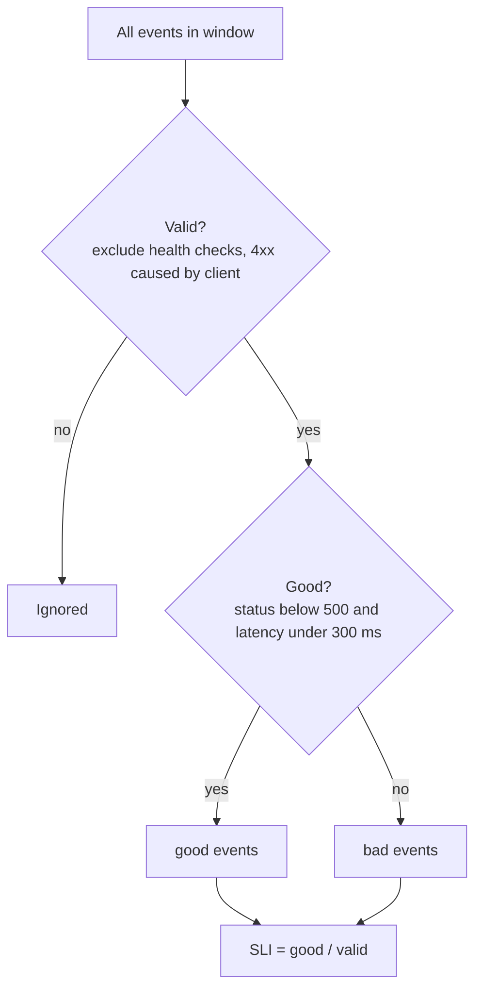

# L14.1 — Service Level Indicators (SLIs)

> **Level 14: SRE** · Topic 1 of 10 · ⏱ ~3 hours · Difficulty: Intermediate

## 1. What it is

A **Service Level Indicator (SLI)** is a quantitative measure of one aspect of how well a service is doing its job *from
the point of view of its users*. "CPU is at 70%" is not an SLI. "The proportion of checkout requests that returned a
correct answer in under 300 ms" is.

The definition used throughout Google's SRE literature (see *Site Reliability Engineering*, the chapter on Service Level
Objectives, and *The Site Reliability Workbook*, the chapter "Implementing SLOs") boils down to a single ratio:

```text
SLI = good events / valid events        (a number between 0 % and 100 %)
```

"Events" can be HTTP requests, messages processed, jobs run, or one-minute time slices. "Valid" excludes things that are
not the service's fault or not in scope (for example health checks, or requests rejected as `400` because the client sent garbage).
Expressing every SLI as a percentage makes it comparable, graphable, and directly usable by the next two topics:
[SLOs](02-slos.md) (the target for the SLI) and [error budgets](04-error-budgets.md) (what is left of that target).

## 2. Why it matters in DevOps

- **It replaces opinions with numbers.** "The site felt slow yesterday" becomes "latency SLI was 97.1% against a 99% objective".
- **It points monitoring at users, not machines.** A server can be at 5% CPU and returning `500` to everyone; a server at 95% CPU
  can be perfectly healthy. Users only care about the outcome.
- **It is the foundation of the whole level.** Without a trustworthy SLI there is no SLO, no error budget, no burn-rate alert
  and no objective way to say "we are allowed to ship" or "we must stop and fix reliability".
- **Bad SLIs cause bad decisions.** An SLI that cannot see a failure mode (for example, measuring only at the app server while
  the load balancer is dropping connections) gives false confidence during real outages.

## 3. Real-world system example

**Google and its published SRE practice.** Google's SRE books describe SLIs as the starting point and recommend choosing a
small number of them per user journey, grouped by the type of system: for *request-driven* services availability, latency and
quality; for *data-processing pipelines* freshness, coverage, correctness and throughput; for *storage systems* latency,
availability and durability. The same books distinguish the SLI *specification* (what we want to measure, in words) from the
SLI *implementation* (the exact query and measurement point), a distinction worth copying.

**Google Cloud Monitoring** (a public product) exposes this model directly: you define an SLO on a **request-based** SLI (a ratio
of good to total requests) or a **windows-based** SLI (the fraction of time windows in which a threshold was met).

**AWS building blocks.** An Application Load Balancer publishes `RequestCount`, `HTTPCode_Target_5XX_Count` and
`TargetResponseTime` metrics to CloudWatch (see [ALB](../level-06-cloud-aws/14-alb.md)). Those are exactly the raw material for
an availability and latency SLI measured at the load balancer, which is why many teams choose that measurement point.

Open-source tools such as **Prometheus**, **Sloth** and **Pyrra** generate SLI recording rules and burn-rate alerts from a short
SLO definition, which shows how mechanical the ratio becomes once the specification is clear.

## 4. Diagram

How a user request becomes an SLI value, and the places you can measure it:



From raw events to a number:



## 5. How it works

### Choosing good SLIs

1. **List the user journeys**, not the components. For `shop-api`: browse catalogue, add to cart, checkout, view order.
2. **Pick 1-3 SLIs per journey** from the standard menu below. More than that and nobody remembers them.
3. **Write the specification in a sentence**, then the implementation as a query.
4. **Check it against a known bad day.** Replay a past incident through the SLI: would it have dropped? If not, it is the wrong SLI.

| Category | Specification (example) | Typical measurement |
|----------|-------------------------|---------------------|
| Availability | Proportion of valid requests served successfully (not `5xx`) | LB or app counters by status code |
| Latency | Proportion of valid requests served faster than a threshold | histogram buckets, a threshold not an average |
| Quality | Proportion of responses that are not degraded (for example served from fallback) | app counter with a `degraded` label |
| Freshness | Proportion of data updated within X minutes | timestamp of last successful pipeline run |
| Correctness | Proportion of records processed with the right result | reconciliation job output |
| Durability | Proportion of stored objects that can still be read back | periodic restore or integrity check |

Prefer **latency thresholds on a distribution** ("99% under 300 ms") over averages. An average hides the slow tail that users feel.

### Request-based vs window-based SLIs

| | Request-based | Window-based |
|---|---|---|
| Formula | good requests / total requests | good windows / total windows (for example 1-minute windows where p95 latency < 300 ms) |
| Strength | Weights by traffic: ten failed requests during a busy minute count more than ten during a quiet minute | Works when there is no natural "event" (a batch system, a probe) and is easy to explain |
| Weakness | A very quiet period carries little weight, so a 3 a.m. outage may barely dent the number | One failed request in an otherwise idle minute can make the whole window "bad" |
| Use for | HTTP APIs, queues | probes, uptime checks, low-traffic internal services |

### Measurement points (where to measure)

| Point | Sees | Misses |
|-------|------|--------|
| Application metrics | rich detail, easy to instrument | crashes before the app records anything, LB or network drops |
| Load balancer or ingress | what the user-facing edge returned, including `502`/`503`/`504` when the app is dead | detail of why, client-side problems |
| Synthetic probe (blackbox) | end to end including DNS and TLS, works at zero traffic | only the paths you probe, not real user mix |
| Client-side or real user monitoring | what the user really experienced, including ISP and CDN problems | noisy, depends on the client being able to report |
| Logs | can be reprocessed retroactively | latency of the signal, cost |

A common compromise: **load balancer metrics as the primary SLI, application metrics for diagnosis, a synthetic probe as a
cross-check**. See also [what to monitor](../level-10-observability/11-what-to-monitor.md) for the golden signals that these SLIs refine.

## 6. Step-by-step guide

**Prerequisites:** Docker and Docker Compose, about 1 GB RAM. We will create a tiny `shop-api` stand-in that exposes the metrics a
real Prometheus client would, and compute SLIs from them. Everything is local and free.

1. **Create the sample service** (Python standard library plus `prometheus_client`).
   ```bash
   mkdir -p ~/sre-lab/shop-api && cd ~/sre-lab/shop-api
   python3 -m venv .venv && . .venv/bin/activate
   pip install prometheus_client==0.20.0
   cat > app.py <<'EOF'
   import random, time
   from http.server import BaseHTTPRequestHandler, HTTPServer
   from prometheus_client import Counter, Histogram, start_http_server

   REQS = Counter("http_requests_total", "Requests", ["code", "route"])
   LAT = Histogram("http_request_duration_seconds", "Latency", ["route"],
                   buckets=(0.05, 0.1, 0.3, 0.5, 1, 2))

   class H(BaseHTTPRequestHandler):
       def do_GET(self):
           start = time.time()
           time.sleep(random.choice([0.02] * 90 + [0.4] * 8 + [1.2] * 2))   # a slow tail
           code = 500 if random.random() < 0.02 else 200                   # 2 % errors
           self.send_response(code); self.end_headers(); self.wfile.write(b"ok")
           REQS.labels(code=str(code), route="/checkout").inc()
           LAT.labels(route="/checkout").observe(time.time() - start)
       def log_message(self, *a): pass

   start_http_server(9100)           # metrics on :9100/metrics
   HTTPServer(("", 8080), H).serve_forever()
   EOF
   python app.py &
   ```
   Expect no output; the app listens on 8080 (traffic) and 9100 (metrics).

2. **Generate traffic.**
   ```bash
   for i in $(seq 1 500); do curl -s -o /dev/null localhost:8080/checkout; done
   curl -s localhost:9100/metrics | grep -E '^http_requests_total|^http_request_duration_seconds_(bucket|count)'
   ```
   You should see `http_requests_total{code="200",...}` near 490 and `code="500"` near 10 (random, so similar to, not identical).

3. **Compute the availability SLI by hand** from the counters (this is exactly what PromQL will do):
   ```bash
   curl -s localhost:9100/metrics | awk '
     /^http_requests_total/ { n=$NF; if ($0 ~ /code="5/) bad+=n; total+=n }
     END { printf "availability SLI = %.2f%% (%d good of %d)\n", 100*(total-bad)/total, total-bad, total }'
   ```
   Expected: roughly `98%`.

4. **Compute the latency SLI** (fraction of requests under 300 ms) from histogram buckets:
   ```bash
   curl -s localhost:9100/metrics | awk '
     /http_request_duration_seconds_bucket\{.*le="0.3"/ { fast=$NF }
     /http_request_duration_seconds_count/ { all=$NF }
     END { printf "latency SLI (<300ms) = %.2f%%\n", 100*fast/all }'
   ```
   Expected: roughly `90%` (the app sleeps 400 ms or 1.2 s in 10% of requests).

5. **Write the SLIs as PromQL** (you will use these in a real Prometheus in topic 4 and the capstone). The expressions below are the
   standard shape; `[5m]` is the window of the rate:
   ```promql
   # Availability SLI: good = not 5xx
   sum(rate(http_requests_total{route="/checkout", code!~"5.."}[5m]))
   /
   sum(rate(http_requests_total{route="/checkout"}[5m]))

   # Latency SLI: good = served in 300 ms or less
   sum(rate(http_request_duration_seconds_bucket{route="/checkout", le="0.3"}[5m]))
   /
   sum(rate(http_request_duration_seconds_count{route="/checkout"}[5m]))
   ```
   A histogram bucket boundary must exist at your threshold (here `0.3`) or the SLI cannot be computed exactly.

6. **Stop the app.** `kill %1` (and `deactivate`).

## 7. Real-world scenario

*Illustrative, not a documented incident.* The `shop-api` team measures availability only at the application: "fraction of requests
that returned `200`". For months it reads 99.97%. One Friday evening customers cannot check out, yet the dashboard is green.
The cause: a bad Nginx config reload made the proxy answer `502` for 40% of requests when it could not reach upstream pods, and
the app never saw those requests. The team replays the incident through their SLI and sees it would not have moved.

**Fix:** the primary SLI moves to the load balancer's response codes, plus a synthetic checkout probe every minute as a
cross-check. The next time the proxy misbehaves the SLI drops within a minute. **Lesson:** an SLI is only as honest as its
measurement point. Always ask "what failure modes can this number not see?"

## 8. Common mistakes and best practices

**Don't**

- Use resource metrics (CPU, memory, queue depth) as SLIs. They are causes or symptoms of causes, not user outcomes.
- Use averages for latency. Use a threshold on a percentile or histogram bucket instead.
- Count health checks, bots you intentionally block, or client `4xx` errors as "bad" (or as valid at all) without thinking.
- Define twenty SLIs. Nobody will watch them, and none will carry authority.
- Measure only where it is convenient. Check the measurement point against a real past outage.

**Do**

- Write each SLI as `good / valid` and keep the specification (words) separate from the implementation (query).
- Start with availability and latency for each critical user journey; add others when a real failure demands it.
- Measure at the edge (load balancer or ingress) and cross-check with a probe.
- Document exactly which requests are excluded and why.
- Keep the PromQL or query in version control next to the service.

## 9. Tasks

- [ ] **T1 — Compute an SLI from raw counters** *(≈30 min, beginner)*
  - **Goal:** see that an SLI is just good divided by valid.
  - **Steps:**
    1. Run the sample app from section 6 and send 500 requests.
    2. Run the `awk` availability command from step 3.
    3. Repeat after sending another 500 requests; note that the counters are cumulative.
  - **Done when:** you have two availability percentages and can explain why they differ slightly.

- [ ] **T2 — Specify SLIs for a user journey** *(≈30 min, beginner)*
  - **Goal:** practise writing a specification before an implementation.
  - **Steps:**
    1. Pick the `shop-api` journey "add to cart".
    2. Write two SLIs (availability and latency) as one-sentence specifications, listing valid and good events.
    3. State what is excluded from "valid" and why.
  - **Done when:** each SLI has a sentence of the form "the proportion of ... that ... within ...".

- [ ] **T3 — Change the threshold** *(≈30 min, intermediate)*
  - **Goal:** feel how the threshold changes the SLI.
  - **Steps:**
    1. Compute the latency SLI for the `0.1`, `0.3`, `0.5` and `1` buckets using the awk pattern in step 4.
    2. Tabulate the four results.
    3. Decide which threshold matches "feels fast" for a checkout and justify it.
  - **Done when:** you have a table with four percentages and a one-line justification.

- [ ] **T4 — Break the measurement point** *(≈45 min, intermediate)*
  - **Goal:** demonstrate an SLI that misses a failure.
  - **Steps:**
    1. Put Nginx in front of the app (`proxy_pass http://127.0.0.1:8080;` in a container or locally) and count requests in the app only.
    2. Stop the app and send 20 requests through Nginx; they return `502`.
    3. Compare the app-level SLI with the Nginx access log (`awk '{print $9}' access.log | sort | uniq -c`).
  - **Done when:** the app-level SLI is unchanged while the proxy log shows 20 `502`s, and you can explain which measurement point to trust.

- [ ] **T5 — Window-based version** *(≈45 min, advanced)*
  - **Goal:** compute a window-based SLI and compare it with the request-based one.
  - **Steps:**
    1. Write a script that curls `/checkout` once a second for 5 minutes, recording status and time.
    2. Group into 1-minute windows; a window is good if at least 95% of its requests were non-`5xx`.
    3. Compute good windows / total windows and the request-based SLI for the same data.
  - **Done when:** you have both numbers and a one-sentence explanation of why they differ.

- [ ] **T6 — Prove it: audit an SLI** *(≈45 min, advanced)*
  - **Goal:** critique an SLI without notes.
  - **Steps:**
    1. Take the SLI "average latency of `shop-api` is below 200 ms at the app server".
    2. In writing, list at least three failure modes it cannot see and a better SLI for each.
    3. Present it to a teammate or record yourself explaining it.
  - **Done when:** you have given three concrete failure modes and replacement specifications.

## 10. Self-check questions

1. Write the general form of an SLI. What goes in the denominator?
2. Why is "average latency under 200 ms" a poor SLI?
3. When would you choose a window-based SLI over a request-based one?
4. Name two measurement points and one failure each cannot see.
5. Why should CPU utilisation not be used as an SLI?

<details>
<summary>Answers</summary>

1. `good events / valid events`. The denominator is valid events: everything in scope, excluding things like health checks or client-caused errors.
2. Averages hide the slow tail; 5% of users can have a terrible experience while the mean looks fine. Use a threshold on a percentile or histogram bucket.
3. When there is no natural event stream (batch jobs, probes, very low-traffic services), or when you want to express "fraction of time the service was OK".
4. Application metrics miss failures before the app sees the request (proxy `502`s, dropped connections). A synthetic probe misses paths it does not exercise and the real traffic mix.
5. CPU is a resource and a cause, not a user outcome: users can be failing at low CPU and happy at high CPU.
</details>

## 11. Further reading

- *Site Reliability Engineering* (Google, free online) — chapters "Service Level Objectives" and "Monitoring Distributed Systems".
- *The Site Reliability Workbook* (Google, free online) — chapter "Implementing SLOs", including SLI specification vs implementation.
- *Implementing Service Level Objectives* by Alex Hidalgo (O'Reilly).
- Prometheus documentation (prometheus.io/docs) — histograms and `rate()`.
- See also: [Observability concepts](../level-00-what-devops-is/10-observability.md) and [Prometheus and PromQL](../level-10-observability/02-prometheus-and-promql.md).

<!-- nav -->
---
← Previous level: [Level 13 — Databases & Distributed Systems](../level-13-databases-distributed-systems/README.md) · [Level 14 index](README.md) · Next: [Service Level Objectives (SLOs)](02-slos.md) →
