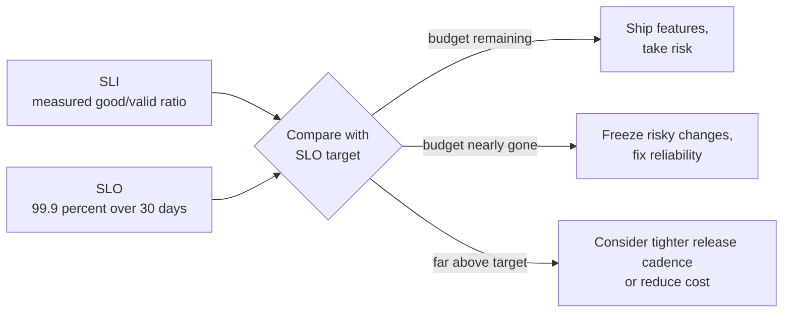
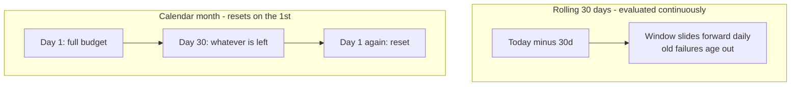

# L14.2 — Service Level Objectives (SLOs)

> **Level 14: SRE** · Topic 2 of 10 · ⏱ ~3 hours · Difficulty: Intermediate

## 1. What it is

A **Service Level Objective (SLO)** is a target value, or range of values, for an [SLI](01-slis.md) over a period of time.
Example: "99.9% of valid `shop-api` checkout requests succeed, measured over a rolling 30 days." The SLI is the measurement;
the SLO is the promise you make to yourself about that measurement.

The SLO also defines how much unreliability is *acceptable*. A 99.9% objective means 0.1% of events are allowed to be bad;
that allowance is the [error budget](04-error-budgets.md). Google's SRE books make the point that 100% is the wrong target for
almost everything: it is unattainable (the user's own phone and ISP are not 100% reliable), and each extra "nine" costs
disproportionately more in engineering effort and slows down feature delivery.

## 2. Why it matters in DevOps

- **It ends the "reliability vs features" argument.** Product and engineering agree on a number in advance, and the data
  decides when to slow down or speed up.
- **It sets alert thresholds.** Pages should fire when the SLO is genuinely at risk, not when a graph looks scary (see
  [alert fatigue reduction](08-alert-fatigue-reduction.md)).
- **It controls cost.** Going from 99.9% to 99.99% typically means multi-region redundancy, more on-call load and slower releases.
  An SLO that is too tight wastes money; one that is too loose loses customers.
- **It gives dependencies a contract.** Your service cannot be more available than the things it hard-depends on.

## 3. Real-world system example

**Google** popularised the practice: its SRE books describe setting SLOs per user journey, keeping them deliberately slightly
looser than what users really need, and using internal SLOs that are tighter than any published agreement. *The Site
Reliability Workbook* includes a worked example of an SLO document for a fictional service, covering the SLIs, targets,
rationale, error budget policy and reviewers; the template in this topic follows that idea.

**Google Cloud Monitoring** lets you define SLOs on a **calendar** period or a **rolling** period, and shows the remaining error
budget, which is the same model described below.

**Open-source tooling:** Prometheus users commonly generate SLO recording rules and alerts with **Sloth** or **Pyrra**, which take
a short SLO spec (objective, window, SLI queries) and emit the rules. **Kubernetes** itself publishes SLIs/SLOs for its API
server and scheduler in its scalability documentation, as an example of an open project treating objectives as engineering
artefacts rather than marketing.

## 4. Diagram

From SLI to action:



Rolling window versus calendar window:



## 5. How it works

### Setting targets

1. **Start from the user, not from what you currently achieve.** Ask: at what level of failure does the user complain, retry, or leave?
2. **Look at history.** Compute the SLI for the last 4-12 weeks. Set the first SLO a little *below* what you actually achieve, so
   it is achievable but meaningful. Tighten it later.
3. **Account for dependencies.** If a service calls dependencies serially, availabilities multiply (below).
4. **Keep it simple.** Few SLOs, round numbers, one per user journey and SLI type.
5. **Agree the consequence.** An SLO without a policy for what happens when it is missed is decoration (see [error budgets](04-error-budgets.md)).

### The nines

Allowed bad time for common targets (period lengths exact; real traffic is not uniform, so request-based budgets differ):

| SLO | Per 30 days | Per quarter (90 d) | Per year |
|-----|-------------|--------------------|----------|
| 99% | 7.2 h | 21.6 h | 3.65 d |
| 99.9% ("three nines") | 43.2 min | 2.16 h | 8.76 h |
| 99.95% | 21.6 min | 1.08 h | 4.38 h |
| 99.99% ("four nines") | 4.32 min | 12.96 min | 52.6 min |
| 99.999% ("five nines") | 25.9 s | 1.3 min | 5.26 min |

At four nines a single slow human response (waking up, logging in, diagnosing) can consume the whole month's budget, which is why
that level normally requires automatic failover rather than heroic on-call.

**Dependency math.** If `shop-api` needs the database, Redis and a payment provider on the critical path and each is independent:

```text
composite = 99.95 % (shop-api) x 99.95 % (PostgreSQL) x 99.9 % (Redis) x 99.9 % (payments) = about 99.70 %
```

So promising 99.9% for checkout on those parts is not realistic unless you add redundancy, caching, or make a dependency optional
(degrade gracefully). The calculation is crude (failures are not always independent) but it exposes impossible promises quickly.

### Windows: rolling vs calendar

| | Rolling (for example last 30 days) | Calendar (month or quarter) |
|---|---|---|
| Behaviour | Old failures age out gradually | Budget resets on a fixed date |
| Pro | Matches user memory; no cliff; best for alerting | Easy to report and align with business reviews |
| Con | Hard to explain "when does it reset" | A bad day 1 can mean 29 days of freeze; a bad day 30 is "free" |
| Use for | operational decisions and burn-rate alerts | reporting and contracts (see [SLAs](03-slas.md)) |

Many teams alert on a rolling window and report on the calendar. The Google material discusses 28 or 30 day windows; four weeks has
the nice property of always containing the same number of weekends.

### SLO documents

An SLO that lives only in someone's head will be forgotten. Keep a short document in the service repository:

```markdown
# SLO: shop-api checkout            Owner: team-shop    Reviewed: 2026-10-01 (quarterly)

## Service and user journey
Customers placing an order through the web and mobile apps.

## SLIs (specification -> implementation)
| Name | Specification | Implementation |
|------|---------------|----------------|
| Availability | Valid checkout requests that do not return 5xx | sli:http_requests:ratio_good (recording rule, measured at ALB) |
| Latency | Valid checkout requests answered in 300 ms or less | histogram bucket le="0.3" / count |

## Objectives (rolling 28 days)
- Availability: 99.9 %      - Latency: 99 % of requests under 300 ms

## Rationale
History shows 99.95 %. Checkout dependencies (PostgreSQL, payments) compose to roughly 99.7-99.9 %.

## Out of scope / excluded
Health checks, requests rejected with 4xx, planned maintenance announced 7 days ahead.

## Error budget policy
See error-budget-policy.md: freeze non-critical releases when budget is exhausted.

## Review
Reviewed every quarter by team-shop and product; changed only with a written reason.
```

## 6. Step-by-step guide

**Prerequisites:** Python 3 only. We will compute budgets and the nines table, then check a candidate SLO against measured history.

1. **Generate the nines table.**
   ```bash
   mkdir -p ~/sre-lab && cd ~/sre-lab
   cat > nines.py <<'EOF'
   #!/usr/bin/env python3
   """Print allowed downtime for common SLO targets."""
   WINDOWS = {"day": 1, "week": 7, "30 days": 30, "quarter (90d)": 90}
   print(f"{'SLO':>8} | " + " | ".join(f"{w:>14}" for w in WINDOWS))
   for slo in (99.0, 99.5, 99.9, 99.95, 99.99, 99.999):
       cells = []
       for days in WINDOWS.values():
           secs = days * 86400 * (1 - slo / 100)
           if secs >= 3600:
               cells.append(f"{secs / 3600:.2f} h")
           elif secs >= 60:
               cells.append(f"{secs / 60:.2f} min")
           else:
               cells.append(f"{secs:.1f} s")
       print(f"{slo:>7}% | " + " | ".join(f"{c:>14}" for c in cells))
   EOF
   python3 nines.py
   ```
   Expect a table whose `99.9%` row shows `43.20 min` in the `30 days` column.

2. **Check the dependency math.**
   ```bash
   python3 - <<'EOF'
   deps = {"shop-api": 99.95, "postgres": 99.95, "redis": 99.9, "payments": 99.9}
   total = 1
   for v in deps.values():
       total *= v / 100
   print(f"serial composite availability: {total*100:.3f}%")
   EOF
   ```
   Expected output: `serial composite availability: 99.700%`.

3. **Test a candidate SLO against history.** Save a CSV of daily good/total counts (the sample below is made up) and see how often
   a 99.9% objective would have been missed.
   ```bash
   cat > history.csv <<'EOF'
   day,good,total
   1,998800,1000000
   2,999900,1000000
   3,999950,1000000
   4,997000,1000000
   5,999990,1000000
   6,999700,1000000
   7,999980,1000000
   EOF
   awk -F, 'NR>1 { g+=$2; t+=$3; printf "day %s: %.4f%%\n", $1, 100*$2/$3 }
            END { printf "7-day SLI: %.4f%%  budget used: %.1f%%\n", 100*g/t, 100*(1-g/t)/0.001 }' history.csv
   ```
   Expected: `7-day SLI: 99.9331%  budget used: 66.9%`. Over the week the 99.9% objective holds, even though day 1 and day 4 were
   individually below 99.9%: a window absorbs bad days as long as the total budget lasts. Change day 4 to `990000` and rerun to see the week fail.

4. **Write your SLO document.** Copy the template from section 5 into `slo-shop-checkout.md` and fill in your own numbers.

5. **Choose a window and say why.** Add one line to the document: "Operational window: rolling 28 days. Reporting: calendar quarter."

## 7. Real-world scenario

*Illustrative, not a documented incident.* The `shop-api` team promises "99.99%" in a sales deck without measuring. Their SLI
history shows 99.93%. Three weeks into a quarter a single 25-minute database failover consumes the quarter's whole four-nines
budget (12.96 minutes) twice over, and the team is in permanent "SLO breached" mode. Nobody believes the dashboard any more, and
feature work continues anyway, so the SLO has no effect on decisions.

**Fix:** they reset the objective to 99.9% on a rolling 28 days, document the dependency math (the database was
on the critical path at 99.95%), and record the target for a later move to 99.95% once a read replica removes the single point of
failure. The SLO now fires rarely and is trusted. **Lesson:** an SLO should be achievable with effort, tied to history and dependencies,
and honest enough that the organisation will act on it.

## 8. Common mistakes and best practices

**Don't**

- Target 100%, or pick a number because it sounds impressive.
- Set the SLO equal to your current best performance with no margin; the first bad day breaches it.
- Create an SLO with no consequence for missing it.
- Change the SLO right after a miss to make the graph green.
- Forget that you cannot be more reliable than your hard dependencies.

**Do**

- Derive the first SLO from 4-12 weeks of real data, then tighten gradually.
- Keep one SLO per user journey and SLI type, in a reviewed document next to the code.
- Use a rolling window for operations and a calendar window for reporting.
- Review SLOs on a schedule (quarterly is common) and record why any change was made.
- Make SLOs for internal services stricter than any external [SLA](03-slas.md) you have signed.

## 9. Tasks

- [ ] **T1 — Build the nines table** *(≈20 min, beginner)*
  - **Goal:** know what each nine buys in minutes.
  - **Steps:**
    1. Run `nines.py` from section 6.
    2. Add `99.8` and `99.97` to the list of SLOs and rerun.
    3. Write down the 30-day allowance for each.
  - **Done when:** you can state the 30-day downtime allowance for 99%, 99.9% and 99.99% from memory.

- [ ] **T2 — Evaluate a candidate SLO against history** *(≈30 min, beginner)*
  - **Goal:** use data, not guesses, to choose a target.
  - **Steps:**
    1. Run the awk command from step 3 on the sample file.
    2. Rerun with the objective changed to 99.95% (replace `0.001` with `0.0005` in the awk), then change day 4 to `990000` and rerun with 99.9%.
    3. Report the 7-day SLI and budget used for each variant.
  - **Done when:** you have three SLI/budget results and can say which objective each satisfies (budget used above 100% means breached).

- [ ] **T3 — Dependency composition** *(≈30 min, intermediate)*
  - **Goal:** see why a promise can be impossible.
  - **Steps:**
    1. List the real dependencies on the `shop-api` checkout path (database, cache, payment provider, DNS, load balancer).
    2. Assign a plausible availability to each and compute the serial composite.
    3. Redo the calculation assuming the cache becomes optional (graceful degradation).
  - **Done when:** you have two composite numbers and can say what 99.9% requires of each dependency.

- [ ] **T4 — Write a real SLO document** *(≈45 min, intermediate)*
  - **Goal:** produce the artefact a team would review.
  - **Steps:**
    1. Copy the template from section 5.
    2. Fill in two SLIs and objectives for `shop-api`, with rationale and exclusions.
    3. Ask a peer to review it for ambiguity ("which requests are valid?").
  - **Done when:** the document has no TBD fields and a reviewer's comments are resolved.

- [ ] **T5 — Rolling vs calendar simulation** *(≈45 min, advanced)*
  - **Goal:** show the cliff effect of calendar windows.
  - **Steps:**
    1. Write a script that generates 60 days of daily error rates with one bad day on day 2 and another on day 29.
    2. Compute the remaining budget on day 30 for a calendar month and for a rolling 28-day window.
    3. Compute the same on day 31 and day 32.
  - **Done when:** you can show that the calendar budget resets abruptly while the rolling budget recovers gradually, with numbers.

- [ ] **T6 — Prove it: defend a target** *(≈45 min, advanced)*
  - **Goal:** justify an SLO to a product manager.
  - **Steps:**
    1. Without the guide, choose an availability SLO for an internal admin tool and one for the customer-facing checkout.
    2. Explain in writing why they differ, referencing cost, dependencies and user impact.
    3. Say what you would do if the checkout budget were exhausted in week two.
  - **Done when:** a teammate can restate your reasoning and your two numbers are different on purpose.

## 10. Self-check questions

1. What is the difference between an SLI and an SLO?
2. How many minutes of downtime does 99.9% allow over 30 days?
3. Why is 100% rarely the right SLO?
4. Why does a rolling window usually suit alerting better than a calendar window?
5. A service with three serial dependencies at 99.9% each: roughly what is its best-case availability?

<details>
<summary>Answers</summary>

1. The SLI is the measured ratio; the SLO is the target for that ratio over a time window.
2. 43.2 minutes (0.1% of 43,200 minutes).
3. It is unattainable end to end, enormously expensive, and leaves no room for change, which causes most incidents. The budget is what makes change affordable.
4. The budget changes continuously and failures age out gradually, so there is no reset cliff where a bad day 30 is "free" and a bad day 1 punishes the whole month.
5. About 0.999 x 0.999 x 0.999 = 99.7%, before counting your own service's failures.
</details>

## 11. Further reading

- *Site Reliability Engineering* (Google) — "Service Level Objectives" and "Embracing Risk".
- *The Site Reliability Workbook* (Google) — "Implementing SLOs", which includes the SLO document example.
- *Implementing Service Level Objectives* by Alex Hidalgo (O'Reilly).
- Sloth and Pyrra project documentation for generating Prometheus SLO rules.
- See also: [Site Reliability Engineering overview](../level-00-what-devops-is/11-sre.md) and [Availability architecture](../level-19-architecture/02-availability.md).

<!-- nav -->
---
← Previous: [Service Level Indicators (SLIs)](01-slis.md) · [Level 14 index](README.md) · Next: [Service Level Agreements (SLAs)](03-slas.md) →
