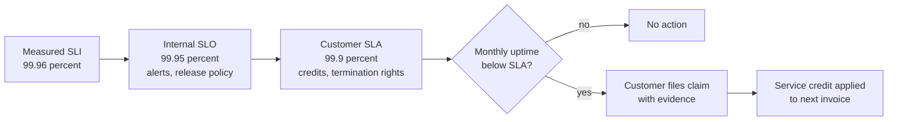
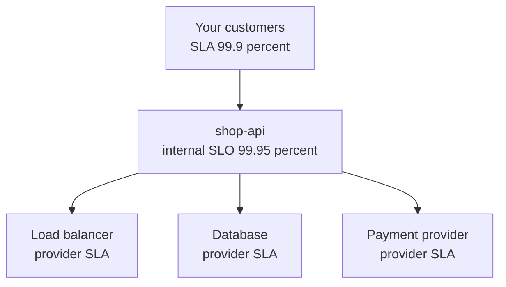

# L14.3 — Service Level Agreements (SLAs)

> **Level 14: SRE** · Topic 3 of 10 · ⏱ ~2 hours · Difficulty: Intermediate

## 1. What it is

A **Service Level Agreement (SLA)** is a *contract* between a service provider and a customer that states a level of service
and what happens if it is not delivered, usually money back (**service credits**) or the right to terminate. It is built from the
same ingredients as an [SLO](02-slos.md): an [SLI](01-slis.md), a target and a measurement period, but with a crucial addition:
**consequences**. *Site Reliability Engineering* (Google) draws the line this way: if missing the target has no explicit
consequence, you are looking at an SLO, not an SLA.

Three layers are worth keeping apart:

| Layer | Audience | Missing it means | Typical value for the same service |
|-------|----------|------------------|-------------------------------------|
| **SLI** | engineers | nothing, it is a measurement | measured 99.96% |
| **SLO (internal)** | engineering and product | slow down releases, fix reliability | 99.95% |
| **SLA (external)** | customers and lawyers | refunds, penalties, churn | 99.9% |

The SLA is deliberately the loosest of the three so that you notice and fix problems internally long before you owe a customer anything.

## 2. Why it matters in DevOps

- **Money and trust.** An SLA breach is a billing event and often a reputational one. Engineers who do not know their SLA's definitions can
  accidentally promise something the architecture cannot deliver.
- **Engineering decides what is measurable.** The legal text says "availability"; somebody must decide that means "ratio of non-5xx responses at the
  load balancer, per calendar month, excluding announced maintenance". That decision belongs in an engineering document that legal then reflects.
- **Dependencies cascade.** Your customer SLA cannot exceed what your own providers promise you (and often not even that).
  Knowing the cloud provider's SLA for the services you build on is a design input (see [availability](../level-19-architecture/02-availability.md)).
- **Evidence.** When a customer disputes uptime, you need metrics, status-page history and incident records to settle it.

## 3. Real-world system example

**Cloud provider SLAs.** AWS, Google Cloud and Microsoft Azure all publish a per-service SLA. The common pattern is a monthly
(or sometimes quarterly) uptime percentage, a few tiers of **service credit** that grow as measured uptime falls (credits are
usually a percentage of that month's bill for the affected service), and a requirement that the **customer files a claim** with
evidence within a time limit. Credits are typically the sole remedy. The exact numbers and exclusions differ per service and change
over time, so always read the current SLA text for the service you rely on. Notice also that many SLAs are tied to a specific
architecture (for example, running instances in more than one Availability Zone), which means the *customer's own design* can void the promise.

**SaaS and status pages.** Many SaaS vendors publish a status page with historical uptime and an enterprise SLA for paying plans. The status page
is the customer-visible evidence; see [incident management](05-incident-management.md).

**Google.** Its SRE books describe running with internal SLOs that are tighter than any SLA offered to Cloud customers, so that engineering
reacts before a contractual line is crossed.

## 4. Diagram

How the three layers relate and where the money changes hands:



Dependency chain: your SLA must fit inside the SLAs you buy.



## 5. How it works

### The parts of an SLA

| Part | What to write | Example |
|------|---------------|---------|
| Service scope | exactly what is covered | "Public HTTPS API at `api.example.com`" |
| Metric definition | the SLI, its measurement point and period | "Percentage of 1-minute intervals in the calendar month where the API error rate is below 5%" |
| Target | the number | 99.9% monthly uptime |
| Exclusions | what does not count | announced maintenance, customer-caused issues, force majeure, third-party outages outside your control |
| Remedy | credits, tiers, caps | 10% of monthly fee if uptime is 99.0-99.9%, higher below |
| Claims process | how and when the customer asks | within 30 days of the incident with request IDs |
| Reporting | where evidence lives | status page and monthly report |

### Contractual vs internal

| | Contractual (SLA) | Internal (SLO) |
|---|---|---|
| Owner | legal, sales and engineering | engineering and product |
| Flexibility | changed by renegotiation | changed by a review meeting |
| Strictness | the loosest | tighter than the SLA |
| Missing it | credits, refunds, termination | feature freeze, reliability work |
| Window | usually calendar month for billing | usually rolling 28-30 days for operations |

### Choosing a margin

Rule of thumb used in practice: the internal SLO sits **one step tighter** than the SLA (for example SLA 99.9%, SLO 99.95%). The
gap is the safety margin that turns "we missed our target" into an internal alert rather than a refund. A related rule: never sign
an SLA for a number that you have not met in the measured history of the last several months.

## 6. Step-by-step guide

**Prerequisites:** Python 3. This guide builds a small SLA calculator for a hypothetical tiered credit table. The tiers are
illustrative and are not any provider's real terms.

1. **Create the calculator.**
   ```bash
   mkdir -p ~/sre-lab && cd ~/sre-lab
   cat > sla_credit.py <<'EOF'
   #!/usr/bin/env python3
   """Compute monthly uptime and the service credit owed under an example SLA.

   usage: python3 sla_credit.py DOWNTIME_MINUTES [EXCLUDED_MINUTES] [MONTHLY_FEE]
   Example tiers (illustrative, NOT any real provider's terms):
     uptime >= 99.9 %          -> 0 % credit
     99.0 % <= uptime < 99.9 % -> 10 % credit
     95.0 % <= uptime < 99.0 % -> 25 % credit
     uptime < 95.0 %           -> 100 % credit
   """
   import sys

   if len(sys.argv) < 2:
       sys.exit(__doc__)
   down = float(sys.argv[1])
   excluded = float(sys.argv[2]) if len(sys.argv) > 2 else 0.0   # maintenance, force majeure
   fee = float(sys.argv[3]) if len(sys.argv) > 3 else 2000.0
   month_min = 30 * 24 * 60

   counted = max(down - excluded, 0)
   uptime = 100 * (month_min - counted) / month_min
   tiers = [(99.9, 0), (99.0, 10), (95.0, 25), (0.0, 100)]
   credit_pct = next(c for floor, c in tiers if uptime >= floor)

   print(f"month minutes          : {month_min}")
   print(f"downtime reported      : {down:.1f} min, excluded {excluded:.1f} min, counted {counted:.1f} min")
   print(f"monthly uptime         : {uptime:.4f} %")
   print(f"credit tier            : {credit_pct} % of {fee:.2f} = {fee * credit_pct / 100:.2f}")
   EOF
   ```

2. **Run three scenarios.**
   ```bash
   python3 sla_credit.py 90 30     # 90 min down, 30 of them in announced maintenance
   python3 sla_credit.py 20        # 20 min down
   python3 sla_credit.py 500       # a bad month
   ```
   Expected (the same on any machine):
   - first: `monthly uptime : 99.8611 %` and a `10 %` credit (`200.00`)
   - second: `99.9537 %` and `0 %`
   - third: `98.8426 %` and `25 %` (`500.00`)

3. **Express the SLA metric as a PromQL expression** so the claim can be answered with data. This is the "good 1-minute intervals" form;
   it requires the `sli:` recording rules built in [Error Budgets](04-error-budgets.md):
   ```promql
   # fraction of the last 30 days in which the 5-minute error ratio stayed below 5 percent
   avg_over_time((sli:http_requests:error_ratio_rate5m{job="shop-api"} < bool 0.05)[30d:1m])
   ```
   The `< bool` form returns 1 or 0 per evaluation and `avg_over_time` over a subquery turns it into a fraction of good minutes.

4. **Record the margin.** Add to your SLO document: "SLA 99.9% monthly; internal SLO 99.95% rolling 28 days; margin 0.05 points."

5. **Make a claims runbook.** Write a short checklist: who receives a claim, which dashboards and status-page entries prove or disprove it,
   who approves a credit, and how long you have to answer.

## 7. Real-world scenario

*Illustrative, not a documented incident.* A B2B customer of `shop-api` emails: "You were down for two hours on the 14th; we want a credit."
The on-call lead opens the incident record: the outage lasted 38 minutes, of which 20 were an announced maintenance
window (excluded by the contract). The SLO dashboard shows monthly uptime of 99.958%, which is above the 99.9% SLA, so no credit is owed.
The customer's own logs, though, show 2 hours of failed checkouts: their integration retried against a deprecated endpoint that was
not in the SLA scope.

The team replies politely with the evidence (incident timeline, status-page posts, SLI graph), and then opens a ticket to warn customers about the
deprecated endpoint. **Lesson:** precise definitions of scope and measurement make disputes short and factual; the postmortem still lists
"customer integrations on a deprecated path" as a contributing factor, because the customer experience was real even if the contract was not breached.

## 8. Common mistakes and best practices

**Don't**

- Copy a competitor's SLA number without measuring your own history.
- Set the SLA equal to the SLO; you would learn of trouble when the refund is already due.
- Promise availability that exceeds the compounded SLAs of your critical providers.
- Leave terms like "downtime" or "available" undefined. Define the measurement point and the interval.
- Hide the exclusions in fine print and then act surprised when a customer disagrees.

**Do**

- Keep the SLA looser than the internal SLO by a clear margin, and document both.
- Have engineering write the metric definition and legal wrap it in contract language.
- Publish status and history so customers can see the same evidence you do.
- Practise the claims process before the first claim arrives.
- Review SLAs when architecture changes (single-region vs multi-region, new dependency).

## 9. Tasks

- [ ] **T1 — Run the credit calculator** *(≈20 min, beginner)*
  - **Goal:** turn downtime into uptime and credit.
  - **Steps:**
    1. Create `sla_credit.py` from section 6.
    2. Run the three scenarios.
    3. Add a fourth: `python3 sla_credit.py 130 0 5000`.
  - **Done when:** you can explain each printed line and the credit for the fourth case (about `99.6991 %` uptime, a `10 %` credit of `500.00`).

- [ ] **T2 — Read a real SLA** *(≈45 min, beginner)*
  - **Goal:** extract the structure of a provider SLA.
  - **Steps:**
    1. Open the current SLA for one managed service you use (for example the AWS SLA page for your load balancer or database, from the provider's legal or SLA documentation).
    2. Fill in the seven rows of the table in section 5: scope, metric, target, exclusions, remedy, claims process, reporting.
    3. Note one architecture requirement that must hold for the SLA to apply.
  - **Done when:** the table is complete with quotes or paraphrases from the document and no blanks.

- [ ] **T3 — Choose SLO and SLA together** *(≈30 min, intermediate)*
  - **Goal:** place the margin sensibly.
  - **Steps:**
    1. Use your SLI history (or the sample data from [SLOs](02-slos.md)) for `shop-api`.
    2. Propose an internal SLO and an SLA that is looser by at least one step.
    3. Justify the choice by showing how many months in the history would have breached each.
  - **Done when:** you show two numbers and a table of "months breached" for each.

- [ ] **T4 — Evidence for a claim** *(≈45 min, intermediate)*
  - **Goal:** answer a customer claim with data.
  - **Steps:**
    1. Using the sample app from [SLIs](01-slis.md), stop it for 3 minutes while a script requests it every 10 seconds.
    2. Compute the failed fraction of 1-minute intervals from the script's log.
    3. Write the reply to a hypothetical claim with the interval list as evidence.
  - **Done when:** the reply states the number of bad minutes, the resulting uptime and whether a credit is owed under the section 6 tiers.

- [ ] **T5 — Tighten and loosen** *(≈30 min, advanced)*
  - **Goal:** feel how exclusions change outcomes.
  - **Steps:**
    1. Run `python3 sla_credit.py 70` and then `python3 sla_credit.py 70 40`.
    2. Explain why the second case owes nothing.
    3. Write one paragraph on the risk of generous exclusions for customer trust.
  - **Done when:** you have both outputs and the paragraph states a trade-off.

- [ ] **T6 — Prove it: SLA vs SLO** *(≈30 min, advanced)*
  - **Goal:** explain it without notes.
  - **Steps:**
    1. Write a half-page note for a sales colleague on why we will not offer 99.99% on `shop-api`.
    2. Use dependency math and the margin rule.
    3. Include what it would take to offer it (architecture, cost, on-call).
  - **Done when:** the note contains a number-based argument that a non-engineer can follow.

## 10. Self-check questions

1. What single feature separates an SLA from an SLO?
2. Why should the internal SLO be tighter than the SLA?
3. Name three common exclusions in an SLA.
4. Why can your SLA not exceed that of your critical dependencies?
5. What evidence do you want ready before a customer sends a claim?

<details>
<summary>Answers</summary>

1. Explicit consequences (credits, penalties, termination rights) for missing it.
2. So engineering reacts, and fixes problems, before the contractual threshold is crossed.
3. Scheduled and announced maintenance, customer-caused issues, force majeure, and failures of third parties outside your control.
4. Serial dependencies multiply: if a required component is down, your service is down regardless of your own quality.
5. The SLI history for the period, incident records and timelines, status-page posts, and the precise metric definition from the contract.
</details>

## 11. Further reading

- *Site Reliability Engineering* (Google) — the section distinguishing SLOs and SLAs in "Service Level Objectives".
- *The Site Reliability Workbook* (Google) — "Implementing SLOs" for how SLOs relate to agreements.
- The published SLA pages of the cloud services you depend on (AWS, Google Cloud, Azure documentation roots); read the current text, as terms change.
- See also: [Error Budgets](04-error-budgets.md) and [Disaster Recovery](../level-00-what-devops-is/09-disaster-recovery.md).

<!-- nav -->
---
← Previous: [Service Level Objectives (SLOs)](02-slos.md) · [Level 14 index](README.md) · Next: [Error Budgets](04-error-budgets.md) →
