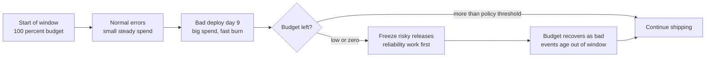
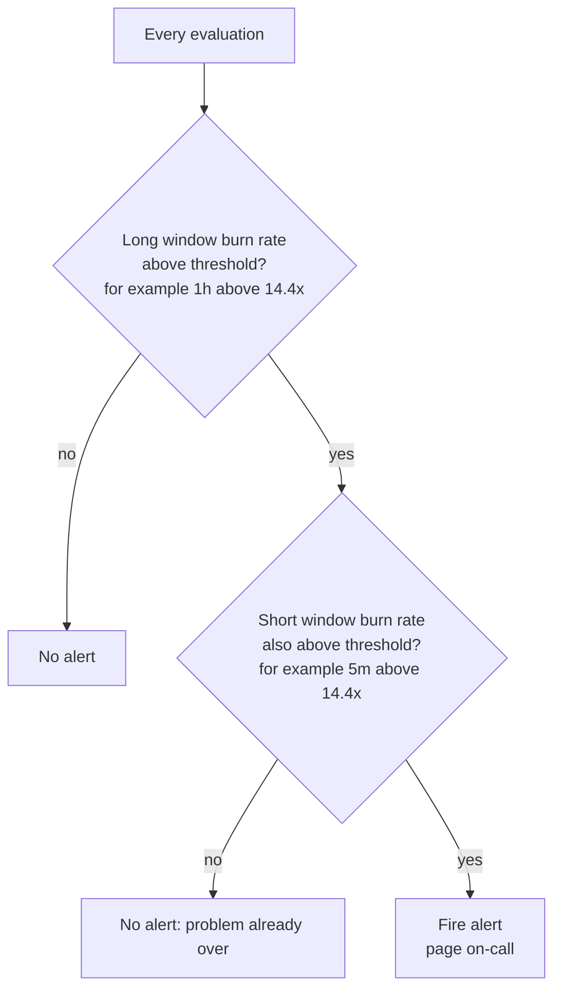

# L14.4 — Error Budgets

> **Level 14: SRE** · Topic 4 of 10 · ⏱ ~4 hours · Difficulty: Intermediate

## 1. What it is

An **error budget** is the amount of unreliability an [SLO](02-slos.md) allows. If the objective is 99.9% of requests succeeding over
30 days, then 0.1% of requests may fail, and that 0.1% is a *budget you are allowed to spend*: on bugs, bad deploys,
infrastructure failures, risky experiments and planned maintenance alike.

```text
error budget = 1 - SLO target                       (99.9 %  ->  0.1 % = 0.001)
budget spent = bad events / valid events in the window
budget left  = 1 - (budget spent / error budget)
```

The idea comes from Google's SRE practice (see *Site Reliability Engineering*, chapter "Embracing Risk", and *The Site
Reliability Workbook*, chapters "Implementing SLOs" and "Alerting on SLOs"). It turns reliability from a vague virtue into a
resource that product and engineering can plan with: while there is budget, ship faster; when it runs out, slow down and invest in
reliability. A **burn rate** is how fast you are spending it: 1x means you would use exactly the whole budget by the end of the window;
10x means the budget is gone in a tenth of the window.

## 2. Why it matters in DevOps

- **Objective release decisions.** "Can we deploy on Friday?" becomes "how much budget is left, and what is the burn rate right now?".
- **Better alerts.** Alerting on budget burn pages you for failures that matter and stays quiet for blips that do not
  (see [alert fatigue reduction](08-alert-fatigue-reduction.md)).
- **Shared incentives.** Developers want velocity, operators want stability. A shared budget makes both sides optimise the same number.
- **Permission to take risk.** Teams that have never failed are probably too slow. Unspent budget is a sign you could be shipping more or testing in production more.

## 3. Real-world system example

**Google** is the origin of the policy approach: its SRE books describe an *error budget policy* in which, if the budget is
exhausted, releases other than critical fixes pause until reliability is restored, and where postmortems of large budget consumers
drive engineering priorities. *The Site Reliability Workbook* includes an example error budget policy and a full chapter, "Alerting on SLOs",
that compares several alerting strategies and ends with the **multi-window, multi-burn-rate** alerts you will build below.

**Prometheus ecosystem.** Open-source generators such as **Sloth** and **Pyrra** emit exactly this family of recording rules and alerts from a short SLO
definition, and Grafana's SLO features visualise remaining budget and burn rate. The rule shape in this topic is the same one those tools
generate, which is why it is worth understanding by hand once.

## 4. Diagram

Budget as a running balance over a 30-day window:



How the multi-window alert decides to page:



## 5. How it works

### Budget math

Pick the SLO and the window, then everything else follows:

| SLO | Budget | 30-day time budget | Per 1,000,000 requests |
|-----|--------|--------------------|------------------------|
| 99% | 1% | 7.2 h | 10,000 may fail |
| 99.9% | 0.1% | 43.2 min | 1,000 may fail |
| 99.99% | 0.01% | 4.32 min | 100 may fail |

For request-based SLOs the budget is counted in *requests*, not minutes: a total outage at 3 a.m. with ten requests per second burns far less than one
at noon with a thousand. Relationship between burn rate, window and consumption:

```text
burn rate     = observed error ratio / error budget ratio
budget used   = burn rate x (alert window / SLO window)
time to empty = SLO window / burn rate
```

Example, 99.9% SLO over 30 days (720 h), observed error ratio 1.44% for 1 hour: burn = 0.0144 / 0.001 = 14.4x;
used = 14.4 x 1/720 = 2% of the budget; at that rate the budget lasts 720 / 14.4 = 50 hours.

### Multi-window, multi-burn-rate alerts

A naive alert ("error rate above 0.1% for 5 minutes") either pages constantly on blips or reacts too late to slow burns.
The Workbook chapter "Alerting on SLOs" develops the better pattern: **alert on burn rate over a long window, and require a short window to agree**.

| Severity | Long window | Short window | Burn rate | Budget consumed when it fires | Action |
|----------|-------------|--------------|-----------|-------------------------------|--------|
| Page | 1 h | 5 m | 14.4x | 2% | wake someone, act now |
| Page | 6 h | 30 m | 6x | 5% | wake someone, act soon |
| Ticket | 3 d | 6 h | 1x | 10% | triage next working day |

- The **long window** gives *precision*: it filters blips.
- The **short window** (about 1/12 of the long one) gives a fast *reset*: once the problem is fixed, the alert clears in minutes instead of staying red for an hour.
- Fast burns page quickly; slow burns that would still empty the budget get a ticket.

### Release policy (the error budget policy)

Write down, in advance and with product sign-off, what happens at each budget level. For example:

| Budget remaining | Policy |
|------------------|--------|
| above 50% | normal pace; experiments and risky changes allowed |
| 25-50% | extra review for risky changes; consider canary-only rollouts (see [canary deployments](../level-05-cicd/12-canary-deployments.md)) |
| below 25% | no risky changes; reliability items are first in the sprint |
| exhausted | freeze all non-critical releases until the budget is back above a floor or the cause is fixed; postmortem required |

Include an escape hatch (for example, security fixes and fixes that *improve* reliability can still ship) and a named person
who can override with a written reason. A policy without consequences will be ignored.

## 6. Step-by-step guide

**Prerequisites:** Python 3 for the calculators; either a local `promtool` (shipped in the Prometheus release tarball) or Docker for
validating rules. All free and local.

1. **Compute budgets for your SLO.**
   ```bash
   mkdir -p ~/sre-lab && cd ~/sre-lab
   cat > budget.py <<'EOF'
   #!/usr/bin/env python3
   """Error budget calculator: python3 budget.py 99.9 [window_days]"""
   import sys

   slo = float(sys.argv[1]) if len(sys.argv) > 1 else 99.9
   days = float(sys.argv[2]) if len(sys.argv) > 2 else 30
   allowed = 1 - slo / 100
   minutes = days * 24 * 60
   print(f"SLO {slo}% over {days:g} days")
   print(f"  error budget      : {allowed * 100:.4f}% of requests/time")
   print(f"  allowed downtime  : {allowed * minutes:.2f} minutes ({allowed * minutes * 60:.0f} s)")
   print(f"  1M requests ->    : {allowed * 1_000_000:,.0f} may fail")
   EOF
   python3 budget.py 99.9 30
   ```
   Expected:
   ```text
   SLO 99.9% over 30 days
     error budget      : 0.1000% of requests/time
     allowed downtime  : 43.20 minutes (2592 s)
     1M requests ->    : 1,000 may fail
   ```

2. **Compute burn rate, consumption and alert thresholds.**
   ```bash
   cat > burn.py <<'EOF'
   #!/usr/bin/env python3
   """Burn-rate calculator.

   usage: python3 burn.py SLO_PERCENT ERROR_RATIO WINDOW_HOURS [PERIOD_DAYS]
     e.g. python3 burn.py 99.9 0.0144 1
   """
   import sys

   if len(sys.argv) < 4:
       sys.exit(__doc__)
   slo = float(sys.argv[1])
   err = float(sys.argv[2])            # observed error ratio, 0.0144 = 1.44 %
   win_h = float(sys.argv[3])
   period_h = (float(sys.argv[4]) if len(sys.argv) > 4 else 30) * 24

   budget = 1 - slo / 100              # allowed error ratio
   burn = err / budget                 # 1.0 = exactly on budget
   consumed = burn * win_h / period_h  # fraction of whole-period budget burned
   exhaust_h = period_h / burn if burn else float("inf")

   print(f"error budget ratio     : {budget:.6f}")
   print(f"burn rate              : {burn:.2f}x")
   print(f"budget consumed in {win_h:g}h : {consumed * 100:.2f}% of the period budget")
   print(f"time to exhaustion     : {exhaust_h:.1f} h ({exhaust_h / 24:.1f} days) at this rate")

   print("\nThresholds for this SLO (error ratio that trips each alert):")
   print(f"{'severity':8} {'long':>5} {'short':>6} {'burn':>6} {'budget spent':>13} {'error ratio >':>14}")
   for sev, long_h, short_h, rate in [("page", 1, "5m", 14.4), ("page", 6, "30m", 6.0), ("ticket", 72, "6h", 1.0)]:
       spent = rate * long_h / period_h * 100
       print(f"{sev:8} {long_h:>4}h {short_h:>6} {rate:>6} {spent:>12.1f}% {rate * budget:>14.6f}")
   EOF
   python3 burn.py 99.9 0.0144 1
   ```
   Expected:
   ```text
   error budget ratio     : 0.001000
   burn rate              : 14.40x
   budget consumed in 1h : 2.00% of the period budget
   time to exhaustion     : 50.0 h (2.1 days) at this rate

   Thresholds for this SLO (error ratio that trips each alert):
   severity  long  short   burn  budget spent  error ratio >
   page        1h     5m   14.4          2.0%       0.014400
   page        6h    30m    6.0          5.0%       0.006000
   ticket     72h     6h    1.0         10.0%       0.001000
   ```
   Try `python3 burn.py 99.9 0.002 6` (a 2x burn). It does not trip any alert yet, but would empty the budget in 15 days.

3. **Create the Prometheus rules file** `shop-api-slo-rules.yml`: recording rules for the error ratio at each window, then the three alerts.
   ```yaml
   # SLO: 99.9 % of valid shop-api requests succeed, rolling 30 days.
   # Error budget ratio = 1 - 0.999 = 0.001
   groups:
     - name: shop-api-sli-recording
       interval: 30s
       rules:
         - record: sli:http_requests:error_ratio_rate5m
           expr: |
             sum by (job) (rate(http_requests_total{job="shop-api", code=~"5.."}[5m]))
             /
             sum by (job) (rate(http_requests_total{job="shop-api"}[5m]))
         - record: sli:http_requests:error_ratio_rate30m
           expr: |
             sum by (job) (rate(http_requests_total{job="shop-api", code=~"5.."}[30m]))
             /
             sum by (job) (rate(http_requests_total{job="shop-api"}[30m]))
         - record: sli:http_requests:error_ratio_rate1h
           expr: |
             sum by (job) (rate(http_requests_total{job="shop-api", code=~"5.."}[1h]))
             /
             sum by (job) (rate(http_requests_total{job="shop-api"}[1h]))
         - record: sli:http_requests:error_ratio_rate6h
           expr: |
             sum by (job) (rate(http_requests_total{job="shop-api", code=~"5.."}[6h]))
             /
             sum by (job) (rate(http_requests_total{job="shop-api"}[6h]))
         - record: sli:http_requests:error_ratio_rate3d
           expr: |
             sum by (job) (rate(http_requests_total{job="shop-api", code=~"5.."}[3d]))
             /
             sum by (job) (rate(http_requests_total{job="shop-api"}[3d]))
         - record: sli:http_requests:error_ratio_rate30d
           expr: |
             sum by (job) (rate(http_requests_total{job="shop-api", code=~"5.."}[30d]))
             /
             sum by (job) (rate(http_requests_total{job="shop-api"}[30d]))
         # fraction of the 30-day error budget still unspent (negative = overspent)
         - record: slo:error_budget_remaining:ratio
           expr: 1 - (sli:http_requests:error_ratio_rate30d / 0.001)

     - name: shop-api-burn-rate-alerts
       rules:
         # 14.4x burn: 2 % of a 30-day budget gone in 1 hour. Page.
         - alert: ShopApiErrorBudgetBurnFast
           expr: |
             sli:http_requests:error_ratio_rate1h{job="shop-api"} > (14.4 * 0.001)
             and
             sli:http_requests:error_ratio_rate5m{job="shop-api"} > (14.4 * 0.001)
           for: 2m
           labels:
             severity: page
             slo: shop-api-availability
           annotations:
             summary: "shop-api is burning its error budget 14.4x too fast"
             description: "1h error ratio {{ $value | humanizePercentage }}. At this rate the 30-day budget is gone in about 2 days."
             runbook_url: "https://runbooks.example.com/shop-api/error-budget-burn"

         # 6x burn: 5 % of the budget gone in 6 hours. Page.
         - alert: ShopApiErrorBudgetBurnSlow
           expr: |
             sli:http_requests:error_ratio_rate6h{job="shop-api"} > (6 * 0.001)
             and
             sli:http_requests:error_ratio_rate30m{job="shop-api"} > (6 * 0.001)
           for: 5m
           labels:
             severity: page
             slo: shop-api-availability
           annotations:
             summary: "shop-api is burning its error budget 6x too fast"
             description: "6h error ratio {{ $value | humanizePercentage }}. The 30-day budget would be gone in about 5 days."
             runbook_url: "https://runbooks.example.com/shop-api/error-budget-burn"

         # 1x burn: 10 % of the budget gone in 3 days. Ticket, not a page.
         - alert: ShopApiErrorBudgetBurnTicket
           expr: |
             sli:http_requests:error_ratio_rate3d{job="shop-api"} > (1 * 0.001)
             and
             sli:http_requests:error_ratio_rate6h{job="shop-api"} > (1 * 0.001)
           labels:
             severity: ticket
             slo: shop-api-availability
           annotations:
             summary: "shop-api is spending its error budget at or above the sustainable rate"
             description: "3d error ratio {{ $value | humanizePercentage }}. Triage in working hours."
             runbook_url: "https://runbooks.example.com/shop-api/error-budget-burn"
   ```
   The `{{ $value }}` in `description` is the value of the left-hand side of the `and`, i.e. the long-window ratio.
   The 30-day rule only sees as much history as Prometheus keeps; the default retention is 15 days, so start Prometheus with
   `--storage.tsdb.retention.time=35d` (or accept a shorter effective window while the lab is young).

4. **Validate the syntax.**
   ```bash
   promtool check rules shop-api-slo-rules.yml
   # no promtool installed? use the one inside the Prometheus image:
   docker run --rm -v "$PWD":/w --entrypoint promtool prom/prometheus:v2.53.0 check rules /w/shop-api-slo-rules.yml
   ```
   Expected: `SUCCESS: 10 rules found`.

5. **Unit-test the alerts** with synthetic data. `promtool test rules` feeds fake time series and asserts which alerts fire. Save as `shop-api-slo-rules.test.yml`:
   ```yaml
   rule_files:
     - shop-api-slo-rules.yml
   evaluation_interval: 30s

   tests:
     # 20 req/s overall, 5 % errors = 50x burn: both fast windows exceed 14.4x
     - interval: 30s
       input_series:
         - series: 'http_requests_total{job="shop-api", code="200"}'
           values: '0+570x400'
         - series: 'http_requests_total{job="shop-api", code="500"}'
           values: '0+30x400'
       alert_rule_test:
         - eval_time: 3h
           alertname: ShopApiErrorBudgetBurnFast
           exp_alerts:
             - exp_labels:
                 severity: page
                 slo: shop-api-availability
                 job: shop-api
               exp_annotations:
                 summary: "shop-api is burning its error budget 14.4x too fast"
                 description: "1h error ratio 5%. At this rate the 30-day budget is gone in about 2 days."
                 runbook_url: "https://runbooks.example.com/shop-api/error-budget-burn"

     # healthy: 0.05 % errors = 0.5x burn, nothing fires
     - interval: 30s
       input_series:
         - series: 'http_requests_total{job="shop-api", code="200"}'
           values: '0+599.7x400'
         - series: 'http_requests_total{job="shop-api", code="500"}'
           values: '0+0.3x400'
       alert_rule_test:
         - eval_time: 3h
           alertname: ShopApiErrorBudgetBurnFast
           exp_alerts: []
         - eval_time: 3h
           alertname: ShopApiErrorBudgetBurnSlow
           exp_alerts: []
   ```
   ```bash
   promtool test rules shop-api-slo-rules.test.yml
   ```
   Expected: `SUCCESS`. Now break it on purpose: change `0+30x400` to `0+0.3x400`, rerun, and read the failure message.

6. **Check the thresholds are consistent with the calculator.** `14.4 * 0.001 = 0.0144`, the first row of the `burn.py` table. If you change the SLO to 99.95%,
   replace the `0.001` literals with `0.0005`. A cleaner production approach is a recording rule such as `slo:shop_api_availability:error_budget` holding the number once.

7. **Write the error budget policy** (half a page) using the table in section 5 and have the product owner initial it.

## 7. Real-world scenario

*Illustrative, not a documented incident.* On a Tuesday afternoon `shop-api` ships a change that adds an unindexed query to the
checkout path. Error ratio climbs to 10% as the database saturates and requests time out. With the old alert ("5xx above 1% for 10 minutes") the
on-call would have been paged late and again whenever traffic dipped. With the new alerts, `ShopApiErrorBudgetBurnFast` fires roughly 11 minutes in:
the 1-hour average passes 1.44% after about 9 minutes of 10% errors, the 5-minute ratio is already above it, and the 2-minute `for` clause is satisfied. The responder sees the deploy marker, rolls back (see [rollback](../level-05-cicd/07-rollback.md)),
and within about five minutes the 5-minute ratio falls under the threshold so the page auto-resolves, even though the 1-hour ratio is still elevated.

The incident consumed about 4% of the month's budget (roughly 17 minutes at 10% errors). With the month's earlier spending, about 70% remains,
which the policy table treats as normal pace, so no freeze, but the postmortem action "add a query-plan check to CI" is accepted as top priority. **Lesson:** the short window made the
alert clear promptly, the long window kept it from firing on noise, and the budget put a number on how bad it was.

## 8. Common mistakes and best practices

**Don't**

- Page on every error spike. Page on budget burn; let the ticket alert handle slow bleeds.
- Use only a long window (alert stays on for an hour after the fix) or only a short one (pages on every blip).
- Define an error budget policy and then let the first exhausted budget pass with no consequence.
- Compute burn rates on a metric with no traffic and divide by zero. Add a minimum-traffic guard or rely on a probe for quiet services.
- Treat the budget as a target to hit exactly. Unspent budget is fine; it means room to move faster.

**Do**

- Keep the recording rules and thresholds in version control, unit-test them with `promtool test rules`, and review them with each SLO change.
- Derive thresholds from the SLO, not from gut feel: `burn rate x (1 - SLO)`.
- Include a runbook link in every page-severity alert.
- Report remaining budget in a weekly review and in release discussions.
- Spend budget deliberately (chaos experiments, risky migrations) when you have plenty.

## 9. Tasks

- [ ] **T1 — Budget math by hand** *(≈20 min, beginner)*
  - **Goal:** be fluent in budget and burn calculations.
  - **Steps:**
    1. Run `budget.py` for 99%, 99.9%, 99.95% and 99.99% over 30 days.
    2. For 99.9% compute by hand the burn rate when the error ratio is 0.5%, then check with `burn.py 99.9 0.005 1`.
    3. State how long the budget lasts at that rate.
  - **Done when:** your hand calculation (5x burn, budget gone in 6 days) matches the script.

- [ ] **T2 — Install and validate the rules** *(≈30 min, beginner)*
  - **Goal:** have a syntactically valid multi-burn-rate rule file.
  - **Steps:**
    1. Create `shop-api-slo-rules.yml` from section 6.
    2. Run `promtool check rules` (local or Docker).
    3. Count the recording rules and alerts it reports.
  - **Done when:** the output says `SUCCESS: 10 rules found`.

- [ ] **T3 — Change the SLO** *(≈30 min, intermediate)*
  - **Goal:** modify thresholds correctly.
  - **Steps:**
    1. Change the objective to 99.5% (budget 0.005) in the rules file, including the `slo:error_budget_remaining:ratio` rule.
    2. Update the unit test so that a 10% error input still fires (the fast threshold is now 14.4 x 0.005 = 7.2%) and a 0.2% input does not.
    3. Run `promtool test rules`.
  - **Done when:** `promtool test rules` reports `SUCCESS` for the new SLO.

- [ ] **T4 — Break the alert and fix it** *(≈45 min, intermediate)*
  - **Goal:** understand why both windows are needed.
  - **Steps:**
    1. Remove the short-window condition from `ShopApiErrorBudgetBurnFast`.
    2. Write a test where errors stop at minute 70 and check at minute 100: the broken alert still fires.
    3. Restore the short window and show the alert no longer fires at minute 100.
  - **Done when:** you have a failing test for the broken rule and a passing test for the fixed one, and you can explain the difference in one sentence.

- [ ] **T5 — Live demo with Prometheus** *(≈60 min, advanced)*
  - **Goal:** watch real data trip the alert.
  - **Steps:**
    1. Run the sample app from [SLIs](01-slis.md) with the error rate raised from 2% to 20% and scrape it with a local Prometheus (`docker run -p 9090:9090 -v ...prometheus.yml prom/prometheus`) loading your rules file.
    2. Use a short evaluation interval and temporarily scale the windows down (for example 1h to 10m, 5m to 1m) so you do not wait an hour.
    3. Open the Prometheus Alerts page and watch `ShopApiErrorBudgetBurnFast` go from pending to firing, then stop the errors and watch it resolve.
  - **Done when:** you have seen the alert fire and resolve, and can name which window cleared first.

- [ ] **T6 — Prove it: write the policy** *(≈45 min, advanced)*
  - **Goal:** produce a policy a product owner could sign.
  - **Steps:**
    1. Without the guide, write an error budget policy for `shop-api` with at least four budget levels and an exceptions clause.
    2. Pick the three alert thresholds for an SLO of 99.95% and show the arithmetic.
    3. Explain to a teammate why the 6-hour alert uses a 30-minute short window.
  - **Done when:** the thresholds you computed are 0.0072, 0.003 and 0.0005 (14.4x, 6x and 1x of 0.0005) and the policy has a named override owner.

## 10. Self-check questions

1. What is the error budget of a 99.95% SLO in minutes per 30 days?
2. What does a burn rate of 6 mean, and how long does the budget last at that rate?
3. Why do multi-window alerts require both a long and a short window?
4. Which of the three standard alerts should create a ticket rather than a page, and why?
5. What should happen to releases when the budget is exhausted?

<details>
<summary>Answers</summary>

1. 0.05% of 43,200 minutes = 21.6 minutes.
2. You are spending budget six times faster than the sustainable rate; the 30-day budget is gone in 5 days.
3. The long window avoids paging on short blips (precision); the short window makes the alert reset quickly once the problem is fixed (fast recovery).
4. The 1x burn over 3 days: the budget is being used at the sustainable rate or slightly above, so it is urgent to look at but not at 3 a.m.
5. Per the policy: freeze non-critical, risky releases and prioritise reliability work until the budget recovers or the cause is fixed, with explicit exceptions for security and reliability fixes.
</details>

## 11. Further reading

- *The Site Reliability Workbook* (Google) — "Alerting on SLOs" (the multi-window, multi-burn-rate approach) and the example error budget policy appendix.
- *Site Reliability Engineering* (Google) — "Embracing Risk" and "Service Level Objectives".
- Prometheus documentation (prometheus.io/docs) — recording rules, alerting rules and `promtool test rules`.
- Sloth and Pyrra documentation for generated SLO rules.
- See also: [Service Level Objectives](02-slos.md), [Alert Fatigue Reduction](08-alert-fatigue-reduction.md) and [Prometheus and PromQL](../level-10-observability/02-prometheus-and-promql.md).

<!-- nav -->
---
← Previous: [Service Level Agreements (SLAs)](03-slas.md) · [Level 14 index](README.md) · Next: [Incident Management](05-incident-management.md) →
