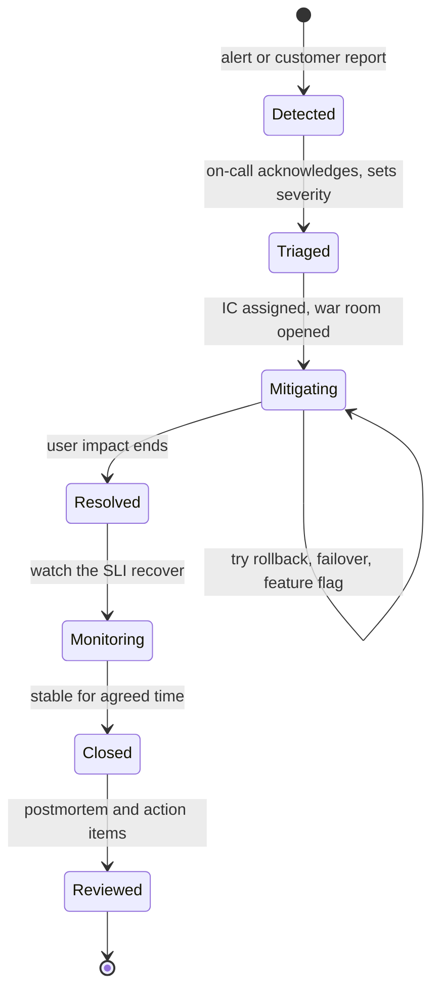
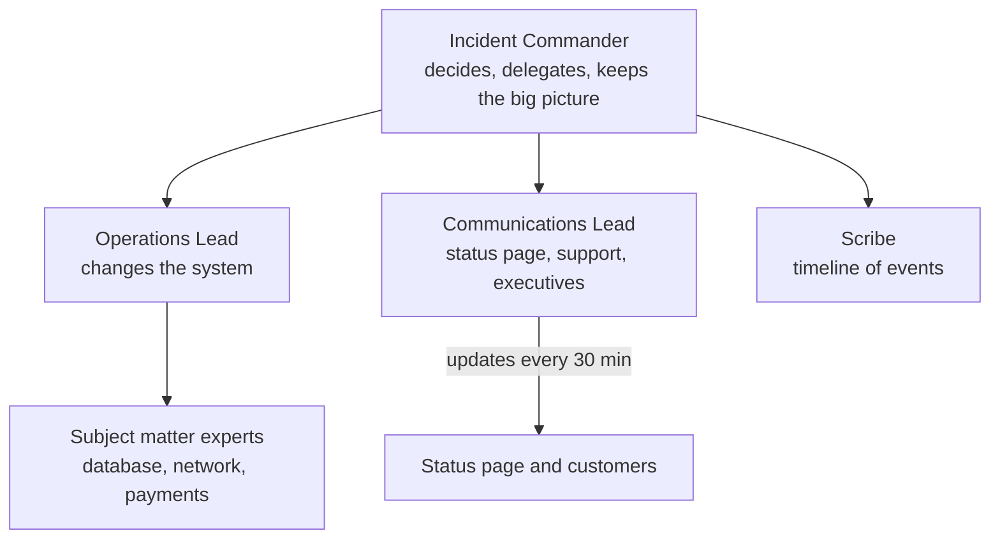

# L14.5 — Incident Management

> **Level 14: SRE** · Topic 5 of 10 · ⏱ ~4 hours · Difficulty: Intermediate

## 1. What it is

**Incident management** is the structured way an organisation responds when a service is broken or about to break: detect it, decide how bad
it is, assign clear roles, restore service as fast as possible, tell the people affected, and capture what happened so you can learn.
An **incident** is any unplanned event that degrades the service enough that a human must respond now.

Two ideas dominate the practice. First, **mitigate first, understand later**: the goal during an incident is to stop the user pain (roll back,
fail over, shed load, disable a feature), not to find the root cause. Second, **roles over heroics**: even a three-person team does better
when one person coordinates, one does the hands-on work and one communicates. Google's SRE books ("Managing Incidents" in *Site Reliability Engineering*
and "Incident Response" in *The Site Reliability Workbook*) borrow this from the emergency-services **Incident Command System (ICS)**.

## 2. Why it matters in DevOps

- **Minutes matter, confusion costs minutes.** Without roles, five engineers debug the same thing, nobody updates the customers and nobody notices the fix made things worse.
- **Burn rate pays for it.** Each minute of impact spends [error budget](04-error-budgets.md); good process shortens time to mitigate.
- **Trust.** Customers forgive outages more readily than silence. A calm, regular status update is part of reliability.
- **People.** A chaotic 3 a.m. incident is how engineers burn out. A rehearsed process lowers stress (see [on-call practices](06-on-call-practices.md)).
- **Learning.** Every incident is an unplanned experiment; the record feeds [postmortems](07-postmortems.md).

## 3. Real-world system example

**Google** describes an incident command structure with three core roles, usually called the **Incident Commander (IC)**,
the **Operations Lead** (the only people changing the system) and the **Communications Lead**, with a **Planning Lead** added for large incidents.
The IC holds the high-level picture and delegates; they do not type commands.

**PagerDuty** publishes its internal incident response documentation openly (the "PagerDuty Incident Response" site). It describes the roles of Incident Commander,
Deputy, Scribe, Communications Liaison and Subject Matter Experts, and the principle of a clear handoff and an explicit "who is in charge now".

**Atlassian** publishes an incident management handbook with severity levels, roles and communication templates.

**Status pages and public postmortems.** Companies such as GitHub, Cloudflare and AWS post incident updates on public status pages and, for major
events, publish detailed postmortems. This transparency is itself an operational practice: customers can see the timeline, and the engineers who write the report
are the ones who fix the root causes.

## 4. Diagram

Incident lifecycle as a state machine:



Who talks to whom during a large incident:



## 5. How it works

### Roles (the incident-roles card)

| Role | Responsibilities | Does NOT |
|------|------------------|----------|
| **Incident Commander (IC)** | Declares the incident, sets severity, assigns roles, decides priorities, calls for help, decides when it is over, hands off clearly | type commands into production |
| **Operations Lead (Ops)** | Investigates and applies mitigations; the single point that changes the system; reports findings to the IC in short sentences | decide severity or talk to customers |
| **Communications Lead (Comms)** | Posts status-page and internal updates on a fixed cadence, handles support and executive questions, shields responders from interruptions | debug |
| **Scribe** | Keeps the timestamped timeline in the incident channel or document | take decisions |
| **Subject matter expert (SME)** | Answers specific questions for Ops | self-assign work without telling the IC |

In a small team one person may hold two roles, but **the IC and the hands-on operator must be different people** as soon as the incident is more than trivial.

### Severity levels

Define severity by *impact*, not by cause. Example scale (adapt the numbers to your SLOs):

| Severity | Typical impact | Response | Update cadence |
|----------|----------------|----------|----------------|
| **SEV1** | Major outage: checkout or login down for most users, data loss or security breach | page immediately, IC + Comms, war room, leadership notified | every 15-30 min |
| **SEV2** | Significant degradation: a major feature broken or a large subset of users affected, fast budget burn | page, IC, war room | every 30-60 min |
| **SEV3** | Minor: limited users, workaround exists | work in hours, ticket, no war room | on resolution |
| **SEV4** | Cosmetic or no user impact | normal backlog | none |

Rules that save arguments: **when in doubt, declare the higher severity** (downgrading is free), and anyone may declare an incident.
Tie the top severities to your SLO burn-rate alerts from [error budgets](04-error-budgets.md): the fast-burn page is usually SEV2 or higher.

### War rooms

A **war room** is a single place where the response happens: a dedicated chat channel (`#inc-2026-10-09-checkout`) and, for severe cases, a voice bridge.
Rules: one room per incident, the IC announces their name and the severity at the top, the scribe pins the timeline, side conversations move to threads, and observers
stay quiet (or read only). Nobody makes a change in production without saying so in the channel first.

### Status pages and communication

| Audience | Channel | Content |
|----------|---------|---------|
| Customers | status page | what is affected, since when, what we are doing, next update time |
| Support | internal channel | wording to use with customers, known workarounds |
| Executives | short summary | impact, ETA if known, customer or revenue exposure |
| Responders | war room | facts and decisions |

Good status updates have a fixed shape: **Investigating -> Identified -> Monitoring -> Resolved**, each with a timestamp and the time of the next update.
Say what users experience, not internal jargon, and never guess a cause publicly.

### Mitigation toolbox

Rollback, feature flag off, fail over to a replica or another region, scale up, shed load or rate-limit, block a bad client, restore from backup (last resort).
Prepare these as **tested runbooks** so the on-call is choosing from a menu rather than inventing.

## 6. Step-by-step guide

**Prerequisites:** a terminal and, optionally, a chat tool or a shared document. We will build the scribe tool, a declaration message and a status template, then use them in the
capstone mock incident.

1. **Create a tiny incident scribe** that timestamps everything in UTC (the timeline is the raw material of the postmortem).
   ```bash
   mkdir -p ~/sre-lab && cd ~/sre-lab
   cat > inc.sh <<'EOF'
   #!/usr/bin/env bash
   # Tiny incident scribe: appends UTC-timestamped lines to ./incident-<id>.log
   # usage: ./inc.sh start "<title>" | note "<text>" | who "<role>=<name>" | show
   set -euo pipefail
   ID="${INCIDENT_ID:-$(date -u +%Y%m%d)-01}"
   LOG="incident-${ID}.log"
   ts() { date -u +%Y-%m-%dT%H:%M:%SZ; }
   case "${1:-}" in
     start) echo "$(ts) START  ${2:?title required}" >> "$LOG" ;;
     note)  echo "$(ts) NOTE   ${2:?text required}" >> "$LOG" ;;
     who)   echo "$(ts) ROLE   ${2:?role=name required}" >> "$LOG" ;;
     show)  cat "$LOG" ;;
     *)     echo "usage: $0 start|note|who|show ..." >&2; exit 2 ;;
   esac
   EOF
   chmod +x inc.sh
   ```

2. **Run a three-line practice incident.**
   ```bash
   export INCIDENT_ID=practice-01
   ./inc.sh start "Checkout returns 502 for 30% of users (SEV2)"
   ./inc.sh who "IC=alex"
   ./inc.sh note "Deploy 4821 correlates with start of errors; Ops proposes rollback"
   ./inc.sh show
   ```
   Expected output (timestamps will differ):
   ```text
   2026-10-09T10:15:02Z START  Checkout returns 502 for 30% of users (SEV2)
   2026-10-09T10:15:02Z ROLE   IC=alex
   2026-10-09T10:15:03Z NOTE   Deploy 4821 correlates with start of errors; Ops proposes rollback
   ```

3. **Write the declaration message** you paste in the war-room channel in the first minute:
   ```text
   INCIDENT DECLARED  SEV2  Checkout errors (shop-api)
   IC: @alex   Ops: @priya   Comms: @sam   Scribe: @jo
   Impact: ~30% of checkout requests return 502 since 10:07 UTC
   Next update: 10:45 UTC     Channel: #inc-20261009-checkout
   Rule: say your intent before you change anything in production.
   ```

4. **Prepare the status-page templates** (save them somewhere your Comms Lead can paste from):
   ```text
   Investigating - We are investigating errors when placing orders. Some customers may see failures at checkout. Next update by <TIME UTC>.
   Identified     - The cause has been identified and we are applying a fix. Next update by <TIME UTC>.
   Monitoring     - A fix has been applied. We are watching to confirm that checkout has recovered. Next update by <TIME UTC>.
   Resolved       - Checkout has been working normally since <TIME UTC>. A summary will follow. We apologise for the disruption.
   ```

5. **Keep the incident-roles card** from the capstone (`99-capstone-project.md`) printed or pinned where responders can find it, and agree who may declare which severity.

6. **Hand off cleanly.** At a shift change, the outgoing IC says: "I am handing IC to Priya at 11:00 UTC. State: impact is X, mitigation Y is in progress, next decision Z." The incoming IC repeats it back; the scribe logs it with `./inc.sh note`.

## 7. Real-world scenario

*Illustrative, not a documented incident.* At 02:12 UTC the fast-burn alert pages Priya. She sees 502s from the load balancer and, because the burn rate is high, declares SEV2 and
opens `#inc-20261009-checkout`. Five more engineers join within minutes and start four parallel investigations, one of which restarts the API pods without telling anyone;
errors briefly worsen. Alex, the engineering manager, joins, announces "I am IC", and asks Priya to be Ops and everyone else to stay quiet unless asked.
Jo takes the scribe role, Sam posts the first status update. Within ten minutes the timeline shows a deploy at 02:05, and Ops rolls it back; the 5-minute error ratio recovers in
five minutes. Sam moves the status page to "Monitoring", then "Resolved" after 30 stable minutes.

**Lesson:** the technical fix was a rollback; the time saved came from one voice coordinating, announced changes, and a written timeline. The uncoordinated restart cost several minutes and
became a contributing factor in the postmortem.

## 8. Common mistakes and best practices

**Don't**

- Let the most senior engineer be both IC and the person typing commands.
- Chase the root cause before the user pain is mitigated.
- Make production changes silently or in parallel without telling the room.
- Go quiet on customers. No update for an hour looks like no progress.
- Guess publicly about the cause, or assign blame in the channel.

**Do**

- Rehearse: run game days and mock incidents so roles are familiar before the real thing.
- Define severity by impact and link it to SLO burn; declare early, downgrade later.
- Use a dedicated channel, a scribe, UTC timestamps and a fixed update cadence.
- Prefer reversible mitigations (rollback, flag off, fail over) and keep the runbook for them current.
- Close every SEV1-SEV2 incident with a [blameless postmortem](07-postmortems.md) and tracked action items.

## 9. Tasks

- [ ] **T1 — Run the scribe** *(≈20 min, beginner)*
  - **Goal:** produce a timestamped incident log.
  - **Steps:**
    1. Create `inc.sh` and run the practice incident from section 6.
    2. Add two more `note` lines for a mitigation attempt and the result.
    3. Run `./inc.sh show`.
  - **Done when:** the log shows five or more timestamped lines in UTC order.

- [ ] **T2 — Classify five scenarios** *(≈30 min, beginner)*
  - **Goal:** practise severity assignment.
  - **Steps:**
    1. For each: (a) checkout fully down, (b) admin report page slow, (c) 2% of logins fail, (d) customer data exposed in a log, (e) one pod crash-looping with no user impact, assign SEV1-SEV4.
    2. Justify each in one sentence by impact.
    3. Compare with a teammate and resolve differences.
  - **Done when:** you have five assignments with impact-based reasons and noted any disagreement.

- [ ] **T3 — Write your own severity matrix** *(≈45 min, intermediate)*
  - **Goal:** adapt the scale to `shop-api`.
  - **Steps:**
    1. Using your SLOs from [SLOs](02-slos.md), define what burn rate or error ratio maps to SEV1, SEV2 and SEV3.
    2. Add response expectations: who is paged, whether a war room opens, update cadence.
    3. Put it in the repo as `docs/severity.md`.
  - **Done when:** the matrix references measurable thresholds, not adjectives.

- [ ] **T4 — Tabletop exercise** *(≈60 min, intermediate)*
  - **Goal:** rehearse roles without breaking anything.
  - **Steps:**
    1. With one or more teammates, read this scenario aloud: "Checkout is returning 502 for 30% of users since 10:07 UTC. A deploy happened at 10:05."
    2. Assign IC, Ops, Comms and Scribe, and talk through each person's first five actions.
    3. Write the first status-page post and the declaration message.
  - **Done when:** the declaration, a status post and a timeline of at least six entries exist, and the IC did not suggest typing a single command.

- [ ] **T5 — Break and recover** *(≈60 min, advanced)*
  - **Goal:** practise a real mitigation.
  - **Steps:**
    1. Run the `shop-api` sample (or any container) and deploy a "bad version" that returns 500 half the time.
    2. Detect it with a simple loop (`watch -n2 'curl -s -o /dev/null -w "%{http_code}\n" localhost:8080'`), declare an incident with the scribe tool, and roll back to the good version.
    3. Log detection, decision and recovery times.
  - **Done when:** the log shows time to detect, time to mitigate and the rollback command used.

- [ ] **T6 — Prove it: explain the roles** *(≈30 min, advanced)*
  - **Goal:** teach it without notes.
  - **Steps:**
    1. Explain to a teammate, from memory, why the IC must not be the operator.
    2. Draw the roles diagram and the status-page state sequence on paper.
    3. Say what you do when you are the only person on call.
  - **Done when:** your teammate can name the four roles and the first message to post, and your solo answer covers declaring, logging and communicating.

## 10. Self-check questions

1. What is the single most important goal during an incident?
2. Why should the Incident Commander not be the person executing changes?
3. When unsure between SEV2 and SEV3, which do you pick and why?
4. What are the four typical status-page states?
5. What is the purpose of a scribe?

<details>
<summary>Answers</summary>

1. To stop user impact (mitigate), not to find the root cause.
2. The IC needs the whole picture and must coordinate and decide; typing commands narrows their focus and removes the independent check on what Ops is doing.
3. SEV2: downgrading later is free, while under-reacting costs minutes and trust.
4. Investigating, Identified, Monitoring, Resolved.
5. To keep an accurate timestamped record of events and decisions, which feeds the postmortem timeline and allows clean handoffs.
</details>

## 11. Further reading

- *Site Reliability Engineering* (Google) — "Managing Incidents" and "Emergency Response".
- *The Site Reliability Workbook* (Google) — "Incident Response".
- PagerDuty Incident Response documentation (response.pagerduty.com) — open roles, handoff and communication guides.
- Atlassian Incident Management Handbook.
- See also: [Postmortems](07-postmortems.md), [On-call Practices](06-on-call-practices.md) and [Rollback](../level-05-cicd/07-rollback.md).

<!-- nav -->
---
← Previous: [Error Budgets](04-error-budgets.md) · [Level 14 index](README.md) · Next: [On-call Practices](06-on-call-practices.md) →
