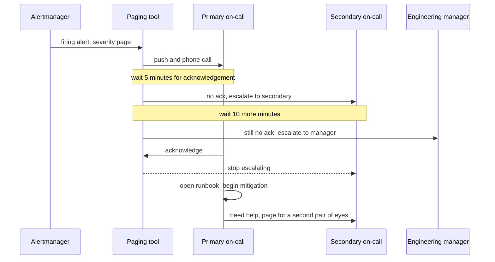
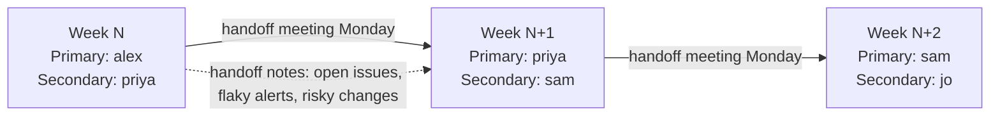

# L14.6 — On-call Practices

> **Level 14: SRE** · Topic 6 of 10 · ⏱ ~4 hours · Difficulty: Intermediate

## 1. What it is

**On-call** means that, for a defined period, a named engineer is reachable and ready to respond to pages about a production service, inside an agreed response time (for example "acknowledge within 5 minutes"). A **page** is an urgent notification, usually a phone push, SMS or phone call, that interrupts whatever the person is doing. The set of rules that decides *who* is on-call, *when* the duty changes hands, *what* they do when paged and *who* they call when they are stuck is the on-call practice.

A good practice has five parts, which are also the five things this topic teaches: a **rotation** (who and when), a **handoff** (how knowledge moves from one shift to the next), **runbooks** (what to do for each known alert), **escalation** (what happens when the first responder cannot fix it or does not answer), and **sustainable load** (how much interruption a human can absorb before quality and health collapse). Google's SRE books treat on-call as a core duty of the role, and the chapter "Being On-Call" in *Site Reliability Engineering* is the standard reference for the balance between responsiveness and burnout.

## 2. Why it matters in DevOps

- **Reliability is a people system.** Your [SLOs](02-slos.md) are only as good as the speed and clarity with which a tired human can respond at 03:00.
- **Burnout is a leading cause of attrition.** Teams with constant night pages lose their best engineers, and the knowledge goes with them.
- **Bad alerts waste the budget twice.** A noisy pager both interrupts people and trains them to ignore it, which delays response to real incidents (see [alert fatigue reduction](08-alert-fatigue-reduction.md)).
- **Developers who carry the pager write better software.** "You build it, you run it" closes the feedback loop: the person who ships a flaky retry loop is the one it wakes.
- **Incidents need a first responder.** The roles in [incident management](05-incident-management.md) assume that someone is on-call to start the process.

## 3. Real-world system example

**Google SRE** describes primary and secondary on-call, with the secondary acting as a backup and, in some teams, handling non-urgent tickets so the primary can focus. The SRE book discusses keeping the interrupt load low enough that engineers have time to investigate properly, and it recommends sizing a rotation so on-call does not come round too often (it gives figures for the minimum team size for single-site and dual-site rotations; treat them as guidance, not law). It also describes teams in two time zones doing **follow-the-sun** shifts so nobody works nights routinely.

**PagerDuty** publishes its incident response documentation openly (the "PagerDuty Incident Response" site), including a "Being On-Call" guide that sets expectations such as being reachable, having a working laptop and connectivity, and being ready to escalate rather than struggle alone.

**Atlassian** publishes an incident management handbook that covers on-call, escalation and ownership; the common thread across these public sources is that every service has a named owning team, layered escalation, and a runbook behind each paging alert.

**Tools:** Prometheus **Alertmanager** routes alerts to receivers; **PagerDuty**, **Opsgenie** and **Grafana OnCall** manage schedules, escalation policies and overrides. The concepts below apply to all of them.

## 4. Diagram

Escalation path when the first responder does not respond:



Weekly rotation and handoff:



## 5. How it works

### Rotation design

| Choice | Options | Guidance |
|--------|---------|----------|
| Shift length | 1 week, 12 hours day/night, 24 hours | One week keeps context together but is tiring if pages are frequent. Shorter shifts suit busy services. |
| Layers | primary only, primary + secondary | Always have a backup. The secondary is who gets paged when the primary misses a page or needs help. |
| Coverage | single site, follow-the-sun | If you have engineers in two or more regions, keep night work out of anyone's routine. |
| Team size | minimum viable rotation | Fewer than about six people means on-call returns too often. Google's SRE book gives a minimum; use it as a sanity check. |
| Eligibility | owners of the service | Shadow first: new members sit as secondary before they go primary. |
| Compensation | pay, time off in lieu, or both | Out-of-hours work must be recognised. Unpaid, unrecognised on-call is a retention risk. |

Fairness rules worth writing down: overrides for holidays and illness are easy and visible in the tool, swaps do not require manager approval, nobody is primary two weeks in a row, and the person who worked a night page starts later the next day.

### Handoff

A handoff is a short written and spoken transfer at the start of each shift. It should cover:

1. **Open incidents and tickets** and who owns them.
2. **Noisy or flaky alerts** seen this week and what was done about them.
3. **Risky changes** planned for the coming week (a migration, a certificate rotation, a big launch).
4. **Quirks** that are not yet in a runbook ("the nightly job spikes CPU at 02:00, ignore").

The outgoing engineer writes it; the incoming one reads it and asks questions. Keep it in the same place every time (a pinned doc or a ticket).

### Runbooks

A **runbook** is the page linked from an alert that tells the responder what the alert means, how to confirm it, and how to mitigate it. The rule: *every paging alert has a runbook URL in its annotations*, and a runbook is reviewed after each incident that used it. A good one has: what the alert means in user terms, a dashboard link, three or four diagnostic commands with expected output, the safe mitigations in order (rollback, flag off, scale up, fail over), who to escalate to and when, and a "last reviewed" date. A runbook that says "investigate" is not a runbook.

### Escalation

An **escalation policy** is the ordered list of who is notified and the delay before the next layer. Typical shape:

| Step | Who | Delay before next step |
|------|-----|------------------------|
| 1 | Primary on-call | 5 min to acknowledge |
| 2 | Secondary on-call | 10 min |
| 3 | Team lead or engineering manager | 15 min |
| 4 | Director or incident-response lead (SEV1 only) | n/a |

Separately, **responders can escalate for help at any time**: "I am out of my depth, page the database owner" is a skill, not a failure. Make it safe to wake someone up when the cost of not doing so is user impact.

### Sustainable load

Google's SRE material suggests an on-call engineer should handle only a small number of distinct events per shift and that time spent on operational work (on-call, tickets, manual tasks) should be capped, so engineers keep time for engineering. Concretely, track these numbers every month:

- **Pages per shift** and **out-of-hours pages per shift**, ideally with a target such as "fewer than two incidents per 12-hour shift".
- **Actionable ratio**: the share of pages that required a human action. Aim for nearly all.
- **Time to acknowledge** and **time to mitigate**.
- **Repeat pages**: the same alert firing again and again means a bug or a bad threshold, not a heroic responder.

If the load exceeds the target, the next sprint's work is reducing it: fix the root cause, automate the mitigation or delete the alert. This links directly to [error budgets](04-error-budgets.md): budget burn that keeps paging people is the signal to stop shipping features.

## 6. Step-by-step guide

**Prerequisites:** Python 3 only. Optional: a free Grafana Cloud or PagerDuty trial account if you want to see a real schedule UI. No cost for the lab itself.

1. **Generate a six-week rotation with primary and secondary.**
   ```bash
   mkdir -p ~/sre-lab && cd ~/sre-lab
   cat > rotation.py <<'EOF'
   #!/usr/bin/env python3
   """Generate a weekly primary/secondary on-call rotation.

   usage: python3 rotation.py START_DATE WEEKS NAME [NAME ...]
     e.g. python3 rotation.py 2026-10-12 6 alex priya sam jo kim lee
   The secondary is always the NEXT person in the list, so every engineer shadows
   before they carry the pager alone.
   """
   import sys
   from datetime import date, timedelta

   if len(sys.argv) < 5:
       sys.exit(__doc__)
   start = date.fromisoformat(sys.argv[1])
   weeks = int(sys.argv[2])
   people = sys.argv[3:]
   if len(people) < 4:
       sys.exit("need at least 4 people for a primary + secondary rotation")

   print(f"{'week starting':14} {'primary':10} {'secondary':10} handoff")
   for w in range(weeks):
       day = start + timedelta(weeks=w)
       primary = people[w % len(people)]
       secondary = people[(w + 1) % len(people)]
       handoff = (day + timedelta(weeks=1)).isoformat()
       print(f"{day.isoformat():14} {primary:10} {secondary:10} Mon {handoff} 10:00 local")
   print(f"\nEach person is primary 1 week in {len(people)} "
         f"({100 / len(people):.1f}% of the time) and secondary 1 week in {len(people)}.")
   EOF
   python3 rotation.py 2026-10-12 6 alex priya sam jo kim lee
   ```
   Expected:
   ```text
   week starting  primary    secondary  handoff
   2026-10-12     alex       priya      Mon 2026-10-19 10:00 local
   2026-10-19     priya      sam        Mon 2026-10-26 10:00 local
   2026-10-26     sam        jo         Mon 2026-11-02 10:00 local
   2026-11-02     jo         kim        Mon 2026-11-09 10:00 local
   2026-11-09     kim        lee        Mon 2026-11-16 10:00 local
   2026-11-16     lee        alex       Mon 2026-11-23 10:00 local

   Each person is primary 1 week in 6 (16.7% of the time) and secondary 1 week in 6.
   ```

2. **Estimate whether your pager load is sustainable.**
   ```bash
   cat > oncall_load.py <<'EOF'
   #!/usr/bin/env python3
   """On-call load estimator.

   usage: python3 oncall_load.py TEAM_SIZE PAGES_PER_WEEK [OUT_OF_HOURS_FRACTION] [MIN_PER_PAGE]
     e.g. python3 oncall_load.py 6 21 0.4 45
   PAGES_PER_WEEK is the total pages the whole rotation receives per week.
   """
   import sys

   if len(sys.argv) < 3:
       sys.exit(__doc__)
   team = int(sys.argv[1])
   pages_week = float(sys.argv[2])
   ooh = float(sys.argv[3]) if len(sys.argv) > 3 else 0.4
   mins = float(sys.argv[4]) if len(sys.argv) > 4 else 45

   shifts_per_year = 52 / team            # one-week primary shifts
   pages_per_shift = pages_week           # the primary takes every page that week
   ooh_pages = pages_per_shift * ooh
   per_day = pages_per_shift / 7
   hours_on_pages = pages_per_shift * mins / 60

   print(f"team size                : {team}")
   print(f"one-week shifts per year : {shifts_per_year:.1f} per engineer")
   print(f"pages per shift          : {pages_per_shift:.1f}  ({per_day:.1f} per day)")
   print(f"out-of-hours pages/shift : {ooh_pages:.1f}  (each can wake someone up)")
   print(f"hands-on time per shift  : {hours_on_pages:.1f} h at {mins:g} min per page")

   verdict = []
   if per_day > 2:
       verdict.append("more than 2 pages per day: not sustainable, fix the alerts first")
   if ooh_pages > 7:
       verdict.append("more than one night-time page per night on average: sleep debt")
   if team < 6:
       verdict.append("small rotation: on-call comes round too often, add people or share across teams")
   print("verdict                  :", "; ".join(verdict) if verdict else "within a sustainable envelope")
   EOF
   python3 oncall_load.py 6 21 0.4 45
   ```
   Expected:
   ```text
   team size                : 6
   one-week shifts per year : 8.7 per engineer
   pages per shift          : 21.0  (3.0 per day)
   out-of-hours pages/shift : 8.4  (each can wake someone up)
   hands-on time per shift  : 15.8 h at 45 min per page
   verdict                  : more than 2 pages per day: not sustainable, fix the alerts first; more than one night-time page per night on average: sleep debt
   ```
   Now try `python3 oncall_load.py 6 5 0.2 30` and compare. The thresholds in the script are illustrative; tune them to your team's agreement.

3. **Write the escalation policy as code** so it is reviewed like any other change. The exact format depends on your tool; this vendor-neutral YAML is what you would translate into PagerDuty, Opsgenie or Grafana OnCall:
   ```yaml
   # escalation-policy.yml  (illustrative, tool-neutral)
   service: shop-api
   urgency_routes:
     page:    # severity=page alerts from Alertmanager
       steps:
         - notify: schedule/shop-api-primary
           wait_minutes: 5
         - notify: schedule/shop-api-secondary
           wait_minutes: 10
         - notify: user/engineering-manager
           wait_minutes: 15
     ticket:  # severity=ticket alerts: never wake anyone
       steps:
         - notify: queue/shop-api-triage
   ```
   Check it parses: `python3 -c "import yaml,sys; print(list(yaml.safe_load(open('escalation-policy.yml'))['urgency_routes']))"` should print `['page', 'ticket']` (needs `pip install pyyaml` if missing).

4. **Route alerts by severity in Alertmanager** so only `severity: page` reaches the phone. This is a minimal, syntactically valid `alertmanager.yml`; replace the placeholders with your own endpoints and keys:
   ```yaml
   route:
     receiver: ticket-queue
     group_by: [alertname, job]
     group_wait: 30s
     group_interval: 5m
     repeat_interval: 4h
     routes:
       - matchers:
           - severity = "page"
         receiver: oncall-pager
         repeat_interval: 1h
   receivers:
     - name: oncall-pager
       pagerduty_configs:
         - routing_key: <YOUR_PAGERDUTY_INTEGRATION_KEY>
     - name: ticket-queue
       webhook_configs:
         - url: https://tickets.example.com/hooks/alertmanager
   ```
   If you have `amtool`, `amtool check-config alertmanager.yml` validates it.

5. **Write the runbook for your first paging alert.** Save as `runbooks/shop-api-error-budget-burn.md`:
   ```markdown
   # Runbook: ShopApiErrorBudgetBurnFast
   Last reviewed: 2026-10-09   Owner: team-shop
   ## What it means
   Checkout errors are burning the 30-day budget 14.4x too fast (about 2% in an hour).
   ## Confirm
   - Dashboard: https://grafana.example.com/d/shop-api-slo
   - `kubectl -n shop get pods` (look for CrashLoopBackOff)
   - `kubectl -n shop rollout history deploy/shop-api` (was there a deploy in the last hour?)
   ## Mitigate, in order
   1. Recent deploy? `kubectl -n shop rollout undo deploy/shop-api`
   2. Database saturated? Disable the heavy feature flag `reports_v2`.
   3. Dependency down? Fail over per the dependency runbook.
   ## Escalate
   After 15 minutes without improvement, page the secondary and declare a SEV2 (see incident management).
   ```

6. **Use a handoff template.** Paste into a pinned ticket and copy it each week:
   ```text
   ON-CALL HANDOFF  week of <DATE>    from: <name>    to: <name>
   Open incidents / tickets : <links>
   Noisy alerts this week   : <alert name, count, action taken>
   Risky changes next week  : <what, when, owner>
   Not yet in a runbook     : <quirks>
   Pages: <n total>, <n out of hours>, <n actionable>
   ```

## 7. Real-world scenario

*Illustrative, not a documented incident.* The `shop-api` team of four has a weekly rotation with no secondary. In one week the primary, Jo, receives 31 pages, 14 out of hours, most from a disk-usage alert on a log volume that fixes itself when logrotate runs. On Thursday at 03:20 a genuine fast-burn page arrives; Jo, after four nights of broken sleep, acknowledges and falls asleep again. Nobody else is paged, and the incident runs 40 minutes before a customer email wakes the team lead.

The review changes three things: add a **secondary** and an escalation step after 5 minutes; delete the disk alert and replace it with a `predict_linear` ticket-severity alert; and grow the rotation to six by borrowing two engineers from the platform team. The next month's report shows 4 pages in the week, 1 out of hours. **Lesson:** the fix for a missed page was not "try harder", it was reducing noise, adding a backup layer and spreading the load.

## 8. Common mistakes and best practices

**Don't**

- Page on things that do not need a human now (disk at 80%, a single pod restart). Send those to a ticket queue.
- Run a rotation with one person and no escalation. A missed page then becomes an outage.
- Let on-call be unpaid, unrecognised or a punishment. Do not schedule someone for back-to-back weeks.
- Keep runbooks in someone's head, or link alerts to wiki pages nobody has opened in a year.
- Treat repeat pages as normal. If the same alert fires weekly, the alert or the system is broken.

**Do**

- Put a runbook link in every page-severity alert and review the runbook after each use.
- Have a primary and a secondary, a documented escalation policy and an easy override process.
- Do a written handoff every shift, including the noisy alerts and upcoming risky changes.
- Track pages per shift, actionable ratio and out-of-hours pages, and reduce them every sprint.
- Let new engineers shadow before going primary, and run mock pages so the first real one is not the first.

## 9. Tasks

- [ ] **T1 — Build a rotation** *(≈20 min, beginner)*
  - **Goal:** generate a fair primary/secondary schedule.
  - **Steps:**
    1. Create `rotation.py` and run it for eight people over eight weeks.
    2. Check that nobody is primary two weeks in a row.
    3. Add a holiday: edit the output by hand so that one person swaps a week with another, and note it as an override.
  - **Done when:** you have an eight-week schedule with one documented override and each person primary exactly once.

- [ ] **T2 — Judge a load** *(≈20 min, beginner)*
  - **Goal:** use numbers to decide whether a rotation is sustainable.
  - **Steps:**
    1. Run `oncall_load.py` for these cases: `4 8`, `6 21 0.4 45`, `8 6 0.1 30`.
    2. For each, write one line saying whether it is sustainable and what you would change first.
    3. Change one threshold in the script to match a target your team might agree on.
  - **Done when:** you have three verdicts and the script reflects your own threshold.

- [ ] **T3 — Write a real runbook** *(≈45 min, intermediate)*
  - **Goal:** produce a runbook a stranger could follow at 3 a.m.
  - **Steps:**
    1. Pick `ShopApiErrorBudgetBurnFast` from [error budgets](04-error-budgets.md) or an alert from your own lab.
    2. Write meaning, confirm commands with expected output, ordered mitigations and escalation.
    3. Ask a teammate to follow it cold and note where they got stuck.
  - **Done when:** a teammate completed the confirm and mitigate steps without asking you a question, and you fixed every gap they found.

- [ ] **T4 — Wire severity routing** *(≈45 min, intermediate)*
  - **Goal:** ensure only urgent alerts page.
  - **Steps:**
    1. Create the `alertmanager.yml` from section 6 (use a local webhook receiver such as a small `python3 -m http.server` handler instead of PagerDuty if you want to see the delivery).
    2. Run `amtool check-config alertmanager.yml` or start Alertmanager and open its status page.
    3. Send a test alert with `curl -XPOST localhost:9093/api/v2/alerts` carrying `severity=page`, then one with `severity=ticket`.
  - **Done when:** the page alert reaches the pager receiver and the ticket alert reaches only the ticket receiver.

- [ ] **T5 — Run a missed-page drill** *(≈45 min, advanced)*
  - **Goal:** feel the escalation path before it matters.
  - **Steps:**
    1. With a teammate as secondary, simulate an alert and have the primary deliberately not acknowledge.
    2. Time how long until the secondary is notified and until a human starts working.
    3. Compare the measured times with the policy in section 5 and fix any gap (wrong phone number, muted app, wrong schedule).
  - **Done when:** you have a timed log from alert to first human action and a list of at least one improvement made.

- [ ] **T6 — Prove it: audit an on-call setup** *(≈60 min, advanced)*
  - **Goal:** assess a rotation without a checklist.
  - **Steps:**
    1. From memory, list the five parts of an on-call practice and one metric for each.
    2. Review a real or invented `shop-api` setup (team of five, 18 pages a week, 60% out of hours, three runbooks for twelve alerts) and write the three highest-value changes.
    3. Present the reasoning in under five minutes.
  - **Done when:** your three changes address noise, runbook coverage and rotation size, each with a measurable target.

## 10. Self-check questions

1. Why is a secondary on-call layer necessary?
2. What must be in the annotations of every paging alert?
3. Name four things that belong in a shift handoff.
4. What is the difference between a page and a ticket, and who decides?
5. What do you do if the same alert pages three times in a week?

<details>
<summary>Answers</summary>

1. People miss pages (asleep, no signal, in the middle of another incident). The secondary prevents a single failure from becoming an unanswered outage and provides a second pair of eyes.
2. A runbook URL (plus a summary that explains impact in user terms and ideally a dashboard link).
3. Open incidents and tickets, noisy or flaky alerts, risky changes coming up, and quirks not yet in a runbook (also the page counts for the week).
4. A page requires immediate human action and wakes someone; a ticket can wait until working hours. The team decides together, using the rule "if no human action is needed now, it is not a page".
5. Treat it as a defect: find the root cause or fix the threshold, add automation for the mitigation, or delete the alert. Track it as a work item, do not normalise it.
</details>

## 11. Further reading

- *Site Reliability Engineering* (Google) — "Being On-Call", "Dealing with Interrupts" and "Eliminating Toil".
- *The Site Reliability Workbook* (Google) — "On-Call" and "Incident Response".
- PagerDuty Incident Response documentation (response.pagerduty.com) — "Being On-Call".
- Prometheus Alertmanager documentation (prometheus.io/docs/alerting) — routing and receivers.
- See also: [Incident Management](05-incident-management.md), [Alert Fatigue Reduction](08-alert-fatigue-reduction.md) and [Observability](../level-00-what-devops-is/10-observability.md).

<!-- nav -->
---
← Previous: [Incident Management](05-incident-management.md) · [Level 14 index](README.md) · Next: [Postmortems](07-postmortems.md) →
