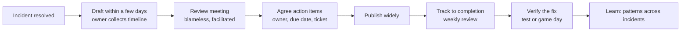
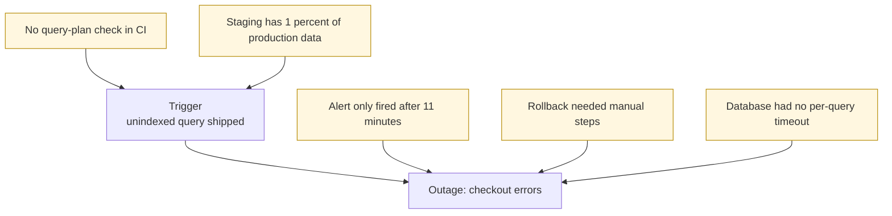

# L14.7 — Postmortems

> **Level 14: SRE** · Topic 7 of 10 · ⏱ ~4 hours · Difficulty: Intermediate

## 1. What it is

A **postmortem** (also called an incident review or retrospective) is a written record of an incident: what happened, what the impact was, how it was detected and fixed, *why it was possible*, and what the organisation will change so it is less likely or less damaging next time. It is written after the incident is resolved, reviewed by people outside the immediate response, and shared widely.

The defining principle is **blamelessness**. A blameless postmortem assumes that everyone involved acted reasonably with the information, tools and incentives they had at the time, and asks what about the *system* made the failure possible: missing guardrails, confusing tooling, absent tests, unclear ownership, time pressure. It does not ask "who messed up?". Google's SRE books ("Postmortem Culture: Learning from Failure" in *Site Reliability Engineering* and the matching chapter in *The Site Reliability Workbook*) are the standard reference, and the idea of a "just culture" in operations was popularised in the industry by writing from Etsy's engineering team.

## 2. Why it matters in DevOps

- **Incidents are the cheapest education you will ever get.** You have already paid the price (downtime, [error budget](04-error-budgets.md)); the postmortem is how you collect the value.
- **Blame hides information.** If admitting a mistake gets you punished, the next person will hide theirs, and the next incident will repeat the same failure with less evidence.
- **Action items are the output.** Without tracked follow-up, a postmortem is a story. With it, it is a reliability investment that competes fairly with feature work.
- **Shared knowledge.** A well-written postmortem teaches the whole company how a subsystem really fails, including people who were not on the call.
- **Feeds the loop.** Findings change [alerts](08-alert-fatigue-reduction.md), [runbooks](06-on-call-practices.md), capacity assumptions and the [error budget policy](04-error-budgets.md).

## 3. Real-world system example

**Google** publishes its approach in the SRE books: postmortems are expected after significant incidents, are blameless, are reviewed, and are kept somewhere searchable so patterns across incidents become visible. The books also describe recognising good postmortem writing, and its on-call training material describes "Wheel of Misfortune" role-play exercises that replay past incidents.

**AWS** publishes "post-event summaries" for major service events. The widely read summary of the February 2017 Amazon S3 event in US-EAST-1 describes an operator running an established playbook command with an input that removed more capacity than intended, and lists changes such as making the tool remove capacity more slowly and adding safeguards against going below minimum capacity. It is a public example of focusing on tooling and guardrails rather than on the individual.

**GitHub** publishes monthly availability reports and detailed write-ups of significant incidents; **Cloudflare** is known for long technical post-incident blog posts with timelines. **Atlassian** publishes its incident-management handbook, including a postmortem process with priority action items and agreed completion deadlines. The shared pattern: a timeline, an honest account of what went wrong, and concrete follow-ups.

## 4. Diagram

The postmortem process:



Why one incident has many causes:



## 5. How it works

### Blameless culture, in practice

| Blameful phrasing | Blameless phrasing |
|-------------------|--------------------|
| "Alex pushed a bad query." | "A change containing an unindexed query passed review and CI." |
| "The on-call should have noticed." | "The alert gave no indication of which deploy to suspect." |
| "Human error." | "The tool allowed an unsafe input without confirmation." |

"Human error" is where analysis starts, not where it ends: ask what made the error easy to make and hard to catch. Blameless does *not* mean unaccountable: people still own action items and still explain their decisions, but the question is "what did you see, and what did you expect?", not "why were you careless?".

### The timeline

The **timeline** is a list of timestamped facts in UTC, written from the incident log (see the scribe tool in [incident management](05-incident-management.md)). Include the trigger, when impact started, when it was detected, each significant decision and why, each mitigation attempt (including the failures), when impact ended and when the incident was closed. Record what people *knew* at the time, not what is known now. From it you compute the key durations:

| Metric | Meaning |
|--------|---------|
| **Time to detect (TTD)** | impact start to first alert or report |
| **Time to mitigate (TTM)** | detection to the moment user impact stops |
| **Time to resolve (TTR)** | impact start to full resolution |
| **Budget consumed** | bad events during the incident divided by the 30-day budget |

### Root cause versus contributing factors

Complex systems rarely fail for a single reason. The **trigger** is the event that started this particular failure (the bad deploy). The **root cause** is the deepest underlying condition that, if fixed, would have prevented the trigger from causing harm (for example, "there is no automated check that stops unindexed queries reaching production"). **Contributing factors** are the other conditions that made it worse or longer: slow detection, a missing runbook, a confusing dashboard, no timeout. Practical guidance:

- Use techniques like **Five Whys** to get beyond the trigger, but stop when the next "why" leaves your control or becomes "because humans are fallible".
- It is fine to name *several* causes. Do not force a single root cause to make the story tidy.
- Separate **what caused it** from **what made it long**: the first drives prevention, the second drives detection and mitigation.
- Include things that went *well* (the alert fired, the rollback worked); these are controls you want to keep.

### Action items

An action item is only useful if it is specific, owned and tracked. Classify each by what it improves:

| Type | Question it answers | Example |
|------|---------------------|---------|
| **Prevent** | How do we stop this class of failure? | Add a query-plan check to CI |
| **Detect** | How do we find it faster? | Alert on p99 query time per route |
| **Mitigate** | How do we shorten the impact? | One-command rollback; per-query timeout |
| **Process** | How do we respond better? | Add the missing step to the runbook |

Each item needs: an ID, a clear verb-first description, a type, a named **owner**, a **due date**, a **ticket** in the normal work tracker, and a priority. Keep the list short (a handful of high-value items beats thirty vague ones) and review completion in a recurring meeting. "Be more careful" and "improve monitoring" are not action items.

## 6. Step-by-step guide

**Prerequisites:** Python 3 and the `inc.sh` scribe from [incident management](05-incident-management.md) (or just a text file). All free and local.

1. **Compute incident timings from the scribe log.** Mark key moments by starting the note text with a tag (`[impact-start]`, `[detected]`, `[mitigated]`, `[resolved]`).
   ```bash
   mkdir -p ~/sre-lab && cd ~/sre-lab
   cat > pm_times.py <<'EOF'
   #!/usr/bin/env python3
   """Compute incident timings from an inc.sh log.

   usage: python3 pm_times.py incident-<id>.log

   Mark key moments in the log with these tags at the start of the note text:
     [impact-start] [detected] [mitigated] [resolved]
   """
   import re
   import sys
   from datetime import datetime

   if len(sys.argv) != 2:
       sys.exit(__doc__)

   TAGS = ("impact-start", "detected", "mitigated", "resolved")
   marks = {}
   for line in open(sys.argv[1]):
       m = re.match(r"(\S+Z)\s+\w+\s+\[([a-z-]+)\]\s*(.*)", line)
       if m and m.group(2) in TAGS:
           marks[m.group(2)] = datetime.strptime(m.group(1), "%Y-%m-%dT%H:%M:%SZ")

   missing = [t for t in TAGS if t not in marks]
   if missing:
       sys.exit(f"missing tags in log: {', '.join(missing)}")

   def mins(a, b):
       return (marks[b] - marks[a]).total_seconds() / 60

   print(f"time to detect   (impact-start -> detected) : {mins('impact-start', 'detected'):6.1f} min")
   print(f"time to mitigate (detected -> mitigated)    : {mins('detected', 'mitigated'):6.1f} min")
   print(f"time to resolve  (impact-start -> resolved) : {mins('impact-start', 'resolved'):6.1f} min")
   print(f"total user impact (impact-start -> mitigated): {mins('impact-start', 'mitigated'):6.1f} min")
   EOF
   cat > sample.log <<'EOF'
   2026-10-09T10:05:00Z NOTE   [impact-start] Deploy 4821 reaches 100% of pods, checkout errors begin
   2026-10-09T10:12:10Z NOTE   [detected] ShopApiErrorBudgetBurnFast pages priya
   2026-10-09T10:15:02Z START  Checkout returns 502 for 30% of users (SEV2)
   2026-10-09T10:15:02Z ROLE   IC=alex
   2026-10-09T10:21:30Z NOTE   Ops proposes rollback of deploy 4821
   2026-10-09T10:24:45Z NOTE   [mitigated] Rollback complete, 5m error ratio falling
   2026-10-09T10:55:00Z NOTE   [resolved] Error ratio below 0.1% for 30 minutes
   EOF
   python3 pm_times.py sample.log
   ```
   Expected:
   ```text
   time to detect   (impact-start -> detected) :    7.2 min
   time to mitigate (detected -> mitigated)    :   12.6 min
   time to resolve  (impact-start -> resolved) :   50.0 min
   total user impact (impact-start -> mitigated):   19.8 min
   ```

2. **Create the postmortem template** `postmortem-template.md`. This is the document you copy for every incident:
   ```bash
   cat > postmortem-template.md <<'EOF'
   # Postmortem: <short title>

   | | |
   |---|---|
   | Incident | INC-<id>, SEV<n> |
   | Date | <YYYY-MM-DD> |
   | Authors | <names> |
   | Status | Draft / In review / Final |
   | Reviewers | <names> |

   ## Summary
   Two or three sentences a stranger can read: what broke, who was affected, how long, how it was fixed.

   ## Impact
   - User impact: <what users saw, how many, which feature>
   - Duration: <minutes> (TTD <m>, TTM <m>, TTR <m>)
   - Error budget consumed: <percent of the 30-day budget>
   - Other: <revenue, support tickets, data loss, SLA exposure>

   ## Timeline (all times UTC)
   | Time | Event |
   |------|-------|
   | HH:MM | Trigger: <change or event> |
   | HH:MM | Impact begins |
   | HH:MM | Detected by <alert or person> |
   | HH:MM | Incident declared SEV<n>, IC <name> |
   | HH:MM | Decision: <what, why, what was known> |
   | HH:MM | Mitigated |
   | HH:MM | Resolved |

   ## Root cause
   The deepest condition that, if fixed, would have prevented this failure.

   ## Contributing factors
   - <factor that made it worse or longer>

   ## What went well
   - <controls and behaviours to keep>

   ## What went poorly
   - <gaps, confusion, luck>

   ## Where we got lucky
   - <things that could have made it worse>

   ## Action items
   | ID | Action | Type | Owner | Due | Ticket |
   |----|--------|------|-------|-----|--------|
   | AI-1 | <verb-first, specific> | prevent/detect/mitigate/process | @name | YYYY-MM-DD | <TICKET-ID> |

   ## Lessons
   What other teams should learn from this.
   EOF
   ```

3. **Lint a postmortem** before it goes to review. The checker enforces that the sections exist and that every action item has an owner, a due date and a ticket.
   ```bash
   cat > pm_lint.py <<'EOF'
   #!/usr/bin/env python3
   """Lint a postmortem Markdown file.

   usage: python3 pm_lint.py postmortem.md
   Checks: required headings, at least one action item row, every action item has an
   owner (@name), a due date (YYYY-MM-DD) and a ticket link or ID.
   """
   import re
   import sys

   if len(sys.argv) != 2:
       sys.exit(__doc__)
   text = open(sys.argv[1], encoding="utf-8").read()
   problems = []

   for h in ["Summary", "Impact", "Timeline", "Root cause", "Contributing factors",
             "What went well", "What went poorly", "Action items", "Lessons"]:
       if not re.search(rf"^##\s+{re.escape(h)}", text, re.M | re.I):
           problems.append(f"missing section: {h}")

   rows = [r for r in text.splitlines() if re.match(r"\|\s*AI-\d+", r)]
   if not rows:
       problems.append("no action items (rows starting with | AI-n)")
   for r in rows:
       cells = [c.strip() for c in r.strip().strip("|").split("|")]
       ident = cells[0]
       if not re.search(r"@\w+", r):
           problems.append(f"{ident}: no owner (@name)")
       if not re.search(r"\d{4}-\d{2}-\d{2}", r):
           problems.append(f"{ident}: no due date")
       if not re.search(r"\b[A-Z]{2,}-\d+\b|https?://", " ".join(cells[1:])):
           problems.append(f"{ident}: no ticket reference")

   for p in problems:
       print("PROBLEM:", p)
   print(f"{len(problems)} problems, {len(rows)} action items")
   sys.exit(1 if problems else 0)
   EOF
   python3 pm_lint.py postmortem-template.md
   ```
   The raw template contains one placeholder row (`AI-1 | <verb-first, specific> | ... | @name | YYYY-MM-DD | <TICKET-ID>`), so it reports problems for the date and ticket. That is the point: a filled-in postmortem must pass with `0 problems`.

4. **Fill in a postmortem for the sample incident** (the unindexed query from [error budgets](04-error-budgets.md)). Start from the template and write the Root cause and Contributing factors honestly. A reasonable pair of examples:
   ```markdown
   ## Root cause
   Nothing in the delivery pipeline checks query plans, so a query that scans the whole orders table reached production.

   ## Contributing factors
   - Staging holds roughly 1% of production data, so the query was fast there.
   - The database has no statement timeout, so slow queries piled up and exhausted the connection pool.
   - The fast-burn alert fired about 7 minutes after impact began and carried no link to the recent deploy.
   - Rollback required three manual steps.
   ```
   And action items that pass the linter:
   ```markdown
   | AI-1 | Add EXPLAIN-based plan check for new queries to CI | prevent | @priya | 2026-10-30 | SHOP-412 |
   | AI-2 | Set statement_timeout of 2s on the API role | mitigate | @jo | 2026-10-16 | SHOP-413 |
   | AI-3 | Add deploy annotation and rollback link to the burn-rate alert | detect | @sam | 2026-10-23 | SHOP-414 |
   | AI-4 | Make rollback a single pipeline button | mitigate | @alex | 2026-11-06 | SHOP-415 |
   ```

5. **Run the review meeting** (30-45 minutes): a facilitator who was not in the incident walks the timeline, asks "what did you see at that point?", records new facts, and then agrees action items with owners. The facilitator's job is to redirect any "who" question into a "what in the system" question.

6. **Track to completion.** Review open postmortem action items in a weekly or fortnightly meeting. An item that is overdue twice is either not important (close it explicitly with a reason) or not resourced (escalate).

## 7. Real-world scenario

*Illustrative, not a documented incident.* After a 20-minute checkout outage the first draft of the `shop-api` postmortem reads "Root cause: engineer deployed an inefficient query". In review the facilitator asks the author what Alex saw before shipping. Alex explains the query was reviewed by two people, passed tests, and ran in 4 ms in staging. The team realises the actual gaps: staging data is too small, there is no plan check, and no timeout protects the pool. The root cause is rewritten as a missing control, and "Alex" disappears from the document except as the person who tried to roll back first.

Six weeks later a different engineer ships a different slow query. CI blocks it with a plan-check failure. **Lesson:** a blameless review changed the system, and the system, not a reminder email, prevented the repeat. The tracked action items were what turned the lesson into a control.

## 8. Common mistakes and best practices

**Don't**

- Write "human error" or a person's name as the root cause.
- Stop at the trigger. Keep asking how it got past review, tests, staging and alerts.
- Produce a postmortem with no owners or deadlines, then never look at it again.
- Hide postmortems. Restricting readership hides patterns and teaches nothing.
- Skip the postmortem for "small" incidents that repeat. Repeats are what budgets are lost to.

**Do**

- Write a draft within a few days while memory is fresh, working from the incident log.
- Put times in UTC and record what people knew at the time.
- List contributing factors, what went well and where you got lucky, not only what failed.
- Keep action items few, specific, owned, ticketed and dated, and review them regularly.
- Share broadly and search past postmortems before designing similar systems.

## 9. Tasks

- [ ] **T1 — Compute the timings** *(≈20 min, beginner)*
  - **Goal:** turn a log into TTD, TTM and TTR.
  - **Steps:**
    1. Create `pm_times.py` and `sample.log` as in section 6.
    2. Run the script and check the four numbers.
    3. Edit the log so the rollback happens 10 minutes later and rerun.
  - **Done when:** time to mitigate increases by 10 minutes and you can say what each metric measures.

- [ ] **T2 — Rewrite the blame** *(≈20 min, beginner)*
  - **Goal:** practise blameless wording.
  - **Steps:**
    1. Rewrite these in system terms: "The intern deleted the wrong table", "Ops ignored the alert", "QA missed the bug", "Sam should have read the docs".
    2. For each, name one control (guardrail, alert, check, doc) that would have helped.
  - **Done when:** four rewritten sentences contain no person as the subject and each names a concrete control.

- [ ] **T3 — Lint and fix** *(≈30 min, intermediate)*
  - **Goal:** use the checker to enforce action-item quality.
  - **Steps:**
    1. Create `pm_lint.py` and a postmortem with two action items, one missing an owner and one missing a ticket.
    2. Run the linter and read the problems.
    3. Fix them until the script prints `0 problems`.
  - **Done when:** the final run exits with status 0 (`echo $?` prints `0`).

- [ ] **T4 — Separate trigger, root cause and contributing factors** *(≈45 min, intermediate)*
  - **Goal:** analyse an incident beyond the trigger.
  - **Steps:**
    1. Take the unindexed-query incident (or a real incident from your work) and write a Five Whys chain.
    2. State the trigger, the root cause and at least three contributing factors, tagging each as "caused it" or "made it longer".
    3. Write one action item of each type: prevent, detect, mitigate, process.
  - **Done when:** you have four action items with owner, due date and ticket, and none says "be more careful".

- [ ] **T5 — Run a mock review** *(≈60 min, advanced)*
  - **Goal:** practise facilitation.
  - **Steps:**
    1. After the capstone mock incident (or any practice incident), gather two or more people.
    2. Have a facilitator who was not the IC walk the timeline and convert every "who" question into a "what in the system" question.
    3. Agree action items live and record them in the template.
  - **Done when:** the postmortem passes `pm_lint.py` and participants confirm the discussion never assigned fault to a person.

- [ ] **T6 — Prove it: read a public postmortem** *(≈60 min, advanced)*
  - **Goal:** analyse an outside incident without notes.
  - **Steps:**
    1. Read a public post-incident report from a cloud provider or a company that publishes them (for example AWS post-event summaries or GitHub availability reports).
    2. Summarise it in the template format: summary, timeline, trigger, root cause, contributing factors, and the fixes they announced.
    3. Classify each fix as prevent, detect, mitigate or process and say which you think was highest value.
  - **Done when:** your one-page summary distinguishes trigger from contributing factors and justifies the highest-value fix.

## 10. Self-check questions

1. What does "blameless" mean, and what does it not mean?
2. What is the difference between a trigger, a root cause and a contributing factor?
3. What four fields must every action item have?
4. Why do postmortems use UTC timestamps and record what people knew at the time?
5. How do you tell a good action item from a bad one?

<details>
<summary>Answers</summary>

1. It means analysing how the system and its incentives made the failure possible, assuming people acted reasonably with what they knew. It does not mean no accountability: owners still deliver action items and explain decisions.
2. The trigger starts the failure (the bad deploy). The root cause is the underlying condition that, if fixed, prevents the trigger from causing harm. Contributing factors are conditions that made impact larger or longer (slow detection, no timeout, no runbook).
3. An owner, a due date, a ticket in the real tracker, and a specific description (type and priority are also recommended).
4. UTC avoids time-zone confusion across responders and logs; recording what was known at the time avoids hindsight bias and shows which information was missing.
5. A good one is specific, verb-first, testable, owned, dated and tied to a cause ("add EXPLAIN check to CI"). A bad one is vague ("improve monitoring", "be more careful").
</details>

## 11. Further reading

- *Site Reliability Engineering* (Google) — "Postmortem Culture: Learning from Failure" and the appendix with an example postmortem.
- *The Site Reliability Workbook* (Google) — "Postmortem Culture" chapter and its postmortem template material.
- John Allspaw, "Blameless PostMortems and a Just Culture" (Etsy engineering blog).
- AWS "post-event summaries" and GitHub availability reports, as examples of public postmortems.
- Atlassian Incident Management Handbook — postmortem process.
- See also: [Incident Management](05-incident-management.md), [Error Budgets](04-error-budgets.md) and [Disaster Recovery](../level-00-what-devops-is/09-disaster-recovery.md).

<!-- nav -->
---
← Previous: [On-call Practices](06-on-call-practices.md) · [Level 14 index](README.md) · Next: [Alert Fatigue Reduction](08-alert-fatigue-reduction.md) →
