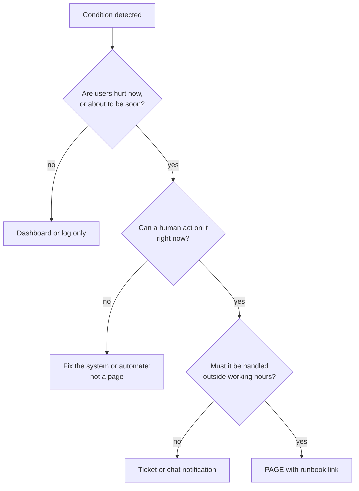
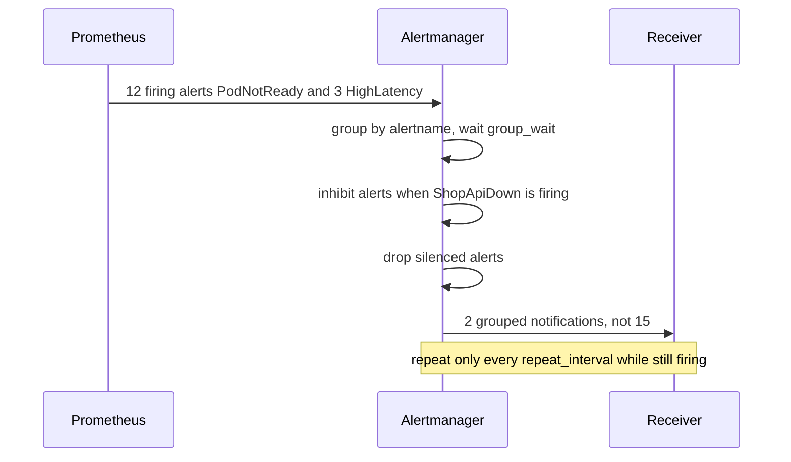

# L14.8 — Alert Fatigue Reduction

> **Level 14: SRE** · Topic 8 of 10 · ⏱ ~4 hours · Difficulty: Intermediate

## 1. What it is

**Alert fatigue** is what happens when people receive so many alerts, or so many low-value ones, that they stop trusting them. They acknowledge without looking, mute channels, delay responding, and eventually miss the one alert that mattered. It is a property of the *alerting system*, not of the people: a pager that cries wolf teaches its audience to ignore wolves.

**Alert fatigue reduction** is the continuous work of making every alert earn its interruption. Four ideas do most of the work and make up this topic: **symptom-based alerts** (page on what users feel, not on every internal cause), **actionable alerts** (each one tells a human something to do right now), **deduplication and grouping** (one problem produces one notification, not forty), and a regular **alert review** (measure, then delete or tune). The foundation is the "Monitoring Distributed Systems" chapter in Google's *Site Reliability Engineering* book, which separates symptoms ("what is broken") from causes ("why") and argues that pages should be rare, urgent and actionable.

## 2. Why it matters in DevOps

- **Missed incidents.** Fatigued responders miss the real page in the noise. Every unanswered alert is a hidden outage.
- **Burnout and attrition.** Night-time pages that need no action are the fastest way to lose good on-call engineers (see [on-call practices](06-on-call-practices.md)).
- **Slower response.** Time to acknowledge grows when people expect false alarms, which burns [error budget](04-error-budgets.md) during real incidents.
- **Wasted effort.** Investigating a symptom-less alert, such as CPU at 85% with healthy latency, takes time away from engineering that would improve reliability.
- **Credibility.** When every page is meaningful, leaders and developers take on-call seriously and fund the fixes.

## 3. Real-world system example

**Google SRE** states the guiding rules in *Site Reliability Engineering* ("Monitoring Distributed Systems", and the section on symptoms versus causes): pages should be about conditions that are urgent, actionable and visible to users; every page should require intelligence, not a robotic response; and alerts that produce no action should be removed or turned into tickets or dashboards. The *Workbook* chapter "Alerting on SLOs" operationalises this with burn-rate alerts that replace many cause-based thresholds. Rob Ewaschuk's widely circulated "My Philosophy on Alerting" (written while at Google) is a short companion that states the same ideas bluntly.

**Prometheus Alertmanager** is the open-source implementation of grouping, inhibition and silencing: it groups alerts with shared labels into one notification, suppresses dependent alerts when a more fundamental one is firing, and mutes alerts during maintenance. **PagerDuty** and **Opsgenie** provide similar grouping, deduplication keys and noise-reduction features, plus analytics for "which alerts wake people most".

**Public examples of the symptom/cause split** exist in most mature monitoring guides, including the Prometheus documentation's alerting practices: alert on user-visible symptoms such as error rate and latency, and keep cause-level metrics for dashboards and diagnosis.

## 4. Diagram

Deciding whether something deserves a page:



What Alertmanager does between a firing alert and your phone:



## 5. How it works

### Symptom-based versus cause-based

| | Cause-based (noisy) | Symptom-based (quiet) |
|---|---------------------|------------------------|
| Examples | CPU above 80%, one pod restarted, disk at 80%, memory above 90% | 5xx ratio above threshold, p99 latency above SLO, SLO burn rate, checkout probe failing |
| What it tells you | A resource is busy; might or might not matter | Users are failing now |
| False positives | Many: busy is often fine | Few |
| Maintenance | Thresholds drift as traffic and hardware change | Tied to the SLO, which changes rarely |
| Where it belongs | Dashboards, tickets, diagnosis | The page |

Cause metrics are still useful, but as **diagnostic context** after the symptom alert fires, and as **ticket-level** alerts for slow-moving risks (a disk predicted to fill in 3 days). The multi-window, multi-burn-rate alerts from [error budgets](04-error-budgets.md) are the canonical symptom alerts: one set per SLO replaces dozens of threshold alerts.

### What makes an alert actionable

Before an alert is allowed to page, it must pass these checks:

1. **Urgent:** waiting until morning makes things materially worse.
2. **Actionable:** there is something a human can do (not "watch it").
3. **Real:** it is almost never a false positive; if it flaps, fix the rule.
4. **Novel:** it is not a duplicate of another alert that will fire at the same time.
5. **Explained:** it carries a summary in user terms, severity, a dashboard link and a runbook URL.
6. **Owned:** it routes to the team that can fix it.

An alert that fails any check is moved down: to a ticket, a dashboard annotation or deleted.

### Deduplication, grouping, inhibition, silences

| Mechanism | What it does | Alertmanager setting |
|-----------|--------------|----------------------|
| **Deduplication** | Identical alerts (same label set) from several Prometheus replicas become one | automatic by label fingerprint |
| **Grouping** | Alerts that share labels such as `alertname` or `job` are sent as one notification | `group_by`, `group_wait`, `group_interval` |
| **Inhibition** | A more fundamental alert suppresses its consequences ("service down" suppresses "high latency") | `inhibit_rules` |
| **Silencing** | Temporary mute for planned work, with an expiry and a reason | UI, `amtool silence add` |
| **Throttling repeats** | Stop re-notifying for the same unresolved problem | `repeat_interval` |
| **`for:` duration** | The condition must hold for N minutes before firing | in the alerting rule |

### Alert review

Treat the alert set like code: review it on a schedule. In a weekly (or per-rotation) 30-minute meeting, look at every page from the last period and for each alert ask: did it lead to action? Was it urgent? Could it be a ticket? Was it a duplicate? Then **delete, tune, demote or keep**, and record the decision. Typical metrics to bring: pages per alert, **actionable ratio** (pages that needed a human action divided by pages), out-of-hours pages, time to acknowledge, and repeat offenders.

## 6. Step-by-step guide

**Prerequisites:** Python 3. For the rules and Alertmanager config, `promtool` / `amtool` (from the Prometheus and Alertmanager release tarballs) are optional for validation; every snippet below is also valid YAML you can check with a YAML parser. All free and local.

1. **Review a week of pages.** Create a CSV that mimics your pager export, then analyse it.
   ```bash
   mkdir -p ~/sre-lab && cd ~/sre-lab
   cat > pages.csv <<'EOF'
   timestamp,alert,action_taken
   2026-10-01T02:10:00Z,DiskUsageHigh,no
   2026-10-02T03:30:00Z,DiskUsageHigh,no
   2026-10-03T01:05:00Z,DiskUsageHigh,no
   2026-10-04T14:00:00Z,DiskUsageHigh,no
   2026-10-05T04:20:00Z,DiskUsageHigh,no
   2026-10-06T02:45:00Z,DiskUsageHigh,no
   2026-10-01T09:00:00Z,HighCPU,no
   2026-10-01T09:30:00Z,HighCPU,no
   2026-10-02T11:00:00Z,HighCPU,no
   2026-10-03T23:30:00Z,HighCPU,yes
   2026-10-04T10:15:00Z,HighCPU,no
   2026-10-03T15:00:00Z,PodRestarted,no
   2026-10-03T15:05:00Z,PodRestarted,no
   2026-10-04T09:00:00Z,PodRestarted,no
   2026-10-05T16:00:00Z,PodRestarted,yes
   2026-10-02T10:12:00Z,ShopApiErrorBudgetBurnFast,yes
   2026-10-05T03:40:00Z,ShopApiErrorBudgetBurnFast,yes
   2026-10-04T21:00:00Z,PostgresReplicaLag,yes
   2026-10-05T22:00:00Z,PostgresReplicaLag,yes
   2026-10-06T21:30:00Z,PostgresReplicaLag,no
   EOF
   cat > alert_review.py <<'EOF'
   #!/usr/bin/env python3
   """Weekly alert review: which pages earn their place?

   usage: python3 alert_review.py pages.csv
   CSV columns: timestamp (ISO, UTC), alert, action_taken (yes/no)
   """
   import csv
   import sys
   from collections import defaultdict
   from datetime import datetime

   if len(sys.argv) != 2:
       sys.exit(__doc__)

   stats = defaultdict(lambda: {"n": 0, "act": 0, "ooh": 0})
   with open(sys.argv[1], newline="") as f:
       for row in csv.DictReader(f):
           hour = datetime.strptime(row["timestamp"], "%Y-%m-%dT%H:%M:%SZ").hour
           s = stats[row["alert"]]
           s["n"] += 1
           s["act"] += row["action_taken"].strip().lower() == "yes"
           s["ooh"] += hour < 8 or hour >= 20     # treat 20:00-08:00 UTC as out of hours

   def advice(s):
       ratio = s["act"] / s["n"]
       if ratio == 0:
           return "DELETE or turn into a ticket: no page led to action"
       if ratio < 0.5:
           return "TUNE: threshold, duration or symptom-based rewrite"
       return "KEEP: mostly actionable"

   total = sum(s["n"] for s in stats.values())
   total_act = sum(s["act"] for s in stats.values())
   print(f"{'alert':30} {'pages':>5} {'actionable':>10} {'out of hrs':>10}  advice")
   for name, s in sorted(stats.items(), key=lambda kv: -kv[1]["n"]):
       print(f"{name:30} {s['n']:>5} {100 * s['act'] / s['n']:>9.0f}% {s['ooh']:>10}  {advice(s)}")
   print(f"\ntotal pages {total}, actionable {100 * total_act / total:.0f}%")
   EOF
   python3 alert_review.py pages.csv
   ```
   Expected:
   ```text
   alert                          pages actionable out of hrs  advice
   DiskUsageHigh                      6         0%          5  DELETE or turn into a ticket: no page led to action
   HighCPU                            5        20%          1  TUNE: threshold, duration or symptom-based rewrite
   PodRestarted                       4        25%          0  TUNE: threshold, duration or symptom-based rewrite
   PostgresReplicaLag                 3        67%          3  KEEP: mostly actionable
   ShopApiErrorBudgetBurnFast         2       100%          1  KEEP: mostly actionable

   total pages 20, actionable 30%
   ```
   Seventy percent of this week's pages were noise, and the noisiest alert (`DiskUsageHigh`) woke someone five times without any action.

2. **See what grouping does to notification volume.**
   ```bash
   cat > dedupe.py <<'EOF'
   #!/usr/bin/env python3
   """Show what grouping does to notification volume.

   usage: python3 dedupe.py alerts.txt [GROUP_WINDOW_MINUTES]
   Each line: ISO_TIMESTAMP alertname instance
   Compares: one notification per alert vs one per (alertname) group per window.
   """
   import sys
   from datetime import datetime, timedelta

   if len(sys.argv) < 2:
       sys.exit(__doc__)
   window = timedelta(minutes=float(sys.argv[2]) if len(sys.argv) > 2 else 5)
   events = []
   for line in open(sys.argv[1]):
       ts, name, inst = line.split()
       events.append((datetime.strptime(ts, "%Y-%m-%dT%H:%M:%SZ"), name, inst))
   events.sort()

   open_group = {}        # alertname -> window start
   grouped = 0
   for ts, name, inst in events:
       start = open_group.get(name)
       if start is None or ts - start > window:
           open_group[name] = ts
           grouped += 1
   print(f"raw alerts           : {len(events)}")
   print(f"notifications grouped: {grouped}  (group_by alertname, window {window.seconds // 60} min)")
   print(f"reduction            : {100 * (1 - grouped / len(events)):.0f}%")
   EOF
   { for i in $(seq 0 11); do printf '2026-10-09T10:0%d:%02dZ PodNotReady shop-api-%d\n' $((i%5)) $((10+i)) $i; done
     for i in 0 1 2; do printf '2026-10-09T10:02:4%dZ HighLatency shop-api-%d\n' $i $i; done
     echo "2026-10-09T11:30:00Z PodNotReady shop-api-1"; } > alerts.txt
   python3 dedupe.py alerts.txt
   ```
   Expected:
   ```text
   raw alerts           : 16
   notifications grouped: 3  (group_by alertname, window 5 min)
   reduction            : 81%
   ```
   Run `python3 dedupe.py alerts.txt 1` to see a 1-minute window produce more notifications (7); the window is a trade-off between latency and noise. This is a simplified model of Alertmanager's `group_by` behaviour, not a re-implementation.

3. **Replace cause alerts with symptom alerts.** Save as `shop-api-alerts.yml`:
   ```yaml
   groups:
     - name: shop-api-noisy-before
       rules:
         # BAD as a page: CPU is a cause, not a symptom.
         - alert: HighCPU
           expr: avg by (instance) (rate(node_cpu_seconds_total{mode!="idle"}[5m])) > 0.8
           labels:
             severity: page

     - name: shop-api-quiet-after
       rules:
         # GOOD page: users are failing. (The full multi-window version lives in the error budgets topic.)
         - alert: ShopApiHighErrorRatio
           expr: |
             sum by (job) (rate(http_requests_total{job="shop-api", code=~"5.."}[5m]))
             /
             sum by (job) (rate(http_requests_total{job="shop-api"}[5m])) > 0.05
           for: 5m
           labels:
             severity: page
           annotations:
             summary: "More than 5% of shop-api requests are failing"
             runbook_url: "https://runbooks.example.com/shop-api/error-ratio"
         # GOOD ticket: a slow, predictable risk. Wakes nobody.
         - alert: ShopApiDiskWillFillIn3Days
           expr: predict_linear(node_filesystem_avail_bytes{mountpoint="/var/lib/docker"}[6h], 3 * 24 * 3600) < 0
           for: 1h
           labels:
             severity: ticket
           annotations:
             summary: "Docker volume predicted to fill within 3 days"
             runbook_url: "https://runbooks.example.com/shop-api/disk"
         # GOOD ticket: repeated restarts are worth a look in working hours.
         - alert: ShopApiCrashLooping
           expr: increase(kube_pod_container_status_restarts_total{namespace="shop"}[1h]) > 5
           labels:
             severity: ticket
           annotations:
             summary: "A shop container restarted more than 5 times in an hour"
             runbook_url: "https://runbooks.example.com/shop-api/crashloop"
   ```
   The disk and restart alerts keep the information but remove the 03:00 interruption. Validate with `promtool check rules shop-api-alerts.yml` if you have it (expected `SUCCESS: 4 rules found`, or 5 once you add `ShopApiDown` in step 4).

4. **Add grouping and inhibition to Alertmanager.** Save as `alertmanager.yml`:
   ```yaml
   route:
     receiver: ticket-queue
     group_by: [alertname, job]
     group_wait: 30s
     group_interval: 5m
     repeat_interval: 4h
     routes:
       - matchers:
           - severity = "page"
         receiver: oncall-pager
         repeat_interval: 1h
   inhibit_rules:
     # If the whole service is down, do not also page for its latency or error ratio.
     - source_matchers:
         - alertname = "ShopApiDown"
       target_matchers:
         - severity =~ "page|ticket"
       equal: [job]
   receivers:
     - name: oncall-pager
       webhook_configs:
         - url: http://localhost:9099/page
     - name: ticket-queue
       webhook_configs:
         - url: http://localhost:9099/ticket
   ```
   Check with `amtool check-config alertmanager.yml` if available. Add the rule that the inhibition refers to, then re-read the config to see the pieces fit:
   ```yaml
   # append to shop-api-quiet-after in shop-api-alerts.yml
   - alert: ShopApiDown
     expr: sum by (job) (up{job="shop-api"}) == 0
     for: 2m
     labels:
       severity: page
     annotations:
       summary: "No shop-api instance is up"
       runbook_url: "https://runbooks.example.com/shop-api/down"
   ```
   An alert never inhibits itself, so `ShopApiDown` still pages. Inhibition only works when the `equal` label (`job` here) is present on both alerts, which is why the rules above aggregate with `sum by (job)`.

5. **Silence for planned work, with an expiry.** With Alertmanager running on `localhost:9093`:
   ```bash
   amtool --alertmanager.url=http://localhost:9093 silence add alertname=ShopApiCrashLooping \
     --duration=2h --author="$USER" --comment="Planned node upgrade, ticket SHOP-420"
   amtool --alertmanager.url=http://localhost:9093 silence query
   ```
   Expect a silence ID and the comment in the query output. A silence without an expiry and a reason is how real alerts get hidden for months.

6. **Schedule the alert review.** Put a recurring 30-minute event in the calendar, bring the output of `alert_review.py` on the real export, and record decisions in a table (alert, action, owner). For each DELETE or TUNE, open a ticket and close it within the sprint.

## 7. Real-world scenario

*Illustrative, not a documented incident.* The `shop-api` team's pager produces 140 pages a month; the on-call dashboard shows an actionable ratio of 22%. Leading offenders are `HighCPU`, `PodRestarted` and `DiskUsageHigh`. After a Friday-night outage the team realises the fast-burn alert did fire, but the engineer on call had been woken by CPU alerts 11 times that week and silenced the pager app for two hours.

The team spends a sprint on noise: it deletes `HighCPU`, converts disk and restarts to ticket alerts, adds grouping and an inhibition rule for `ShopApiDown`, and replaces six threshold alerts with the three burn-rate alerts. A weekly alert review is added to the rotation handoff. A month later: 31 pages, actionable ratio 84%, out-of-hours pages down from 52 to 6. **Lesson:** the answer to fatigue was not a better phone; it was fewer, better alerts, and a recurring habit of checking them.

## 8. Common mistakes and best practices

**Don't**

- Page on resource thresholds (CPU, memory, disk percentage) that users cannot feel.
- Send everything to one channel, one severity and one receiver.
- Silence an alert forever instead of deciding whether it should exist.
- Alert on a metric nobody knows how to act on, or without a runbook.
- Copy a vendor's default alert pack into production without reviewing it.

**Do**

- Page on SLO burn and clear user symptoms; ticket slow-moving risks; dashboard the rest.
- Group, inhibit and set sensible `for:` and `repeat_interval` values.
- Give every alert an owner, severity, summary, dashboard and runbook.
- Measure actionable ratio and out-of-hours pages, and review them on a schedule.
- Treat each non-actionable page as a bug with an owner and a due date.

## 9. Tasks

- [ ] **T1 — Review the pages** *(≈20 min, beginner)*
  - **Goal:** classify alerts by value.
  - **Steps:**
    1. Create `pages.csv` and `alert_review.py` and run the review.
    2. For each alert, write delete, tune, demote to ticket or keep, with one reason.
    3. Compute how many of the 20 pages disappear if you apply your decisions.
  - **Done when:** you have a decision per alert and a projected reduction you can defend (for example 15 of 20).

- [ ] **T2 — Measure grouping** *(≈20 min, beginner)*
  - **Goal:** see the effect of grouping.
  - **Steps:**
    1. Create `alerts.txt` and run `dedupe.py` with windows of 1, 5 and 15 minutes.
    2. Record raw alerts, notifications and reduction for each.
    3. Say which window you would choose for a page route and why.
  - **Done when:** you have a three-row table and a one-sentence justification mentioning the latency trade-off.

- [ ] **T3 — Rewrite cause alerts as symptoms** *(≈45 min, intermediate)*
  - **Goal:** convert noisy alerts to user-focused ones.
  - **Steps:**
    1. List five cause-based alerts from a real or imaginary setup (CPU, memory, restarts, queue depth, disk).
    2. For each, write the user-visible symptom it should map to and the PromQL for that symptom or a ticket-level alternative.
    3. Create `shop-api-alerts.yml` with your versions and, if possible, validate it with `promtool check rules`.
  - **Done when:** every alert in the file has a severity, summary and runbook_url, and at most one of them pages.

- [ ] **T4 — Add inhibition and test it** *(≈45 min, intermediate)*
  - **Goal:** prove that a root alert suppresses its consequences.
  - **Steps:**
    1. Run Alertmanager with the config from section 6 and a tiny webhook receiver (`python3 -m http.server 9099` is enough to see connection attempts, or any request-logging script).
    2. Post a `ShopApiDown` alert and a `ShopApiHighErrorRatio` alert with the same `job` label to `/api/v2/alerts`.
    3. Check the Alertmanager UI to see the second alert shown as inhibited.
  - **Done when:** the UI lists `ShopApiHighErrorRatio` as inhibited and only one notification is delivered.

- [ ] **T5 — Break and fix a flapping alert** *(≈45 min, advanced)*
  - **Goal:** understand `for:` and thresholds.
  - **Steps:**
    1. Write a unit test with `promtool test rules` where the error ratio oscillates above and below the threshold every minute and observe the alert states.
    2. Add `for: 5m` and re-test so that it no longer fires on the oscillation.
    3. Add a second test with a sustained 10-minute breach and confirm it still fires.
  - **Done when:** the flapping test passes with no alert, the sustained test passes with the alert, and you can explain the delay you introduced.

- [ ] **T6 — Prove it: run an alert review** *(≈60 min, advanced)*
  - **Goal:** lead a review without the guide.
  - **Steps:**
    1. With a teammate, take a week of real or invented pages (at least 30 rows) and run the analysis.
    2. Facilitate a 30-minute review that ends with a decision, owner and date for each alert.
    3. Define the three numbers you will track next month to prove it worked.
  - **Done when:** you have a written decision table and targets for actionable ratio, pages per week and out-of-hours pages.

## 10. Self-check questions

1. Why is "CPU above 80%" usually a bad paging alert?
2. List four properties a paging alert must have.
3. What is the difference between grouping, inhibition and silencing?
4. What does the `for:` clause in a Prometheus alerting rule do?
5. What would you measure to prove an alert-reduction effort worked?

<details>
<summary>Answers</summary>

1. CPU is a cause, not a user-visible symptom; high CPU is often normal and harmless, so the alert pages people without anything to do. Page on error rate, latency or SLO burn instead and use CPU for diagnosis.
2. Urgent, actionable, real (low false-positive rate), not a duplicate, owned, and linked to a runbook with a user-impact summary.
3. Grouping merges related alerts into one notification; inhibition suppresses dependent alerts while a more fundamental alert is firing; silencing temporarily mutes matching alerts for a fixed time with a reason.
4. It requires the expression to remain true for the stated duration before the alert fires, which filters short blips and flapping.
5. Pages per week, out-of-hours pages, actionable ratio, and time to acknowledge, compared before and after; ideally also that no incidents were missed.
</details>

## 11. Further reading

- *Site Reliability Engineering* (Google) — "Monitoring Distributed Systems".
- *The Site Reliability Workbook* (Google) — "Alerting on SLOs".
- Rob Ewaschuk, "My Philosophy on Alerting" (a Google SRE essay widely shared online).
- Prometheus documentation (prometheus.io/docs) — "Alerting" and "Alertmanager" (grouping, inhibition, silences) and best practices on alerting.
- See also: [Error Budgets](04-error-budgets.md), [On-call Practices](06-on-call-practices.md) and [What to Monitor](../level-10-observability/11-what-to-monitor.md).

<!-- nav -->
---
← Previous: [Postmortems](07-postmortems.md) · [Level 14 index](README.md) · Next: [Capacity Planning](09-capacity-planning.md) →
