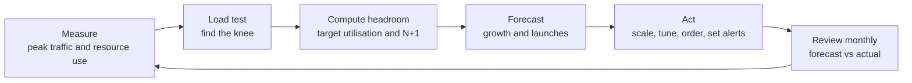
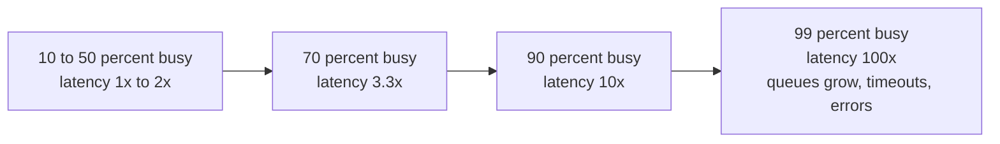

# L14.9 — Capacity Planning

> **Level 14: SRE** · Topic 9 of 10 · ⏱ ~5 hours · Difficulty: Intermediate

## 1. What it is

**Capacity planning** is the practice of making sure a service always has enough resources (CPU, memory, disk, network, database connections, instances, money) to serve the load users will put on it, with margin to spare, without paying for far more than it needs. It answers three questions: how much can we handle *today* (measured by **load testing**), how much do we use at peak and how much slack remains (**headroom**), and when will we run out (**forecasting**). A fourth idea, **saturation**, explains why the answer is never "we can run at 100%": as a resource approaches full utilisation, queues build, latency explodes and errors start long before the hardware is technically maxed out.

Google's SRE books treat capacity as part of reliability: *Site Reliability Engineering* discusses capacity planning in its chapters on software engineering in SRE and on handling overload and cascading failures, and the **Four Golden Signals** (latency, traffic, errors, saturation) put saturation next to the signals your [SLIs](01-slis.md) are built from.

## 2. Why it matters in DevOps

- **Outages from success.** A marketing campaign, a launch or a seasonal peak can double traffic. If the system was only ever tested at today's load, the first discovery of its limit happens in production, in public.
- **Error budget.** Overload burns [error budget](04-error-budgets.md) fast: latency SLOs fail first, then availability.
- **Cost.** Over-provisioning "to be safe" wastes real money every month. Planning replaces fear with numbers (see also [autoscaling for cost](../level-20-cost-optimization/04-autoscaling-for-cost.md)).
- **Lead times.** Some capacity takes weeks to arrive: database instance class changes, reserved capacity, hardware, quota increases. You must forecast further ahead than the lead time.
- **Resilience maths.** Losing one node or one zone shifts its load to the survivors; without headroom a small failure cascades into a large one.

## 3. Real-world system example

**Retail peaks.** Large e-commerce platforms plan for predictable peak events. Shopify has written publicly about load-testing its platform ahead of Black Friday and Cyber Monday with in-house tooling, and Amazon publishes guidance in the AWS Well-Architected Framework (Reliability pillar) to test that scaling works and to design for demand changes. The consistent pattern: rehearse the peak at or above expected traffic well before it happens, and fix whatever breaks.

**Netflix** wrote publicly about predictive autoscaling (an internal system named Scryer in its technology blog) that uses historical daily patterns to scale before the evening peak rather than reacting after latency rises; the idea of combining reactive and predictive scaling is now offered by cloud providers as a managed feature.

**Google** describes in the SRE book how overload is handled: load shedding, graceful degradation and per-client limits protect the system when demand exceeds capacity, while capacity planning aims to make that the exception.

**Kubernetes** gives the primitives: resource requests and limits ([requests and limits](../level-08-kubernetes/14-resource-requests-and-limits.md)), the Horizontal Pod Autoscaler ([HPA](../level-08-kubernetes/16-horizontal-pod-autoscaling.md)), and cluster autoscaling. Planning decides the numbers that go into them.

## 4. Diagram

The capacity planning loop:



Why saturation hurts before you reach 100 percent (mean response time grows as service time divided by one minus utilisation):



## 5. How it works

### Load testing

A **load test** applies controlled, increasing traffic to a copy of the system and records throughput, latency percentiles and error rate. The goal is to find the **knee**: the load at which latency or errors stop being acceptable. Types:

| Test | Question it answers | Shape |
|------|--------------------|-------|
| **Load** | Does it meet the SLO at expected peak? | ramp to expected peak and hold |
| **Stress** | Where does it break and how does it fail? | ramp past peak until errors rise |
| **Soak** | Does it leak memory, connections or disk over hours? | steady load for hours |
| **Spike** | Can it absorb a sudden burst and recover? | sudden jump up and back |
| **Capacity (step)** | What is the max sustainable throughput? | stepped increases, one level at a time |

Rules for honest results: use production-like data volume and configuration, keep dependencies realistic (a mocked database that answers in 1 ms proves nothing), drive the test from a separate machine, use **open-loop** load (requests start on schedule even if earlier ones are slow, like real users) and watch percentiles rather than averages. Do not load-test production dependencies you do not own, and tell people first.

### Headroom

**Headroom** is the unused capacity you deliberately keep. Define it from the knee of your load test and the failures you must survive:

```text
safe capacity per instance  = knee throughput x target utilisation   (for example 80 rps x 0.6 = 48 rps)
instances needed            = ceil(forecast peak / safe capacity per instance)
fleet size                  = instances needed + redundancy           (N+1, or one zone's worth)
```

Typical choices: plan to run at **50-70%** of the tested knee at peak, keep **N+1** so the loss of one instance (or N+2 / one availability zone for critical tiers) still leaves you under the knee, and include autoscaling lead time: if new capacity takes 5 minutes to become ready, headroom must cover the traffic that arrives in those 5 minutes.

### Saturation

**Saturation** is the degree to which a resource has more work than it can process promptly, shown by queues. Measure it per resource using the **USE method** (Utilization, Saturation, Errors) and the golden signals:

| Resource | Utilization | Saturation signal |
|----------|-------------|-------------------|
| CPU | `1 - idle` fraction | run queue length, load average per core, container CPU throttling |
| Memory | used vs available | swapping, page faults, OOM kills |
| Disk | busy time, space used | I/O wait, queue depth |
| Network | bandwidth used | drops, retransmits |
| Connection pool | connections in use / max | requests waiting for a connection |
| Thread or worker pool | busy workers | queue length, rejected tasks |

Saturation is usually a better alert and a better capacity signal than raw utilisation, because it says the resource is already costing users time. See [what to monitor](../level-10-observability/11-what-to-monitor.md).

### Forecasting

A **forecast** projects demand forward so you can order capacity before you need it. Start simple and honest:

- **Organic growth:** fit a trend to weekly peak traffic (linear or compound) and extrapolate. Re-fit regularly; do not trust a forecast longer than a few quarters.
- **Seasonality:** daily, weekly and yearly cycles. Compare peak to peak, not average to average.
- **Known events:** launches, campaigns and migrations get explicit multipliers from the business, added on top of the trend.
- **Resource-per-request changes:** a new feature may double CPU per request; track cost per request as well as request volume.
- **Lead time:** order or provision when the forecast crosses (safe limit minus lead time).

Always state the **forecast, the assumptions and the date you will check it**, then compare actual with forecast each month. The error in the forecast teaches you more than the forecast.

## 6. Step-by-step guide

**Prerequisites:** Python 3.10 or newer (for `statistics.linear_regression`). All free and local; the toy service runs on `127.0.0.1:8081`. The numbers are similar to, not identical to, what you will see: they depend on your machine.

1. **Start a toy service with a known capacity.** It has 4 worker slots and each request takes 50 ms, so its theoretical capacity is 4 / 0.05 = 80 requests per second; beyond a small queue it sheds load with `503`.
   ```bash
   mkdir -p ~/sre-lab/capacity && cd ~/sre-lab/capacity
   cat > toyapi.py <<'EOF'
   #!/usr/bin/env python3
   """A toy 'shop-api' with a known capacity: WORKERS slots x 1/SERVICE_S requests per second."""
   import threading
   import time
   from http.server import BaseHTTPRequestHandler, ThreadingHTTPServer

   WORKERS = 4
   SERVICE_S = 0.05          # 50 ms of 'work' per request  ->  capacity = 4 / 0.05 = 80 req/s
   MAX_QUEUE = 20            # more than this many waiting -> 503 (load shedding)

   slots = threading.Semaphore(WORKERS)
   waiting = 0
   lock = threading.Lock()

   class H(BaseHTTPRequestHandler):
       def do_GET(self):
           global waiting
           with lock:
               if waiting >= MAX_QUEUE:
                   self.send_response(503); self.end_headers(); return
               waiting += 1
           with slots:
               with lock:
                   waiting -= 1
               time.sleep(SERVICE_S)
           self.send_response(200); self.end_headers(); self.wfile.write(b"ok")
       def log_message(self, *a):
           pass

   ThreadingHTTPServer(("127.0.0.1", 8081), H).serve_forever()
   EOF
   python3 toyapi.py &
   sleep 1 && curl -s -o /dev/null -w "%{http_code}\n" localhost:8081/
   ```
   Expected: `200`.

2. **Write an open-loop step load tester** (standard library only, so it works anywhere; for real systems prefer `k6`, `hey`, `wrk` or `vegeta`).
   ```bash
   cat > loadtest.py <<'EOF'
   #!/usr/bin/env python3
   """Step load test: python3 loadtest.py URL RATE1 RATE2 ... [--secs N]

   Open-loop: requests are started on schedule whether or not earlier ones finished,
   which is how real users behave (they do not wait for the server to catch up).
   """
   import http.client
   import sys
   import time
   from concurrent.futures import ThreadPoolExecutor
   from urllib.parse import urlparse

   args = sys.argv[1:]
   secs = 5
   if "--secs" in args:
       i = args.index("--secs")
       secs = float(args[i + 1])
       del args[i:i + 2]
   if len(args) < 2:
       sys.exit(__doc__)
   u = urlparse(args[0])
   rates = [float(r) for r in args[1:]]

   def hit():
       t0 = time.perf_counter()
       try:
           c = http.client.HTTPConnection(u.hostname, u.port, timeout=10)
           c.request("GET", u.path or "/")
           code = c.getresponse().status
           c.close()
       except Exception:
           code = 0
       return code, time.perf_counter() - t0

   def pct(xs, p):
       xs = sorted(xs)
       return xs[min(len(xs) - 1, int(p * len(xs)))]

   print(f"{'target rps':>10} {'achieved':>9} {'errors':>7} {'p50 ms':>7} {'p99 ms':>7}")
   with ThreadPoolExecutor(max_workers=200) as pool:
       for rate in rates:
           futs = []
           start = time.perf_counter()
           n = int(rate * secs)
           for k in range(n):
               wait = start + k / rate - time.perf_counter()
               if wait > 0:
                   time.sleep(wait)
               futs.append(pool.submit(hit))
           res = [f.result() for f in futs]
           dur = time.perf_counter() - start
           ok = [t for c, t in res if c == 200]
           err = sum(1 for c, _ in res if c != 200)
           print(f"{rate:>10.0f} {len(ok) / dur:>9.1f} {100 * err / len(res):>6.1f}% "
                 f"{pct([t for _, t in res], 0.5) * 1000:>7.0f} {pct([t for _, t in res], 0.99) * 1000:>7.0f}")
   EOF
   python3 loadtest.py http://127.0.0.1:8081/ 20 40 60 80 100 140 --secs 5
   ```
   Expected output, similar to:
   ```text
   target rps  achieved  errors  p50 ms  p99 ms
           20      20.0    0.0%      52      64
           40      39.8    0.0%      51      60
           60      59.6    0.0%      51      56
           80      78.9    0.0%      72      95
          100      78.9   16.8%     292     313
          140      65.4   41.1%     279     629
   ```
   Read it like an SRE: up to 60 rps latency is flat at about 50 ms; at 80 rps (the theoretical capacity) the median starts rising as queues form; at 100 rps throughput is stuck near 79 rps, latency is six times higher and 17% of requests are shed. The **knee is around 70-80 rps**. Stop the service when done: `kill %1`.

3. **Turn the knee into a headroom plan.** With a knee of 80 rps per instance, a peak of 240 rps, a 60% target utilisation, and 8% monthly growth:
   ```bash
   cat > headroom.py <<'EOF'
   #!/usr/bin/env python3
   """Headroom calculator.

   usage: python3 headroom.py PEAK_RPS RPS_PER_INSTANCE [TARGET_UTIL] [GROWTH_PCT_PER_MONTH] [MONTHS]
     e.g. python3 headroom.py 240 80 0.6 8 6
   TARGET_UTIL is the busiest you want instances to run at peak (0.6 = 60 %).
   Adds N+1: the fleet must still carry the peak with one instance lost.
   """
   import math
   import sys

   if len(sys.argv) < 3:
       sys.exit(__doc__)
   peak = float(sys.argv[1])
   per = float(sys.argv[2])
   util = float(sys.argv[3]) if len(sys.argv) > 3 else 0.6
   growth = float(sys.argv[4]) / 100 if len(sys.argv) > 4 else 0.0
   months = int(sys.argv[5]) if len(sys.argv) > 5 else 6

   print(f"{'month':>5} {'peak rps':>9} {'instances':>9} {'with N+1':>8} {'util at peak':>13} {'util if 1 lost':>15}")
   for m in range(months + 1):
       demand = peak * (1 + growth) ** m
       need = math.ceil(demand / (per * util))
       fleet = need + 1
       print(f"{m:>5} {demand:>9.0f} {need:>9} {fleet:>8} "
             f"{100 * demand / (fleet * per):>12.0f}% {100 * demand / ((fleet - 1) * per):>14.0f}%")
   EOF
   python3 headroom.py 240 80 0.6 8 6
   ```
   Expected:
   ```text
   month  peak rps instances with N+1  util at peak  util if 1 lost
       0       240         5        6           50%             60%
       1       259         6        7           46%             54%
       2       280         6        7           50%             58%
       3       302         7        8           47%             54%
       4       327         7        8           51%             58%
       5       353         8        9           49%             55%
       6       381         8        9           53%             60%
   ```
   Even with one instance lost, utilisation stays at or below the 60% target. Without the extra instance, losing one of five would push the remaining four to 75% (240 / 320), above your target.

4. **See why you cannot run hot.**
   ```bash
   cat > saturation.py <<'EOF'
   #!/usr/bin/env python3
   """Why latency explodes near saturation (M/M/1 queue model).

   usage: python3 saturation.py [SERVICE_TIME_MS]
   Mean response time = S / (1 - utilization).  A model, not a measurement, but it
   shows the shape every real service follows.
   """
   import sys

   s = float(sys.argv[1]) if len(sys.argv) > 1 else 50.0
   print(f"service time {s:g} ms")
   print(f"{'utilization':>11} {'mean response ms':>17} {'x service time':>15}")
   for u in (0.10, 0.30, 0.50, 0.60, 0.70, 0.80, 0.90, 0.95, 0.99):
       r = s / (1 - u)
       print(f"{u * 100:>10.0f}% {r:>17.0f} {r / s:>14.1f}x")
   EOF
   python3 saturation.py
   ```
   Expected: `50%` busy gives `100` ms (2.0x), `90%` gives `500` ms (10.0x), `99%` gives `5000` ms (100.0x). Real services differ in detail, but the hockey-stick shape is universal.

5. **Forecast when you run out.** Twelve weeks of weekly peak traffic and a tested ceiling of 400 rps for the whole fleet:
   ```bash
   cat > forecast.py <<'EOF'
   #!/usr/bin/env python3
   """Linear capacity forecast.

   usage: python3 forecast.py peaks.csv CAPACITY_RPS [SAFE_FRACTION]
   peaks.csv: one 'week,peak_rps' row per line (header allowed).
   Fits a straight line, projects forward and reports when demand crosses the
   safe limit (CAPACITY_RPS x SAFE_FRACTION, default 0.7).
   """
   import csv
   import sys
   from statistics import linear_regression

   if len(sys.argv) < 3:
       sys.exit(__doc__)
   xs, ys = [], []
   for row in csv.reader(open(sys.argv[1])):
       try:
           xs.append(float(row[0]))
           ys.append(float(row[1]))
       except ValueError:
           continue                      # header line
   cap = float(sys.argv[2])
   safe = cap * (float(sys.argv[3]) if len(sys.argv) > 3 else 0.7)

   slope, intercept = linear_regression(xs, ys)
   print(f"trend: peak rps = {intercept:.1f} + {slope:.2f} x week   ({len(xs)} points)")
   last = xs[-1]
   print(f"latest fitted peak : {intercept + slope * last:.0f} rps  (safe limit {safe:.0f}, hard limit {cap:.0f})")
   if slope <= 0:
       print("no growth trend: no exhaustion date")
   else:
       wk = (safe - intercept) / slope
       hard = (cap - intercept) / slope
       print(f"safe limit crossed : week {wk:.1f}  ({max(wk - last, 0):.1f} weeks from now)")
       print(f"hard limit crossed : week {hard:.1f}  ({max(hard - last, 0):.1f} weeks from now)")
   EOF
   printf 'week,peak_rps\n1,100\n2,104\n3,111\n4,113\n5,121\n6,124\n7,131\n8,138\n9,141\n10,149\n11,153\n12,160\n' > peaks.csv
   python3 forecast.py peaks.csv 400
   ```
   Expected:
   ```text
   trend: peak rps = 93.2 + 5.47 x week   (12 points)
   latest fitted peak : 159 rps  (safe limit 280, hard limit 400)
   safe limit crossed : week 34.1  (22.1 weeks from now)
   hard limit crossed : week 56.1  (44.1 weeks from now)
   ```
   If ordering new capacity takes 8 weeks, you must start by week 26. Add a known event (for example, a 2x launch spike in week 20) by hand and see how much earlier the date moves.

6. **Alert on saturation and on the runway, not just utilisation.** In Prometheus (rule syntax; adjust metric names to your exporters):
   ```yaml
   groups:
     - name: shop-api-capacity
       rules:
         # symptom of saturation: requests are waiting for a database connection
         - alert: ShopApiDbPoolSaturated
           expr: avg_over_time(db_pool_waiting_requests{job="shop-api"}[5m]) > 5
           for: 10m
           labels:
             severity: ticket
           annotations:
             summary: "shop-api requests are queueing for database connections"
             runbook_url: "https://runbooks.example.com/shop-api/db-pool"
         # runway: the disk will be full within a week
         - alert: ShopApiDiskRunway7d
           expr: predict_linear(node_filesystem_avail_bytes{mountpoint="/var/lib/postgresql"}[24h], 7 * 24 * 3600) < 0
           for: 2h
           labels:
             severity: ticket
           annotations:
             summary: "Postgres volume predicted to fill within 7 days"
             runbook_url: "https://runbooks.example.com/shop-api/disk"
   ```
   Both are tickets: they give days of warning, not a 3 a.m. page (see [alert fatigue reduction](08-alert-fatigue-reduction.md)).

7. **Put the plan in version control.** One page per service: knee (with the date and test setup), target utilisation, redundancy rule, forecast with assumptions, lead times, and the next review date.

## 7. Real-world scenario

*Illustrative, not a documented incident.* The `shop-api` team launches a "flash sale" email at 12:00. Normal peak is 240 rps; the email lifts traffic to 520 rps within three minutes. The service has five instances with a 80 rps knee each (400 rps total) and an autoscaler that takes about six minutes to add capacity. At 12:03 median latency climbs from 50 ms to 300 ms, then database connection waits appear, retries amplify the load, and the fast-burn alert pages the on-call at 12:08. The team scales manually to 12 instances and the service recovers at 12:15; a day's worth of error budget is gone.

The postmortem finds three planning gaps: nobody told engineering about the email, the load test had only gone to 300 rps, and scale-out lead time exceeded the ramp. Actions: a launch calendar that feeds the forecast, a quarterly step test to 2x expected peak, pre-scaling before announced events, a request rate limit with graceful degradation for non-checkout routes, and a saturation ticket alert on the database pool. **Lesson:** capacity failures are usually communication and rehearsal failures before they are technical ones.

## 8. Common mistakes and best practices

**Don't**

- Plan for the average. Plan for the peak, including its shape and speed.
- Run a load test against a tiny dataset or with mocked dependencies and trust the result.
- Aim for 100% utilisation. Queueing makes latency explode long before that.
- Forecast far ahead from a few weeks of data, or forget known events like launches.
- Load-test production dependencies or third-party APIs without permission.

**Do**

- Find the knee with a step test, then run at 50-70% of it at peak, with N+1 or better.
- Measure saturation (queues, waits, throttling) as well as utilisation.
- Account for lead times: autoscaler warm-up, instance class changes, quota requests, purchases.
- Re-run the load test after major changes and at least quarterly; store results with the date.
- Compare forecast to actuals each month and publish both the forecast and its assumptions.
- Keep a release valve: rate limiting, load shedding and degraded modes (see [rate limiting](../level-12-advanced-networking/13-rate-limiting.md)).

## 9. Tasks

- [ ] **T1 — Find the knee** *(≈30 min, beginner)*
  - **Goal:** locate the capacity of a service empirically.
  - **Steps:**
    1. Run the toy service and `loadtest.py` as in section 6.
    2. Identify the first step where p50 rises noticeably and the first step with errors.
    3. State your knee in requests per second.
  - **Done when:** you have a table like the one above and a written knee (around 70-80 rps) with the evidence.

- [ ] **T2 — Change the capacity** *(≈30 min, beginner)*
  - **Goal:** predict, then confirm, the effect of a change.
  - **Steps:**
    1. Predict the new capacity if `WORKERS` becomes 8 and then if `SERVICE_S` becomes 0.025.
    2. Restart the service with each change and rerun the step test up to 200 rps.
    3. Compare prediction with result.
  - **Done when:** both predictions (160 rps each) are within about 25% of the measured knee (the Python client itself becomes a limit at high rates, so treat the result as approximate).

- [ ] **T3 — Size a fleet with N+1** *(≈30 min, intermediate)*
  - **Goal:** convert a knee and a forecast into an instance count.
  - **Steps:**
    1. Run `python3 headroom.py 200 80 0.6 5 12` (peak 200 rps, 80 rps per instance, 60% target, 5% monthly growth, 12 months).
    2. Find the month in which the instances needed (before adding N+1) first reach 7, then work out by hand how many instances you would need to survive losing one of three equal zones.
    3. Record the assumptions.
  - **Done when:** you report month 8 for the seventh instance (needed 7, fleet 8 with N+1) and can explain the "util if 1 lost" column.

- [ ] **T4 — Forecast with an event** *(≈45 min, intermediate)*
  - **Goal:** combine trend and a known spike.
  - **Steps:**
    1. Generate a `peaks.csv` for your own invented service (at least 10 weeks) and run `forecast.py`.
    2. Add a planned launch that doubles traffic in week 20 and decide when you must order capacity given a 6-week lead time.
    3. Write the date and the assumptions in a half-page plan.
  - **Done when:** the plan states the order date, which is earlier than the pure-trend date.

- [ ] **T5 — Break it and watch saturation** *(≈45 min, advanced)*
  - **Goal:** observe queueing and load shedding live.
  - **Steps:**
    1. Run the toy service and, in a second terminal, a step test that goes to 200 rps.
    2. Capture the latency and error columns, then reduce `MAX_QUEUE` to 5 and repeat.
    3. Explain what the smaller queue changes about latency and errors, and when each setting is preferable.
  - **Done when:** you have two result tables and can explain the trade-off between longer queues (higher latency, fewer errors) and shorter queues (lower latency, more rejections).

- [ ] **T6 — Prove it: capacity plan for shop-api** *(≈90 min, advanced)*
  - **Goal:** produce a one-page capacity plan without the guide.
  - **Steps:**
    1. Load-test any service you can run locally (the toy service, or `shop-api` in Docker) with a tool of your choice and record the knee.
    2. Choose target utilisation and redundancy, compute fleet sizes for six months of growth, and define two saturation alerts.
    3. Present it, including what would make the plan wrong.
  - **Done when:** the plan has a measured knee, a justified target utilisation, a forecast with stated assumptions, a review date and two alert definitions.

## 10. Self-check questions

1. Why shouldn't you run a service at 100% of its tested capacity?
2. What is the difference between utilisation and saturation?
3. What does N+1 mean for capacity?
4. Name three kinds of load test and what each tests.
5. Why do you forecast peak rather than average traffic?

<details>
<summary>Answers</summary>

1. Queueing delay grows sharply as utilisation approaches 100%, so latency and errors rise before the resource is "full"; you also need slack for failures, deploys and bursts.
2. Utilisation is how busy a resource is; saturation is how much work is waiting because the resource cannot keep up (queues, throttling, waits). Saturation means users are already paying.
3. The fleet is sized so that if one instance (or one zone) fails, the rest can still carry the peak under the target utilisation.
4. For example: load (meets SLO at expected peak), stress (where and how it breaks), soak (leaks over long periods), spike (absorbs and recovers from bursts), step/capacity (maximum sustainable throughput).
5. Failures happen at the peak, not on average; an average hides the short bursts that saturate the system and burn error budget.
</details>

## 11. Further reading

- *Site Reliability Engineering* (Google) — chapters on "Handling Overload", "Addressing Cascading Failures" and "Software Engineering in SRE" (capacity planning).
- *The Site Reliability Workbook* (Google) — chapters on SLO engineering and on non-abstract large system design.
- AWS Well-Architected Framework — Reliability pillar (testing scaling and managing demand).
- Brendan Gregg, "The USE Method" (utilisation, saturation, errors) and *Systems Performance*.
- Documentation for `k6`, `vegeta`, `wrk` or `hey` for real load generation.
- See also: [Horizontal and Vertical Scaling](../level-13-databases-distributed-systems/10-horizontal-and-vertical-scaling.md), [Auto Scaling](../level-06-cloud-aws/02-auto-scaling.md) and [Error Budgets](04-error-budgets.md).

<!-- nav -->
---
← Previous: [Alert Fatigue Reduction](08-alert-fatigue-reduction.md) · [Level 14 index](README.md) · Next: [Reliability Engineering](10-reliability-engineering.md) →
