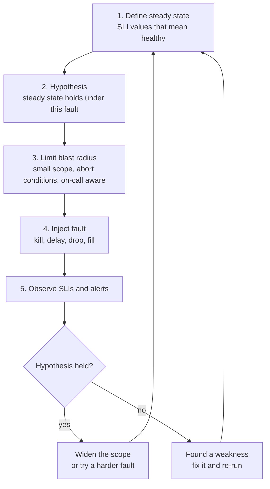
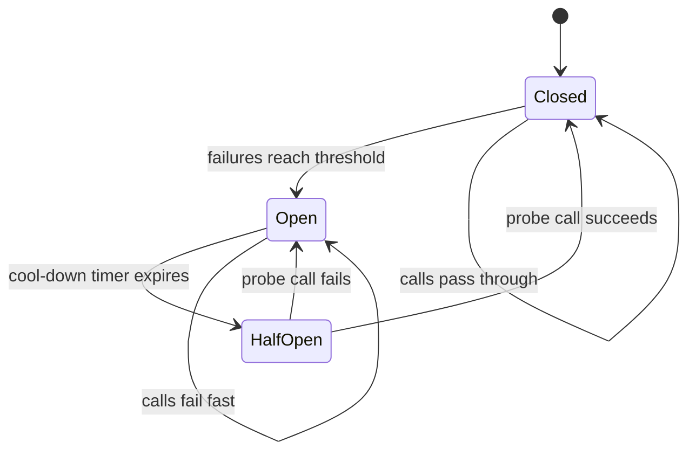

# L14.10 — Reliability Engineering

> **Level 14: SRE** · Topic 10 of 10 · ⏱ ~5 hours · Difficulty: Advanced

## 1. What it is

**Reliability engineering** is the proactive half of SRE: instead of only responding to failures, you remove the work that keeps you busy and you build, then test, the system's ability to survive failure. This topic joins four connected practices:

- **Toil reduction and automation.** *Toil* is operational work that is manual, repetitive, automatable, tactical and has no lasting value, and that grows in proportion to the size of the service. Automating it frees engineers to improve the system.
- **Resilience patterns.** Design techniques such as timeouts, retries with backoff, circuit breakers, bulkheads, load shedding and graceful degradation that let a service keep working when a dependency or a component does not.
- **Chaos engineering.** The discipline of experimenting on a system on purpose, with a hypothesis and a limited blast radius, to find weaknesses before they find you.
- **Game days.** Scheduled, rehearsed exercises where a team injects failure (or replays an incident) and practises detection, response and recovery together.

Google's *Site Reliability Engineering* book defines toil and the goal of capping operational work in its chapter "Eliminating Toil", and *The Site Reliability Workbook* has a chapter of the same name; the *Principles of Chaos Engineering* manifesto defines the experiment loop used below.

## 2. Why it matters in DevOps

- **Toil does not scale.** If every new customer means more manual steps, the team's time disappears into operations and reliability work never happens. Capping toil protects engineering time.
- **Failure is normal.** Disks fill, nodes disappear, dependencies slow down. A system that has never been tested against these is only assumed to be resilient.
- **Resilience patterns can backfire.** Retries without backoff turn a small outage into a self-inflicted overload; poorly configured timeouts hold resources open. Patterns must be understood and tested together.
- **Practice shortens incidents.** Teams that rehearse [incident response](05-incident-management.md) and [on-call](06-on-call-practices.md) find the gaps in runbooks, alerts and permissions in a calm exercise instead of at 3 a.m.
- **Budget use.** Healthy [error budget](04-error-budgets.md) is permission to run experiments; exhausted budget is a reason to prioritise this work.

## 3. Real-world system example

**Google** describes in the SRE book that SRE teams should spend no more than about half their time on operational work, keeping the rest for engineering projects that reduce future toil; it also runs company-wide disaster-recovery exercises (known publicly as DiRT, Disaster Recovery Testing) that deliberately take services away to test whether teams and systems cope.

**Netflix** popularised chaos engineering: Chaos Monkey, which randomly terminates instances in production so that services must tolerate instance loss, was created during its move to AWS and later joined by other tools in a "Simian Army"; Netflix engineers co-authored the *Principles of Chaos Engineering*. The open-source Chaos Monkey is now part of the Spinnaker project.

**Amazon** is associated with "GameDay" exercises (credited publicly to Jesse Robbins) in which failures are simulated against production-like systems. **AWS** now offers **Fault Injection Service (FIS)** as a managed way to run experiments such as stopping instances or adding latency. In the Kubernetes world, **Chaos Mesh** and **LitmusChaos** (both CNCF projects) provide declarative fault injection, and **Gremlin** is a commercial platform.

**Resilience libraries and proxies** such as Resilience4j (JVM), Polly (.NET), Envoy and Istio ([service mesh](../level-12-advanced-networking/09-service-mesh.md)) package timeouts, retries and circuit breaking so each team does not reinvent them.

## 4. Diagram

The chaos experiment loop:



The circuit breaker state machine:



## 5. How it works

### Toil

The SRE book characterises toil as work that is **manual**, **repetitive**, **automatable**, **tactical** (interrupt-driven rather than strategic), has **no enduring value**, and **scales linearly** with the size of the service. Not all operational work is toil: designing a capacity plan or writing a postmortem is overhead but not toil, because it has lasting value. Process for tackling it:

1. **Inventory.** Everyone logs recurring manual tasks for two to four weeks: what, how often, how long.
2. **Rank by payback.** Hours saved per month versus hours to automate. Start with short payback periods.
3. **Automate or eliminate.** Often the best fix is to remove the need (a self-healing component, a safer default), not to script the task.
4. **Measure.** Track toil as a percentage of team time and review it quarterly.

Automation levels: documented steps, then a script run by a human, then a script run by a pipeline, then self-service, then a fully automatic system. Each step reduces both effort and error. Automation is software: version it, review it, test it, and give it the same alerting as production code (see [infrastructure automation](../level-00-what-devops-is/06-infrastructure-automation.md)).

### Resilience patterns

| Pattern | What it does | Watch out for |
|---------|--------------|---------------|
| **Timeouts** | Never wait forever for a dependency; every network call has a deadline | Set below the caller's own deadline so total time is bounded |
| **Retries with exponential backoff and jitter** | Retry transient failures with growing, randomised delays | Retries multiply load; cap attempts; retry only idempotent operations (see [idempotency](../level-13-databases-distributed-systems/14-idempotency.md)) |
| **Circuit breaker** | After repeated failures stop calling the dependency for a while and fail fast | Choose thresholds and cool-down carefully; see [circuit breakers](../level-12-advanced-networking/14-circuit-breakers.md) |
| **Bulkhead** | Isolate resources (thread pools, connection pools, queues) per dependency so one failure cannot starve everything | Sizing the compartments |
| **Load shedding and rate limiting** | Reject excess work early to protect the work you can do | Decide what to drop first (see [rate limiting](../level-12-advanced-networking/13-rate-limiting.md)) |
| **Graceful degradation / fallback** | Serve a reduced answer (cached, default, partial) when a dependency fails | A degraded answer must be safe and clearly acceptable |
| **Redundancy and failover** | N+1 instances, multiple zones, replicas | Test the failover; untested failover is a hope |
| **Health checks and self-healing** | Detect unhealthy instances and replace them | See [liveness and readiness probes](../level-08-kubernetes/15-liveness-and-readiness-probes.md) |
| **Safe deploys** | Canary, progressive rollout, instant rollback | See [canary deployments](../level-05-cicd/12-canary-deployments.md) |

The combination matters. A retry policy without a circuit breaker amplifies an outage; a breaker without a fallback just fails faster. The simulation in section 6 shows the numbers.

### Chaos engineering

A good experiment follows the loop in the diagram. Practical rules:

- **Start in a staging or test environment**, then graduate to production for services with good observability and rollback, and only when the [error budget](04-error-budgets.md) is healthy.
- **Define the steady state in SLI terms** (error ratio, latency percentile), not in "the pods are running".
- **Keep the blast radius small** (one instance, 1% of traffic, one zone) and write **abort conditions** ("stop if the 5-minute error ratio exceeds 2%").
- **Tell people**: the on-call and anyone whose service is in scope. Chaos is not a surprise attack.
- **Fix what you find**, then repeat the experiment as an automated regression check.

Typical faults: kill an instance or pod, add latency or packet loss to a dependency, fail DNS, fill a disk, exhaust a connection pool, expire a certificate, take a zone away, return errors from a downstream.

### Game days

A **game day** is a scheduled exercise with a plan: scenario, scope, roles, abort criteria, observers and a debrief. Variants: **tabletop** (talk through a scenario, no systems touched), **wheel of misfortune** (an experienced engineer plays the system and a trainee debugs it, described in Google's SRE material), **fault injection game day** (real faults in staging or controlled production), and **disaster recovery drill** (restore from backup, fail over a region; see [failure scenario drills](../level-15-disaster-recovery/10-failure-scenario-drills.md)). The output is the same as a postmortem: findings with owners and due dates.

## 6. Step-by-step guide

**Prerequisites:** Linux or macOS shell, Python 3, `curl`. No Docker or cloud account is needed, and everything is free. (Section 3 mentions Chaos Mesh, Litmus and AWS FIS; apply them later on a throwaway `kind` cluster or a sandbox account.) Run the long-lived commands in separate terminals.

1. **Inventory your toil and rank it by payback.**
   ```bash
   mkdir -p ~/sre-lab/reliability && cd ~/sre-lab/reliability
   cat > toil.csv <<'EOF'
   task,times_per_month,minutes_each,build_hours
   Restart stuck queue worker,12,15,6
   Rotate TLS certificate by hand,2,60,10
   Create customer sandbox environment,20,30,16
   Clean full disk on build runner,8,20,3
   Copy logs for support requests,15,10,12
   Manual database failover test,1,120,40
   EOF
   cat > toil.py <<'EOF'
   #!/usr/bin/env python3
   """Toil inventory: how much time does manual work eat, and what is worth automating?

   usage: python3 toil.py toil.csv [ENGINEERS] [HOURS_PER_ENGINEER_MONTH]
   CSV columns: task, times_per_month, minutes_each, build_hours (to automate)
   """
   import csv
   import sys

   if len(sys.argv) < 2:
       sys.exit(__doc__)
   eng = int(sys.argv[2]) if len(sys.argv) > 2 else 4
   cap = eng * (float(sys.argv[3]) if len(sys.argv) > 3 else 140)

   rows = []
   with open(sys.argv[1], newline="") as f:
       for r in csv.DictReader(f):
           monthly_h = float(r["times_per_month"]) * float(r["minutes_each"]) / 60
           build = float(r["build_hours"])
           payback = build / monthly_h if monthly_h else float("inf")
           rows.append((r["task"], monthly_h, build, payback))
   rows.sort(key=lambda x: x[3])

   total = sum(r[1] for r in rows)
   print(f"{'task':32} {'hours/month':>11} {'build h':>8} {'payback (months)':>17}")
   for task, m, b, p in rows:
       print(f"{task:32} {m:>11.1f} {b:>8.0f} {p:>17.1f}")
   print(f"\ntotal toil: {total:.1f} h/month = {100 * total / cap:.1f}% of {eng} engineers' time ({cap:.0f} h)")
   print("Google's SRE guidance is to keep toil under 50% of an SRE's time; aim far lower.")
   EOF
   python3 toil.py toil.csv 4
   ```
   Expected:
   ```text
   task                             hours/month  build h  payback (months)
   Clean full disk on build runner          2.7        3               1.1
   Create customer sandbox environment     10.0       16               1.6
   Restart stuck queue worker               3.0        6               2.0
   Copy logs for support requests           2.5       12               4.8
   Rotate TLS certificate by hand           2.0       10               5.0
   Manual database failover test            2.0       40              20.0

   total toil: 22.2 h/month = 4.0% of 4 engineers' time (560 h)
   Google's SRE guidance is to keep toil under 50% of an SRE's time; aim far lower.
   ```
   The sandbox environment is the best target: it costs 10 hours a month and repays an automation project in under two months. Real inventories are usually much worse than this sample.

2. **Compare resilience strategies with a simulation.** The script models a dependency that fails 20% of calls at random and is completely down for the middle third of 600 requests.
   ```bash
   cat > resilience_demo.py <<'EOF'
   #!/usr/bin/env python3
   """Compare client strategies against a flaky dependency (pure simulation, no network).

   usage: python3 resilience_demo.py [SEED]
   Scenario: 600 requests. The dependency is healthy for the first 200, completely
   down for the next 200 and healthy again for the last 200. 20 % of healthy calls
   also fail at random (a transient error).
   """
   import random
   import sys

   random.seed(int(sys.argv[1]) if len(sys.argv) > 1 else 7)
   N, TRANSIENT = 600, 0.20

   def dependency_ok(i):
       if 200 <= i < 400:
           return False                       # hard outage
       return random.random() > TRANSIENT     # otherwise 20 % transient failures

   class Breaker:
       """closed -> open after 5 straight failures -> half-open probe after 20 requests."""
       def __init__(self):
           self.fails, self.opened_at = 0, None
       def allow(self, i):
           return self.opened_at is None or i - self.opened_at >= 20
       def record(self, ok, i):
           if ok:
               self.fails, self.opened_at = 0, None
           else:
               self.fails += 1
               if self.fails >= 5:
                   self.opened_at = i

   def run(name, retries, use_breaker, fallback):
       calls = good = served = 0
       br = Breaker()
       for i in range(N):
           ok = False
           for attempt in range(retries + 1):
               if use_breaker and not br.allow(i):
                   break                      # fail fast: do not call the dependency
               calls += 1
               ok = dependency_ok(i)
               if use_breaker:
                   br.record(ok, i)
               if ok:
                   break
           if ok:
               good += 1
               served += 1
           elif fallback:
               served += 1                    # degraded answer (cached or default)
       print(f"{name:34} dependency calls {calls:>5} ({calls / N:4.2f}/request)  "
             f"fully correct {100 * good / N:5.1f}%  user got an answer {100 * served / N:5.1f}%")

   run("1 naive: no retry", 0, False, False)
   run("2 retry x3", 3, False, False)
   run("3 retry x3 + circuit breaker", 3, True, False)
   run("4 retry x3 + breaker + fallback", 3, True, True)
   EOF
   python3 resilience_demo.py
   ```
   Output similar to (exact figures vary with the seed):
   ```text
   1 naive: no retry                  dependency calls   600 (1.00/request)  fully correct  51.2%  user got an answer  51.2%
   2 retry x3                         dependency calls  1299 (2.17/request)  fully correct  66.7%  user got an answer  66.7%
   3 retry x3 + circuit breaker       dependency calls   520 (0.87/request)  fully correct  66.5%  user got an answer  66.5%
   4 retry x3 + breaker + fallback    dependency calls   519 (0.86/request)  fully correct  66.5%  user got an answer 100.0%
   ```
   Read it: retries fix transient errors (51% to 67%) but more than double the calls to a dependency that is already struggling; the breaker removes that amplification during the outage; the fallback is what keeps users served at all. Try seeds 1 to 5.

3. **Build a chaos lab: a web server, a supervisor and a probe.** The supervisor restarts the server if it dies, which is a stand-in for systemd or a Kubernetes Deployment.
   ```bash
   mkdir -p site && echo hello > site/index.html
   cat > supervise.sh <<'EOF'
   #!/usr/bin/env bash
   # Restart the web server whenever it dies (a very small stand-in for systemd or Kubernetes).
   # usage: ./supervise.sh [restart|norestart]
   cd site
   while true; do
     python3 -m http.server 8082 --bind 127.0.0.1 >/dev/null 2>&1 &
     echo $! > ../server.pid
     wait $!
     [ "${1:-restart}" = "norestart" ] && break
     sleep 0.5
   done
   EOF
   cat > probe.sh <<'EOF'
   #!/usr/bin/env bash
   # usage: ./probe.sh SECONDS   - hit the service 5 times a second and report availability
   end=$((SECONDS + ${1:-20})); ok=0; total=0
   while [ $SECONDS -lt $end ]; do
     code=$(curl -m 0.4 -s -o /dev/null -w '%{http_code}' http://127.0.0.1:8082/ || true)
     total=$((total + 1)); [ "$code" = "200" ] && ok=$((ok + 1))
     sleep 0.2
   done
   awk -v ok=$ok -v t=$total 'BEGIN { printf "availability during experiment: %.1f%% (%d of %d probes)\n", 100*ok/t, ok, t }'
   EOF
   cat > chaos.sh <<'EOF'
   #!/usr/bin/env bash
   # usage: ./chaos.sh SECONDS INTERVAL - kill the web server every INTERVAL seconds
   end=$((SECONDS + ${1:-20}))
   while [ $SECONDS -lt $end ]; do
     sleep "${2:-5}"
     kill "$(cat server.pid)" 2>/dev/null && echo "chaos: killed server pid $(cat server.pid) at +${SECONDS}s"
   done
   EOF
   chmod +x supervise.sh probe.sh chaos.sh
   ```

4. **Run the experiment.** Hypothesis: *with a supervisor, killing the server once every 10 seconds keeps availability at or above 95%.* Blast radius: a local toy server. Abort condition: none needed.
   ```bash
   # terminal 1
   ./supervise.sh restart
   # terminal 2: start the probe first, then immediately start chaos in terminal 3
   ./probe.sh 20
   # terminal 3
   ./chaos.sh 20 10
   ```
   Expected, similar to: two `chaos: killed server ...` lines, and `availability during experiment: 97.8% (89 of 91 probes)`. The hypothesis holds: the system recovers from the fault by itself, and the few failed probes are the half-second restart gap.

5. **Break the hypothesis, learn something.** Run again with the interval shortened to 3 seconds (`./chaos.sh 20 3`) and you will see roughly 85% availability: the restart gap now matters because failures come more often. Then stop the supervisor and run `./supervise.sh norestart` instead; after the first kill, availability collapses (about 26% over a 12-second run). That is what "no self-healing" costs, in a number. Press `Ctrl-C` in terminal 1 to finish; run `kill "$(cat server.pid)"` if a stray server remains.

6. **Plan a game day.** Fill in this page and run it as a tabletop first:
   ```text
   GAME DAY PLAN  shop-api  <DATE>  duration 90 min
   Scenario     : primary database becomes unreachable for 10 minutes during peak
   Hypothesis   : checkout error ratio stays below 2% because of read replica + cached prices
   Scope        : staging environment, then 5% of production if staging passes
   Roles        : Game master <name> (injects, can abort), IC <name>, Ops <name>, Scribe <name>, Observer <name>
   Abort when   : 5m error ratio above 5% in production, or any data-loss signal
   Comms        : #gameday channel, on-call notified, status page not used
   Success      : detected by alert within 5 min, mitigated within 15 min, runbook was enough
   Debrief      : blameless review within 2 days; action items with owners
   ```

## 7. Real-world scenario

*Illustrative, not a documented incident.* The `shop-api` team notices that every few weeks an overloaded recommendations service makes checkout slow. The checkout code retries recommendations three times with a 10-second timeout and no breaker. In a game day against staging they inject 2 seconds of latency into the recommendations service. The hypothesis, "checkout p99 stays under 500 ms", fails within a minute: threads pile up waiting, the connection pool exhausts and checkout times out.

Fixes, in order of value: make recommendations optional (a fallback of "popular items" from cache), add a 300 ms timeout, one retry with jitter, and a breaker; put recommendations in their own bulkhead (separate pool). They re-run the experiment and the hypothesis now holds; they add the experiment to the weekly CI-triggered test. Two months later the real recommendations service has an outage; checkout error ratio does not move and nobody is paged. **Lesson:** the chaos experiment converted a vague worry into a specific defect, and the fix was a combination of patterns, each necessary.

## 8. Common mistakes and best practices

**Don't**

- Confuse all operational work with toil. Capacity planning and postmortems are engineering, not toil.
- Add retries everywhere with no backoff, no cap and no idempotency. That is how outages grow.
- Run chaos in production without observability, rollback, a hypothesis, abort conditions or telling the on-call.
- Treat a game day as a test the team can fail. It is a rehearsal designed to find gaps.
- Automate a broken process. Fix or remove the process first, then automate.

**Do**

- Track toil as a percentage of time and spend a fixed share of each sprint removing it.
- Set a timeout on every network call, and make retries bounded, jittered and limited to idempotent operations.
- Combine patterns: timeout, retry, breaker, bulkhead, fallback; test them together.
- Define steady state with SLIs, start small, and widen the blast radius as confidence grows.
- Turn every finding into a ticket with an owner, and re-run the experiment as a regression test.

## 9. Tasks

- [ ] **T1 — Rank your toil** *(≈30 min, beginner)*
  - **Goal:** quantify manual work and pick the best automation target.
  - **Steps:**
    1. Create `toil.csv` with at least eight real or realistic recurring tasks from your own work.
    2. Run `toil.py` and read the payback column.
    3. Choose the top target and justify it in two sentences.
  - **Done when:** you have a ranked table and a written justification that cites payback time.

- [ ] **T2 — Experiment with resilience parameters** *(≈45 min, intermediate)*
  - **Goal:** see how settings change outcomes.
  - **Steps:**
    1. Run `resilience_demo.py` with five different seeds and note the ranges.
    2. Change retries to 1, then 5, and the breaker threshold to 3 and 10.
    3. Record dependency calls per request and the "user got an answer" percentage for each combination.
  - **Done when:** you can state which parameters raised load on the failing dependency and which protected it.

- [ ] **T3 — Run the kill experiment** *(≈30 min, intermediate)*
  - **Goal:** observe self-healing in a number.
  - **Steps:**
    1. Create the three scripts and run the experiment in section 6 with a 10-second kill interval.
    2. Record availability.
    3. Repeat with a 3-second interval and with `norestart`.
  - **Done when:** you have three availability numbers (about 98%, about 85%, much lower) and one sentence on what each teaches.

- [ ] **T4 — Improve the system under test** *(≈60 min, advanced)*
  - **Goal:** fix a weakness found by chaos.
  - **Steps:**
    1. Modify `supervise.sh` to run two servers on ports 8082 and 8083, and modify `probe.sh` to try 8082 first and fall back to 8083 (a stand-in for a load balancer).
    2. Update `chaos.sh` to kill one server at random.
    3. Re-run the 3-second-interval experiment.
  - **Done when:** availability under the 3-second chaos rises clearly above the single-server result (for example above 95%) and you can explain why redundancy beat faster restarts.

- [ ] **T5 — Write and run a tabletop game day** *(≈60 min, advanced)*
  - **Goal:** rehearse a failure scenario with others.
  - **Steps:**
    1. Fill in the game day plan from section 6 for a scenario relevant to `shop-api` (database failover, expired certificate, bad deploy).
    2. Gather at least two people, assign the roles, and talk through detection, mitigation and communication.
    3. Write findings as postmortem-style action items (see [postmortems](07-postmortems.md)).
  - **Done when:** the plan and at least three findings with owners and due dates are written down.

- [ ] **T6 — Prove it: a resilience review** *(≈60 min, advanced)*
  - **Goal:** assess a design without notes.
  - **Steps:**
    1. For a service that calls three dependencies (payments, inventory, recommendations), list for each: timeout, retry policy, breaker, fallback and bulkhead.
    2. Say which dependency may degrade gracefully and which must fail the request.
    3. Design one chaos experiment per dependency with a hypothesis and abort condition.
  - **Done when:** you have a table of nine decisions, three experiments, and can explain why retries can make an outage worse.

## 10. Self-check questions

1. List four characteristics of toil. Give an example of work that is overhead but not toil.
2. Why can retries make an outage worse, and what two mechanisms limit the damage?
3. What are the steps of a chaos experiment?
4. What is a game day, and how does it differ from a chaos experiment?
5. What is the difference between a circuit breaker and a bulkhead?

<details>
<summary>Answers</summary>

1. Manual, repetitive, automatable, tactical (interrupt-driven), no enduring value, scales with service size. Overhead but not toil: writing a postmortem, planning capacity, interviewing.
2. Each retry adds load to a dependency that is already struggling, multiplying traffic when it can least cope. Limit with backoff plus jitter and a retry cap, and with a circuit breaker that stops calls during a sustained failure (also retry only idempotent operations).
3. Define steady state, form a hypothesis, limit the blast radius and set abort conditions, inject the fault, observe, then either widen scope or fix the weakness and repeat.
4. A game day is a scheduled team exercise (scenario, roles, debrief) that practises people and process as well as systems; a chaos experiment is the technical hypothesis test. A game day often contains chaos experiments.
5. A breaker stops calling a failing dependency for a while (fail fast); a bulkhead isolates resource pools so one failing dependency cannot consume the resources needed by others.
</details>

## 11. Further reading

- *Site Reliability Engineering* (Google) — "Eliminating Toil", "Handling Overload", "Addressing Cascading Failures", "Testing for Reliability".
- *The Site Reliability Workbook* (Google) — "Eliminating Toil" and "Engagement Model" chapters.
- *Principles of Chaos Engineering* (principlesofchaos.org) and *Chaos Engineering* (Rosenthal and Jones, O'Reilly).
- Netflix Technology Blog posts on Chaos Monkey and the Simian Army; Chaos Mesh, LitmusChaos and AWS Fault Injection Service documentation.
- *Release It!* by Michael Nygard — stability patterns including timeouts, circuit breakers and bulkheads.
- See also: [Site Reliability Engineering](../level-00-what-devops-is/11-sre.md), [Incident Management](05-incident-management.md) and [Failure Scenario Drills](../level-15-disaster-recovery/10-failure-scenario-drills.md).

<!-- nav -->
---
← Previous: [Capacity Planning](09-capacity-planning.md) · [Level 14 index](README.md) · Next: [Level capstone project](99-capstone-project.md) →
