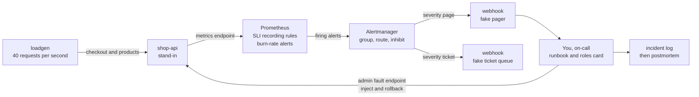
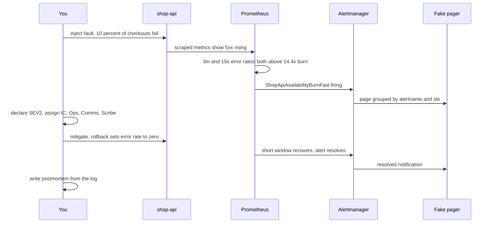

# L14 Capstone — Reliability for shop-api: SLOs, burn-rate alerts and a mock incident

> **Level 14: SRE** · Capstone · ⏱ ~12 hours

## 1. Goal and outcome

Take the `shop-api` sample app from "we think it is fine" to "we can prove how reliable it is and we know what to do when it is not". On your laptop you will:

- Define **SLIs and SLOs** for the checkout journey (availability and latency), document them, and compare them with a hypothetical customer **SLA**.
- Turn the SLOs into an **error budget policy** and **multi-window, multi-burn-rate alerts** in Prometheus and Alertmanager, with unit tests.
- Route pages to a fake pager, write the **on-call runbook** for the alert, and check every alert against the "actionable" test.
- Run a **mock incident (a game day)**: inject a bad-deploy failure, get paged, run the response with named roles and a scribe log, mitigate, and watch the alerts clear.
- Write a blameless **postmortem** with a timeline, impact in error budget, contributing factors and tracked action items.

You finish with a repeatable lab, an SLO document, a rules file, a runbook, an incident log and a postmortem: the artifacts a real SRE team keeps.

| Topics exercised | Where |
|------------------|-------|
| [01 SLIs](01-slis.md) | Milestone 1 |
| [02 SLOs](02-slos.md), [03 SLAs](03-slas.md) | Milestone 2 |
| [04 Error budgets](04-error-budgets.md), [08 Alert fatigue reduction](08-alert-fatigue-reduction.md) | Milestone 3 |
| [06 On-call practices](06-on-call-practices.md) | Milestone 4 |
| [05 Incident management](05-incident-management.md), [09 Capacity planning](09-capacity-planning.md), [10 Reliability engineering](10-reliability-engineering.md) | Milestone 5 |
| [07 Postmortems](07-postmortems.md) | Milestone 6 |

The approach follows the ideas in Google's *Site Reliability Engineering* book and *The Site Reliability Workbook* (the chapters on service level objectives, "Alerting on SLOs", incident response and postmortem culture).

## 2. Architecture

Everything runs in five containers. The app exposes Prometheus-format metrics and has a fault-injection endpoint so you can create incidents on demand.



The mock incident, end to end (lab time is about 20 times faster than production time, see Milestone 3):



## 3. Prerequisites and cost

- **Cost:** free. Everything is local containers; no cloud account.
- **Machine:** about 2 GB RAM free, 1 GB disk, Docker with Compose v2, Python 3.9+ on the host (for the calculators, no packages needed), `curl`.
- **Time shape:** the live parts take minutes, not days, because the lab rules use windows scaled down by 20 (Milestone 3). The real-window rules are checked with `promtool` and the simulator.
- **Prior reading:** the topic files linked in section 1. You can do the capstone with them open.
- **Verification note:** the Python scripts (app, load generator, rule generator, simulator, webhook) were run in the authoring sandbox, the generated rules were parsed with a PromQL parser and the YAML files were loaded,
  and the simulator output below is real. The authoring sandbox had no Docker daemon, so the Compose stack, `promtool`, `amtool` and Alertmanager routing were **not run there**: ports, timings and alert states in sample output
  are "similar to" what you will see, and you should run the `promtool` and `amtool` checks yourself. All URLs, keys and addresses are placeholders.

## 4. Build it step by step

### Milestone 0 — Start the lab

Create a working directory and the five lab files. The app is a standard-library stand-in for `shop-api`: it serves `/checkout` and `/products`, exposes `http_requests_total` and a latency histogram on `/metrics`, returns about 0.05% server errors and 1% client errors as a baseline, and lets you inject faults with `/admin/fault`.

```bash
mkdir l14-lab && cd l14-lab

cat > shop_api.py <<'EOF'
#!/usr/bin/env python3
"""shop-api stand-in: /checkout, /products, /healthz, /metrics (Prometheus text format), /admin/fault."""
import random, threading, time
from http.server import BaseHTTPRequestHandler, ThreadingHTTPServer
from urllib.parse import urlparse, parse_qs

BUCKETS = (0.05, 0.1, 0.3, 0.5, 1.0, 2.5)
lock = threading.Lock()
reqs = {}                      # (route, code) -> count
hist = {}                      # route -> {"b": [per-bucket counts], "sum": s, "count": n}
fault = {"error_rate": 0.0, "slow_rate": 0.0}   # injected by /admin/fault

def observe(route, code, secs):
    with lock:
        reqs[(route, code)] = reqs.get((route, code), 0) + 1
        h = hist.setdefault(route, {"b": [0] * len(BUCKETS), "sum": 0.0, "count": 0})
        for i, le in enumerate(BUCKETS):
            if secs <= le:
                h["b"][i] += 1
        h["sum"] += secs
        h["count"] += 1

def render():
    out = ["# TYPE http_requests_total counter"]
    with lock:
        for (route, code), n in sorted(reqs.items()):
            out.append(f'http_requests_total{{route="{route}",code="{code}"}} {n}')
        out.append("# TYPE http_request_duration_seconds histogram")
        for route, h in sorted(hist.items()):
            for le, n in zip(BUCKETS, h["b"]):
                out.append(f'http_request_duration_seconds_bucket{{route="{route}",le="{le}"}} {n}')
            out.append(f'http_request_duration_seconds_bucket{{route="{route}",le="+Inf"}} {h["count"]}')
            out.append(f'http_request_duration_seconds_sum{{route="{route}"}} {h["sum"]:.6f}')
            out.append(f'http_request_duration_seconds_count{{route="{route}"}} {h["count"]}')
    return "\n".join(out) + "\n"

class H(BaseHTTPRequestHandler):
    def reply(self, code, body=b"ok", ctype="text/plain"):
        self.send_response(code); self.send_header("Content-Type", ctype); self.end_headers()
        try:
            self.wfile.write(body)
        except BrokenPipeError:
            pass

    def do_GET(self):
        u = urlparse(self.path)
        if u.path == "/metrics":
            return self.reply(200, render().encode(), "text/plain; version=0.0.4")
        if u.path == "/healthz":
            return self.reply(200)
        if u.path == "/admin/fault":                       # e.g. /admin/fault?error_rate=0.3&slow_rate=0
            q = parse_qs(u.query)
            for k in fault:
                if k in q:
                    fault[k] = float(q[k][0])
            return self.reply(200, f"{fault}\n".encode())
        if u.path in ("/checkout", "/products"):
            start = time.time()
            slow = random.random() < fault["slow_rate"]
            time.sleep(0.6 if slow else random.choice([0.02] * 95 + [0.15] * 5))
            r = random.random()
            code = 500 if r < fault["error_rate"] + 0.0005 else 400 if r > 0.99 else 200   # 0.05 % baseline errors, 1 % client errors
            observe(u.path, code, time.time() - start)
            return self.reply(code)
        self.reply(404)

    def log_message(self, *a):
        pass

if __name__ == "__main__":
    ThreadingHTTPServer(("0.0.0.0", 8080), H).serve_forever()
EOF

cat > loadgen.py <<'EOF'
#!/usr/bin/env python3
"""Steady open-loop traffic: python3 loadgen.py [rps] [url]"""
import sys, threading, time, urllib.request

rps = float(sys.argv[1]) if len(sys.argv) > 1 else 20
base = sys.argv[2] if len(sys.argv) > 2 else "http://localhost:8080"

def hit(path):
    try:
        urllib.request.urlopen(base + path, timeout=5).read()
    except Exception:
        pass            # 4xx/5xx raise HTTPError; the server already counted them

n = 0
while True:
    path = "/checkout" if n % 2 == 0 else "/products"
    threading.Thread(target=hit, args=(path,), daemon=True).start()
    n += 1
    time.sleep(1 / rps)
EOF

cat > webhook.py <<'EOF'
#!/usr/bin/env python3
"""Fake pager: prints every Alertmanager webhook it receives."""
import json
from http.server import BaseHTTPRequestHandler, HTTPServer

class H(BaseHTTPRequestHandler):
    def do_POST(self):
        body = json.loads(self.rfile.read(int(self.headers["Content-Length"])))
        for al in body["alerts"]:
            print(f'{self.path:8} {al["status"]:9} {al["labels"]["alertname"]} {al["annotations"].get("summary", "")}', flush=True)
        self.send_response(200); self.end_headers()
    def log_message(self, *a):
        pass

HTTPServer(("0.0.0.0", 9000), H).serve_forever()
EOF
```

Prometheus scrapes every 5 seconds (fast for the lab) and sends alerts to Alertmanager:

```bash
cat > prometheus.yml <<'EOF'
global:
  scrape_interval: 5s          # fast for the lab; use 15s to 60s in production
  evaluation_interval: 15s
rule_files:
  - /etc/prometheus/rules.yml
alerting:
  alertmanagers:
    - static_configs:
        - targets: ["alertmanager:9093"]
scrape_configs:
  - job_name: shop-api
    static_configs:
      - targets: ["shop-api:8080"]
EOF

cat > alertmanager.yml <<'EOF'
route:
  receiver: tickets
  group_by: [alertname, slo]
  group_wait: 10s
  group_interval: 1m
  repeat_interval: 4h
  routes:
    - matchers: [severity="page"]
      receiver: pager
    - matchers: [severity="ticket"]
      receiver: tickets
receivers:
  - name: pager
    webhook_configs:
      - url: http://webhook:9000/page
  - name: tickets
    webhook_configs:
      - url: http://webhook:9000/ticket
inhibit_rules:
  # while the fast-burn page is firing, do not also page for the slow burn of the same SLO
  - source_matchers: [alertname="ShopApiAvailabilityBurnFast"]
    target_matchers: [alertname="ShopApiAvailabilityBurnSlow"]
    equal: [slo]
  - source_matchers: [alertname="ShopApiLatencyBurnFast"]
    target_matchers: [alertname="ShopApiLatencyBurnSlow"]
    equal: [slo]
EOF

cat > compose.yaml <<'EOF'
name: l14
services:
  shop-api:
    image: python:3.12-slim
    command: ["python", "/app/shop_api.py"]
    volumes: ["./shop_api.py:/app/shop_api.py:ro"]
    ports: ["127.0.0.1:8080:8080"]
  loadgen:
    image: python:3.12-slim
    command: ["python", "/app/loadgen.py", "40", "http://shop-api:8080"]
    volumes: ["./loadgen.py:/app/loadgen.py:ro"]
    depends_on: [shop-api]
  webhook:
    image: python:3.12-slim
    command: ["python", "/app/webhook.py"]
    volumes: ["./webhook.py:/app/webhook.py:ro"]
  alertmanager:
    image: prom/alertmanager:v0.27.0
    volumes: ["./alertmanager.yml:/etc/alertmanager/alertmanager.yml:ro"]
    ports: ["127.0.0.1:9093:9093"]
  prometheus:
    image: prom/prometheus:v2.53.0
    command:
      - --config.file=/etc/prometheus/prometheus.yml
      - --storage.tsdb.retention.time=35d
      - --web.enable-lifecycle
    volumes:
      - ./prometheus.yml:/etc/prometheus/prometheus.yml:ro
      - ./rules-lab.yml:/etc/prometheus/rules.yml:ro
    ports: ["127.0.0.1:9090:9090"]
EOF

echo "groups: []" > rules-lab.yml        # filled in Milestone 3
docker compose up -d
docker compose ps
```

Expected: five services (`shop-api`, `loadgen`, `webhook`, `alertmanager`, `prometheus`) in state `running`. Add a small helper to query Prometheus from the shell:

```bash
q() { curl -s localhost:9090/api/v1/query --data-urlencode "query=$1" \
  | python3 -c 'import sys,json; [print(r["metric"], r["value"][1]) for r in json.load(sys.stdin)["data"]["result"]]'; }
curl -s localhost:8080/healthz; echo
q 'up{job="shop-api"}'
```

Expected: `ok`, then a line similar to `{'__name__': 'up', 'instance': 'shop-api:8080', 'job': 'shop-api'} 1`.
If host port 8080 is already used, change the left side of the `ports:` mapping in `compose.yaml` and use that port in the `curl` commands.

### Milestone 1 — Define the SLIs (topic 01)

Choose the user journey (placing an order) and specify each SLI as "good events / valid events", then implement it as PromQL.

| SLI | Specification | Good events | Valid events |
|-----|---------------|-------------|--------------|
| Availability | checkout requests that do not fail on the server | `/checkout`, code 2xx or 3xx | `/checkout`, every code except 4xx |
| Latency | checkout requests answered fast enough | `/checkout` served in 0.3 s or less (histogram bucket `le="0.3"`) | all `/checkout` requests |

4xx responses are the client's mistakes, so they are excluded from the valid events; `/healthz` and `/products` are out of scope for the checkout SLO.

```bash
q 'sum(rate(http_requests_total{route="/checkout",code=~"2..|3.."}[1m])) / sum(rate(http_requests_total{route="/checkout",code!~"4.."}[1m]))'
q 'sum(rate(http_request_duration_seconds_bucket{route="/checkout",le="0.3"}[1m])) / sum(rate(http_request_duration_seconds_count{route="/checkout"}[1m]))'
```

Expected after a minute of traffic: availability close to `0.9995` (the baseline is 0.05% errors) and latency close to `1`. The histogram has a bucket boundary exactly at 0.3, which the latency SLI needs.
Cross-check against the raw counters once, as in [SLIs](01-slis.md): `curl -s localhost:8080/metrics | grep 'route="/checkout"'`.

### Milestone 2 — Set the SLOs and compare them with an SLA (topics 02 and 03)

Write the objective down where the team keeps its code. Save as `slo-shop-checkout.md`:

```markdown
# SLO: shop-api checkout            Owner: team-shop    Reviewed: 2026-10-09 (quarterly)

## Service and user journey
Customers placing an order through the web and mobile apps (the `/checkout` route in the lab).

## SLIs
Availability: good = 2xx/3xx, valid = all but 4xx. Latency: good = answered in 0.3 s or less. Measured at the application in the lab (at the load balancer in production).

## Objectives (rolling 30 days)
- Availability: 99.9 %  (error budget 0.1 %, 43.2 minutes of full outage per 30 days)
- Latency: 99 % of requests under 300 ms  (error budget 1 %)

## Rationale
Baseline in the lab is 99.95 % availability. Dependencies (PostgreSQL, Redis, payments) compose to roughly 99.7-99.9 %, so a tighter target is not credible yet.

## Exclusions
Health checks, 4xx responses, announced maintenance (7 days notice).

## Error budget policy
Above 50 % remaining: normal pace. 25-50 %: extra review, canary only. Below 25 %: no risky changes, reliability work first.
Exhausted: freeze non-critical releases until the cause is fixed or budget recovers; security and reliability fixes are exempt. Override owner: the engineering manager, in writing.

## Review
Quarterly, by team-shop and product. Changed only with a written reason.
```

The example SLO document in topic 2 uses a 28-day window and topic 4 uses 30; this capstone standardises on **30 days** because the burn-rate arithmetic in the rules assumes it.

Now compare with a **hypothetical** customer SLA (illustrative, not any provider's terms): "99.5% monthly availability, 10% credit below it". The internal SLO must be tighter, and the gap is your safety margin:

```bash
python3 -c "
slo, sla, minutes = 99.9, 99.5, 30*24*60
print(f'SLO downtime budget : {(100-slo)/100*minutes:6.1f} min / 30 days')
print(f'SLA downtime allowed: {(100-sla)/100*minutes:6.1f} min / 30 days')
print(f'margin before a credit is owed: {(slo-sla)/100*minutes:6.1f} min')"
```

Expected: `43.2`, `216.0` and `172.8` minutes. Write one paragraph in `slo-shop-checkout.md` saying what happens at each line: SLO missed means internal freeze, SLA missed means credits and a customer conversation (see [SLAs](03-slas.md)).

### Milestone 3 — Error budget policy and burn-rate alerts (topics 04 and 08)

Generate the rules from the SLO targets instead of hand-copying thresholds. The generator emits, for each SLI, recording rules for the error ratio at every window, a `budget_remaining` rule over the 30-day window, and three alerts (fast page, slow page, ticket) using the long-window-and-short-window pattern from [error budgets](04-error-budgets.md).

```bash
cat > gen_rules.py <<'EOF'
#!/usr/bin/env python3
"""Generate multi-window, multi-burn-rate Prometheus rules for the shop-api SLOs.

usage: python3 gen_rules.py [--scale 1] > shop-api-slo-rules.yml
  --scale 1     real windows (5m/1h, 30m/6h, 6h/3d, 30d budget window)
  --scale 0.05  lab windows, 20x faster (15s/3m, 90s/18m, 18m/3.6h, 36h) for watching alerts fire in minutes
"""
import argparse

ap = argparse.ArgumentParser()
ap.add_argument("--scale", type=float, default=1.0)
scale = ap.parse_args().scale

def dur(seconds):
    s = round(seconds)
    for unit, n in (("d", 86400), ("h", 3600), ("m", 60), ("s", 1)):
        if s % n == 0:
            return f"{s // n}{unit}"
    return f"{s}s"

# (alert suffix, long window s, short window s, burn rate, severity, for)
ALERTS = [("Fast", 3600, 300, 14.4, "page", 120),
          ("Slow", 21600, 1800, 6.0, "page", 300),
          ("Ticket", 259200, 21600, 1.0, "ticket", None)]
BUDGET_WINDOW = 30 * 86400

SLOS = {  # name -> (target, bad-ratio PromQL template with {w} for the range window)
    "availability": (0.999,
        '(sum(rate(http_requests_total{{route="/checkout",code=~"5.."}}[{w}])) or vector(0))\n'
        '/\nsum(rate(http_requests_total{{route="/checkout",code!~"4.."}}[{w}]))'),
    "latency": (0.99,
        '1 - (\n  sum(rate(http_request_duration_seconds_bucket{{route="/checkout",le="0.3"}}[{w}]))\n'
        '  /\n  sum(rate(http_request_duration_seconds_count{{route="/checkout"}}[{w}]))\n)'),
}

def block(text, indent):
    return "\n".join(" " * indent + line for line in text.split("\n"))

out = ["# Generated by gen_rules.py --scale %g  (do not edit by hand)" % scale, "groups:"]
for name, (target, tmpl) in SLOS.items():
    budget = round(1 - target, 6)
    windows = sorted({int(w * scale) for a in ALERTS for w in a[1:3]} | {int(BUDGET_WINDOW * scale)})
    rec = f"sli:shop_api_{name}:error_ratio_rate"
    out += [f"  - name: shop-api-{name}-recording", "    interval: 15s", "    rules:"]
    for w in windows:
        out += [f"      - record: {rec}{dur(w)}", "        expr: |", block(tmpl.format(w=dur(w)), 10)]
    out += [f"      - record: slo:shop_api_{name}:error_budget_remaining:ratio",
            f"        expr: 1 - ({rec}{dur(BUDGET_WINDOW * scale)} / {budget})",
            f"  - name: shop-api-{name}-burn-rate-alerts", "    rules:"]
    for suffix, long_s, short_s, rate, sev, wait in ALERTS:
        lw, sw = dur(long_s * scale), dur(short_s * scale)
        thr = f"{rate:g} * {budget}"
        out += [f"      - alert: ShopApi{name.capitalize()}Burn{suffix}",
                "        expr: |",
                f"          {rec}{lw} > ({thr})",
                "          and",
                f"          {rec}{sw} > ({thr})"]
        if wait:
            out.append(f"        for: {dur(wait * scale)}")
        out += ["        labels:", f"          severity: {sev}", f"          slo: shop-api-{name}",
                "        annotations:",
                f'          summary: "shop-api {name} SLO burning {rate:g}x too fast ({lw} and {sw} windows)"',
                '          runbook_url: "https://runbooks.example.com/shop-api/error-budget-burn"']
print("\n".join(out))
EOF
python3 gen_rules.py > shop-api-slo-rules.yml              # production windows
python3 gen_rules.py --scale 0.05 > rules-lab.yml          # 20x faster, for the lab
grep -E "record:|alert:" shop-api-slo-rules.yml | head -8
```

Two details worth reading in the output. The availability numerator is wrapped in `(... or vector(0))`, so the ratio is `0` rather than "no data" when there are no 5xx series at all. The thresholds are written as `burn rate * budget` (for example `14.4 * 0.001`) so a reviewer can see where the numbers come from.

Validate the files (Docker images contain the tools):

```bash
docker run --rm -v "$PWD":/w --entrypoint promtool prom/prometheus:v2.53.0 check rules /w/shop-api-slo-rules.yml
docker run --rm -v "$PWD":/w --entrypoint promtool prom/prometheus:v2.53.0 check rules /w/rules-lab.yml
docker run --rm -v "$PWD":/w --entrypoint amtool prom/alertmanager:v0.27.0 check-config /w/alertmanager.yml
```

Expected: `SUCCESS: 20 rules found` twice and an Alertmanager config summary ending without errors.

Unit-test the production rules with synthetic traffic. Save as `shop-api-slo-rules.test.yml`:

```yaml
rule_files:
  - shop-api-slo-rules.yml
evaluation_interval: 15s

tests:
  # 20 req/s, 5 % errors = 50x burn: the fast alert fires
  - interval: 30s
    input_series:
      - series: 'http_requests_total{route="/checkout", code="200"}'
        values: '0+570x400'
      - series: 'http_requests_total{route="/checkout", code="500"}'
        values: '0+30x400'
    alert_rule_test:
      - eval_time: 3h
        alertname: ShopApiAvailabilityBurnFast
        exp_alerts:
          - exp_labels:
              severity: page
              slo: shop-api-availability
            exp_annotations:
              summary: "shop-api availability SLO burning 14.4x too fast (1h and 5m windows)"
              runbook_url: "https://runbooks.example.com/shop-api/error-budget-burn"

  # errors stop after 70 minutes: the 5m window recovers, so the alert has cleared at minute 100 although the 1h average is still high
  - interval: 30s
    input_series:
      - series: 'http_requests_total{route="/checkout", code="200"}'
        values: '0+570x140 80400+600x259'
      - series: 'http_requests_total{route="/checkout", code="500"}'
        values: '0+30x140 4200+0x259'
    alert_rule_test:
      - eval_time: 69m
        alertname: ShopApiAvailabilityBurnFast
        exp_alerts:
          - exp_labels:
              severity: page
              slo: shop-api-availability
            exp_annotations:
              summary: "shop-api availability SLO burning 14.4x too fast (1h and 5m windows)"
              runbook_url: "https://runbooks.example.com/shop-api/error-budget-burn"
      - eval_time: 100m
        alertname: ShopApiAvailabilityBurnFast
        exp_alerts: []

  # healthy: 0.05 % errors = 0.5x burn, nothing fires
  - interval: 30s
    input_series:
      - series: 'http_requests_total{route="/checkout", code="200"}'
        values: '0+599.7x400'
      - series: 'http_requests_total{route="/checkout", code="500"}'
        values: '0+0.3x400'
    alert_rule_test:
      - eval_time: 3h
        alertname: ShopApiAvailabilityBurnFast
        exp_alerts: []
      - eval_time: 3h
        alertname: ShopApiAvailabilityBurnSlow
        exp_alerts: []
```

```bash
docker run --rm -v "$PWD":/w -w /w --entrypoint promtool prom/prometheus:v2.53.0 test rules shop-api-slo-rules.test.yml
```

Expected: `SUCCESS`. If a test fails, read the diff `promtool` prints: it shows expected versus actual alerts and labels.

Now a runnable calculator that tells you **when each alert would fire** for a failure you describe, with production windows. It replays a constant error ratio minute by minute:

```bash
cat > burn_sim.py <<'EOF'
#!/usr/bin/env python3
"""When would the shop-api burn-rate alerts fire?  Minute-by-minute replay of a constant-rate failure.

usage: python3 burn_sim.py [--slo 99.9] [--err 0.10] [--fault-min 25] [--minutes 480] [--baseline 0.0005]
  --err        error ratio while the fault is active (0.10 = 10 %)
  --fault-min  minutes the fault lasts before it is mitigated
"""
import argparse

ap = argparse.ArgumentParser()
ap.add_argument("--slo", type=float, default=99.9)
ap.add_argument("--err", type=float, default=0.10)
ap.add_argument("--fault-min", type=int, default=25)
ap.add_argument("--minutes", type=int, default=480)
ap.add_argument("--baseline", type=float, default=0.0005)   # normal error ratio, 0.05 %
a = ap.parse_args()

budget = 1 - a.slo / 100
period = 30 * 24 * 60                                         # 30-day window in minutes
# (name, long window min, short window min, burn rate, for-minutes)
ALERTS = [("Fast  14.4x 1h/5m", 60, 5, 14.4, 2), ("Slow  6x 6h/30m", 360, 30, 6.0, 5), ("Ticket 1x 3d/6h", 4320, 360, 1.0, 0)]

err = [a.err if t < a.fault_min else a.baseline for t in range(a.minutes)]
def mean(t, w):                                               # average error ratio over the last w minutes, healthy before t=0
    vals = [err[i] if i >= 0 else a.baseline for i in range(t - w + 1, t + 1)]
    return sum(vals) / w

print(f"SLO {a.slo}%  budget {budget:.4%}  fault: {a.err:.1%} errors for {a.fault_min} min (burn {a.err / budget:.0f}x)")
for name, lw, sw, rate, wait in ALERTS:
    thr, run, fired, cleared = rate * budget, 0, None, None
    for t in range(a.minutes):
        cond = mean(t, lw) > thr and mean(t, sw) > thr
        run = run + 1 if cond else 0
        if fired is None and run > wait:                      # condition held for the whole `for` period
            fired = t + 1
        if fired is not None and cleared is None and not cond:
            cleared = t + 1
    f = f"fires at minute {fired}" if fired else "never fires"
    c = f", clears at minute {cleared}" if cleared else (", still firing at end" if fired else "")
    print(f"  {name:20} threshold {thr:.4%}  {f}{c}")

spent = sum(e - a.baseline for e in err[:a.fault_min]) / (budget * period)
print(f"The incident itself consumed {spent:.1%} of the 30-day budget (baseline noise excluded).")
EOF
python3 burn_sim.py --err 0.10 --fault-min 25
```

Expected (this is real output):

```text
SLO 99.9%  budget 0.1000%  fault: 10.0% errors for 25 min (burn 100x)
  Fast  14.4x 1h/5m    threshold 1.4400%  fires at minute 11, clears at minute 30
  Slow  6x 6h/30m      threshold 0.6000%  fires at minute 25, clears at minute 54
  Ticket 1x 3d/6h      threshold 0.1000%  fires at minute 22, clears at minute 384
The incident itself consumed 5.8% of the 30-day budget (baseline noise excluded).
```

Read it carefully: the fast alert pages after about 11 minutes and clears 5 minutes after the fix (the short window at work); the slow alert is still true for roughly half an hour after the fix because its short window is 30 minutes. Try the other shapes:

```bash
python3 burn_sim.py --err 0.02 --fault-min 120 --minutes 600      # a 20x burn for two hours
python3 burn_sim.py --err 0.003 --fault-min 4000 --minutes 4000   # a quiet 3x burn: only the ticket fires, after about 14 hours
python3 burn_sim.py --slo 99 --err 0.30 --fault-min 10 --baseline 0   # a 30x burn of a 99 percent SLO for 10 minutes: no alert yet
```

The last one is a lesson: a short, intense failure against a loose SLO may not trip any alert, because it spends only 0.7% of the budget. That is the policy working as designed, not a gap, but you should know it.

Load the lab rules into the running Prometheus and check them (the lab stack scrapes every 5 seconds and the lab windows are 15s/3m, 90s/18m and 18m/3.6h):

```bash
curl -s -X POST localhost:9090/-/reload
q 'slo:shop_api_availability:error_budget_remaining:ratio'
q 'slo:shop_api_latency:error_budget_remaining:ratio'
```

Expected after a couple of minutes: availability budget remaining close to `0.5` (the app's baseline 0.05% errors use half of a 0.1% budget by design; with minutes of history in a 36h window the number is noisy) and latency close to `1`. Open `http://localhost:9090/alerts` and confirm six alerts, all `inactive`.

**Alert quality (topic 08).** Check each alert against the six tests: urgent, actionable, real, novel, explained, owned.

| Alert | Severity | Urgent | Actionable | Duplicates? | Explained |
|-------|----------|--------|------------|-------------|-----------|
| Availability fast and slow burn | page | yes, budget gone in hours or days | yes: runbook step 1 is "was there a deploy" | slow inhibited while fast fires | summary in user terms, runbook link |
| Latency fast and slow burn | page | yes | yes | slow inhibited while fast fires | same |
| Availability and latency ticket | ticket | no, next working day | yes | no | same |

The `inhibit_rules` in `alertmanager.yml` already suppress the slow-burn notification while the fast-burn alert for the same SLO is firing.

### Milestone 4 — On-call: route, runbook, handoff (topic 06)

Pages go to the fake pager, tickets to the ticket queue. Watch both streams in a spare terminal: `docker compose logs -f webhook`. Then write the runbook the pager link points to. Save as `runbooks/shop-api-error-budget-burn.md`:

```markdown
# Runbook: shop-api error budget burn (ShopApi*Burn*)

**Meaning:** checkout is failing or slow fast enough to empty the 30-day budget in hours (page) or days (ticket).
**First 5 minutes**
1. Acknowledge the page. Open the dashboard / Prometheus: `sum by (code)(rate(http_requests_total{route="/checkout"}[5m]))`.
2. Which SLI? 5xx rising = availability. `le="0.3"` share falling = latency.
3. Did anything change in the last hour (deploy, config, flag, traffic spike)? If yes and the timing matches: roll it back first, investigate after.
4. Declare an incident if impact is user-visible and not fixed in 15 minutes (SEV2 for fast burn). Use the roles card.
**Mitigations:** rollback, feature flag off, scale out, shed load, fail over. **Escalate** to the secondary after 15 minutes without progress.
**After:** note the times in the incident log, open a postmortem for any page that consumed more than 5 percent of the budget.
```

Write a handoff note for the end of your pretend shift (open incidents, noisy alerts, risky changes, quirks), as in [on-call practices](06-on-call-practices.md). For sustainability, run `python3 burn_sim.py --err 0.10 --fault-min 25` three times in your head as "three incidents this week": each produces at most two pages, which is well inside what a single on-call can absorb.

### Milestone 5 — Run the mock incident (topics 05, 09 and 10)

This is a **game day**: a planned failure with a hypothesis, a blast radius (a local container) and an abort condition (`docker compose restart shop-api` resets the faults).

**Hypothesis:** if 10% of checkouts start failing, `ShopApiAvailabilityBurnFast` pages within about two minutes of lab time, the response restores service within five minutes of the page, and the alert resolves by itself afterwards.

First print the card and decide who plays each role (if you are alone, play them in turn and write the role name before every log line):

```text
INCIDENT ROLES CARD
IC (Incident Commander)  declares, sets severity, assigns roles, decides, calls the end.   Does NOT type in production.
Ops (Operations Lead)    investigates and changes the system, says intent before acting.   Does NOT decide severity or talk to customers.
Comms (Communications)   status updates on a fixed cadence, answers support and leadership. Does NOT debug.
Scribe                   keeps the UTC timeline.                                           Does NOT take decisions.
SME                      answers questions for Ops when asked.
Severity: SEV1 core journey down for most users or data loss.  SEV2 major degradation, fast burn.  SEV3 minor, workaround exists.  When in doubt, go higher.
Status updates: Investigating -> Identified -> Monitoring -> Resolved, each with the time of the next update.
Rule: no change in production without saying so in the channel first.
```

**Before the failure: a capacity check (topic 09).** Know how much load you carry and what margin you have, because a rollback that sends users back in a burst needs headroom:

```bash
q 'sum(rate(http_requests_total{route="/checkout"}[1m]))'
python3 -c "
import math
peak, knee, util = 20, 40, 0.6      # checkout rps now, an assumed tested knee per instance, target utilisation
print('safe per instance:', knee*util, 'rps; instances needed for 3x peak with N+1:', math.ceil(peak*3/(knee*util))+1)"
```

Expected: about `20` requests per second (the loadgen alternates two routes at 40 per second) and `instances needed ... 4`. The knee here is an assumption; in a real service you measure it with a load test as in [capacity planning](09-capacity-planning.md).

**Start the scribe log and the failure:**

```bash
note() { echo "$(date -u +%Y-%m-%dT%H:%M:%SZ) NOTE   $*" >> incident.log; }
note "[impact-start] Bad deploy 4821 begins failing 10 percent of checkouts"
curl -s 'localhost:8080/admin/fault?error_rate=0.10'
```

Expected response: `{'error_rate': 0.1, 'slow_rate': 0.0}`. Now respond as if you did not know the cause:

1. Wait for the page: `docker compose logs -f webhook`. Expected within roughly one to two minutes: a line similar to `/page     firing    ShopApiAvailabilityBurnFast shop-api availability SLO burning 14.4x too fast (3m and 15s windows)`.
   Log it: `note "[detected] ShopApiAvailabilityBurnFast paged"`.
2. **Declare** (IC), and log it:
   ```text
   INCIDENT DECLARED  SEV2  Checkout errors (shop-api)
   IC: <name>  Ops: <name>  Comms: <name>  Scribe: <name>
   Impact: about 10% of checkout requests return 5xx since <time> UTC
   Next update: <time + 15 min>   Channel: #inc-<date>-checkout
   ```
   Post the first status update: "Investigating: some customers see errors when placing orders. Next update by ...".
3. **Investigate** (Ops, using the runbook). Confirm the symptom and scope:
   ```bash
   q 'sum by (code)(rate(http_requests_total{route="/checkout"}[1m]))'
   q 'sum by (route)(rate(http_requests_total{code="500"}[1m]))'
   q 'slo:shop_api_availability:error_budget_remaining:ratio'
   ```
   You should see `500` at roughly 10% of checkout traffic and the budget-remaining ratio falling. Note what you see and what you decide: `note "Ops: 5xx at 10 percent, started with deploy 4821, proposing rollback"`.
4. **Mitigate** (Ops announces, then acts). In the lab, "rolling back" is switching the fault off:
   ```bash
   curl -s 'localhost:8080/admin/fault?error_rate=0'
   note "[mitigated] Rollback of deploy 4821 done, 5xx ratio falling"
   ```
   Post "Monitoring: a fix has been applied, we are watching checkout."
5. **Watch it recover.** The fast alert should resolve within a minute or so (watch `docker compose logs -f webhook` for a `resolved` line, and the `alerts` page). You may also see the slow-burn alert go pending or firing during the incident: Alertmanager suppresses its notification while the fast alert is firing. Check what happens to it once the fast alert has resolved, and compare with the simulator's "slow clears later" line. Whether to keep that behaviour is a design decision for the postmortem.
   When the 5xx ratio is back to baseline: `note "[resolved] Error ratio at baseline for 2 minutes"` and post "Resolved".
6. Keep the log: `cat incident.log`. It is the raw material for Milestone 6.

**Variation B (reliability engineering, topic 10).** Same hypothesis format, different fault: `curl -s 'localhost:8080/admin/fault?slow_rate=0.3'` makes 30% of requests take 0.6 s. Predict first: which alert fires (latency, not availability) and why the availability SLI stays green. Run it, then reset with `curl -s 'localhost:8080/admin/fault?slow_rate=0'`.

### Milestone 6 — Write the postmortem (topic 07)

First compute the timings from your log with the `pm_times.py` script from [postmortems](07-postmortems.md) (step 1 there): `python3 pm_times.py incident.log` prints time to detect, mitigate and resolve. The lab runs about 20 times faster than production, so quote the lab numbers and say so.
Then copy this template to `postmortem-2026-10-09-checkout.md` and fill it in. The linter from the same topic (`pm_lint.py`) checks that every action item has an owner, a due date and a ticket.

```markdown
# Postmortem: <short title>

| | |
|---|---|
| Incident | INC-<id>, SEV<n> |
| Date | <YYYY-MM-DD> |
| Authors | <names> |
| Status | Draft / In review / Final |

## Summary
Two or three sentences a stranger can read: what broke, who was affected, how long, how it was fixed.

## Impact
- User impact: <what users saw, how many, which feature>
- Duration: <minutes> (time to detect <m>, time to mitigate <m>, time to resolve <m>)
- Error budget consumed: <percent of the 30-day budget> (from slo:shop_api_availability:error_budget_remaining:ratio before and after)
- Other: <support tickets, revenue, SLA exposure>

## Timeline (all times UTC)
| Time | Event |
|------|-------|
| HH:MM | Trigger: <change or event> |
| HH:MM | Impact begins |
| HH:MM | Detected by <alert or person> |
| HH:MM | Incident declared SEV<n>, IC <name> |
| HH:MM | Decision: <what, why, what was known at the time> |
| HH:MM | Mitigated |
| HH:MM | Resolved |

## Root cause
The deepest condition that, if fixed, would have prevented this failure. A system or process, never a person.

## Contributing factors
- <what made it worse or longer>

## What went well
- <controls and behaviours to keep>

## What went poorly
- <gaps, confusion, luck>

## Where we got lucky
- <things that could have made it worse>

## Action items
| ID | Action | Type | Owner | Due | Ticket |
|----|--------|------|-------|-----|--------|
| AI-1 | <verb-first, specific> | prevent/detect/mitigate/process | @name | YYYY-MM-DD | SHOP-000 |

## Lessons
What other teams should learn from this.
```

For the lab incident, a believable set of findings (these are illustrative; use what you actually observed): root cause "nothing in the release pipeline verifies error rate after a deploy, so a faulty version served all traffic until a human rolled it back";
contributing factors "rollback is a manual command", "the page did not link to the deploy that preceded it", "the slow-burn alert became active after the fast one resolved"; action items such as "Add automatic post-deploy error-rate check with rollback to the pipeline" (prevent), "Add deploy annotation and rollback link to the alert" (detect), "Decide whether slow-burn pages are wanted after mitigation" (process), each with an owner, date and ticket.
Hold a 30-minute review with a facilitator who was not the IC, and agree the action items, as in [postmortems](07-postmortems.md).

## 5. Tasks

- [ ] **T1 — Bring up the lab and measure the SLIs** *(≈45 min, beginner; topic 01, Milestones 0-1)*
  - **Goal:** a running `shop-api` stack whose availability and latency SLIs you can read from Prometheus.
  - **Steps:**
    1. Create the lab files and run `docker compose up -d`.
    2. Run the two SLI queries and the raw-counter cross-check.
    3. Change the latency threshold in the query from `0.3` to `0.1` and explain why the answer drops.
  - **Done when:** `q` returns availability near `0.9995` and latency near `1` for 0.3 s, and a lower value for 0.1 s with a one-sentence explanation (about 5% of requests take 150 ms).

- [ ] **T2 — Write the SLO document and the SLA margin** *(≈45 min, beginner; topics 02-03, Milestone 2)*
  - **Goal:** an SLO document a product owner could sign, and a quantified margin to a customer SLA.
  - **Steps:**
    1. Save `slo-shop-checkout.md` with SLIs, objectives, rationale, exclusions and policy.
    2. Run the margin calculation for an SLO of 99.9% and an SLA of 99.5%.
    3. Change the SLA to 99.9% and explain what is wrong with the result.
  - **Done when:** the margin prints `172.8` for the first case, and for the second you state that there is no safety margin so every SLO miss is an SLA miss.

- [ ] **T3 — Generate, test and understand the burn-rate rules** *(≈90 min, intermediate; topics 04 and 08, Milestone 3)*
  - **Goal:** valid multi-window, multi-burn-rate alerts, validated and unit-tested.
  - **Steps:**
    1. Generate both rules files and run `promtool check rules` on each.
    2. Save and run the unit test file with `promtool test rules`.
    3. Run `burn_sim.py` for the three shapes in the guide and write down which alert fires for each.
    4. Change the SLO to 99.5% in `gen_rules.py` (`0.995`), regenerate, and update the test so a 10% error rate still fires but 0.2% does not.
  - **Done when:** `promtool` reports `SUCCESS: 20 rules found` and `SUCCESS` for the tests (before and after the SLO change), and your notes explain why a 0.3% error ratio never pages at 99.9% but eventually tickets.

- [ ] **T4 — Break the alert and fix it** *(≈60 min, intermediate; topics 04 and 08, Milestone 3)*
  - **Goal:** see why each alert needs both a long and a short window.
  - **Steps:**
    1. In the generated production rules, delete the short-window condition (the second line after `and`) from `ShopApiAvailabilityBurnFast`.
    2. Re-run the second unit test (errors stop at minute 70, check at minute 100).
    3. Observe the failure, then restore the line and re-run until the test passes.
  - **Done when:** you have output of a failing test for the broken rule and `SUCCESS` for the restored one, and you can say in one sentence what the short window buys you.

- [ ] **T5 — Route, runbook and handoff** *(≈60 min, intermediate; topic 06, Milestone 4)*
  - **Goal:** pages reach the right place and a stranger could act on them.
  - **Steps:**
    1. Start the stack with the lab rules loaded and confirm all six alerts are `inactive`.
    2. Save the runbook to `runbooks/shop-api-error-budget-burn.md` and add its real path to the `runbook_url` in `gen_rules.py` (placeholders are fine for the lab).
    3. Fill in the six-point alert quality table for all six alerts and delete or downgrade any that fail it.
    4. Write a handoff note for the next on-call.
  - **Done when:** `amtool check-config` passes, the alerts page shows six inactive alerts, and a teammate can follow the runbook's first five minutes without asking you a question.

- [ ] **T6 — Run the mock incident and keep the log** *(≈90 min, advanced; topics 05, 09 and 10, Milestone 5)*
  - **Goal:** a complete, role-based response with evidence.
  - **Steps:**
    1. Do the capacity check, write the hypothesis, then inject the 10% failure.
    2. Declare the incident with the template, run the response, mitigate and wait for the alert to resolve.
    3. Keep `incident.log` with the tags `[impact-start]`, `[detected]`, `[mitigated]` and `[resolved]`.
    4. Run Variation B (slow requests) and record which alert fired.
  - **Done when:** `docker compose logs webhook` shows a firing and a resolved line for the availability alert, `incident.log` has all four tags, and your hypothesis is marked confirmed or refuted with the numbers.

- [ ] **T7 — Write and lint the postmortem** *(≈90 min, advanced; topic 07, Milestone 6)*
  - **Goal:** a blameless postmortem that passes the linter.
  - **Steps:**
    1. Compute timings with `pm_times.py incident.log`.
    2. Fill in the template with a timeline from the log, a root cause that is a system condition, at least three contributing factors and four action items with owner, due date and ticket.
    3. Run `pm_lint.py` on it and fix every problem.
  - **Done when:** `python3 pm_lint.py` prints `0 problems`, the impact section quotes the budget consumed, and no sentence names a person as the cause.

- [ ] **T8 — Prove it: SLO to postmortem from a blank directory** *(≈2 hours, advanced; all topics)*
  - **Goal:** show you can do the whole loop without the guide, and explain it.
  - **Steps:**
    1. In a new empty directory, with only the scripts and your notes, define one new SLO (for example 99.95% availability), regenerate the rules, run `promtool check rules` and `promtool test rules`.
    2. Predict with `burn_sim.py` when the fast alert will fire for a 5% failure, then verify in the lab and compare.
    3. Run a short mock incident as IC with a second person as Ops if possible, and write a half-page postmortem with three action items.
    4. Explain in writing (one page) why you page on budget burn rather than on raw error rate, what the error budget policy would have done after this incident, and what you would change first.
  - **Done when:** the predicted and observed firing times agree within a scheduling interval or two, the one-page explanation covers burn rate, windows, policy and blamelessness, and a reviewer can follow every claim to a command output.

## 6. Verification checklist

- [ ] `docker compose ps` shows five running services and `q 'up{job="shop-api"}'` returns `1`.
- [ ] The availability and latency SLIs return values you can reproduce from the raw `/metrics` counters.
- [ ] `slo-shop-checkout.md` states both objectives, exclusions, rationale and an error budget policy with an override owner.
- [ ] `promtool check rules` passes on both generated files (`SUCCESS: 20 rules found`) and `promtool test rules` passes.
- [ ] `amtool check-config alertmanager.yml` passes; pages and tickets go to different webhook paths.
- [ ] `burn_sim.py` output for the 10% scenario matches the numbers in this capstone and you can explain each line.
- [ ] The mock incident produced a firing and a resolved notification, and `incident.log` contains the four tagged moments.
- [ ] The postmortem has a timeline, root cause, contributing factors, a budget impact figure and four action items, and `pm_lint.py` reports `0 problems`.
- [ ] You can explain, without notes, what a 14.4x burn rate means and why both a long and a short window are needed.

## 7. Teardown

Nothing here costs money. Clean up the containers, volumes and files:

```bash
docker compose down -v          # stops the stack and deletes Prometheus data
cd .. && rm -rf l14-lab         # only after copying out anything you want to keep: SLO doc, rules, runbook, postmortem
```

Keep `slo-shop-checkout.md`, `gen_rules.py`, the unit tests, the runbook and the postmortem in a Git repository: they are the deliverables of this level.

## 8. Stretch goals and what to learn next

- **Use a generator or a platform.** Reproduce the rules with Sloth or Pyrra from a short SLO definition and diff the output against yours. Add a Grafana dashboard for budget remaining and burn rate ([Grafana dashboards](../level-10-observability/03-grafana-dashboards.md)).
- **Measure at the edge.** Move the availability SLI from the application to the load balancer metrics, and add a synthetic probe as a cross-check ([what to monitor](../level-10-observability/11-what-to-monitor.md)).
- **Close the loop with deploys.** Add an error-rate gate to a canary deployment that rolls back automatically ([canary deployments](../level-05-cicd/12-canary-deployments.md), [rollback](../level-05-cicd/07-rollback.md)), and take that postmortem action item to done.
- **Add resilience patterns.** Add timeouts, retries with backoff and a circuit breaker to the load generator and rerun Variation B ([circuit breakers](../level-12-advanced-networking/14-circuit-breakers.md)).
- **Run a real game day.** Gather three people, assign roles from the card, and have someone you do not sit near choose the failure.
- **Next level:** reliability includes surviving the failures you cannot prevent. Continue with Level 15 and start with [backups](../level-15-disaster-recovery/01-backups.md), then define recovery targets in [RPO](../level-15-disaster-recovery/06-rpo.md) and [RTO](../level-15-disaster-recovery/07-rto.md).

<!-- nav -->
---
← Previous: [Reliability Engineering](10-reliability-engineering.md) · [Level 14 index](README.md) · Next level: [Level 15 — Disaster Recovery](../level-15-disaster-recovery/README.md) →
