# Level 14 — SRE

> **Goal:** Run services with measurable reliability: define SLOs, manage incidents and learn from failure.

| | |
|---|---|
| **Recommended time** | 3-4 weeks |
| **Topics** | 10 |
| **Practice / capstone** | Define SLIs/SLOs for the sample app, build error-budget burn-rate alerts, run a mock incident and write a postmortem. |

## Topics

| # | Topic | What you will learn |
|---|-------|---------------------|
| 1 | [Service Level Indicators (SLIs)](01-slis.md) | choosing good SLIs, request-based vs window-based, measurement points |
| 2 | [Service Level Objectives (SLOs)](02-slos.md) | setting targets, nines, rolling windows, SLO docs |
| 3 | [Service Level Agreements (SLAs)](03-slas.md) | SLA vs SLO, credits, contractual vs internal |
| 4 | [Error Budgets](04-error-budgets.md) | budget math, burn rate alerts, release policy |
| 5 | [Incident Management](05-incident-management.md) | roles (IC, comms, ops), severity levels, war rooms, status pages |
| 6 | [On-call Practices](06-on-call-practices.md) | rotations, handoffs, runbooks, escalation, sustainable load |
| 7 | [Postmortems](07-postmortems.md) | blameless culture, timeline, root cause vs contributing factors, action items |
| 8 | [Alert Fatigue Reduction](08-alert-fatigue-reduction.md) | symptom-based alerts, actionable alerts, deduplication, alert review |
| 9 | [Capacity Planning](09-capacity-planning.md) | load testing, headroom, forecasting, saturation |
| 10 | [Reliability Engineering](10-reliability-engineering.md) | toil, automation, chaos engineering, game days, resilience patterns |
| ★ | [Level capstone project](99-capstone-project.md) | Define SLIs/SLOs for the sample app, build error-budget burn-rate alerts, run a mock incident and write a postmortem. |

## How to work through this level

1. Read each topic in order: *what it is → why it matters → real-world example → diagram → guide*.
2. Do **every task** in the topic's *Tasks* section and tick the box (`- [x]`) in your own fork or notes.
3. Answer the *Self-check questions* without looking, then reveal the answers.
4. Finish with the **capstone project**, which combines all topics of the level.
5. Move on only when you can do the capstone's *Prove it* task without the guide.

## Topic flow

```mermaid
flowchart LR
    T1["1. Service Level Indicators (SLIs)"]
    T2["2. Service Level Objectives (SLOs)"]
    T3["3. Service Level Agreements (SLAs)"]
    T4["4. Error Budgets"]
    T5["5. Incident Management"]
    T6["6. On-call Practices"]
    T7["7. Postmortems"]
    T8["8. Alert Fatigue Reduction"]
    T9["9. Capacity Planning"]
    T10["10. Reliability Engineering"]
    CAP(["Capstone"])
    T1 --> T2 --> T3 --> T4 --> T5 --> T6 --> T7 --> T8 --> T9 --> T10 --> CAP
```

---
← [Level 13 — Databases & Distributed Systems](../level-13-databases-distributed-systems/README.md) · [Roadmap home](../README.md) · [Level 15 — Disaster Recovery](../level-15-disaster-recovery/README.md) →
