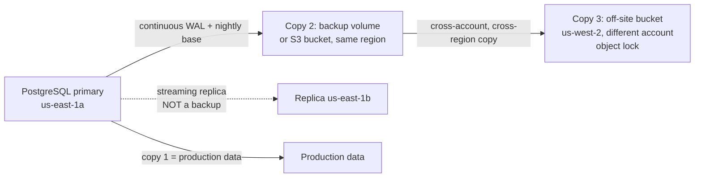
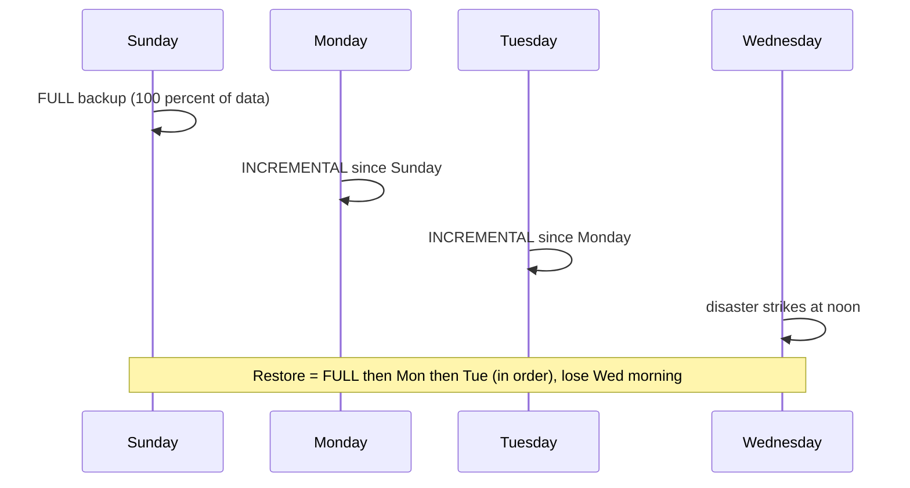

# L15.1 — Backups

> **Level 15: Disaster Recovery** · Topic 1 of 10 · ⏱ ~4 hours · Difficulty: Intermediate

## 1. What it is

A **backup** is an independent, point-in-time copy of data that you can use to rebuild a system after the original is
lost, corrupted or deleted. The key word is *independent*: if the copy shares a failure with the original (same disk,
same account, same admin credentials, same replication stream) it is not a backup, it is a second copy of the same risk.

Backups differ along a few axes you must be able to choose between on purpose:

- **Full vs incremental vs differential.** A *full* backup copies everything. An *incremental* copies only what changed since the
  previous backup (full or incremental). A *differential* copies what changed since the last *full*.
- **Logical vs physical.** A *logical* backup exports data as SQL or rows (`pg_dump`); it is portable across versions but slow to
  restore. A *physical* backup copies the database's files plus the write-ahead log (`pg_basebackup`, volume snapshots); it restores
  fast and enables point-in-time recovery but is tied to the major version and CPU architecture.
- **Where it lives.** The **3-2-1 rule**: keep **3** copies of your data, on **2** different kinds of media or systems,
  with **1** copy off-site (modern wording adds: and 1 copy offline or immutable, and 0 errors after a restore test).

## 2. Why it matters in DevOps

- **Every other safety net has a hole.** High availability and replication protect against a *machine* failing; they happily
  replicate `DROP TABLE` and ransomware to every replica (see [Replication](02-replication.md)). Only a backup protects against
  *humans, bugs and attackers*.
- **A backup that was never restored is a hope, not a backup.** The most common DR failure is discovering at 3 a.m. that the
  backup job has been silently failing for months. Topic 9 turns this into a routine test.
- **Backups define your worst case.** Your backup frequency *is* your RPO ([RPO](06-rpo.md)); your restore speed *is* a large part of
  your RTO ([RTO](07-rto.md)). You cannot promise either without knowing how you back up.
- **Compliance and legal.** Retention periods, encryption at rest and proof of recoverability show up in SOC 2, ISO 27001, HIPAA and GDPR audits.

## 3. Real-world system example

**GitLab.com, January 2017.** A widely documented public postmortem describes an engineer, while fighting replication
problems on the production PostgreSQL setup, deleting a data directory on the wrong database host. GitLab then found that several
of its backup and replication mechanisms were not usable in practice, and recovered from a snapshot that happened to be about
six hours old, losing some hours of user-generated data (git repositories themselves were stored separately). GitLab published
its timeline openly and streamed the recovery. The lesson the industry took away: having "five backup methods" means nothing
until at least one is monitored and restored on a schedule.

**Managed databases as a reference design.** Amazon RDS takes daily automated snapshots *and* continuously ships transaction
logs to S3, which is what lets you restore to a chosen second inside the retention window (1-35 days, configurable).
Self-managed PostgreSQL shops usually reproduce the same design with open-source tools such as **pgBackRest** or **WAL-G**:
a base backup plus continuous WAL archiving to object storage, with encryption and retention managed by the tool.

## 4. Diagram

The 3-2-1 rule applied to the `shop-api` PostgreSQL database:



A backup chain, and why restore order matters:



## 5. How it works

| Type | Copies | Backup speed / size | Restore speed | Needs to restore |
|------|--------|--------------------|---------------|------------------|
| Full | everything | slowest, largest | fastest | itself only |
| Incremental | changes since last backup of any kind | fastest, smallest | slowest | full + every incremental in order |
| Differential | changes since last full | middle, grows daily | middle | full + latest differential |

| Approach | Tool examples | Strengths | Weaknesses |
|----------|---------------|-----------|------------|
| Logical | `pg_dump`, `mysqldump`, `mongodump` | portable across versions, can restore one table | slow on large DBs, only a single point in time, no PITR |
| Physical | `pg_basebackup`, `xtrabackup`, volume snapshots | fast restore, enables PITR with WAL archive | same major version and architecture, restores everything |
| Continuous (WAL / binlog archive) | `archive_command`, pgBackRest, WAL-G | RPO of seconds to minutes | more moving parts, archive gaps break recovery |
| File-level | `tar`, `rsync`, `restic`, `borg` | simple for configs and uploads | not consistent for a running database unless quiesced |

**Encryption.** Encrypt *before* data leaves the host (client-side), keep keys somewhere that survives the disaster
(a password manager or KMS in a different account), and test decryption in the restore drill. Tools: `age`, `gpg`, `restic`/`borg`
(built-in), S3 SSE-KMS (server-side, protects the disk, not against anyone who can read the bucket). Losing the key equals losing the backup.

**Retention.** Choose a policy that matches the threats: recent copies for operator errors (days), older copies for slow-burn
corruption nobody noticed (weeks to months), and compliance copies (years). A common scheme is "grandfather-father-son":
daily for a week, weekly for a month, monthly for a year. Retention must never be shorter than the time you need to *notice* a problem.

**Consistency.** A backup of a running database must be transactionally consistent: use the database's own tool
(`pg_dump` uses a snapshot transaction; `pg_basebackup` brackets the copy with WAL) rather than `cp -r` on a live data directory.

## 6. Step-by-step guide

**Prerequisites:** a Linux shell with PostgreSQL 16 server binaries (`sudo apt-get install -y postgresql-16`; the binaries live in
`/usr/lib/postgresql/16/bin`), plus `tar`, `sha256sum`, `age` (`sudo apt-get install -y age`) and `python3`. Everything runs locally,
for free, as your normal user in a scratch directory. We create a **throwaway** cluster on port 55433 and never touch any existing database.

1. **Start a disposable PostgreSQL cluster and load sample data.**
   ```bash
   export PATH=/usr/lib/postgresql/16/bin:$PATH
   export W=$HOME/dr-lab/backups-demo && rm -rf "$W" && mkdir -p "$W/backups"
   initdb -D "$W/pg" >/dev/null
   printf "port = 55433\nunix_socket_directories = '/tmp'\nlisten_addresses = ''\n" >> "$W/pg/postgresql.conf"
   pg_ctl -D "$W/pg" -l "$W/pg.log" -w start
   export PGHOST=/tmp PGPORT=55433
   createdb shop
   psql -X -q -d shop -c "CREATE TABLE orders(id serial primary key, item text, qty int)" \
     -c "INSERT INTO orders(item,qty) SELECT 'item-'||g, g%10 FROM generate_series(1,200000) g"
   ```
   Expected: `waiting for server to start.... done` / `server started`.

2. **Take a logical backup (compressed custom format) and a plain-SQL one; compare.**
   ```bash
   time pg_dump -Fc -d shop -f "$W/backups/shop.dump"
   pg_dump -d shop -f "$W/backups/shop.sql"
   ls -lh "$W/backups"
   ```
   Similar to: the custom-format dump is ~1 MB, the plain SQL ~4 MB, and the dump takes well under a second for 200k rows.
   `pg_restore -l "$W/backups/shop.dump" | head` lists the table of contents, which lets you restore a single table later.

3. **Take a physical backup and verify it.**
   ```bash
   time pg_basebackup -D "$W/backups/base" -Ft -z -X stream -c fast
   pg_basebackup -D "$W/backups/plain" -X stream -c fast
   pg_verifybackup "$W/backups/plain"
   ```
   Expected last line: `backup successfully verified`. PostgreSQL writes a `backup_manifest` with a checksum per file; `pg_verifybackup`
   checks it. This is your first automated integrity check.

4. **Restore the logical backup into a fresh database (proof that it works).**
   ```bash
   createdb shop_restored
   time pg_restore -d shop_restored --no-owner "$W/backups/shop.dump"
   psql -X -At -d shop_restored -c "SELECT count(*) FROM orders"
   ```
   Expected: `200000`.

5. **Add a checksum and client-side encryption, then prove you can decrypt.**
   ```bash
   cd "$W/backups"
   age-keygen -o backup-key.txt                           # prints: Public key: age1...
   PUB=$(grep -o 'age1[a-z0-9]*' backup-key.txt | head -1)
   age -r "$PUB" -o shop.dump.age shop.dump
   sha256sum shop.dump.age > shop.dump.age.sha256
   sha256sum -c shop.dump.age.sha256                      # shop.dump.age: OK
   age -d -i backup-key.txt shop.dump.age | sha256sum     # must equal: sha256sum shop.dump
   sha256sum shop.dump
   ```
   Keep `backup-key.txt` somewhere that is **not** the machine being backed up. In production you would store only the public key on the server.

6. **Try incremental backups of plain files with GNU tar.**
   ```bash
   mkdir -p ~/dr-lab/files && cd ~/dr-lab/files && rm -rf data snap.snar *.tar.gz && mkdir data
   for i in 1 2 3; do echo "file $i" > data/f$i.txt; done
   tar --listed-incremental=snap.snar -czf full-0.tar.gz data
   echo changed > data/f2.txt; echo new > data/f4.txt
   tar --listed-incremental=snap.snar -czf incr-1.tar.gz data
   tar -tzf incr-1.tar.gz        # only data/, data/f2.txt, data/f4.txt
   mv data data.lost
   tar --listed-incremental=/dev/null -xzf full-0.tar.gz
   tar --listed-incremental=/dev/null -xzf incr-1.tar.gz
   cat data/f2.txt               # changed
   ```
   Note the restore applies full first, then each incremental in order.

7. **Back up a SQLite file safely (never `cp` an open database).**
   ```bash
   python3 - <<'EOF'
   import sqlite3
   src = sqlite3.connect('shop.db')
   src.execute('create table if not exists t(a)')
   src.executemany('insert into t values(?)', [(i,) for i in range(100)]); src.commit()
   dst = sqlite3.connect('shop-backup.db'); src.backup(dst); dst.close()   # online, consistent backup API
   c = sqlite3.connect('shop-backup.db')
   print(c.execute('select count(*) from t').fetchone(), c.execute('pragma integrity_check').fetchone())
   EOF
   ```
   Expected: `(100,) ('ok',)`.

8. **Implement retention: keep 7 daily and 5 weekly (Sunday) backups.**
   ```bash
   cat > ~/dr-lab/prune.sh <<'EOF'
   #!/usr/bin/env bash
   set -euo pipefail
   DIR=${1:?backup dir}
   for f in "$DIR"/shop-*.dump.age; do
     d=$(basename "$f" | sed -E 's/shop-([0-9-]{10}).*/\1/')
     age_days=$(( ( $(date +%s) - $(date -d "$d" +%s) ) / 86400 ))
     dow=$(date -d "$d" +%u)                      # 7 = Sunday
     if [ "$age_days" -le 7 ] || { [ "$dow" = 7 ] && [ "$age_days" -le 35 ]; }; then continue; fi
     echo "prune $f"; rm -- "$f"
   done
   EOF
   chmod +x ~/dr-lab/prune.sh
   mkdir -p ~/dr-lab/ret && cd ~/dr-lab/ret
   for d in $(seq 0 40); do touch -d "-$d day" "shop-$(date -d "-$d day" +%F).dump.age"; done
   ~/dr-lab/prune.sh . | wc -l; ls | wc -l
   ```
   Expected with 41 fake files: 29 pruned, 12 kept (7-8 daily plus the Sundays inside 35 days; exact counts depend on today's weekday).

9. **Clean up.**
   ```bash
   pg_ctl -D "$W/pg" -m fast stop
   ```

## 7. Real-world scenario

*Illustrative.* The `shop-api` team runs a nightly `pg_dump` from cron to a disk attached to the same VM. A developer ships a migration
with a missing `WHERE` clause and zeroes every customer's `email` column. Nobody notices for three days. The nightly dumps have a
retention of 2 days, so every copy already contains the damage. The team can only recover by reconstructing emails from the
replica's old WAL and a vendor's mailing list export. Afterwards they change three things: retention becomes 7 daily + 5 weekly + 12 monthly,
dumps are copied off the host to a second account, and a weekly job restores the latest dump to a scratch database and compares row
counts with production.
**Lesson:** retention must exceed your *detection time*, and a backup on the same machine is a copy, not a backup.

## 8. Common mistakes and best practices

**Don't**

- Store backups on the same disk, host, cloud account or credentials as the original.
- Run `cp -r /var/lib/postgresql` on a live database and call it a backup.
- Treat "the cron job exited 0" as proof. Empty files and truncated dumps also exit 0 if you pipe carelessly (`set -o pipefail`!).
- Keep the encryption key only on the server it protects.
- Count a replica as a backup.

**Do**

- Follow 3-2-1 (and make one copy immutable or offline, see [Off-site Backups](08-offsite-backups.md)).
- Alert on *backup age* (time since last successful backup), not only on job failure.
- Record the backup size, duration and checksum every run; sudden drops in size are an early warning.
- Restore regularly ([Testing Backup Restoration](09-testing-backup-restoration.md)); see also [Backups and PITR in the databases level](../level-13-databases-distributed-systems/05-backups-and-pitr.md).
- Define retention from your detection time and compliance needs, then automate pruning.

## 9. Tasks

- [ ] **T1 — Logical vs physical, measured** *(≈30 min, beginner)*
  - **Goal:** see the size and time difference with your own numbers.
  - **Steps:**
    1. Follow steps 1-3 of the guide.
    2. Record dump size, base backup size and elapsed `time` for each in a small table.
    3. Restore the dump into `shop_restored` and note the restore time.
  - **Done when:** you have a 3-row table (dump.sql, dump.dump, base backup) with size and duration, and `count(*)` on the restored database is `200000`.

- [ ] **T2 — Build an encrypted, checksummed backup script** *(≈45 min, intermediate)*
  - **Goal:** one script that produces `shop-YYYY-MM-DD.dump.age` plus a `.sha256` file.
  - **Steps:**
    1. Write `backup.sh` with `set -euo pipefail` that runs `pg_dump -Fc | age -r "$PUB" > file.tmp`, then `mv`s it to the final name only on success.
    2. Write the sha256 file next to it.
    3. Run it twice on different days (use `faketime` or just rename) and run `prune.sh`.
  - **Done when:** `sha256sum -c` says OK and decrypting then `pg_restore -l` lists the table of contents.

- [ ] **T3 — Incremental chain** *(≈30 min, intermediate)*
  - **Goal:** prove the restore order for incrementals.
  - **Steps:**
    1. Repeat step 6 and add a second incremental `incr-2.tar.gz` that deletes `f1.txt`.
    2. Restore with `--listed-incremental=/dev/null` applying full, incr-1, incr-2 in order.
    3. Then try applying incr-2 before incr-1 on a fresh directory and observe the difference.
  - **Done when:** `ls data` after the correct order shows `f2.txt f3.txt f4.txt`, and you can explain why the wrong order produces a different result.

- [ ] **T4 — Break it: silent failure** *(≈30 min, intermediate)*
  - **Goal:** see why `pipefail` and backup-age alerts matter.
  - **Steps:**
    1. Run `pg_dump -d nonexistent | age -r "$PUB" > bad.age` **without** `pipefail` and look at `echo $?` and the size of `bad.age`.
    2. Re-run with `set -o pipefail` and compare.
    3. Write a 5-line check that fails if the newest backup is older than 26 hours or smaller than 50 percent of the previous one.
  - **Done when:** your check script exits non-zero when you `touch -d "-2 days"` the newest backup.

- [ ] **T5 — Automate on a schedule** *(≈30 min, intermediate)*
  - **Goal:** run the backup nightly and record results.
  - **Steps:**
    1. Create a systemd timer or cron entry that runs `backup.sh`, then `prune.sh`, and appends one line (`date, size, sha256, seconds`) to `backup.log`.
    2. Trigger it manually twice.
  - **Done when:** `backup.log` has two lines with different timestamps and a non-zero size.

- [ ] **T6 — Prove it: design a 3-2-1 plan** *(≈45 min, advanced)*
  - **Goal:** justify every copy to a skeptical reviewer.
  - **Steps:**
    1. Without the guide, write a one-page backup policy for `shop-api` listing what is backed up (database, uploads, Terraform state, secrets inventory), the type (logical/physical), frequency, retention, encryption and where each of the 3 copies lives.
    2. State which threat each copy defends against (disk loss, operator error, account compromise, region loss).
  - **Done when:** every threat in that list maps to at least one copy, and you can explain out loud why the replica is not one of the three.

## 10. Self-check questions

1. What does 3-2-1 stand for, and which failure does the "1 off-site" part protect against?
2. Why is an incremental backup faster to take but slower to restore than a full one?
3. When would you choose `pg_dump` over `pg_basebackup`, and vice versa?
4. Your backups are encrypted and the server was destroyed in a fire. What must you have stored elsewhere?
5. A bad migration corrupted data 10 days ago. Your retention is 7 days. What are your options now, and what do you change?

<details>
<summary>Answers</summary>

1. Three copies, two media or systems, one off-site. It protects against site-level loss: fire, region outage, or an account compromise that wipes everything in one place.
2. It only reads and writes changed data, but a restore needs the full backup plus every incremental in sequence, so more files and more steps.
3. `pg_dump` for portability, upgrades across major versions and restoring a single table; `pg_basebackup` plus WAL archive for fast whole-cluster restore and point-in-time recovery.
4. The decryption key (or the KMS key and access to it), and the documented procedure and credentials to reach the backup storage.
5. Probably only partial repair (reconstruct from logs, replicas, exports). Lengthen retention to exceed your detection time and add a data-quality check that catches corruption sooner.
</details>

## 11. Further reading

- PostgreSQL documentation, *Backup and Restore* chapter (SQL dump, file system level backup, continuous archiving and PITR).
- pgBackRest and WAL-G project documentation.
- AWS documentation: *Backing up and restoring an Amazon RDS DB instance*.
- GitLab's public postmortem of the 31 January 2017 database incident.
- *Site Reliability Engineering* (Google), the chapter on data integrity.
- Related: [Disaster Recovery overview](../level-00-what-devops-is/09-disaster-recovery.md), [Backups and PITR](../level-13-databases-distributed-systems/05-backups-and-pitr.md).

<!-- nav -->
---
← Previous level: [Level 14 — SRE](../level-14-sre/README.md) · [Level 15 index](README.md) · Next: [Replication](02-replication.md) →
