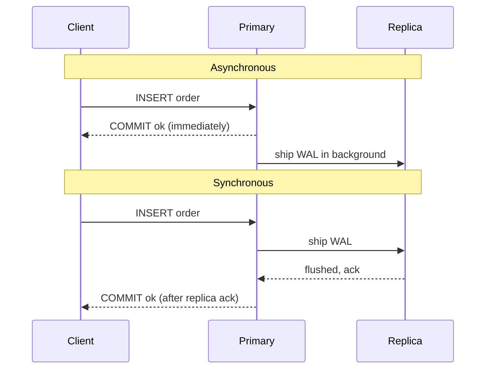
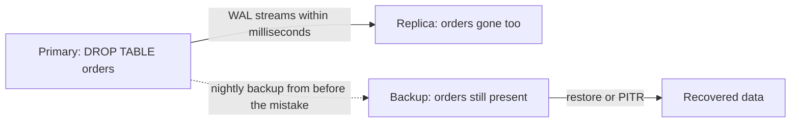

# L15.2 — Replication

> **Level 15: Disaster Recovery** · Topic 2 of 10 · ⏱ ~4 hours · Difficulty: Intermediate

## 1. What it is

**Replication** continuously copies changes from one system (the *primary*, or leader) to one or more others (*replicas*,
or followers/standbys), so that more than one machine holds a current copy of the data. It exists to give you
**availability** (a copy ready to take over) and **read scale** (replicas can serve queries).

Two properties define a replication setup:

- **Synchronous vs asynchronous.** In *synchronous* replication the primary does not tell the client "committed" until at least one replica has confirmed it received (or applied) the change. Data loss on primary failure is zero, but every write pays a network round trip and an unreachable replica can stall writes. In *asynchronous* replication the primary commits immediately and ships changes in the background: writes are fast, but anything not yet shipped is lost if the primary dies. That lag is your potential data loss ([RPO](06-rpo.md)).
- **Distance.** Replicating across **availability zones (AZs)** in one region has low latency (typically single-digit milliseconds) and is often synchronous. Replicating across **regions** has tens to hundreds of milliseconds of latency, so it is almost always asynchronous.

The sentence to tattoo on your runbook: **replication is not a backup.** A replica faithfully copies `DROP TABLE`, a buggy `UPDATE`, ransomware encryption and silent corruption. It protects against *hardware and site failure*, not against *mistakes and attacks*.

## 2. Why it matters in DevOps

- Replication is the mechanism behind fast recovery: promoting a warm replica takes seconds to minutes, restoring from backup takes minutes to hours ([RTO](07-rto.md)).
- Choosing sync vs async is choosing between latency and data loss; you must be able to explain that trade-off to a product owner.
- Misconfigured replication causes the nastiest incidents: stalled writes because the sync replica vanished, replicas that fell silently hours behind, and "failover" to a replica that was missing the last 20 minutes of orders.
- Teams that believe "we have a replica, so we are backed up" learn the difference the hard way ([Backups](01-backups.md)).

## 3. Real-world system example

**Amazon RDS and Aurora.** RDS *Multi-AZ* deployments keep a standby copy in a different AZ and replicate to it synchronously; on failure of the primary, RDS flips the DNS endpoint to the standby (AWS documents failover typically completing within a minute or two). RDS *read replicas*, including cross-region ones, use the engine's native asynchronous replication, and AWS documents that replica lag can occur. Amazon Aurora separates compute from a distributed storage layer that keeps six copies of the data across three AZs, and *Aurora Global Database* adds asynchronous cross-region replication for disaster recovery. S3 offers cross-region replication that is asynchronous; with Replication Time Control, AWS publishes a 15-minute target for the vast majority of objects, which tells you it is not instant.

**PostgreSQL itself.** The open-source default is *streaming replication* of the write-ahead log (WAL), asynchronous unless you set `synchronous_standby_names`. Large PostgreSQL deployments typically layer a failover manager (such as Patroni) on top and still keep separate WAL-archive backups, precisely because streaming replication copies mistakes too.

## 4. Diagram

Synchronous versus asynchronous commit:



Why a replica is not a backup:



## 5. How it works

| Mode | Data loss on primary failure | Write latency | Failure mode to watch |
|------|-----------------------------|---------------|----------------------|
| Asynchronous | up to the replication lag (RPO greater than 0) | no extra | silent lag growth, lost tail of transactions |
| Synchronous (1 standby) | none for acknowledged commits | +1 network round trip | writes stall if the sync standby is down |
| Quorum sync (any 1 of 2) | none for acknowledged commits | +round trip to the fastest replica | needs 2+ replicas, more cost |
| Semi-sync (MySQL style) | near zero, falls back to async on timeout | small | silently degrades to async |

| Scope | Typical latency | Typical mode | Protects against |
|-------|-----------------|--------------|------------------|
| Same AZ | sub-millisecond | either | server or process failure only |
| Cross-AZ, same region | low milliseconds | sync or async | AZ outage (power, network, fire in one data center) |
| Cross-region | tens to hundreds of ms | async | regional outage, large-scale disaster |

PostgreSQL specifics worth knowing:

- Replica state is visible on the primary in `pg_stat_replication` (`state`, `sync_state`, `replay_lag`) and on the replica via `pg_is_in_recovery()` and `pg_last_wal_replay_lsn()`.
- A **replication slot** keeps WAL until the replica has consumed it; this avoids replica breakage but a dead replica makes the primary's disk fill with WAL. Monitor slot lag.
- Logical replication (publications/subscriptions) replicates row changes per table and allows different versions, but does not carry DDL or sequences by default.
- Replica **delayed replication** (`recovery_min_apply_delay`) deliberately lags a standby, giving you a short "oops window", but it is a convenience, not a substitute for backups.

## 6. Step-by-step guide

**Prerequisites:** PostgreSQL 16 server binaries (`sudo apt-get install -y postgresql-16`, binaries in `/usr/lib/postgresql/16/bin`). Everything runs on one machine with two throwaway clusters on ports 55440 (primary) and 55441 (replica), unix sockets only, free.

1. **Create the primary.**
   ```bash
   export PATH=/usr/lib/postgresql/16/bin:$PATH
   export W=$HOME/dr-lab/repl && rm -rf "$W" && mkdir -p "$W" && export PGHOST=/tmp
   initdb -D "$W/primary" >/dev/null
   cat >> "$W/primary/postgresql.conf" <<'CONF'
   port = 55440
   unix_socket_directories = '/tmp'
   listen_addresses = ''
   wal_level = replica
   max_wal_senders = 5
   hot_standby = on
   CONF
   echo "local replication all trust" >> "$W/primary/pg_hba.conf"
   pg_ctl -D "$W/primary" -l "$W/primary.log" -w start
   psql -X -q -p 55440 -d postgres -c "CREATE DATABASE shop"
   psql -X -q -p 55440 -d shop -c "CREATE TABLE orders(id serial primary key, item text)" \
     -c "INSERT INTO orders(item) SELECT 'i'||g FROM generate_series(1,1000) g"
   ```

2. **Clone a replica with `pg_basebackup -R`** (`-R` writes `standby.signal` and the connection string).
   ```bash
   pg_basebackup -h /tmp -p 55440 -D "$W/replica" -R -X stream -c fast
   sed -i 's/^port = 55440/port = 55441/' "$W/replica/postgresql.conf"
   pg_ctl -D "$W/replica" -l "$W/replica.log" -w start
   ```

3. **Observe the replication state from both sides.**
   ```bash
   psql -X -p 55440 -d postgres -x -c "SELECT application_name, state, sync_state, replay_lag FROM pg_stat_replication"
   psql -X -p 55441 -d shop -At -c "SELECT pg_is_in_recovery(), count(*) FROM orders"
   ```
   Expected: `state | streaming`, `sync_state | async`, a tiny `replay_lag` (microseconds), and `t|1000` on the replica.

4. **Prove the replica is read-only.**
   ```bash
   psql -X -p 55441 -d shop -c "INSERT INTO orders(item) VALUES ('x')"
   ```
   Expected: `ERROR:  cannot execute INSERT in a read-only transaction`.

5. **Switch to synchronous replication.**
   ```bash
   psql -X -p 55440 -d postgres -c "ALTER SYSTEM SET synchronous_standby_names = 'walreceiver'" -c "SELECT pg_reload_conf()"
   sleep 1
   psql -X -p 55440 -d postgres -At -c "SELECT application_name, sync_state FROM pg_stat_replication"
   ```
   Expected: `walreceiver|sync`. (`walreceiver` is the default application name of a standby created with `-R`; in production set an explicit `application_name` in `primary_conninfo`.)

6. **See the cost of synchronous replication: stop the replica and try to write.**
   ```bash
   psql -X -q -p 55440 -d shop -c "CREATE TABLE t(a int)"
   pg_ctl -D "$W/replica" -m fast stop
   time timeout 5 psql -X -p 55440 -d shop -c "INSERT INTO t VALUES (1)"; echo "exit=$?"
   ```
   Expected: the insert **hangs** until the timeout (`exit=124`, about 5 seconds) because no synchronous standby can acknowledge. This is the availability price of zero data loss. Restart the replica and the write completes:
   `pg_ctl -D "$W/replica" -l "$W/replica.log" -w start`.
   (Use `Ctrl+C` instead of the timeout if you like; rows only become visible after replication confirms.)

7. **Prove "replication is not a backup".**
   ```bash
   psql -X -p 55440 -d shop -c "DROP TABLE orders"
   sleep 1
   psql -X -p 55441 -d shop -c "SELECT count(*) FROM orders"
   ```
   Expected: `ERROR:  relation "orders" does not exist` on the replica too. The mistake travelled in milliseconds.

8. **Clean up.**
   ```bash
   pg_ctl -D "$W/replica" -m fast stop; pg_ctl -D "$W/primary" -m fast stop
   ```

**AWS equivalent (read-only reference, costs money if you actually create it):** `aws rds create-db-instance-read-replica --source-db-instance-identifier shop-api-db --db-instance-identifier shop-api-db-replica` creates an asynchronous replica; adding `--multi-az` on the primary gives the synchronous standby. A cross-region replica needs `--region` pointing at the target and `--source-region`. Always set a billing alarm and delete the instances afterwards.

## 7. Real-world scenario

*Illustrative.* `shop-api` runs a PostgreSQL primary in `us-east-1a` with an asynchronous replica in `us-east-1b`. During a deploy, a script truncates the `payments` table in production instead of staging. Monitoring shows the replica has `payments` empty within a second. The on-call engineer's first instinct, "fail over to the replica", would change nothing. They instead restore a base backup to a scratch instance, replay WAL up to one minute before the truncate (point-in-time recovery, see [Restore Procedures](04-restore-procedures.md)), and copy the table back.
A second, different night, the primary's host dies. The replica was 40 seconds behind, so about 40 seconds of orders are lost; the team now knows exactly what their RPO is in practice and decides whether that is acceptable or whether they need synchronous replication.
**Lesson:** replication answers "the machine died"; backups answer "we did something wrong". You need both.

## 8. Common mistakes and best practices

**Don't**

- Call a replica your backup or skip backups because you "have HA".
- Use synchronous replication with a single standby and no plan for what happens when that standby is down.
- Ignore replica lag until failover time. A lagging replica fails over to stale data.
- Let a dead replica's replication slot pin WAL until the primary disk fills.
- Replicate to a node with the same credentials, same account and same blast radius if you want it to survive attacks.

**Do**

- Alert on replica lag in seconds and bytes, and on `state != streaming`.
- Decide per data class: money and orders may justify sync, analytics and sessions usually do not.
- Keep a separate backup path with PITR ([Backups](01-backups.md)) and replicate across a failure domain you actually fear (AZ, region).
- Use quorum sync (`ANY 1 (a, b)`) when you need zero data loss without a single-replica stall.
- Practice promotion regularly ([Failover](05-failover.md)); see also [Replication in the databases level](../level-13-databases-distributed-systems/04-replication.md).

## 9. Tasks

- [ ] **T1 — Build and inspect a replica** *(≈30 min, beginner)*
  - **Goal:** a working primary and streaming replica on your machine.
  - **Steps:** follow guide steps 1-3.
  - **Done when:** `pg_stat_replication` shows `streaming`, and the replica returns the same `count(*)` as the primary.

- [ ] **T2 — Measure lag under load** *(≈30 min, intermediate)*
  - **Goal:** see asynchronous lag as a number.
  - **Steps:**
    1. Run `pgbench -i -s 20 -h /tmp -p 55440 shop` then `pgbench -T 20 -c 8 -h /tmp -p 55440 shop` (pgbench ships with the PostgreSQL packages).
    2. During the run, poll `SELECT application_name, write_lag, flush_lag, replay_lag FROM pg_stat_replication` every second on the primary.
  - **Done when:** you captured a peak `replay_lag` value and can say how much data (in transactions per second times seconds) you could have lost at that instant.

- [ ] **T3 — Sync versus async cost** *(≈30 min, intermediate)*
  - **Goal:** quantify what zero data loss costs.
  - **Steps:**
    1. Run `pgbench -T 15 -c 4 -h /tmp -p 55440 shop` with async, record transactions per second (TPS) and latency average.
    2. Enable `synchronous_standby_names = 'walreceiver'`, reload, repeat.
  - **Done when:** you have a two-row table (async vs sync, TPS, latency) and a sentence explaining the difference.

- [ ] **T4 — Break it: the stalled sync write** *(≈20 min, intermediate)*
  - **Goal:** experience and fix the sync stall.
  - **Steps:** follow guide step 6; then recover without restarting the replica by running `ALTER SYSTEM RESET synchronous_standby_names` and `SELECT pg_reload_conf()` on the primary.
  - **Done when:** the blocked insert completes and you can state the availability trade-off of the setting you just reverted.

- [ ] **T5 — Disprove "replica equals backup"** *(≈30 min, intermediate)*
  - **Goal:** evidence you can show a skeptical manager.
  - **Steps:**
    1. Take a base backup (`pg_basebackup -D "$W/b" -Ft -z`) first.
    2. Run `DELETE FROM orders WHERE id % 2 = 0` on the primary, wait one second, and count rows on the replica.
    3. Write down what you would restore from, and from where.
  - **Done when:** the replica shows half the rows, and your note names the backup as the recovery source.

- [ ] **T6 — Prove it: choose a replication design** *(≈40 min, advanced)*
  - **Goal:** justify a design for `shop-api`.
  - **Steps:** Without the guide, write half a page covering sync vs async for orders, cross-AZ vs cross-region, expected lag, what happens when the replica is down, and what *else* you still need (backups).
  - **Done when:** each claim has a stated failure it addresses, and you can explain it to a teammate in under five minutes.

## 10. Self-check questions

1. What exactly do you lose on an asynchronous primary failure, and how do you measure it beforehand?
2. Why can a synchronous standby reduce availability?
3. Why is cross-region replication almost always asynchronous?
4. A developer runs `DELETE FROM users` by mistake. Does your replica help? Why or why not?
5. What can go wrong with replication slots if a replica disappears?

<details>
<summary>Answers</summary>

1. Transactions committed on the primary but not yet received/applied by the replica. Measure replication lag (`replay_lag`, bytes behind) and its peak under load.
2. The primary waits for the standby's acknowledgement; if the standby is down or partitioned, commits block (unless you use quorum or fall back).
3. The speed of light: tens to hundreds of ms per round trip on every commit would make writes slow; so you accept some lag.
4. No. The delete is replicated almost instantly. You need a backup or PITR to recover.
5. The primary retains WAL for the slot indefinitely, which can fill the disk and take the primary down. Monitor and cap slot retention.
</details>

## 11. Further reading

- PostgreSQL documentation, *High Availability, Load Balancing, and Replication* (streaming replication, synchronous replication, replication slots).
- Amazon RDS documentation on Multi-AZ deployments and read replicas; Aurora Global Database documentation.
- *Designing Data-Intensive Applications* by Martin Kleppmann, the chapter on replication.
- Related: [High Availability and Scalability](../level-00-what-devops-is/08-high-availability-and-scalability.md), [Replication in the databases level](../level-13-databases-distributed-systems/04-replication.md).

<!-- nav -->
---
← Previous: [Backups](01-backups.md) · [Level 15 index](README.md) · Next: [Snapshots](03-snapshots.md) →
