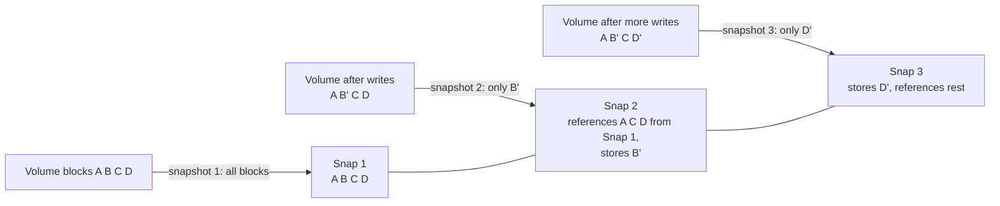
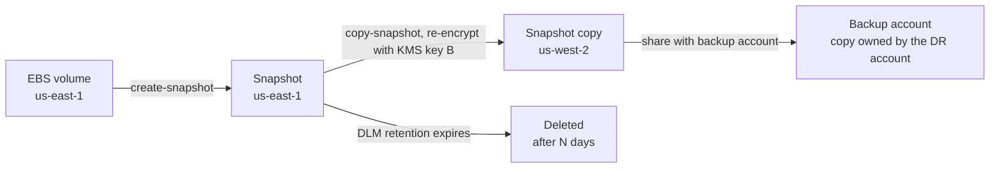

# L15.3 — Snapshots

> **Level 15: Disaster Recovery** · Topic 3 of 10 · ⏱ ~3 hours · Difficulty: Intermediate

## 1. What it is

A **snapshot** is a point-in-time image of a storage volume (or a whole managed database), taken by the storage layer itself rather than by
reading every file through the application. Because the storage system only has to remember "the state of the blocks as of this instant",
a snapshot is created in seconds regardless of volume size, and on cloud platforms it is stored incrementally: only blocks that changed since
the previous snapshot cost extra space.

Two properties decide whether a snapshot is trustworthy:

- **Consistency level.** A *crash-consistent* snapshot captures what is on disk at that instant, exactly as if the power had been pulled. Journaling filesystems and databases with a write-ahead log (PostgreSQL, MySQL/InnoDB) recover from this on start-up. An *application-consistent* snapshot additionally asks the application to flush and pause first (for example with a database backup mode, `fsfreeze`, or VSS on Windows), so recovery needs no crash replay.
- **Where it lives.** A snapshot that sits next to the volume in the same region and account protects against deleting the volume, not against losing the region or the account. Copying it elsewhere is a separate step ([Off-site Backups](08-offsite-backups.md)).

## 2. Why it matters in DevOps

- Snapshots are the cheapest, fastest "backup" you can automate on a cloud platform, and they make restores fast because you attach a new volume instead of replaying data.
- They are also easy to get wrong: a snapshot of a volume under heavy writes with several disks (data + WAL on separate volumes) can be internally inconsistent.
- Lifecycle management matters: snapshots that are never deleted quietly add to the bill; snapshots that are deleted too soon leave you without a restore point.
- Encrypted snapshots tie your recovery to a KMS key. If the key (or its permissions) is lost, so is the snapshot.

## 3. Real-world system example

**Amazon EBS and RDS.** EBS snapshots are incremental, are stored durably by AWS (in S3-backed storage you do not manage directly), and can be copied across regions and shared across accounts. A volume restored from a snapshot is usable immediately but blocks are loaded lazily from storage in the background, so first reads can be slower unless you use Fast Snapshot Restore (an extra-cost feature). EBS snapshots of a single volume are crash-consistent; AWS offers a multi-volume snapshot call so that all volumes attached to an instance are captured at the same moment. Amazon Data Lifecycle Manager (DLM) automates creation, retention and cross-region copy on a schedule. RDS builds on the same idea: *automated backups* (daily snapshot plus transaction logs for point-in-time recovery, retention 1-35 days) and *manual snapshots*, which you control and which are kept until you delete them. Restoring either type always creates a **new** DB instance with a **new endpoint**; nothing is rolled back in place.

**Kubernetes.** The CSI snapshot API (`VolumeSnapshot`, `VolumeSnapshotClass`) exposes the same storage-layer snapshots to cluster operators, and tools such as Velero use them to back up persistent volumes alongside cluster objects. A CSI driver must support snapshots and the snapshot controller must be installed; a plain kind cluster does not provide this out of the box.

## 4. Diagram

How an incremental snapshot chain looks, and why deleting an old snapshot is safe:



Cross-region and cross-account protection of a snapshot:



## 5. How it works

| Question | Crash-consistent | Application-consistent |
|----------|------------------|------------------------|
| What is captured | disk state at the instant | disk state after the app flushed/quiesced |
| Recovery on restore | filesystem journal and database WAL replay | usually none or minimal |
| Risk | multi-volume skew; apps without a log (some caches, plain files being written) | brief write pause or backup-mode complexity |
| Typical method | EBS snapshot, `fsfreeze`-less cloud snapshot | `pg_backup_start`/`pg_backup_stop` around the snapshot, `fsfreeze`, VSS |

Rules of thumb for databases:

- **One volume for everything** (data + WAL) gives a crash-consistent snapshot you can usually trust. If data and WAL live on different volumes, use a multi-volume snapshot call or bracket the snapshots with the database's backup mode.
- A snapshot gives you **one point in time**. For anything finer, combine it with continuous log archiving (point-in-time recovery). RDS does this for you.
- **Test the restore**: attach the volume to a scratch instance and start the database; check the logs for recovery messages and run integrity queries ([Testing Backup Restoration](09-testing-backup-restoration.md)).

| Lifecycle concern | What to decide |
|-------------------|----------------|
| Frequency | derived from your RPO ([RPO](06-rpo.md)) |
| Retention | count or days; separate rules for hourly, daily, monthly |
| Cross-region copy | which snapshots, to which region, with which KMS key |
| Cross-account copy | a second account the production credentials cannot delete from |
| Deletion protection | recycle bin / retention lock on snapshots, tags that mark "do not delete" |
| Cost | incremental storage per GB-month; copies are billed separately; data transfer for cross-region copies |

## 6. Step-by-step guide

**Part A: a local, free crash-consistent snapshot of a live database.** We use a loop-mounted ext4 volume as a stand-in for an EBS volume,
freeze the filesystem for a moment, copy the block image (our "snapshot"), and prove that PostgreSQL started from the copy recovers cleanly.

**Prerequisites:** Linux with root (`sudo`), PostgreSQL 16 server binaries (`sudo apt-get install -y postgresql-16`), `fsfreeze` (util-linux, preinstalled). This needs loop-device support, which a normal VM or VPS has; some restricted containers do not. Uses ~300 MB of disk and port 55450.

1. **Create and mount a 300 MB "volume".**
   ```bash
   sudo -i
   export PATH=/usr/lib/postgresql/16/bin:$PATH
   D=/tmp/snaplab; mkdir -p $D/vol $D/snapvol; chmod 777 $D
   truncate -s 300M $D/vol.img && mkfs.ext4 -q $D/vol.img
   mount -o loop $D/vol.img $D/vol
   mkdir $D/vol/pgdata && chown postgres:postgres $D/vol/pgdata && chmod 700 $D/vol/pgdata
   ```

2. **Initialise PostgreSQL on that volume and generate write load.**
   ```bash
   as() { su postgres -s /bin/bash -c "export PATH=$PATH PGHOST=/tmp; $*"; }
   as "initdb -D $D/vol/pgdata >/dev/null"
   as "printf \"port = 55450\nunix_socket_directories = '/tmp'\nlisten_addresses = ''\n\" >> $D/vol/pgdata/postgresql.conf"
   as "pg_ctl -D $D/vol/pgdata -l $D/pg.log -w start"
   as "createdb -p 55450 shop; pgbench -i -s 5 -p 55450 shop"
   as "pgbench -T 8 -c 4 -p 55450 shop" > $D/bench.out 2>&1 &
   sleep 3
   ```
   `pgbench` keeps inserting into `pgbench_history` for 8 seconds, so the snapshot is taken **while the database is busy**.

3. **Take the snapshot: freeze, copy, thaw.**
   ```bash
   time ( fsfreeze -f $D/vol; cp --sparse=always $D/vol.img $D/snap.img; fsfreeze -u $D/vol )
   wait
   as "psql -p 55450 -At -d shop -c 'select count(*) from pgbench_history'"
   ```
   Similar to: about a second of freeze (limited by copying a small image; a real cloud snapshot returns immediately), and a final live row count such as `15214`.
   Always run `fsfreeze -u` even on error; a frozen filesystem blocks every write on it.

4. **Stop production, mount the snapshot, and start PostgreSQL from it.**
   ```bash
   as "pg_ctl -D $D/vol/pgdata -m fast stop"
   mount -o loop $D/snap.img $D/snapvol
   rm -f $D/snapvol/pgdata/postmaster.pid
   sed -i 's/^port = 55450/port = 55451/' $D/snapvol/pgdata/postgresql.conf
   as "pg_ctl -D $D/snapvol/pgdata -l $D/snap.log -w start"
   as "psql -p 55451 -At -d shop -c 'select count(*) from pgbench_history'"
   grep -E "not properly shut down|automatic recovery|redo done|ready to accept" $D/snap.log
   ```
   Similar to: a **smaller** count than production (for example `7844`, the state at the moment of the snapshot) and log lines
   `database system was not properly shut down; automatic recovery in progress`, `redo done at ...`, `database system is ready to accept connections`.
   That is exactly what a crash-consistent snapshot looks like: valid, internally consistent, but frozen at one instant, with WAL replay on start.

5. **Clean up.**
   ```bash
   as "pg_ctl -D $D/snapvol/pgdata -m fast stop"
   umount $D/snapvol $D/vol && rm -rf $D && exit
   ```

**Part B: the same on AWS (read-only reference; creating these costs money).** Replace placeholders; set a billing alarm first, and run the cleanup at the end.

```bash
# Snapshot every volume on an instance at the same instant (crash-consistent across volumes)
aws ec2 create-snapshots \
  --instance-specification InstanceId=i-0123456789abcdef0,ExcludeBootVolume=true \
  --description "shop-api db 2026-10-09" \
  --tag-specifications 'ResourceType=snapshot,Tags=[{Key=app,Value=shop-api},{Key=retention,Value=daily}]'

# Copy to another region (for an encrypted snapshot, pass a KMS key that exists in the destination region)
aws ec2 copy-snapshot --region us-west-2 --source-region us-east-1 \
  --source-snapshot-id snap-0123456789abcdef0 --encrypted --kms-key-id alias/shop-dr

# RDS: manual snapshot, cross-region copy, restore as a NEW instance
aws rds create-db-snapshot --db-instance-identifier shop-api-db --db-snapshot-identifier shop-api-db-2026-10-09
aws rds copy-db-snapshot --region us-west-2 --source-region us-east-1 \
  --source-db-snapshot-identifier arn:aws:rds:us-east-1:111122223333:snapshot:shop-api-db-2026-10-09 \
  --target-db-snapshot-identifier shop-api-db-2026-10-09-dr --kms-key-id alias/shop-dr
aws rds restore-db-instance-from-db-snapshot --region us-west-2 \
  --db-instance-identifier shop-api-db-drill --db-snapshot-identifier shop-api-db-2026-10-09-dr \
  --db-instance-class db.t3.micro
```
Illustrative: output is JSON describing the new resource; exact fields vary. Automate retention with a Data Lifecycle Manager policy
(`aws dlm create-lifecycle-policy ...`) or AWS Backup, then **clean up**: `aws rds delete-db-instance --db-instance-identifier shop-api-db-drill --skip-final-snapshot`,
`aws rds delete-db-snapshot ...`, `aws ec2 delete-snapshot --snapshot-id ...` in both regions. Snapshots keep billing until deleted.

## 7. Real-world scenario

*Illustrative.* The `shop-api` team snapshots the database volume nightly with a cron-triggered CLI call and keeps seven. PostgreSQL's data directory is on `/dev/nvme1n1` and its WAL on `/dev/nvme2n1`, snapshotted by two separate calls a few seconds apart. During a drill the team restores both snapshots to a new instance: PostgreSQL refuses to start with `invalid checkpoint record` because the WAL snapshot is newer than the data snapshot. They switch to the multi-volume `create-snapshots` call, add a restore check that starts PostgreSQL from the snapshot and runs `SELECT count(*)`, and add cross-region copy for the weekly snapshot.
**Lesson:** a snapshot you have not restored is a guess, and multi-volume consistency is a design decision, not an afterthought.

## 8. Common mistakes and best practices

**Don't**

- Snapshot a multi-volume database with independent calls at different times.
- Leave snapshots only in the account and region that production lives in.
- Forget that snapshots of encrypted volumes need access to the KMS key at restore time.
- Treat a snapshot as an in-place undo: on RDS and EBS a restore creates a new resource, and you must repoint the application.
- Let snapshots accumulate forever (cost) or expire after fewer days than your detection time (risk).

**Do**

- Use lifecycle automation (DLM, AWS Backup, or an equivalent) with explicit retention and tags.
- Combine snapshots with log archiving when your RPO is smaller than the snapshot interval.
- Copy critical snapshots to a second region *and* a second account; protect them from deletion ([Off-site Backups](08-offsite-backups.md)).
- Restore a snapshot on a schedule and record the time it took ([RTO](07-rto.md)).
- Related reading: [EBS and EFS](../level-06-cloud-aws/09-ebs-and-efs.md), [RDS and Aurora](../level-06-cloud-aws/10-rds-and-aurora.md), [KMS](../level-06-cloud-aws/15-kms.md).

## 9. Tasks

- [ ] **T1 — Take and inspect a crash-consistent snapshot** *(≈40 min, intermediate)*
  - **Goal:** reproduce Part A and read the recovery log.
  - **Steps:** run guide steps 1-4 with `sudo`.
  - **Done when:** the restored count is lower than production's final count and `snap.log` contains `automatic recovery in progress`.

- [ ] **T2 — Snapshot without freezing** *(≈30 min, intermediate)*
  - **Goal:** see what freezing buys you.
  - **Steps:**
    1. Repeat the exercise but copy the image while the filesystem is **not** frozen (`cp` while `pgbench` runs).
    2. Try to start PostgreSQL from the copy; run `pg_amcheck -p 55451 shop` or just the count query.
  - **Done when:** you report whether it recovered, and explain why a non-atomic copy of a busy volume is not a snapshot. (It may happen to work; the point is that nothing guarantees it.)

- [ ] **T3 — Application-consistent variant** *(≈30 min, advanced)*
  - **Goal:** use the database's backup mode around the copy.
  - **Steps:**
    1. In one `psql` session run `SELECT pg_backup_start('snap', true);` and keep the session open.
    2. Freeze and copy the image from another terminal, thaw, then run `SELECT * FROM pg_backup_stop();`.
    3. Start the copy and compare the log with T1.
  - **Done when:** you can describe the difference in the startup messages and why backup mode requires the WAL generated during the copy to be kept.

- [ ] **T4 — Write the lifecycle policy** *(≈30 min, intermediate)*
  - **Goal:** a policy file others can review.
  - **Steps:** Write a table for `shop-api` with columns: snapshot, frequency, retention, copy destination (region, account), KMS key, deletion protection. Include hourly, daily, weekly and monthly rows, derive frequency from an RPO of 1 hour.
  - **Done when:** every row has a retention number and a copy destination, and the monthly cost estimate is stated (use the AWS pricing page; mark it an estimate).

- [ ] **T5 — AWS: snapshot, copy, restore, delete** *(≈60 min, intermediate, **costs money**)*
  - **Goal:** run the Part B flow once on a tiny resource.
  - **Steps:**
    1. Create a billing alarm. Create a 1 GiB gp3 volume (or a `db.t3.micro` RDS instance in the free tier if eligible).
    2. Snapshot it, copy the snapshot to `us-west-2`, create a volume from the copy.
    3. Delete the volume, both snapshots, and any instance.
  - **Done when:** `aws ec2 describe-snapshots --owner-ids self` in both regions returns an empty list.

- [ ] **T6 — Prove it: explain consistency** *(≈30 min, advanced)*
  - **Goal:** teach crash-consistent versus application-consistent.
  - **Steps:** Without the guide, explain to a teammate (or in writing) what is on the disk at snapshot time, why PostgreSQL recovers from a crash-consistent snapshot, when it would not (multi-volume skew), and what you would do about it.
  - **Done when:** your explanation includes one concrete failure message or log line and one mitigation.

## 10. Self-check questions

1. Why is an EBS snapshot fast and cheap even for a 2 TB volume?
2. What is the difference between crash-consistent and application-consistent?
3. Why does a database with data and WAL on separate volumes need extra care?
4. You restored an RDS snapshot. What is different about the resulting instance?
5. A snapshot cannot be restored in another region. Name two likely causes.

<details>
<summary>Answers</summary>

1. It is incremental and copy-on-write at the storage layer: only blocks changed since the previous snapshot are stored, and creation just records a point in time.
2. Crash-consistent equals what the disk holds at that instant (like a power cut); application-consistent means the app flushed and quiesced first, so no recovery is required.
3. Two independent snapshots are taken at different instants, so data and WAL can disagree. Use a multi-volume snapshot or backup mode around the snapshots.
4. It is a new instance with a new endpoint, parameter and security group choices to reapply; the original is untouched. Applications must be repointed.
5. The KMS key for an encrypted snapshot does not exist or is not permitted in the destination region; or the snapshot was never copied there and the source region is down.
</details>

## 11. Further reading

- AWS documentation: *Amazon EBS snapshots*, *Amazon Data Lifecycle Manager*, *Backing up and restoring an Amazon RDS DB instance* and *AWS Backup*.
- Kubernetes documentation: *Volume Snapshots* and the CSI snapshot controller; Velero documentation.
- PostgreSQL documentation, *Continuous Archiving and Point-in-Time Recovery (PITR)*, section on low-level base backups and snapshots.
- Related: [Backups](01-backups.md), [EBS and EFS](../level-06-cloud-aws/09-ebs-and-efs.md), [RDS and Aurora](../level-06-cloud-aws/10-rds-and-aurora.md).

<!-- nav -->
---
← Previous: [Replication](02-replication.md) · [Level 15 index](README.md) · Next: [Restore Procedures](04-restore-procedures.md) →
