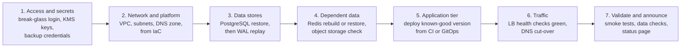
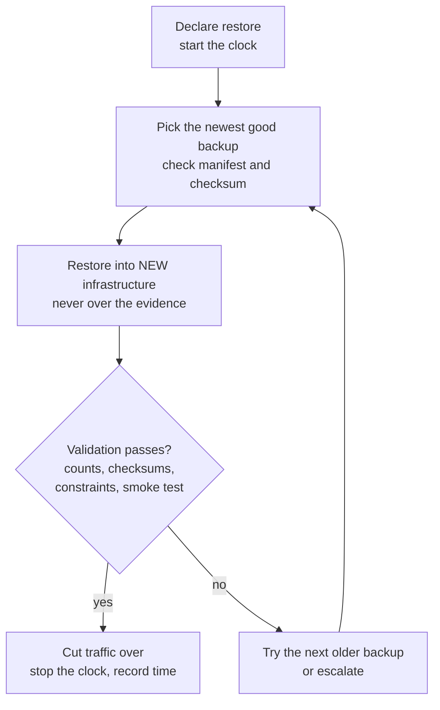

# L15.4 — Restore Procedures

> **Level 15: Disaster Recovery** · Topic 4 of 10 · ⏱ ~4 hours · Difficulty: Intermediate

## 1. What it is

A **restore procedure** is the written, rehearsed sequence of steps that turns "we have backups" into "the service is running again with
correct data". It has three parts: a **runbook** (the documented steps, with owners, commands and decision points), an **order of restore**
(what must come back first because other things depend on it) and **validation** (evidence that what came back is complete and correct,
not merely "the process started").

A backup is only half of recovery. The other half is knowing, under stress and possibly at 3 a.m. with the usual tools unavailable,
exactly which command to run next. A good runbook is boring: numbered steps, copy-pasteable commands, expected output after each step,
and a clear "stop and escalate if you see X".

## 2. Why it matters in DevOps

- **Under pressure people skip steps and guess.** A runbook removes the need to remember. The person restoring may not be the person who built the system.
- **Your RTO is the sum of the steps** ([RTO](07-rto.md)). You can only measure and shrink it if the steps are written down and timed.
- **Dependencies hide.** Restoring the database before the secrets store, the KMS key or the network means a restored database that nobody can reach or decrypt.
- **"Restored" is not "correct".** A restore that finishes with exit code 0 can still be missing hours of data, have broken constraints or point at the wrong environment. Validation is what lets you tell the business "we are back" with a straight face.
- **The runbook must survive the disaster.** If it lives only in the wiki that runs on the failed cluster, it is not available when needed.

## 3. Real-world system example

**GitLab.com, January 2017.** The public postmortem of the production database incident shows the restore side of the story as clearly as the backup side:
after the data directory was removed on the wrong host, the team had to work out, live, which of several backup mechanisms was usable, copy a
large amount of data from a staging server, and wait for it to transfer and load. GitLab published a running log and live-streamed the recovery. A frequently
drawn lesson is that recovery time was dominated by copying and loading data on a path nobody had rehearsed, and by uncertainty about which copy to trust,
not by the restore command itself.

**Google SRE practice.** The Google *Site Reliability Engineering* books describe treating restores as something you exercise, since
data that cannot be recovered is effectively lost. The same books describe the discipline of playbooks (runbooks) linked from alerts so on-call engineers
do not have to invent a response. Most mature operations teams follow this pattern: each page has a runbook, each runbook has been executed by someone other than its author.

**AWS RDS.** Restoring an RDS snapshot or point-in-time creates a *new* instance with a *new endpoint*; the application must be repointed
(or DNS/Route 53 updated) and parameter groups, security groups and monitoring re-attached. Teams that only practise "click restore" discover this dependency list during the real event.

## 4. Diagram

Order of restore: things on the left must exist before things on the right can work.



The restore-and-validate loop with a decision point:



## 5. How it works

**What a runbook contains**

| Element | Why |
|---------|-----|
| Trigger and scope | "Use this when: primary DB lost and replica unusable." Prevents using the wrong runbook. |
| Roles | Incident commander, restorer, validator, communicator. Restoring and deciding are different jobs. |
| Prerequisites | Where credentials, keys and the backup location are, and how to get them if SSO is down. |
| Numbered steps with expected output | Each command followed by "you should see ...". |
| Decision points | "If the newest backup fails the checksum, use the previous one; if both fail, escalate." |
| Validation checklist | Objective checks, not "looks fine". |
| Rollback / abort | How to back out of a half-finished restore. |
| Time estimates | Measured during drills, not guessed. |
| Last tested date and by whom | A runbook untested for a year is suspect. |

**Order of restore (typical).** Restore in dependency order: (1) the ability to act (identity, break-glass accounts, key management, backup access),
(2) the platform (network, DNS, compute, built from Infrastructure as Code, see [Infrastructure as Code](../level-00-what-devops-is/03-infrastructure-as-code.md)),
(3) the system of record (the primary database), (4) derived or secondary data (caches, search indexes, which can often be rebuilt rather than restored),
(5) stateless applications deployed from a known-good version, (6) traffic, (7) validation and communication. Restore the **system of record first**, rebuild the **derived data last**.

**Restore into new infrastructure.** Restoring over the damaged system destroys evidence and removes your fallback. Build the replacement beside it, validate, then switch traffic.

**Validation layers**

| Layer | Example check |
|-------|---------------|
| Backup integrity | `sha256sum -c`, `pg_verifybackup`, decryption succeeds |
| Completeness | row counts per table, `max(created_at)` close to the incident time, a stored "canary" total (sum of a column) recorded at backup time |
| Structural integrity | `pg_amcheck`, foreign keys valid (no orphans), unique constraints present, sequences ahead of data |
| Application | smoke test: log in, read an order, write an order and delete it |
| Business | a human spot-checks a known customer or yesterday's revenue figure |
| Security | restored environment has the right credentials, is not exposed publicly, and does not send real emails to real customers from a test restore |

**Common restore pitfalls:** restoring a staging snapshot into production by name, sequences not advanced (duplicate key errors after cut-over),
restored database accepting writes before validation completes, forgetting that replicas and backups must be re-established after the restore
(your new primary has no backups until you start them again), and restored job queues re-sending old emails.

## 6. Step-by-step guide

**Prerequisites:** Linux with PostgreSQL 16 server binaries in `/usr/lib/postgresql/16/bin`. `initdb` refuses to run as root, so use your normal
user, or `sudo -u postgres -i` on a server where you are root. Everything is local and free. We use port 55434 and a scratch directory; nothing existing is touched.

1. **Build a "production" database with a recorded canary value.**
   ```bash
   export PATH=/usr/lib/postgresql/16/bin:$PATH
   export W=$HOME/dr-lab/restore-demo && rm -rf "$W" && mkdir -p "$W/backups"
   initdb -D "$W/pg" >/dev/null
   printf "port = 55434\nunix_socket_directories = '/tmp'\nlisten_addresses = ''\n" >> "$W/pg/postgresql.conf"
   pg_ctl -D "$W/pg" -l "$W/pg.log" -w start
   export PGHOST=/tmp PGPORT=55434
   createdb shop
   psql -X -q -d shop <<'SQL'
   CREATE TABLE customers(id serial PRIMARY KEY, email text UNIQUE NOT NULL);
   CREATE TABLE orders(id serial PRIMARY KEY, customer_id int NOT NULL REFERENCES customers(id),
                       total_cents int NOT NULL, created_at timestamptz DEFAULT now());
   INSERT INTO customers(email) SELECT 'user'||g||'@example.com' FROM generate_series(1,5000) g;
   INSERT INTO orders(customer_id,total_cents) SELECT 1+g%5000, 100+g%9000 FROM generate_series(1,100000) g;
   SQL
   ```
   Expected: `server started`, then no errors.

2. **Take the backup and record what "correct" looks like.** The canary is stored *with the backup*, not in the database that may be lost.
   ```bash
   pg_dump -Fc -d shop -f "$W/backups/shop.dump"
   psql -X -At -d shop -c "SELECT count(*), sum(total_cents) FROM orders" | tee "$W/backups/expected.txt"
   sha256sum "$W/backups/shop.dump" > "$W/backups/shop.dump.sha256"
   ```
   Expected: `100000|455951000`.

3. **Write the restore runbook as a script (executable documentation).**
   ```bash
   cat > "$W/restore.sh" <<'EOF'
   #!/usr/bin/env bash
   # restore.sh - runbook steps for the shop database. Usage: restore.sh <work-dir>
   set -euo pipefail
   export PATH=/usr/lib/postgresql/16/bin:$PATH
   W=${1:?work dir}
   export PGHOST=/tmp PGPORT=55434
   log() { printf '%s  %s\n' "$(date +%T)" "$*" | tee -a "$W/restore.log"; }
   T0=$(date +%s)
   log "STEP 1 verify backup checksum"
   (cd "$W/backups" && sha256sum -c shop.dump.sha256)
   log "STEP 2 initialise a fresh cluster"
   initdb -D "$W/pg" >/dev/null
   printf "port = 55434\nunix_socket_directories = '/tmp'\nlisten_addresses = ''\n" >> "$W/pg/postgresql.conf"
   pg_ctl -D "$W/pg" -l "$W/pg.log" -w start >/dev/null
   log "STEP 3 create database and restore data, indexes and constraints"
   createdb shop
   pg_restore -d shop --no-owner --exit-on-error "$W/backups/shop.dump"
   log "STEP 4 refresh planner statistics"
   psql -X -q -d shop -c "ANALYZE"
   log "DONE restore in $(( $(date +%s) - T0 )) seconds"
   EOF
   chmod +x "$W/restore.sh"
   ```

4. **Write the validation script.** It encodes the validation layers from section 5 and exits non-zero on the first failure.
   ```bash
   cat > "$W/validate.sh" <<'EOF'
   #!/usr/bin/env bash
   set -euo pipefail
   export PATH=/usr/lib/postgresql/16/bin:$PATH
   W=${1:?work dir}
   export PGHOST=/tmp PGPORT=55434
   q() { psql -X -At -d shop -c "$1"; }
   fail() { echo "FAIL: $*"; exit 1; }

   want=$(cat "$W/backups/expected.txt")
   got=$(q "SELECT count(*), sum(total_cents) FROM orders")
   [ "$got" = "$want" ] && echo "PASS row count and checksum: $got" || fail "orders $got != $want"

   orphans=$(q "SELECT count(*) FROM orders o LEFT JOIN customers c ON c.id=o.customer_id WHERE c.id IS NULL")
   [ "$orphans" = 0 ] && echo "PASS no orphan orders" || fail "$orphans orphan orders"

   seq_ok=$(q "SELECT (SELECT last_value FROM orders_id_seq) >= (SELECT max(id) FROM orders)")
   [ "$seq_ok" = t ] && echo "PASS sequence ahead of max(id)" || fail "sequence behind data"

   q "CREATE EXTENSION IF NOT EXISTS amcheck" >/dev/null
   pg_amcheck -d shop >/dev/null && echo "PASS pg_amcheck (heap and btree structure)" || fail "pg_amcheck"

   q "INSERT INTO customers(email) VALUES ('smoke-test@example.com')" >/dev/null
   q "DELETE FROM customers WHERE email='smoke-test@example.com'" >/dev/null && echo "PASS write smoke test"
   echo "ALL CHECKS PASSED"
   EOF
   chmod +x "$W/validate.sh"
   ```

5. **Cause the disaster, then restore against the clock.**
   ```bash
   pg_ctl -D "$W/pg" -m immediate stop
   rm -rf "$W/pg"                                   # the server's disk is gone
   time "$W/restore.sh" "$W" && "$W/validate.sh" "$W"
   ```
   Similar to: `shop.dump: OK`, the four STEP lines, `DONE restore in 1 seconds` (a few seconds at most for this tiny data set), then five `PASS` lines and `ALL CHECKS PASSED`.
   The point is the *shape*: every step logged with a timestamp, and validation as a separate, objective gate.

6. **Prove the validation can fail.** Corrupt the restored data and re-run the gate.
   ```bash
   psql -X -q -d shop -c "DELETE FROM orders WHERE id % 1000 = 0"
   "$W/validate.sh" "$W" || echo "gate correctly refused (exit $?)"
   ```
   Expected: `FAIL: orders 99900|... != 100000|455951000` and `gate correctly refused (exit 1)`. A check that never fails proves nothing.

7. **Write the runbook document.** Copy this skeleton into your wiki *and* into the repository (so it exists when the wiki does not):
   ```markdown
   # Runbook: restore shop-api database from backup
   Owner: @db-team   Last drilled: YYYY-MM-DD by @name   Measured duration: NN min
   Use when: primary PostgreSQL lost and replica unusable or also corrupted.
   Do not use when: a replica is healthy (see failover runbook).
   Roles: IC, restorer, validator, communicator.
   1. Declare incident, start timer, post to #incidents.
   2. Fetch break-glass credentials from <location>. Expected: can run `aws sts get-caller-identity`.
   3. Pick newest backup, verify checksum. If fail, try previous. If two fail, escalate to <person>.
   4. Provision replacement DB host from Terraform module <path>. Expected: instance healthy.
   5. Run restore.sh. Expected: DONE restore in <time>.
   6. Run validate.sh. All PASS required. Any FAIL: stop, do not cut over.
   7. Repoint app config / DNS. Expected: /healthz returns 200 from all pods.
   8. Re-enable backups and replication on the new primary. Expected: first backup success logged.
   9. Stop timer, record RPO (newest data timestamp) and RTO, announce, schedule postmortem.
   ```

8. **Clean up.**
   ```bash
   pg_ctl -D "$W/pg" -m fast stop
   ```

## 7. Real-world scenario

*Illustrative.* At 02:10 the `shop-api` primary database host in `us-east-1` dies and the replica is lagging by 40 minutes with replay paused (a
maintenance setting nobody reverted). The on-call engineer opens the runbook. Step 2 (break-glass credentials) fails: the credentials are in a vault that requires
the SSO provider, which authenticates through the same company VPN as the dead host's network. The restore is delayed 25 minutes until a second engineer retrieves the
offline break-glass copy from the security team. The restore itself takes 18 minutes, but validation catches that the `orders_id_seq`
sequence had been restored behind the data (a plain-SQL script had been used in an old runbook), which would have caused duplicate-key errors on the first checkout.
They advance the sequence and cut over at 03:21. **Lessons:** the runbook must list and test *access* as step one, validation found a real defect, and the measured steps (25 + 18 + 15 minutes)
become the honest RTO number for the next planning round.

## 8. Common mistakes and best practices

**Don't**

- Keep the only copy of the runbook in a system that depends on what failed.
- Restore over the damaged system. Build beside it and switch.
- Declare success when the restore command exits 0.
- Let the author be the only person who has ever followed the runbook.
- Forget to restart backups and replication on the restored primary.

**Do**

- Write runbooks as numbered steps with expected output and decision points; link them from the alert that pages.
- Restore in dependency order: access, platform, system of record, derived data, apps, traffic, validation.
- Store a canary (count, sum, checksum) with each backup and compare after restore.
- Time every step during drills and put the measured duration at the top of the runbook.
- Re-test after every significant change (new database version, new region, new backup tool). See [Testing Backup Restoration](09-testing-backup-restoration.md) and [Failure Scenario Drills](10-failure-scenario-drills.md).
- Keep a printed or offline copy of the first three steps (who to call, where the break-glass credentials are).

## 9. Tasks

- [ ] **T1 — Run the timed restore** *(≈30 min, beginner)*
  - **Goal:** execute the restore and validation scripts and record a baseline.
  - **Steps:**
    1. Follow steps 1-5 of the guide.
    2. Open `restore.log` and note the time of each STEP.
    3. Record the total in a small table (step, seconds).
  - **Done when:** `ALL CHECKS PASSED` is printed and you have a table with the duration of each step.

- [ ] **T2 — Scale the data and re-time it** *(≈30 min, intermediate)*
  - **Goal:** see how restore time grows with data.
  - **Steps:**
    1. Increase the `orders` insert to 5,000,000 rows (update `expected.txt` accordingly), back up and restore again.
    2. Compare the STEP durations with T1. Note which step grew most (usually `pg_restore`, mostly index builds).
    3. Try `pg_restore -j 4` and compare.
  - **Done when:** you can state, with numbers, how many MB/s your restore achieved and what parallelism bought you.

- [ ] **T3 — Break it: sequence and orphan traps** *(≈30 min, intermediate)*
  - **Goal:** make the validation script catch three different faults.
  - **Steps:**
    1. After a restore, run `SELECT setval('orders_id_seq', 1)` and run `validate.sh`.
    2. Drop the foreign key, delete a customer that has orders, re-run.
    3. Truncate the last 1,000 orders, re-run.
  - **Done when:** each fault produces a distinct `FAIL:` line and you restored the healthy state afterwards.

- [ ] **T4 — Add a layer: application-level smoke test** *(≈45 min, intermediate)*
  - **Goal:** extend validation beyond SQL.
  - **Steps:**
    1. Add a check to `validate.sh` that confirms the most recent `created_at` is within a tolerance you choose, and fails otherwise.
    2. Add a check that prints (not asserts) the number of rows per table, for the incident report.
    3. If you have the sample app, add a `curl` to its health endpoint.
  - **Done when:** the script fails when you restore an artificially old backup (create one earlier in the day and compare).

- [ ] **T5 — Turn it into a real runbook and swap roles** *(≈45 min, advanced)*
  - **Goal:** prove the runbook works for someone who did not write it.
  - **Steps:**
    1. Fill in the skeleton from step 7 for your own setup, including a "Do not use when" line.
    2. Give it (and only it) to a colleague or to yourself a week later; they delete the lab and restore from it.
    3. Write down every question they had to ask.
  - **Done when:** the restorer succeeded with at most two clarifying questions and you updated the runbook to answer them.

- [ ] **T6 — Prove it: ordered restore plan for the whole stack** *(≈45 min, advanced)*
  - **Goal:** explain the order of restore for `shop-api` without notes.
  - **Steps:**
    1. List every component (Terraform state, KMS keys, secrets, PostgreSQL, Redis, Node.js API, Nginx, DNS, monitoring).
    2. Draw the dependency graph and number the restore order; mark which items are restored and which are rebuilt.
    3. For each, write the validation check that proves it is back.
  - **Done when:** a reviewer can pick any component and you can say what must exist before it, how you will know it is healthy, and who owns it.

## 10. Self-check questions

1. Why restore into new infrastructure instead of in place?
2. What belongs in a runbook besides the commands?
3. In what order would you restore access, network, database, cache, application and DNS, and why?
4. Give four validation checks that go beyond "the restore command succeeded".
5. After a successful restore, what must you do before you can call the system protected again?

<details>
<summary>Answers</summary>

1. In-place restore destroys evidence for the postmortem and removes your fallback if the restore fails. New infrastructure lets you validate before switching traffic.
2. Trigger and scope, roles, prerequisites (how to get access), expected output after each step, decision points, validation checklist, abort path, measured timings and the date it was last drilled.
3. Access (break-glass and keys), network/platform, database (system of record), cache (often rebuilt), application, then traffic/DNS and finally validation and announcement. Each step depends on the previous; restoring the app before its data creates inconsistent state.
4. Row counts and a stored checksum, no orphan foreign keys, sequences ahead of max IDs, `pg_amcheck` or equivalent structural check, a write smoke test, freshness of the newest record.
5. Re-establish backups and replication on the new primary, confirm monitoring and alerts point to it, and record the measured RPO and RTO.
</details>

## 11. Further reading

- PostgreSQL documentation: *pg_restore*, *Continuous Archiving and Point-in-Time Recovery* and the `amcheck` module.
- *Site Reliability Engineering* and *The Site Reliability Workbook* (Google): chapters on data integrity, incident response and on-call playbooks.
- GitLab's public postmortem of the 31 January 2017 database incident.
- AWS documentation: *Restoring a DB instance to a specified time* (RDS).
- Related: [Backups](01-backups.md), [Snapshots](03-snapshots.md), [Disaster Recovery overview](../level-00-what-devops-is/09-disaster-recovery.md), [Backups and PITR](../level-13-databases-distributed-systems/05-backups-and-pitr.md).

<!-- nav -->
---
← Previous: [Snapshots](03-snapshots.md) · [Level 15 index](README.md) · Next: [Failover](05-failover.md) →
