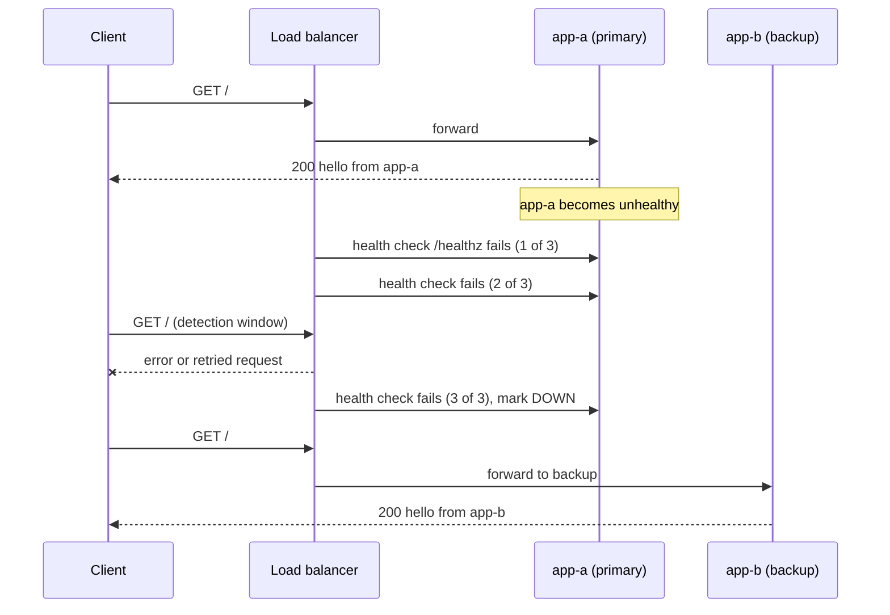
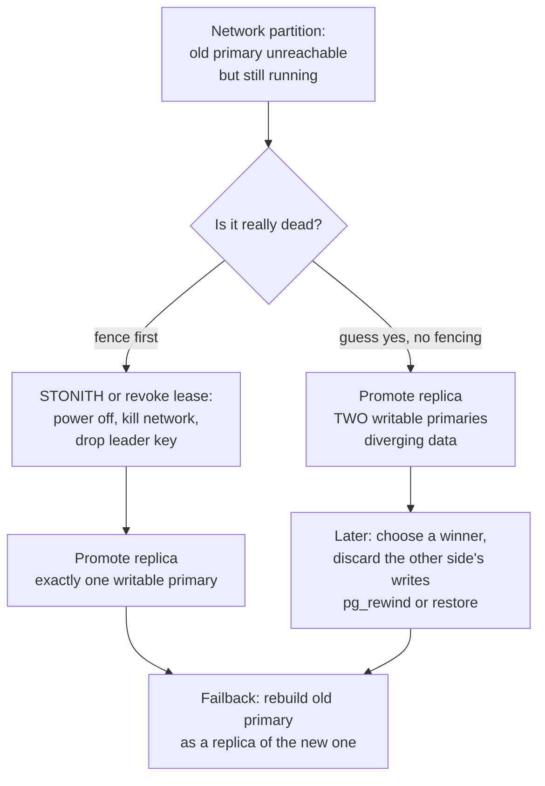

# L15.5 — Failover

> **Level 15: Disaster Recovery** · Topic 5 of 10 · ⏱ ~4 hours · Difficulty: Advanced

## 1. What it is

**Failover** is moving work from a failed (or failing) component to a standby that can take over: a load balancer stops sending requests to a dead
web server, a database replica is **promoted** to primary, or traffic for a whole region is redirected to another region. **Failback** is the later,
deliberate return to the original arrangement once the failed component is healthy again.

Two decisions define a failover design. First, **who decides**: software (*automatic* failover) or a human following a runbook (*manual* failover).
Second, **how clients find the new active node**: through a load balancer or proxy, a virtual IP, or a DNS change. Both choices trade speed against
the risk of the worst failover outcome, **split-brain**: two nodes both believing they are the primary and both accepting writes, so the data
diverges and one side's writes must eventually be thrown away.

## 2. Why it matters in DevOps

- **Failover is where HA either works or makes things worse.** A badly tuned automatic failover can turn a 5-second network blip into a 30-minute outage plus data loss.
- **It sets part of your RTO** ([RTO](07-rto.md)): detection time + decision time + promotion time + client re-routing time. Each term can be measured and shrunk.
- **It sets part of your RPO** ([RPO](06-rpo.md)): promoting an asynchronous replica loses whatever had not replicated ([Replication](02-replication.md)).
- **Untested failover does not work.** Configuration drift, expired credentials, a firewall rule that only the old primary had and an application that caches DNS for an hour are the usual reasons.
- **Failback is a second outage waiting to happen** if it is not planned: it needs the old node to be re-synchronised, not just switched on.

## 3. Real-world system example

**Amazon RDS Multi-AZ.** AWS keeps a synchronous standby in another Availability Zone and, on failure of the primary instance, automatically promotes
the standby and flips the DB instance endpoint's DNS record to it. Clients must reconnect and must honour DNS changes (short TTL, no endless connection reuse);
AWS documents failover as typically taking on the order of a minute or two, so check the current documentation for your engine. The application's job is to retry.

**Patroni (PostgreSQL).** The open-source Patroni project, used by many self-managed PostgreSQL platforms and by the Zalando Postgres Operator for Kubernetes,
runs an agent beside each PostgreSQL node and uses a distributed consensus store (etcd, Consul or ZooKeeper, or the Kubernetes API) holding a **leader key with a lease**.
The node that holds the lease is primary; if it cannot renew, it demotes itself, and a replica acquires the key and promotes. Because only one holder can own the lease, this is a defence against split-brain.
Clients reach the primary through HAProxy health checks on Patroni's REST API or a Kubernetes service.

**DNS and global load balancing.** AWS Route 53 offers *failover routing* backed by health checks, and most large CDN and edge providers can steer traffic away from unhealthy origins.
GitHub's 2018 outage is a widely cited public example of failover side effects: a brief network partition caused an automated system to promote database nodes in another data center, writes then
existed on both sides, and reconciling them took many hours (GitHub published a detailed postmortem). The lesson is not "avoid automation" but "automatic failover must be designed around split-brain".

## 4. Diagram

Health-check failover through a load balancer, and the detection window where requests can still fail:



Split-brain, and how fencing prevents it:



## 5. How it works

**Automatic vs manual**

| | Automatic | Manual (human-triggered, scripted) |
|---|-----------|-----------------------------------|
| Detection to action | seconds | minutes (page, assess, run) |
| Typical tools | RDS Multi-AZ, Patroni, Aurora, Kubernetes controllers, cloud LB health checks | runbook plus a promote script, `pg_ctl promote`, Route 53 record edit |
| Main risk | false positives, flapping, split-brain, cascading failover | slow RTO, human error under stress |
| Good fit | stateless tiers, well-understood data tiers with fencing | cross-region failover, data tiers without reliable fencing, decisions with data-loss trade-offs |
| Safeguards | quorum, leader lease, fencing, a minimum time between failovers, `fall`/`rise` thresholds | explicit "go" from the incident commander, pre-flight checks in the script |

A common compromise: **automatic within a region (stateless tiers and the database across AZs), manual between regions**, because a regional failover usually implies
accepting some data loss and takes a business decision.

**Ways to route clients to the new active node**

| Mechanism | Speed | Caveat |
|-----------|-------|--------|
| Load balancer or proxy with health checks (ALB, NLB, HAProxy, Nginx) | seconds | the LB itself must be redundant; passive checks (Nginx open source) only notice failures on real requests |
| Virtual IP moved by keepalived or VRRP | seconds | needs a shared L2 network, not available in most clouds |
| DNS record change (Route 53 failover routing, manual edit) | TTL plus client caching: tens of seconds to hours | some resolvers, JVMs and connection pools cache beyond the TTL; keep TTL low (for example 30-60 s) *before* you need it |
| Database endpoint managed by the platform (RDS endpoint, Kubernetes Service) | tens of seconds | clients must reconnect and retry |
| Global anycast or CDN steering | seconds | typically HTTP-level only, not database traffic |

**Health checks decide everything.** A shallow check (TCP port open) passes while the app is wedged; a deep check (query the database) can take the whole fleet out when the database is slow
and cause a cascading outage. A reasonable default: a *liveness-style* check on each instance (can this process serve) plus separate dependency alerts. Use thresholds (`fall 3`, `rise 2`) to avoid flapping.

**Split-brain defences.** (1) A **quorum or lease** from a consensus system so only one leader can exist. (2) **Fencing** ("shoot the other node in the head", STONITH): make sure the old primary can no longer write
before promoting, by powering it off through an out-of-band API, revoking its storage or network access. (3) Make the old primary demote itself if it loses contact with the quorum. (4) **Witness/odd number** of voters,
spread over failure domains, so a partition leaves one side with a majority.

**Failback.** After failover, the old primary may contain writes the new primary never saw. You cannot just restart it as primary. Either rebuild it from scratch as a replica of the new primary,
or use `pg_rewind`, which rolls back the diverged changes and re-synchronises. Then decide: stay on the new primary (usually simplest) or perform a *planned switchover* back during a quiet window
(clean stop of the current primary, wait for the standby to catch up, promote, re-attach the other as replica).

## 6. Step-by-step guide

**Prerequisites:** Linux, `nginx`, `haproxy`, `python3`, `curl` and PostgreSQL 16 server binaries (`sudo apt-get install -y nginx haproxy postgresql-16`; if a package
starts a system service you do not want, run `sudo systemctl disable --now nginx haproxy`). Everything uses non-root processes, loopback only and unusual ports (18101-18191, 55450-55451),
so nothing existing is touched and nothing is exposed. No cost. Run as a normal user (`initdb` refuses root; on a root-only box use `sudo -u postgres -i`).

1. **Create two toy backends that can be made "sick".** Touching `app-a.sick` makes only the `/healthz` endpoint return 503, simulating a hung dependency while the process stays up.
   ```bash
   export W=$HOME/dr-lab/failover && rm -rf "$W" && mkdir -p "$W/logs" "$W/tmp"
   cat > "$W/backend.py" <<'PY'
   import os, sys
   from http.server import BaseHTTPRequestHandler, ThreadingHTTPServer
   name, port, here = sys.argv[1], int(sys.argv[2]), os.path.dirname(os.path.abspath(__file__))
   class H(BaseHTTPRequestHandler):
       def do_GET(self):
           sick = os.path.exists(os.path.join(here, name + ".sick"))
           code = 503 if (sick and self.path == "/healthz") else 200
           body = f"hello from {name}\n".encode()
           self.send_response(code); self.send_header("Content-Length", str(len(body))); self.end_headers()
           self.wfile.write(body)
       def log_message(self, *a): pass
   class S(ThreadingHTTPServer):
       def handle_error(self, *a): pass
   S(("127.0.0.1", port), H).serve_forever()
   PY
   python3 "$W/backend.py" app-a 18101 & echo $! > "$W/a.pid"
   python3 "$W/backend.py" app-b 18102 & echo $! > "$W/b.pid"
   curl -s localhost:18101/ localhost:18102/
   ```
   Expected: `hello from app-a` and `hello from app-b`.

2. **Nginx failover (passive health checks, backup server).** Nginx open source marks a server failed after real requests fail (`max_fails`) and sends traffic to the `backup` only then.
   ```bash
   cat > "$W/nginx.conf" <<CONF
   worker_processes 1;
   pid $W/nginx.pid;
   error_log $W/logs/error.log;
   events { worker_connections 64; }
   http {
     access_log off;
     client_body_temp_path $W/tmp/body; proxy_temp_path $W/tmp/proxy; fastcgi_temp_path $W/tmp/fcgi;
     uwsgi_temp_path $W/tmp/uwsgi; scgi_temp_path $W/tmp/scgi;
     upstream shop {
       server 127.0.0.1:18101 max_fails=1 fail_timeout=10s;
       server 127.0.0.1:18102 backup;
     }
     server {
       listen 127.0.0.1:18180;
       location / {
         proxy_pass http://shop;
         proxy_connect_timeout 1s;
         proxy_next_upstream error timeout http_502 http_503;
       }
     }
   }
   CONF
   nginx -c "$W/nginx.conf" -e "$W/logs/error.log" -p "$W"
   for i in 1 2 3; do curl -s localhost:18180/; done
   kill "$(cat "$W/a.pid")"                      # simulate app-a crash
   for i in 1 2 3; do curl -s -w '  (HTTP %{http_code})\n' localhost:18180/; done
   ```
   Expected: three `hello from app-a`, then after the kill three `hello from app-b (HTTP 200)`. No client saw an error because `proxy_next_upstream` retried the first failed request on the backup.
   Note this works for idempotent requests; Nginx will not retry a `POST` by default, which is the right default for orders and payments.
   Restart app-a and stop Nginx: `python3 "$W/backend.py" app-a 18101 & echo $! > "$W/a.pid"; kill "$(cat "$W/nginx.pid")"`.

3. **HAProxy failover with active health checks, and measure the detection time.**
   ```bash
   cat > "$W/haproxy.cfg" <<CONF
   global
       maxconn 256
   defaults
       mode http
       timeout connect 1s
       timeout client 5s
       timeout server 5s
   frontend fe
       bind 127.0.0.1:18190
       default_backend shop
   backend shop
       option httpchk GET /healthz
       default-server inter 1s fall 3 rise 2
       server app-a 127.0.0.1:18101 check
       server app-b 127.0.0.1:18102 check backup
   listen stats
       bind 127.0.0.1:18191
       stats enable
       stats uri /stats
   CONF
   haproxy -c -f "$W/haproxy.cfg"
   haproxy -f "$W/haproxy.cfg" -D -p "$W/haproxy.pid"; sleep 3
   curl -s localhost:18190/                                   # hello from app-a
   touch "$W/app-a.sick"; T=$(date +%s.%N)
   until curl -s -m 1 localhost:18190/ | grep -q app-b; do sleep 0.2; done
   echo "switched after $(echo "$(date +%s.%N) - $T" | bc) s"
   curl -s 'localhost:18191/stats;csv' | cut -d, -f1,2,18 | grep app
   ```
   Similar to: `Configuration file is valid`, then `switched after 3.1 s` (about `fall x inter` = 3 x 1 s) and `shop,app-a,DOWN` / `shop,app-b,UP`. During those 3 seconds clients got errors or timeouts.
   That detection window is a direct input to your RTO. Now fail back and time it:
   ```bash
   rm "$W/app-a.sick"; T=$(date +%s.%N)
   until curl -s -m 1 localhost:18190/ | grep -q app-a; do sleep 0.2; done
   echo "failed back after $(echo "$(date +%s.%N) - $T" | bc) s"     # about rise x inter = 2 s
   ```
   Try `fall 1` and `fall 6` and observe the trade-off: faster detection, more flapping risk, versus slower detection.

4. **Database failover: a primary and a streaming replica.** Settings needed for a safe failback later: `wal_log_hints` (required by `pg_rewind` unless data checksums are on) and `wal_keep_size` (so the WAL needed to rewind still exists).
   ```bash
   export PATH=/usr/lib/postgresql/16/bin:$PATH PGHOST=/tmp
   P=$W/pg && mkdir -p "$P"
   initdb -D "$P/node1" >/dev/null
   cat >> "$P/node1/postgresql.conf" <<'CONF'
   unix_socket_directories = '/tmp'
   listen_addresses = ''
   wal_log_hints = on
   wal_keep_size = 128MB
   max_wal_senders = 5
   CONF
   echo "local replication all trust" >> "$P/node1/pg_hba.conf"
   pg_ctl -D "$P/node1" -o "-p 55450" -l "$P/node1.log" -w start
   psql -X -q -p 55450 -d postgres -c "CREATE TABLE orders(id serial primary key, item text)" \
     -c "INSERT INTO orders(item) SELECT 'i'||g FROM generate_series(1,1000) g"
   pg_basebackup -h /tmp -p 55450 -D "$P/node2" -R -X stream -c fast
   pg_ctl -D "$P/node2" -o "-p 55451" -l "$P/node2.log" -w start
   psql -X -At -p 55451 -d postgres -c "SELECT pg_is_in_recovery()"       # t
   ```
   Ports are passed on the command line (`-o "-p ..."`) rather than in `postgresql.conf` because `pg_rewind` later copies configuration from the source node, which would silently change a port.

5. **Cause a split-brain on purpose.** Promote the replica while the old primary is still alive and writable, as an over-eager automatic failover would after a network partition.
   ```bash
   pg_ctl -D "$P/node2" promote -w
   psql -X -At -p 55450 -d postgres -c "INSERT INTO orders(item) VALUES ('written-to-OLD-primary')"
   psql -X -At -p 55451 -d postgres -c "INSERT INTO orders(item) VALUES ('written-to-NEW-primary')"
   psql -X -At -p 55450 -d postgres -c "SELECT id,item FROM orders WHERE id>1000"
   psql -X -At -p 55451 -d postgres -c "SELECT id,item FROM orders WHERE id>1000"
   ```
   Expected: both nodes accepted id 1001 with different contents (`1001|written-to-OLD-primary` and `1001|written-to-NEW-primary`). Two histories now exist; no merge is possible without choosing a winner. This is the exact failure the fencing rules prevent.

6. **Resolve it: fence, rewind, re-attach (failback of the old primary as a replica).** We choose node2 as the winner; the old-primary write will be lost.
   ```bash
   pg_ctl -D "$P/node1" -m fast stop                         # fencing: the old primary must not run
   pg_rewind --target-pgdata="$P/node1" --source-server="host=/tmp port=55451 dbname=postgres" -R
   pg_ctl -D "$P/node1" -o "-p 55450" -l "$P/node1.log" -w start
   psql -X -At -p 55450 -d postgres -c "SELECT pg_is_in_recovery()" -c "SELECT id,item FROM orders WHERE id>1000"
   ```
   Expected: `pg_rewind: servers diverged at WAL location ...`, `Done!`, then `t` and `1001|written-to-NEW-primary`. The old write is gone, which is why fencing (preventing the second writer) is cheaper than rewinding.
   If `pg_rewind` complains that it cannot find a WAL file, `wal_keep_size` was too small or WAL archiving is needed (`restore_command`); that is a real-world failure mode.

7. **Planned switchover back to node1 (failback).**
   ```bash
   psql -X -At -p 55451 -d postgres -c "INSERT INTO orders(item) VALUES ('written-while-failed-over')"
   sleep 1
   pg_ctl -D "$P/node2" -m fast stop                         # clean stop flushes all WAL to the standby
   pg_ctl -D "$P/node1" promote -w
   pg_rewind --target-pgdata="$P/node2" --source-server="host=/tmp port=55450 dbname=postgres" -R
   pg_ctl -D "$P/node2" -o "-p 55451" -l "$P/node2.log" -w start
   sleep 2
   psql -X -At -p 55450 -d postgres -c "SELECT id,item FROM orders WHERE id>1000"
   psql -X -At -p 55451 -d postgres -c "SELECT pg_is_in_recovery(), count(*) FROM orders"
   ```
   Expected: node1 shows both rows (`1001|written-to-NEW-primary` and `1002|written-while-failed-over`) and node2 reports `t|1002`. `pg_rewind: no rewind required` is normal after a clean shutdown.

8. **DNS failover (read-only reference).** In Route 53 a *failover routing policy* uses two records for `api.example.com`: PRIMARY with a health check, SECONDARY pointing at the standby region. Keep TTL at 60 seconds or less.
   Cost and safety: health checks and hosted zones cost money; use a throwaway domain and delete them afterwards. A quick local feel for TTL effects: `dig +noall +answer example.com` shows the remaining TTL counting down in your resolver's cache.

9. **Clean up.**
   ```bash
   pg_ctl -D "$P/node1" -m fast stop; pg_ctl -D "$P/node2" -m fast stop
   kill "$(cat "$W/haproxy.pid")" "$(cat "$W/a.pid")" "$(cat "$W/b.pid")"
   ```

## 7. Real-world scenario

*Illustrative.* `shop-api` runs Patroni-style automatic failover inside `us-east-1`. A flaky switch makes the primary unable to reach the consensus store for 20 seconds. The leader lease expires and a replica is promoted; the old primary, correctly, demotes itself.
But two application pods keep a pooled connection to the old primary for several minutes and receive errors ("read-only transaction"). The on-call engineer sees elevated 5xx for 4 minutes: 25 seconds for failover, the remainder for connection pools that had no
retry or reconnect logic. The fix is in the application: validate connections on borrow, retry idempotent writes with backoff, and use the cluster endpoint, not an instance hostname.
In the postmortem they also turn on a minimum interval between automatic failovers, to prevent a flapping network from promoting replicas in a loop. **Lesson:** failover time is database promotion plus client recovery; the second term is often larger.

## 8. Common mistakes and best practices

**Don't**

- Promote a replica without making sure the old primary can no longer accept writes.
- Set health-check thresholds so tight that a single slow response triggers failover.
- Put a database dependency check in every instance's health check (a slow database then removes every web server at once).
- Rely on DNS failover with a 1-hour TTL, or assume applications honour TTLs.
- Forget failback: restarting a failed primary as primary is how split-brain is created the second time.

**Do**

- Decide per tier: automatic for stateless and for in-region databases with fencing, manual (scripted) for cross-region.
- Use a consensus-based leader election or the platform's managed failover rather than rolling your own scripts.
- Measure every term: detection, decision, promotion, client recovery. Then put them in the DR plan ([RTO](07-rto.md)).
- Build clients that retry with backoff and jitter, validate pooled connections and re-resolve DNS ([Connection Pooling](../level-12-advanced-networking/10-connection-pooling.md)).
- Drill it regularly ([Failure Scenario Drills](10-failure-scenario-drills.md)); see also [High Availability and Scalability](../level-00-what-devops-is/08-high-availability-and-scalability.md) and [Load Balancers](../level-02-networking/08-reverse-proxies-and-load-balancers.md).

## 9. Tasks

- [ ] **T1 — Passive and active load balancer failover** *(≈45 min, beginner)*
  - **Goal:** watch traffic move away from a dead and from a sick backend.
  - **Steps:**
    1. Follow guide steps 1-3.
    2. Record in a table: failure type (process killed vs `/healthz` 503), balancer (Nginx vs HAProxy), seconds until traffic moved, whether any client request failed.
  - **Done when:** the table has four rows with measured values and a sentence explaining each difference.

- [ ] **T2 — Tune detection time** *(≈30 min, intermediate)*
  - **Goal:** understand the speed versus flapping trade-off.
  - **Steps:**
    1. Change `fall` to 1 and then 6, `inter` to 500ms and 2s, reload HAProxy (`haproxy -f ... -sf $(cat "$W/haproxy.pid")` for a graceful restart) and re-measure.
    2. Make `/healthz` flap: loop `touch`/`rm` of `app-a.sick` every 1.5 seconds and watch the HAProxy stats page.
  - **Done when:** you can show one setting that detects fast but flaps under the loop and one that is stable but slow, with numbers.

- [ ] **T3 — Database failover and rewind** *(≈45 min, intermediate)*
  - **Goal:** promote, fence and rejoin a database node.
  - **Steps:** follow guide steps 4, 6 (skip 5's split-brain at first: stop node1 first, then promote node2) and 7.
  - **Done when:** both nodes are up, the original primary is a replica that has no writes the new primary lacked, and `pg_stat_replication` on the current primary shows it streaming.

- [ ] **T4 — Break it: reproduce split-brain and describe the damage** *(≈30 min, advanced)*
  - **Goal:** experience divergence and quantify the lost writes.
  - **Steps:**
    1. Follow guide step 5, then insert 10 different rows on each side.
    2. Run `pg_rewind` in the direction that discards the *other* side and list exactly which rows are gone.
    3. Write the three-line rule your team would adopt to make this impossible (fencing, lease, who may promote).
  - **Done when:** you can list the discarded rows and name the control that would have prevented them.

- [ ] **T5 — Script a safe manual promote** *(≈60 min, advanced)*
  - **Goal:** automate the manual failover with guard rails.
  - **Steps:**
    1. Write `promote.sh` that refuses to run unless: the old primary does not answer on its port (or `--force-fence` stops it), the replica's `pg_last_wal_replay_lsn()` is printed with its lag, and the operator types the node name to confirm.
    2. After promotion it prints the new primary and the exact `pg_rewind` command for the old one.
    3. Test it against your lab with the old primary up and down.
  - **Done when:** the script aborts with a clear message when the old primary is still writable, and succeeds when it is not.

- [ ] **T6 — Prove it: failover design review** *(≈45 min, advanced)*
  - **Goal:** justify a failover design for `shop-api` out loud.
  - **Steps:**
    1. Without notes, draw the web tier, database and DNS path and mark for each: automatic or manual, how it is detected, how clients find the new node, what prevents split-brain, and how failback works.
    2. Write the total expected unavailability as detection + decision + promotion + client recovery with numbers you measured in T1-T3.
  - **Done when:** each term has a number from your lab or a stated assumption, and a reviewer cannot find a path that allows two writable primaries.

## 10. Self-check questions

1. What is split-brain and what are two independent defences against it?
2. When would you choose manual failover over automatic?
3. Why is DNS-based failover usually slower than a load balancer, and what must you do before the incident to improve it?
4. Why can a deep health check (querying the database) be dangerous on every web instance?
5. After failover the old primary comes back. Why can you not just start it as primary, and what are your options?

<details>
<summary>Answers</summary>

1. Two nodes both acting as primary and accepting writes, so histories diverge. Defences: quorum/leader lease so only one leader exists, and fencing (power off, revoke storage or network) before promoting; also self-demotion on losing quorum.
2. When failover implies a business decision or acceptable data loss (cross-region, asynchronous replication), when there is no reliable fencing, or when false positives would be costlier than a few extra minutes.
3. Resolvers, applications and connection pools cache answers beyond or up to the TTL, and propagation is not instantaneous. Lower the TTL in advance, make clients re-resolve and retry, and test with real clients.
4. A shared dependency failure (slow database) marks every instance unhealthy simultaneously, so the load balancer removes all of them and turns a degradation into a full outage, and recovery can stampede.
5. It may contain writes the new primary never received, so the histories diverged. Rebuild it as a replica from a fresh base backup, or use `pg_rewind` to roll back divergence and re-attach it, then optionally do a planned switchover.
</details>

## 11. Further reading

- PostgreSQL documentation: *High Availability, Load Balancing, and Replication*, `pg_rewind` and `pg_ctl promote`.
- Patroni project documentation and the Zalando Postgres Operator documentation.
- HAProxy and Nginx documentation on health checks (`option httpchk`, `max_fails`, `proxy_next_upstream`).
- AWS documentation: *Amazon RDS Multi-AZ deployments* and *Route 53 DNS failover*.
- GitHub engineering's published postmortem of the October 2018 incident.
- Related: [Replication](02-replication.md), [Restore Procedures](04-restore-procedures.md), [Replication in the databases level](../level-13-databases-distributed-systems/04-replication.md).

<!-- nav -->
---
← Previous: [Restore Procedures](04-restore-procedures.md) · [Level 15 index](README.md) · Next: [RPO - Recovery Point Objective](06-rpo.md) →
