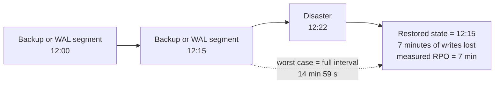
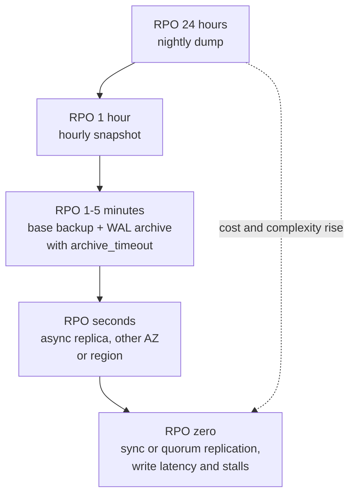

# L15.6 — RPO - Recovery Point Objective

> **Level 15: Disaster Recovery** · Topic 6 of 10 · ⏱ ~3 hours · Difficulty: Intermediate

## 1. What it is

The **Recovery Point Objective (RPO)** is the maximum amount of data loss, measured in *time*, that the business accepts after a disaster.
"RPO = 15 minutes" means: after we recover, the newest data we are guaranteed to have is at most 15 minutes older than the moment of the failure.
It is a *requirement* the business sets ("we can tolerate losing at most this much"), not a property you discover afterwards.

Do not confuse it with three neighbours. **RTO** ([RTO](07-rto.md)) is how long recovery takes, not how much data is lost. The **SLA** ([SLAs](../level-14-sre/03-slas.md)) is a promise to customers
about availability. The **actual recovery point** is what a real incident or drill *measured*: if the measured value is worse than the objective, the design (or the money) is wrong. RPO is set **per data class**:
orders and payments may need seconds; analytics events, search indexes and sessions can often be rebuilt or lost.

## 2. Why it matters in DevOps

- **It converts a vague wish ("don't lose data") into engineering choices.** RPO decides whether nightly dumps are enough, whether you need continuous WAL archiving, or whether you must pay for synchronous replication.
- **Every minute of RPO has a price, in both directions.** Tight RPO costs money (more storage, network, standby capacity, write latency). Loose RPO costs business (lost orders, lost trust, regulatory exposure).
- **It tells you what to monitor.** The honest RPO of an asynchronous system is its current replication lag or the age of the newest archived WAL file. If you do not alert on those, your real RPO is "unknown".
- **It exposes hidden dependencies.** The database may have RPO 1 minute, but if uploaded files sync to a second region nightly, the *system's* RPO is 24 hours.
- **It drives contracts.** Customers and auditors ask for it in security reviews and disaster-recovery clauses.

## 3. Real-world system example

**GitLab.com, January 2017.** After the production database incident described in GitLab's public postmortem, service was restored from a snapshot taken roughly six hours earlier, and some hours of
user-generated database content (issues, merge requests, comments) were lost. That outcome is a textbook measured RPO: it was far worse than the continuous protection people assumed they had, because the mechanisms they believed in were not working.

**Amazon RDS and Aurora.** RDS continuously uploads transaction logs, and its documentation describes the latest restorable time as typically within about five minutes of the present, which is the practical RPO of its point-in-time recovery for a single-region restore.
Aurora stores data across multiple Availability Zones within a region and offers continuous backup; **Aurora Global Database** and RDS cross-region read replicas replicate asynchronously between regions, so a regional disaster implies loss of whatever had not yet reached the other region
(AWS publishes typical lag figures for Global Database; check the current documentation, because they depend on workload).

**Object storage.** Amazon S3 Cross-Region Replication is asynchronous by default; *S3 Replication Time Control* adds an SLA that most objects replicate within 15 minutes and metrics to watch. A design that depends on uploaded files being in the second region
should state which of these RPOs it assumes.

## 4. Diagram

RPO on a timeline. Data written after the last recovery point is the data you lose:



Cost versus RPO: each step down needs a more expensive mechanism.



## 5. How it works

**Deriving backup frequency from RPO.** The worst-case data loss of any periodic mechanism is *one full interval plus the time the job takes to finish and ship*. So:

`interval + job duration + shipping delay <= RPO`

Leave headroom, because one job can fail and still leave you inside the objective: a common rule is to schedule at no more than **half the RPO**. Worked example for `shop-api` (illustrative numbers): the business says "at most 15 minutes of orders".
Nightly `pg_dump` gives RPO 24 hours, fails. Hourly snapshots give 1 hour, fails. Continuous WAL archiving with `archive_timeout = 60s` (segments are forced out at least every minute) plus a base backup gives an RPO of about one minute plus shipping delay, passes. Adding an asynchronous replica gives seconds of exposure for a *server* failure (lag), while WAL archive to object storage covers a *site* failure.

| Mechanism | Worst-case loss | What it protects against | Cost drivers |
|-----------|-----------------|--------------------------|--------------|
| Nightly logical dump | up to 24 h | operator error, small data sets | cheap; slow restore |
| Hourly volume snapshot | up to 1 h | volume loss, bad deploy | snapshot storage, scheduling |
| Base backup + WAL archive | `archive_timeout` + ship delay (seconds to minutes) | corruption, bad migration (with PITR), site loss if copied off-site | object storage, a bit of CPU and network |
| Async replica, other AZ | replication lag (usually sub-second to seconds) | instance or AZ failure | a second database instance (roughly 2x compute) |
| Async replica, other region | lag across regions (seconds, can grow) | region failure | instance cost plus cross-region transfer |
| Sync or quorum replication | zero for acknowledged commits | node failure, with no loss | write latency, writes can stall if standbys are unreachable ([Replication](02-replication.md)) |

**Cost of a lower RPO, in practice.** Going from 24 hours to 1 hour is a scheduling change. Going from 1 hour to 1 minute adds a log-shipping pipeline and monitoring. Going from minutes to seconds requires a running standby (double compute) and sometimes a cross-region link.
Going to zero requires synchronous commit across failure domains, which adds a network round trip to every write and can halt writes when the standby is unreachable. Teams therefore set tiers: *Tier A* data (payments) tight RPO, *Tier C* data (cache, analytics) loose.

**Backups do not protect the last mile by themselves.** Replication copies mistakes ([Backups](01-backups.md)); the RPO you can claim for *logical corruption* is the time of the last good backup or the PITR window, not the replication lag.
You need both numbers in the plan: RPO for infrastructure failure and RPO for data corruption (which PITR can bring to "seconds before the mistake").

**How to measure the real RPO continuously.** For WAL archiving, alert when `now() - pg_stat_archiver.last_archived_time` exceeds your target. For replicas, alert on replay lag in seconds. For snapshots, alert on the age of the newest completed snapshot.
For object replication, use the replication metrics. Write the measured values into your DR drills.

## 6. Step-by-step guide

**Prerequisites:** Linux with PostgreSQL 16 server binaries in `/usr/lib/postgresql/16/bin`, a normal (non-root) user, `python3`. Free, local, uses ports 55460 and 55461 and a scratch directory. Nothing existing is touched.

1. **Compute what an RPO implies with a small calculator.**
   ```bash
   mkdir -p ~/dr-lab/rpo && cd ~/dr-lab/rpo
   cat > rpo_calc.py <<'EOF'
   #!/usr/bin/env python3
   """rpo_calc.py - what does a given RPO imply? Usage: rpo_calc.py RPO_SECONDS [orders_per_hour] [avg_order_usd]"""
   import sys
   rpo = float(sys.argv[1])
   orders_per_hour = float(sys.argv[2]) if len(sys.argv) > 2 else 600
   avg_order = float(sys.argv[3]) if len(sys.argv) > 3 else 40.0

   orders_lost = orders_per_hour / 3600 * rpo          # worst case: one full interval of orders
   print(f"RPO target            : {rpo:>10.0f} s ({rpo/3600:.2f} h)")
   print(f"worst-case orders lost: {orders_lost:>10.0f}  (about ${orders_lost*avg_order:,.0f} revenue at risk)")

   if rpo >= 86400:   method = "nightly logical or physical backup"
   elif rpo >= 3600:  method = "hourly snapshots or incremental backups"
   elif rpo >= 60:    method = "base backup + continuous WAL archiving (archive_timeout <= RPO/2)"
   elif rpo > 0:      method = "streaming replica (asynchronous), lag alerting"
   else:              method = "synchronous or quorum replication (write latency and availability cost)"
   print(f"minimum mechanism     : {method}")
   if rpo > 0:
       print(f"schedule with headroom: every {rpo/2:.0f} s ({172800/rpo:.1f} runs per day), because the job itself takes time and can fail once")
   EOF
   python3 rpo_calc.py 900 1200 25
   ```
   Expected:
   ```text
   RPO target            :        900 s (0.25 h)
   worst-case orders lost:        300  (about $7,500 revenue at risk)
   minimum mechanism     : base backup + continuous WAL archiving (archive_timeout <= RPO/2)
   schedule with headroom: every 450 s (192.0 runs per day), because the job itself takes time and can fail once
   ```
   Try `86400`, `30` and `0` and read how the mechanism changes. The order rate and price are placeholders; use your own business numbers.

2. **Write the RPO drill script.** It builds a database with WAL archiving, runs a continuous writer, destroys the server *violently* (`kill -9`, then deletes the data directory) after 25 seconds, restores from the base backup plus the archive, and reports how many seconds of data were lost.
   ```bash
   cat > rpo-drill.sh <<'EOF'
   #!/usr/bin/env bash
   # Usage: rpo-drill.sh <archive_timeout_seconds>
   set -eu
   export PATH=/usr/lib/postgresql/16/bin:$PATH
   export W=$HOME/dr-lab/rpo/lab && rm -rf "$W" && mkdir -p "$W/archive"
   export PGHOST=/tmp PGPORT=55460
   TIMEOUT=${1:-10}
   initdb -D "$W/pg" >/dev/null
   cat >> "$W/pg/postgresql.conf" <<CONF
   port = 55460
   unix_socket_directories = '/tmp'
   listen_addresses = ''
   archive_mode = on
   archive_command = 'test ! -f $W/archive/%f && cp %p $W/archive/%f'
   archive_timeout = ${TIMEOUT}s
   CONF
   pg_ctl -D "$W/pg" -l "$W/pg.log" -w start >/dev/null
   createdb shop
   psql -X -q -d shop -c "CREATE TABLE ticks(id serial primary key, ts timestamptz not null)"
   pg_basebackup -D "$W/base" -X stream -c fast
   # the "orders": one row every 0.2 s, each stamped with the time it committed
   ( while true; do psql -X -q -d shop -c "INSERT INTO ticks(ts) VALUES (clock_timestamp())"; sleep 0.2; done ) >/dev/null 2>&1 &
   WR=$!
   sleep 25
   CRASH=$(date +%s.%N)                                   # the disaster
   kill -9 "$(head -1 "$W/pg/postmaster.pid")"; kill $WR 2>/dev/null || true
   sleep 1; rm -rf "$W/pg"                               # the disk is gone; only base/ and archive/ survive
   echo "archived WAL segments: $(ls "$W/archive" | wc -l)"
   START=$(date +%s)
   cp -r "$W/base" "$W/restored"; chmod 700 "$W/restored"
   export PGPORT=55461
   cat >> "$W/restored/postgresql.conf" <<CONF
   port = 55461
   unix_socket_directories = '/tmp'
   listen_addresses = ''
   restore_command = 'cp $W/archive/%f %p'
   CONF
   touch "$W/restored/recovery.signal"
   pg_ctl -D "$W/restored" -l "$W/restored.log" -w start >/dev/null
   until [ "$(psql -X -At -d shop -c 'SELECT pg_is_in_recovery()')" = f ]; do sleep 0.2; done
   echo "recovery took $(( $(date +%s) - START )) s"
   psql -X -At -d shop -c "SELECT count(*) AS rows_recovered, round(extract(epoch from (to_timestamp($CRASH) - max(ts)))::numeric,1) AS seconds_lost FROM ticks"
   pg_ctl -D "$W/restored" -m fast stop >/dev/null
   EOF
   chmod +x rpo-drill.sh
   ```

3. **Run the drill with a loose and a tight `archive_timeout` and compare the measured RPO.**
   ```bash
   ./rpo-drill.sh 10
   ./rpo-drill.sh 2
   ```
   Similar to (your numbers will differ run to run):
   ```text
   archived WAL segments: 5
   recovery took 1 s
   91|5.5          <- 91 rows recovered, about 5.5 seconds of data lost
   ...
   archived WAL segments: 15
   recovery took 1 s
   114|0.3         <- far fewer seconds lost, but 3x more WAL files (each is 16 MB on disk)
   ```
   The measured loss is bounded by `archive_timeout` (the open WAL segment that was never shipped). Tighter means more files shipped and stored: that is the "cost of lower RPO", demonstrated.
   (Each forced segment switch writes a full 16 MB file even when nearly empty, which compresses well, so real systems compress archived WAL.)

4. **Compare with a replica's exposure.** Reuse the two-node lab from [Replication](02-replication.md), run `pgbench` against the primary, and watch `replay_lag` in `pg_stat_replication`. A replica's RPO for a server crash is that lag; a replica's RPO for a `DROP TABLE` is zero protection.

5. **Set up the alert that tells you the real RPO.**
   ```bash
   psql -X -At -h /tmp -p 55460 -d postgres -c "SELECT now() - last_archived_time AS archive_age, failed_count FROM pg_stat_archiver" 2>/dev/null || echo "start the lab cluster first"
   ```
   In production, export `archive_age` as a metric and page when it exceeds half your RPO. See [What to Monitor](../level-10-observability/11-what-to-monitor.md).

6. **Clean up.**
   ```bash
   rm -rf ~/dr-lab/rpo/lab
   ```

## 7. Real-world scenario

*Illustrative.* `shop-api` is told "we can lose at most 5 minutes of orders" and configures an asynchronous replica plus nightly dumps. The team believes the replica gives them seconds. During a quarterly drill they kill the primary's VM and promote the replica: 11 seconds of lag, fine.
Then they run the *corruption* drill: a faulty migration deletes rows at 14:02, discovered at 14:40. The replica has the same deletion; the newest dump is from 02:00, so the honest recovery point for that scenario is **12 hours**, not 5 minutes.
They add base backups plus WAL archiving with `archive_timeout = 60s`, which allows point-in-time recovery to 14:01:59. Their DR plan now states two RPOs: 15 seconds for infrastructure failure (replica lag, alerted) and about one minute for logical corruption (PITR).
**Lesson:** one RPO number per scenario, backed by a measured drill, not one optimistic number for everything.

## 8. Common mistakes and best practices

**Don't**

- Quote a single RPO for the whole system; stateful dependencies (uploads, queues, third-party data) often have a worse one.
- Assume replication lag is your RPO for data corruption or human error.
- Choose "zero data loss" without agreeing to its availability and latency cost.
- Set RPO from what the current tooling happens to do ("our dumps are nightly so RPO is 24 hours" is a result, not an objective).
- Forget the time the backup job takes and the delay shipping it off-site.

**Do**

- Ask the business to price data loss (orders per minute, revenue per order, regulatory exposure) and derive the RPO from it.
- Tier data: tight RPO for money and customer records, loose for derived or rebuildable data.
- Schedule jobs at half the RPO or better, and monitor *backup age* and *replication lag* against it.
- Measure the actual recovery point in every drill and record the gap ([Failure Scenario Drills](10-failure-scenario-drills.md)).
- Keep an off-site copy that meets the RPO too ([Off-site Backups](08-offsite-backups.md)).

## 9. Tasks

- [ ] **T1 — Run the RPO drill and chart the trade-off** *(≈45 min, beginner)*
  - **Goal:** measure loss versus `archive_timeout` with your own numbers.
  - **Steps:**
    1. Follow guide steps 1-3 and also run with timeouts 1, 5, 30 and 60.
    2. Record seconds lost, number of archived segments and total archive size (`du -sh lab/archive`) for each run.
  - **Done when:** you have a 5-row table showing loss rising with the timeout and archive volume rising as it shrinks, plus one sentence on the trade-off.

- [ ] **T2 — Derive a schedule from a business statement** *(≈20 min, beginner)*
  - **Goal:** turn a requirement into a backup schedule.
  - **Steps:**
    1. For three data classes in `shop-api` (orders, product images, session cache) write an RPO the business could accept and the mechanism that meets it, using `rpo_calc.py`.
    2. State the schedule with headroom for each.
  - **Done when:** each row names RPO, mechanism, interval and how you will alert if the interval is missed.

- [ ] **T3 — Break it: RPO does not cover corruption** *(≈30 min, intermediate)*
  - **Goal:** show that a replica's low RPO is irrelevant to logical errors.
  - **Steps:**
    1. Using the replication lab, `DELETE` from a table on the primary and show the replica agrees.
    2. Using the archive from the RPO drill, restore to a point just before the delete using `recovery_target_time` and `recovery_target_action = 'promote'` in `postgresql.conf` of the restored copy (use a timestamp from your `ticks` table; the drill script deletes `lab/pg` but keeps `lab/base` and `lab/archive`).
    3. Compare the data loss of the two approaches.
  - **Done when:** the PITR copy contains the rows the replica no longer has, and you can state both RPOs for this scenario.

- [ ] **T4 — Alert on the real RPO** *(≈45 min, intermediate)*
  - **Goal:** make the RPO observable.
  - **Steps:**
    1. Write a script or Prometheus query exporter that reports `now() - last_archived_time` from `pg_stat_archiver` and the age of your newest backup file.
    2. Make it exit non-zero (or alert) when either exceeds half your chosen RPO.
    3. Stop the archive by breaking `archive_command` (for example point it at a non-existent directory) and watch the alert fire.
  - **Done when:** the alert fires within one `archive_timeout` of the break and clears after you fix the command and the backlog drains.

- [ ] **T5 — Cost model** *(≈45 min, advanced)*
  - **Goal:** price each RPO tier for `shop-api`.
  - **Steps:**
    1. Using your cloud provider's public pricing calculator (read-only, no resources created), estimate monthly cost for: nightly snapshot, hourly snapshot, WAL archive to object storage, a same-region replica, a cross-region replica.
    2. Add the expected revenue at risk per incident from `rpo_calc.py`.
  - **Done when:** a table lists monthly cost, RPO and "break-even incident frequency" for each tier, and you recommend one.

- [ ] **T6 — Prove it: defend an RPO** *(≈30 min, advanced)*
  - **Goal:** explain an RPO decision to a non-engineer.
  - **Steps:**
    1. Without notes, write one page that states the RPO for orders, the mechanism, how it is monitored, the measured value from your drill and the cost of making it tighter by 10x.
    2. Explain the difference between this RPO and the RPO for accidental deletion.
  - **Done when:** the page contains both numbers (infrastructure failure and corruption) with evidence from your drills.

## 10. Self-check questions

1. Define RPO in one sentence and say what it is not.
2. Your backup runs every 6 hours and takes 30 minutes to complete and upload. What is the worst-case data loss, and what would you change to reach a 1-hour RPO?
3. Why is an asynchronous replica not enough for an RPO of 5 minutes against accidental `DROP TABLE`?
4. What does synchronous replication buy you and what does it cost?
5. How would you detect, before a disaster, that your actual RPO has silently drifted above target?

<details>
<summary>Answers</summary>

1. The maximum tolerated data loss measured in time. It is not recovery time (RTO), nor an availability promise (SLA), nor what the tooling happens to achieve.
2. Roughly 6.5 hours (an interval plus the job and upload time, and if one run fails, double that). Move to continuous WAL archiving or at least hourly snapshots/incrementals with off-site shipping, and alert on backup age.
3. Replication faithfully copies the drop within moments, so the replica has no pre-drop state. You need PITR or backups with retention beyond your detection time.
4. Zero loss of acknowledged commits across the synchronous failure domain; it costs write latency (a network round trip) and can stall writes when the standby is unreachable.
5. Alert on replication lag, `pg_stat_archiver.last_archived_time` age, newest backup age and replication metrics for object storage, and measure the real value in drills.
</details>

## 11. Further reading

- PostgreSQL documentation: *Continuous Archiving and Point-in-Time Recovery (PITR)* and the `pg_stat_archiver` view.
- AWS documentation: *Amazon RDS backups and point-in-time recovery*, *Aurora Global Database*, and *S3 Replication Time Control*.
- *Site Reliability Engineering* (Google), chapters on data integrity; AWS Well-Architected Framework, Reliability Pillar (disaster recovery objectives).
- GitLab's public postmortem of the 31 January 2017 database incident.
- Related: [Backups](01-backups.md), [Replication](02-replication.md), [Disaster Recovery overview](../level-00-what-devops-is/09-disaster-recovery.md), [Backups and PITR](../level-13-databases-distributed-systems/05-backups-and-pitr.md).

<!-- nav -->
---
← Previous: [Failover](05-failover.md) · [Level 15 index](README.md) · Next: [RTO - Recovery Time Objective](07-rto.md) →
