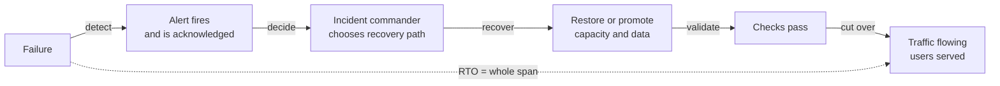
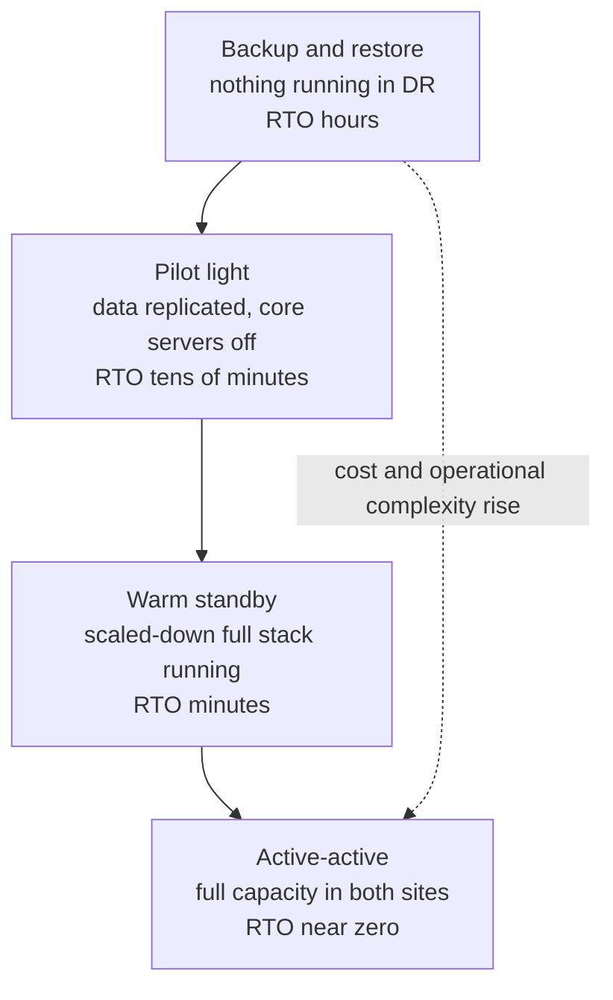

# L15.7 — RTO - Recovery Time Objective

> **Level 15: Disaster Recovery** · Topic 7 of 10 · ⏱ ~3 hours · Difficulty: Intermediate

## 1. What it is

The **Recovery Time Objective (RTO)** is the maximum acceptable length of time between the moment a service goes down and the moment it is usable again.
"RTO = 30 minutes" means: from the failure, the service must be back (possibly degraded, and as agreed with the business) within half an hour. The clock covers the *whole* outage, not just the technical restore:
detecting the problem, waking someone up, deciding what to do, restoring or failing over, validating, and switching traffic.

RTO is a requirement the business sets and the architecture must meet; the **achieved RTO** is what a drill or incident measured. RTO is paired with the RPO ([RPO](06-rpo.md)): RPO is "how much data may we lose", RTO is "how long may we be down".
A related number, the **Maximum Tolerable Downtime (MTD)**, is the point at which the business itself is damaged; RTO must sit comfortably inside it. Work that follows recovery (reconciling records, rebuilding caches) is often forgotten but also takes time, so agree what "recovered" means up front.

## 2. Why it matters in DevOps

- **It decides how much you spend.** Recovering in four hours from backups costs very little; recovering in four minutes means a second environment, running, tested and paid for. RTO is the single biggest driver of DR cost.
- **It shapes the architecture.** A tight RTO cannot be met by "rebuild everything from scratch"; it requires automation (Infrastructure as Code, scripted promotion), pre-provisioned capacity, and in some cases active-active design.
- **Your RTO is the sum of the slowest steps**, usually human ones: noticing, deciding, finding credentials. Technical restore time is often not the biggest term.
- **It is a contract in disguise.** If sales promised a customer a 99.95% SLA ([SLAs](../level-14-sre/03-slas.md)), the budget for downtime per month is about 22 minutes; an RTO of two hours blows through it in a single incident.
- **Untested RTOs are fiction.** Teams routinely discover their "30 minute RTO" is 3 hours the first time they time it ([Testing Backup Restoration](09-testing-backup-restoration.md)).

## 3. Real-world system example

**AWS's DR strategies.** The AWS Well-Architected Reliability Pillar and the AWS whitepaper *Disaster Recovery of Workloads on AWS* describe four strategies on a cost-versus-recovery-time scale: **backup and restore**, **pilot light**, **warm standby** and **multi-site active/active**.
They map directly onto RTO and RPO targets (see the table in section 5). The whitepaper is a good reference for picking a tier per workload.

**Netflix.** Netflix has publicly described running its streaming service from multiple AWS regions and practising evacuating a region, rehearsed with the "Chaos Kong" exercise, which simulates a regional failure
by shifting traffic away from a region. The point for RTO is that an active-active design with a rehearsed traffic shift can recover in minutes because nothing has to be restored: capacity and data are already live elsewhere.
(Netflix engineers have written about this on their tech blog; details such as exact timings change over time, so treat the pattern, not the numbers, as the lesson.)

**OVHcloud Strasbourg, March 2021.** A fire destroyed one data center (SBG2) of OVHcloud's Strasbourg site and caused an outage of other buildings on the site. It is a public, widely reported event. Customers with backups in the same data center or only on the same site lost data, while those with copies and an environment elsewhere
could restart there. It is a reminder that both the RTO and the RPO of a "region failure" depend on where the second copy and the second environment physically are. We keep the facts high-level here; OVHcloud published its own updates and a postmortem.

## 4. Diagram

What the clock covers. Each segment is a term in your RTO, and each can be measured:



The four DR tiers trade money for time:



## 5. How it works

**Choosing an RTO.** Start from the business impact of downtime: revenue per minute, contractual penalties, safety or legal obligations, reputational cost. Then ask what is *degraded but acceptable* (read-only mode, no search, queued checkouts).
Different services get different RTOs; the dependency graph decides the real value, because a service cannot recover faster than the things it depends on. A common approach is to assign each system a **tier**:

| Tier | Example systems in `shop-api` | Typical RTO | Typical RPO |
|------|------------------------------|-------------|-------------|
| 0 | identity, secrets, DNS, networking | minutes (everything else waits for it) | near zero (config in Git) |
| 1 | checkout API, orders database | 15-60 minutes | 1-5 minutes |
| 2 | search, recommendations, emails | 4-8 hours | hours |
| 3 | internal reporting, analytics | 24-72 hours | a day |

**The four DR strategies (names from the AWS DR whitepaper)**

| Strategy | What runs in the DR site | Typical RTO | Typical RPO | Relative cost | Main work to recover |
|----------|-------------------------|-------------|-------------|---------------|----------------------|
| Backup and restore | nothing, only backups copied off-site | hours | hours (backup interval) | lowest | create infrastructure from code, restore data, switch DNS |
| Pilot light | data stores replicated and kept up to date, application servers defined but stopped or at minimum size | tens of minutes | minutes | low-medium | start and scale the application tier, promote the database, switch DNS |
| Warm standby | a complete but scaled-down copy running and serving health checks | minutes | seconds to minutes | medium-high | scale up, promote, shift traffic |
| Multi-site active-active | full capacity in two or more sites, serving traffic | seconds to minutes | near zero to seconds | highest, and hard (data conflicts, consistency) | remove the failed site from rotation |

Indicative ranges only; the real values depend on your data size, automation and drills.

**RTO budget.** `RTO = detection + decision + provisioning + data restore (or promote) + validation + traffic cut-over`. Every term can be attacked:

| Term | How to shrink it |
|------|------------------|
| Detection | symptom-based alerts on user-visible errors (not only host metrics), synthetic checks, short evaluation windows |
| Decision | runbooks with pre-authorised actions, clear incident roles ([Incident Management](../level-14-sre/05-incident-management.md)), a rule such as "if X is not back in 10 minutes, fail over" |
| Provisioning | Infrastructure as Code, pre-built machine images and container images, pilot light or warm capacity |
| Data restore | smaller restores (snapshots, PITR with fewer WAL files), parallel restore, restore from a recent base backup in the same region, or replace restore with a promote of a replica |
| Validation | automated checks ([Restore Procedures](04-restore-procedures.md)) instead of manual spot-checks |
| Cut-over | low DNS TTL set in advance, load balancer switch, pre-warmed caches and connections |

**Restore time scales with data size, but not linearly.** Copying bytes is bounded by network and disk throughput; loading a logical dump adds index builds; a physical restore adds WAL replay up to the target time. The only reliable estimate is to measure with realistic data.
Restoring a cloud snapshot is fast to start but the volume may read slowly until blocks are pulled in from object storage ([Snapshots](03-snapshots.md)). When data restore dominates, change architecture rather than tune: replicas, smaller shards, or a warmer tier.

**RTO must include people.** The 3 a.m. factor (finding the laptop, VPN, MFA), unavailability of the one person who knows the system, and decision paralysis are real. Track **time to acknowledge** and **time to decision** as part of drills ([On-call Practices](../level-14-sre/06-on-call-practices.md)).

## 6. Step-by-step guide

**Prerequisites:** Linux with PostgreSQL 16 server binaries in `/usr/lib/postgresql/16/bin`, `python3`, `bc`, a normal (non-root) user. Free and local; uses port 55470/55471 and a scratch directory. Nothing existing is touched.

1. **Create a script that turns an incident timeline into an achieved RTO.** This is the instrument you will use in every drill.
   ```bash
   mkdir -p ~/dr-lab/rto && cd ~/dr-lab/rto
   cat > rto_timeline.py <<'EOF'
   #!/usr/bin/env python3
   """rto_timeline.py - turn 'HH:MM:SS event text' lines into per-phase durations and the achieved RTO.
   Usage: rto_timeline.py timeline.txt [target_minutes]"""
   import sys
   from datetime import datetime

   def t(s): return datetime.strptime(s, "%H:%M:%S")

   rows = []
   for line in open(sys.argv[1]):
       line = line.strip()
       if line and not line.startswith("#"):
           ts, text = line.split(None, 1)
           rows.append((t(ts), text))
   if len(rows) < 2:
       sys.exit("need at least two events")
   print(f"{'phase (ends at event)':<46}{'seconds':>8}")
   for (a, _), (b, text) in zip(rows, rows[1:]):
       print(f"{text:<46}{(b - a).total_seconds():>8.0f}")
   total = (rows[-1][0] - rows[0][0]).total_seconds()
   print(f"{'TOTAL (achieved RTO)':<46}{total:>8.0f}  = {total/60:.1f} min")
   if len(sys.argv) > 2:
       target = float(sys.argv[2]) * 60
       verdict = "MET" if total <= target else "MISSED"
       print(f"target {sys.argv[2]} min -> {verdict} (margin {(target - total)/60:+.1f} min)")
   EOF
   cat > timeline.txt <<'EOF'
   # first line is the moment of failure
   12:00:00 failure injected
   12:02:10 alert fired and acknowledged
   12:05:40 decision made to restore
   12:21:30 database restored on new host
   12:24:00 validation passed
   12:27:15 traffic switched and verified
   EOF
   python3 rto_timeline.py timeline.txt 30
   ```
   Expected (the example timeline above is made up):
   ```text
   phase (ends at event)                          seconds
   alert fired and acknowledged                       130
   decision made to restore                           210
   database restored on new host                      950
   validation passed                                  150
   traffic switched and verified                      195
   TOTAL (achieved RTO)                              1635  = 27.2 min
   target 30 min -> MET (margin +2.8 min)
   ```
   Notice that restoring the database is 58 percent of the total, but detection plus decision is another 21 percent that no backup tool can fix.

2. **Measure restore time against data size (cold "backup and restore" tier), then compare with promoting a warm standby.**
   ```bash
   cat > rto-bench.sh <<'EOF'
   #!/usr/bin/env bash
   set -eu
   export PATH=/usr/lib/postgresql/16/bin:$PATH
   export W=$HOME/dr-lab/rto/lab && rm -rf "$W" && mkdir -p "$W" && export PGHOST=/tmp PGPORT=55470
   initdb -D "$W/pg" >/dev/null
   cat >> "$W/pg/postgresql.conf" <<CONF
   port = 55470
   unix_socket_directories = '/tmp'
   listen_addresses = ''
   max_wal_senders = 5
   CONF
   echo "local replication all trust" >> "$W/pg/pg_hba.conf"
   pg_ctl -D "$W/pg" -l "$W/pg.log" -w start >/dev/null
   createdb shop
   for N in 200000 1000000 3000000; do
     psql -X -q -d shop -c "DROP TABLE IF EXISTS orders" \
       -c "CREATE TABLE orders(id serial primary key, customer_id int, item text, total_cents int, created_at timestamptz default now())" \
       -c "INSERT INTO orders(customer_id,item,total_cents) SELECT g%50000, md5(g::text), g%9000 FROM generate_series(1,$N) g" \
       -c "CREATE INDEX ON orders(customer_id)" -c "CREATE INDEX ON orders(created_at)"
     pg_dump -Fc -d shop -f "$W/shop.dump"
     SIZE=$(du -m "$W/shop.dump" | cut -f1)
     for J in 1 4; do
       dropdb --if-exists shop_r 2>/dev/null; createdb shop_r
       S=$(date +%s.%N); pg_restore -j $J -d shop_r "$W/shop.dump"; E=$(date +%s.%N)
       printf "rows=%s dump=%sMB jobs=%s restore=%.1fs\n" $N $SIZE $J "$(echo "$E - $S" | bc)"
     done
   done
   pg_basebackup -D "$W/standby" -R -X stream -c fast
   pg_ctl -D "$W/standby" -o "-p 55471" -l "$W/standby.log" -w start >/dev/null
   S=$(date +%s.%N); pg_ctl -D "$W/standby" promote -w >/dev/null; E=$(date +%s.%N)
   printf "promote warm standby = %.2fs\n" "$(echo "$E - $S" | bc)"
   pg_ctl -D "$W/standby" -m fast stop >/dev/null; pg_ctl -D "$W/pg" -m fast stop >/dev/null
   EOF
   chmod +x rto-bench.sh && ./rto-bench.sh 2>&1 | grep -v NOTICE
   ```
   Similar to (numbers depend on your disk and CPU):
   ```text
   rows=200000 dump=6MB jobs=1 restore=0.5s
   rows=200000 dump=6MB jobs=4 restore=0.3s
   rows=1000000 dump=26MB jobs=1 restore=3.5s
   rows=1000000 dump=26MB jobs=4 restore=3.3s
   rows=3000000 dump=79MB jobs=1 restore=6.3s
   rows=3000000 dump=79MB jobs=4 restore=4.8s
   promote warm standby = 0.10s
   ```
   The restore grows with data; the promote does not. The big difference is the lesson of the tier table: a warm standby converts a data-size-dependent restore into a near-constant promote, at the price of running a second database.

3. **Extrapolate to production size, and be honest about it.** Divide your measured MB/s into your real database size and add the non-restore terms.
   ```bash
   python3 - <<'EOF'
   dump_mb, secs = 79, 4.8          # replace with your measured values
   prod_gb = 400                    # replace with your real (compressed) dump or base-backup size
   est = prod_gb * 1024 / (dump_mb / secs)
   print(f"naive restore estimate for {prod_gb} GB: {est/60:.0f} min ({est/3600:.1f} h)")
   print("then add: detection + decision + provisioning + validation + cut-over, and measure at real scale before promising it")
   EOF
   ```
   Expected: roughly `415 min (6.9 h)`. The naive straight-line number is a lower bound for planning, not a promise; index builds, WAL replay and network egress can change it a lot. This is why you need an at-scale drill.

4. **Time the "people" terms in a tabletop.** With a colleague (or alone with a stopwatch), simulate the page: how long to get from "alert fires" to "restore command running"? Write each event with a timestamp into `timeline.txt` and rerun `rto_timeline.py`.

5. **Clean up.**
   ```bash
   rm -rf ~/dr-lab/rto/lab
   ```

## 7. Real-world scenario

*Illustrative.* `shop-api` promises a 1-hour RTO for checkout. The team tests it once: a full restore of the 250 GB production database from snapshot in the same region takes 38 minutes in a quiet drill, and the team declares victory.
In the real region-level incident six months later, the snapshot copy in the second region is only 14 hours old (the cross-region copy ran nightly), the Terraform state is in the failed region's S3 bucket, and the second region has never run the application so quotas for the required instances are too low.
Detection to decision takes 25 minutes, provisioning needs a quota increase (another 40 minutes), and the data restore starts only at 01:10, nearly two hours after the failure. Total outage: about 3 hours 20 minutes.
In the postmortem they adopt a **pilot light** design: continuous WAL shipping to the second region, the Terraform state replicated, pre-requested quotas, and an AMI/container images present in both regions. Their next drill measures a 38-minute RTO for the region scenario, and they publish the timeline.
**Lesson:** RTO is a property of the *whole path*, including quotas, state, people and cross-region copies, not of the restore command alone.

## 8. Common mistakes and best practices

**Don't**

- Quote an RTO derived from the restore command's runtime.
- Forget dependencies: DNS, identity, secrets, Terraform state and container registries must be available in the recovery site.
- Choose active-active because it sounds safe; it introduces data-conflict and operational complexity that must be justified by the business.
- Assume service quotas and capacity are available in the DR region at the moment you need them.
- Set one RTO for everything; tier your services.

**Do**

- Tie each tier of service to a documented RTO and RPO and review them with the business annually.
- Break down the RTO into terms, measure each in a drill, and attack the largest.
- Pre-provision what is slow: quotas, images, state, DNS TTLs, IAM roles, certificates ([Infrastructure as Code](../level-00-what-devops-is/03-infrastructure-as-code.md)).
- Replace restore with promote where the RTO demands it ([Failover](05-failover.md)).
- Re-run the timed drill after major changes and keep the evidence ([Failure Scenario Drills](10-failure-scenario-drills.md)).

## 9. Tasks

- [ ] **T1 — Build the RTO timer and use it** *(≈30 min, beginner)*
  - **Goal:** produce a per-phase breakdown from a real run.
  - **Steps:**
    1. Create `rto_timeline.py` (guide step 1).
    2. Run the restore lab from [Restore Procedures](04-restore-procedures.md), writing the time of each event (failure, alert, decision, restore done, validation, cut-over) by hand.
    3. Feed it to the script with a target.
  - **Done when:** the script prints the per-phase table and a MET or MISSED verdict from your own timestamps.

- [ ] **T2 — Restore time versus size** *(≈45 min, intermediate)*
  - **Goal:** estimate production restore time with evidence.
  - **Steps:**
    1. Run `rto-bench.sh` and add a larger data set (for example 10 million rows) if your disk allows.
    2. Plot or tabulate MB/s versus size and the effect of `-j`.
    3. Extrapolate to a 100 GB and 1 TB database and note the uncertainty.
  - **Done when:** you have a table with measured rows plus extrapolated rows clearly marked as estimates.

- [ ] **T3 — Compare two tiers on the same workload** *(≈45 min, intermediate)*
  - **Goal:** put numbers on "backup and restore" versus "warm standby".
  - **Steps:**
    1. Time a full restore (cold) of your data set.
    2. Build a streaming replica ([Replication](02-replication.md)) and time `pg_ctl promote`.
    3. Estimate the monthly cost difference using your cloud's public pricing calculator (compute, storage, transfer; no resources created).
  - **Done when:** a 2-row table shows RTO, RPO, extra monthly cost and what the business gets for the money.

- [ ] **T4 — Break it: hidden dependency** *(≈45 min, advanced)*
  - **Goal:** find the dependency that would blow your RTO.
  - **Steps:**
    1. List what the `shop-api` restore needs that is not the data (credentials, images, DNS zone, Terraform state, certificates, quotas, people).
    2. For each, ask "where does it live, and does it survive the failure we are planning for?".
    3. Simulate one failing: for example restore with the encryption key unavailable, or without network access to your registry, and time how long it takes to unblock.
  - **Done when:** you have a list of at least three dependencies with their location and one measured delay caused by a missing one.

- [ ] **T5 — Write a tiered RTO/RPO table and wire in alerts** *(≈60 min, advanced)*
  - **Goal:** make the targets operational.
  - **Steps:**
    1. Classify the services of `shop-api` into tiers 0-3 with RTO, RPO and DR strategy for each, and justify with revenue per minute.
    2. For tier 1, write the alert that would page you early enough to still meet the RTO (for example 5xx rate over 2 minutes, with the page routed to a runbook).
  - **Done when:** the table is complete, every tier-1 item names its runbook, and the page-to-decision time budget fits inside the RTO.

- [ ] **T6 — Prove it: the budget conversation** *(≈45 min, advanced)*
  - **Goal:** defend an RTO and its cost in plain language.
  - **Steps:**
    1. Without notes, explain to a non-engineer why a 15-minute RTO costs more than a 4-hour one, naming the four strategies and what each leaves running.
    2. Present your measured timeline from T1 and say which term you would shorten first and how.
  - **Done when:** you can state your achieved RTO for one scenario with evidence, and the single change that would cut it the most.

## 10. Self-check questions

1. Name the terms that add up to an RTO. Which is usually the biggest?
2. What distinguishes pilot light from warm standby?
3. Why is your database restore not your RTO?
4. A customer SLA allows about 22 minutes of downtime a month. Is a 2-hour RTO acceptable? What should you do?
5. Which DR strategy would you choose for a tier-1 checkout service with an RTO of 15 minutes, and what would worry you?

<details>
<summary>Answers</summary>

1. Detection, decision, provisioning, data restore or promote, validation and traffic cut-over. Depending on the system, data restore or the human terms (detection and decision) dominate; measure to know.
2. Pilot light keeps data replicated and the core pieces ready but application capacity off or minimal, so you must start and scale it. Warm standby runs a complete scaled-down stack that can serve traffic and only needs scaling up.
3. The RTO includes everything from the failure until users are served: detecting, deciding, building infrastructure, validating and switching traffic. The restore is one term.
4. No. One incident would consume several months of downtime budget. Either improve the design (warm standby or active-active for that service) or renegotiate the SLA to match what you can really do, and document it.
5. Warm standby (or active-active) with an automated or one-command promote and a low DNS TTL. Concerns: data lag at promote time (RPO), capacity quotas in the second region, shared dependencies, and whether the team has actually rehearsed the cut-over.
</details>

## 11. Further reading

- AWS whitepaper *Disaster Recovery of Workloads on AWS: Recovery in the Cloud* and the Well-Architected Framework Reliability Pillar.
- *Site Reliability Engineering* and *The Site Reliability Workbook* (Google): chapters on managing incidents and disaster recovery.
- PostgreSQL documentation: *pg_restore* (parallel restore with `-j`) and *High Availability, Load Balancing, and Replication*.
- Netflix Technology Blog posts on regional failover and chaos engineering.
- OVHcloud's public communications and postmortem about the March 2021 Strasbourg fire.
- Related: [Backups](01-backups.md), [Failover](05-failover.md), [High Availability and Scalability](../level-00-what-devops-is/08-high-availability-and-scalability.md), [Disaster Recovery Architecture](../level-19-architecture/09-disaster-recovery-architecture.md).

<!-- nav -->
---
← Previous: [RPO - Recovery Point Objective](06-rpo.md) · [Level 15 index](README.md) · Next: [Off-site Backups](08-offsite-backups.md) →
