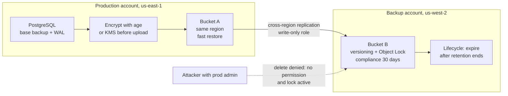
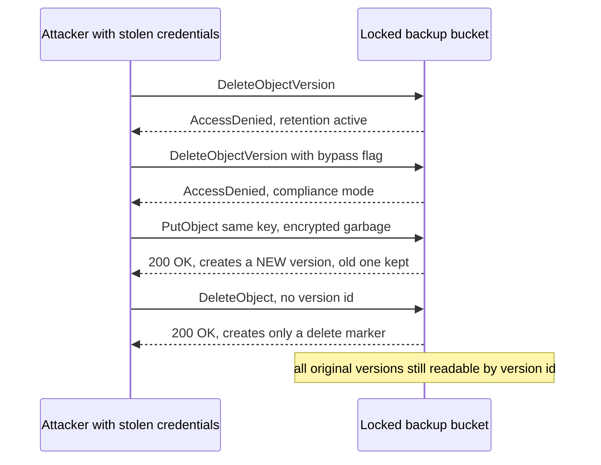

# L15.8 — Off-site Backups

> **Level 15: Disaster Recovery** · Topic 8 of 10 · ⏱ ~4 hours · Difficulty: Intermediate

## 1. What it is

An **off-site backup** is a copy of your backup that lives in a different failure domain from the system it protects: another building, another cloud **region**, and, most importantly for modern attacks,
another **account** with different credentials. In the 3-2-1 rule ([Backups](01-backups.md)) it is the "1". "Off-site" originally meant a tape in a vault across town; in the cloud it means *a copy that a fire, a region outage, a deleted account
or a stolen administrator password in the production environment cannot reach*.

Two properties make an off-site copy trustworthy. **Isolation:** the production account's credentials cannot delete or overwrite it (cross-account, write-only or append-only access). **Immutability:** even someone with the backup account's own credentials
cannot delete or modify it until a retention period ends. On AWS S3 the immutability feature is **Object Lock**, with *governance* mode (privileged users can bypass), *compliance* mode (nobody can, not even the root user, until the retention date)
and *legal hold* (an indefinite flag you can remove). Equivalents exist elsewhere: Azure immutable blob storage, Google Cloud bucket retention policies and Bucket Lock, AWS Backup Vault Lock, and the append-only modes of backup tools.

## 2. Why it matters in DevOps

- **Ransomware and malicious insiders target backups first.** An attacker who gets production admin rights deletes snapshots and backup buckets before encrypting data. If your only backups sit in the same account, the attacker owns them.
- **Region and site failures happen.** A backup in the same region as the primary dies with it ([OVHcloud example](#3-real-world-system-example)).
- **Accidents look like attacks.** A mistaken `terraform destroy` or an expired payment method that suspends an account removes everything in that account, backups included.
- **Replication is not off-site backup.** Cross-region replication copies deletes and corruption quickly; combined with versioning and Object Lock it becomes a safe copy, but on its own it is only a faster way to spread a mistake.
- **Compliance.** Regulations and cyber-insurance questionnaires increasingly ask for offline or immutable backups and tested restores.

## 3. Real-world system example

**OVHcloud Strasbourg fire, March 2021.** A fire destroyed one data center (SBG2) and caused outages in neighbouring buildings of the same site. It was widely reported that some customers lost data permanently because their backups, or the snapshots they relied on,
were kept at the same site. OVHcloud published updates and a postmortem; the practical lesson, stated by many engineers afterwards, is that an "off-site" copy must be in a different *physical* site, not merely a different server in the same campus.

**AWS S3 Object Lock and AWS Backup.** S3 Object Lock provides write-once-read-many (WORM) storage on versioned buckets, with retention modes described above. AWS Backup offers **Backup Vault Lock**, which can enforce a minimum retention for recovery points in a vault;
in compliance mode, after a short cooling-off period it can no longer be changed or removed. AWS also supports copying recovery points to a vault in another region or another account, and "logically air-gapped" vaults. AWS's Well-Architected guidance recommends separating backups into a dedicated account.

**Ransomware-resistant backups in the wider industry.** Backup vendors and cloud providers document the same pattern: immutable object storage, a separate security domain, and tested restores. Tools such as restic and Borg offer append-only repository modes for the same purpose.

## 4. Diagram

A defence-in-depth layout for `shop-api` backups. The production account can write, but cannot delete; the backup account is a separate trust domain:



The ransomware attempt, step by step:



## 5. How it works

**Where to put the second copy (increasing protection):**

| Copy | Protects against | Does not protect against |
|------|------------------|--------------------------|
| Other server, same rack or AZ | disk, host failure | fire, AZ outage, account compromise |
| Other AZ, same region and account | AZ outage | region outage, account compromise |
| Other region, same account | region outage | account compromise, admin mistakes |
| Other region, **other account** | region outage, account compromise | a bug that corrupts data *before* upload (needs restore tests), loss of the encryption key |
| Other region, other account, **immutable** | all of the above including ransomware | the retention window expiring before you notice, key loss |
| Provider-independent (other cloud, or offline tape or disk) | provider-wide failure or account termination | slow restore, operational overhead |

**Object Lock modes**

| Mode | Who can delete before the date | Typical use |
|------|-------------------------------|-------------|
| Governance | principals with `s3:BypassGovernanceRetention` permission who pass the bypass flag | internal protection against accidents, easy to undo |
| Compliance | nobody, including the root user; retention cannot be shortened | ransomware defence, regulatory WORM; **cost cannot be avoided by deleting**, choose retention carefully |
| Legal hold | anyone with `s3:PutObjectLegalHold` can remove the hold | investigations, indefinite hold |

Object Lock requires **versioning**. A plain delete on a versioned bucket just adds a *delete marker*; an overwrite adds a new version. The old versions stay until their retention ends. Remember that with compliance mode you pay for stored bytes until the date passes even if you made a mistake.

**Cross-account design checklist**
1. A dedicated **backup account** in the AWS Organization, with few humans and no day-to-day workloads; protect the management account and enable MFA everywhere.
2. The production role gets only `s3:PutObject` (and replication permissions) on the backup bucket. A bucket policy denies `s3:DeleteObjectVersion`, `s3:PutBucketObjectLockConfiguration`, lifecycle changes and `s3:BypassGovernanceRetention` for everyone except a break-glass role that requires MFA.
3. Encrypt before upload (age, GPG, or a KMS key whose policy lives in the backup account). Keep the key somewhere that survives (see [Backups](01-backups.md)); store a **sha256** next to every backup.
4. Replicate in the background. S3 replication copies new objects, needs versioning on both buckets, and does not replicate delete markers or version deletions by default for the safety you want here; existing objects need a one-time batch replication.
5. Alert on anomalies: backup age, size drops, any `Delete*` or `PutBucketLifecycle*` API call in the backup account (CloudTrail, see [CloudTrail](../level-06-cloud-aws/17-cloudtrail.md)).
6. Test restoring *from the off-site copy*, in the DR region, with only the backup account's access ([Testing Backup Restoration](09-testing-backup-restoration.md)).

**Costs.** Storage in a second region, cross-region data transfer (typically charged per GB transferred out of the source region), request charges, and the retention you cannot shorten in compliance mode. Use lifecycle rules to move older backups to cheaper storage classes after the lock expires; see [Storage Lifecycle Policies](../level-20-cost-optimization/06-storage-lifecycle-policies.md).

## 6. Step-by-step guide

This guide uses a **local S3-compatible emulator (moto)** so you can practise Object Lock for free, with no AWS account and no risk. The emulator reproduces S3 API behaviour for the cases below; it does not replace testing against real S3 (real IAM, replication and Vault Lock are not emulated).

**Prerequisites:** Linux or macOS, Python 3.10+, `age` (`sudo apt-get install -y age`), a normal user. Ports used: 18500 on loopback only.

1. **Install the emulator and a client in a virtual environment, and start it.** boto3 is pinned to an older release because newer client defaults send checksum headers that this emulator version rejects on locked buckets; real AWS accepts both.
   ```bash
   mkdir -p ~/dr-lab/offsite && cd ~/dr-lab/offsite
   python3 -m venv venv && ./venv/bin/pip install -q "moto[server]==5.0.28" "boto3==1.35.99" "botocore==1.35.99"
   ./venv/bin/moto_server -H 127.0.0.1 -p 18500 > moto.log 2>&1 &
   echo $! > moto.pid; sleep 3
   export AWS_ACCESS_KEY_ID=test AWS_SECRET_ACCESS_KEY=test        # dummy credentials, accepted by the emulator only
   ```

2. **Create an encrypted backup file and its keys.** The random bytes stand in for the `pg_dump` from [Backups](01-backups.md); the pipeline is the same.
   ```bash
   age-keygen -o key.txt 2>/dev/null
   PUB=$(grep -o 'age1[a-z0-9]*' key.txt | head -1)
   head -c 3000000 /dev/urandom | age -r "$PUB" -o shop-2026-10-09.dump.age
   ls -l shop-2026-10-09.dump.age
   ```

3. **Write the off-site tool.**
   ```bash
   cat > offsite.py <<'EOF'
   #!/usr/bin/env python3
   """offsite.py - upload encrypted backups to an Object Lock bucket, verify them, and simulate an attacker.
   Usage: offsite.py init | upload FILE | verify KEY | attack KEY | recover KEY"""
   import datetime, hashlib, os, sys
   import boto3
   from botocore.exceptions import ClientError

   BUCKET = "shop-api-backups-offsite"
   s3 = boto3.client("s3", endpoint_url=os.environ.get("S3_ENDPOINT", "http://127.0.0.1:18500"),
                     region_name="us-east-1")   # credentials come from AWS_ACCESS_KEY_ID / AWS_SECRET_ACCESS_KEY

   def sha256(path):
       h = hashlib.sha256()
       with open(path, "rb") as f:
           for chunk in iter(lambda: f.read(1 << 20), b""):
               h.update(chunk)
       return h.hexdigest()

   def init():
       s3.create_bucket(Bucket=BUCKET, ObjectLockEnabledForBucket=True)   # lock must be enabled at creation; enables versioning too
       s3.put_object_lock_configuration(Bucket=BUCKET, ObjectLockConfiguration={
           "ObjectLockEnabled": "Enabled",
           "Rule": {"DefaultRetention": {"Mode": "COMPLIANCE", "Days": 7}}})
       print("bucket ready: versioning on, default retention COMPLIANCE 7 days")

   def upload(path):
       key = os.path.basename(path)
       digest = sha256(path)
       until = datetime.datetime.now(datetime.timezone.utc) + datetime.timedelta(days=7)
       with open(path, "rb") as f:
           r = s3.put_object(Bucket=BUCKET, Key=key, Body=f, Metadata={"sha256": digest},
                             ObjectLockMode="COMPLIANCE", ObjectLockRetainUntilDate=until)
       print(f"uploaded {key} version={r['VersionId']} sha256={digest[:16]}... locked until {until.date()}")

   def verify(key):
       obj = s3.get_object(Bucket=BUCKET, Key=key)
       want = obj["Metadata"]["sha256"]
       got = hashlib.sha256(obj["Body"].read()).hexdigest()
       print("verify:", "OK" if got == want else f"MISMATCH {got} != {want}")
       sys.exit(0 if got == want else 1)

   def attack(key):
       """What a thief holding full credentials can and cannot do."""
       vers = [v["VersionId"] for v in s3.list_object_versions(Bucket=BUCKET, Prefix=key).get("Versions", [])]
       for vid in vers:
           for bypass in (False, True):
               try:
                   s3.delete_object(Bucket=BUCKET, Key=key, VersionId=vid, BypassGovernanceRetention=bypass)
                   print(f"  delete version {vid[:8]} bypass={bypass}: DELETED  <-- lock failed")
               except ClientError as e:
                   print(f"  delete version {vid[:8]} bypass={bypass}: {e.response['Error']['Code']}")
       s3.put_object(Bucket=BUCKET, Key=key, Body=b"ENCRYPTED BY RANSOMWARE")   # overwrite attempt = a new version
       s3.delete_object(Bucket=BUCKET, Key=key)                                 # plain delete = a delete marker only
       n = len(s3.list_object_versions(Bucket=BUCKET, Prefix=key).get("Versions", []))
       print(f"  after overwrite and delete the bucket still holds {n} versions of {key}")

   def recover(key):
       """Find the version whose bytes match the sha256 recorded at upload time and download it."""
       for v in s3.list_object_versions(Bucket=BUCKET, Prefix=key).get("Versions", []):
           obj = s3.get_object(Bucket=BUCKET, Key=key, VersionId=v["VersionId"])
           body, want = obj["Body"].read(), obj["Metadata"].get("sha256")
           ok = want == hashlib.sha256(body).hexdigest()
           print(f"  version {v['VersionId'][:8]} modified {v['LastModified']:%H:%M:%S} checksum {'GOOD' if ok else 'bad'}")
           if ok:
               out = "recovered-" + key
               open(out, "wb").write(body)
               print(f"  saved the good version to {out}")
               return
       sys.exit("no good version found")

   {"init": lambda: init(), "upload": lambda: upload(sys.argv[2]), "verify": lambda: verify(sys.argv[2]),
    "attack": lambda: attack(sys.argv[2]), "recover": lambda: recover(sys.argv[2])}[sys.argv[1]]()
   EOF
   ```

4. **Create the locked bucket, upload and verify.**
   ```bash
   ./venv/bin/python offsite.py init
   ./venv/bin/python offsite.py upload shop-2026-10-09.dump.age
   ./venv/bin/python offsite.py verify shop-2026-10-09.dump.age
   ```
   Similar to: `bucket ready: versioning on, default retention COMPLIANCE 7 days`, `uploaded ... locked until <date 7 days from now>`, `verify: OK`.

5. **Play the ransomware actor.**
   ```bash
   ./venv/bin/python offsite.py attack shop-2026-10-09.dump.age
   ./venv/bin/python offsite.py verify shop-2026-10-09.dump.age 2>&1 | tail -1   # NoSuchKey: hidden by a delete marker
   ```
   Expected: both deletes `AccessDenied`, then `after overwrite and delete the bucket still holds 2 versions` (the original plus the attacker's garbage). The last command prints a `NoSuchKey` error: the normal "latest object" view is now broken, exactly what the attacker wanted;
   the data is not gone.

6. **Recover: find the good version by checksum and prove it decrypts.**
   ```bash
   ./venv/bin/python offsite.py recover shop-2026-10-09.dump.age
   sha256sum shop-2026-10-09.dump.age recovered-shop-2026-10-09.dump.age
   age -d -i key.txt recovered-shop-2026-10-09.dump.age | wc -c
   ```
   Expected: one version `GOOD`, one `bad`; both sha256 lines identical; `3000000` bytes after decryption. This is the recovery you would script in a real incident, using the stored checksum to choose between versions.

7. **Compare governance and legal hold, and see what bypass means.**
   ```bash
   cat > modes.py <<'EOF'
   import datetime, boto3
   from botocore.exceptions import ClientError
   s3 = boto3.client("s3", endpoint_url="http://127.0.0.1:18500", region_name="us-east-1")
   B = "gov-test"
   s3.create_bucket(Bucket=B, ObjectLockEnabledForBucket=True)
   until = datetime.datetime.now(datetime.timezone.utc) + datetime.timedelta(days=7)
   v1 = s3.put_object(Bucket=B, Key="k", Body=b"v1", ObjectLockMode="GOVERNANCE", ObjectLockRetainUntilDate=until)["VersionId"]
   try: s3.delete_object(Bucket=B, Key="k", VersionId=v1)
   except ClientError as e: print("governance delete ->", e.response["Error"]["Code"])
   s3.delete_object(Bucket=B, Key="k", VersionId=v1, BypassGovernanceRetention=True)
   print("governance + bypass flag -> deleted")
   v3 = s3.put_object(Bucket=B, Key="h", Body=b"x", ObjectLockLegalHoldStatus="ON")["VersionId"]
   try: s3.delete_object(Bucket=B, Key="h", VersionId=v3)
   except ClientError as e: print("legal hold delete ->", e.response["Error"]["Code"])
   s3.put_object_legal_hold(Bucket=B, Key="h", VersionId=v3, LegalHold={"Status": "OFF"})
   s3.delete_object(Bucket=B, Key="h", VersionId=v3); print("hold released, then deleted")
   EOF
   ./venv/bin/python modes.py
   ```
   Expected: `governance delete -> AccessDenied`, `governance + bypass flag -> deleted`, `legal hold delete -> AccessDenied`, `hold released, then deleted`.
   Governance stops accidents and unprivileged users, but anyone with the bypass permission (including a stolen admin role) can still delete. Compliance has no bypass. That difference is why ransomware defence uses compliance mode or a separate account whose admin credentials the attacker does not have.
   (The emulator does not enforce IAM; on real S3 the bypass flag also needs the `s3:BypassGovernanceRetention` permission.)

8. **Immutability on a plain Linux file system (single-host, weaker).** The `chattr +i` flag makes a file undeletable even by root until the flag is cleared.
   ```bash
   mkdir -p imm && cp shop-2026-10-09.dump.age imm/
   sudo chattr +i imm/shop-2026-10-09.dump.age
   rm imm/shop-2026-10-09.dump.age; lsattr imm/
   sudo chattr -i imm/shop-2026-10-09.dump.age && rm -r imm
   ```
   Expected: `rm: cannot remove ...: Operation not permitted` and `----i---` in the `lsattr` listing. It stops accidents and simple malware, but anyone with root can run `chattr -i`, which is exactly why a locked remote bucket under *different* credentials is stronger. (Works on ext4 and xfs; some file systems and containers do not support it.)

9. **Cross-region and cross-account on real AWS: read-only reference. Not run here, illustrative, untested; costs money if applied.** The shape of the Terraform for the backup account:
   ```hcl
   resource "aws_s3_bucket" "offsite" {
     bucket              = "example-shop-api-backups-offsite"
     object_lock_enabled = true
   }
   resource "aws_s3_bucket_versioning" "offsite" {
     bucket = aws_s3_bucket.offsite.id
     versioning_configuration { status = "Enabled" }
   }
   resource "aws_s3_bucket_object_lock_configuration" "offsite" {
     bucket = aws_s3_bucket.offsite.id
     rule {
       default_retention {
         mode = "COMPLIANCE"
         days = 30
       }
     }
   }
   # plus: a bucket policy that allows only the production replication role to write,
   # denies s3:DeleteObjectVersion and s3:PutBucketObjectLockConfiguration to everyone,
   # and an aws_s3_bucket_replication_configuration on the source bucket.
   ```
   **Cost and safety warning:** a COMPLIANCE lock cannot be removed, so you pay for the stored data for the full retention. Test with 1 day, a tiny bucket and a billing alarm, and in a sandbox account. Teardown: after the retention date, empty all versions and delete markers, then delete the bucket (`aws s3api list-object-versions` shows what remains).

10. **Clean up the emulator.**
    ```bash
    kill "$(cat moto.pid)"; cd ~ && rm -rf ~/dr-lab/offsite
    ```

## 7. Real-world scenario

*Illustrative.* An attacker phishes a `shop-api` engineer's cloud console session, creates a new access key on a production admin role, and over 40 minutes: deletes the RDS automated backups and manual snapshots, empties the backup bucket in the production account, and finally encrypts the database volume.
The on-call engineer notices through a CloudTrail alert on `DeleteDBSnapshot`. The production backups are gone. The cross-account copy in the backup account in `us-west-2` is intact: the replication role in production could write but not delete, and the objects are locked for 30 days.
The team recovers the previous night's base backup plus WAL from the locked bucket, using break-glass access to the *backup account* and the encryption key stored in the password manager. Restore into a fresh VPC with Terraform takes 2 hours 10 minutes, RPO about 4 minutes (the replication lag at the time).
**Lesson:** the production credentials could do anything in production, and that is exactly why the backup account existed; the drill had already proven the restore from the copy.

## 8. Common mistakes and best practices

**Don't**

- Put backups in the same account, region or credential domain as production.
- Rely on replication alone; it copies deletions and corruption.
- Use governance-mode locks and give wide `BypassGovernanceRetention` permissions, then call it ransomware-proof.
- Set a COMPLIANCE retention longer than you can afford before testing with a short one.
- Forget the key: encrypted backups with the key only in the lost account are unrecoverable.

**Do**

- Use a dedicated backup account with write-only cross-account access from production and MFA-protected break-glass access.
- Turn on versioning and Object Lock (or Vault Lock) on the final copy, and keep a checksum with every backup.
- Alert on any destructive API calls in the backup account and on backup age and size anomalies.
- Keep one copy that is independent of your cloud provider if the business cannot survive provider-level loss.
- Restore from the off-site copy on a schedule ([Testing Backup Restoration](09-testing-backup-restoration.md)); see also [S3](../level-06-cloud-aws/08-s3.md), [KMS](../level-06-cloud-aws/15-kms.md) and [IAM](../level-06-cloud-aws/07-iam.md).

## 9. Tasks

- [ ] **T1 — Lock a bucket and try to break it** *(≈45 min, beginner)*
  - **Goal:** observe Object Lock behaviour in practice.
  - **Steps:** follow guide steps 1-5.
  - **Done when:** both delete attempts print `AccessDenied` and the bucket still contains the original version after the "attack".

- [ ] **T2 — Recover by checksum** *(≈30 min, intermediate)*
  - **Goal:** pick the right version after tampering.
  - **Steps:**
    1. Run `recover`, then decrypt the result with your `age` key.
    2. Modify the script to download *all* versions and print their sizes and checksum status.
  - **Done when:** the recovered file's sha256 equals the original and you can explain how the tool decided which version was good.

- [ ] **T3 — Governance versus compliance versus legal hold** *(≈30 min, intermediate)*
  - **Goal:** explain which mode defends against which actor.
  - **Steps:**
    1. Run `modes.py`.
    2. Extend it to attempt to *shorten* a compliance retention and to delete the bucket while versions exist; record the errors.
    3. Write a table: actor (accident, junior admin, stolen admin credentials, root of the account) versus mode (governance, compliance, hold) with "protected" or "not protected".
  - **Done when:** your table is filled in and you can defend each cell from the output or the documentation.

- [ ] **T4 — Break it: unencrypted or key-less backup** *(≈30 min, intermediate)*
  - **Goal:** feel what losing the key means.
  - **Steps:**
    1. Create an encrypted backup and delete `key.txt`; try to decrypt.
    2. Restore the key from where your plan says it is stored (password manager, second location), or conclude the backup is lost.
    3. Add a "key location and recovery" section to your backup policy.
  - **Done when:** you proved the file is undecryptable without the key and your policy names two independent places for the key.

- [ ] **T5 — Automate off-site copy with monitoring** *(≈60 min, advanced)*
  - **Goal:** a nightly pipeline: dump, encrypt, upload with checksum, verify, alert.
  - **Steps:**
    1. Combine the `pg_dump | age` pipeline from [Backups](01-backups.md) with `offsite.py upload` in a script with `set -euo pipefail`.
    2. Add a check that fails when the newest object in the bucket is older than 26 hours or its checksum does not verify.
    3. Run it twice and break it (remove credentials) to see the alert.
  - **Done when:** the check exits non-zero for a stale backup and zero for a fresh one, and the log shows the two uploads.

- [ ] **T6 — Prove it: design the isolation** *(≈45 min, advanced)*
  - **Goal:** explain a ransomware-proof backup design without notes.
  - **Steps:**
    1. Draw the accounts, regions, roles and buckets for `shop-api`; mark who can write, who can read, who can delete and what is locked.
    2. Walk through three attacks (stolen prod admin, deleted production account, insider with backup-account admin) and say what survives each.
    3. State the retention and the monthly cost of keeping it (use a public pricing calculator, create nothing).
  - **Done when:** every attack has a surviving copy, you have named the residual risk (for example key loss or retention shorter than detection time), and the cost is written down.

## 10. Self-check questions

1. Why is "cross-region, same account" not enough against a ransomware attack?
2. What is the difference between governance and compliance mode in S3 Object Lock?
3. A plain delete is issued on a versioned bucket. What happens to the data?
4. Why must Object Lock be paired with a checksum and a restore test?
5. What costs money in an off-site design, and what is the risk of a very long compliance retention?

<details>
<summary>Answers</summary>

1. An attacker with credentials for the account can delete the replicated copies as easily as the originals; only a separate trust domain (another account with different credentials) and/or immutability prevents that.
2. In governance mode a principal with the bypass permission can delete or change the lock; in compliance mode nobody can, including the account root user, until the retention date.
3. A delete marker is added and the object appears gone in the normal view, but earlier versions remain and can be listed and retrieved by version id (and locked versions cannot be removed).
4. Lock guarantees that bytes are not changed after write, not that they were correct when written or that you can use them. A checksum proves integrity and a restore test proves usability, including keys and procedure.
5. Storage in a second region, cross-region transfer, requests and the locked retention window; a long compliance lock means you pay for mistakes (for example uploading huge wrong data) until it expires and cannot delete them early.
</details>

## 11. Further reading

- AWS documentation: *Amazon S3 Object Lock*, *S3 Replication*, *AWS Backup Vault Lock* and *Logically air-gapped vault*.
- AWS Well-Architected Framework: Reliability Pillar and Security Pillar guidance on backups and account separation.
- Azure documentation on immutable blob storage; Google Cloud documentation on retention policies and Bucket Lock.
- restic and Borg documentation on append-only repositories; the NIST guidance on data integrity and ransomware recovery.
- OVHcloud's public communications and postmortem on the March 2021 Strasbourg fire.
- Related: [Backups](01-backups.md), [Snapshots](03-snapshots.md), [Disaster Recovery overview](../level-00-what-devops-is/09-disaster-recovery.md), [Secrets Management and Encryption](../level-11-security-devsecops/04-secrets-management-and-encryption.md).

<!-- nav -->
---
← Previous: [RTO - Recovery Time Objective](07-rto.md) · [Level 15 index](README.md) · Next: [Testing Backup Restoration](09-testing-backup-restoration.md) →
