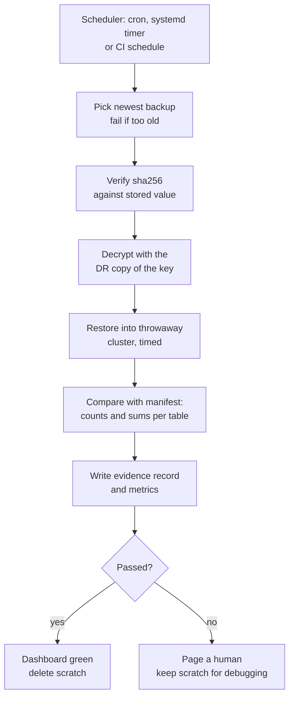

# L15.9 — Testing Backup Restoration

> **Level 15: Disaster Recovery** · Topic 9 of 10 · ⏱ ~4 hours · Difficulty: Intermediate

## 1. What it is

**Testing backup restoration** means regularly, and automatically, doing what you would do in a disaster: take the newest backup, decrypt it, restore it into a throwaway environment, check that the result is complete and correct,
measure how long it took, and keep the result as evidence. The principle is old and blunt: **a backup you have never restored is a hope, not a backup** (often attributed to the sysadmin saying "Schrödinger's backup": its state is unknown until you look).

A restore test checks four different things that a green "backup job succeeded" message does not:

1. **Integrity:** the file is intact (a **checksum** such as SHA-256 matches the one recorded at backup time) and decryptable with the key you would have in a disaster.
2. **Usability:** the database software accepts it and restores without errors, on the version and hardware you would use in recovery.
3. **Completeness and correctness:** the restored data matches what was in production when the backup was taken (row counts, sums, a manifest of expected content).
4. **Speed:** the restore finishes within the time budget; the measured duration feeds your RTO ([RTO](07-rto.md)).

## 2. Why it matters in DevOps

- **Backups fail silently.** Full disks, expired credentials, changed schemas, a new table excluded by a well-meaning optimisation, an upgrade that changes dump format: the job exits 0 and the file is useless.
- **It is the only way to know your RTO.** Estimates from restore throughput are guesses until you time a restore on production-sized data ([RTO](07-rto.md)).
- **It tests the people and the procedure too.** Missing keys, wrong runbook steps and expired access are found in drills, not at 3 a.m. ([Restore Procedures](04-restore-procedures.md)).
- **It produces evidence.** Auditors (SOC 2, ISO 27001) and insurers want proof that recoverability is tested; a dated log of automated restores is exactly that.
- **It catches slow-burn corruption early,** while an older, good backup still exists within retention ([Backups](01-backups.md)).

## 3. Real-world system example

**GitLab.com, January 2017.** The public postmortem lists a set of recovery mechanisms (regular backups, disk snapshots, replication and others) and states that when the team needed them, several were not working or not restorable in practice: for instance backup jobs that had failed
without anyone noticing. The follow-up actions in the postmortem included monitoring backups and testing restores. It is the most-cited industry example of why restoring, not backing up, is the test.

**Managed services still need your validation.** With a managed database such as Amazon RDS, the provider operates the backup mechanism, but restoring still creates a new instance whose *contents* you must check, and restoring from your own copies is entirely your responsibility.
Many engineering organisations run a scheduled "restore the latest production backup into a scratch environment and run checks" pipeline, sometimes also used to seed staging with realistic data (with sensitive fields masked, see [Secrets and Encryption](../level-11-security-devsecops/04-secrets-management-and-encryption.md)).
PostgreSQL itself provides `pg_verifybackup` for physical backups and the `amcheck` extension for structural verification.

**Site Reliability Engineering practice.** Google's SRE books describe periodic restores of backups, and "recovery testing" as part of the data-integrity strategy, because recoverability is a property that decays unless it is exercised.

## 4. Diagram

An automated restore test as a pipeline. Every box can fail the run, and every outcome is recorded:



What a green checkmark means at each level of testing, from weak to strong:


## 5. How it works

**What to record at backup time (so the restore can be judged).**

| Artifact | Why |
|----------|-----|
| `sha256` of the final (encrypted) file | detects corruption and truncation in storage or transfer |
| Manifest: per-table row counts and a checksum column (e.g. `sum(total_cents)`) taken from the *live* database at dump time | the restore must reproduce it; catches missing tables, truncated data and silent exclusions |
| Size and duration | sudden size drop is an early warning |
| Tool and database version | so the restore environment matches |
| Backup timestamp | gives the real RPO of this backup |

**What the restore test does.** It runs on a schedule, in an isolated environment with no route to production and no ability to send real emails or webhooks. Steps: choose newest backup, check age, verify checksum, decrypt using the key from the DR location, restore, compare to manifest, run structural checks (`pg_amcheck`),
run a smoke query or even the application's integration tests, record duration and result, destroy the scratch environment. Failure pages someone; success updates a metric ("last successful restore test timestamp") that is itself alerted on.

**Levels of rigor**

| Level | What you check | Catches | Cost |
|-------|----------------|---------|------|
| Job success | exit code | crashes | free, weakest |
| Checksum | file unchanged since backup | storage corruption, truncation | trivial |
| Restore runs | restore finishes without errors | wrong version, missing key, corrupt dump | a scratch host for minutes |
| Content check | manifest comparison | excluded tables, partial dumps | needs a manifest |
| Application check | smoke test or integration tests against the restored DB | schema and permission issues | more setup |
| Full drill | humans follow the runbook under time pressure | process, access and communication gaps | quarterly effort ([Failure Scenario Drills](10-failure-scenario-drills.md)) |

**Frequency.** Automated restore test: after every backup or at least daily for critical data, weekly for the rest. Full human drill: quarterly or after major changes (new region, database upgrade, new backup tool). Test restores from *each* storage location (local, replicated, off-site copy) because they have different failure modes ([Off-site Backups](08-offsite-backups.md)).

**Evidence.** Keep an append-only log (a JSON line per test: time, backup, status, duration), export metrics, and store drill reports. Evidence answers "when did we last prove this works, and how long did it take?" without anyone having to remember.

## 6. Step-by-step guide

**Prerequisites:** Linux with PostgreSQL 16 server binaries in `/usr/lib/postgresql/16/bin`, `age` (`sudo apt-get install -y age`), a normal non-root user. Free and local; uses ports 55480 ("production") and 55481 (the throwaway restore target) and a scratch directory. Nothing existing is touched.

1. **Create a "production" database and an encryption key.**
   ```bash
   export PATH=/usr/lib/postgresql/16/bin:$PATH
   export W=$HOME/dr-lab/restore-test && rm -rf "$W" && mkdir -p "$W/backups" "$W/evidence"
   export PGHOST=/tmp PGPORT=55480
   initdb -D "$W/prod" >/dev/null
   printf "port = 55480\nunix_socket_directories = '/tmp'\nlisten_addresses = ''\n" >> "$W/prod/postgresql.conf"
   pg_ctl -D "$W/prod" -l "$W/prod.log" -w start
   createdb shop
   psql -X -q -d shop <<'SQL'
   CREATE TABLE customers(id serial PRIMARY KEY, email text UNIQUE NOT NULL);
   CREATE TABLE orders(id serial PRIMARY KEY, customer_id int NOT NULL REFERENCES customers(id),
                       total_cents int NOT NULL, created_at timestamptz DEFAULT now());
   INSERT INTO customers(email) SELECT 'user'||g||'@example.com' FROM generate_series(1,5000) g;
   INSERT INTO orders(customer_id,total_cents) SELECT 1+g%5000, 100+g%9000 FROM generate_series(1,200000) g;
   SQL
   age-keygen -o "$W/key.txt" 2>/dev/null
   ```
   In real life `key.txt` would **not** live next to the backups; the test uses it from the "DR copy" location.

2. **Write the backup script: encrypt, checksum, manifest.**
   ```bash
   cat > "$W/backup.sh" <<'EOF'
   #!/usr/bin/env bash
   # backup.sh - encrypted dump + sha256 + manifest of expected content. Usage: backup.sh <work-dir> <age-public-key>
   set -euo pipefail
   export PATH=/usr/lib/postgresql/16/bin:$PATH PGHOST=/tmp PGPORT=55480
   W=${1:?work dir}; PUB=${2:?age public key}
   STAMP=$(date +%Y-%m-%dT%H%M%S)
   OUT="$W/backups/shop-$STAMP.dump.age"
   pg_dump -Fc -d shop | age -r "$PUB" > "$OUT.tmp"
   mv "$OUT.tmp" "$OUT"
   ( cd "$W/backups" && sha256sum "$(basename "$OUT")" > "$(basename "$OUT").sha256" )
   # the manifest records what a correct restore must contain, taken from the live database
   psql -X -At -d shop -F, -c "SELECT 'customers', count(*), coalesce(sum(id),0) FROM customers UNION ALL SELECT 'orders', count(*), coalesce(sum(total_cents),0) FROM orders" > "$OUT.manifest"
   echo "$STAMP $(stat -c %s "$OUT") bytes"
   EOF
   chmod +x "$W/backup.sh"
   PUB=$(grep -o 'age1[a-z0-9]*' "$W/key.txt" | head -1)
   "$W/backup.sh" "$W" "$PUB"
   cat "$W"/backups/*.manifest
   ```
   Expected: a line like `2026-10-09T221500 1311259 bytes` (size varies), then `customers,5000,12502500` and `orders,200000,912902000`.

3. **Write the automated restore test.** It never touches production: it creates its own scratch cluster on another port, destroys it on exit, and writes one JSON evidence line plus a Prometheus-style metrics file.
   ```bash
   cat > "$W/restore-test.sh" <<'EOF'
   #!/usr/bin/env bash
   # restore-test.sh - restore the newest backup into a throwaway cluster and prove it.
   # Usage: restore-test.sh <work-dir> [max_age_hours]
   set -uo pipefail
   export PATH=/usr/lib/postgresql/16/bin:$PATH
   W=${1:?work dir}; MAXAGE=${2:-26}
   export PGHOST=/tmp PGPORT=55481
   SCRATCH=$(mktemp -d "$W/scratch.XXXXXX")
   START=$(date +%s); STATUS=pass; REASON=""
   fail() { STATUS=fail; REASON="$1"; }
   cleanup() { pg_ctl -D "$SCRATCH/pg" -m immediate stop >/dev/null 2>&1; rm -rf "$SCRATCH"; }
   trap cleanup EXIT

   BK=$(ls -1t "$W"/backups/shop-*.dump.age 2>/dev/null | head -1)
   [ -n "$BK" ] || fail "no backup found"
   if [ "$STATUS" = pass ]; then
     AGE_H=$(( ( $(date +%s) - $(stat -c %Y "$BK") ) / 3600 ))
     [ "$AGE_H" -le "$MAXAGE" ] || fail "newest backup is ${AGE_H}h old (limit ${MAXAGE}h)"
   fi
   if [ "$STATUS" = pass ]; then ( cd "$W/backups" && sha256sum -c "$(basename "$BK").sha256" >/dev/null 2>&1 ) || fail "sha256 mismatch"; fi
   if [ "$STATUS" = pass ]; then age -d -i "$W/key.txt" "$BK" > "$SCRATCH/shop.dump" 2>/dev/null || fail "decryption failed"; fi
   T_DECRYPT=$(date +%s)
   if [ "$STATUS" = pass ]; then
     initdb -D "$SCRATCH/pg" >/dev/null 2>&1
     printf "port = 55481\nunix_socket_directories = '/tmp'\nlisten_addresses = ''\nfsync = off\n" >> "$SCRATCH/pg/postgresql.conf"
     pg_ctl -D "$SCRATCH/pg" -l "$SCRATCH/pg.log" -w start >/dev/null 2>&1 || fail "scratch cluster did not start"
   fi
   if [ "$STATUS" = pass ]; then
     createdb shop && pg_restore -j 2 --exit-on-error -d shop "$SCRATCH/shop.dump" 2>"$SCRATCH/restore.err" || fail "pg_restore failed: $(head -1 "$SCRATCH/restore.err")"
   fi
   T_RESTORE=$(date +%s)
   if [ "$STATUS" = pass ]; then
     GOT=$(psql -X -At -d shop -F, -c "SELECT 'customers', count(*), coalesce(sum(id),0) FROM customers UNION ALL SELECT 'orders', count(*), coalesce(sum(total_cents),0) FROM orders" 2>/dev/null)
     [ "$GOT" = "$(cat "$BK.manifest")" ] || fail "content differs from manifest"
   fi
   END=$(date +%s)
   printf '{"time":"%s","backup":"%s","status":"%s","reason":"%s","restore_seconds":%d,"total_seconds":%d}\n' \
     "$(date -u +%FT%TZ)" "$(basename "${BK:-none}")" "$STATUS" "$REASON" "$(( T_RESTORE - T_DECRYPT ))" "$(( END - START ))" | tee -a "$W/evidence/restore-tests.jsonl"
   # metrics for node_exporter's textfile collector: alert if the success timestamp gets old
   { echo "backup_restore_test_success $([ "$STATUS" = pass ] && echo 1 || echo 0)"
     echo "backup_restore_test_duration_seconds $(( END - START ))"
     [ "$STATUS" = pass ] && echo "backup_restore_test_last_success_timestamp_seconds $END"
   } > "$W/evidence/restore_test.prom"
   [ "$STATUS" = pass ]
   EOF
   chmod +x "$W/restore-test.sh"
   "$W/restore-test.sh" "$W"; echo "exit=$?"
   ```
   Similar to: `{"time":"...","backup":"shop-2026-10-09T221500.dump.age","status":"pass","reason":"","restore_seconds":1,"total_seconds":1}` and `exit=0`.
   (`fsync = off` on the scratch cluster speeds up the test; never use it for production.)

4. **Prove the test can fail: corrupt one byte of the stored backup.**
   ```bash
   F=$(ls -1t "$W"/backups/*.age | head -1)
   cp "$F" "$F.good"; printf '\x00' | dd of="$F" bs=1 seek=1000 conv=notrunc 2>/dev/null
   "$W/restore-test.sh" "$W"; echo "exit=$?"
   mv "$F.good" "$F"
   ```
   Expected: `"status":"fail","reason":"sha256 mismatch"` and `exit=1`. Restore the good copy afterwards.

5. **Prove it catches the nastiest failure: a backup that restores fine but is missing data.** Simulate a well-meaning "optimisation" that excludes the biggest table.
   ```bash
   sed 's/pg_dump -Fc -d shop/pg_dump -Fc -T orders -d shop/' "$W/backup.sh" > "$W/backup-broken.sh" && chmod +x "$W/backup-broken.sh"
   sleep 1; "$W/backup-broken.sh" "$W" "$PUB"
   "$W/restore-test.sh" "$W"; echo "exit=$?"
   ```
   Expected: `"status":"fail","reason":"content differs from manifest"` and `exit=1` (a psql error about the missing `orders` table may print above it). The checksum passed, decryption passed and `pg_restore` exited 0: only the content check saw the problem.
   Remove the broken backup set (the file and its `.sha256` and `.manifest` companions) and take a fresh good one before continuing:
   `rm "$(ls -1t "$W"/backups/*.age | head -1)"* && "$W/backup.sh" "$W" "$PUB"`.

6. **Test staleness detection.**
   ```bash
   touch -d '-30 hours' "$(ls -1t "$W"/backups/*.age | head -1)"
   "$W/restore-test.sh" "$W"; echo "exit=$?"
   ```
   Expected: `"reason":"newest backup is 30h old (limit 26h)"`. A job that silently stopped yesterday is detected today.

7. **Schedule it and alert on the absence of success.** Cron example (edit with `crontab -e`; adjust the paths):
   ```text
   17 3 * * *  /home/you/dr-lab/restore-test/backup.sh /home/you/dr-lab/restore-test <AGE_PUBLIC_KEY> >> /home/you/dr-lab/restore-test/cron.log 2>&1
   47 3 * * *  /home/you/dr-lab/restore-test/restore-test.sh /home/you/dr-lab/restore-test >> /home/you/dr-lab/restore-test/cron.log 2>&1
   ```
   The metrics file `evidence/restore_test.prom` can be picked up by Prometheus `node_exporter`'s textfile collector. A Prometheus alert such as
   `time() - backup_restore_test_last_success_timestamp_seconds > 129600` (36 hours) pages you when the restore test has not *succeeded* recently, which also covers the case where the test job itself stopped running
   ([Prometheus](../level-10-observability/02-prometheus-and-promql.md)).
   Run the restore test in CI too, as a scheduled workflow (illustrative, not run here): a GitHub Actions workflow with `on: schedule: - cron: "47 3 * * *"` that pulls the newest off-site object using a read-only role, runs the script, and uploads the JSON line as an artifact ([GitHub Actions](../level-03-git-and-github/11-github-actions-workflows.md)).

8. **Structural check on the restored copy (optional extra layer).** Add to the script after `pg_restore`: `psql -X -d shop -c "CREATE EXTENSION IF NOT EXISTS amcheck"` and `pg_amcheck -d shop`, as in [Restore Procedures](04-restore-procedures.md). For physical backups use `pg_verifybackup <backup-dir>` before restoring.

9. **Clean up.**
   ```bash
   pg_ctl -D "$W/prod" -m fast stop
   ```

## 7. Real-world scenario

*Illustrative.* `shop-api` has a nightly dump job that reports success for eight months. The weekly automated restore test starts failing with `content differs from manifest`: `orders` has 4.1 million rows in the manifest but the restore has 3.9 million.
Investigation shows a schema change created `orders_2026` as a partitioned table; the dump job's exclusion pattern (`-T 'orders_*'`, added to skip temporary tables) silently omitted the new partition, so every backup since the migration was missing the newest orders.
Because the restore test caught it on the first weekly run after the migration, the team lost nothing: they fixed the exclude pattern, took a full backup that night and kept the evidence file as a postmortem exhibit.
Without the test, the next real restore would have returned a database with the last two months of orders missing.
**Lesson:** the manifest comparison caught an error that checksum, decryption and `pg_restore` all passed.

## 8. Common mistakes and best practices

**Don't**

- Treat "backup job succeeded" as the test.
- Restore only to the same host or only from the local copy: test the off-site copy and a clean environment.
- Keep the decryption key only in the system being backed up, and forget to use the DR copy of the key in the test.
- Let the restore test touch production data stores, send email, or call external APIs.
- Hide failures: a test that fails and no one is paged is the same as no test.

**Do**

- Record expected content (manifest, checksums) at backup time and compare after restore.
- Test automatically on every backup or at least daily, and also quarterly with humans following the runbook.
- Time the restore at realistic data size and publish the number ([RTO](07-rto.md)).
- Alert on the *absence of recent success* as well as on failure.
- Keep evidence: JSON lines, metrics, drill reports ([Failure Scenario Drills](10-failure-scenario-drills.md)).
- Re-run after every change to the backup tooling, the database version, or the schema layout.

## 9. Tasks

- [ ] **T1 — Build and run the automated restore test** *(≈45 min, beginner)*
  - **Goal:** a restore test that exits 0 on a good backup and writes evidence.
  - **Steps:** follow guide steps 1-3.
  - **Done when:** `evidence/restore-tests.jsonl` has a `"status":"pass"` line with a non-zero `total_seconds`.

- [ ] **T2 — Make it fail three different ways** *(≈45 min, intermediate)*
  - **Goal:** confirm the test detects corruption, staleness and missing data.
  - **Steps:** follow guide steps 4-6, then add a fourth case: delete `key.txt` (or use the wrong key) and observe the failure reason.
  - **Done when:** the evidence file contains four distinct `fail` reasons and you restored the healthy state.

- [ ] **T3 — Add an application-level check** *(≈45 min, intermediate)*
  - **Goal:** go beyond counts.
  - **Steps:**
    1. Extend the script to run `pg_amcheck` and a query that validates a business invariant (for example "no order has a customer_id that does not exist" and "no negative totals").
    2. Break the invariant in a scratch copy and confirm the test notices.
  - **Done when:** the script fails when you restore a dump in which you deliberately removed one customer with orders (use `session_replication_role = replica` to bypass the foreign key when creating the bad data).

- [ ] **T4 — Metrics and alert** *(≈45 min, advanced)*
  - **Goal:** page on missing restore evidence.
  - **Steps:**
    1. Serve `restore_test.prom` through a textfile collector or a tiny HTTP endpoint, scrape it with Prometheus (see [Prometheus](../level-10-observability/02-prometheus-and-promql.md)).
    2. Write the alert rule `time() - backup_restore_test_last_success_timestamp_seconds > 129600`.
    3. Stop running the test and wait (or temporarily shorten the threshold) to see the alert fire.
  - **Done when:** an alert is firing in Prometheus (or Alertmanager) for a stale restore test and clears after a successful run.

- [ ] **T5 — Time it at scale** *(≈45 min, advanced)*
  - **Goal:** a restore-time number you can put into the DR plan.
  - **Steps:**
    1. Re-create the data with 10 million orders (if your disk allows), run backup and restore test, record `restore_seconds`.
    2. Compute MB/s and extrapolate to the real database size ([RTO](07-rto.md)).
  - **Done when:** your evidence file shows the large run and a table gives the estimated production restore time with the assumptions written next to it.

- [ ] **T6 — Prove it: audit pack** *(≈45 min, advanced)*
  - **Goal:** prepare what an auditor or a new CTO asks for.
  - **Steps:**
    1. Without notes, write a one-page "backup verification" statement: what is backed up, how often it is restore-tested, from which location, what is checked, the last result and the last measured time.
    2. Attach the evidence file lines and a dashboard screenshot description.
    3. List the three most likely ways your test could still give a false pass, and one mitigation each.
  - **Done when:** the page cites real dated evidence from your lab and the false-pass list includes at least "data was already wrong at backup time" and "the test ran against a different copy than the one you would use".

## 10. Self-check questions

1. Why is a matching checksum not enough to call a backup good?
2. What is a manifest, and what failure does it catch that `pg_restore` exit code 0 does not?
3. How often should you automate restore tests, and how often run a human drill?
4. Your restore test passes every night, but the alert for "no successful restore test in 36 hours" is also useful. Why?
5. What can a restore test *not* prove?

<details>
<summary>Answers</summary>

1. A checksum proves the file is unchanged since it was written, not that it was complete or correct when written, that it can be decrypted, or that the database accepts it.
2. A record of what the restored data must contain (row counts and sums per table, taken from the live database at backup time). It catches backups that restore cleanly but are missing tables or rows.
3. Automate after every backup (or daily for critical data); run a human, timed drill at least quarterly and after major changes.
4. If the test job itself stops (cron broken, runner gone), no failure is ever reported. Alerting on the absence of a recent success covers a dead tester.
5. That data was correct before it was backed up (garbage in, garbage out), that your whole organisation can execute the process under pressure, or that a different copy (such as the off-site one) is also good unless you test that copy.
</details>

## 11. Further reading

- PostgreSQL documentation: `pg_verifybackup`, `pg_amcheck`, `pg_restore` and the `amcheck` module.
- GitLab's public postmortem of the 31 January 2017 database incident, and their later documentation on backup verification.
- *Site Reliability Engineering* (Google), the data integrity chapter.
- Prometheus documentation: node_exporter textfile collector and alerting rules.
- Related: [Backups](01-backups.md), [Restore Procedures](04-restore-procedures.md), [Backups and PITR](../level-13-databases-distributed-systems/05-backups-and-pitr.md), [Disaster Recovery overview](../level-00-what-devops-is/09-disaster-recovery.md).

<!-- nav -->
---
← Previous: [Off-site Backups](08-offsite-backups.md) · [Level 15 index](README.md) · Next: [Failure Scenario Drills](10-failure-scenario-drills.md) →
