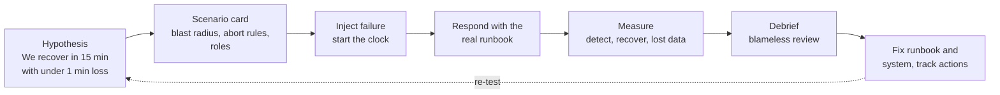
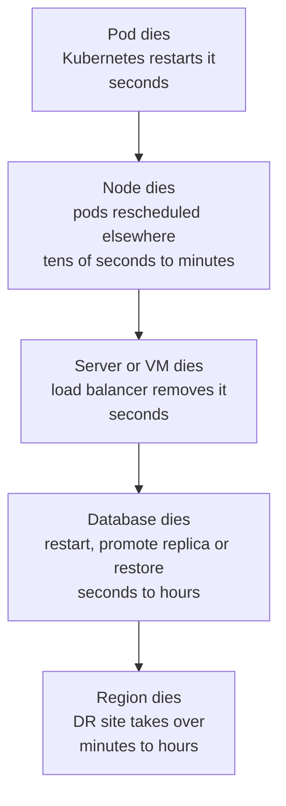

# L15.10 — Failure Scenario Drills

> **Level 15: Disaster Recovery** · Topic 10 of 10 · ⏱ ~6 hours · Difficulty: Advanced

## 1. What it is

A **failure scenario drill** is a planned, controlled rehearsal of a specific failure: you break something on purpose (or pretend you did), the team recovers it using the real runbooks, and you measure how long it took and how much data was lost.
A **game day** is the team-level version: a scheduled exercise with a scenario, roles, a facilitator, observers, a timeline and a debrief. **Chaos engineering** is the continuous, automated cousin that injects small failures regularly to prove the system tolerates them.

This topic works through the five failure classes that the level's capstone asks for, from smallest to largest blast radius: **database**, **server**, **pod**, **node** and **region**. For each you will cause the failure, watch the system react, and write down three numbers:
the **detection time**, the **recovery time** (your measured RTO, [RTO](07-rto.md)) and the **data loss** (your measured RPO, [RPO](06-rpo.md)).

## 2. Why it matters in DevOps

- **Plans decay.** Every deploy, schema change, credential rotation and new dependency can silently break a runbook. A drill is the only test that includes people, access and timing, not just software ([Testing Backup Restoration](09-testing-backup-restoration.md)).
- **It converts RTO and RPO from promises into measurements.** "We can recover in an hour" becomes "last quarter we recovered in 41 minutes with 12 seconds of data loss".
- **Failures are cheaper on Tuesday afternoon.** Finding that the on-call engineer has no access to the DR region is a ticket during a drill and a business-threatening outage during a real event.
- **It builds muscle memory and psychological safety.** Teams that rehearse communicate better under stress and escalate earlier ([Incident Management](../level-14-sre/05-incident-management.md)).
- **It feeds the postmortem loop.** Drill findings are tracked as action items exactly like incident findings ([Postmortems](../level-14-sre/07-postmortems.md)).

## 3. Real-world system example

**Netflix and chaos engineering.** Netflix publicly described Chaos Monkey, which randomly terminates production instances so engineers build for instance failure, and larger exercises in the Simian Army family, including "Chaos Kong", which simulates the loss of an entire AWS region by
moving traffic out of it. The pattern is: failures are routine, rehearsed and automated, so that the response is a practiced one.

**Google DiRT.** Google has described its Disaster Recovery Testing (DiRT) program in public talks and in the *Site Reliability Engineering* books: scheduled, company-wide exercises where teams deliberately simulate large failures (including loss of whole locations and unavailability of key people or systems) to find the weaknesses of their plans.

**AWS.** AWS Fault Injection Service (FIS) lets customers run controlled experiments such as stopping instances, injecting network latency or interrupting an Availability Zone's connectivity, with stop conditions tied to CloudWatch alarms; the Well-Architected Reliability Pillar recommends game days and testing resilience.
**Kubernetes** projects such as Chaos Mesh and LitmusChaos (CNCF projects) provide pod, node and network faults for clusters.

**Learning from real data-loss incidents.** The GitLab.com database incident of January 2017 and the OVHcloud Strasbourg data center fire of March 2021 (both publicly documented, see [Backups](01-backups.md) and [Off-site Backups](08-offsite-backups.md)) are standard case studies: in both, the most valuable lesson was that assumptions about backups and site independence had not been exercised before they were needed.

## 4. Diagram

The shape of every drill, from hypothesis to fixed runbook:



Blast radius grows, and so does the recovery mechanism:



## 5. How it works

**Scenario card.** Every drill starts with a one-page card:

| Field | Example |
|-------|---------|
| Name | DB-01: primary database host lost |
| Hypothesis | A standby is promoted and traffic resumes within 5 minutes with less than 30 s of data loss |
| Injection | `kill -9` on the primary's postmaster (or stop the VM) |
| Blast radius | staging, or a canary slice of production; never an unannounced production-wide failure |
| Abort criteria | customer-visible error rate above X, or any data-loss signal; the facilitator can stop at any time |
| Roles | facilitator, incident commander, operator(s), scribe, observers (customer-support liaison) |
| Runbook under test | link; the operator gets only this |
| Measurements | time to detect, time to decide, time to recover, requests failed, data lost |
| Success | hypothesis met and runbook executed without improvisation |

**Drill types (increasing realism and risk):**

| Type | Description | Risk |
|------|-------------|------|
| Tabletop | talk through the scenario on a whiteboard, no systems touched | none; finds gaps in plans and ownership |
| Walkthrough in a sandbox | execute the runbook against a lab or staging | low |
| Simulation in production-like environment | inject failure in staging with real traffic replay | low-medium |
| Game day in production | controlled failure with real users, small blast radius, tight abort rules | medium; needs mature observability |
| Continuous chaos | automated small faults daily | requires strong guardrails |

**The five failure classes and what "good" looks like:**

| Failure | Typical mechanism | What recovery should look like | Measure |
|---------|-------------------|--------------------------------|---------|
| Pod | container crash, OOM kill, eviction | Deployment/ReplicaSet recreates it; readiness probe keeps traffic away until ready; other replicas absorb load; no failed requests with 2+ replicas | failed requests, time to ready |
| Node | VM or machine lost | node marked NotReady, pods evicted after a toleration timeout, scheduled to other nodes; spread constraints keep replicas apart | time to detect node, time to replacement pods ready |
| Server (VM / app host) | host crash, kernel panic | load balancer health check removes it; autoscaling replaces it | detection window (`fall` x `inter`), failed requests |
| Database | process crash, disk loss, corruption | restart with crash recovery (seconds), promote a replica (tens of seconds), or restore from backup/PITR (minutes to hours) | outage, rows lost, validation passed ([Restore Procedures](04-restore-procedures.md)) |
| Region | provider outage, network partition, disaster | traffic moved to the DR region, database promoted there, stateless tier already running (warm) or started (pilot light) | RTO, RPO, manual steps count, quota/access surprises |

**Rules for safe drills.** Announce the window; have a rollback; keep humans out of the injection unless the scenario says so; never run an unannounced production drill; keep a "stop everything" word; make sure monitoring and communications channels work from outside the failure domain; do not test what you cannot undo.

**After the drill.** Write the report immediately (template in the [capstone](99-capstone-project.md)): timeline, measured values vs targets, what surprised the team, what you will change, owners and dates. Track the actions to completion and schedule the re-test.

## 6. Step-by-step guide

The lab simulates **two regions on one machine**. Region A runs a PostgreSQL primary and two copies of an app; region B runs an asynchronous streaming standby and one app. HAProxy fronts all three apps and treats region B as the backup site.
The app's `/healthz` returns 200 only if its database accepts writes, so region B serves traffic only after its database is promoted: a manual-failover design. A load generator sends five order requests per second through HAProxy; each order is an acknowledged write we can later look for.
Everything is free and local. **Prerequisites:** Linux, PostgreSQL 16 server binaries (`/usr/lib/postgresql/16/bin`), `haproxy`, `python3`, `curl`, run as a normal non-root user. Ports 56190, 56191, 18201-18203, 18290 on loopback only; Unix sockets in `/tmp`.
Pod and node drills need Docker and `kind` (free) and are in steps 7-8.

1. **Create the lab (database pair, three app instances, load balancer, load generator, analyser).**
   ```bash
   export PATH=/usr/lib/postgresql/16/bin:$PATH
   export W=$HOME/dr-lab/region PGHOST=/tmp
   rm -rf "$W" && mkdir -p "$W" && cd "$W"          # fresh start; run the teardown (step 10) first if a lab is still running
   cat > app.py <<'PY'
   #!/usr/bin/env python3
   """app.py NAME PORT DBSOCKDIR DBPORT - a tiny stand-in for shop-api.
   GET /healthz -> 200 only if the local database accepts writes (not a standby)
   GET /order   -> inserts an order, returns its id"""
   import subprocess, sys
   from http.server import BaseHTTPRequestHandler, ThreadingHTTPServer
   name, port, sock, dbport = sys.argv[1], int(sys.argv[2]), sys.argv[3], sys.argv[4]

   def psql(sql):
       r = subprocess.run(["psql", "-X", "-At", "-h", sock, "-p", dbport, "-d", "shop", "-c", sql],
                          capture_output=True, text=True, timeout=3)
       if r.returncode != 0:
           raise RuntimeError(r.stderr.strip())
       return r.stdout.strip().split("\n")[0]

   class H(BaseHTTPRequestHandler):
       def reply(self, code, text):
           body = (text + "\n").encode()
           self.send_response(code); self.send_header("Content-Length", str(len(body))); self.end_headers()
           self.wfile.write(body)
       def do_GET(self):
           try:
               if self.path == "/healthz":
                   ok = psql("SELECT NOT pg_is_in_recovery()") == "t"
                   self.reply(200 if ok else 503, "writable" if ok else "standby")
               else:
                   self.reply(200, f"{name} order {psql('INSERT INTO orders(item) VALUES (' + chr(39) + name + chr(39) + ') RETURNING id')}")
           except Exception as e:
               self.reply(500, f"{name} error: {e}"[:200])
       def log_message(self, *a): pass
   class S(ThreadingHTTPServer):
       def handle_error(self, *a): pass
   S(("127.0.0.1", port), H).serve_forever()
   PY
   cat > loadgen.sh <<'SH'
   #!/usr/bin/env bash
   # loadgen.sh <seconds> <logfile> - one order request every 0.2 s through the load balancer
   END=$(( $(date +%s) + $1 ))
   while [ "$(date +%s)" -lt "$END" ]; do
     R=$(curl -s -m 1 -w ' %{http_code}' localhost:18290/order 2>/dev/null | tr '\n' ' ')
     R=${R:- 000}; R=${R% }
     echo "$(date +%s.%N) ${R##* } ${R% *}" >> "$2"
     sleep 0.2
   done
   SH
   cat > analyze.py <<'PY'
   #!/usr/bin/env python3
   """analyze.py <loadgen.log> <fail_epoch> [survivor_ids_file] - measured outage and data loss"""
   import sys
   rows = [(l.split(None, 2) + [""])[:3] for l in open(sys.argv[1]) if l.strip()]
   fail = float(sys.argv[2])
   good = [(float(t), body) for t, code, body in rows if code == "200"]
   bad = [float(t) for t, code, _ in rows if code != "200" and float(t) >= fail - 0.5]
   print(f"requests sent={len(rows)} failed={len(bad)}")
   if bad:
       last_ok_before = max(t for t, _ in good if t < bad[0])
       first_ok_after = min(t for t, _ in good if t > bad[0])
       served_by = [b.split()[0] for t, b in good if t == first_ok_after][0]
       print(f"outage as seen by users: {first_ok_after - last_ok_before:.1f} s, traffic resumed on {served_by}")
   else:
       print("outage as seen by users: 0.0 s")
   if len(sys.argv) > 3:
       survivors = {int(x) for x in open(sys.argv[3]).read().split()}
       acked = [int(b.split()[-1]) for t, b in good if b.startswith("app-a")]
       lost = [i for i in acked if i not in survivors]
       print(f"orders acknowledged by region A: {len(acked)}, present after recovery: {len(acked) - len(lost)}, LOST: {len(lost)}")
   PY
   chmod +x loadgen.sh analyze.py
   ```

2. **Start region A (primary), region B (standby), the apps and HAProxy.**
   ```bash
   initdb -D "$W/region-a" >/dev/null
   cat >> "$W/region-a/postgresql.conf" <<CONF
   unix_socket_directories = '/tmp'
   listen_addresses = ''
   wal_keep_size = 128MB
   max_wal_senders = 5
   CONF
   echo "local replication all trust" >> "$W/region-a/pg_hba.conf"
   pg_ctl -D "$W/region-a" -o "-p 56190" -l "$W/pg-a.log" -w start >/dev/null
   psql -X -q -p 56190 -d postgres -c "CREATE DATABASE shop"
   psql -X -q -p 56190 -d shop -c "CREATE TABLE orders(id serial primary key, item text, created_at timestamptz default now())"
   pg_basebackup -h /tmp -p 56190 -D "$W/region-b" -R -X stream -c fast
   pg_ctl -D "$W/region-b" -o "-p 56191" -l "$W/pg-b.log" -w start >/dev/null
   nohup python3 "$W/app.py" app-a  18201 /tmp 56190 > "$W/app-a.log"  2>&1 & echo $! > "$W/app-a.pid"
   nohup python3 "$W/app.py" app-a2 18203 /tmp 56190 > "$W/app-a2.log" 2>&1 & echo $! > "$W/app-a2.pid"
   nohup python3 "$W/app.py" app-b  18202 /tmp 56191 > "$W/app-b.log"  2>&1 & echo $! > "$W/app-b.pid"
   cat > "$W/haproxy.cfg" <<CONF
   global
       maxconn 256
   defaults
       mode http
       timeout connect 1s
       timeout client 5s
       timeout server 5s
   frontend fe
       bind 127.0.0.1:18290
       default_backend shop
   backend shop
       option httpchk GET /healthz
       default-server inter 1s fall 3 rise 2
       server app-a  127.0.0.1:18201 check
       server app-a2 127.0.0.1:18203 check
       server app-b  127.0.0.1:18202 check backup
   CONF
   haproxy -f "$W/haproxy.cfg" -D -p "$W/haproxy.pid"
   sleep 3
   for i in 1 2 3; do curl -s localhost:18290/order; done
   psql -X -At -p 56190 -d postgres -c "SELECT application_name, state FROM pg_stat_replication"
   curl -s -o /dev/null -w 'region B healthz: %{http_code}\n' localhost:18202/healthz
   ```
   Expected: three lines like `app-a order 1`, `app-a2 order 2`, `app-a order 3` (HAProxy round-robins the two primary-site apps), `walreceiver|streaming`, and `region B healthz: 503` (the standby correctly refuses to take traffic).

3. **Write the drill runner.** One script, three scenarios, one measured result.
   ```bash
   cat > "$W/drill.sh" <<'EOF'
   #!/usr/bin/env bash
   # drill.sh <server|db|region> [decision_delay_seconds] [partition_seconds]
   #   server : kill -9 one app instance (automatic recovery by the load balancer)
   #   db     : kill -9 the region A database, a human restarts it (crash recovery)
   #   region : (optionally cut replication first) kill all of region A, a human promotes region B
   set -u
   export PATH=/usr/lib/postgresql/16/bin:$PATH PGHOST=/tmp
   W=$HOME/dr-lab/region; SCEN=${1:?server|db|region}; DECIDE=${2:-10}; PART=${3:-0}
   rm -f "$W/loadgen.log"
   "$W/loadgen.sh" 40 "$W/loadgen.log" &
   sleep 8
   case $SCEN in
     server)
       T_FAIL=$(date +%s.%N); echo "$(date +%T) app-a killed"
       kill -9 "$(cat "$W/app-a.pid")"; SURV=""
       ;;
     db)
       T_FAIL=$(date +%s.%N); echo "$(date +%T) region A database killed (kill -9)"
       kill -9 "$(head -1 "$W/region-a/postmaster.pid")"
       sleep "$DECIDE"; echo "$(date +%T) human restarts the database"
       pg_ctl -D "$W/region-a" -o "-p 56190" -l "$W/pg-a.log" -w start >/dev/null
       SURV=56190
       ;;
     region)
       if [ "$PART" -gt 0 ]; then
         echo "$(date +%T) inter-region link breaks (replication stops) ${PART}s before the disaster"
         psql -X -q -p 56191 -d postgres -c "ALTER SYSTEM SET primary_conninfo = 'host=/nonexistent port=1'" -c "SELECT pg_reload_conf()" >/dev/null
         sleep "$PART"
       fi
       T_FAIL=$(date +%s.%N); echo "$(date +%T) REGION A FAILS (database and both app instances killed)"
       kill -9 "$(head -1 "$W/region-a/postmaster.pid")" "$(cat "$W/app-a.pid")" "$(cat "$W/app-a2.pid")"
       echo "$(date +%T) humans are deciding for ${DECIDE}s ..."; sleep "$DECIDE"
       echo "$(date +%T) PROMOTE region B"; pg_ctl -D "$W/region-b" promote -w >/dev/null
       SURV=56191
       ;;
   esac
   wait
   if [ -n "$SURV" ]; then
     psql -X -At -p "$SURV" -d shop -c "SELECT id FROM orders WHERE item LIKE 'app-a%'" > "$W/survivors.txt"
     python3 "$W/analyze.py" "$W/loadgen.log" "$T_FAIL" "$W/survivors.txt"
   else
     python3 "$W/analyze.py" "$W/loadgen.log" "$T_FAIL"
   fi
   if [ "$SCEN" = server ]; then   # repair so the lab is reusable
     nohup python3 "$W/app.py" app-a 18201 /tmp 56190 > "$W/app-a.log" 2>&1 & echo $! > "$W/app-a.pid"
   fi
   EOF
   chmod +x "$W/drill.sh"
   ```

4. **Drill SERVER-01: an app host dies.** Recovery is automatic, so the only human job is to watch.
   ```bash
   "$W/drill.sh" server
   ```
   Similar to:
   ```text
   22:36:17 app-a killed
   requests sent=164 failed=2
   outage as seen by users: 1.4 s, traffic resumed on app-a2
   ```
   Only the requests that happened to be routed to the dead instance before the health check noticed failed. The sibling instance carried on. Record: detection about 3 s (`fall 3` x `inter 1s`), user-visible failures 2 of 164, recovery automatic. Hypothesis "no human needed and under 5 seconds of errors" confirmed.

5. **Drill DB-01: the primary database process dies, the human restarts it.** `kill -9` on the postmaster is an unclean crash; PostgreSQL recovers from its write-ahead log on start.
   ```bash
   "$W/drill.sh" db 8
   ```
   Similar to:
   ```text
   22:41:17 region A database killed (kill -9)
   22:41:25 human restarts the database
   pg_ctl: another server might be running; trying to start server anyway
   requests sent=175 failed=44
   outage as seen by users: 9.8 s, traffic resumed on app-a2
   orders acknowledged by region A: 131, present after recovery: 131, LOST: 0
   ```
   The warning about "another server might be running" is the stale `postmaster.pid` left by the kill and is expected. Outage is approximately the 8 s "human decision" you chose plus start-up and the health check's `rise` time; crash recovery itself took a fraction of a second here.
   Zero acknowledged orders lost, because committed transactions are flushed to the WAL before they are acknowledged. Re-run with `drill.sh db 30` and see how the decision time dominates; this is why detection and decision belong in your RTO ([RTO](07-rto.md)).

6. **Drill REGION-01: all of region A is lost; promote region B.** First with healthy replication, then with a replication link that broke 4 seconds before the disaster. You must rebuild the lab (steps 1-2, after the teardown in step 9) between runs because the promoted standby is now a primary.
   ```bash
   "$W/drill.sh" region 12 4
   ```
   Similar to:
   ```text
   22:42:01 inter-region link breaks (replication stops) 4s before the disaster
   22:42:01 REGION A FAILS (database and both app instances killed)
   22:42:01 humans are deciding for 12s ...
   22:42:13 PROMOTE region B
   requests sent=166 failed=52
   outage as seen by users: 14.4 s, traffic resumed on app-b
   orders acknowledged by region A: 53, present after recovery: 36, LOST: 17
   ```
   Measured: **RTO about 14 s** (12 s decision + promotion + HAProxy `rise`), **RPO: 17 orders lost**, about 3-4 seconds of traffic at five requests per second, exactly the replication gap. Run `drill.sh region 12 0` on a fresh lab and expect LOST to be 0 or very small.
   In the real world the 12 seconds would be minutes of paging, assessing and approving, and the partition of seconds would be replication lag across regions ([Replication](02-replication.md), [Failover](05-failover.md)).

7. **Drill POD-01 on Kubernetes (kind).** Requires Docker and `kind`. Free, local. *Output below is illustrative: it was not run in the sandbox that built this guide; run it yourself and record your numbers.*
   ```bash
   cat > kind.yaml <<'EOF'
   kind: Cluster
   apiVersion: kind.x-k8s.io/v1alpha4
   nodes:
   - role: control-plane
   - role: worker
   - role: worker
   EOF
   kind create cluster --name dr-drill --config kind.yaml
   cat > shop-api.yaml <<'EOF'
   apiVersion: apps/v1
   kind: Deployment
   metadata: { name: shop-api }
   spec:
     replicas: 3
     selector: { matchLabels: { app: shop-api } }
     template:
       metadata: { labels: { app: shop-api } }
       spec:
         topologySpreadConstraints:
         - maxSkew: 1
           topologyKey: kubernetes.io/hostname
           whenUnsatisfiable: ScheduleAnyway
           labelSelector: { matchLabels: { app: shop-api } }
         tolerations:                     # evict pods quickly from a dead node (default is 300 s)
         - { key: node.kubernetes.io/unreachable, operator: Exists, effect: NoExecute, tolerationSeconds: 20 }
         - { key: node.kubernetes.io/not-ready,   operator: Exists, effect: NoExecute, tolerationSeconds: 20 }
         containers:
         - name: web
           image: nginx:1.27
           ports: [ { containerPort: 80 } ]
           readinessProbe: { httpGet: { path: /, port: 80 }, periodSeconds: 2 }
   ---
   apiVersion: v1
   kind: Service
   metadata: { name: shop-api }
   spec:
     selector: { app: shop-api }
     ports: [ { port: 80, targetPort: 80 } ]
   EOF
   kubectl apply -f shop-api.yaml && kubectl rollout status deploy/shop-api
   kubectl run load --image=curlimages/curl:8.10.1 --restart=Never -- \
     sh -c 'while true; do curl -s -o /dev/null -m 1 -w "%{http_code}\n" http://shop-api/; sleep 0.2; done'
   kubectl get pods -o wide
   ```
   Now kill a pod and count errors seen by the load generator:
   ```bash
   POD=$(kubectl get pods -l app=shop-api -o name | head -1)
   kubectl delete "$POD" --wait=false
   kubectl get pods -l app=shop-api -w        # Ctrl+C after the replacement is Running and 1/1 Ready
   kubectl logs load | sort | uniq -c
   ```
   Illustrative expectation: a replacement pod is Running within a few seconds and Ready after its first readiness probe; the log shows only `200` with 3 replicas. Repeat with `kubectl scale deploy/shop-api --replicas=1` first: you should see a short burst of `000` or `503` while the single pod restarts. The lesson is replicas plus readiness probes, not luck ([Pods](../level-08-kubernetes/02-pods.md), [Liveness and Readiness Probes](../level-08-kubernetes/15-liveness-and-readiness-probes.md)).

8. **Drill NODE-01 on Kubernetes: a worker node dies.** Use the same cluster. *Illustrative output; verify on your machine.*
   ```bash
   kubectl get pod load -o wide      # note the node the load generator is on; do NOT stop that one
   kubectl get pods -l app=shop-api -o wide
   docker stop dr-drill-worker2      # pick the worker that is NOT hosting "load"; if "load" is on worker2 stop dr-drill-worker
   date +%T; kubectl get nodes -w    # Ctrl+C once the node shows NotReady
   ```
   Timeline to expect (defaults, rounded): the node controller marks the node `NotReady` after roughly 40-50 seconds without a heartbeat (`node-monitor-grace-period`); the taint `node.kubernetes.io/unreachable:NoExecute` is added; pods tolerating it for 20 s (as configured above) are then evicted and recreated on the surviving worker;
   without the custom tolerations the default `tolerationSeconds` is 300, so recovery would take about six minutes. During the first minute requests routed to pods on the dead node fail until the endpoint is removed. Count them:
   ```bash
   kubectl logs load | sort | uniq -c
   kubectl get pods -l app=shop-api -o wide   # all Running on the surviving worker
   docker start dr-drill-worker2              # bring the node back; wait for Ready
   ```
   Record: detection (~45 s), eviction (+20 s), new pods Ready (+ a few seconds), failed requests, and the knobs that move the numbers (probe period, tolerations, replica spread, PodDisruptionBudget).
   Clean up: `kind delete cluster --name dr-drill`.

9. **Region failure on real cloud: read-only reference.** *Not run here; costs real money; use a sandbox account, a billing alarm and a tag on everything.* On AWS a region drill for `shop-api` typically combines: a pilot-light or warm-standby stack in a second region (for example `us-west-2`), an RDS cross-region read replica or Aurora Global Database, ECR/S3 replication, and Route 53 failover records.
   The drill is: (1) announce, (2) simulate loss of `us-east-1` by removing it from rotation (set the Route 53 health check to fail, or weight 0) rather than by breaking it, (3) promote the replica in the DR region, (4) scale the application tier, (5) validate ([Restore Procedures](04-restore-procedures.md)), (6) measure, (7) fail back deliberately.
   Teardown: delete the DR stack, replica and hosted-zone records afterwards; a warm-standby environment left running is a monthly bill. AWS Fault Injection Service can automate steps such as stopping instances, with stop conditions bound to alarms.

10. **Tear down the local lab (and run it before every re-run of step 2).**
    ```bash
    kill "$(cat "$W/haproxy.pid")" "$(cat "$W/app-a.pid")" "$(cat "$W/app-a2.pid")" "$(cat "$W/app-b.pid")" 2>/dev/null
    pg_ctl -D "$W/region-a" -m immediate stop 2>/dev/null; pg_ctl -D "$W/region-b" -m immediate stop 2>/dev/null
    ```
    Remove `~/dr-lab/region` when you are done. If a start fails with "address in use", another process on your machine uses one of the ports; change the numbers in all scripts consistently.

## 7. Real-world scenario

*Illustrative.* The `shop-api` team runs its first quarterly game day on staging with production-sized data. The scenario card says: "primary region lost; hypothesis: back in 30 minutes with less than 1 minute of data loss".
At 10:00 the facilitator cuts the staging VPC's route to the primary region. The alert fires at 10:03 and the incident commander is paged at 10:05, but the engineer who owns the database is on holiday and the runbook step "get the break-glass credential" requires a laptop with a hardware key that only he holds. A deputy gets a replacement at 10:27.
The replica is promoted at 10:31, but the application pods in the DR region have a 4-vCPU quota instead of 40, so only a tenth of the capacity can start; the quota request is approved at 11:04. Traffic is fully served at 11:12.
The measured RTO is 72 minutes against a 30-minute hypothesis, and measured data loss is 6 seconds. The debrief produces five actions: a second key holder, quotas set to match production in the DR region (verified by a weekly check), a promote script with guard rails, a runbook update, and a re-test in six weeks.
**Lesson:** the technical failover worked; the plan failed on people and limits. Only a drill finds that.

## 8. Common mistakes and best practices

**Don't**

- Run an unannounced destructive test in production, or without an abort rule and a rollback.
- Treat a tabletop as sufficient; at least once, execute the runbook for real in a sandbox.
- Let the person who wrote the runbook run the drill; use someone else.
- Skip measurement: "it worked" without timestamps and counts cannot be compared next quarter.
- Punish people for drill findings; make them blameless or nobody will report the next gap.

**Do**

- Start small: pod, then node, then server, then database, then region; graduate when each is boring.
- Write a scenario card with hypothesis, abort criteria and roles before every drill.
- Measure detect, decide, recover and data lost, and record them in a drill report ([capstone templates](99-capstone-project.md)).
- Include dependencies and people: access, quotas, DNS TTLs, communication channels that live outside the failure domain.
- Track every finding as an action item with an owner and a date, and re-test ([Postmortems](../level-14-sre/07-postmortems.md)).
- Automate repeatable drills (scripts, chaos tools) and keep humans for the ones that test judgement.

## 9. Tasks

- [ ] **T1 — Build the lab and run the server and database drills** *(≈60 min, intermediate)*
  - **Goal:** produce measured results for two failure classes.
  - **Steps:** follow guide steps 1-5; run `drill.sh db` with decision delays of 5, 15 and 30 seconds.
  - **Done when:** you have a table (delay, outage seconds, failed requests, lost orders) and can explain why the outage grows with the decision delay while lost orders stay zero.

- [ ] **T2 — Region failure with and without replication lag** *(≈60 min, advanced)*
  - **Goal:** separate RTO from RPO in a region failure.
  - **Steps:**
    1. Rebuild the lab and run `drill.sh region 5 0`; record outage and lost orders.
    2. Rebuild and run `drill.sh region 5 8`; record again.
    3. Compute the data loss in seconds from the lost orders divided by the request rate.
  - **Done when:** you can show that the outage depends mostly on the decision delay and the health-check timing, while the data loss depends on the replication gap, with your two result sets.

- [ ] **T3 — Break it: improve the design, re-drill** *(≈90 min, advanced)*
  - **Goal:** cut the measured RTO.
  - **Steps:**
    1. Change HAProxy to `fall 2 inter 500ms` and the human decision to a script (`promote.sh` from [Failover](05-failover.md)) that runs automatically 3 seconds after the failure is detected.
    2. Re-run the region drill and compare outage and lost orders with T2.
    3. Write down the new risk you introduced (false positive promotion, split-brain) and one guard rail for it.
  - **Done when:** your report shows the before and after outage numbers and names the risk you traded for the speed.

- [ ] **T4 — Pod and node drills on kind** *(≈90 min, intermediate)*
  - **Goal:** measure Kubernetes self-healing.
  - **Steps:** follow guide steps 7-8, then repeat the node drill without the custom tolerations and observe how much longer pods take to move.
  - **Done when:** you have measured numbers for pod replacement time, node-detection time, eviction time and failed requests, with and without the tolerations, and you have deleted the cluster.

- [ ] **T5 — Write a scenario card and run a tabletop** *(≈60 min, intermediate)*
  - **Goal:** practice the human side.
  - **Steps:**
    1. Use the scenario-card fields from section 5 to write a card for "primary region lost" for `shop-api`.
    2. Walk through it with at least one other person using only the runbooks, speaking each step and who does it.
    3. Write down every question that no document answers.
  - **Done when:** you have a completed card and a list of at least five gaps with owners.

- [ ] **T6 — Prove it: full drill and report** *(≈120 min, advanced)*
  - **Goal:** run a complete drill without the guide and report on it.
  - **Steps:**
    1. Choose one scenario (database or region) and write the hypothesis, abort criteria and roles.
    2. Run it with a stopwatch and the load generator; capture the timeline.
    3. Produce a one-page drill report using the template in the [capstone](99-capstone-project.md), including measured RTO and RPO and at least three action items.
  - **Done when:** the report compares measured values with targets, lists what surprised you, and each action has an owner and a due date.

## 10. Self-check questions

1. What is the difference between a tabletop, a game day and chaos engineering?
2. Why does the outage in the database drill grow with the decision delay but the data loss does not?
3. In a region failover with asynchronous replication, which quantity determines data loss and which determine downtime?
4. Why set `tolerationSeconds` on pods, and what is the default behavior without it?
5. What must a scenario card contain before you run a drill in production?

<details>
<summary>Answers</summary>

1. A tabletop is a discussion with no systems touched; a game day is a scheduled, facilitated exercise where failure is actually injected and the team responds; chaos engineering is automated, continuous injection of small failures to prove tolerance.
2. Time passes while people decide, and requests fail in the meantime; the data was already safely committed in the write-ahead log, so a restart recovers it. Data loss depends on what had not been durably stored or replicated at the moment of failure.
3. Data loss is determined by the replication gap at the time of failure (RPO). Downtime is determined by detection, decision, promotion, scaling the DR tier and traffic cut-over (RTO).
4. A node that stops reporting gets a NoExecute taint; pods tolerate it for `tolerationSeconds` before eviction. The default added to pods is 300 seconds, so without tuning recovery from a dead node takes about five minutes on top of detection.
5. A hypothesis, blast radius, abort criteria, rollback, roles, the runbook under test, what will be measured, and an announcement window with the facilitator able to stop the drill at any time.
</details>

## 11. Further reading

- *Site Reliability Engineering* and *The Site Reliability Workbook* (Google): chapters on managing incidents, postmortems and disaster-recovery testing.
- *Chaos Engineering: System Resiliency in Practice* (Rosenthal, Jones) and the Principles of Chaos Engineering site.
- AWS Well-Architected Framework, Reliability Pillar (testing resilience, game days) and AWS Fault Injection Service documentation.
- Kubernetes documentation: *Taints and Tolerations*, *Pod Disruption Budgets*, *Node-pressure eviction* and kind (Kubernetes in Docker) quick start.
- Chaos Mesh and LitmusChaos project documentation.
- Related: [Failover](05-failover.md), [Testing Backup Restoration](09-testing-backup-restoration.md), [Incident Management](../level-14-sre/05-incident-management.md), [Reliability Engineering](../level-14-sre/10-reliability-engineering.md).

<!-- nav -->
---
← Previous: [Testing Backup Restoration](09-testing-backup-restoration.md) · [Level 15 index](README.md) · Next: [Level capstone project](99-capstone-project.md) →
