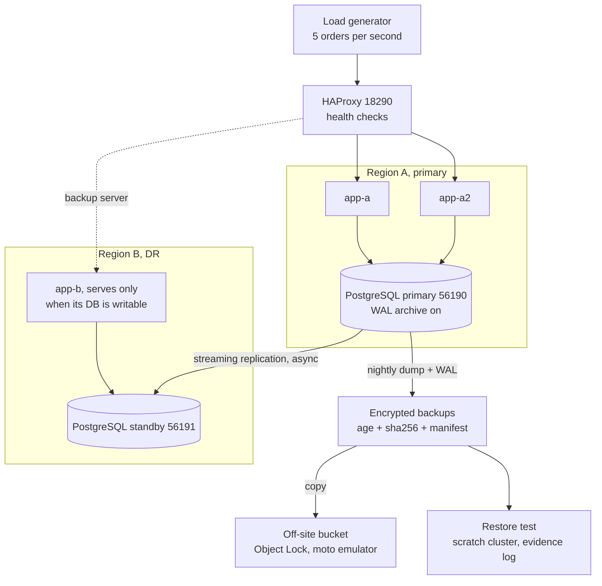
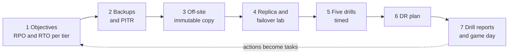

# L15 Capstone — Break It, Time It, Write the Plan

> **Level 15: Disaster Recovery** · Capstone · ⏱ ~16 hours

## 1. Goal and outcome

Practise five failure scenarios against the `shop-api` stack (Node.js API + PostgreSQL + Redis + Nginx, domain `example.com`) and finish with **measured recovery numbers and a written DR plan**:

1. **Database failure** (process crash, total loss of the primary, and logical corruption needing point-in-time recovery).
2. **Server failure** (an application host dies behind a load balancer).
3. **Pod failure** (a Kubernetes pod is killed).
4. **Node failure** (a Kubernetes worker node is lost).
5. **Region failure** (the primary site disappears; the standby site is promoted).

Outcome: for each scenario a dated drill report with detect/decide/recover times and data loss compared with targets you set up front; an automated, evidence-producing restore test; an immutable off-site backup copy; and a DR plan document a stranger could follow.
You are done when the five reports exist, every miss against a target has an action item, and you can explain RPO, RTO, failover, restore order and off-site design without notes.

## 2. Architecture

Everything runs on one laptop (two simulated regions plus a kind cluster); cloud equivalents are noted in the stretch goals.





## 3. Prerequisites and cost

- **Cost:** free. Everything uses local processes, loopback ports and a local S3 emulator. The kind pod/node drills need Docker and `kind` (free). Cloud parts are optional stretch goals and **cost real money**: if you do them, set a billing alarm first, tag everything `dr-capstone` and run the teardown in section 7.
- **Machine:** Linux, 8 GB RAM, 10 GB disk; PostgreSQL 16 server binaries (`/usr/lib/postgresql/16/bin`), `haproxy`, `python3`, `curl`, `age`, a Python venv for `moto`; Docker + `kind` + `kubectl` for drills 3 and 4. Use a normal non-root user.
- **Knowledge:** the ten topics of this level: [Backups](01-backups.md), [Replication](02-replication.md), [Snapshots](03-snapshots.md), [Restore Procedures](04-restore-procedures.md), [Failover](05-failover.md), [RPO](06-rpo.md), [RTO](07-rto.md), [Off-site Backups](08-offsite-backups.md), [Testing Backup Restoration](09-testing-backup-restoration.md), [Failure Scenario Drills](10-failure-scenario-drills.md).
- **Ports used (loopback only):** 56190-56191 (regions), 56200-56201 (PITR), 55480-55481 (restore test), 18201-18203 and 18290 (apps and balancer), 18500 (S3 emulator). Pick other numbers consistently if any clash.
- **Evidence directory:** `mkdir -p ~/dr-lab/capstone/{evidence,reports}`; every number you quote in the DR plan must come from a file here.

## 4. Build it step by step

### Milestone 1 — Objectives first (topics 6 and 7)

Before touching anything, decide targets. Create `~/dr-lab/capstone/objectives.md`:

| Tier | Component | RPO | RTO | Strategy | Rationale (revenue per minute, contract) |
|------|-----------|-----|-----|----------|------------------------------------------|
| 0 | access, secrets, DNS | 0 (in Git/vault) | 15 min | warm | everything else waits for it |
| 1 | orders database + checkout | 30 s | 15 min | warm standby | revenue |
| 2 | Redis cache, search | rebuild | 4 h | rebuild | derived data |
| 3 | reports | 24 h | 72 h | backup/restore | internal |

Run `python3 rpo_calc.py 30 1200 25` from [RPO](06-rpo.md) to show the revenue at risk, and write the **scenario targets** you will test against, for example: DB crash RTO 60 s; server RTO 10 s; pod 0 failed requests; node RTO 2 min; region RTO 5 min with RPO 30 s; logical corruption RPO 1 min via PITR.

### Milestone 2 — Backups, restore test and PITR (topics 1, 3, 4, 9)

1. Build the encrypted backup + automated restore test exactly as in [Testing Backup Restoration](09-testing-backup-restoration.md) steps 1-3 (`backup.sh`, `restore-test.sh`, JSON evidence). Run both, then copy `restore-tests.jsonl` into `capstone/evidence/`.
2. Snapshots: a base backup is the local analogue of a volume snapshot (a point-in-time physical copy plus WAL). Take one with `pg_basebackup`, verify it with `pg_verifybackup`, and write one paragraph on the cloud equivalent (EBS snapshot + DLM, RDS snapshot) from [Snapshots](03-snapshots.md).
3. Write the logical-corruption drill (a bad `DELETE`, recovered by PITR). Save as `pitr-drill.sh` and run it:
   ```bash
   cat > ~/dr-lab/capstone/pitr-drill.sh <<'EOF'
   #!/usr/bin/env bash
   # pitr-drill.sh - logical corruption: a bad DELETE at a known time, recovered with point-in-time recovery
   set -eu
   export PATH=/usr/lib/postgresql/16/bin:$PATH
   export W=$HOME/dr-lab/pitr && rm -rf "$W" && mkdir -p "$W/archive" && export PGHOST=/tmp PGPORT=56200
   initdb -D "$W/pg" >/dev/null 2>&1
   cat >> "$W/pg/postgresql.conf" <<CONF
   port = 56200
   unix_socket_directories = '/tmp'
   listen_addresses = ''
   archive_mode = on
   archive_command = 'test ! -f $W/archive/%f && cp %p $W/archive/%f'
   archive_timeout = 5s
   CONF
   pg_ctl -D "$W/pg" -l "$W/pg.log" -w start >/dev/null
   createdb shop
   psql -X -q -d shop -c "CREATE TABLE orders(id serial primary key, item text)" \
     -c "INSERT INTO orders(item) SELECT 'i'||g FROM generate_series(1,50000) g"
   pg_basebackup -D "$W/base" -X stream -c fast
   psql -X -q -d shop -c "INSERT INTO orders(item) SELECT 'late'||g FROM generate_series(1,1000) g"   # work after the backup
   sleep 2
   GOOD=$(psql -X -At -d shop -c "SELECT clock_timestamp()")                                       # the last good moment
   ROWS_BEFORE=$(psql -X -At -d shop -c "SELECT count(*) FROM orders")
   sleep 1
   echo "$(date +%T) THE MISTAKE: DELETE FROM orders"
   psql -X -q -d shop -c "DELETE FROM orders"
   psql -X -q -d shop -c "SELECT pg_switch_wal()" >/dev/null; sleep 7                                # let the WAL reach the archive
   START=$(date +%s)
   echo "$(date +%T) restoring base backup + WAL up to: $GOOD"
   cp -r "$W/base" "$W/restored"; chmod 700 "$W/restored"; export PGPORT=56201
   cat >> "$W/restored/postgresql.conf" <<CONF
   port = 56201
   unix_socket_directories = '/tmp'
   listen_addresses = ''
   restore_command = 'cp $W/archive/%f %p'
   recovery_target_time = '$GOOD'
   recovery_target_action = 'promote'
   CONF
   touch "$W/restored/recovery.signal"
   pg_ctl -D "$W/restored" -l "$W/restored.log" -w start >/dev/null
   until [ "$(psql -X -At -d shop -c 'SELECT pg_is_in_recovery()' 2>/dev/null)" = f ]; do sleep 0.2; done
   echo "PITR took $(( $(date +%s) - START )) s; rows before the mistake: $ROWS_BEFORE; rows after PITR: $(psql -X -At -d shop -c 'SELECT count(*) FROM orders')"
   pg_ctl -D "$W/restored" -m fast stop >/dev/null; pg_ctl -D "$W/pg" -m immediate stop >/dev/null
   EOF
   chmod +x ~/dr-lab/capstone/pitr-drill.sh && ~/dr-lab/capstone/pitr-drill.sh
   ```
   Similar to: `PITR took 1 s; rows before the mistake: 51000; rows after PITR: 51000`. The RPO for this scenario is the gap between `GOOD` and the mistake (here about 1 second), not the replication lag.

### Milestone 3 — Off-site, immutable copy (topic 8)

Follow [Off-site Backups](08-offsite-backups.md) steps 1-6 with the newest `*.dump.age` from milestone 2: start the emulator, `offsite.py init`, `upload`, `attack`, `recover`. Save the output as `capstone/evidence/offsite.txt`. Add one step to your restore test: after the local restore passes, also download the off-site object, verify its sha256 and decrypt it.

### Milestone 4 — Replica and failover lab (topics 2 and 5)

Build the two-region lab from [Failure Scenario Drills](10-failure-scenario-drills.md) steps 1-3 (ports 56190/56191, HAProxy, load generator, `drill.sh`). Confirm `walreceiver|streaming` and `region B healthz: 503`. Then answer, in writing: which tier of [RTO](07-rto.md) is this (warm standby), what decides whether it fails over automatically (HAProxy health checks) and what is manual (the database promote), and what prevents two writable primaries ([Failover](05-failover.md): fencing by killing region A, and never auto-promoting).

### Milestone 5 — The five drills (topic 10)

Run each drill, keep the terminal output as evidence, and fill the numbers into a `capstone/evidence/results.csv` with the header `scenario,detect_s,decide_s,recover_s,failed_requests,data_lost,target_met`.

| ID | Scenario | How | What to record |
|----|----------|-----|----------------|
| DB-1 | database crash | `~/dr-lab/region/drill.sh db 8` | outage seconds, failed requests, lost orders (expect 0) |
| DB-2 | primary host lost, promote standby | covered by REGION-1 with `drill.sh region 12 0` | RTO, RPO |
| DB-3 | logical corruption | `pitr-drill.sh` from milestone 2 | restore seconds, rows recovered, RPO to the mistake |
| SRV-1 | server dies | `~/dr-lab/region/drill.sh server` | detection (about 3 s), failed requests |
| POD-1 | pod killed | topic 10 step 7 on kind | failed requests with 3 replicas and with 1 replica |
| NODE-1 | node lost | topic 10 step 8 on kind | time to NotReady, eviction, pods Ready, failed requests |
| REGION-1 | region lost | `drill.sh region 12 4` on a fresh lab (teardown, then steps 1-2) | outage, lost orders vs the 4 s replication gap |

After each drill write one sentence stating whether the target from milestone 1 was met, and what you would change. A helper to keep the CSV honest:
```bash
rec() { echo "$1,$2,$3,$4,$5,$6,$7" >> ~/dr-lab/capstone/evidence/results.csv; }
echo "scenario,detect_s,decide_s,recover_s,failed_requests,data_lost,target_met" > ~/dr-lab/capstone/evidence/results.csv
rec REGION-1 3 12 14 54 17 no          # example row; use your measured values
```

### Milestone 6 — The written DR plan

Create `~/dr-lab/capstone/reports/DR-PLAN.md` from this template. Every number must be one you measured; if you did not measure it, write "not tested" instead.

````markdown
# Disaster Recovery Plan — shop-api
Version: 1.0   Date: YYYY-MM-DD   Owner: <name>   Reviewers: <names>   Next review: <date + 6 months>

## 1. Purpose and scope
What this plan covers (services, environments, regions) and what it explicitly does not.

## 2. Objectives
| Tier | Service | RPO target | RPO measured (date) | RTO target | RTO measured (date) | Strategy |
|------|---------|-----------|---------------------|-----------|---------------------|----------|

## 3. Scenarios and responses
| Scenario | Detection | Decision rule | Recovery action | Runbook link | Last drilled |
|----------|-----------|---------------|-----------------|--------------|--------------|
| Pod / node / server / database / logical corruption / region | | | | | |

## 4. Backups and recovery data
| Data | Method | Frequency | Retention | Encrypted | Location 1 | Off-site (account, region, immutable) | Key location | Last restore test |
|------|--------|-----------|-----------|-----------|------------|----------------------------------------|--------------|-------------------|

## 5. Order of restore
Numbered dependency list (access, network, database, cache, apps, traffic, validation) with owners.

## 6. Roles and contacts
Incident commander, communications lead, database owner, deputies, escalation path, vendor support numbers.
Out-of-band communication channel that survives the primary failure.

## 7. Access and break-glass
Where emergency credentials and encryption keys live, who can retrieve them, how it is tested.

## 8. Communication
Internal and customer templates, status page owner, update cadence (for example every 30 minutes).

## 9. Failback
Criteria and steps to return to normal after the event.

## 10. Testing schedule and evidence
| Test | Frequency | Owner | Evidence location |
|------|-----------|-------|-------------------|
| Automated restore test | daily | | |
| Pod/node/server drill | monthly | | |
| Database and region game day | quarterly | | |

## 11. Known gaps and accepted risks
Each with owner, due date or explicit risk acceptance signed by the business owner.

## 12. Change log
````

### Milestone 7 — Drill reports and a game day

For every drill create `reports/DRILL-<id>-<date>.md` from this template, then run one **game day** combining DB-3 and REGION-1 with a second person acting as incident commander using only the DR plan.
````markdown
# Drill report DRILL-<ID> — <scenario>
Date/time window: ...   Facilitator: ...   Incident commander: ...   Operators: ...   Scribe: ...   Environment: lab / staging

## Hypothesis and targets
RPO target ..., RTO target ..., success criteria ...

## Scenario card
Injection ..., blast radius ..., abort criteria ..., runbook under test ...

## Timeline (from the scribe)
| Time | Event | Elapsed |
|------|-------|---------|
| hh:mm:ss | failure injected | 0 |
| | detected / alert | |
| | decision made | |
| | recovery started / finished | |
| | validation passed / traffic restored | |

## Results
| Metric | Target | Measured | Met? |
|--------|--------|----------|------|
| Detection time | | | |
| Recovery time (RTO) | | | |
| Data loss (RPO) | | | |
| Requests failed | | | |

## What went well / what went badly / what surprised us

## Action items
| # | Action | Owner | Due | Ticket |
|---|--------|-------|-----|--------|

## Evidence
Links to logs, CSV rows, screenshots, terminal output.
Sign-off: <name, date>
````
Finish by turning the action items into tickets, fixing at least one, and re-running that drill to show the improvement.

## 5. Tasks

- [ ] **T1 — Set targets and the evidence skeleton** *(≈60 min, beginner; milestone 1; topics 6, 7)*
  - **Goal:** objectives and scenario targets written before any drill.
  - **Steps:**
    1. Create the evidence directory, `objectives.md` and the scenario targets list.
    2. Run `rpo_calc.py` for each tier and put the revenue-at-risk figure next to it.
  - **Done when:** `objectives.md` has RPO, RTO, strategy and rationale for four tiers and six scenario targets.

- [ ] **T2 — Automated, evidence-producing restore test plus PITR** *(≈150 min, intermediate; milestone 2; topics 1, 3, 4, 9)*
  - **Goal:** a backup you have restored, timed and can prove.
  - **Steps:** milestone 2, steps 1-3; add the three failure injections from topic 9 (corrupt byte, missing table, stale backup).
  - **Done when:** `restore-tests.jsonl` has passes and three distinct failures with reasons, and `pitr-drill.sh` shows equal row counts before the mistake and after PITR.

- [ ] **T3 — Immutable off-site copy and a ransomware attempt** *(≈90 min, intermediate; milestone 3; topic 8)*
  - **Goal:** prove the off-site copy survives deletion attempts and can be restored.
  - **Steps:** milestone 3; then restore from the recovered object through the restore test.
  - **Done when:** `offsite.txt` shows `AccessDenied` on both delete attempts, the recovered file's sha256 matches, and the restore test passes from that copy.

- [ ] **T4 — Build the two-region failover lab and explain it** *(≈90 min, intermediate; milestone 4; topics 2, 5)*
  - **Goal:** a working primary, standby, health-checked balancer and load generator.
  - **Steps:** milestone 4; run `drill.sh server` once as a smoke test.
  - **Done when:** the smoke test reports 1-3 failed requests and a half-page note explains what is automatic, what is manual and how split-brain is prevented.

- [ ] **T5 — Run all five drills and record results** *(≈240 min, advanced; milestone 5; topics 5, 10, 7, 6)*
  - **Goal:** measured detect/decide/recover/loss for database, server, pod, node and region.
  - **Steps:** milestone 5 table; fill `results.csv`; for POD-1 and NODE-1 also run the "worse" variants (1 replica; default tolerations) and record the difference.
  - **Done when:** `results.csv` has all seven rows plus the two variants, each with a `target_met` value, and you can explain every miss.

- [ ] **T6 — Write the DR plan and one drill report per scenario** *(≈180 min, advanced; milestones 6-7; topics 4, 7, 10)*
  - **Goal:** documents a stranger can execute.
  - **Steps:** fill both templates from your evidence; have a colleague follow the plan for DB-3 without help (or leave it a week and do it yourself).
  - **Done when:** five reports and the DR plan exist, the colleague completed DB-3 using only the plan with at most two questions, and every question is now answered in the plan.

- [ ] **T7 — Improve one result and re-test** *(≈120 min, advanced; milestones 5-7; topics 5, 7, 9)*
  - **Goal:** show that drills lead to improvement.
  - **Steps:**
    1. Pick the worst miss in `results.csv`.
    2. Change one thing (for example automate the promote with a guarded script, shorten `fall`/`inter`, or add the second replica) and re-run the drill.
    3. Update the DR plan and the report with before/after numbers and the new risk you introduced.
  - **Done when:** the before/after measurements are in the report and the plan reflects the new design.

- [ ] **T8 — Prove it: game day without notes** *(≈180 min, advanced; all milestones; all topics)*
  - **Goal:** demonstrate mastery under time pressure.
  - **Steps:**
    1. Have a second person pick a scenario you have not told them in advance (database loss, corruption or region loss) and inject it into a fresh lab.
    2. Recover using only the DR plan and your scripts, narrating each step and why.
    3. Hold a 20-minute blameless debrief and write the report.
  - **Done when:** recovery meets or misses the targets with measured evidence, you can explain the RPO/RTO tier, the failover decision, the restore order and where the off-site copy lives, and the report lists at least three action items.

## 6. Verification checklist

- [ ] `objectives.md` states RPO and RTO per tier with a business rationale.
- [ ] `restore-tests.jsonl` contains at least one pass and failures for corruption, missing data and staleness.
- [ ] `pitr-drill.sh` output shows row counts equal before the mistake and after recovery.
- [ ] The off-site bucket refused both delete attempts and a version was recovered by checksum.
- [ ] The standby shows `streaming` before each region drill and HAProxy marks region B only after promotion.
- [ ] `results.csv` has database, server, pod, node and region rows, each with measured numbers.
- [ ] Every region drill record separates RTO (seconds) from RPO (lost orders) and links them to the replication gap and decision time.
- [ ] `DR-PLAN.md` has no number that is not backed by an evidence file; untested items say "not tested".
- [ ] Five drill reports exist with timelines, targets vs measured, and action items with owners.
- [ ] You re-ran at least one drill after a fix and the measured numbers improved (or you explained why not).
- [ ] No lab process is still running and no secret or key from the lab is committed anywhere.

## 7. Teardown

```bash
# local region lab and any app/haproxy processes
W=$HOME/dr-lab/region
kill "$(cat "$W/haproxy.pid")" "$(cat "$W/app-a.pid")" "$(cat "$W/app-a2.pid")" "$(cat "$W/app-b.pid")" 2>/dev/null
for d in region-a region-b; do /usr/lib/postgresql/16/bin/pg_ctl -D "$W/$d" -m immediate stop 2>/dev/null; done
# restore-test and PITR labs
/usr/lib/postgresql/16/bin/pg_ctl -D ~/dr-lab/restore-test/prod -m immediate stop 2>/dev/null
# S3 emulator
kill "$(cat ~/dr-lab/offsite/moto.pid)" 2>/dev/null
# kind cluster
kind delete cluster --name dr-drill 2>/dev/null
# keep evidence and reports; delete the heavy lab data
rm -rf ~/dr-lab/region ~/dr-lab/pitr ~/dr-lab/restore-test ~/dr-lab/offsite ~/dr-lab/rpo ~/dr-lab/rto
```
If you ran any cloud stretch goals: delete DR stacks, replicas, snapshots, hosted-zone records and health checks, empty and delete buckets (Object Lock in compliance mode cannot be removed before its retention date, so use 1 day when testing), and check the billing console the next day.

## 8. Stretch goals and what to learn next

- Repeat the region drill on real infrastructure with a pilot-light stack in a second AWS region (Terraform for the DR region, RDS cross-region replica or Aurora Global Database, Route 53 failover records), and compare the measured RTO with the local one. See [RDS and Aurora](../level-06-cloud-aws/10-rds-and-aurora.md) and [Route 53](../level-06-cloud-aws/12-route-53.md). Set a billing alarm and tear down afterwards.
- Replace the hand-run promote with Patroni (etcd leader lease) or a managed failover and measure the false-positive risk with network-partition tests.
- Add Velero or CSI snapshots for the Kubernetes volumes and drill a persistent-volume restore ([Volumes, PV and PVC](../level-08-kubernetes/09-volumes-pv-pvc.md)).
- Run chaos experiments continuously (Chaos Mesh, LitmusChaos, AWS Fault Injection Service) and alert on drill staleness.
- Feed the results into SLOs and error budgets: how much downtime does one regional failover consume ([Error Budgets](../level-14-sre/04-error-budgets.md))?
- Study the architectural side in [Disaster Recovery Architecture](../level-19-architecture/09-disaster-recovery-architecture.md) and the cost side in [Storage Lifecycle Policies](../level-20-cost-optimization/06-storage-lifecycle-policies.md).
- Next level: [Level 16 — Advanced Kubernetes](../level-16-advanced-kubernetes/01-rbac-in-depth.md), where stateful workloads and operators bring the backup and failover patterns of this level into the cluster ([Stateful Workloads](../level-16-advanced-kubernetes/08-stateful-workloads.md)).

<!-- nav -->
---
← Previous: [Failure Scenario Drills](10-failure-scenario-drills.md) · [Level 15 index](README.md) · Next level: [Level 16 — Advanced Kubernetes](../level-16-advanced-kubernetes/README.md) →
