# Level 15 — Disaster Recovery

> **Goal:** Design, document and rehearse recovery so that failures are survivable and recovery times are known, not guessed.

| | |
|---|---|
| **Recommended time** | 2-3 weeks |
| **Topics** | 10 |
| **Practice / capstone** | Practice failure scenarios: database failure, server failure, pod failure, node failure and region failure, with timed recovery and a written DR plan. |

## Topics

| # | Topic | What you will learn |
|---|-------|---------------------|
| 1 | [Backups](01-backups.md) | 3-2-1 rule, full/incremental, logical vs physical, encryption, retention |
| 2 | [Replication](02-replication.md) | sync/async, cross-AZ/region, replication is not backup |
| 3 | [Snapshots](03-snapshots.md) | EBS/RDS snapshots, consistency, lifecycle, cross-region copy |
| 4 | [Restore Procedures](04-restore-procedures.md) | documented runbooks, order of restore, validation after restore |
| 5 | [Failover](05-failover.md) | automatic vs manual, DNS/LB failover, split-brain, failback |
| 6 | [RPO - Recovery Point Objective](06-rpo.md) | data-loss tolerance, deriving backup frequency, cost of lower RPO |
| 7 | [RTO - Recovery Time Objective](07-rto.md) | downtime tolerance, DR tiers (backup/restore, pilot light, warm standby, active-active) |
| 8 | [Off-site Backups](08-offsite-backups.md) | cross-region/cross-account, immutability, object lock, ransomware protection |
| 9 | [Testing Backup Restoration](09-testing-backup-restoration.md) | automated restore tests, checksums, restore timing, evidence |
| 10 | [Failure Scenario Drills](10-failure-scenario-drills.md) | database, server, pod, node, region failure drills and game days |
| ★ | [Level capstone project](99-capstone-project.md) | Practice failure scenarios: database failure, server failure, pod failure, node failure and region failure, with timed recovery and a written DR plan. |

## How to work through this level

1. Read each topic in order: *what it is → why it matters → real-world example → diagram → guide*.
2. Do **every task** in the topic's *Tasks* section and tick the box (`- [x]`) in your own fork or notes.
3. Answer the *Self-check questions* without looking, then reveal the answers.
4. Finish with the **capstone project**, which combines all topics of the level.
5. Move on only when you can do the capstone's *Prove it* task without the guide.

## Topic flow

```mermaid
flowchart LR
    T1["1. Backups"]
    T2["2. Replication"]
    T3["3. Snapshots"]
    T4["4. Restore Procedures"]
    T5["5. Failover"]
    T6["6. RPO - Recovery Point Objective"]
    T7["7. RTO - Recovery Time Objective"]
    T8["8. Off-site Backups"]
    T9["9. Testing Backup Restoration"]
    T10["10. Failure Scenario Drills"]
    CAP(["Capstone"])
    T1 --> T2 --> T3 --> T4 --> T5 --> T6 --> T7 --> T8 --> T9 --> T10 --> CAP
```

---
← [Level 14 — SRE](../level-14-sre/README.md) · [Roadmap home](../README.md) · [Level 16 — Advanced Kubernetes](../level-16-advanced-kubernetes/README.md) →
