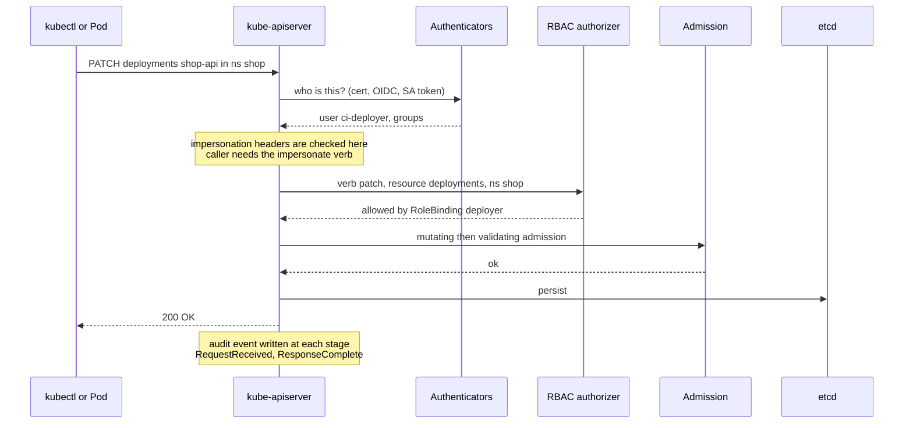
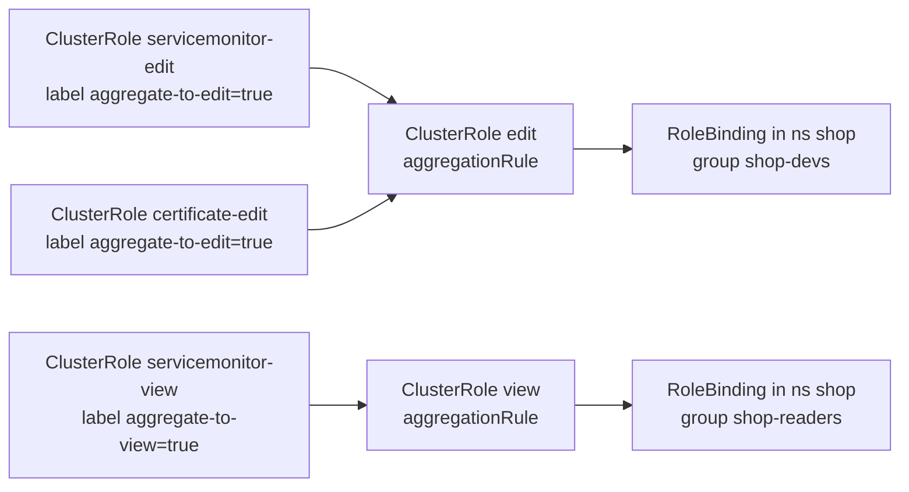

# L16.1 — RBAC in Depth

> **Level 16: Advanced Kubernetes** · Topic 1 of 10 · ⏱ ~5 hours · Difficulty: Advanced

## 1. What it is

You already know the four RBAC objects (Role, ClusterRole, RoleBinding, ClusterRoleBinding) from [RBAC](../level-08-kubernetes/18-rbac.md). This topic is about what happens when a cluster is shared by many teams, many CI pipelines and many controllers: how to design roles that stay **least-privilege**, how to compose them with **aggregated ClusterRoles**, how to **audit** who did what, how **impersonation** lets you test and delegate safely, and which permission combinations are **privilege escalations in disguise**.

The key mental model: RBAC is **additive and deny-by-default**, and the API server authorizes the *verb + resource + subresource + namespace + (optionally) resource name* of every request. Because there are no deny rules, the only way to be safe is to never grant a permission that quietly implies a bigger one.

## 2. Why it matters in DevOps

- **Most real cluster takeovers are RBAC over-grants,** not kernel exploits: a pipeline ServiceAccount that can `create pods` can run a pod that mounts the node's filesystem, and then it effectively owns the node.
- **`list secrets` is `get secrets`.** A role that can *list* Secrets in a namespace receives every Secret value in the response. Auditors find this constantly.
- **Platform teams need composable roles.** Writing one giant ClusterRole per team does not scale; aggregation lets each CRD (see [Custom Resource Definitions](05-custom-resource-definitions.md)) add its own permissions to the standard `view`/`edit`/`admin` roles.
- **You cannot answer "who did that?" without audit logs.** Without an audit policy, a deleted Deployment has no author.
- **Compliance:** SOC 2 and ISO 27001 reviews ask "who can read production Secrets?" and expect a query, not a guess.

## 3. Real-world system example

**Kubernetes' own built-in roles.** The default `view`, `edit` and `admin` ClusterRoles are not hand-maintained lists. They are **aggregated ClusterRoles**: each has an `aggregationRule` that selects other ClusterRoles carrying labels such as `rbac.authorization.k8s.io/aggregate-to-view: "true"`. When you install a CRD-based product (for example the Prometheus Operator or cert-manager), its manifests typically include small ClusterRoles with those aggregation labels so that anyone who already has `edit` in a namespace can also manage that product's custom resources, with no extra bindings. The controller-manager fills in the combined rules automatically.

**Managed clouds** map their own identity systems onto RBAC groups: Amazon EKS maps IAM principals to Kubernetes users/groups through access entries (the older `aws-auth` ConfigMap is being superseded), GKE combines IAM and RBAC, and AKS binds Microsoft Entra ID groups. The Kubernetes project's RBAC good-practices documentation lists the same escalation paths covered below (wildcards, `escalate`, `bind`, `impersonate`, access to Secrets, `pods/exec`, and `create pods`).

## 4. Diagram

How a request is judged, and where audit fits:



How aggregation composes roles:



## 5. How it works

### Designing least-privilege roles

| Dimension | Use it to narrow | Example |
|-----------|------------------|---------|
| `verbs` | Only what the task needs | `get`, `list`, `watch`, `patch` — not `*` |
| `resources` | Exact kinds | `deployments`, not `*` |
| `resourceNames` | Specific objects | `resourceNames: ["shop-api"]` for `patch` (works for `get`, `update`, `patch`, `delete`; **not** for `list`, `watch` or `create`) |
| Namespace | Role + RoleBinding, not ClusterRole + ClusterRoleBinding | the pipeline for `shop` gets a Role in `shop` only |
| Subresources | `pods/log` and `pods/exec` are separate | grant `pods/log`, withhold `pods/exec` |

Prefer **groups** (from OIDC or cloud IAM) over individual users in bindings, and bind **one reusable ClusterRole through many namespaced RoleBindings** instead of cloning Roles.

### Aggregated roles

A ClusterRole with `aggregationRule.clusterRoleSelectors` has its `rules` **overwritten** by the controller with the union of all matching ClusterRoles. Do not hand-edit `rules` on an aggregated role; create a small labelled ClusterRole instead.

### Impersonation

A caller with the `impersonate` verb on `users`, `groups`, `serviceaccounts` (or `userextras`) can act as someone else: `kubectl --as=jane --as-group=shop-devs get pods`. It is invaluable for **testing** a role ("what would this ServiceAccount see?") and for support tooling, and dangerous if granted broadly: `impersonate` on `groups` lets you become `system:masters` and so cluster-admin. Impersonated calls appear in audit logs with both the real and impersonated identity.

### Common escalations (permissions that imply more)

| Permission | Why it is dangerous |
|------------|---------------------|
| `create pods` (or any workload controller) in a namespace | Run a pod with any ServiceAccount in that namespace, mount Secrets, or (without [Pod Security](03-pod-security.md)) mount `hostPath` and take the node |
| `get/list/watch secrets` | Reads every Secret, including ServiceAccount tokens in older clusters and cloud credentials |
| `create serviceaccounts/token` | Mints tokens for any ServiceAccount in the namespace |
| `escalate` on `roles`/`clusterroles` | Lets you write a role with permissions you do not hold |
| `bind` on `roles`/`clusterroles` | Lets you create a binding to a role you do not hold (including `cluster-admin`) |
| `impersonate` | Become any user or group |
| `pods/exec`, `pods/attach`, `pods/portforward` | Shell inside workloads that hold credentials |
| `nodes/proxy` | Reaches the kubelet API, often a path to exec in any pod on the node |
| `create/patch` on admission webhook configurations | Intercept or break every API request ([Admission Controllers](06-admission-controllers-and-webhooks.md)) |
| Wildcards `*` in verbs, resources or API groups | Silently includes future resources and CRDs |

By default the API server **blocks privilege escalation through RBAC objects**: you can only create a role or binding if you already hold every permission it contains, unless you have `escalate`/`bind`. That protection is only as strong as who holds those two verbs.

### Audit

The API server can write an audit log following an **audit policy** file (levels `None`, `Metadata`, `Request`, `RequestResponse`). A good baseline: `Metadata` for Secrets and ConfigMaps (never log their bodies), `RequestResponse` for RBAC and webhook objects, `None` for noisy read-only system traffic. On managed clusters you enable audit logs through the provider (for example EKS control-plane logging to CloudWatch Logs), and you do not edit the policy yourself.

## 6. Step-by-step guide

**Prerequisites:** Docker, `kind`, `kubectl`, `jq`. Cost: none (local). Commands were written against a recent kind/kubectl; outputs below are illustrative ("similar to").

1. **Create a cluster with auditing enabled.** Save the policy first:
   ```bash
   mkdir -p ~/l16 && cd ~/l16
   cat > audit-policy.yaml <<'EOF'
   apiVersion: audit.k8s.io/v1
   kind: Policy
   omitStages: ["RequestReceived"]
   rules:
     - level: None
       users: ["system:kube-proxy"]
     - level: Metadata
       resources:
         - group: ""
           resources: ["secrets", "configmaps"]
     - level: RequestResponse
       resources:
         - group: "rbac.authorization.k8s.io"
         - group: "admissionregistration.k8s.io"
     - level: Metadata
   EOF
   cat > kind-audit.yaml <<'EOF'
   kind: Cluster
   apiVersion: kind.x-k8s.io/v1alpha4
   kubeadmConfigPatches:
     - |
       kind: ClusterConfiguration
       apiServer:
         extraArgs:
           audit-log-path: /var/log/kubernetes/audit.log
           audit-policy-file: /etc/kubernetes/policies/audit-policy.yaml
         extraVolumes:
           - name: audit-policies
             hostPath: /etc/kubernetes/policies
             mountPath: /etc/kubernetes/policies
             readOnly: true
             pathType: DirectoryOrCreate
           - name: audit-logs
             hostPath: /var/log/kubernetes
             mountPath: /var/log/kubernetes
             readOnly: false
             pathType: DirectoryOrCreate
   nodes:
     - role: control-plane
       extraMounts:
         - hostPath: ./audit-policy.yaml
           containerPath: /etc/kubernetes/policies/audit-policy.yaml
           readOnly: true
   EOF
   kind create cluster --name rbac-lab --config kind-audit.yaml
   ```
   Expect `Set kubectl context to "kind-rbac-lab"`. *Note:* newer kubeadm config versions express `extraArgs` as a list of `name`/`value` pairs; if kind reports a patch/schema error, consult the kind "Auditing" docs for the form matching your kind version.

2. **Create a namespace, a ServiceAccount and a least-privilege Role for a pipeline.**
   ```bash
   kubectl create namespace shop
   cat <<'EOF' | kubectl apply -f -
   apiVersion: v1
   kind: ServiceAccount
   metadata:
     name: ci-deployer
     namespace: shop
   ---
   apiVersion: rbac.authorization.k8s.io/v1
   kind: Role
   metadata:
     name: shop-api-deployer
     namespace: shop
   rules:
     - apiGroups: ["apps"]
       resources: ["deployments"]
       verbs: ["get", "list", "watch"]
     - apiGroups: ["apps"]
       resources: ["deployments"]
       resourceNames: ["shop-api"]
       verbs: ["update", "patch"]
     - apiGroups: [""]
       resources: ["pods", "pods/log"]
       verbs: ["get", "list", "watch"]
   ---
   apiVersion: rbac.authorization.k8s.io/v1
   kind: RoleBinding
   metadata:
     name: ci-deployer-binding
     namespace: shop
   subjects:
     - kind: ServiceAccount
       name: ci-deployer
       namespace: shop
   roleRef:
     apiGroup: rbac.authorization.k8s.io
     kind: Role
     name: shop-api-deployer
   EOF
   ```

3. **Test the role with `can-i` and impersonation.**
   ```bash
   SA=system:serviceaccount:shop:ci-deployer
   kubectl auth can-i patch deployments/shop-api -n shop --as=$SA     # yes
   kubectl auth can-i patch deployments/other    -n shop --as=$SA     # no
   kubectl auth can-i list secrets               -n shop --as=$SA     # no
   kubectl auth can-i create pods                -n shop --as=$SA     # no
   kubectl auth can-i --list -n shop --as=$SA
   ```
   Note that `resourceNames` limits `patch` to `shop-api`. `--list` prints a table of every verb the identity has in that namespace. Your own user (cluster-admin in kind) can impersonate; a normal user cannot unless granted `impersonate`.

4. **Build an aggregated role.** Create a role that aggregates everything labelled `shop-reader`, plus teach the built-in `view` about a custom resource:
   ```bash
   cat <<'EOF' | kubectl apply -f -
   apiVersion: rbac.authorization.k8s.io/v1
   kind: ClusterRole
   metadata:
     name: shop-reader
   aggregationRule:
     clusterRoleSelectors:
       - matchLabels:
           shop.example.com/aggregate-to-shop-reader: "true"
   rules: []
   ---
   apiVersion: rbac.authorization.k8s.io/v1
   kind: ClusterRole
   metadata:
     name: shop-reader-core
     labels:
       shop.example.com/aggregate-to-shop-reader: "true"
   rules:
     - apiGroups: ["", "apps"]
       resources: ["pods", "services", "deployments"]
       verbs: ["get", "list", "watch"]
   ---
   apiVersion: rbac.authorization.k8s.io/v1
   kind: ClusterRole
   metadata:
     name: shop-reader-extra
     labels:
       shop.example.com/aggregate-to-shop-reader: "true"
   rules:
     - apiGroups: ["autoscaling"]
       resources: ["horizontalpodautoscalers"]
       verbs: ["get", "list", "watch"]
   EOF
   kubectl get clusterrole shop-reader -o jsonpath='{.rules[*].resources}'
   ```
   Expect the union of both (`pods services deployments horizontalpodautoscalers` or similar). Add a third labelled ClusterRole and re-run: the rules update within seconds.

5. **Demonstrate the escalation guard, then the `escalate` bypass.** Let a user manage RoleBindings but not hold what they grant:
   ```bash
   cat <<'EOF' | kubectl apply -f -
   apiVersion: rbac.authorization.k8s.io/v1
   kind: Role
   metadata: {name: binding-admin, namespace: shop}
   rules:
     - apiGroups: ["rbac.authorization.k8s.io"]
       resources: ["rolebindings"]
       verbs: ["create", "get", "list"]
   ---
   apiVersion: rbac.authorization.k8s.io/v1
   kind: RoleBinding
   metadata: {name: binding-admin, namespace: shop}
   subjects: [{kind: User, name: mallory, apiGroup: rbac.authorization.k8s.io}]
   roleRef: {apiGroup: rbac.authorization.k8s.io, kind: Role, name: binding-admin}
   EOF
   kubectl create rolebinding grab-admin --clusterrole=admin --user=mallory -n shop --as=mallory
   ```
   Similar to: `forbidden: user "mallory" (groups=...) is attempting to grant RBAC permissions not currently held`. Mallory has `create rolebindings`, but the API server refuses because she lacks the `admin` permissions. Now add `{verbs: ["bind"], resources: ["clusterroles"], resourceNames: ["admin"], apiGroups: ["rbac.authorization.k8s.io"]}` to her role and the same command succeeds: `bind` is a deliberate escape hatch, so grant it rarely and always with `resourceNames`.

6. **Read the audit log.** Make some changes, then inspect the log inside the control-plane node:
   ```bash
   kubectl delete rolebinding grab-admin -n shop
   docker exec rbac-lab-control-plane sh -c 'tail -n 200 /var/log/kubernetes/audit.log' \
     | jq -c 'select(.objectRef.resource=="rolebindings") | {verb, user: .user.username, ns: .objectRef.namespace, name: .objectRef.name, code: .responseStatus.code}'
   ```
   You should see `create`/`delete` events on `rolebindings` with the acting user, including the `403` for Mallory's first attempt.

7. **Hunt for dangerous grants in a live cluster.**
   ```bash
   # who is bound to cluster-admin?
   kubectl get clusterrolebindings -o json | jq -r '.items[] | select(.roleRef.name=="cluster-admin") | .metadata.name + " -> " + ([.subjects[]? | .kind + "/" + .name] | join(","))'
   # which roles contain a wildcard verb or resource?
   kubectl get clusterroles,roles -A -o json | jq -r '.items[] | select(any(.rules[]?; (.verbs|index("*")) or (.resources|index("*")))) | .kind + " " + (.metadata.namespace // "-") + "/" + .metadata.name'
   ```
   In a fresh kind cluster expect only built-in `system:` roles and the `cluster-admin` binding for `system:masters` and kubeadm admins. Dedicated tools such as `kubectl-who-can`, `rbac-tool` and `rakkess` automate these queries.

8. **Clean up:** `kind delete cluster --name rbac-lab`.

## 7. Real-world scenario

*(Illustrative, not a documented incident.)* A `shop-api` team's CI pipeline used a ServiceAccount with a ClusterRole that granted `get, list, create, patch` on `*` resources in the `apps` and core API groups "so deploys never fail". A leaked CI token turned up in a public build log. The security team ran `kubectl auth can-i --list --as=system:serviceaccount:ci:deployer -n kube-system` and found the token could `list secrets` cluster-wide. They rotated the ServiceAccount token and replaced the ClusterRole with a namespaced Role limited to `deployments` (with `resourceNames`) in `shop`, added an audit rule recording RBAC changes at `RequestResponse`, and put a weekly job on the wildcard-hunting query from step 7. **Lesson:** convenience wildcards turn one leaked token into a cluster-wide incident; least privilege is cheap to apply on day one and expensive to retrofit.

## 8. Common mistakes and best practices

**Don't**

- Bind humans or pipelines to `cluster-admin` "temporarily". Temporary grants become permanent.
- Grant `list` or `watch` on Secrets to anything that does not need the values.
- Use `*` for verbs, resources or API groups.
- Hand out `escalate`, `bind` or `impersonate` without `resourceNames` limits and a documented reason.
- Edit the `rules` of an aggregated ClusterRole directly; the controller will overwrite your change.
- Rely on the default ServiceAccount in a namespace; pods get it automatically.

**Do**

- Start from zero and add verbs until the task works; verify with `kubectl auth can-i --as=...`.
- Use groups from your identity provider, and review bindings on a schedule.
- Disable token auto-mount (`automountServiceAccountToken: false`) on pods that never call the API.
- Turn on audit logging (control-plane logs on managed clusters) and alert on RBAC object changes and `cluster-admin` use.
- Keep roles in Git and review them as code (see [Policy as Code](../level-18-platform-engineering/07-policy-as-code.md)).

## 9. Tasks

- [ ] **T1 — Least-privilege pipeline role** *(≈30 min, beginner)*
  - **Goal:** give a ServiceAccount exactly the access a deploy needs.
  - **Steps:**
    1. Follow guide steps 1-3 to create `ci-deployer` and the `shop-api-deployer` Role.
    2. Run the four `can-i` checks and record yes/no for each.
  - **Done when:** `patch deployments/shop-api` is `yes`, while `patch deployments/other`, `list secrets` and `create pods` are all `no`.

- [ ] **T2 — Aggregate a role** *(≈30 min, intermediate)*
  - **Goal:** compose a role from labelled pieces.
  - **Steps:**
    1. Create `shop-reader` and the two labelled ClusterRoles from step 4.
    2. Add a third labelled ClusterRole granting `get, list, watch` on `networkpolicies` (group `networking.k8s.io`).
    3. Bind `shop-reader` to a group in `shop` with a RoleBinding and test with `--as=anna --as-group=shop-readers`.
  - **Done when:** `kubectl get clusterrole shop-reader -o yaml` shows networkpolicies in its rules and `kubectl auth can-i list networkpolicies -n shop --as=anna --as-group=shop-readers` prints `yes`.

- [ ] **T3 — Safe impersonation for support** *(≈30 min, intermediate)*
  - **Goal:** let a support identity impersonate only one ServiceAccount.
  - **Steps:**
    1. Create ServiceAccount `support-bot` in `shop`, plus a ClusterRole with verb `impersonate` on `serviceaccounts` with `resourceNames: ["ci-deployer"]`, bound to `support-bot` with a ClusterRoleBinding.
    2. Mint a token: `TOKEN=$(kubectl create token support-bot -n shop)`.
    3. Run `kubectl --token=$TOKEN get pods -n shop --as=system:serviceaccount:shop:ci-deployer` (should work), then the same with `--as=system:serviceaccount:shop:default` (should fail). Note that `impersonate` on serviceaccounts also needs the matching namespace to be allowed, which the ClusterRole grants cluster-wide for that one name.
    4. Find the impersonated call in the audit log (`.impersonatedUser`).
  - **Done when:** impersonating `ci-deployer` succeeds, impersonating any other ServiceAccount returns `forbidden`, and the audit event shows both `user.username` and `impersonatedUser.username`.

- [ ] **T4 — Break it: trigger and bypass the escalation guard** *(≈40 min, advanced)*
  - **Goal:** see exactly what `bind` and `escalate` change.
  - **Steps:**
    1. Reproduce step 5 and capture the `403` message.
    2. Add `bind` scoped to `resourceNames: ["admin"]`, retry and succeed.
    3. Remove the `bind` rule and confirm the RoleBinding can no longer be created.
  - **Done when:** you have the failing and succeeding commands plus an audit-log excerpt showing both, and you can explain why `bind` is safer with `resourceNames`.

- [ ] **T5 — Automate an RBAC audit** *(≈45 min, advanced)*
  - **Goal:** a script that flags risky grants.
  - **Steps:**
    1. Write a shell or Python script around the step 7 queries that also flags any role with `secrets` + `list`, `escalate`, `bind`, `impersonate`, or `pods/exec`.
    2. Run it against your kind cluster after creating one deliberately bad Role.
    3. Make it exit non-zero when findings exist so CI can run it.
  - **Done when:** the script exits `1` and names your bad Role, and exits `0` after you delete it.

- [ ] **T6 — Prove it: explain the takeover path** *(≈45 min, advanced)*
  - **Goal:** show a namespace-level permission becoming node-level control, and how to prevent it.
  - **Steps:**
    1. Without the guide, give a ServiceAccount only `create pods` in a namespace and write down (not necessarily run) the pod spec an attacker would use.
    2. Write the three controls that stop it: RBAC narrowing, Pod Security (`restricted`), and admission policy.
    3. Explain it to a teammate or in a one-page note.
  - **Done when:** your note names the permission, the abused feature (`hostPath`, privileged, other SA), and one concrete mitigation from each of the three layers.

## 10. Self-check questions

1. Why is granting `list` on Secrets as dangerous as granting `get`?
2. What do `escalate` and `bind` do, and why does RBAC refuse to let you create a role you could not already exercise?
3. Which RBAC verb on which resource lets a user become `system:masters`?
4. How does an aggregated ClusterRole get its rules, and why should you not edit them?
5. Why can `resourceNames` not restrict `list` or `create`?
6. What audit level should Secrets use, and why?

<details>
<summary>Answers</summary>

1. A list response includes the full objects, so every Secret value is returned.
2. They bypass the escalation check: `escalate` lets you write roles containing permissions you lack; `bind` lets you bind a role you lack. The default check stops a low-privileged user from granting themselves more.
3. `impersonate` on `groups` (or `users`), which lets the caller act as any group, including `system:masters`.
4. A controller replaces `rules` with the union of ClusterRoles matched by `clusterRoleSelectors`; manual edits are overwritten at the next sync.
5. At `list`/`create` time the request does not target a specific existing object name (a list covers many objects; the create has no name in the URL). Use `resourceNames` with `get`, `update`, `patch`, `delete`.
6. `Metadata`, so the log shows who touched which Secret without storing the secret value in the log.
</details>

## 11. Further reading

- Kubernetes documentation: *Using RBAC Authorization* and *Role Based Access Control Good Practices* (kubernetes.io/docs).
- Kubernetes documentation: *Auditing* and *User Impersonation*.
- *Kubernetes Security and Observability* by Brendan Creane and Amit Gupta (O'Reilly).
- Tools: `kubectl-who-can` (Aqua Security), `rbac-tool` (Insight Engineering), `rakkess`.
- Related topics: [Pod Security](03-pod-security.md), [Admission Controllers and Webhooks](06-admission-controllers-and-webhooks.md), [Least-privilege IAM](../level-11-security-devsecops/02-least-privilege-iam.md).

<!-- nav -->
---
← Previous level: [Level 15 — Disaster Recovery](../level-15-disaster-recovery/README.md) · [Level 16 index](README.md) · Next: [NetworkPolicies in Depth](02-networkpolicies-in-depth.md) →
