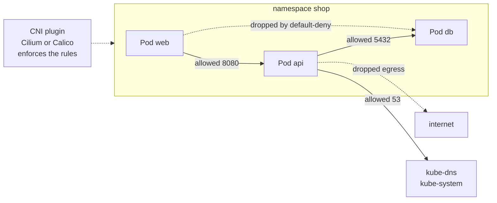
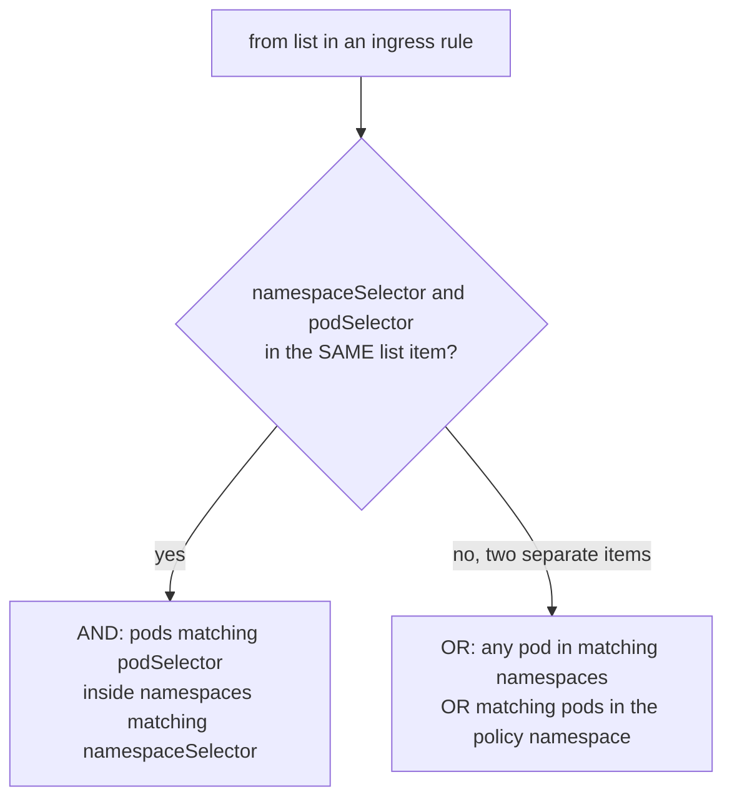

# L16.2 — NetworkPolicies in Depth

> **Level 16: Advanced Kubernetes** · Topic 2 of 10 · ⏱ ~5 hours · Difficulty: Advanced

## 1. What it is

By default every Pod in a Kubernetes cluster can open a connection to every other Pod, in every namespace, and out to the internet. A **NetworkPolicy** is a namespaced object that selects a set of Pods and declares which **ingress** (incoming) and **egress** (outgoing) traffic is allowed for them. The moment *any* policy selects a Pod for a direction, that direction flips from "allow all" to "deny everything except what some policy allows". Policies are **additive**: there are no deny rules, only allows, and the union of all policies selecting a Pod is what is permitted.

Crucially, a NetworkPolicy is only an API object. **Enforcement is done by the CNI plugin** (Container Network Interface, the networking plugin). If your CNI does not implement NetworkPolicy, the objects are accepted and silently do nothing. This topic covers the **default-deny patterns**, **egress control** (including DNS and the internet), the **richer policy languages of Cilium and Calico**, and how to **test** policies instead of trusting them. You met the basics in [NetworkPolicies](../level-08-kubernetes/19-networkpolicies.md).

## 2. Why it matters in DevOps

- **Lateral movement.** In a flat network, one compromised front-end Pod can reach the database, the metadata service and other teams' workloads. Default-deny shrinks the blast radius.
- **Compliance.** PCI DSS-style segmentation requirements are usually answered with namespace-level default-deny plus explicit allows.
- **Silent failure.** A policy on a CNI that does not enforce it gives *false confidence*; an over-tight policy that forgets DNS gives 3 a.m. "everything times out" incidents.
- **Egress is the exfiltration path.** Most teams only restrict ingress; attackers and malware need egress to call home. See [Cloud Security Groups and Policies](../level-11-security-devsecops/03-cloud-security-groups-and-policies.md) for the same layered idea at the VPC level.

## 3. Real-world system example

**Cilium and Calico, the two most widely deployed policy-capable CNIs.** Both are open source CNCF-hosted or CNCF-adjacent projects used on managed and self-managed clusters (Amazon EKS documents installing Calico or Cilium for network policy; GKE's "Dataplane V2" is built on Cilium and enforces NetworkPolicy; AKS offers Azure Network Policy, Calico and Cilium options). Cilium uses eBPF (extended Berkeley Packet Filter, in-kernel programmable hooks) to enforce policy by *workload identity* derived from labels, adds its own `CiliumNetworkPolicy` with L7 (HTTP) rules and DNS-name (FQDN) egress rules, and ships **Hubble** for observing allowed and dropped flows. Calico enforces with iptables or eBPF and adds `GlobalNetworkPolicy` for cluster-wide rules and ordered, deny-capable policies. The Kubernetes SIG Network is also developing cluster-scoped `AdminNetworkPolicy` and `BaselineAdminNetworkPolicy` APIs (still maturing, so check your cluster's version before relying on them) for platform teams to set rules that namespace owners cannot override.

## 4. Diagram

How a policy decision is made and where it is enforced:



The rule that surprises everyone, AND versus OR inside `from`:



## 5. How it works

### Anatomy

```yaml
spec:
  podSelector: {}            # {} = every Pod in this namespace
  policyTypes: [Ingress, Egress]
  ingress:
    - from: [ ... ]          # peers: podSelector, namespaceSelector, ipBlock
      ports: [ ... ]         # protocol + port (or port + endPort range)
  egress:
    - to: [ ... ]
      ports: [ ... ]
```

- **Empty `podSelector`** selects all Pods; **empty rule list** with a `policyTypes` entry means "allow nothing" for that direction.
- **Peers** are `podSelector`, `namespaceSelector` (use the automatic label `kubernetes.io/metadata.name: <ns>`), or `ipBlock` (CIDR with optional `except`). There are no hostname peers in the standard API.
- **Policies are stateful:** reply packets for an allowed connection are allowed automatically.
- **Both ends must agree:** traffic from A to B must be allowed by egress on A (if A is egress-restricted) **and** ingress on B (if B is ingress-restricted).
- NetworkPolicy does not apply to traffic from a Pod to its own node's host network in a consistent way across CNIs, and cannot filter traffic to the node's own kubelet/IMDS reliably; use cloud-level controls (for example blocking the instance metadata address `169.254.169.254` via `ipBlock except`, plus IMDSv2 hop limit) for that.

### The default-deny pattern

1. Apply a `default-deny-all` policy (ingress and egress) to every application namespace.
2. Immediately add `allow-dns` egress (otherwise service names stop resolving).
3. Add one small allow policy per real flow: ingress controller to web, web to api, api to db, api to the allowed external CIDRs.

### Egress control

| Need | Standard NetworkPolicy | Cilium / Calico |
|------|------------------------|-----------------|
| Allow DNS | egress to `kube-dns` on 53 UDP and TCP | same |
| Allow a CIDR (e.g. a payment provider range) | `ipBlock` | same |
| Allow `api.stripe.com` by name | not possible (IPs change) | `toFQDNs` (Cilium), domain-based rules in Calico (feature availability depends on edition and version) |
| Allow only `GET /health` | not possible | `CiliumNetworkPolicy` L7 HTTP rules |
| Cluster-wide baseline | repeat in every namespace | `CiliumClusterwideNetworkPolicy`, Calico `GlobalNetworkPolicy` |
| Explicit deny rules, ordering | no | Calico and Cilium (deny policies) |

### Policy testing

| Method | What it tells you |
|--------|-------------------|
| `kubectl run` a throwaway client and `wget`/`curl` with a short timeout | End-to-end allowed or dropped, from a chosen label set |
| Hubble (`hubble observe --verdict DROPPED`) | Which flow was dropped and by which policy (Cilium) |
| `cilium connectivity test` | Built-in conformance run for Cilium |
| Static analysis in CI (for example, NetworkPolicy analyzers and `kubectl` dry-runs) | Catches "policy selects nothing" and overly permissive rules before merge |
| Calico flow logs / policy audit mode | Shows what *would* be denied before you enforce |

## 6. Step-by-step guide

**Prerequisites:** Docker, `kind`, `kubectl`, the `cilium` CLI (and optionally the `hubble` CLI). Cost: none. Outputs are illustrative.

1. **Create a kind cluster with no default CNI** (kind's default CNI does not provide the richer features used here, so we install Cilium):
   ```bash
   cat > kind-cni.yaml <<'EOF'
   kind: Cluster
   apiVersion: kind.x-k8s.io/v1alpha4
   networking:
     disableDefaultCNI: true
   nodes:
     - role: control-plane
     - role: worker
   EOF
   kind create cluster --name netpol-lab --config kind-cni.yaml
   kubectl get nodes     # NotReady until a CNI is installed
   ```

2. **Install Cilium and wait for it.**
   ```bash
   cilium install
   cilium status --wait
   kubectl get nodes     # now Ready
   ```
   Expect `Cilium: OK` and `Operator: OK`. (Calico is an equally valid choice; its install uses the Tigera operator manifests from the Calico docs.)

3. **Deploy the stand-in `shop` workloads.** We use an unprivileged nginx listening on 8080 as a stand-in for web, api and db (in real life the db would be PostgreSQL on 5432):
   ```bash
   kubectl create namespace shop
   for app in web api db; do
   cat <<EOF | kubectl apply -n shop -f -
   apiVersion: apps/v1
   kind: Deployment
   metadata: {name: $app}
   spec:
     replicas: 1
     selector: {matchLabels: {app: $app}}
     template:
       metadata: {labels: {app: $app}}
       spec:
         containers:
           - name: $app
             image: nginxinc/nginx-unprivileged:1.27-alpine
             ports: [{containerPort: 8080}]
   ---
   apiVersion: v1
   kind: Service
   metadata: {name: $app}
   spec:
     selector: {app: $app}
     ports: [{port: 8080, targetPort: 8080}]
   EOF
   done
   kubectl -n shop rollout status deploy/web deploy/api deploy/db 2>/dev/null || kubectl -n shop get pods
   ```

4. **Prove the network is flat first.**
   ```bash
   kubectl -n shop run probe --rm -it --restart=Never --image=busybox:1.36 --labels=app=probe -- \
     wget -qO- -T 3 http://db:8080 | head -3
   ```
   You get the nginx welcome HTML. Everything can reach everything.

5. **Apply default-deny and watch things break.**
   ```bash
   cat <<'EOF' | kubectl apply -f -
   apiVersion: networking.k8s.io/v1
   kind: NetworkPolicy
   metadata:
     name: default-deny-all
     namespace: shop
   spec:
     podSelector: {}
     policyTypes: [Ingress, Egress]
   EOF
   kubectl -n shop run probe --rm -it --restart=Never --image=busybox:1.36 -- wget -qO- -T 3 http://db:8080
   ```
   Similar to `wget: bad address 'db'` (DNS egress blocked) — the classic first failure.

6. **Allow DNS egress, then the real flows.**
   ```bash
   cat <<'EOF' | kubectl apply -f -
   apiVersion: networking.k8s.io/v1
   kind: NetworkPolicy
   metadata: {name: allow-dns, namespace: shop}
   spec:
     podSelector: {}
     policyTypes: [Egress]
     egress:
       - to:
           - namespaceSelector:
               matchLabels: {kubernetes.io/metadata.name: kube-system}
             podSelector:
               matchLabels: {k8s-app: kube-dns}
         ports:
           - {protocol: UDP, port: 53}
           - {protocol: TCP, port: 53}
   ---
   apiVersion: networking.k8s.io/v1
   kind: NetworkPolicy
   metadata: {name: web-to-api, namespace: shop}
   spec:
     podSelector: {matchLabels: {app: api}}
     policyTypes: [Ingress]
     ingress:
       - from: [{podSelector: {matchLabels: {app: web}}}]
         ports: [{protocol: TCP, port: 8080}]
   ---
   apiVersion: networking.k8s.io/v1
   kind: NetworkPolicy
   metadata: {name: web-egress-to-api, namespace: shop}
   spec:
     podSelector: {matchLabels: {app: web}}
     policyTypes: [Egress]
     egress:
       - to: [{podSelector: {matchLabels: {app: api}}}]
         ports: [{protocol: TCP, port: 8080}]
   ---
   apiVersion: networking.k8s.io/v1
   kind: NetworkPolicy
   metadata: {name: api-to-db, namespace: shop}
   spec:
     podSelector: {matchLabels: {app: db}}
     policyTypes: [Ingress]
     ingress:
       - from: [{podSelector: {matchLabels: {app: api}}}]
         ports: [{protocol: TCP, port: 8080}]
   ---
   apiVersion: networking.k8s.io/v1
   kind: NetworkPolicy
   metadata: {name: api-egress-to-db, namespace: shop}
   spec:
     podSelector: {matchLabels: {app: api}}
     policyTypes: [Egress]
     egress:
       - to: [{podSelector: {matchLabels: {app: db}}}]
         ports: [{protocol: TCP, port: 8080}]
   EOF
   ```

7. **Test allowed and denied paths from the right identities.**
   ```bash
   # allowed: web -> api
   kubectl -n shop exec deploy/web -- wget -qO- -T 3 http://api:8080 | head -2
   # denied: web -> db (no policy allows it)
   kubectl -n shop exec deploy/web -- wget -qO- -T 3 http://db:8080 ; echo "exit=$?"
   # allowed: api -> db
   kubectl -n shop exec deploy/api -- wget -qO- -T 3 http://db:8080 | head -2
   ```
   The first and third print HTML; the second times out (`wget: download timed out`, `exit=1`). `nginx-unprivileged` images include BusyBox `wget`; if yours lacks it, use a probe pod with matching labels instead.

8. **Observe drops with Hubble (Cilium).**
   ```bash
   cilium hubble enable
   cilium status --wait
   cilium hubble port-forward &
   hubble observe --namespace shop --verdict DROPPED --last 10
   ```
   Similar to `shop/web:41234 (ID:...) <> shop/db:8080 (ID:...) Policy denied DROPPED (TCP Flags: SYN)`.

9. **Add an egress rule with a CIDR and a Cilium FQDN rule.** Standard API, with the metadata address excluded:
   ```yaml
   # api may call a payment provider's documented range, but never the IMDS address
   apiVersion: networking.k8s.io/v1
   kind: NetworkPolicy
   metadata: {name: api-egress-payments, namespace: shop}
   spec:
     podSelector: {matchLabels: {app: api}}
     policyTypes: [Egress]
     egress:
       - to:
           - ipBlock:
               cidr: 203.0.113.0/24
               except: [203.0.113.99/32]
         ports: [{protocol: TCP, port: 443}]
   ```
   And the name-based version, which only Cilium understands:
   ```yaml
   apiVersion: cilium.io/v2
   kind: CiliumNetworkPolicy
   metadata: {name: api-egress-fqdn, namespace: shop}
   spec:
     endpointSelector: {matchLabels: {app: api}}
     egress:
       - toEndpoints:
           - matchLabels:
               io.kubernetes.pod.namespace: kube-system
               k8s-app: kube-dns
         toPorts:
           - ports: [{port: "53", protocol: ANY}]
             rules:
               dns: [{matchPattern: "*"}]
       - toFQDNs: [{matchName: "api.payments.example.com"}]
         toPorts: [{ports: [{port: "443", protocol: TCP}]}]
   ```
   The DNS rule is required so Cilium can observe lookups and learn the IPs behind the name.

10. **Clean up:** `kind delete cluster --name netpol-lab`.

## 7. Real-world scenario

*(Illustrative.)* After a security review the `shop-api` team enabled default-deny in the `shop` namespace on a Friday. Within minutes the checkout page returned 502s: the web Pod could not resolve `api`. Investigation: `kubectl exec` into web, `nslookup api` timed out; the cluster CNI was enforcing, `allow-dns` had been left out of the change. They applied the DNS policy and the site recovered in two minutes. The post-incident fixes were to ship `default-deny-all` and `allow-dns` as **one** kustomize base so they can never be applied separately, to test every policy change in staging with a probe-pod script from this topic, and to alert on Hubble drop spikes. **Lesson:** default-deny is correct, but it must be rolled out with DNS and a test.

## 8. Common mistakes and best practices

**Don't**

- Assume policies work: verify that your CNI enforces NetworkPolicy by testing a deny.
- Forget DNS egress (UDP *and* TCP 53) when you restrict egress.
- Mix up AND/OR in `from`/`to`: a `namespaceSelector` and `podSelector` in the same list item is AND; in separate items it is OR.
- Use `0.0.0.0/0` egress "just for now", or leave the instance metadata address reachable from workloads.
- Write policies keyed to labels that anyone can change (a developer who can relabel a Pod can change which policy applies; restrict who can patch Pods).

**Do**

- Start every namespace with `default-deny-all` plus `allow-dns`, then add one policy per flow with a descriptive name (`web-to-api`).
- Select peers by labels you control and use `kubernetes.io/metadata.name` to select namespaces.
- Test allow *and* deny paths in CI, and watch drops in Hubble or flow logs.
- Use FQDN or cluster-wide policy features (Cilium/Calico) for egress to SaaS APIs and for platform-owned baselines.
- Combine with [Pod Security](03-pod-security.md) and a service mesh for mTLS (see [Service Mesh](09-service-mesh-istio-linkerd.md)); NetworkPolicy is L3/L4, a mesh adds identity and L7.

## 9. Tasks

- [ ] **T1 — Show the flat network, then end it** *(≈30 min, beginner)*
  - **Goal:** prove default-deny changes behaviour.
  - **Steps:**
    1. Build the lab (guide steps 1-3).
    2. Show `web` reaching `db` with `wget`.
    3. Apply `default-deny-all` and repeat.
  - **Done when:** the same `wget` succeeds before and fails (`bad address` or timeout) after, and you can say why.

- [ ] **T2 — Rebuild the allowed paths** *(≈40 min, intermediate)*
  - **Goal:** least-privilege flows only.
  - **Steps:**
    1. Apply `allow-dns`, `web-to-api`, `web-egress-to-api`, `api-to-db`, `api-egress-to-db` from step 6.
    2. Run the three tests in step 7.
  - **Done when:** web to api and api to db succeed, web to db times out.

- [ ] **T3 — Allow the ingress controller and Prometheus** *(≈40 min, intermediate)*
  - **Goal:** add cross-namespace allows correctly.
  - **Steps:**
    1. Create a namespace `monitoring` with a probe Pod labelled `app=prometheus`.
    2. Write an ingress policy on `api` allowing TCP 8080 only from Pods labelled `app=prometheus` **in** `monitoring` (namespaceSelector AND podSelector in one item).
    3. Test from a Pod with the same label in another namespace and confirm it is denied.
  - **Done when:** the monitoring probe connects and the look-alike in another namespace does not.

- [ ] **T4 — Break it: the OR trap** *(≈30 min, advanced)*
  - **Goal:** experience the AND/OR mistake.
  - **Steps:**
    1. Rewrite the T3 policy with `namespaceSelector` and `podSelector` as two separate list items.
    2. Re-run the look-alike test and capture what is now allowed.
    3. Fix it and write one sentence on the YAML difference (a single leading `-`).
  - **Done when:** you have a failing-test and a passing-test transcript and the corrected manifest.

- [ ] **T5 — Observe and automate** *(≈60 min, advanced)*
  - **Goal:** turn manual probing into a repeatable test.
  - **Steps:**
    1. Write a script `netpol-test.sh` with a table of `source-label, destination, expected` rows that runs `kubectl exec ... wget -T 3` and compares the result.
    2. Use `hubble observe --verdict DROPPED` to confirm drops appear for the expected-deny rows.
    3. Make the script exit non-zero on any mismatch and add it to a GitHub Actions workflow that runs against a kind cluster (see [GitHub Actions Workflows](../level-03-git-and-github/11-github-actions-workflows.md)).
  - **Done when:** the script passes on your policies and fails when you delete `api-to-db`.

- [ ] **T6 — Prove it: egress lockdown design** *(≈45 min, advanced)*
  - **Goal:** design, from scratch and without the guide, egress control for `shop-api`.
  - **Steps:**
    1. List every external dependency (DNS, a payments API, package mirrors, IMDS) and decide how each is allowed or blocked.
    2. Write the policies (standard and Cilium FQDN versions where needed).
    3. Explain to a teammate why AND/OR matters, why DNS is needed, and what NetworkPolicy cannot do.
  - **Done when:** the policies apply cleanly, the allowed calls work, a call to an unlisted address fails, and your explanation covers all three points.

## 10. Self-check questions

1. What happens to a Pod's egress when a policy with `policyTypes: [Egress]` and no `egress` rules selects it?
2. Why can a NetworkPolicy be applied to a cluster and do nothing?
3. How do you allow traffic from Pods labelled `app=prometheus` in the `monitoring` namespace only?
4. Why can standard NetworkPolicy not allow "api.stripe.com", and what are your options?
5. A policy allows A to B on the B side, but A is egress-restricted with no rule to B. Does traffic flow?
6. Name two ways to test that a deny actually works.

<details>
<summary>Answers</summary>

1. All egress is denied, including DNS.
2. Enforcement belongs to the CNI plugin; if it does not implement NetworkPolicy the objects are ignored.
3. One `from` item containing both `namespaceSelector` (`kubernetes.io/metadata.name: monitoring`) and `podSelector` (`app: prometheus`).
4. The API only supports IP-based peers. Use a CNI feature such as Cilium `toFQDNs` or Calico domain rules, an egress proxy/gateway, or a cloud firewall.
5. No. Both the egress on A and the ingress on B must allow it.
6. A probe Pod with a short-timeout `wget`/`curl` from the denied identity, and Hubble or flow logs showing a `DROPPED` verdict (also `cilium connectivity test`, policy audit mode, or CI analyzers).
</details>

## 11. Further reading

- Kubernetes documentation: *Network Policies* (kubernetes.io/docs/concepts/services-networking/network-policies).
- Cilium documentation: *Network Policy*, *Hubble* and *DNS-based policies*.
- Calico documentation: *Network policy* and *Global network policy*.
- Kubernetes Network Policy API working group material on `AdminNetworkPolicy` (network-policy-api.sigs.k8s.io).
- Related: [Admission Controllers and Webhooks](06-admission-controllers-and-webhooks.md) for enforcing "every namespace must have a default-deny", and [mTLS](../level-12-advanced-networking/12-mtls.md).

<!-- nav -->
---
← Previous: [RBAC in Depth](01-rbac-in-depth.md) · [Level 16 index](README.md) · Next: [Pod Security](03-pod-security.md) →
