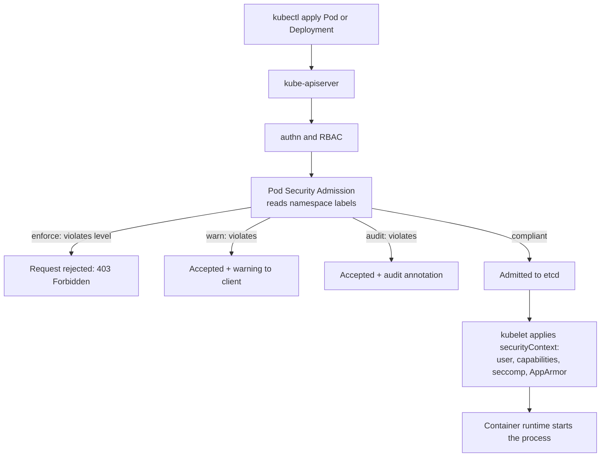
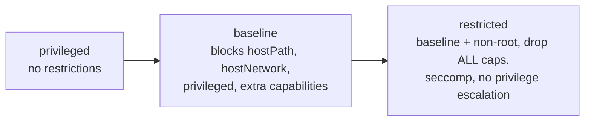

# L16.3 — Pod Security

> **Level 16: Advanced Kubernetes** · Topic 3 of 10 · ⏱ ~5 hours · Difficulty: Advanced

## 1. What it is

A container is "just a process", and a Pod spec decides how much power that process gets over the node: may it run as root, gain extra Linux capabilities, mount the host's filesystem, share the host network, or call any system call? **Pod security** is the set of controls that constrain this.

There are two layers:

1. **Per-workload hardening with `securityContext`** — fields in the Pod and container spec (`runAsNonRoot`, `allowPrivilegeEscalation: false`, `capabilities.drop`, `seccompProfile`, `appArmorProfile`, `readOnlyRootFilesystem`) that you set so the process runs with minimum power.
2. **Cluster-level enforcement with Pod Security Admission (PSA)** — a built-in admission controller that checks every Pod against one of three **Pod Security Standards (PSS)**: `privileged` (unrestricted), `baseline` (blocks known privilege escalations) and `restricted` (current hardening best practice). You turn it on per namespace with labels.

**PodSecurityPolicy (PSP) was removed in Kubernetes 1.25.** If you read an old tutorial that creates a `PodSecurityPolicy`, skip it: use PSA for the built-in standards, and use [ValidatingAdmissionPolicy, Kyverno or Gatekeeper](06-admission-controllers-and-webhooks.md) for anything custom.

## 2. Why it matters in DevOps

- **Container escape is the path from "one bug" to "whole node".** Privileged containers, `hostPath` mounts, `hostPID` and added capabilities such as `SYS_ADMIN` are how a compromised application becomes a compromised node and then a compromised cluster (see how RBAC `create pods` feeds into this in [RBAC in Depth](01-rbac-in-depth.md)).
- **Root in a container is risky by default.** The first line of defence is to not run as root ([Non-root Containers](../level-04-docker/11-non-root-containers.md), [Rootless and Minimal Containers](../level-11-security-devsecops/12-rootless-and-minimal-containers.md)).
- **Benchmarks and audits expect it.** The CIS Kubernetes Benchmark and most compliance frameworks ask for a pod-level security control on every namespace.
- **Retrofitting is painful.** Turning on `restricted` in a namespace full of root-running images breaks deployments; the `warn`/`audit` modes exist so you can find that out safely first.

## 3. Real-world system example

**Kubernetes itself and the managed distributions.** The Pod Security Standards are defined in the Kubernetes docs, and PSA has been a built-in admission plugin since it went beta in v1.23 and stable in v1.25 as the PSP replacement. Many popular Helm charts and operators (for example cert-manager, the Prometheus stack and ingress controllers) document or ship `securityContext` defaults that satisfy `restricted`, with node-level agents such as CNI plugins and node exporters being the typical workloads that need `privileged` or `baseline` and therefore live in separately labelled namespaces (the `kube-system` namespace is normally exempted or left `privileged`). Kubernetes' own `kind`, `minikube` and managed clusters ship with PSA enabled and, by default, enforce nothing: namespaces without labels behave as `privileged`. Cloud providers publish hardening guides (for example the EKS best-practices guide and GKE hardening guide) that recommend `restricted`/`baseline` on application namespaces, seccomp `RuntimeDefault` and non-root users.

## 4. Diagram



The three levels, nested:



## 5. How it works

### Pod Security Standards

| Level | Intent | Representative rules |
|-------|--------|----------------------|
| `privileged` | Unrestricted; for system and infrastructure workloads | Anything goes |
| `baseline` | Prevent *known* privilege escalations; easy to adopt | No `privileged: true`; no `hostNetwork`, `hostPID`, `hostIPC`; no `hostPath` volumes; no host ports; only a default capability set; no custom AppArmor or SELinux types; limited `sysctls` |
| `restricted` | Heavily restricted, hardening best practice | Everything in baseline, plus `allowPrivilegeEscalation: false`, `runAsNonRoot: true` (and no UID 0), `capabilities.drop: [ALL]` (adding back only `NET_BIND_SERVICE`), `seccompProfile` of `RuntimeDefault` or `Localhost`, and only a limited set of volume types |

### Pod Security Admission labels

Applied to a **namespace**, with three **modes** and an optional version pin:

```yaml
metadata:
  labels:
    pod-security.kubernetes.io/enforce: restricted
    pod-security.kubernetes.io/enforce-version: latest   # or v1.xx to pin
    pod-security.kubernetes.io/warn: restricted
    pod-security.kubernetes.io/audit: restricted
```

| Mode | Effect on violation |
|------|---------------------|
| `enforce` | Pod is **rejected** |
| `warn` | Pod accepted; the user sees a warning from `kubectl` (also applies to Deployments, Jobs and other Pod templates) |
| `audit` | Pod accepted; a violation annotation is added to the audit log event |

Important details:

- `enforce` only evaluates **Pods** (and checks updates that change security fields). Creating a Deployment succeeds, and the failure shows up as the ReplicaSet being unable to create Pods (`kubectl describe rs`). `warn` and `audit` do evaluate Pod templates in workload resources.
- Namespaces can be **exempted** (users, runtime classes, namespaces) and given **cluster-wide defaults** through an `AdmissionConfiguration` for the `PodSecurity` plugin, but managed control planes such as EKS and GKE generally do not let you edit it, so rely on namespace labels there.
- A safe rollout recipe: set `warn` and `audit` to `restricted` first, read the output for a week, fix the workloads, then switch on `enforce`.

### `securityContext` essentials

```yaml
spec:
  securityContext:                  # pod level
    runAsNonRoot: true
    runAsUser: 10001
    runAsGroup: 10001
    fsGroup: 10001                  # group ownership for mounted volumes
    seccompProfile: {type: RuntimeDefault}
  containers:
    - name: api
      securityContext:              # container level
        allowPrivilegeEscalation: false
        readOnlyRootFilesystem: true
        capabilities: {drop: ["ALL"]}
```

- **Seccomp** (secure computing mode) filters which system calls the process may make. `RuntimeDefault` applies the container runtime's default profile (containerd, CRI-O), blocking many rarely-needed, dangerous calls with low compatibility risk. `Localhost` loads a custom profile from the node (`/var/lib/kubelet/seccomp/...`). `Unconfined` disables it and is rejected by `baseline` and `restricted`. Older clusters needed a kubelet `--seccomp-default` flag to make `RuntimeDefault` the default; setting it in the manifest works everywhere.
- **AppArmor** is a Linux Security Module (LSM) that confines programs by path-based profiles. On current Kubernetes it is set with `securityContext.appArmorProfile.type: RuntimeDefault | Localhost | Unconfined` (stable in v1.30; older clusters used the annotation `container.apparmor.security.beta.kubernetes.io/<container>`). It only works on nodes whose OS has AppArmor enabled (Ubuntu and Debian yes, many other distributions use **SELinux** instead, configured through `seLinuxOptions`).
- **`readOnlyRootFilesystem: true`** is not required by `restricted` but is a strong, cheap addition; mount an `emptyDir` at paths the app must write (`/tmp`).
- **User namespaces** (`hostUsers: false` in the Pod spec) map container root to an unprivileged host UID on runtimes and kernels that support it; check your Kubernetes version for its feature status before depending on it.

## 6. Step-by-step guide

**Prerequisites:** Docker, `kind`, `kubectl`. Cost: none. Outputs are illustrative ("similar to").

1. **Create a cluster and a namespace in `warn` + `audit` mode.**
   ```bash
   kind create cluster --name pss-lab
   kubectl create namespace shop
   kubectl label namespace shop \
     pod-security.kubernetes.io/warn=restricted \
     pod-security.kubernetes.io/audit=restricted
   ```

2. **Deploy a typical "naive" workload and read the warnings.**
   ```bash
   kubectl -n shop create deployment web --image=nginx:1.27
   ```
   Similar to:
   ```text
   Warning: would violate PodSecurity "restricted:latest": allowPrivilegeEscalation != false (container "nginx" must set securityContext.allowPrivilegeEscalation=false), unrestricted capabilities (container "nginx" must set securityContext.capabilities.drop=["ALL"]), runAsNonRoot != true (pod or container "nginx" must set securityContext.runAsNonRoot=true), seccompProfile (pod or container "nginx" must set securityContext.seccompProfile.type to "RuntimeDefault" or "Localhost")
   deployment.apps/web created
   ```
   The Deployment was *created* (warn mode); the warning is your to-do list.

3. **Dry-run the effect of `enforce` before turning it on.** The server evaluates all existing Pods in the namespace:
   ```bash
   kubectl label --dry-run=server --overwrite namespace shop \
     pod-security.kubernetes.io/enforce=restricted
   ```
   You get the same warnings for each existing Pod that would be rejected on re-creation; nothing is changed.

4. **Fix the workload so it meets `restricted`.** The stock `nginx` image runs as root and listens on 80, so use the unprivileged image:
   ```bash
   cat <<'EOF' | kubectl apply -n shop -f -
   apiVersion: apps/v1
   kind: Deployment
   metadata: {name: web}
   spec:
     replicas: 1
     selector: {matchLabels: {app: web}}
     template:
       metadata: {labels: {app: web}}
       spec:
         securityContext:
           runAsNonRoot: true
           runAsUser: 101
           seccompProfile: {type: RuntimeDefault}
         containers:
           - name: web
             image: nginxinc/nginx-unprivileged:1.27-alpine
             ports: [{containerPort: 8080}]
             securityContext:
               allowPrivilegeEscalation: false
               readOnlyRootFilesystem: true
               capabilities: {drop: ["ALL"]}
             volumeMounts:
               - {name: tmp, mountPath: /tmp}
         volumes:
           - {name: tmp, emptyDir: {}}
   EOF
   kubectl -n shop rollout status deploy/web
   ```
   No warning this time. (The nginx-unprivileged image also needs writable cache/pid paths; if the Pod crash-loops with a read-only error, check `kubectl logs` and add an `emptyDir` for the path named, or temporarily drop `readOnlyRootFilesystem`.)

5. **Turn on `enforce` and try to sneak a bad Pod in.**
   ```bash
   kubectl label --overwrite namespace shop pod-security.kubernetes.io/enforce=restricted
   cat <<'EOF' | kubectl apply -n shop -f -
   apiVersion: v1
   kind: Pod
   metadata: {name: bad}
   spec:
     hostNetwork: true
     containers:
       - name: c
         image: busybox:1.36
         command: ["sleep", "3600"]
         securityContext: {privileged: true}
         volumeMounts: [{name: host, mountPath: /host}]
     volumes:
       - name: host
         hostPath: {path: /}
   EOF
   ```
   Similar to: `Error from server (Forbidden): error when creating "STDIN": pods "bad" is forbidden: violates PodSecurity "restricted:latest": host namespaces (hostNetwork=true), privileged (container "c" must not set securityContext.privileged=true), hostPath volumes (volume "host"), ...`.

6. **See the Deployment-versus-Pod subtlety.** Create a violating Deployment under `enforce`:
   ```bash
   kubectl -n shop create deployment naive --image=nginx:1.27
   kubectl -n shop get deploy naive            # READY 0/1
   kubectl -n shop describe rs -l app=naive | grep -A2 -i "forbidden"
   ```
   The Deployment exists but its ReplicaSet reports `FailedCreate ... violates PodSecurity`. Monitoring should alert on ReplicaSets that cannot create Pods.

7. **Check what the runtime actually applied.** Confirm seccomp and the user:
   ```bash
   kubectl -n shop get pod -l app=web -o jsonpath='{.items[0].spec.securityContext}{"\n"}'
   kubectl -n shop exec deploy/web -- id
   kubectl -n shop exec deploy/web -- grep -E 'Seccomp|CapEff|NoNewPrivs' /proc/1/status
   ```
   Expect `uid=101`, `Seccomp: 2` (filter mode), `CapEff: 0000000000000000` and `NoNewPrivs: 1`.

8. **Optional: AppArmor.** On a node/VM where AppArmor is enabled (for example an Ubuntu host with a multi-node kind cluster, not Docker Desktop), add this to the container's `securityContext` and verify with `kubectl exec ... cat /proc/1/attr/current`:
   ```yaml
   appArmorProfile:
     type: RuntimeDefault
   ```
   If the node cannot enforce AppArmor the Pod may fail to start; that is correct behaviour for a profile you asked for.

9. **Clean up:** `kind delete cluster --name pss-lab`.

## 7. Real-world scenario

*(Illustrative.)* A platform team rolled out PSA `restricted` on all team namespaces after an audit finding. They started with `warn` and `audit` only. The audit log annotations showed that 14 of 60 Deployments lacked `runAsNonRoot` and that a legacy reporting service mounted `hostPath: /var/log` to read node logs. The team fixed the 14 images and moved the log reader into a separate `observability-agents` namespace labelled `baseline`, with the exception documented. Two weeks later they flipped `enforce`. Months afterwards a compromised dependency in one app attempted to spawn a privileged pod through a leaked token; the API server returned `violates PodSecurity "restricted:latest"`, and the attempt appeared in the audit log. **Lesson:** `warn`/`audit` first, exceptions in dedicated namespaces, and `enforce` as a backstop that limits what a stolen token can do.

## 8. Common mistakes and best practices

**Don't**

- Write new `PodSecurityPolicy` objects; the API no longer exists.
- Flip `enforce` straight to `restricted` in production without `warn`/`audit` and a server-side dry run.
- Exempt a whole namespace "because it is easier" or give application teams `privileged`.
- Assume `Deployment` creation failing is how PSA reports; check ReplicaSet events too.
- Rely on image `USER` alone; set `runAsNonRoot` so the kubelet verifies it.

**Do**

- Use `restricted` for application namespaces, `baseline` or `privileged` only for narrowly justified infrastructure namespaces, and pin the `-version` for predictable upgrades.
- Set `seccompProfile: RuntimeDefault`, `allowPrivilegeEscalation: false`, `capabilities.drop: [ALL]` and `readOnlyRootFilesystem: true` in every chart and base manifest.
- Write the namespace labels in Git and add an admission policy that rejects namespaces without them ([Admission Controllers](06-admission-controllers-and-webhooks.md)).
- Scan images and keep them minimal ([Image Scanning and Container Security](../level-04-docker/14-image-scanning-and-container-security.md)).

## 9. Tasks

- [ ] **T1 — Read the warnings** *(≈20 min, beginner)*
  - **Goal:** see what `restricted` objects to.
  - **Steps:**
    1. Do guide steps 1-2.
    2. Copy the warning text and map every item to the `securityContext` field that fixes it.
  - **Done when:** you have a table of 4+ violations and the field that resolves each.

- [ ] **T2 — Make it compliant** *(≈40 min, intermediate)*
  - **Goal:** run `shop-api`-style workloads under `restricted`.
  - **Steps:**
    1. Apply the hardened Deployment from step 4.
    2. Confirm with `kubectl label --dry-run=server --overwrite ns shop pod-security.kubernetes.io/enforce=restricted` that no warnings appear.
    3. Run step 7 and record the `id` and `/proc/1/status` lines.
  - **Done when:** the dry run is silent and `exec ... id` shows a non-zero UID with `NoNewPrivs: 1`.

- [ ] **T3 — Enforce and attack** *(≈30 min, intermediate)*
  - **Goal:** watch enforcement block an escalation.
  - **Steps:**
    1. Enable `enforce=restricted` (step 5) and try a Pod with `privileged: true`, then one with `hostPath`, then one with `capabilities.add: ["NET_ADMIN"]`.
    2. Capture each rejection message.
  - **Done when:** all three are rejected and you can name the PSS rule that caught each.

- [ ] **T4 — Break it: the silent Deployment failure** *(≈30 min, advanced)*
  - **Goal:** diagnose a "0/1 ready" caused by PSA.
  - **Steps:**
    1. Create the `naive` Deployment under `enforce`.
    2. Find the cause using only `kubectl get/describe` (no external tools).
    3. Fix it by patching the Deployment's Pod template.
  - **Done when:** `naive` reaches `1/1` and you wrote down the exact event message that revealed the cause.

- [ ] **T5 — Automate namespace policy** *(≈45 min, advanced)*
  - **Goal:** make unlabelled namespaces impossible.
  - **Steps:**
    1. Write a short script (or a kustomize base) that creates a namespace with `enforce`, `warn` and `audit` labels all set to `restricted` and pinned `-version`.
    2. Add a CI check that fails if any `Namespace` manifest in the repo lacks `pod-security.kubernetes.io/enforce`.
    3. (Stretch) implement the same check as an admission policy after [Admission Controllers and Webhooks](06-admission-controllers-and-webhooks.md).
  - **Done when:** CI fails on a namespace manifest without labels and passes with them.

- [ ] **T6 — Prove it: harden and explain** *(≈45 min, advanced)*
  - **Goal:** from a plain `nginx` Deployment, reach `restricted` without the guide.
  - **Steps:**
    1. Take `kubectl create deployment web --image=nginx:1.27` and make it pass `restricted` enforcement.
    2. Explain in writing what each added field defends against (privilege escalation, kernel attack surface, container escape) and why PSP is not an option.
  - **Done when:** the Pod runs in an `enforce=restricted` namespace and your note covers `runAsNonRoot`, capabilities, seccomp and `allowPrivilegeEscalation`.

## 10. Self-check questions

1. What replaced PodSecurityPolicy and in which release was PSP removed?
2. Which three modes does PSA have and in what order would you roll them out?
3. Why does `kubectl create deployment` succeed in an `enforce` namespace even though the Pod will not run?
4. Which four settings are the core of the `restricted` profile for a container?
5. What does `seccompProfile: RuntimeDefault` do, and what is AppArmor's role compared to it?
6. How do you apply a different level to a node-agent namespace safely?

<details>
<summary>Answers</summary>

1. Pod Security Admission with the Pod Security Standards; PSP was removed in Kubernetes 1.25.
2. `audit` and `warn` first (observe), then `enforce`. Use the server-side dry-run label check before enforcing.
3. PSA enforcement checks Pods, not Deployments. The ReplicaSet controller's attempt to create the Pod is what is rejected, so you see `FailedCreate` events on the ReplicaSet.
4. Non-root user, no privilege escalation, drop ALL capabilities, and seccomp `RuntimeDefault` (or `Localhost`).
5. Seccomp filters which system calls the process may invoke. AppArmor (or SELinux) is a separate Linux Security Module that restricts file, network and capability access by profile.
6. Put those workloads in their own namespace labelled `baseline` or `privileged`, restrict who can deploy there with RBAC, and document the exception.
</details>

## 11. Further reading

- Kubernetes documentation: *Pod Security Standards*, *Pod Security Admission* and *Configure a Security Context for a Pod or Container*.
- Kubernetes documentation: *Migrate from PodSecurityPolicy to the Built-In PodSecurity Admission Controller*.
- Kubernetes documentation: *Restrict a Container's Syscalls with seccomp* and *Restrict a Container's Access to Resources with AppArmor*.
- CIS Kubernetes Benchmark (Center for Internet Security) and the NSA/CISA *Kubernetes Hardening Guide*.
- Related: [Admission Controllers and Webhooks](06-admission-controllers-and-webhooks.md), [RBAC in Depth](01-rbac-in-depth.md).

<!-- nav -->
---
← Previous: [NetworkPolicies in Depth](02-networkpolicies-in-depth.md) · [Level 16 index](README.md) · Next: [Operators](04-operators.md) →
