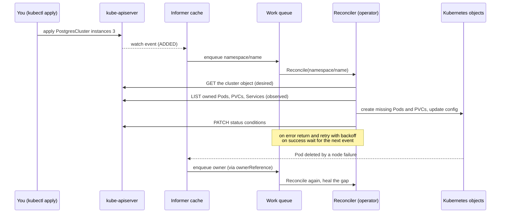
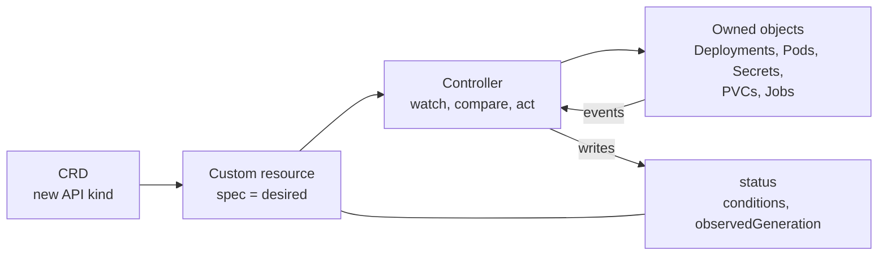

# L16.4 — Operators

> **Level 16: Advanced Kubernetes** · Topic 4 of 10 · ⏱ ~5 hours · Difficulty: Advanced

## 1. What it is

Kubernetes is built from **controllers**: loops that watch the *desired state* you declared (a Deployment with 3 replicas) and the *observed state* of the world (2 Pods running), and act to close the gap. A **reconcile loop** is that act: "look at what is, compare to what should be, make one step toward it, repeat".

An **Operator** is a controller that encodes the operational knowledge of a specific application. Instead of a runbook that says "to add a PostgreSQL replica, create a volume, run `pg_basebackup`, edit `postgresql.conf`, register the standby", you apply a small declarative object (`Cluster` with `instances: 3`) and the operator performs those steps, and keeps performing them when things fail. The pattern is **Custom Resource Definition (CRD) + custom controller**: the CRD teaches the API server a new kind (covered next in [Custom Resource Definitions](05-custom-resource-definitions.md)), and the controller is a Pod that reconciles objects of that kind.

## 2. Why it matters in DevOps

- **Day-2 operations as code.** Backups, failover, version upgrades, certificate renewal and scaling become reconciled behaviour, not 3 a.m. manual procedures.
- **It is how the ecosystem ships software.** Prometheus, cert-manager, Strimzi (Kafka), the major Postgres operators, Argo CD, Istio and Crossplane are all controllers; to run or debug them you must understand reconcile loops, finalizers and status conditions.
- **Platform APIs.** Platform teams use operators and CRDs to expose "give me a database" as one YAML object ([Platform Engineering](../level-00-what-devops-is/13-platform-engineering.md)).
- **Risk.** An operator runs with broad RBAC and manages your data. A buggy or unmaintained operator can delete things. Choosing and vetting operators is a senior skill.

## 3. Real-world system example

**The Prometheus Operator and Postgres operators.**

- The **Prometheus Operator** (the basis of the `kube-prometheus-stack` Helm chart) introduces CRDs such as `Prometheus`, `Alertmanager`, `ServiceMonitor`, `PodMonitor` and `PrometheusRule`. You declare *what to scrape* with a `ServiceMonitor` selecting Services by label; the operator generates the Prometheus configuration, writes it to a Secret, and reloads Prometheus. Application teams never edit `prometheus.yml` (see [Prometheus and PromQL](../level-10-observability/02-prometheus-and-promql.md)).
- **PostgreSQL operators** such as **CloudNativePG** (a CNCF project), Zalando's postgres-operator, Crunchy Data's PGO and Percona's operator let you declare a Postgres cluster (instance count, storage, backup schedule) and handle replication, primary election, failover, rolling minor upgrades and backups to object storage. They differ in design: CloudNativePG, for example, manages Pods directly rather than through StatefulSets.
- **cert-manager** reconciles `Certificate` objects into issued TLS Secrets and renews them before expiry; **Strimzi** does the same for Kafka clusters.

Kubernetes' own built-in controllers (Deployment, ReplicaSet, Job, StatefulSet) use exactly the same pattern, so operators are not a foreign mechanism, just more domain-specific controllers.

## 4. Diagram



Controller anatomy:



## 5. How it works

### Key ideas

| Concept | Meaning |
|---------|---------|
| **Level-triggered** | The loop reacts to *state*, not to individual events. If an event is missed, the next reconcile still converges. Never write reconcile code that assumes "this runs once per change". |
| **Idempotent** | Running reconcile twice with the same input gives the same result. Use create-or-update, not blind create. |
| **Informer / cache** | Controllers read from a local watch-backed cache to avoid hammering the API server; writes still go to the API. |
| **Work queue and backoff** | Keys (`namespace/name`) are queued, deduplicated and retried with exponential backoff on error. |
| **ownerReferences** | Child objects point to the parent CR, so deleting the parent garbage-collects the children and child events trigger the parent's reconcile. |
| **Finalizers** | A marker that blocks deletion until the controller has cleaned up external resources (a cloud disk, a DNS record). A stuck finalizer is a classic "namespace stuck in Terminating" cause. |
| **Status subresource** | `spec` is what the user wants, `status` is what the controller observed; conditions (`Ready`, `Progressing`) and `observedGeneration` tell users whether it is up to date. |
| **Leader election** | Multiple operator replicas run but only one reconciles, via a Lease object. |

### Operator capability levels

The Operator Framework describes five capability levels: (1) basic install, (2) seamless upgrades, (3) full lifecycle (backup, failure recovery), (4) deep insights (metrics, alerts), (5) auto-pilot (auto-scaling, tuning). Use them to judge how much an operator really automates before trusting it with data.

### Tooling to write your own

| Tool | Notes |
|------|-------|
| **kubebuilder** | The Kubernetes SIG project's framework and scaffolder (Go, built on `controller-runtime`). Generates the project, CRD manifests from Go types, RBAC from markers, and tests with `envtest`. |
| **Operator SDK** | From the Operator Framework (Red Hat); in Go it builds on kubebuilder, and it also supports **Ansible** and **Helm**-based operators when you do not want to write Go. |
| **controller-runtime** | The library under both: `Manager`, `Reconciler`, `client`, `builder`. |
| **Operator Lifecycle Manager (OLM)** and **OperatorHub.io** | Catalog and install/upgrade operators (more common on OpenShift; elsewhere Helm and Argo CD installs dominate). |
| Kopf (Python), Metacontroller, shell-operator, Crossplane compositions | Lighter or non-Go options for simple cases ([Crossplane](../level-18-platform-engineering/09-crossplane.md)). |

A minimal reconcile in Go (a sketch of what kubebuilder scaffolds; not complete code):

```go
func (r *ShopCacheReconciler) Reconcile(ctx context.Context, req ctrl.Request) (ctrl.Result, error) {
	var cache shopv1alpha1.ShopCache
	if err := r.Get(ctx, req.NamespacedName, &cache); err != nil {
		return ctrl.Result{}, client.IgnoreNotFound(err) // deleted: nothing to do
	}

	dep := &appsv1.Deployment{ObjectMeta: metav1.ObjectMeta{Name: cache.Name, Namespace: cache.Namespace}}
	_, err := controllerutil.CreateOrUpdate(ctx, r.Client, dep, func() error {
		dep.Spec.Replicas = &cache.Spec.Replicas
		// ... set selector, pod template (redis image from cache.Spec.Version) ...
		return controllerutil.SetControllerReference(&cache, dep, r.Scheme)
	})
	if err != nil {
		return ctrl.Result{}, err // controller-runtime requeues with backoff
	}

	cache.Status.ReadyReplicas = dep.Status.ReadyReplicas
	return ctrl.Result{}, r.Status().Update(ctx, &cache)
}
```

## 6. Step-by-step guide

**Prerequisites:** Docker, `kind`, `kubectl`, `helm`. Optional: Go and `kubebuilder` for step 7. Cost: none. Outputs are illustrative.

1. **Start a cluster and watch a built-in controller reconcile.**
   ```bash
   kind create cluster --name operators-lab
   kubectl create namespace shop
   kubectl -n shop create deployment shop-api --image=nginx:1.27 --replicas=3
   kubectl -n shop get pods -w &           # watch in the background
   kubectl -n shop delete pod -l app=shop-api --wait=false
   ```
   Similar to: new Pods appear within seconds as old ones terminate. The ReplicaSet controller saw observed (0) differ from desired (3) and reconciled. Stop the watch with `kill %1`.

2. **Write a "poor man's operator" to feel the loop.** It reads desired replicas from a ConfigMap and drives the Deployment:
   ```bash
   kubectl -n shop create configmap desired --from-literal=replicas=2
   cat > mini-operator.sh <<'EOF'
   #!/usr/bin/env bash
   # level-triggered loop: compare desired (ConfigMap) with observed (Deployment) every 5s
   while true; do
     want=$(kubectl -n shop get cm desired -o jsonpath='{.data.replicas}')
     have=$(kubectl -n shop get deploy shop-api -o jsonpath='{.spec.replicas}')
     if [ "$want" != "$have" ]; then
       echo "$(date +%T) drift: have=$have want=$want -> scaling"
       kubectl -n shop scale deploy/shop-api --replicas="$want"
     fi
     sleep 5
   done
   EOF
   chmod +x mini-operator.sh && ./mini-operator.sh &
   ```
   Within 5 seconds expect `drift: have=3 want=2 -> scaling`. Now try `kubectl -n shop scale deploy/shop-api --replicas=5` by hand: the loop undoes your change. Edit the ConfigMap (`kubectl -n shop patch cm desired --type merge -p '{"data":{"replicas":"4"}}'`) and it converges to 4. Real operators avoid polling by using watches, and handle errors, conflicts and deletion, but the logic is the same. Stop it with `kill %2` (or `fg` then Ctrl+C).

3. **Install a real operator: CloudNativePG** (an open source Postgres operator) with Helm:
   ```bash
   helm repo add cnpg https://cloudnative-pg.github.io/charts
   helm repo update
   helm upgrade --install cnpg cnpg/cloudnative-pg --namespace cnpg-system --create-namespace
   kubectl -n cnpg-system rollout status deploy -l app.kubernetes.io/name=cloudnative-pg
   kubectl get crd | grep cnpg.io
   ```
   Expect CRDs such as `clusters.postgresql.cnpg.io`, `backups.postgresql.cnpg.io` and `scheduledbackups.postgresql.cnpg.io`. The operator is just a Deployment; the new API kinds are the product.

4. **Declare a database; do not build one.**
   ```bash
   cat <<'EOF' | kubectl apply -f -
   apiVersion: postgresql.cnpg.io/v1
   kind: Cluster
   metadata:
     name: shop-db
     namespace: shop
   spec:
     instances: 3
     storage:
       size: 1Gi
   EOF
   kubectl -n shop get cluster shop-db -w
   ```
   Similar to `STATUS: Cluster in healthy state` after a minute or two, with Pods `shop-db-1`, `shop-db-2`, `shop-db-3` (one primary, two replicas) and Services `shop-db-rw`, `shop-db-ro`, `shop-db-r`.

5. **Break it and watch the operator heal.**
   ```bash
   kubectl -n shop get cluster shop-db -o jsonpath='{.status.currentPrimary}{"\n"}'
   kubectl -n shop delete pod $(kubectl -n shop get cluster shop-db -o jsonpath='{.status.currentPrimary}')
   kubectl -n shop get cluster shop-db -w
   ```
   Expect a short failover: a replica is promoted, `currentPrimary` changes and the deleted instance returns as a replica. You wrote no failover code.

6. **Read the operator's logs and the object's status.**
   ```bash
   kubectl -n cnpg-system logs deploy/cnpg-cloudnative-pg --tail=20
   kubectl -n shop describe cluster shop-db | sed -n '/Status:/,$p' | head -30
   ```
   Look for reconcile messages and the `Conditions` list. This is where you debug an operator that is "stuck".

7. **Scaffold your own operator (optional, needs Go and kubebuilder).** Commands, not run in this repo's sandbox:
   ```bash
   mkdir shop-operator && cd shop-operator
   kubebuilder init --domain example.com --repo github.com/example/shop-operator
   kubebuilder create api --group shop --version v1alpha1 --kind ShopCache --resource --controller
   # edit api/v1alpha1/shopcache_types.go (Spec: Replicas, Version) and internal/controller/shopcache_controller.go
   make manifests generate        # regenerate CRD YAML and deepcopy code
   make install                   # apply the CRD to the current cluster
   make run                       # run the controller locally against your kube context
   kubectl apply -f config/samples/shop_v1alpha1_shopcache.yaml
   ```
   `make deploy IMG=<registry>/shop-operator:0.1.0` builds and installs it in-cluster after `make docker-build docker-push IMG=...`. Operator SDK equivalents are `operator-sdk init` and `operator-sdk create api`.

8. **Clean up:** `kill %1 %2 2>/dev/null; kind delete cluster --name operators-lab`.

## 7. Real-world scenario

*(Illustrative.)* The `shop-api` team ran PostgreSQL on a hand-built StatefulSet. When the primary's node was drained for a kernel update, the Pod restarted but the replica's replication slot was stale, and an engineer spent two hours repairing replication while the checkout API served errors. After the incident they moved to a Postgres operator: they declared `instances: 3`, a backup schedule to object storage and a `PodDisruptionBudget`. The next node drain triggered an automatic switchover in seconds, and the status condition and operator logs told the on-call exactly what happened. The follow-up risk review added an upgrade policy for the operator itself (pinned versions, staged rollout, restore-from-backup drill). **Lesson:** operators turn tribal knowledge into reconciled behaviour, but you now operate the operator.

## 8. Common mistakes and best practices

**Don't**

- Treat reconcile as event-driven ("on create do X"). Always compare current and desired state and tolerate re-runs.
- Block the reconcile with long sleeps; return `RequeueAfter` instead.
- Forget finalizers and ownerReferences, leaving orphaned cloud resources or undeletable objects.
- Install operators from random manifests with `cluster-admin` and no review.
- Write an operator when a Helm chart or a Deployment suffices.

**Do**

- Report progress in `status.conditions` and `observedGeneration`; users and GitOps tools read them.
- Pin operator and CRD versions, upgrade in staging, and read upgrade notes (CRD changes are cluster-wide).
- Run operators with narrow RBAC, resource limits, replicas with leader election and metrics scraped by Prometheus.
- Prefer a well-maintained community operator for databases and brokers over writing your own.
- Back up the *data*, not just the manifests, and test restores ([Testing Backup Restoration](../level-15-disaster-recovery/09-testing-backup-restoration.md)).

## 9. Tasks

- [ ] **T1 — Watch a controller reconcile** *(≈20 min, beginner)*
  - **Goal:** see level-triggered convergence.
  - **Steps:**
    1. Do guide step 1.
    2. Scale to 5, then delete two Pods, then `kubectl cordon` a node and delete a Pod.
    3. Watch the ReplicaSet recreate Pods each time.
  - **Done when:** you can describe, for each action, what the observed and desired counts were.

- [ ] **T2 — Run the mini operator** *(≈30 min, intermediate)*
  - **Goal:** implement drift correction yourself.
  - **Steps:**
    1. Run `mini-operator.sh` from step 2.
    2. Change replicas by hand and via the ConfigMap, and observe the difference.
  - **Done when:** the Deployment always converges to the ConfigMap value within ~5 s and you can explain why this is level-triggered.

- [ ] **T3 — Improve the mini operator** *(≈45 min, intermediate)*
  - **Goal:** add the missing production behaviours.
  - **Steps:**
    1. Add validation (reject a non-integer or a value above 10 and keep the old value).
    2. Write the result to the ConfigMap's annotation `status` (for example `reconciled at <time>`), mimicking `status`.
    3. Make the script exit cleanly on SIGTERM using `trap`.
  - **Done when:** invalid input is ignored with a log line, the annotation is updated after each successful reconcile and `kill -TERM` stops it.

- [ ] **T4 — Install a real operator and fail it over** *(≈45 min, advanced)*
  - **Goal:** prove an operator heals a stateful app.
  - **Steps:**
    1. Install CloudNativePG and create the `shop-db` cluster (steps 3-4).
    2. Delete the primary Pod (step 5).
    3. Record the old and new `currentPrimary`, and the time to recover.
  - **Done when:** the cluster returns to the healthy state with a different primary and you can show it in the status and logs.

- [ ] **T5 — Break it: the stuck finalizer** *(≈30 min, advanced)*
  - **Goal:** understand why deletions hang.
  - **Steps:**
    1. Scale the operator Deployment in `cnpg-system` to 0.
    2. Delete the `shop-db` Cluster object and observe it stuck in terminating or its children lingering.
    3. Scale the operator back to 1 and watch cleanup complete.
  - **Done when:** you can explain (with `kubectl get cluster shop-db -o yaml | grep -A3 finalizers`) why the operator must be running for cleanup, and the object is gone after scaling up.

- [ ] **T6 — Prove it: scaffold and explain** *(≈90 min, advanced)*
  - **Goal:** build and explain a minimal operator.
  - **Steps:**
    1. Using kubebuilder (or Operator SDK), scaffold `ShopCache` and implement a reconcile that keeps a Redis Deployment at `spec.replicas`.
    2. Run it with `make run` and show self-healing when you delete the Deployment.
    3. Explain `ownerReferences`, `status` and requeue behaviour out loud or in writing.
  - **Done when:** deleting the owned Deployment results in it being recreated, and your explanation covers idempotency and level-triggering.

## 10. Self-check questions

1. What is the difference between an event-driven and a level-triggered controller, and why does Kubernetes use the second?
2. What do a CRD and a controller each contribute to an operator?
3. Why do operators set `ownerReferences` on the objects they create?
4. What is a finalizer and what happens if the operator that owns it is gone?
5. When would you not write an operator?
6. How do kubebuilder and Operator SDK relate?

<details>
<summary>Answers</summary>

1. Event-driven reacts once per change and can miss events; level-triggered compares full current and desired state each time, so a missed event or restart still converges.
2. The CRD adds the new API type (desired-state schema); the controller makes reality match it.
3. For garbage collection when the parent is deleted and to map child events back to the parent's reconcile.
4. A key in `metadata.finalizers` that blocks deletion until cleanup is done. Without the operator, the object stays in terminating until the finalizer is removed manually (carefully).
5. When a Deployment, a Helm chart or a managed cloud service does the job; operators add code to maintain and permissions to trust.
6. Operator SDK (Go) builds on kubebuilder and controller-runtime and adds Ansible/Helm operator types and OLM integration.
</details>

## 11. Further reading

- Kubernetes documentation: *Operator pattern* and *Controllers* (kubernetes.io/docs/concepts).
- The Kubebuilder Book (book.kubebuilder.io) and the Operator SDK documentation (sdk.operatorframework.io).
- Prometheus Operator and CloudNativePG project documentation.
- *Kubernetes Operators* by Jason Dobies and Joshua Wood (O'Reilly); *Programming Kubernetes* by Michael Hausenblas and Stefan Schimanski (O'Reilly).
- Related: [Stateful Workloads](08-stateful-workloads.md), [StatefulSets](../level-08-kubernetes/10-statefulsets.md).

<!-- nav -->
---
← Previous: [Pod Security](03-pod-security.md) · [Level 16 index](README.md) · Next: [Custom Resource Definitions (CRDs)](05-custom-resource-definitions.md) →
