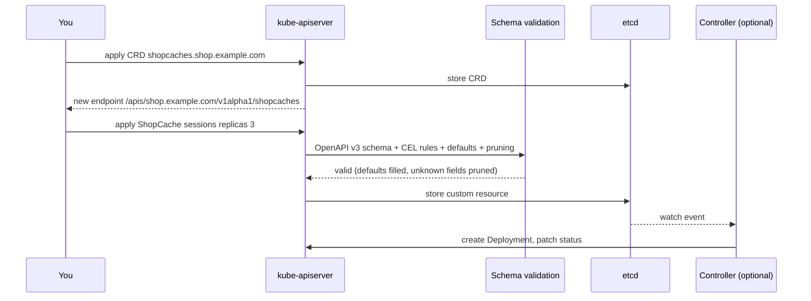
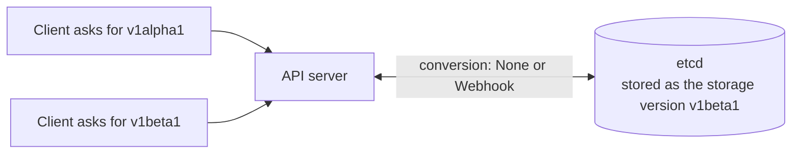

# L16.5 — Custom Resource Definitions (CRDs)

> **Level 16: Advanced Kubernetes** · Topic 5 of 10 · ⏱ ~4 hours · Difficulty: Advanced

## 1. What it is

The Kubernetes API is a set of **resource types** (Pod, Service, Deployment, ...) served by the API server and stored in etcd. A **CustomResourceDefinition (CRD)** lets you add your *own* resource type to that API at runtime, with no changes to Kubernetes itself and no extra API server. Once the CRD exists you can `kubectl apply` objects of the new kind (called **custom resources**, CRs), and `kubectl get`, RBAC, audit logging, watches, labels and GitOps tools all work on them exactly as they do on built-in objects.

A CRD alone is only **data with validation**: the API server will store a `ShopCache` object, but nothing happens until a controller acts on it. The CRD plus a controller is the [Operator](04-operators.md) pattern.

## 2. Why it matters in DevOps

- **Almost every cloud-native tool is a CRD set.** Argo CD (`Application`), cert-manager (`Certificate`), Istio (`VirtualService`), Prometheus Operator (`ServiceMonitor`), Crossplane and Karpenter (`NodePool`) all extend Kubernetes this way. Reading and debugging them is daily work.
- **Schema design is API design.** A sloppy schema becomes a permanent contract: field names, defaults and validation bugs live for years, and CRD upgrades are cluster-wide.
- **Validation at the door.** A good schema (types, enums, ranges, CEL rules) rejects bad YAML at `kubectl apply` time instead of at 3 a.m. inside a controller.
- **Platform engineering.** Teams expose "give me a cache" as a simple CR and hide the Deployments, Services and PodDisruptionBudgets behind it ([Self-service Infrastructure](../level-18-platform-engineering/03-self-service-infrastructure.md)).

## 3. Real-world system example

**Karpenter, cert-manager and Argo CD.** Karpenter's node-provisioning API is two CRDs in the `karpenter.sh` group (`NodePool`, `NodeClaim`) plus a cloud-specific `EC2NodeClass` on AWS; you tune cluster scaling by editing those objects. cert-manager defines `Issuer`, `ClusterIssuer` and `Certificate`; a `Certificate` is a few lines of YAML while the controller talks to Let's Encrypt and writes a TLS Secret. Argo CD defines `Application` and `AppProject`, so "what is deployed where" is itself Kubernetes data. Kubernetes also ships its own API extensions this way: the Gateway API (`Gateway`, `HTTPRoute`) is delivered as CRDs from the Kubernetes SIG Network project, installed independently of the cluster version, and the Cluster API project models whole clusters as CRs.

## 4. Diagram



Multiple versions and conversion:



## 5. How it works

### Anatomy of a CRD

| Field | Purpose |
|-------|---------|
| `metadata.name` | Must be `<plural>.<group>` |
| `spec.group` | API group, a DNS name you control (`shop.example.com`) |
| `spec.scope` | `Namespaced` or `Cluster` |
| `spec.names` | `kind`, `plural`, `singular`, optional `shortNames` and `categories` (`kubectl get all` style groups) |
| `spec.versions[]` | Each with `name`, `served`, `storage`, `schema`, `subresources`, `additionalPrinterColumns`, `deprecated` |
| `schema.openAPIV3Schema` | A **structural** schema (every field typed) used for validation, defaulting and pruning |
| `subresources.status` | Separate `/status` endpoint so users edit `spec` and the controller edits `status` (with different RBAC) |
| `subresources.scale` | Makes `kubectl scale` and HPA work on your kind |
| `conversion` | `None` (only `apiVersion` changes) or `Webhook` (a service you run converts between versions) |

### Schema features worth knowing

- **Types and validation:** `type`, `enum`, `minimum`, `maximum`, `pattern`, `maxLength`, `required`, `format`.
- **Defaulting:** `default:` fills missing fields on create and on read from etcd.
- **Pruning:** fields not in the schema are dropped (unless you mark `x-kubernetes-preserve-unknown-fields: true`). Typos in field names are silently removed, so use `kubectl apply --validate=strict` or `kubectl explain` to catch them.
- **CEL validation rules** (`x-kubernetes-validations`) express cross-field and transition rules without a webhook, for example immutable fields via `self == oldSelf` ([Admission Controllers and Webhooks](06-admission-controllers-and-webhooks.md) uses the same expression language).
- **Lists:** `x-kubernetes-list-type: map` with `x-kubernetes-list-map-keys` makes `conditions` mergeable by `type`.

### Versioning rules of thumb

- Exactly **one version is the storage version**. Other served versions are converted on the fly.
- Start at `v1alpha1`, promote to `v1beta1` and `v1`. Keep old versions `served: true` until clients have migrated, mark them `deprecated: true`, then stop serving.
- With `conversion: None`, versions must be structurally compatible (a renamed field needs a **conversion webhook**).
- Changing the storage version does not rewrite old objects; use a storage-version migration (for example the Kube Storage Version Migrator or re-applying each object) before you remove an old version from the CRD's `status.storedVersions`.
- Deleting a CRD **deletes every custom resource of that kind**. Treat CRDs like database schemas.

## 6. Step-by-step guide

**Prerequisites:** Docker, `kind`, `kubectl`. Cost: none. Outputs are illustrative.

1. **Create a cluster.**
   ```bash
   kind create cluster --name crd-lab
   ```

2. **Define the `ShopCache` CRD (version `v1alpha1`).**
   ```bash
   cat <<'EOF' | kubectl apply -f -
   apiVersion: apiextensions.k8s.io/v1
   kind: CustomResourceDefinition
   metadata:
     name: shopcaches.shop.example.com
   spec:
     group: shop.example.com
     scope: Namespaced
     names:
       plural: shopcaches
       singular: shopcache
       kind: ShopCache
       shortNames: [sc]
       categories: [shop]
     versions:
       - name: v1alpha1
         served: true
         storage: true
         subresources:
           status: {}
           scale:
             specReplicasPath: .spec.replicas
             statusReplicasPath: .status.readyReplicas
         additionalPrinterColumns:
           - {name: Version, type: string, jsonPath: .spec.version}
           - {name: Replicas, type: integer, jsonPath: .spec.replicas}
           - {name: Ready, type: integer, jsonPath: .status.readyReplicas}
           - {name: Age, type: date, jsonPath: .metadata.creationTimestamp}
         schema:
           openAPIV3Schema:
             type: object
             required: [spec]
             properties:
               spec:
                 type: object
                 required: [version]
                 properties:
                   replicas:
                     type: integer
                     minimum: 1
                     maximum: 10
                     default: 1
                   version:
                     type: string
                     pattern: '^[0-9]+\.[0-9]+(\.[0-9]+)?$'
                   evictionPolicy:
                     type: string
                     enum: [noeviction, allkeys-lru, volatile-lru]
                     default: allkeys-lru
                     x-kubernetes-validations:
                       - rule: self == oldSelf
                         message: evictionPolicy is immutable once set
                 x-kubernetes-validations:
                   - rule: "!(self.evictionPolicy == 'noeviction' && self.replicas > 3)"
                     message: noeviction caches are limited to 3 replicas
               status:
                 type: object
                 properties:
                   readyReplicas:
                     type: integer
                   conditions:
                     type: array
                     x-kubernetes-list-type: map
                     x-kubernetes-list-map-keys: [type]
                     items:
                       type: object
                       required: [type, status]
                       properties:
                         type: {type: string}
                         status: {type: string}
                         reason: {type: string}
                         message: {type: string}
                         lastTransitionTime: {type: string, format: date-time}
   EOF
   kubectl get crd shopcaches.shop.example.com
   kubectl api-resources --api-group=shop.example.com
   ```
   Expect the CRD with `ESTABLISHED` shortly after, and `shopcaches   sc   shop.example.com/v1alpha1   true   ShopCache`.

3. **Let the cluster document your type.**
   ```bash
   kubectl explain shopcache.spec
   kubectl explain shopcache.spec.replicas
   ```
   `kubectl explain` reads your OpenAPI schema, so a good schema is your API documentation.

4. **Write a custom resource.**
   ```bash
   kubectl create namespace shop
   cat <<'EOF' | kubectl apply -f -
   apiVersion: shop.example.com/v1alpha1
   kind: ShopCache
   metadata:
     name: sessions
     namespace: shop
   spec:
     version: "7.2"
   EOF
   kubectl -n shop get shopcaches
   kubectl -n shop get sc sessions -o yaml | sed -n '/^spec:/,/^status:/p'
   ```
   The defaults appear (`replicas: 1`, `evictionPolicy: allkeys-lru`) even though you did not write them. The table shows the printer columns. Nothing runs: no controller exists yet.

5. **Trigger each validation rule.**
   ```bash
   # out of range
   kubectl -n shop patch sc sessions --type merge -p '{"spec":{"replicas":50}}'
   # bad version format
   kubectl -n shop patch sc sessions --type merge -p '{"spec":{"version":"latest"}}'
   # CEL transition rule: immutable field
   kubectl -n shop patch sc sessions --type merge -p '{"spec":{"evictionPolicy":"noeviction"}}'
   ```
   Similar to `spec.replicas: Invalid value: 50: spec.replicas in body should be less than or equal to 10`, `spec.version in body should match '^[0-9]+\.[0-9]+(\.[0-9]+)?$'`, and `evictionPolicy is immutable once set`.

6. **See pruning silently remove a typo.**
   ```bash
   cat <<'EOF' | kubectl apply -f - --validate=false
   apiVersion: shop.example.com/v1alpha1
   kind: ShopCache
   metadata: {name: typo, namespace: shop}
   spec: {version: "7.2", replicaz: 3}
   EOF
   kubectl -n shop get sc typo -o jsonpath='{.spec}{"\n"}'
   ```
   `replicaz` is gone from the stored object. Without `--validate=false`, `kubectl` (strict field validation) would have warned or errored. Make strict validation your default.

7. **Use the scale and status subresources.**
   ```bash
   kubectl -n shop scale sc sessions --replicas=3
   kubectl -n shop patch sc sessions --subresource=status --type merge \
     -p '{"status":{"readyReplicas":3}}'
   kubectl -n shop get sc sessions
   ```
   `kubectl scale` works because you declared the scale subresource; the status patch simulates what a controller would do, and RBAC can allow `shopcaches/status` only to the controller.

8. **Add a second version.** Introduce `v1beta1` with a new optional field `tier`, make it the storage version and keep `v1alpha1` served and deprecated. Apply the full CRD again with both entries (shown condensed; keep the full schema from step 2 for `v1alpha1`):
   ```yaml
   # excerpt of spec.versions after the change
   versions:
     - name: v1alpha1
       served: true
       storage: false
       deprecated: true
       deprecationWarning: "shop.example.com/v1alpha1 ShopCache is deprecated; use v1beta1"
       # ... same schema as before ...
     - name: v1beta1
       served: true
       storage: true
       # ... same schema, plus under spec.properties:
       #   tier: {type: string, enum: [standard, premium], default: standard}
   ```
   Because there is no `conversion` stanza the strategy is `None`, and the two versions are structurally compatible apart from the optional field. Check with `kubectl get sc sessions -o jsonpath='{.apiVersion}'` and `kubectl get crd shopcaches.shop.example.com -o jsonpath='{.status.storedVersions}'` (expect both `["v1alpha1","v1beta1"]` until you migrate stored objects). Reading through `v1alpha1` prunes `tier`; reading through `v1beta1` shows it.

9. **Validate in CI before applying.** The API server is the source of truth, so use a server-side dry run:
   ```bash
   kubectl apply --dry-run=server -f my-cache.yaml
   ```
   Offline tools such as `kubeconform` can validate CRs against schemas exported from CRDs.

10. **Clean up:** `kind delete cluster --name crd-lab`. (Never delete a CRD in a real cluster casually: it deletes all its custom resources.)

## 7. Real-world scenario

*(Illustrative.)* The platform team shipped a `ShopCache` CRD where `spec.size` was a free-form string. Teams wrote `"2GB"`, `"2gb"`, `"2048"` and `"two"`. The controller parsed only the first form, and a Friday deploy of a typo'd size crash-looped the cache for the checkout flow. In the post-mortem they added a `pattern` on `size`, an enum for tiers and a CEL rule requiring `replicas >= 2` for `tier: premium`, introduced `v1beta1` with the corrected field and a conversion webhook mapping the old field, then deprecated `v1alpha1` with a warning and migrated stored objects before dropping it. A server-side dry run in CI now blocks bad CRs at pull request time. **Lesson:** the schema is the first line of defence and the version plan is part of the design.

## 8. Common mistakes and best practices

**Don't**

- Leave the schema loose (`x-kubernetes-preserve-unknown-fields: true` everywhere): you lose validation, defaulting and documentation.
- Rename fields inside a version. Add a new version and convert.
- Delete or replace a CRD that has live objects without a backup.
- Put controller-written data in `spec`, or user input in `status`.
- Invent a group like `k8s.io` or `kubernetes.io`; use a domain you own.

**Do**

- Make every field typed and bounded, add `required`, `enum`, `pattern`, and CEL rules for cross-field logic.
- Enable the `status` subresource and report `conditions` plus `observedGeneration`.
- Version from the start, mark deprecations and publish a migration path.
- Generate CRD YAML from Go types with kubebuilder markers (`+kubebuilder:validation:Minimum=1`) so code and schema cannot drift.
- Install CRDs separately from their controller (Helm `crds/` or a dedicated chart) so upgrades and rollbacks are deliberate; GitOps tools treat CRDs as a first-class ordering concern ([Argo CD and Flux](../level-17-gitops/02-argo-cd-and-flux.md)).

## 9. Tasks

- [ ] **T1 — Define and use a CRD** *(≈30 min, beginner)*
  - **Goal:** extend the API and create an object.
  - **Steps:**
    1. Apply the CRD from step 2 and the `sessions` CR from step 4.
    2. Run `kubectl explain shopcache.spec` and `kubectl get sc -n shop`.
  - **Done when:** `kubectl get sc -n shop` shows your printer columns with the defaulted `Replicas` value.

- [ ] **T2 — Add validation** *(≈40 min, intermediate)*
  - **Goal:** reject bad input at the API.
  - **Steps:**
    1. Add `maxMemoryMB` (integer, 16-4096) to the schema and make it required.
    2. Add a CEL rule that `maxMemoryMB >= 256` when `replicas > 1`.
    3. Re-apply and test one passing and two failing CRs.
  - **Done when:** the failing CRs return your messages and the passing one is stored.

- [ ] **T3 — Break it: pruning and strict validation** *(≈30 min, intermediate)*
  - **Goal:** understand silent field loss.
  - **Steps:**
    1. Apply a CR with a misspelled field using `--validate=false` and show it was pruned.
    2. Apply it again with default strict validation and capture the error or warning.
  - **Done when:** you can show both outcomes and say which `kubectl` flag or default prevents the loss.

- [ ] **T4 — Version it** *(≈60 min, advanced)*
  - **Goal:** serve two versions safely.
  - **Steps:**
    1. Add `v1beta1` with the optional `tier` field, as in step 8, and make it the storage version.
    2. Show `storedVersions` before and after re-saving each object (`kubectl get sc -A -o json | kubectl replace -f -`).
    3. Mark `v1alpha1` deprecated and observe the warning on `kubectl apply`.
  - **Done when:** `storedVersions` contains only `v1beta1` after migration and the old version still serves with a deprecation warning.

- [ ] **T5 — Wire the CRD to a controller and RBAC** *(≈60 min, advanced)*
  - **Goal:** make the CR do something, with least privilege.
  - **Steps:**
    1. Adapt `mini-operator.sh` from [Operators](04-operators.md) to read `.spec.replicas` from the `sessions` CR (instead of a ConfigMap) and create/scale a `redis` Deployment.
    2. Create a ServiceAccount with a Role allowing `get,list,watch` on `shopcaches` and `update,patch` on `shopcaches/status` only.
    3. Write `readyReplicas` back through the status subresource.
  - **Done when:** `kubectl scale sc sessions --replicas=2` results in two Redis Pods and `kubectl get sc` shows `Ready 2`.

- [ ] **T6 — Prove it: design a CRD** *(≈60 min, advanced)*
  - **Goal:** design an API without the guide.
  - **Steps:**
    1. Design a `Backup` CRD for `shop-db` with `schedule` (cron), `retentionDays` (1-365) and `target` enum, a status with conditions, printer columns and one CEL rule.
    2. Apply it, create a valid and an invalid CR, and run `kubectl explain` on it.
    3. Explain in writing why deleting the CRD is dangerous and how you would version a rename.
  - **Done when:** the CRD is accepted, the invalid CR is rejected with your message, and your note covers storage versions and conversion.

## 10. Self-check questions

1. What does a CRD give you and what does it not do by itself?
2. What is a structural schema and why is pruning dangerous for typos?
3. Which version of a multi-version CRD is stored in etcd, and how do other versions work?
4. When do you need a conversion webhook?
5. Why enable the `status` subresource?
6. What happens to custom resources if you delete the CRD?

<details>
<summary>Answers</summary>

1. A new API type with schema validation, defaulting, RBAC and `kubectl` support; it does not implement behaviour. A controller is needed.
2. A schema where all fields are typed so the API server can validate, default and prune. Unknown fields are dropped, so a misspelled field disappears silently unless strict validation catches it.
3. The single version with `storage: true`; others are converted at request time (via `None` or a webhook).
4. When versions differ in more than the `apiVersion` string, for example a renamed or restructured field.
5. It separates user-writable `spec` from controller-written `status`, with separate RBAC, and prevents status writes from bumping `metadata.generation`.
6. They are all deleted.
</details>

## 11. Further reading

- Kubernetes documentation: *Custom Resources*, *Extend the Kubernetes API with CustomResourceDefinitions* and *Versions in CustomResourceDefinitions*.
- Kubernetes documentation: *Validation rules (CEL)* for CRDs.
- The Kubebuilder Book, section on CRD markers and multi-version APIs.
- *Kubernetes API conventions* (kubernetes/community design docs) for `spec`, `status` and conditions.
- Related: [Operators](04-operators.md), [Admission Controllers and Webhooks](06-admission-controllers-and-webhooks.md).

<!-- nav -->
---
← Previous: [Operators](04-operators.md) · [Level 16 index](README.md) · Next: [Admission Controllers and Webhooks](06-admission-controllers-and-webhooks.md) →
