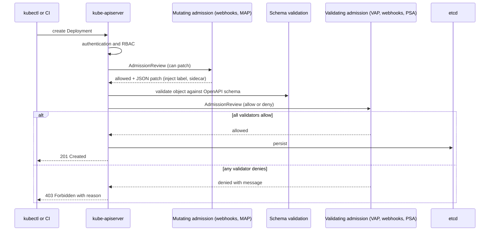
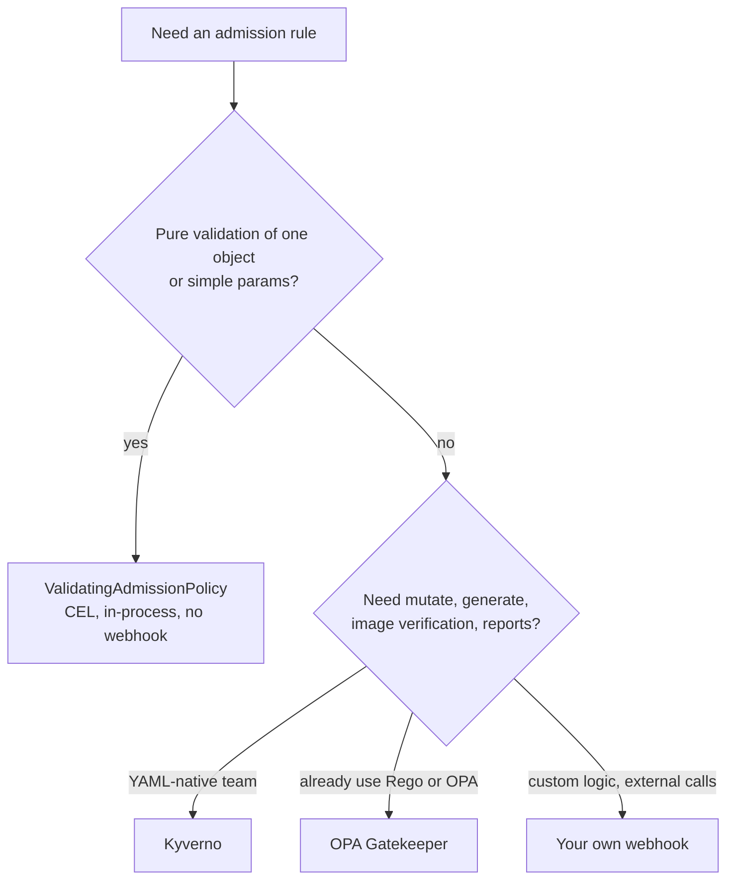

# L16.6 — Admission Controllers and Webhooks

> **Level 16: Advanced Kubernetes** · Topic 6 of 10 · ⏱ ~6 hours · Difficulty: Advanced

## 1. What it is

After the API server has authenticated and authorized a request (see [RBAC in Depth](01-rbac-in-depth.md)), it passes any request that **creates, updates or deletes** an object through **admission control**. Admission controllers can **mutate** the object (add a default, inject a sidecar) and **validate** it (reject a Pod that runs as root). RBAC answers "may this user touch Deployments?"; admission answers "is *this particular Deployment* acceptable?". RBAC cannot express "images must come from our registry" or "every namespace needs a `team` label". Admission can.

There are three ways to add your own admission logic:

1. **Dynamic admission webhooks** (`MutatingWebhookConfiguration`, `ValidatingWebhookConfiguration`) — the API server calls an HTTPS service you run, sending an `AdmissionReview` and expecting an allow/deny (and, for mutating, a JSON patch). Maximum flexibility, maximum operational risk.
2. **ValidatingAdmissionPolicy (VAP)** — validation rules written in **CEL** (Common Expression Language) and evaluated *inside* the API server, with no webhook to run. Stable (GA) since Kubernetes 1.30. A newer **MutatingAdmissionPolicy** brings the same in-process idea to mutation; it is a more recent feature, so check its status in your Kubernetes version before relying on it.
3. **Policy engines** — **Kyverno** and **OPA Gatekeeper** are webhook-based engines (Kyverno policies are YAML, Gatekeeper uses Rego) that add reporting, background scanning and libraries of ready-made policies.

## 2. Why it matters in DevOps

- **Guardrails for self-service.** When 30 teams deploy to one cluster you cannot review every manifest; admission enforces org rules (labels, registries, resource limits, no `latest`) automatically ([Policy as Code](../level-18-platform-engineering/07-policy-as-code.md)).
- **Security enforcement.** Pod Security Admission is itself an admission controller ([Pod Security](03-pod-security.md)); policy engines cover what it does not, such as signed images or required network policies.
- **It sits on the critical path.** A broken admission webhook with `failurePolicy: Fail` can stop *every* matching create/update in the cluster, including the fix. Many production incidents trace to this.
- **Consistency.** Mutating policies add the same labels, sidecars, tolerations or default `securityContext` everywhere, so developers do not have to remember.

## 3. Real-world system example

**Istio, cert-manager and Kubernetes itself.** Istio's automatic sidecar injection is a **mutating admission webhook**: when a Pod is created in a namespace labelled for injection, the webhook patches in the Envoy proxy container and init container ([Service Mesh](09-service-mesh-istio-linkerd.md)). cert-manager and the Prometheus Operator ship validating webhooks that reject malformed `Certificate` and `PrometheusRule` objects at apply time. Kubernetes' own built-ins are admission plugins too: `LimitRanger`, `ResourceQuota`, `ServiceAccount`, `PodSecurity` and `DefaultStorageClass` are compiled into the API server and are what fill in your default StorageClass or reject a Pod over quota. **Kyverno** and **Gatekeeper** are CNCF projects widely used to implement "no `latest` tag", "must have owner label" and "only approved registries" policies; both can also scan existing resources in the background and report violations, so you learn about drift as well as new requests. VAP is the in-tree option designed to cover the common validation cases without running a webhook.

## 4. Diagram



Choosing a tool:



## 5. How it works

### Order and rules

- Order of evaluation: **mutating** admission (in series, may be re-invoked if a later mutator changes the object), then **object schema validation**, then **validating** admission (in parallel). Any single denial rejects the request.
- Admission applies to writes (`CREATE`, `UPDATE`, `DELETE`, `CONNECT` such as `exec`), never to reads.
- Webhooks match on `rules` (apiGroups, apiVersions, resources, operations, scope), and can be narrowed with `namespaceSelector`, `objectSelector` and `matchConditions` (CEL pre-filter).

### Dynamic webhook settings that decide outages

| Setting | Meaning | Guidance |
|---------|---------|----------|
| `failurePolicy` | `Fail` rejects requests if the webhook errors or times out; `Ignore` lets them through | `Fail` for security-critical policies, but only with an HA webhook and sane exclusions |
| `timeoutSeconds` | 1-30 s, default 10 | Keep short; each call adds latency to every matching write |
| `namespaceSelector` | Skip namespaces | Always exclude `kube-system` and the webhook's own namespace to avoid deadlock |
| `sideEffects` | `None` or `NoneOnDryRun` | Required; webhooks must be dry-run safe |
| `admissionReviewVersions` | e.g. `["v1"]` | Required |
| `reinvocationPolicy` (mutating) | `IfNeeded` re-runs after other mutators | Use when other mutators may change fields you care about |
| TLS `caBundle` | CA that signed the webhook's serving cert | Automate with cert-manager; expiry breaks the cluster |

### ValidatingAdmissionPolicy

Two objects: a **ValidatingAdmissionPolicy** (the rules, in CEL) and a **ValidatingAdmissionPolicyBinding** (where to apply it, and which actions to take). Optional **parameters** (a ConfigMap or your own CRD) let one policy serve many bindings with different values. `validationActions` can be `Deny`, `Warn` and `Audit` in any combination, so you roll out as `[Warn, Audit]` first and then `[Deny]`. CEL gives you `object`, `oldObject`, `params`, `request`, `namespaceObject` and `variables`.

### Kyverno vs Gatekeeper vs VAP

| | VAP (CEL) | Kyverno | OPA Gatekeeper |
|--|-----------|---------|----------------|
| Runs as | In the API server | Webhook controller | Webhook controller (plus audit) |
| Language | CEL | YAML with patterns, JMESPath, and CEL | Rego (via ConstraintTemplates) |
| Validate | Yes | Yes | Yes |
| Mutate | Newer MutatingAdmissionPolicy | Yes (patches, `generate` rules too) | Yes (mutation CRDs) |
| Generate resources | No | Yes (for example default NetworkPolicy per namespace) | No |
| Image signature verification | No | Yes (`verifyImages`) | Via external data/providers |
| Existing-object reports | Audit actions only | Background scan and PolicyReports | Audit controller |
| Extra moving part | None | Controller deployment | Controller deployment |

Rule of thumb: use VAP first for plain validation; reach for Kyverno when you need mutate/generate/image verification with low learning curve; use Gatekeeper when your organization already writes Rego for OPA.

## 6. Step-by-step guide

**Prerequisites:** Docker, `kind`, `kubectl`, `helm`. Cost: none. Outputs are illustrative. VAP needs Kubernetes 1.30 or newer (a current kind node image is fine).

1. **Create a cluster and namespaces.**
   ```bash
   kind create cluster --name admission-lab
   kubectl create namespace shop
   kubectl create namespace sandbox
   ```

2. **Write a ValidatingAdmissionPolicy: memory limit required, no `latest` tag.**
   ```bash
   cat <<'EOF' | kubectl apply -f -
   apiVersion: admissionregistration.k8s.io/v1
   kind: ValidatingAdmissionPolicy
   metadata:
     name: workload-hygiene
   spec:
     failurePolicy: Fail
     matchConstraints:
       resourceRules:
         - apiGroups: ["apps"]
           apiVersions: ["v1"]
           operations: ["CREATE", "UPDATE"]
           resources: ["deployments"]
     variables:
       - name: containers
         expression: "object.spec.template.spec.containers"
     validations:
       - expression: "variables.containers.all(c, has(c.resources) && has(c.resources.limits) && 'memory' in c.resources.limits)"
         message: "every container must set resources.limits.memory"
       - expression: "variables.containers.all(c, c.image.contains(':') && !c.image.endsWith(':latest'))"
         message: "images must be pinned to a tag other than latest"
   ---
   apiVersion: admissionregistration.k8s.io/v1
   kind: ValidatingAdmissionPolicyBinding
   metadata:
     name: workload-hygiene-shop
   spec:
     policyName: workload-hygiene
     validationActions: [Deny]
     matchResources:
       namespaceSelector:
         matchLabels:
           kubernetes.io/metadata.name: shop
   EOF
   kubectl get validatingadmissionpolicy workload-hygiene -o jsonpath='{.status.typeChecking}{"\n"}'
   ```
   The API server type-checks your CEL against the Deployment schema; an empty or absent `typeChecking.expressionWarnings` means no problems found.

3. **Try a bad and a good Deployment.**
   ```bash
   kubectl -n shop create deployment bad --image=nginx:latest
   kubectl -n shop create deployment good --image=nginx:1.27 --dry-run=client -o yaml \
     | kubectl set resources --local -f - --limits=memory=128Mi -o yaml \
     | kubectl apply -f -
   ```
   The first fails, similar to: `Error from server (Invalid): deployments.apps "bad" is invalid: ... ValidatingAdmissionPolicy 'workload-hygiene' with binding 'workload-hygiene-shop' denied request: every container must set resources.limits.memory`. The second is admitted. The `sandbox` namespace is not bound, so the same bad Deployment is allowed there; that is how you scope rollouts.

4. **Add parameters and a staged rollout.** One policy, values from a ConfigMap, warn-only first:
   ```bash
   cat <<'EOF' | kubectl apply -f -
   apiVersion: v1
   kind: ConfigMap
   metadata: {name: replica-limits, namespace: default}
   data:
     maxReplicas: "5"
   ---
   apiVersion: admissionregistration.k8s.io/v1
   kind: ValidatingAdmissionPolicy
   metadata: {name: max-replicas}
   spec:
     failurePolicy: Fail
     paramKind: {apiVersion: v1, kind: ConfigMap}
     matchConstraints:
       resourceRules:
         - apiGroups: ["apps"]
           apiVersions: ["v1"]
           operations: ["CREATE", "UPDATE"]
           resources: ["deployments"]
     validations:
       - expression: "object.spec.replicas <= int(params.data.maxReplicas)"
         messageExpression: "'replicas must be <= ' + params.data.maxReplicas"
   ---
   apiVersion: admissionregistration.k8s.io/v1
   kind: ValidatingAdmissionPolicyBinding
   metadata: {name: max-replicas-shop}
   spec:
     policyName: max-replicas
     validationActions: [Warn, Audit]
     paramRef:
       name: replica-limits
       namespace: default
       parameterNotFoundAction: Deny
     matchResources:
       namespaceSelector:
         matchLabels: {kubernetes.io/metadata.name: shop}
   EOF
   kubectl -n shop patch deployment good --type merge -p '{"spec":{"replicas":8}}'
   ```
   (Use `patch`, not `kubectl scale`: scaling goes through the `deployments/scale` subresource, which the policy's `deployments` rule does not match.) You get `Warning: Validation failed for ValidatingAdmissionPolicy 'max-replicas' ... replicas must be <= 5` but the scale succeeds. Later change `validationActions` to `[Deny]` once the warnings are clean.

5. **Install Kyverno and write mutate and validate policies.**
   ```bash
   helm repo add kyverno https://kyverno.github.io/kyverno/
   helm repo update
   helm install kyverno kyverno/kyverno -n kyverno --create-namespace
   kubectl -n kyverno get pods
   ```
   Wait until the Kyverno Pods are `Running`. Then:
   ```bash
   cat <<'EOF' | kubectl apply -f -
   apiVersion: kyverno.io/v1
   kind: ClusterPolicy
   metadata:
     name: team-label-and-defaults
   spec:
     validationFailureAction: Enforce
     background: true
     rules:
       - name: require-team-label
         match:
           any:
             - resources:
                 kinds: [Deployment]
                 namespaces: [shop]
         validate:
           message: "label 'team' is required on Deployments in shop"
           pattern:
             metadata:
               labels:
                 team: "?*"
       - name: add-managed-by
         match:
           any:
             - resources:
                 kinds: [Deployment]
                 namespaces: [shop]
         mutate:
           patchStrategicMerge:
             metadata:
               labels:
                 +(managed-by): platform
   EOF
   kubectl -n shop create deployment nolabel --image=nginx:1.27
   ```
   The create is denied with a message naming the policy and rule. *Note:* newer Kyverno releases move the enforce/audit setting to the rule's `validate.failureAction` and add CEL-based policy kinds; the older `spec.validationFailureAction` form above still works but check the Kyverno docs for your installed version.

6. **See a mutation happen.** Create a compliant Deployment and inspect it:
   ```bash
   kubectl -n shop create deployment labelled --image=nginx:1.27 --dry-run=client -o yaml \
     | kubectl label --local -f - team=checkout -o yaml \
     | kubectl set resources --local -f - --limits=memory=128Mi -o yaml \
     | kubectl apply -f -
   kubectl -n shop get deploy labelled --show-labels
   ```
   Expect `managed-by=platform` in the labels even though you never wrote it. (If the earlier VAP also applies, you need the memory limit and a pinned tag, which this command satisfies.) The `team` label on the Deployment object is what the validate rule checks; adjust the pattern to `spec.template.metadata.labels` if you want Pods labelled.

7. **Reproduce the webhook outage, safely.** Create a webhook that points at a Service that does not exist, scoped to one labelled namespace so it cannot hurt anything else:
   ```bash
   kubectl create namespace webhook-test
   kubectl label namespace webhook-test webhook-test=true
   cat <<'EOF' | kubectl apply -f -
   apiVersion: admissionregistration.k8s.io/v1
   kind: ValidatingWebhookConfiguration
   metadata:
     name: broken-webhook
   webhooks:
     - name: broken.shop.example.com
       admissionReviewVersions: ["v1"]
       sideEffects: None
       failurePolicy: Fail
       timeoutSeconds: 5
       namespaceSelector:
         matchLabels: {webhook-test: "true"}
       rules:
         - apiGroups: [""]
           apiVersions: ["v1"]
           operations: ["CREATE"]
           resources: ["configmaps"]
       clientConfig:
         service:
           name: does-not-exist
           namespace: default
           path: /validate
   EOF
   kubectl -n webhook-test create configmap x --from-literal=a=b
   ```
   Similar to: `Error from server (InternalError): Internal error occurred: failed calling webhook "broken.shop.example.com": ... service "does-not-exist" not found`. This is the shape of a real outage: nothing in that namespace can create ConfigMaps. Fix it by deleting the configuration (`kubectl delete validatingwebhookconfiguration broken-webhook`) or changing `failurePolicy` to `Ignore`.

8. **Know what the webhook receives.** An `AdmissionReview` request (abridged) and a denial response:
   ```json
   {"apiVersion":"admission.k8s.io/v1","kind":"AdmissionReview",
    "request":{"uid":"705ab4f5-6393-11e8-b7cc-42010a800002","operation":"CREATE",
      "kind":{"group":"apps","version":"v1","kind":"Deployment"},
      "namespace":"shop","userInfo":{"username":"ci-deployer"},
      "object":{"metadata":{"name":"bad"},"spec":{"replicas":1}}}}
   ```
   ```json
   {"apiVersion":"admission.k8s.io/v1","kind":"AdmissionReview",
    "response":{"uid":"705ab4f5-6393-11e8-b7cc-42010a800002","allowed":false,
      "status":{"code":403,"message":"images must come from registry.example.com"}}}
   ```
   A mutating response adds `"patchType":"JSONPatch"` and a base64-encoded JSON Patch.

9. **(Optional) Gatekeeper.** The same "required labels" rule in Rego, shown for comparison. Install with `helm repo add gatekeeper https://open-policy-agent.github.io/gatekeeper/charts` then `helm install gatekeeper gatekeeper/gatekeeper -n gatekeeper-system --create-namespace`, and apply:
   ```yaml
   apiVersion: templates.gatekeeper.sh/v1
   kind: ConstraintTemplate
   metadata:
     name: k8srequiredlabels
   spec:
     crd:
       spec:
         names:
           kind: K8sRequiredLabels
         validation:
           openAPIV3Schema:
             type: object
             properties:
               labels:
                 type: array
                 items:
                   type: string
     targets:
       - target: admission.k8s.gatekeeper.sh
         rego: |
           package k8srequiredlabels

           violation[{"msg": msg}] {
             provided := {l | input.review.object.metadata.labels[l]}
             required := {l | l := input.parameters.labels[_]}
             missing := required - provided
             count(missing) > 0
             msg := sprintf("missing required labels: %v", [missing])
           }
   ---
   apiVersion: constraints.gatekeeper.sh/v1beta1
   kind: K8sRequiredLabels
   metadata:
     name: deployments-need-team
   spec:
     enforcementAction: dryrun
     match:
       kinds:
         - apiGroups: ["apps"]
           kinds: ["Deployment"]
     parameters:
       labels: ["team"]
   ```
   `enforcementAction: dryrun` records violations in the constraint's `status` without blocking, the Gatekeeper equivalent of `[Warn, Audit]`. Newer Gatekeeper releases accept Rego v1 syntax (`violation contains {...} if {...}`); follow the docs for your version.

10. **Clean up:** `kind delete cluster --name admission-lab`.

## 7. Real-world scenario

*(Illustrative.)* The platform team installed a policy-engine webhook with `failurePolicy: Fail` matching all Pods. During a routine node upgrade the engine's only Pod was evicted. New Pods, including the replacement engine Pod, were rejected because the webhook it needed was unreachable: a deadlock. The API server kept returning `failed calling webhook ... connection refused` and the on-call could not schedule anything until they deleted the `ValidatingWebhookConfiguration` by hand. The fixes: three replicas with a PodDisruptionBudget and topology spread; `namespaceSelector` excluding `kube-system` and the engine's own namespace; `failurePolicy: Ignore` for non-critical policies; migrating simple rules to ValidatingAdmissionPolicy (no webhook to be down); alerts on webhook latency and error rate from the API server metrics. **Lesson:** an admission webhook is a dependency of every write; design it like a control-plane component.

## 8. Common mistakes and best practices

**Don't**

- Match `*` resources in `*` namespaces with `failurePolicy: Fail`.
- Let your webhook's namespace or `kube-system` be subject to its own policies.
- Make webhooks slow or dependent on external services; timeouts block every write.
- Roll out `Deny` on day one; you will break teams' pipelines.
- Write mutations that depend on ordering of other mutators without `reinvocationPolicy`.

**Do**

- Prefer ValidatingAdmissionPolicy for simple validation, a policy engine for mutate/generate/verify, and your own webhook only when you must.
- Roll out as `Warn`/`Audit` (VAP) or `dryrun`/audit mode (Gatekeeper, Kyverno `Audit`), fix violations, then enforce.
- Run webhooks with 2+ replicas, PDB, resource requests, and automated certificate rotation (cert-manager).
- Test policies in CI with the engines' CLIs (Kyverno CLI, `gator` for Gatekeeper) or `kubectl apply --dry-run=server`.
- Keep policies in Git and deploy them with GitOps ([Argo CD and Flux](../level-17-gitops/02-argo-cd-and-flux.md)).

## 9. Tasks

- [ ] **T1 — First ValidatingAdmissionPolicy** *(≈40 min, intermediate)*
  - **Goal:** block bad Deployments without a webhook.
  - **Steps:**
    1. Apply the `workload-hygiene` policy and binding (step 2).
    2. Try a Deployment without limits and one using `:latest`; then a compliant one.
  - **Done when:** both bad Deployments are rejected with your messages and the good one is created.

- [ ] **T2 — Stage a rollout** *(≈30 min, intermediate)*
  - **Goal:** use `Warn`/`Audit` before `Deny`.
  - **Steps:**
    1. Change the binding's `validationActions` to `[Warn, Audit]` and create a violating Deployment.
    2. Capture the warning, then switch back to `[Deny]`.
  - **Done when:** the object is admitted with a warning in warn mode and rejected in deny mode.

- [ ] **T3 — Parameterize** *(≈45 min, advanced)*
  - **Goal:** one policy, per-environment values.
  - **Steps:**
    1. Create the `max-replicas` policy (step 4) and a second binding for `sandbox` using a different ConfigMap with `maxReplicas: "2"`.
    2. Patch a Deployment's `spec.replicas` to 4 in each namespace.
  - **Done when:** `sandbox` rejects (or warns on) 4 replicas while `shop` allows it.

- [ ] **T4 — Kyverno mutate and validate** *(≈60 min, advanced)*
  - **Goal:** enforce a label and inject a default.
  - **Steps:**
    1. Install Kyverno and apply `team-label-and-defaults` (step 5).
    2. Create Deployments with and without `team`, and show `managed-by=platform` appear.
    3. Add a `generate` rule that creates a default-deny `NetworkPolicy` in every new namespace (see [NetworkPolicies in Depth](02-networkpolicies-in-depth.md)).
  - **Done when:** a new namespace automatically receives the NetworkPolicy and an unlabelled Deployment is denied.

- [ ] **T5 — Break it: the webhook outage** *(≈30 min, advanced)*
  - **Goal:** feel and fix a `failurePolicy: Fail` outage.
  - **Steps:**
    1. Reproduce step 7.
    2. Recover three ways: delete the configuration, set `failurePolicy: Ignore`, or fix the Service.
    3. Write the three-line runbook entry, including exclusion of `kube-system`.
  - **Done when:** you can create a ConfigMap in `webhook-test` again and your runbook names the failure mode, the quickest unblock and the structural fix.

- [ ] **T6 — Prove it: choose and justify** *(≈60 min, advanced)*
  - **Goal:** implement "images only from `registry.example.com`" three ways.
  - **Steps:**
    1. Write it as a ValidatingAdmissionPolicy, a Kyverno policy and a Gatekeeper constraint (CLI tests or a kind cluster).
    2. Compare failure modes, rollout mode, and operational cost in a short table.
    3. Recommend one for your team and explain why.
  - **Done when:** all three reject `docker.io/nginx:1.27` and admit `registry.example.com/shop-api:1.4.2`, and your recommendation names a failure-mode trade-off.

## 10. Self-check questions

1. In what order do mutating admission, schema validation and validating admission run?
2. Why is a webhook with `failurePolicy: Fail` dangerous, and how do you mitigate it?
3. What two objects make up a ValidatingAdmissionPolicy deployment, and what does each do?
4. Which `validationActions` let you trial a policy without blocking anyone?
5. When would you choose Kyverno over VAP?
6. What admission-controller work already happens on every Pod you create, without any webhook?

<details>
<summary>Answers</summary>

1. Mutating, then schema validation, then validating (validators in parallel).
2. If the webhook is down or slow, matching writes are rejected, possibly including those needed to fix it. Mitigate with HA replicas and PDB, namespace exclusions, short timeouts, `Ignore` for non-critical policies, and in-process VAP where possible.
3. The ValidatingAdmissionPolicy defines the CEL rules; the Binding selects where they apply, which parameters to use and which actions (`Deny`, `Warn`, `Audit`) to take.
4. `Warn` and/or `Audit` (without `Deny`).
5. When you need mutation, resource generation, image signature verification or background reports, and prefer YAML to Rego.
6. Built-in plugins such as `ServiceAccount`, `LimitRanger`, `ResourceQuota`, `DefaultStorageClass` and `PodSecurity`.
</details>

## 11. Further reading

- Kubernetes documentation: *Admission Controllers Reference*, *Dynamic Admission Control* and *Validating Admission Policy*.
- Kubernetes documentation: *Common Expression Language in Kubernetes*.
- Kyverno documentation (kyverno.io) and OPA Gatekeeper documentation (open-policy-agent.github.io/gatekeeper).
- Related: [Pod Security](03-pod-security.md), [Policy as Code](../level-18-platform-engineering/07-policy-as-code.md), [DevSecOps](../level-00-what-devops-is/12-devsecops.md).

<!-- nav -->
---
← Previous: [Custom Resource Definitions (CRDs)](05-custom-resource-definitions.md) · [Level 16 index](README.md) · Next: [HPA, VPA and Cluster Autoscaler](07-hpa-vpa-cluster-autoscaler.md) →
