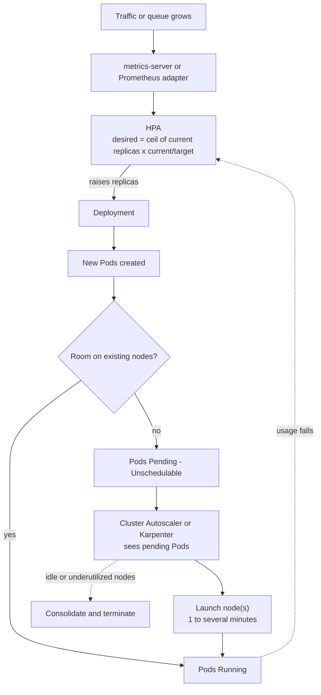
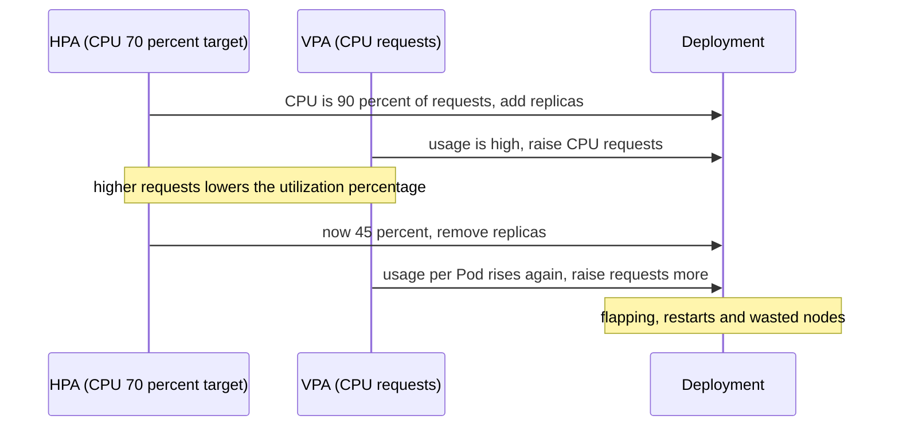

# L16.7 — HPA, VPA and Cluster Autoscaler

> **Level 16: Advanced Kubernetes** · Topic 7 of 10 · ⏱ ~6 hours · Difficulty: Advanced

## 1. What it is

Kubernetes can scale at two layers, and each layer has more than one tool:

- **Pod scaling** — change how many Pods run, or how big each Pod is.
  - **Horizontal Pod Autoscaler (HPA):** adds or removes Pod *replicas* based on metrics (CPU, memory, custom or external). You met the basics in [Horizontal Pod Autoscaling](../level-08-kubernetes/16-horizontal-pod-autoscaling.md).
  - **Vertical Pod Autoscaler (VPA):** adjusts a Pod's CPU and memory *requests* (and optionally limits) based on observed usage.
- **Node scaling** — change how many machines the cluster has.
  - **Cluster Autoscaler (CA):** grows and shrinks pre-defined *node groups* (for example AWS Auto Scaling groups) when Pods cannot be scheduled or nodes are idle.
  - **Karpenter:** a newer node provisioner that looks at pending Pods and launches *right-sized* instances directly (no node groups), then consolidates them when load drops.

Pod scaling decides *how much work is running*; node scaling decides *where there is room to run it*. They are separate control loops that react to each other with a delay, and most autoscaling incidents live in the gap between them.

## 2. Why it matters in DevOps

- **Cost and reliability in one knob.** Under-scaling means latency and errors during a traffic spike; over-scaling means paying for idle nodes ([Autoscaling for Cost](../level-20-cost-optimization/04-autoscaling-for-cost.md)).
- **Requests are the currency.** The scheduler, HPA (CPU utilization is a percentage *of requests*), VPA and node autoscalers all key off `resources.requests`. Wrong requests make every autoscaler wrong ([Resource Requests and Limits](../level-08-kubernetes/14-resource-requests-and-limits.md)).
- **Autoscalers fight.** HPA and VPA on the same metric, a Cluster Autoscaler blocked by a PodDisruptionBudget, or an HPA that scales up faster than nodes can arrive all produce "autoscaling is on but the site is still down".
- **Lead time.** A new node can take one to several minutes to become Ready. Spikes shorter than that need headroom, not reaction.

## 3. Real-world system example

**Amazon EKS with Karpenter, and GKE/AKS built-in autoscaling.** AWS documents Karpenter as the recommended node autoscaler for EKS in its best-practices guide, using `NodePool` and `EC2NodeClass` objects to describe what capacity is allowed (instance families, architectures, Spot vs On-Demand, CPU limits). When Pods go `Pending`, Karpenter batches them, chooses suitable instance types from the cloud API and launches nodes directly; when nodes become empty or underutilized it consolidates workloads and terminates nodes, honoring PodDisruptionBudgets and `disruption.budgets`. EKS also supports Cluster Autoscaler with managed node groups, and EKS Auto Mode is a managed offering that runs node provisioning for you. GKE offers cluster autoscaling and node auto-provisioning, plus Autopilot, and AKS ships a cluster autoscaler and a Karpenter-based "node auto-provisioning" option. Karpenter is now a Kubernetes SIG Autoscaling project with a cloud-provider interface, with AWS the most mature provider. On the pod side, VPA is a Kubernetes autoscaler subproject often run in recommendation-only mode to right-size requests, and event-driven autoscaling with **KEDA** (a CNCF project) feeds HPA with queue-length metrics from systems like Kafka and SQS ([Kafka](../level-13-databases-distributed-systems/08-kafka.md)).

## 4. Diagram



Why HPA and VPA on the same metric conflict:



## 5. How it works

### HPA (`autoscaling/v2`)

- Control loop (every 15 s by default): `desiredReplicas = ceil(currentReplicas × currentMetric / targetMetric)`, bounded by `minReplicas` and `maxReplicas`, and ignored inside a ±10% tolerance band.
- **Metric types:** `Resource` (CPU/memory from metrics-server), `ContainerResource` (per-container), `Pods` (per-Pod custom metric), `Object`, `External` (for example SQS queue depth through an adapter or KEDA).
- **Requires** `resources.requests` on the target containers for utilization-based targets, and metrics-server (or a custom metrics adapter).
- **`behavior`** tunes speed: `scaleUp`/`scaleDown` `policies` (for example +4 Pods or +100% per 60 s, whichever you choose with `selectPolicy`) and `stabilizationWindowSeconds` (default 300 s for scale-down, which stops flapping).
- Scaling to zero needs KEDA or the alpha `HPAScaleToZero` feature gate; stock HPA stops at 1.

### VPA

Three components (Recommender, Updater, Admission Plugin). `updatePolicy.updateMode`:

| Mode | Behaviour |
|------|-----------|
| `Off` | Only computes recommendations (read them with `kubectl describe vpa`). Safest, great for right-sizing. |
| `Initial` | Applies recommendations only when Pods are created |
| `Recreate` / `Auto` | Evicts Pods to apply new requests (Pod restart!) |
| `InPlaceOrRecreate` (newer versions) | Tries to resize without restart using Kubernetes in-place Pod resize, falling back to eviction; availability depends on your Kubernetes and VPA versions |

Do not let HPA and VPA both act on CPU or memory for the same workload. Common pattern: HPA on CPU (or custom metrics) with VPA in `Off` mode giving advice, or VPA on memory only with HPA on a custom metric.

### Cluster Autoscaler vs Karpenter

| | Cluster Autoscaler | Karpenter |
|--|--------------------|-----------|
| Unit of scaling | Node group (ASG / MIG / VMSS) you define in advance | Individual nodes chosen per pending-Pod set |
| Instance choice | Fixed per group (mixed instance policies help) | Picks from many types/families/zones given constraints |
| Scale-up trigger | Pending, unschedulable Pods | Pending, unschedulable Pods (batched) |
| Scale-down | Nodes under a utilization threshold (default 50%) for ~10 minutes, if Pods can move | Consolidation: delete empty nodes, replace/merge underutilized ones; `disruption.budgets` limit pace |
| Spot handling | Via mixed groups | First-class `capacity-type` requirement and interruption handling |
| Config | Flags on the autoscaler Deployment plus ASG tags | `NodePool` (what is allowed) + `EC2NodeClass` (how to build it) |
| Platforms | Many clouds | AWS most mature; other providers exist |

### Interactions and pitfalls

- **Missing or inflated requests:** no requests means HPA percentages are meaningless and nodes get overcommitted; inflated requests mean idle capacity you pay for.
- **PDBs and node drain:** a `PodDisruptionBudget` with `maxUnavailable: 0` makes a node undrainable, blocking both CA scale-down and Karpenter consolidation.
- **Scale-up latency:** node creation takes minutes. Use *overprovisioning* (low-priority "pause" Pods that reserve headroom and get preempted), or keep `minReplicas` above baseline before predictable peaks.
- **Local storage and anti-affinity:** Pods with `emptyDir`/local PVs, restrictive `topologySpreadConstraints` or hard anti-affinity can prevent bin-packing or scale-down. Annotate safe cases with `cluster-autoscaler.kubernetes.io/safe-to-evict: "true"` (CA) or `karpenter.sh/do-not-disrupt: "true"` for the opposite.
- **maxReplicas vs quotas:** `maxReplicas × requests` must fit in node limits (`NodePool.limits`, ASG max, cloud quotas), or Pods sit `Pending`.
- **Thrash:** short stabilization windows plus spiky metrics create scale-up/down loops; keep 300 s scale-down stabilization unless you have measured otherwise.

## 6. Step-by-step guide

**Prerequisites:** Docker, `kind`, `kubectl`. Cost: none locally. Node autoscaling (CA/Karpenter) needs a cloud cluster and is shown as reviewed manifests, not run here. Outputs are illustrative.

1. **Create the cluster and install metrics-server (with the kind TLS tweak).**
   ```bash
   kind create cluster --name scale-lab
   kubectl apply -f https://github.com/kubernetes-sigs/metrics-server/releases/latest/download/components.yaml
   kubectl -n kube-system patch deployment metrics-server --type=json \
     -p '[{"op":"add","path":"/spec/template/spec/containers/0/args/-","value":"--kubelet-insecure-tls"}]'
   kubectl -n kube-system rollout status deploy/metrics-server
   kubectl top nodes
   ```
   `--kubelet-insecure-tls` is only for kind's self-signed kubelet certificates; never use it in production. `kubectl top nodes` prints CPU/memory after about a minute.

2. **Deploy a CPU-hungry sample app with proper requests.**
   ```bash
   kubectl create namespace shop
   cat <<'EOF' | kubectl apply -n shop -f -
   apiVersion: apps/v1
   kind: Deployment
   metadata: {name: php-apache}
   spec:
     selector: {matchLabels: {app: php-apache}}
     replicas: 1
     template:
       metadata: {labels: {app: php-apache}}
       spec:
         containers:
           - name: php-apache
             image: registry.k8s.io/hpa-example
             ports: [{containerPort: 80}]
             resources:
               requests: {cpu: 200m, memory: 64Mi}
               limits: {cpu: 500m, memory: 128Mi}
   ---
   apiVersion: v1
   kind: Service
   metadata: {name: php-apache}
   spec:
     selector: {app: php-apache}
     ports: [{port: 80}]
   EOF
   ```

3. **Create an HPA with a tuned `behavior`.**
   ```bash
   cat <<'EOF' | kubectl apply -n shop -f -
   apiVersion: autoscaling/v2
   kind: HorizontalPodAutoscaler
   metadata: {name: php-apache}
   spec:
     scaleTargetRef: {apiVersion: apps/v1, kind: Deployment, name: php-apache}
     minReplicas: 1
     maxReplicas: 8
     metrics:
       - type: Resource
         resource:
           name: cpu
           target: {type: Utilization, averageUtilization: 50}
     behavior:
       scaleUp:
         stabilizationWindowSeconds: 0
         policies:
           - {type: Pods, value: 4, periodSeconds: 60}
       scaleDown:
         stabilizationWindowSeconds: 120
         policies:
           - {type: Percent, value: 50, periodSeconds: 60}
   EOF
   kubectl -n shop get hpa php-apache
   ```
   Expect `TARGETS cpu: 0%/50%` after a minute (if `<unknown>`, metrics-server is not ready or requests are missing).

4. **Generate load and watch it scale.** In one terminal:
   ```bash
   kubectl -n shop run load --image=busybox:1.36 --restart=Never -- \
     /bin/sh -c "while true; do wget -q -O- http://php-apache; done"
   ```
   In another:
   ```bash
   kubectl -n shop get hpa php-apache -w
   ```
   Similar to: `cpu: 250%/50%` then replicas stepping 1 → 5 → 8 within a few minutes. Compute it by hand: 1 replica at 250% of target 50% → `ceil(1 × 250/50) = 5`.

5. **Remove the load and observe slow scale-down.**
   ```bash
   kubectl -n shop delete pod load
   kubectl -n shop get hpa php-apache -w
   ```
   CPU drops to 0% immediately but replicas shrink only after the 120 s stabilization window, in steps of at most 50% per minute.

6. **Install VPA in recommendation-only mode.** Install the components following the Kubernetes autoscaler repository's VPA documentation (it provides a `hack/vpa-up.sh` script and a Helm chart; follow the version matching your cluster). Then:
   ```bash
   cat <<'EOF' | kubectl apply -n shop -f -
   apiVersion: autoscaling.k8s.io/v1
   kind: VerticalPodAutoscaler
   metadata: {name: php-apache}
   spec:
     targetRef: {apiVersion: apps/v1, kind: Deployment, name: php-apache}
     updatePolicy: {updateMode: "Off"}
     resourcePolicy:
       containerPolicies:
         - containerName: "*"
           minAllowed: {cpu: 50m, memory: 32Mi}
           maxAllowed: {cpu: 1, memory: 512Mi}
   EOF
   kubectl -n shop describe vpa php-apache | sed -n '/Recommendation/,$p'
   ```
   After a few minutes of traffic you see `Lower Bound`, `Target` and `Upper Bound` per container. Use `Target` to correct your requests. Note that setting `updateMode: "Off"` keeps HPA safe from VPA interference.

7. **Review the node-autoscaler manifests (EKS, not run here).** *Cost warning:* running nodes bills by the second; set an AWS Budget/billing alarm and delete the cluster afterwards. A Karpenter v1 setup on EKS defines allowed capacity and how nodes are built:
   ```yaml
   apiVersion: karpenter.sh/v1
   kind: NodePool
   metadata:
     name: default
   spec:
     template:
       spec:
         nodeClassRef:
           group: karpenter.k8s.aws
           kind: EC2NodeClass
           name: default
         requirements:
           - key: karpenter.sh/capacity-type
             operator: In
             values: ["spot", "on-demand"]
           - key: kubernetes.io/arch
             operator: In
             values: ["amd64"]
           - key: karpenter.k8s.aws/instance-category
             operator: In
             values: ["c", "m", "r"]
           - key: karpenter.k8s.aws/instance-generation
             operator: Gt
             values: ["2"]
         expireAfter: 720h
     limits:
       cpu: "100"
     disruption:
       consolidationPolicy: WhenEmptyOrUnderutilized
       consolidateAfter: 1m
       budgets:
         - nodes: "10%"
   ---
   apiVersion: karpenter.k8s.aws/v1
   kind: EC2NodeClass
   metadata:
     name: default
   spec:
     role: "KarpenterNodeRole-<CLUSTER_NAME>"
     amiSelectorTerms:
       - alias: al2023@latest
     subnetSelectorTerms:
       - tags:
           karpenter.sh/discovery: "<CLUSTER_NAME>"
     securityGroupSelectorTerms:
       - tags:
           karpenter.sh/discovery: "<CLUSTER_NAME>"
   ```
   Read it line by line: `limits.cpu` caps total provisioned CPU (your cost fence), `capacity-type` allows Spot, `consolidationPolicy` lets Karpenter repack, `budgets` limits how many nodes are disrupted at once, and `expireAfter` rotates nodes for patching. Pin the AMI alias (for example a specific `al2023@v...` version) in production instead of `@latest`. Install steps for the controller (IAM roles, interruption queue, Helm chart) are in the Karpenter "Getting Started" guide.

8. **Add headroom with overprovisioning pods (works with CA or Karpenter).** Low-priority placeholder Pods hold space and are preempted when real Pods need it, triggering node scale-up *before* users feel it:
   ```yaml
   apiVersion: scheduling.k8s.io/v1
   kind: PriorityClass
   metadata:
     name: overprovisioning
   value: -10
   globalDefault: false
   description: placeholder pods that real workloads can preempt
   ---
   apiVersion: apps/v1
   kind: Deployment
   metadata:
     name: overprovisioning
     namespace: kube-system
   spec:
     replicas: 2
     selector:
       matchLabels: {app: overprovisioning}
     template:
       metadata:
         labels: {app: overprovisioning}
       spec:
         priorityClassName: overprovisioning
         containers:
           - name: pause
             image: registry.k8s.io/pause:3.9
             resources:
               requests: {cpu: "500m", memory: 512Mi}
   ```

9. **Clean up:** `kind delete cluster --name scale-lab`. For any cloud run: delete the workloads (so nodes drain), then the NodePools, then the cluster, and confirm no EC2 instances remain.

## 7. Real-world scenario

*(Illustrative.)* During a flash sale the `shop-api` HPA correctly scaled from 6 to 40 Pods in four minutes, but half of them sat `Pending` for another five: the Cluster Autoscaler's node group was capped at 10 nodes and the chosen instance type had no capacity in one zone. Checkout latency climbed and the team was paged. Investigation (`kubectl get pods --field-selector=status.phase=Pending`, `kubectl describe pod` showing `FailedScheduling`, and the autoscaler logs) found three issues: `maxSize` too low, a single instance type, and requests of `1 CPU` per Pod although usage was `150m` (so nodes looked full). The fix: VPA recommendations lowered requests to 250m, Karpenter replaced the fixed group with a multi-family NodePool allowing Spot and On-Demand with a CPU limit sized to budget, overprovisioning pods provided 10% headroom, and a load test before each sale verified time-to-capacity. **Lesson:** measure end-to-end time to capacity, not just whether HPA "works".

## 8. Common mistakes and best practices

**Don't**

- Run HPA on CPU while VPA also changes CPU requests for the same Deployment.
- Set `resources.requests` equal to limits "to be safe" without measuring; or omit them entirely.
- Set `maxUnavailable: 0` PDBs on everything, or `minAvailable` equal to replicas, which blocks node drains.
- Leave `maxReplicas` unbounded or `NodePool.limits` unset; a runaway loop is a surprise bill.
- Scale on a metric that does not correlate with load (CPU on an I/O-bound or queue-driven worker).

**Do**

- Right-size requests with VPA in `Off` mode and real load tests, then set HPA targets (50-70% CPU is typical).
- Use `behavior` to scale up fast and down slowly; keep a 5-minute scale-down window by default.
- Use custom or external metrics (requests per second, queue depth) or KEDA when CPU is a poor proxy.
- Spread across zones, keep Pods interruptible (readiness probes, graceful shutdown) when using Spot ([Spot Instances](../level-20-cost-optimization/03-spot-instances.md)), and set PDBs thoughtfully.
- Alert on `Pending` Pods, HPA `ScalingLimited` conditions and node provisioning errors; load test scale-up time.

## 9. Tasks

- [ ] **T1 — Scale on CPU** *(≈40 min, beginner)*
  - **Goal:** watch an HPA react to load.
  - **Steps:**
    1. Do guide steps 1-4.
    2. Record `TARGETS` and `REPLICAS` every 30 s for five minutes.
  - **Done when:** replicas rise above 1 under load and fall back after you stop it, and you can compute one of the scaling decisions by hand.

- [ ] **T2 — Tune the behavior** *(≈40 min, intermediate)*
  - **Goal:** control speed and stability.
  - **Steps:**
    1. Change `scaleDown.stabilizationWindowSeconds` to 30 and `scaleUp` to `+1 Pod per 60 s`.
    2. Repeat the load test and compare timelines with T1.
  - **Done when:** you can show the two timelines and explain which setting changed which part of the curve.

- [ ] **T3 — Right-size with VPA** *(≈60 min, intermediate)*
  - **Goal:** use recommendations, not guesses.
  - **Steps:**
    1. Install VPA and create the `Off` mode object (step 6).
    2. Apply steady load for 10 minutes and read `Target`.
    3. Update the Deployment's requests to the recommendation and rerun the HPA test.
  - **Done when:** the HPA `TARGETS` percentage reflects realistic usage and you can state the before/after requests.

- [ ] **T4 — Break it: missing requests and pending Pods** *(≈40 min, advanced)*
  - **Goal:** diagnose two classic autoscaling failures.
  - **Steps:**
    1. Remove `resources.requests` from the Deployment and observe the HPA `TARGETS` become `<unknown>`; read `kubectl describe hpa` for the condition message.
    2. Restore requests, then set `maxReplicas: 100` with `requests.cpu: 2` and watch Pods go `Pending` on your small kind node; find the `FailedScheduling` event.
  - **Done when:** you can state the exact message for each failure and the fix.

- [ ] **T5 — Plan a Karpenter NodePool** *(≈60 min, advanced)*
  - **Goal:** design node autoscaling with a cost fence, for review rather than deployment.
  - **Steps:**
    1. Adapt the step 7 manifests for `shop-api` in `us-east-1`: choose capacity types, instance categories, a CPU limit and a disruption budget, and add a second NodePool for system Pods that never uses Spot (with a taint).
    2. Write a short README: what happens on a spot interruption, on a Pod with `do-not-disrupt`, and when `limits.cpu` is hit.
    3. (Optional) try the Karpenter KWOK provider to simulate it locally, or a dev EKS cluster with a billing alarm and teardown.
  - **Done when:** a reviewer can read your manifests and README and predict the behaviour in all three situations.

- [ ] **T6 — Prove it: end-to-end capacity test** *(≈90 min, advanced)*
  - **Goal:** demonstrate and explain both scaling layers without the guide.
  - **Steps:**
    1. On any cluster (kind for pods, a dev cloud cluster for nodes), create load that forces both HPA scale-up and node scale-up.
    2. Measure time from load start to all Pods Ready, and name which step dominated.
    3. Explain how requests, PDBs, overprovisioning and HPA/VPA separation affect the result.
  - **Done when:** you have a timeline with timestamps (load start, HPA decision, Pending, node Ready, Pods Ready) and a written explanation.

## 10. Self-check questions

1. Write the HPA formula and compute desired replicas for 4 Pods at 90% CPU with a 60% target.
2. Why must Pods have CPU requests for HPA utilization targets to work?
3. Why should HPA and VPA not both manage CPU for the same workload?
4. What triggers scale-up and scale-down in Cluster Autoscaler, and how does Karpenter differ?
5. How can a PodDisruptionBudget stop a node from being removed?
6. What is overprovisioning with pause Pods and what problem does it solve?

<details>
<summary>Answers</summary>

1. `desired = ceil(current × currentMetric / target)` = ceil(4 × 90/60) = 6.
2. Utilization is computed as usage divided by requests; without requests there is no denominator, so the metric is `<unknown>`.
3. VPA raising requests lowers the HPA's utilization percentage, causing it to scale in, which raises per-Pod load and VPA recommendations again, so they oscillate.
4. CA scales up when Pods are unschedulable and down when nodes are underutilized, within pre-defined node groups. Karpenter provisions individual right-sized nodes directly from pending Pods and consolidates continuously, using NodePool constraints.
5. Draining evicts Pods; if evicting would violate the PDB (for example `maxUnavailable: 0`), the eviction is refused and the node cannot be removed.
6. Low-priority placeholder Pods reserve capacity; real Pods preempt them instantly while the autoscaler adds a node for the evicted placeholders, hiding node start-up latency.
</details>

## 11. Further reading

- Kubernetes documentation: *Horizontal Pod Autoscaling*, *Node Autoscaling* and *Resource Management for Pods and Containers*.
- Kubernetes autoscaler repository: Vertical Pod Autoscaler and Cluster Autoscaler FAQs.
- Karpenter documentation (karpenter.sh), the Amazon EKS Best Practices Guide (cluster autoscaling and cost sections), and KEDA documentation (keda.sh).
- Related: [High Availability and Scalability](../level-00-what-devops-is/08-high-availability-and-scalability.md), [Auto Scaling](../level-06-cloud-aws/02-auto-scaling.md), [Kubernetes Infrastructure Costs](../level-20-cost-optimization/09-kubernetes-infrastructure-costs.md).

<!-- nav -->
---
← Previous: [Admission Controllers and Webhooks](06-admission-controllers-and-webhooks.md) · [Level 16 index](README.md) · Next: [Stateful Workloads](08-stateful-workloads.md) →
