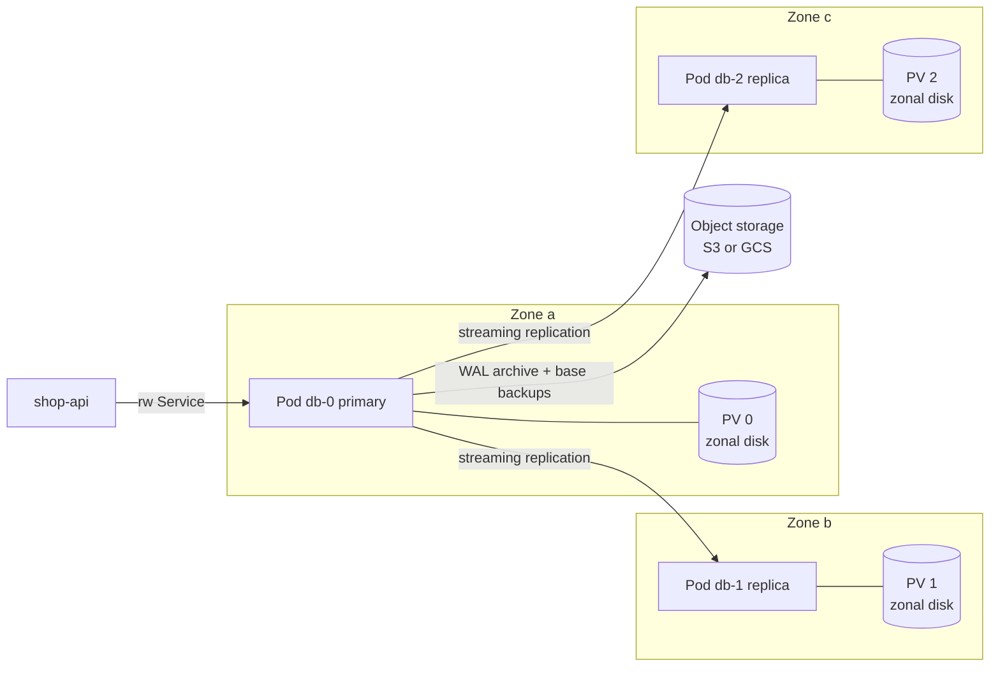
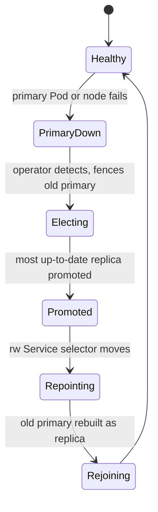

# L16.8 — Stateful Workloads

> **Level 16: Advanced Kubernetes** · Topic 8 of 10 · ⏱ ~6 hours · Difficulty: Advanced

## 1. What it is

A **stateless** workload can be killed and replaced anywhere with no loss: the `shop-api` web tier. A **stateful** workload owns data that must survive restarts, rescheduling and node loss: PostgreSQL, Redis with persistence, Kafka, Elasticsearch. Kubernetes can run these, but the platform's default assumptions (Pods are disposable, interchangeable and can start anywhere) work against you until you add the right pieces:

- **Stable identity and ordered rollout:** [StatefulSets](../level-08-kubernetes/10-statefulsets.md) give Pods stable names (`db-0`, `db-1`), stable DNS through a headless Service, and one PersistentVolumeClaim per Pod via `volumeClaimTemplates`.
- **Durable storage:** [PersistentVolumes and PVCs](../level-08-kubernetes/09-volumes-pv-pvc.md), provisioned dynamically through a **StorageClass** and a **CSI driver** (Container Storage Interface, the plugin API for storage).
- **Application-aware operations:** replication, leader election, failover, upgrades, backups. These are not Kubernetes features; an **[operator](04-operators.md)** or your own runbooks must supply them.

The honest question is not "can it run on Kubernetes?" but "should *we* run it, and who gets paged when it breaks?"

## 2. Why it matters in DevOps

- **Data loss is the one unrecoverable failure.** A deleted PVC with `reclaimPolicy: Delete`, an unverified backup, or a failover that promotes a lagging replica ends careers.
- **Storage is zonal.** An EBS volume lives in one Availability Zone; the Pod must be scheduled in the same zone, which interacts with autoscaling and node drains ([HPA, VPA and Cluster Autoscaler](07-hpa-vpa-cluster-autoscaler.md)).
- **Cost and toil trade-off.** Managed databases ([RDS and Aurora](../level-06-cloud-aws/10-rds-and-aurora.md)) cost more per GB but remove patching, backups and failover from your plate.
- **Platform consistency.** Teams that already operate Kubernetes well often want databases in the same GitOps workflow, with the same observability and policy.

## 3. Real-world system example

**PostgreSQL operators and Kafka on Kubernetes.** Zalando open-sourced its Patroni-based `postgres-operator` and documents running it for its own applications; CloudNativePG (a CNCF project) models a Postgres cluster as a `Cluster` resource, with automated failover, rolling updates and backup to object storage with point-in-time recovery from archived WAL (write-ahead log) files; Crunchy Data's PGO and Percona's operators offer similar approaches. **Strimzi** (CNCF) runs Apache Kafka on Kubernetes with CRDs for clusters, topics and users. The Data on Kubernetes Community (DoKC) collects production reports and best practices, and the Kubernetes docs themselves include tutorials for replicated MySQL and ZooKeeper using StatefulSets. On the other side, cloud providers' own guidance generally recommends their managed database services for primary relational data unless you have a reason to self-manage. Both positions are mainstream; the right one depends on team size, compliance needs and failure tolerance.

## 4. Diagram



Failover as a state machine, driven by the operator:



## 5. How it works

### The storage chain

| Object | Role | Settings that matter |
|--------|------|----------------------|
| **StorageClass** | Recipe for provisioning volumes | `provisioner` (CSI driver), `parameters` (disk type, IOPS), `reclaimPolicy` (`Delete` or `Retain`), `allowVolumeExpansion`, `volumeBindingMode` |
| **PVC** | A request for storage | access mode (`ReadWriteOnce` for a single node), size, class |
| **PV** | The actual volume | created dynamically; bound 1:1 to the PVC |
| **VolumeSnapshot** (`snapshot.storage.k8s.io`) | Point-in-time copy via the CSI driver | `VolumeSnapshotClass`; restore by creating a PVC with a `dataSource` |

- Use `volumeBindingMode: WaitForFirstConsumer` so the volume is created in the zone where the Pod is scheduled, not before.
- Use `reclaimPolicy: Retain` for important data so that deleting a PVC does not delete the disk, and set `persistentVolumeClaimRetentionPolicy` on StatefulSets (`whenDeleted`/`whenScaled`: `Retain` or `Delete`) deliberately.
- Network block storage (EBS, Persistent Disk) survives node loss but has latency and IOPS limits; local NVMe is fast but is lost with the node, so replication must carry durability.

### Running a database safely

- **Replication plus backups.** Replicas protect against node failure, *not* against `DROP TABLE` or corruption. Backups (base backup + continuous WAL archive for point-in-time recovery, see [Backups and Point-in-Time Recovery](../level-13-databases-distributed-systems/05-backups-and-pitr.md)) protect against both. **A backup is only real after a successful restore test** ([Testing Backup Restoration](../level-15-disaster-recovery/09-testing-backup-restoration.md)).
- **Spread and protect.** Anti-affinity / topology spread so replicas land in different zones; PodDisruptionBudgets so drains cannot take out two members; dedicated node pools or taints so noisy neighbours do not starve the database.
- **Resources.** Set memory requests = limits for databases (avoid OOM surprises), `Guaranteed` QoS, and tune huge pages, `shared_buffers` etc. for your engine.
- **Upgrades.** Minor version upgrades via rolling restart replicas-first; major upgrades need a tested procedure (`pg_upgrade` or logical replication). Operators automate part of this; read what they do.
- **Connection management.** Put a pooler such as PgBouncer in front ([Database Connection Pooling](../level-13-databases-distributed-systems/06-db-connection-pooling.md)); many operators include one.
- **Velero** (and similar tools) back up Kubernetes *objects* and, with CSI snapshots or file-system backup, volume contents. It complements, not replaces, database-native backups, which are consistent at the transaction level.

### When *not* to run it on Kubernetes

| Situation | Better choice |
|-----------|---------------|
| Small team, no one with database operations experience | Managed service (RDS, Aurora, Cloud SQL) |
| Strict RPO/RTO and compliance that the provider already certifies | Managed service with multi-AZ and automated backups |
| Single huge database needing special hardware or kernel tuning | Dedicated VMs or bare metal |
| You cannot test restores and failover regularly | Do not self-run it yet |
| Cache or queue where loss is acceptable | Kubernetes is fine; persistence may not even be needed |
| Multi-tenant platform wanting self-service databases | Operator-based on Kubernetes can be a strong fit |

## 6. Step-by-step guide

**Prerequisites:** Docker, `kind`, `kubectl`, `helm`. Cost: none locally. Outputs are illustrative. kind uses a local-path provisioner whose volumes are node-local (good for learning, **not** a durability model).

1. **Create a cluster and inspect storage.**
   ```bash
   kind create cluster --name stateful-lab
   kubectl get storageclass
   kubectl get storageclass standard -o jsonpath='{.provisioner}{"  "}{.volumeBindingMode}{"  "}{.reclaimPolicy}{"\n"}'
   ```
   Expect a `standard (default)` class using `rancher.io/local-path`, `WaitForFirstConsumer` and `Delete`. On a real cloud you would define classes explicitly; for example:
   ```yaml
   apiVersion: storage.k8s.io/v1
   kind: StorageClass
   metadata:
     name: gp3-retain
   provisioner: ebs.csi.aws.com
   parameters:
     type: gp3
     encrypted: "true"
   reclaimPolicy: Retain
   allowVolumeExpansion: true
   volumeBindingMode: WaitForFirstConsumer
   ```

2. **Run a persistent Redis with a StatefulSet and prove data survives a Pod restart.**
   ```bash
   kubectl create namespace shop
   cat <<'EOF' | kubectl apply -n shop -f -
   apiVersion: v1
   kind: Service
   metadata: {name: redis}
   spec:
     clusterIP: None
     selector: {app: redis}
     ports: [{port: 6379, name: redis}]
   ---
   apiVersion: apps/v1
   kind: StatefulSet
   metadata: {name: redis}
   spec:
     serviceName: redis
     replicas: 1
     selector: {matchLabels: {app: redis}}
     persistentVolumeClaimRetentionPolicy:
       whenDeleted: Retain
       whenScaled: Retain
     template:
       metadata: {labels: {app: redis}}
       spec:
         containers:
           - name: redis
             image: redis:7-alpine
             args: ["--appendonly", "yes", "--dir", "/data"]
             ports: [{containerPort: 6379}]
             volumeMounts: [{name: data, mountPath: /data}]
     volumeClaimTemplates:
       - metadata: {name: data}
         spec:
           accessModes: [ReadWriteOnce]
           resources: {requests: {storage: 100Mi}}
   EOF
   kubectl -n shop rollout status sts/redis
   kubectl -n shop exec redis-0 -- redis-cli set cart:42 "3 items"
   kubectl -n shop delete pod redis-0
   kubectl -n shop rollout status sts/redis
   kubectl -n shop exec redis-0 -- redis-cli get cart:42
   ```
   The last command prints `"3 items"`: the new Pod `redis-0` re-attached the same PVC `data-redis-0`. See it with `kubectl -n shop get pvc,pv`.

3. **Prove the PVC outlives the StatefulSet (retention policy).**
   ```bash
   kubectl -n shop delete sts redis
   kubectl -n shop get pvc            # data-redis-0 is still there
   ```
   Re-applying the StatefulSet would re-attach it. Delete the PVC only when you mean to destroy the data.

4. **Install a Postgres operator and create a 3-instance cluster.**
   ```bash
   helm repo add cnpg https://cloudnative-pg.github.io/charts
   helm repo update
   helm upgrade --install cnpg cnpg/cloudnative-pg -n cnpg-system --create-namespace
   kubectl -n cnpg-system rollout status deploy -l app.kubernetes.io/name=cloudnative-pg
   cat <<'EOF' | kubectl apply -f -
   apiVersion: postgresql.cnpg.io/v1
   kind: Cluster
   metadata:
     name: shop-db
     namespace: shop
   spec:
     instances: 3
     storage:
       size: 1Gi
     resources:
       requests: {cpu: 250m, memory: 512Mi}
       limits: {memory: 512Mi}
   EOF
   kubectl -n shop get cluster shop-db -w
   ```
   Wait for `Cluster in healthy state`. Services created: `shop-db-rw` (primary), `shop-db-ro` (replicas), `shop-db-r` (any).

5. **Write data, then fail the primary while writing.**
   ```bash
   P=$(kubectl -n shop get cluster shop-db -o jsonpath='{.status.currentPrimary}')
   kubectl -n shop exec "$P" -c postgres -- psql -U postgres -d app -c \
     "create table if not exists orders(id serial primary key, created timestamptz default now()); insert into orders default values;"
   kubectl -n shop delete pod "$P" --wait=false
   kubectl -n shop get cluster shop-db -w
   ```
   A replica is promoted. After the cluster is healthy again:
   ```bash
   P2=$(kubectl -n shop get cluster shop-db -o jsonpath='{.status.currentPrimary}'); echo "new primary: $P2"
   kubectl -n shop exec "$P2" -c postgres -- psql -U postgres -d app -c "select count(*) from orders;"
   ```
   The row survived. Applications connected through `shop-db-rw` reconnect to the new primary after a short interruption, so client retry logic matters ([Idempotency](../level-13-databases-distributed-systems/14-idempotency.md)).

6. **Take a logical backup and practice a restore.** This works anywhere and is independent of the operator's own backup mechanism:
   ```bash
   kubectl -n shop exec "$P2" -c postgres -- pg_dump -U postgres -d app -Fc -f /tmp/app.dump
   kubectl -n shop cp "$P2":/tmp/app.dump ./app.dump -c postgres
   ls -lh app.dump
   # restore into a scratch database
   kubectl -n shop exec "$P2" -c postgres -- psql -U postgres -c "create database app_restore;"
   kubectl -n shop exec "$P2" -c postgres -- pg_restore -U postgres -d app_restore /tmp/app.dump
   kubectl -n shop exec "$P2" -c postgres -- psql -U postgres -d app_restore -c "select count(*) from orders;"
   ```
   The count should match. If `kubectl cp` complains that `tar` is missing, run the dump to stdout instead: `kubectl exec ... -- pg_dump -U postgres -d app -Fc > app.dump`.

7. **Review production backup configuration (object storage + PITR).** Shape of an operator-managed backup to S3-compatible storage (field names vary by operator version; recent CloudNativePG releases are moving object-store backups to a Barman Cloud plugin, so follow the docs for your version):
   ```yaml
   # illustrative shape, not applied in this lab
   apiVersion: postgresql.cnpg.io/v1
   kind: ScheduledBackup
   metadata: {name: shop-db-nightly, namespace: shop}
   spec:
     schedule: "0 0 2 * * *"      # six fields in CNPG: second minute hour day month weekday
     cluster: {name: shop-db}
     backupOwnerReference: self
   ```
   The pieces every solution needs: credentials for the bucket (IAM role via IRSA / Pod Identity on EKS, not static keys), continuous WAL archiving, scheduled base backups, a retention policy, and a **recovery** definition (`bootstrap: recovery` with a target time) that you have actually exercised.

8. **Add scheduling protections to anything you self-run.** Spread members across zones and cap voluntary disruption (operators usually do this for you; plain StatefulSets need it written):
   ```yaml
   apiVersion: policy/v1
   kind: PodDisruptionBudget
   metadata: {name: redis, namespace: shop}
   spec:
     maxUnavailable: 1
     selector: {matchLabels: {app: redis}}
   ```
   and in the Pod template: `topologySpreadConstraints: [{maxSkew: 1, topologyKey: topology.kubernetes.io/zone, whenUnsatisfiable: DoNotSchedule, labelSelector: {matchLabels: {app: redis}}}]`.

9. **Clean up:** `rm -f app.dump; kind delete cluster --name stateful-lab`. On a cloud cluster, retained PVs/volumes keep billing; delete the underlying disks and snapshots explicitly.

## 7. Real-world scenario

*(Illustrative.)* A team ran a three-node Postgres StatefulSet on a hand-written Helm chart, with replicas in two zones and nightly `pg_dump` backups they had never restored. A developer ran a migration containing `DELETE FROM payments;` without a `WHERE` clause. Replication faithfully copied the delete to both replicas within a second. The latest dump was 20 hours old and, when restored for the first time, took 3 hours and was missing a table added after the dump's schema list was written. The postmortem produced: continuous WAL archiving with point-in-time recovery to just before the delete, a monthly restore drill in an isolated namespace measured against an RTO, migrations reviewed and run through a role without `DELETE` on critical tables, and a decision memo that, for a team of four, moving to a managed database with PITR was the better trade. **Lesson:** replication is availability, not backup; and whether to self-host is a staffing question as much as a technical one.

## 8. Common mistakes and best practices

**Don't**

- Treat replicas as backups.
- Use `reclaimPolicy: Delete` and `whenDeleted: Delete` on irreplaceable data without a tested restore path.
- Use `emptyDir` or node-local storage for data you cannot rebuild.
- Run a single-replica "production" database with no PDB and call it highly available.
- Upgrade the operator and the database engine at the same time.

**Do**

- Prefer an operator with a track record (and read its failure modes) over hand-rolled StatefulSets for databases.
- Archive WAL and take base backups to object storage in another account or region ([Off-site Backups](../level-15-disaster-recovery/08-offsite-backups.md)).
- Practice restore and failover on a schedule; measure RPO and RTO ([RPO](../level-15-disaster-recovery/06-rpo.md), [RTO](../level-15-disaster-recovery/07-rto.md)).
- Use `WaitForFirstConsumer`, zone spread, PDBs, dedicated node pools and Guaranteed QoS.
- Monitor replication lag, disk usage (alert before full; ensure `allowVolumeExpansion`), backup age and WAL archive failures.
- Decide explicitly, in writing, whether the database belongs on Kubernetes ([Architecture Decision Records](../level-19-architecture/11-architecture-decision-records.md)).

## 9. Tasks

- [ ] **T1 — Persistence across Pod death** *(≈30 min, beginner)*
  - **Goal:** prove a PVC outlives its Pod.
  - **Steps:**
    1. Run the Redis StatefulSet (step 2), write a key, delete `redis-0`.
    2. Read the key again and run `kubectl get pvc,pv`.
  - **Done when:** the value is still there and you can name the PVC that held it.

- [ ] **T2 — Retention and reclaim** *(≈30 min, intermediate)*
  - **Goal:** understand what really deletes data.
  - **Steps:**
    1. Delete the StatefulSet (PVC stays), then the PVC, then check the PV state.
    2. Switch the PV `persistentVolumeReclaimPolicy` to `Retain` with `kubectl patch pv ...` before deleting the PVC and repeat.
  - **Done when:** you can state, for each combination of `reclaimPolicy` and PVC deletion, whether the underlying volume survives, and demonstrate `Released` PV status.

- [ ] **T3 — Operator failover** *(≈45 min, advanced)*
  - **Goal:** observe automated failover and client impact.
  - **Steps:**
    1. Create `shop-db` (step 4).
    2. Run a loop inserting a row every second via `shop-db-rw` from a client Pod while you delete the primary.
    3. Count failed or missing inserts and the outage duration.
  - **Done when:** you have a measured outage in seconds and a statement of what the application must do (retry with backoff) to survive it.

- [ ] **T4 — Backup and restore drill** *(≈60 min, advanced)*
  - **Goal:** a restore you have actually performed.
  - **Steps:**
    1. Take a logical backup (step 6), then run `drop table orders;` in `app`.
    2. Restore from the dump into `app_restore`, and compare row counts with the dump's age.
    3. Write down the RPO this implies (time since last backup) and the measured RTO.
  - **Done when:** the table is back with correct data, and you have RPO and RTO numbers on paper.

- [ ] **T5 — Break it: drain and anti-affinity** *(≈45 min, advanced)*
  - **Goal:** see PDBs and spreading in action.
  - **Steps:**
    1. Create a kind cluster with 3 worker nodes, deploy a 3-replica StatefulSet with the step 8 PDB and zone/host spread.
    2. `kubectl drain` one node, then try draining a second while the first Pod is not ready.
    3. Observe the PDB refusing the second eviction.
  - **Done when:** you capture the `Cannot evict pod as it would violate the pod's disruption budget` message and explain how it protects quorum.

- [ ] **T6 — Prove it: build-vs-buy decision** *(≈60 min, advanced)*
  - **Goal:** make and defend a decision for `shop-api`'s PostgreSQL.
  - **Steps:**
    1. Without the guide, write a one-page ADR comparing RDS/Aurora with CloudNativePG on Kubernetes across cost, operations, RPO/RTO, skills required and exit cost.
    2. Include the exact restore test you would run to accept either option.
    3. Present it to a teammate.
  - **Done when:** the ADR states a recommendation with the deciding factors, and the restore test is concrete enough to run.

## 10. Self-check questions

1. What do replicas protect against, and what do they not protect against?
2. Why use `volumeBindingMode: WaitForFirstConsumer` with zonal disks?
3. What happens to the PVCs when you delete a StatefulSet?
4. What makes a backup "real"?
5. Name three situations where you should prefer a managed database.
6. Why can a drain stall when a PodDisruptionBudget exists?

<details>
<summary>Answers</summary>

1. They protect against node/Pod/zone failure (availability). They do not protect against logical errors (bad deletes, corruption, ransomware) because those replicate too.
2. It delays volume creation until the Pod is scheduled, so the disk is created in the zone where the Pod will run rather than a zone that cannot host it.
3. By default PVCs are retained (the StatefulSet's `persistentVolumeClaimRetentionPolicy` can change this); the Pods go away but the claims and data stay until you delete them.
4. A restore has been tested end-to-end, within the RTO, producing correct data as of the expected RPO.
5. Small team without DB expertise; strict compliance and SLAs the provider already meets; need for features like Aurora global databases or when failure of self-managed operations would be too costly.
6. The eviction API refuses evictions that would drop available Pods below the budget, so the drain waits or fails until enough Pods are ready elsewhere.
</details>

## 11. Further reading

- Kubernetes documentation: *StatefulSets*, *Storage Classes*, *Volume Snapshots* and *Run a Replicated Stateful Application*.
- CloudNativePG, Zalando postgres-operator, Strimzi and Velero project documentation.
- *Data on Kubernetes Community* (dok.community) reports and whitepapers.
- Related: [Operators](04-operators.md), [Replication](../level-13-databases-distributed-systems/04-replication.md), [Backups](../level-15-disaster-recovery/01-backups.md), [Database Costs](../level-20-cost-optimization/08-database-costs.md).

<!-- nav -->
---
← Previous: [HPA, VPA and Cluster Autoscaler](07-hpa-vpa-cluster-autoscaler.md) · [Level 16 index](README.md) · Next: [Service Mesh with Istio or Linkerd](09-service-mesh-istio-linkerd.md) →
