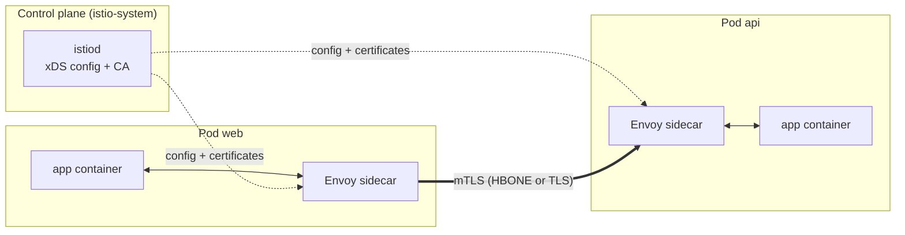
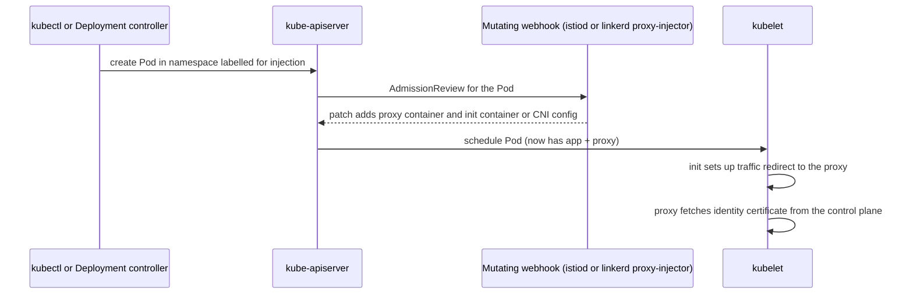
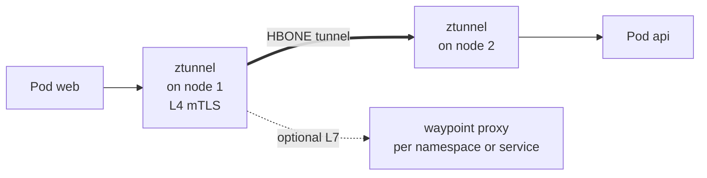

# L16.9 — Service Mesh with Istio or Linkerd

> **Level 16: Advanced Kubernetes** · Topic 9 of 10 · ⏱ ~6 hours · Difficulty: Advanced

## 1. What it is

A **service mesh** is a dedicated infrastructure layer that handles service-to-service communication so that applications do not have to. Instead of every service re-implementing TLS, retries, timeouts, load balancing and metrics in its own language and library, the mesh puts a **proxy** next to (or near) every workload. All traffic flows through those proxies, which are configured centrally by a **control plane**.

A mesh is split into two planes:

- **Data plane:** the proxies that carry the traffic. In **Istio** classic mode each Pod gets an **Envoy** proxy as a *sidecar* container; in **Linkerd** each Pod gets `linkerd2-proxy`, a lightweight proxy written in Rust. Istio's newer **ambient mode** removes per-Pod sidecars: a per-node **ztunnel** handles identity and mTLS (L4), and optional **waypoint** proxies handle L7 features for the services that need them.
- **Control plane:** the brains. For Istio that is `istiod` (service discovery, config distribution, certificate authority); for Linkerd it is the `destination`, `identity` and `proxy-injector` components.

This topic covers the architecture, sidecar injection, and installing and onboarding an app. The next topic, [Mesh traffic management](10-mesh-traffic-management.md), covers mTLS policy, routing, retries, timeouts, circuit breaking and observability. The general concept is in [Service Mesh](../level-12-advanced-networking/09-service-mesh.md) and [mTLS](../level-12-advanced-networking/12-mtls.md).

## 2. Why it matters in DevOps

- **Uniform security.** Automatic mutual TLS gives every connection encryption and a workload identity, without touching application code, a requirement in many zero-trust and compliance programs.
- **Uniform reliability and visibility.** Golden-signal metrics (rate, errors, duration), retries and timeouts apply to every service the same way, including legacy ones.
- **Progressive delivery.** Weighted routing makes canary releases a configuration change ([Canary Deployments](../level-05-cicd/12-canary-deployments.md)).
- **It is not free.** Proxies add CPU, memory and latency; the mesh is another critical system to upgrade and debug. Many teams are better off without one until they hit the problems it solves.

## 3. Real-world system example

**Istio, Linkerd and their public adopters.** Istio started as a joint project of Google, IBM and Lyft and is a CNCF graduated project; its data plane is Envoy, which Lyft created and also open-sourced. Linkerd was the project that coined the term "service mesh", is also a CNCF graduated project, and is built around its own Rust micro-proxy. Both projects publish public adopter lists on their websites, which is the place to check who runs them in production. Istio's ambient mode, which removes the per-Pod sidecar in favour of node-level ztunnels and optional waypoint proxies, reached general availability in the 1.24 release. Managed offerings include Google Cloud's Cloud Service Mesh (Istio-based); AWS has announced the end of support for its own App Mesh, so on EKS teams typically run open-source Istio, Linkerd or Cilium. Cloud-specific details change often, so check current documentation for your provider. On the open-source side, Cilium also offers a sidecar-free mesh built on eBPF and Envoy, and the Kubernetes **Gateway API** is becoming the common API for mesh traffic routing.

## 4. Diagram

Sidecar mode, with injection:



How a Pod gets its sidecar:



Ambient mode, sidecar-free:



## 5. How it works

### Comparison

| | Istio (sidecar) | Istio (ambient) | Linkerd |
|--|-----------------|-----------------|---------|
| Data plane | Envoy sidecar per Pod | ztunnel per node + optional waypoint (Envoy) | `linkerd2-proxy` sidecar per Pod |
| Opt in | Label namespace `istio-injection=enabled` | Label namespace `istio.io/dataplane-mode=ambient` | Annotate namespace/workload `linkerd.io/inject: enabled` |
| mTLS | Yes (permissive by default, strict by policy) | Yes, from ztunnel | Yes, on by default for meshed TCP traffic |
| L7 routing, retries | `VirtualService` / Gateway API `HTTPRoute` | Gateway API `HTTPRoute` via waypoint | Gateway API `HTTPRoute` and `ServiceProfile` (legacy) |
| Overhead | Highest, most features | Lower per-Pod, extra hop for L7 | Lowest, smaller feature set |
| Learning curve | Steep | Moderate | Gentle |
| Ingress | Istio ingress gateway or Gateway API | same | bring your own ingress (meshed) |

*Licensing and release note:* since early 2024 the Linkerd maintainer (Buoyant) publishes stable release artifacts through its own distribution with commercial terms for larger organizations, while open-source edge releases and the source remain available. Check the Linkerd site for the current installation path and terms before standardizing on it.

### Key concepts

- **Workload identity:** each workload receives a short-lived X.509 certificate whose identity is tied to its ServiceAccount (Istio uses a SPIFFE ID such as `spiffe://cluster.local/ns/shop/sa/api`). This identity, not an IP address, is what policies match on.
- **Traffic interception:** an init container (or CNI plugin, or ambient node component) installs iptables/eBPF rules redirecting Pod traffic through the proxy. Applications keep calling `http://api` as before.
- **xDS:** the Envoy discovery APIs by which `istiod` pushes clusters, routes and endpoints to proxies.
- **Native sidecars:** Kubernetes can run sidecars as init containers with `restartPolicy: Always`, giving them proper start-up and shutdown ordering relative to the app; recent Istio and Linkerd versions can use this when the cluster supports it.
- **Protocol detection:** name Service ports with a protocol prefix (`http`, `grpc`, `tcp`) or set `appProtocol` so the proxy treats traffic correctly.
- **Upgrades:** control plane and data plane are versioned separately. Sidecars only update on Pod restart; Istio supports canary control planes using revision labels (`istio.io/rev`).

## 6. Step-by-step guide

**Prerequisites:** Docker, `kind`, `kubectl`, about 4 CPUs and 8 GB RAM free for Istio. Cost: none. Commands follow the official Istio and Linkerd docs; outputs are illustrative. Use separate kind clusters for Istio and Linkerd so they do not interfere.

### Part A: Istio (sidecar mode)

1. **Create a cluster and install Istio.**
   ```bash
   kind create cluster --name mesh-lab
   curl -L https://istio.io/downloadIstio | ISTIO_VERSION=<CURRENT_ISTIO_VERSION> sh -
   export PATH="$PWD/istio-<CURRENT_ISTIO_VERSION>/bin:$PATH"
   istioctl x precheck
   istioctl install --set profile=default \
     --set meshConfig.accessLogFile=/dev/stdout -y
   kubectl -n istio-system get pods
   ```
   Replace `<CURRENT_ISTIO_VERSION>` with the latest supported Istio release number from the release notes. Expect `istiod` and `istio-ingressgateway` Pods `Running`. (The `default` profile includes an ingress gateway; the `minimal` profile installs only `istiod`.)

2. **Create the `shop` namespace, enable injection and deploy the sample app.** The `http-echo` image prints a fixed text so we can later tell versions apart:
   ```bash
   kubectl create namespace shop
   kubectl label namespace shop istio-injection=enabled
   cat <<'EOF' | kubectl apply -n shop -f -
   apiVersion: v1
   kind: ServiceAccount
   metadata: {name: api}
   ---
   apiVersion: apps/v1
   kind: Deployment
   metadata: {name: api-v1}
   spec:
     replicas: 2
     selector: {matchLabels: {app: api, version: v1}}
     template:
       metadata: {labels: {app: api, version: v1}}
       spec:
         serviceAccountName: api
         containers:
           - name: api
             image: hashicorp/http-echo:1.0
             args: ["-text=api v1", "-listen=:5678"]
             ports: [{containerPort: 5678}]
             resources:
               requests: {cpu: 50m, memory: 32Mi}
   ---
   apiVersion: v1
   kind: Service
   metadata: {name: api}
   spec:
     selector: {app: api}
     ports:
       - {name: http, port: 80, targetPort: 5678}
   ---
   apiVersion: apps/v1
   kind: Deployment
   metadata: {name: client}
   spec:
     replicas: 1
     selector: {matchLabels: {app: client}}
     template:
       metadata: {labels: {app: client}}
       spec:
         containers:
           - name: client
             image: curlimages/curl:8.10.1
             command: ["sleep", "36000"]
   EOF
   kubectl -n shop get pods
   ```
   Because the namespace is labelled, the mutating webhook injects a proxy: the `READY` column shows `2/2` (app plus `istio-proxy`). If you see `1/1`, you labelled after creating the Pods: run `kubectl -n shop rollout restart deploy`.

3. **Look at what injection added.**
   ```bash
   kubectl -n shop get pod -l app=api -o jsonpath='{.items[0].spec.containers[*].name}{"\n"}'
   kubectl -n shop get pod -l app=api -o jsonpath='{.items[0].spec.initContainers[*].name}{"\n"}'
   ```
   Expect `api istio-proxy` and `istio-init` (or `istio-proxy` in `initContainers` when native sidecars are in use; the exact layout depends on your versions).

4. **Call the service through the mesh and read the proxy's access log.**
   ```bash
   kubectl -n shop exec deploy/client -c client -- curl -s http://api
   kubectl -n shop logs deploy/client -c istio-proxy --tail=2
   kubectl -n shop logs deploy/api-v1 -c istio-proxy --tail=2
   ```
   You get `api v1`. Both proxies log the request (`"GET / HTTP/1.1" 200 ...`), proving the traffic went client proxy to server proxy.

5. **Check the mesh's own health and identity.**
   ```bash
   istioctl proxy-status
   istioctl analyze -n shop
   istioctl proxy-config secret deploy/api-v1 -n shop
   ```
   `proxy-status` lists each proxy as `SYNCED`; `analyze` should say `No validation issues found`; `proxy-config secret` shows a `default` workload certificate and the `ROOTCA`, which is the short-lived identity used for mTLS. By default Istio is in *permissive* mode: it uses mTLS between meshed workloads automatically but still accepts plain text from outside the mesh, which the next topic tightens.

6. **See that non-injected Pods are outside the mesh.**
   ```bash
   kubectl create namespace legacy
   kubectl -n legacy run curl --rm -it --restart=Never --image=curlimages/curl:8.10.1 -- curl -s http://api.shop
   ```
   In permissive mode this still works (plain text allowed). Keep this in mind for topic 10.

### Part B: Ambient mode (optional, separate cluster)

7. **Install ambient and enrol a namespace** (on a fresh kind cluster):
   ```bash
   istioctl install --set profile=ambient -y
   kubectl -n istio-system get pods        # istiod, ztunnel (DaemonSet), istio-cni
   kubectl label namespace shop istio.io/dataplane-mode=ambient
   ```
   No Pod restart is needed and Pods stay `1/1`. mTLS between Pods in the namespace is now provided by the `ztunnel` DaemonSet. To use L7 features you add a waypoint (`istioctl waypoint apply -n shop --enroll-namespace`, see the Istio ambient docs for the current flags).

### Part C: Linkerd (separate cluster)

8. **Install the Linkerd CLI and control plane** following the current official instructions at linkerd.io (the install path and the version to use depend on the release channel you choose):
   ```bash
   kind create cluster --name linkerd-lab
   linkerd check --pre
   linkerd install --crds | kubectl apply -f -
   linkerd install | kubectl apply -f -
   linkerd check
   ```
   `linkerd check` prints a long list of green checks, ending in `Status check results are √`.

9. **Onboard the same app.** Annotate the namespace, deploy the manifests from step 2 (without the Istio label), restart if needed:
   ```bash
   kubectl create namespace shop
   kubectl annotate namespace shop linkerd.io/inject=enabled
   # apply the same ServiceAccount/Deployments/Service from step 2 with: kubectl apply -n shop -f ...
   kubectl -n shop get pods                       # READY 2/2 : app + linkerd-proxy
   ```
   Install the viz extension and inspect the mesh:
   ```bash
   linkerd viz install | kubectl apply -f -
   linkerd viz check
   kubectl -n shop exec deploy/client -c client -- curl -s http://api
   linkerd viz -n shop stat deploy
   linkerd viz -n shop edges deploy
   ```
   `stat` prints success rate, requests per second and latency percentiles per Deployment with no instrumentation in your code; `edges` shows each connection with `SECURED` mTLS status.

10. **Clean up:** `kind delete cluster --name mesh-lab` (and `linkerd-lab`, or the ambient cluster).

## 7. Real-world scenario

*(Illustrative.)* A fintech team enabled sidecar injection on a production namespace on Monday and saw p99 latency rise 8 ms, which was acceptable, but two services began failing readiness probes after rollout. Investigation: one Job-based service finished its work, but the `istio-proxy` sidecar kept the Pod alive so the Job never completed; another service listened on a port named `db` so the mesh treated its protocol as unknown and applied HTTP routing to a binary protocol. They fixed the first with the native sidecar mechanism (and `quitquitquit` in older setups), the second by naming the port `tcp-db`, added mesh resource requests to their capacity plans, and rolled out namespace by namespace with a rollback plan (removing the label and restarting). **Lesson:** a mesh changes Pod lifecycle, networking and capacity; onboard incrementally and watch both the app and the proxy.

## 8. Common mistakes and best practices

**Don't**

- Enable the mesh cluster-wide on day one.
- Forget that labelling a namespace does not change running Pods; they need a restart.
- Skip port naming / `appProtocol`, causing protocol mis-detection.
- Run mesh components with the default (often unbounded) resources in production, or ignore sidecar CPU and memory when sizing nodes.
- Mix control plane and data plane versions far apart.

**Do**

- Start with one low-risk namespace, verify `2/2` readiness, metrics and rollback, then expand.
- Pick the simplest tool that meets the need: Linkerd for mTLS and golden metrics with minimal fuss; Istio for rich traffic management, gateways and policy; ambient to reduce sidecar overhead (check current feature status for your use case).
- Use revision-based canary upgrades for Istio and test with `istioctl analyze` / `linkerd check` in CI.
- Treat the mesh as a platform component: monitor it, document ownership and runbooks.
- Combine it with NetworkPolicies ([NetworkPolicies in Depth](02-networkpolicies-in-depth.md)); the mesh authenticates workloads, NetworkPolicy blocks at L3/L4 even for non-mesh traffic.

## 9. Tasks

- [ ] **T1 — Install and onboard** *(≈60 min, intermediate)*
  - **Goal:** run an app inside the mesh.
  - **Steps:**
    1. Install Istio (step 1) and deploy `shop` (step 2).
    2. Show `2/2` Pods, `istioctl proxy-status` and `istioctl analyze`.
  - **Done when:** the client reaches `api` and both proxies appear as `SYNCED` with no validation issues.

- [ ] **T2 — Read the access logs and the config** *(≈40 min, intermediate)*
  - **Goal:** see the data plane.
  - **Steps:**
    1. Send 20 requests from `client` to `api` and read the `istio-proxy` logs on both sides.
    2. Run `istioctl proxy-config clusters deploy/client -n shop | grep api` and `istioctl proxy-config endpoints deploy/client -n shop`.
  - **Done when:** you can identify the client-side and server-side log lines of one request and the endpoint addresses of the `api` Pods.

- [ ] **T3 — Break it: forgotten restart and bad port name** *(≈40 min, advanced)*
  - **Goal:** hit two real onboarding failures.
  - **Steps:**
    1. Create a new Deployment in a freshly created namespace, then label the namespace afterward; show the Pod is `1/1`, then fix with a rollout restart.
    2. Rename a Service port from `http` to `db` and send HTTP traffic; look at the proxy behaviour (`istioctl proxy-config listeners`) and restore the name.
  - **Done when:** you can state the cause of each symptom and the one-line fix.

- [ ] **T4 — Compare with Linkerd** *(≈75 min, advanced)*
  - **Goal:** feel the trade-offs.
  - **Steps:**
    1. Repeat the onboarding on a Linkerd cluster (Part C).
    2. Record the proxy container memory and CPU for each (`kubectl top pod --containers` with metrics-server) and the number of control-plane Pods.
    3. Fill a 5-row comparison (install steps, resource use, features you could do, debugging tools, docs).
  - **Done when:** your comparison table is based on numbers you measured.

- [ ] **T5 — Try ambient mode** *(≈60 min, advanced)*
  - **Goal:** onboard without sidecars.
  - **Steps:**
    1. On a new cluster install the ambient profile and enrol `shop` by label.
    2. Show Pods are `1/1` and confirm traffic is secured by `ztunnel` (its logs, or `istioctl ztunnel-config workloads`).
    3. Note which L7 feature would need a waypoint.
  - **Done when:** you can explain, using your cluster output, where mTLS happens in ambient mode.

- [ ] **T6 — Prove it: mesh or no mesh?** *(≈45 min, advanced)*
  - **Goal:** decide for `shop-api`.
  - **Steps:**
    1. Without the guide, draw (by hand) the request path for `client` to `api` in sidecar, ambient and Linkerd modes.
    2. Write a half-page recommendation covering needs (mTLS, canary, observability), cost, team skills and a rollback plan.
  - **Done when:** the diagrams are correct and the recommendation names at least two risks and how you would mitigate them.

## 10. Self-check questions

1. What are the control plane and data plane of Istio and of Linkerd?
2. How does sidecar injection work, and why do existing Pods not get a sidecar when you label the namespace?
3. What does ambient mode change, and what does a waypoint add?
4. Why must Service ports be named by protocol in Istio?
5. What is a workload identity and why is it better than IP-based policy?
6. Give two reasons not to adopt a service mesh yet.

<details>
<summary>Answers</summary>

1. Istio: `istiod` and Envoy sidecars (or ztunnel/waypoints in ambient). Linkerd: `destination`, `identity` and `proxy-injector` plus `linkerd2-proxy` sidecars.
2. A mutating admission webhook patches the Pod spec at creation time; admission happens only on create/update, so running Pods must be restarted.
3. Ambient replaces per-Pod sidecars with a per-node ztunnel for L4 mTLS; waypoints add L7 routing and policy where needed.
4. So the proxy can pick correct protocol handling (HTTP vs TCP vs gRPC); wrong detection breaks routing or metrics.
5. A cryptographic identity (certificate tied to a ServiceAccount) that follows the workload; IPs change constantly in Kubernetes.
6. Operational overhead and resource cost, small number of services, no mTLS or traffic-management requirement, or no team capacity to operate it.
</details>

## 11. Further reading

- Istio documentation (istio.io): *Getting Started*, *Sidecar or Ambient?*, *Installation* and *Ambient Mode*.
- Linkerd documentation (linkerd.io): *Getting Started*, *Architecture* and *Automatic mTLS*.
- Envoy proxy documentation (envoyproxy.io) and the Kubernetes Gateway API (gateway-api.sigs.k8s.io).
- *Istio in Action* by Christian Posta and Rinor Maloku (Manning); *Linkerd: Up and Running* is also available.
- Related: [Admission Controllers and Webhooks](06-admission-controllers-and-webhooks.md), [Mesh traffic management](10-mesh-traffic-management.md).

<!-- nav -->
---
← Previous: [Stateful Workloads](08-stateful-workloads.md) · [Level 16 index](README.md) · Next: [Mesh: mTLS, Routing, Retries, Timeouts, Circuit Breaking and Observability](10-mesh-traffic-management.md) →
