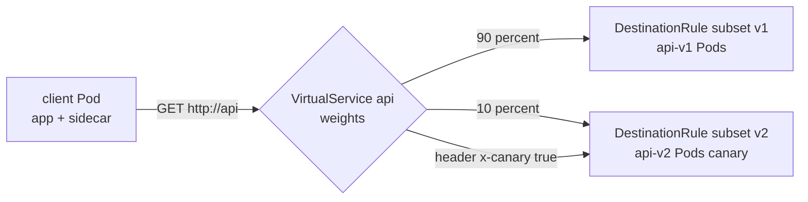
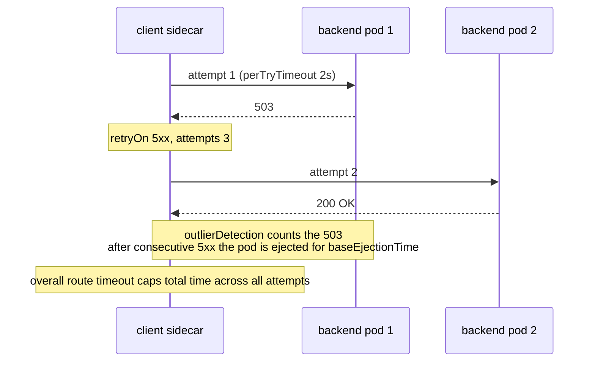
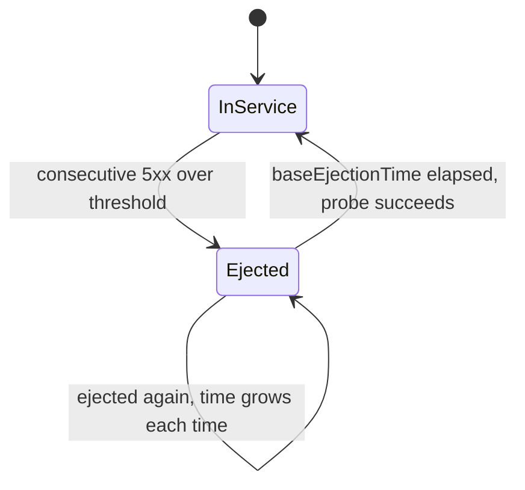

# L16.10 — Mesh: mTLS, Routing, Retries, Timeouts, Circuit Breaking and Observability

> **Level 16: Advanced Kubernetes** · Topic 10 of 10 · ⏱ ~7 hours · Difficulty: Advanced

## 1. What it is

Once workloads are in the mesh ([Service Mesh with Istio or Linkerd](09-service-mesh-istio-linkerd.md)), the proxies give you a set of policies you can apply **without changing application code**:

- **mTLS (mutual TLS):** both sides of a connection present certificates, so traffic is encrypted *and* each side knows the other's workload identity. You can then write **authorization policy** based on identity ("only `client` may call `api`").
- **Routing and traffic shifting:** send a percentage of requests, or requests with a given header, to a different version: the mechanism behind canary releases.
- **Resilience:** per-route **timeouts** and **retries**, and **circuit breaking** (limit concurrent connections/requests and eject unhealthy endpoints) so one slow dependency does not take down its callers.
- **Observability:** the proxies emit the **golden signals** (rate, errors, duration) for every service pair: you get dashboards for services that were never instrumented.

In Istio these are expressed with `PeerAuthentication`, `AuthorizationPolicy`, `VirtualService` and `DestinationRule`. In Linkerd mTLS is automatic, routing uses the Gateway API `HTTPRoute`, and retries, timeouts and failure accrual are configured with annotations and policy resources. The Kubernetes Gateway API is converging both ecosystems on one routing API.

## 2. Why it matters in DevOps

- **Safer releases.** Weighted routing turns "deploy and pray" into "send 5% and watch the error rate" ([Canary Deployments](../level-05-cicd/12-canary-deployments.md), [Deployment Strategies](../level-00-what-devops-is/07-deployment-strategies.md)).
- **Containing failure.** Without timeouts, retries and circuit breakers, a slow database makes every upstream thread wait, and the failure cascades. With *bad* retry settings you can cause the outage yourself (a retry storm multiplies load) ([Circuit Breakers](../level-12-advanced-networking/14-circuit-breakers.md)).
- **Zero-trust networking.** Strict mTLS plus identity-based authorization replaces "anything inside the cluster is trusted" ([mTLS](../level-12-advanced-networking/12-mtls.md)).
- **SRE signals for free.** SLIs such as request success rate and p99 latency come straight from the mesh ([SLIs](../level-14-sre/01-slis.md), [What to Monitor](../level-10-observability/11-what-to-monitor.md)).

## 3. Real-world system example

**Envoy-based meshes and progressive delivery tools.** Envoy, the data-plane proxy behind Istio, was created at Lyft and exposes exactly these features (weighted clusters, retries, per-try timeouts, outlier detection, circuit-breaker thresholds) in its configuration; Istio translates `VirtualService` and `DestinationRule` objects into that configuration. Progressive-delivery controllers such as **Argo Rollouts** and **Flagger** (a CNCF project under the Flux umbrella) automate canaries on top of service meshes and the Gateway API: they shift traffic in steps, query Prometheus for mesh metrics such as success rate and latency, and roll back automatically if thresholds are breached ([Canary Deployments](../level-05-cicd/12-canary-deployments.md)). Linkerd's documentation describes retries and timeouts as per-route configuration plus a "retry budget" idea that bounds the extra load retries can add. The golden metrics (`istio_requests_total`, `istio_request_duration_milliseconds` for Istio; `response_total`, `response_latency_ms` for Linkerd) are the standard Prometheus series exported by these meshes.

## 4. Diagram

Weighted canary routing in the client's sidecar:



What retries, timeouts and ejection do on one request:



Circuit breaker states (Envoy outlier detection per endpoint):



## 5. How it works

### mTLS and authorization (Istio)

| Resource | Purpose | Example effect |
|----------|---------|----------------|
| `PeerAuthentication` | Whether the workload accepts mTLS only (`STRICT`), both (`PERMISSIVE`, the default) or plain text | `STRICT` in namespace `shop`: a Pod outside the mesh gets connection reset |
| `AuthorizationPolicy` | Allow or deny by `principals` (SPIFFE identity), namespaces, IPs, methods, paths, headers | Only the `client` ServiceAccount may call `api` |
| `DestinationRule` `trafficPolicy.tls.mode` | Client-side TLS to the destination | `ISTIO_MUTUAL` (usually automatic with auto mTLS) |

Rollout order for strict mTLS: install in `PERMISSIVE`, onboard all clients, check metrics to see no plain-text traffic remains (`connection_security_policy` label), then switch to `STRICT`.

### Routing and shifting

- `DestinationRule` defines **subsets** (named label selectors such as `version: v1`) plus load balancing, connection pool and outlier-detection settings.
- `VirtualService` defines **routing rules**: matches (headers, paths, methods), `route` with `weight`s (must sum to 100), `timeout`, `retries`, `fault` injection, `mirror` (shadow traffic).
- A `VirtualService` hosts and rules apply in the **client's** sidecar, so the client must be in the mesh for them to take effect.
- Gateway API equivalent: an `HTTPRoute` whose `parentRefs` point at a Service (the "GAMMA" mesh pattern) and whose `backendRefs` carry weights. It is portable between Istio and Linkerd, but each version of each mesh supports a different subset; check the docs.

### Resilience knobs

| Concern | Istio setting | Linkerd equivalent (check docs for your version) |
|---------|---------------|--------------------------------------------------|
| Timeout | `VirtualService.http[].timeout` | `timeout.linkerd.io/request` annotation or route `timeouts` |
| Retries | `http[].retries` (`attempts`, `perTryTimeout`, `retryOn`) | `retry.linkerd.io/http: 5xx` and `retry.linkerd.io/limit` annotations (route-level config for gRPC and HTTP) |
| Circuit breaking, concurrency limits | `DestinationRule.trafficPolicy.connectionPool` | Not concurrency limits; use rate limiting at the app or gateway |
| Ejecting bad endpoints | `trafficPolicy.outlierDetection` | Failure accrual (`balancer.linkerd.io/failure-accrual: consecutive` annotation) |
| Fault injection | `http[].fault` (`delay`, `abort`) | Usually done with a dedicated testing tool or an injector service |

Retry guidance: retry only **idempotent** operations ([Idempotency](../level-13-databases-distributed-systems/14-idempotency.md)); keep `attempts` small (1-3); set `perTryTimeout` so total time (`attempts × perTryTimeout`) fits inside the route `timeout`; remember retries multiply load during an outage (retry budgets or outlier detection mitigate that).

### Golden metrics from the mesh

| Signal | Istio (Prometheus) | Linkerd |
|--------|--------------------|---------|
| Rate | `istio_requests_total` | `request_total`, `linkerd viz stat` RPS column |
| Errors | `istio_requests_total{response_code=~"5.."}` | `response_total{classification="failure"}` |
| Duration | `istio_request_duration_milliseconds_bucket` | `response_latency_ms_bucket` |
| Saturation | Envoy stats (pending overflow), plus node/Pod CPU/memory | proxy metrics, plus cAdvisor |

Use `reporter="destination"` for server-side numbers (and `source` for client-side) to avoid double counting.

## 6. Step-by-step guide

**Prerequisites:** the Istio lab from the previous topic (kind cluster `mesh-lab`, namespace `shop` with sidecar injection, `api-v1`, `api` Service and `client`), plus the `legacy` namespace. If you tore it down, redo steps 1 to 4 of that guide. Cost: none. YAML shown is for Istio's `networking.istio.io/v1` and `security.istio.io/v1` APIs (current in recent Istio; older clusters use `v1beta1`). Outputs are illustrative.

1. **Give the client its own identity.** The default ServiceAccount is shared by anything that does not set one, so use a dedicated one:
   ```bash
   kubectl -n shop create serviceaccount client
   kubectl -n shop set serviceaccount deploy/client client
   kubectl -n shop rollout status deploy/client
   ```

2. **Turn on strict mTLS for `shop` and prove it.**
   ```bash
   cat <<'EOF' | kubectl apply -f -
   apiVersion: security.istio.io/v1
   kind: PeerAuthentication
   metadata:
     name: default
     namespace: shop
   spec:
     mtls:
       mode: STRICT
   EOF
   # inside the mesh: works
   kubectl -n shop exec deploy/client -c client -- curl -s http://api
   # outside the mesh: plain text is refused
   kubectl -n legacy run probe --rm -it --restart=Never --image=curlimages/curl:8.10.1 -- curl -sv --max-time 5 http://api.shop
   ```
   The first prints `api v1`. The second fails with something like `curl: (56) Recv failure: Connection reset by peer` (or `(52) Empty reply from server`). Flip `mode: PERMISSIVE` and it succeeds again, which is how you stage a migration.

3. **Restrict who may call `api` with identity.**
   ```bash
   cat <<'EOF' | kubectl apply -f -
   apiVersion: security.istio.io/v1
   kind: AuthorizationPolicy
   metadata:
     name: api-allow-client
     namespace: shop
   spec:
     selector:
       matchLabels: {app: api}
     action: ALLOW
     rules:
       - from:
           - source:
               principals: ["cluster.local/ns/shop/sa/client"]
         to:
           - operation:
               methods: ["GET"]
   EOF
   kubectl -n shop exec deploy/client -c client -- curl -s -o /dev/null -w '%{http_code}\n' http://api
   kubectl -n shop run other --rm -it --restart=Never --image=curlimages/curl:8.10.1 \
     --overrides='{"spec":{"serviceAccountName":"api"}}' -- curl -s -w '%{http_code}\n' http://api
   ```
   The client gets `200`. The `other` Pod (a different identity, `api`) gets `403` with body `RBAC: access denied`. Note that the `other` Pod is injected because the namespace is labelled, so it has a proxy and an identity.

4. **Deploy `api-v2` and define subsets.**
   ```bash
   cat <<'EOF' | kubectl apply -n shop -f -
   apiVersion: apps/v1
   kind: Deployment
   metadata: {name: api-v2}
   spec:
     replicas: 1
     selector: {matchLabels: {app: api, version: v2}}
     template:
       metadata: {labels: {app: api, version: v2}}
       spec:
         serviceAccountName: api
         containers:
           - name: api
             image: hashicorp/http-echo:1.0
             args: ["-text=api v2", "-listen=:5678"]
             ports: [{containerPort: 5678}]
             resources:
               requests: {cpu: 50m, memory: 32Mi}
   ---
   apiVersion: networking.istio.io/v1
   kind: DestinationRule
   metadata: {name: api}
   spec:
     host: api
     subsets:
       - {name: v1, labels: {version: v1}}
       - {name: v2, labels: {version: v2}}
   EOF
   kubectl -n shop rollout status deploy/api-v2
   ```
   Without a `VirtualService`, the `api` Service load-balances across v1 and v2 Pods in proportion to their numbers (2:1), which is *not* what you want for a canary.

5. **Canary: 90/10 split, then measure it.**
   ```bash
   cat <<'EOF' | kubectl apply -n shop -f -
   apiVersion: networking.istio.io/v1
   kind: VirtualService
   metadata: {name: api}
   spec:
     hosts: [api]
     http:
       - match:
           - headers:
               x-canary: {exact: "true"}
         route:
           - destination: {host: api, subset: v2}
       - route:
           - destination: {host: api, subset: v1}
             weight: 90
           - destination: {host: api, subset: v2}
             weight: 10
   EOF
   kubectl -n shop exec deploy/client -c client -- sh -c 'for i in $(seq 1 100); do curl -s http://api; done' | sort | uniq -c
   kubectl -n shop exec deploy/client -c client -- curl -s -H 'x-canary: true' http://api
   ```
   Similar to `91 api v1` / `9 api v2` (it is random, so not exactly 90/10), and the header request always returns `api v2`, so testers can reach the canary deliberately. Now promote gradually by editing the weights:
   ```bash
   for w in 50 100; do
     kubectl -n shop patch virtualservice api --type json -p "[
       {\"op\":\"replace\",\"path\":\"/spec/http/1/route/0/weight\",\"value\":$((100-w))},
       {\"op\":\"replace\",\"path\":\"/spec/http/1/route/1/weight\",\"value\":$w}]"
     kubectl -n shop exec deploy/client -c client -- sh -c 'for i in $(seq 1 100); do curl -s http://api; done' | sort | uniq -c
   done
   ```
   The split moves to about 50/50, then 0/100. Rollback is the same patch in reverse, taking effect in seconds without restarting any Pod. The portable Gateway API form of the same rule, using one Service per version (`api-v1` and `api-v2`), looks like this:
   ```yaml
   apiVersion: gateway.networking.k8s.io/v1
   kind: HTTPRoute
   metadata: {name: api, namespace: shop}
   spec:
     parentRefs:
       - {group: "", kind: Service, name: api, port: 80}
     rules:
       - backendRefs:
           - {name: api-v1, port: 80, weight: 90}
           - {name: api-v2, port: 80, weight: 10}
   ```
   It needs the Gateway API CRDs installed and mesh support for it in your version; do not apply it together with the VirtualService for the same host.

6. **Add a flaky and slow backend for resilience experiments.**
   ```bash
   cat <<'EOF' | kubectl apply -n shop -f -
   apiVersion: apps/v1
   kind: Deployment
   metadata: {name: httpbin}
   spec:
     replicas: 2
     selector: {matchLabels: {app: httpbin}}
     template:
       metadata: {labels: {app: httpbin}}
       spec:
         containers:
           - name: httpbin
             image: kennethreitz/httpbin
             ports: [{containerPort: 80}]
             resources:
               requests: {cpu: 50m, memory: 64Mi}
   ---
   apiVersion: v1
   kind: Service
   metadata: {name: httpbin}
   spec:
     selector: {app: httpbin}
     ports: [{name: http, port: 80, targetPort: 80}]
   ---
   apiVersion: apps/v1
   kind: Deployment
   metadata: {name: fortio}
   spec:
     replicas: 1
     selector: {matchLabels: {app: fortio}}
     template:
       metadata: {labels: {app: fortio}}
       spec:
         serviceAccountName: client
         containers:
           - name: fortio
             image: fortio/fortio
             args: ["server"]
   EOF
   kubectl -n shop rollout status deploy/httpbin deploy/fortio
   ```
   `/status/200,503` returns one of the listed codes at random; `/delay/3` waits 3 seconds. (The AuthorizationPolicy from step 3 only applies to `api`, so these are unaffected.)

7. **Baseline failure rate, then add retries.**
   ```bash
   kubectl -n shop exec deploy/client -c client -- sh -c \
     'for i in $(seq 1 60); do curl -s -o /dev/null -w "%{http_code}\n" http://httpbin/status/200,503; done' | sort | uniq -c
   ```
   Expect roughly half `503`. Now:
   ```bash
   cat <<'EOF' | kubectl apply -n shop -f -
   apiVersion: networking.istio.io/v1
   kind: VirtualService
   metadata: {name: httpbin}
   spec:
     hosts: [httpbin]
     http:
       - route:
           - destination: {host: httpbin}
         retries:
           attempts: 3
           perTryTimeout: 2s
           retryOn: 5xx
   EOF
   ```
   Re-run the loop. Similar to only a handful of `503` (about 0.5^4 of requests, roughly 6%, fail after one try plus three retries). The proxy hid most failures, which is useful for transient errors and dangerous for overloaded ones.

8. **Add a timeout.**
   ```bash
   cat <<'EOF' | kubectl apply -n shop -f -
   apiVersion: networking.istio.io/v1
   kind: VirtualService
   metadata: {name: httpbin}
   spec:
     hosts: [httpbin]
     http:
       - route:
           - destination: {host: httpbin}
         timeout: 1s
         retries:
           attempts: 2
           perTryTimeout: 400ms
           retryOn: 5xx,reset,connect-failure
   EOF
   kubectl -n shop exec deploy/client -c client -- curl -s -o /dev/null -w '%{http_code} in %{time_total}s\n' http://httpbin/delay/3
   ```
   Similar to `504 in 1.0s`: the caller is released after 1 second instead of waiting 3, with `upstream request timeout` as the body. Total time is bounded by the route `timeout` regardless of attempts.

9. **Circuit breaking: limit concurrency and eject bad endpoints.**
   ```bash
   cat <<'EOF' | kubectl apply -n shop -f -
   apiVersion: networking.istio.io/v1
   kind: DestinationRule
   metadata: {name: httpbin}
   spec:
     host: httpbin
     trafficPolicy:
       connectionPool:
         tcp: {maxConnections: 1}
         http: {http1MaxPendingRequests: 1, maxRequestsPerConnection: 1}
       outlierDetection:
         consecutive5xxErrors: 2
         interval: 5s
         baseEjectionTime: 30s
         maxEjectionPercent: 100
   EOF
   kubectl -n shop exec deploy/fortio -c fortio -- \
     fortio load -c 3 -qps 0 -n 30 -loglevel Warning http://httpbin/get
   kubectl -n shop exec deploy/fortio -c istio-proxy -- pilot-agent request GET stats | grep httpbin | grep pending
   ```
   With three concurrent connections against a limit of one, some requests are rejected: the load tool reports a share of `Code 503` and the stat `upstream_rq_pending_overflow` is non-zero. That is the circuit breaker shedding load instead of queueing it. Remove the strict limits (or raise them) for real services based on measured capacity.

10. **Observe golden metrics.** Install the sample Prometheus add-on from the Istio release directory (it ships `samples/addons/`), generate traffic, and query:
    ```bash
    kubectl apply -f istio-<CURRENT_ISTIO_VERSION>/samples/addons/prometheus.yaml
    kubectl -n shop exec deploy/client -c client -- sh -c 'for i in $(seq 1 200); do curl -s -o /dev/null http://httpbin/status/200,503; done'
    kubectl -n istio-system port-forward svc/prometheus 9090:9090 &
    ```
    In the Prometheus UI at `http://localhost:9090` run:
    ```promql
    # Rate: requests per second per destination workload
    sum by (destination_workload) (rate(istio_requests_total{reporter="destination", destination_workload_namespace="shop"}[1m]))

    # Errors: share of 5xx responses
    sum by (destination_workload) (rate(istio_requests_total{reporter="destination", response_code=~"5.."}[1m]))
      / sum by (destination_workload) (rate(istio_requests_total{reporter="destination"}[1m]))

    # Duration: p99 latency in ms
    histogram_quantile(0.99, sum by (le, destination_workload) (rate(istio_request_duration_milliseconds_bucket{reporter="destination"}[1m])))
    ```
    These are the SLIs for a canary: compare `destination_workload="api-v2"` with `api-v1`. Add `kubectl apply -f .../samples/addons/kiali.yaml` for a live service graph (`istioctl dashboard kiali`). On Linkerd the same view is `linkerd viz stat deploy -n shop` and `linkerd viz top`.

11. **Clean up:** `kill %1 2>/dev/null; kind delete cluster --name mesh-lab`.

## 7. Real-world scenario

*(Illustrative.)* A checkout service called a tax-calculation service that began to degrade: p50 latency stayed normal but 5% of calls took 30 seconds. With no timeout, checkout Pods exhausted their worker pools waiting; error rates climbed across the site. After mitigation (scaling tax replicas) the post-incident review added mesh policy: a 2-second route timeout on the tax call, one retry only for `connect-failure,reset` (the call is idempotent), and outlier detection ejecting any tax Pod with three consecutive 5xx for 30 seconds, with a connection-pool cap to shed excess load quickly. They also added a canary workflow: new tax versions receive 5% of traffic, with a Prometheus alert comparing the canary's error rate and p99 to the stable version, and a one-line rollback (set the weight to 0). Later, a retry setting of `attempts: 5` on a different service turned a brief database slowdown into a retry storm. It was caught in staging by a fault-injection test and capped at 2 with a route timeout. **Lesson:** timeouts, retries and breakers are a set; configured together and tested with faults, they contain failure, and configured carelessly they amplify it.

## 8. Common mistakes and best practices

**Don't**

- Switch to `STRICT` before every client is meshed; you will see connection resets from jobs, health checkers and ingress.
- Retry non-idempotent calls (payment capture) or set `attempts` high; retries multiply load.
- Set the route `timeout` lower than `attempts × perTryTimeout` (retries never get to run) or leave no timeout at all.
- Forget that `VirtualService` rules run in the caller's sidecar: un-meshed callers bypass them.
- Test canaries with eyeballs; use metrics and an automated rollback criterion.
- Use `reporter` labels carelessly; mixing source and destination double counts.

**Do**

- Roll out mTLS as `PERMISSIVE` first, check for plain-text traffic, then `STRICT`; add identity-based `AuthorizationPolicy`, starting with a default deny per namespace once everything works.
- Keep canary weights in Git (GitOps) or drive them with Argo Rollouts / Flagger from metrics ([Argo CD and Flux](../level-17-gitops/02-argo-cd-and-flux.md)).
- Define timeouts for every external-facing and cross-service call; tune retries only for idempotent traffic with small budgets.
- Chaos-test: inject delay and aborts in staging to prove the settings do what you expect.
- Alert on SLIs from mesh metrics (success rate, p99), and dashboard per-version canary comparisons.
- Pair with [NetworkPolicies](02-networkpolicies-in-depth.md) and [Pod Security](03-pod-security.md): the mesh does not protect traffic that bypasses it.

## 9. Tasks

- [ ] **T1 — Strict mTLS** *(≈40 min, intermediate)*
  - **Goal:** prove the mesh enforces encryption.
  - **Steps:**
    1. Apply the `STRICT` PeerAuthentication (step 2).
    2. Call `api` from the `legacy` namespace and from `client`.
    3. Switch to `PERMISSIVE` and call again.
  - **Done when:** you have three outputs (blocked outside, allowed inside, allowed in permissive) and can explain each.

- [ ] **T2 — Identity-based authorization** *(≈45 min, intermediate)*
  - **Goal:** allow only a named identity.
  - **Steps:**
    1. Apply the `api-allow-client` policy (step 3).
    2. Show `200` for `client` and `403` for a Pod using another ServiceAccount.
    3. Add a path restriction (`paths: ["/health*"]`) and test allowed and denied paths.
  - **Done when:** all four combinations behave as predicted.

- [ ] **T3 — Canary and header routing** *(≈45 min, intermediate)*
  - **Goal:** shift traffic safely.
  - **Steps:**
    1. Do step 5, measuring the split with 200 requests at 90/10, 50/50 and 0/100.
    2. Send `x-canary: true` and confirm it always reaches v2.
    3. Roll back to 100/0 and re-measure.
  - **Done when:** your three measurements are near the configured weights and rollback takes effect without restarting any Pod.

- [ ] **T4 — Retries and timeouts, break it** *(≈60 min, advanced)*
  - **Goal:** observe the benefit and the danger.
  - **Steps:**
    1. Measure the failure rate of `/status/200,503` with no retries, `attempts: 3` and `attempts: 10`.
    2. Count requests received by `httpbin` Pods during each test (`kubectl logs` line counts or `istio_requests_total` at the destination).
    3. Show `/delay/3` with a `1s` timeout returning 504.
  - **Done when:** you have a table of failure rate versus backend request count, showing retries amplify backend load, and a written rule for choosing `attempts`.

- [ ] **T5 — Circuit breaker and golden metrics** *(≈75 min, advanced)*
  - **Goal:** shed load and read the signals.
  - **Steps:**
    1. Apply the circuit-breaker `DestinationRule` (step 9) and run `fortio` at concurrency 3, then 1.
    2. Find `upstream_rq_pending_overflow` in the proxy stats.
    3. Install the Prometheus addon and build the rate, error and p99 queries; compare `api-v1` and `api-v2` during a 50/50 split.
  - **Done when:** overflow appears at concurrency 3 and not at 1, and your three queries return data for both versions.

- [ ] **T6 — Prove it: automated canary gate** *(≈2 hours, advanced)*
  - **Goal:** make traffic shifting depend on metrics, without the guide.
  - **Steps:**
    1. Write a script that increases `api-v2` weight 10 → 25 → 50 → 100, waiting 2 minutes per step.
    2. Before each step it queries Prometheus for the canary's 5xx ratio and p99, and aborts (weight back to 0) if the ratio exceeds 2% or p99 exceeds 1.5× the stable version's.
    3. Demonstrate both a successful promotion and an aborted one (make `api-v2` return errors, for example by pointing its Deployment at an image that returns 500).
    4. Explain how Argo Rollouts or Flagger would replace your script.
  - **Done when:** one run promotes to 100% and one run auto-rolls back to 0%, and your explanation names the metrics, thresholds and the failure it protects against.

## 10. Self-check questions

1. What is the difference between `PERMISSIVE` and `STRICT` PeerAuthentication, and how do you migrate safely?
2. Why is a `DestinationRule` needed for a version-based canary in Istio?
3. How can retries make an outage worse, and what settings limit that?
4. What does outlier detection do that a timeout does not?
5. Which Prometheus series give you rate, errors and duration in Istio, and what does the `reporter` label mean?
6. In which proxy are `VirtualService` rules applied, and what does that imply for clients outside the mesh?

<details>
<summary>Answers</summary>

1. `PERMISSIVE` accepts both mTLS and plain text; `STRICT` accepts only mTLS. Start permissive, mesh all clients, verify no plain-text traffic remains, then switch to strict.
2. It defines the subsets (named label selectors) that the `VirtualService` weights point to.
3. Each failed request becomes several backend requests, multiplying load on an already struggling service (a retry storm). Limit `attempts`, set `perTryTimeout` and a route `timeout`, retry only idempotent and specific failure classes, and use outlier detection and connection-pool limits.
4. A timeout bounds one request's wait. Outlier detection removes consistently failing endpoints from load balancing for a period, so subsequent requests do not even try them.
5. `istio_requests_total` (rate and errors via `response_code`), `istio_request_duration_milliseconds_bucket` (duration). `reporter` says whether the metric was recorded by the source or destination proxy; filter on one to avoid double counting.
6. In the caller's sidecar (or waypoint in ambient mode). Callers outside the mesh bypass the rules and hit the Service as normal.
</details>

## 11. Further reading

- Istio documentation: *Traffic Management*, *Security* (PeerAuthentication, AuthorizationPolicy) and *Observability* (standard metrics).
- Linkerd documentation: *Automatic mTLS*, *Traffic Split / HTTPRoute*, *Retries and Timeouts* and *Failure accrual*.
- Kubernetes Gateway API documentation, including the GAMMA initiative for mesh routing (gateway-api.sigs.k8s.io).
- Argo Rollouts and Flagger documentation for metric-driven canaries.
- *Release It!* by Michael Nygard (timeouts, circuit breakers, bulkheads) and the Google SRE book chapters on handling overload and cascading failures.
- Related: [Prometheus and PromQL](../level-10-observability/02-prometheus-and-promql.md), [Rate Limiting](../level-12-advanced-networking/13-rate-limiting.md).

<!-- nav -->
---
← Previous: [Service Mesh with Istio or Linkerd](09-service-mesh-istio-linkerd.md) · [Level 16 index](README.md) · Next: [Level capstone project](99-capstone-project.md) →
