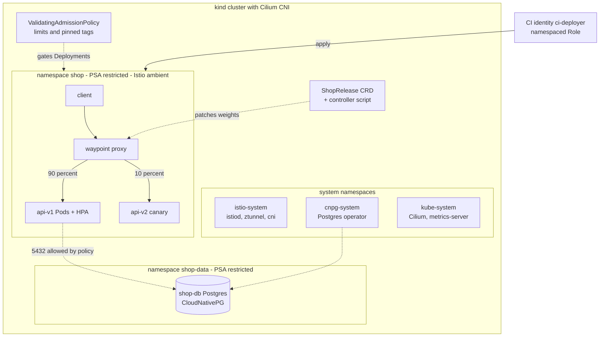
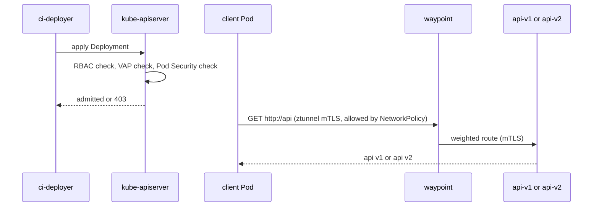

# L16 Capstone — Harden a kind/EKS Cluster

> **Level 16: Advanced Kubernetes** · Capstone · ⏱ ~16 hours

## 1. Goal and outcome

Take a plain cluster running the `shop-api` stand-in workloads and harden it the way a platform team would before letting several teams share it. At the end you will have, in one cluster you built and can tear down:

- **Least-privilege RBAC** for a CI pipeline and a controller, proven with `kubectl auth can-i` ([L16.1](01-rbac-in-depth.md)).
- **Pod Security Standards** (`restricted`, enforced) on every application namespace ([L16.3](03-pod-security.md)).
- **A ValidatingAdmissionPolicy** that rejects Deployments without memory limits or with `:latest` images ([L16.6](06-admission-controllers-and-webhooks.md)).
- **Default-deny NetworkPolicies** with only the flows you intend, enforced by Cilium and observed in Hubble ([L16.2](02-networkpolicies-in-depth.md)).
- **Autoscaling:** an HPA on the API, and a reviewed Karpenter NodePool for EKS ([L16.7](07-hpa-vpa-cluster-autoscaler.md)).
- **A stateful data tier** managed by a Postgres operator in its own locked-down namespace ([L16.8](08-stateful-workloads.md), [L16.4](04-operators.md)).
- **A service mesh** (Istio ambient mode) giving mTLS between workloads and a 90/10 **canary** route ([L16.9](09-service-mesh-istio-linkerd.md), [L16.10](10-mesh-traffic-management.md)).
- **Your own CRD and a tiny controller** (`ShopRelease`) that drives the canary weight from a declarative object ([L16.5](05-custom-resource-definitions.md), [L16.4](04-operators.md)).

Success looks like: a bad Deployment is rejected, an intruder Pod cannot reach anything, the API scales under load, traffic is mTLS-encrypted, and `kubectl apply` of a `ShopRelease` shifts traffic from v1 to v2.

## 2. Architecture



Request path and enforcement points:



## 3. Prerequisites and cost

- **Machine:** Docker, `kind`, `kubectl`, `helm`, `jq`, the `cilium` CLI, `istioctl`; about 6 CPUs and 10 GB RAM free for a 3-node kind cluster running Cilium, Istio and Postgres. **Cost: none.**
- **Versions:** use current releases; pin them in your notes. The Istio and Gateway API commands below use `<ISTIO_VERSION>` and `<GATEWAY_API_VERSION>` placeholders: take compatible versions from the Istio ambient "getting started" page. Outputs shown are illustrative ("similar to").
- **EKS variant:** every milestone works on EKS with these differences: use the VPC CNI network policy support or install Cilium for NetworkPolicy; set Pod Security by namespace labels (you cannot edit the managed API server's admission config); install Karpenter (see milestone 5) instead of relying on kind; the object-store backups for Postgres would use IRSA or Pod Identity. **Cost warning:** an EKS control plane plus nodes bills hourly; set an AWS Budget and billing alarm first, tag everything, and run the teardown section the same day.
- **Time plan:** milestones 0-3 about 4 h, 4-5 about 3 h, 6-8 about 8 h.

## 4. Build it step by step

### Milestone 0 — Cluster, CNI, metrics

```bash
mkdir -p ~/l16-capstone && cd ~/l16-capstone
cat > kind.yaml <<'EOF'
kind: Cluster
apiVersion: kind.x-k8s.io/v1alpha4
networking:
  disableDefaultCNI: true
nodes:
  - role: control-plane
  - role: worker
  - role: worker
EOF
kind create cluster --name hardened --config kind.yaml
cilium install --set cni.exclusive=false --set socketLB.hostNamespaceOnly=true
cilium status --wait
cilium hubble enable
kubectl apply -f https://github.com/kubernetes-sigs/metrics-server/releases/latest/download/components.yaml
kubectl -n kube-system patch deployment metrics-server --type=json \
  -p '[{"op":"add","path":"/spec/template/spec/containers/0/args/-","value":"--kubelet-insecure-tls"}]'
kubectl get nodes
```
Three `Ready` nodes. The two Cilium flags are what Istio's documentation asks for when Istio runs on a Cilium cluster (CNI chaining and socket load-balancing in the host namespace only); `--kubelet-insecure-tls` is for kind only.

### Milestone 1 — Namespaces and least-privilege RBAC (L16.1)

```bash
kubectl create namespace shop
kubectl create namespace shop-data
kubectl create namespace sandbox       # a stand-in for another team's namespace
cat <<'EOF' | kubectl apply -f -
apiVersion: v1
kind: ServiceAccount
metadata: {name: ci-deployer, namespace: shop}
---
apiVersion: rbac.authorization.k8s.io/v1
kind: Role
metadata: {name: shop-deployer, namespace: shop}
rules:
  - apiGroups: ["apps"]
    resources: ["deployments"]
    verbs: ["get", "list", "watch", "create", "update", "patch"]
  - apiGroups: [""]
    resources: ["services", "serviceaccounts"]
    verbs: ["get", "list", "watch", "create", "update", "patch"]
  - apiGroups: ["autoscaling"]
    resources: ["horizontalpodautoscalers"]
    verbs: ["get", "list", "watch", "create", "update", "patch"]
  - apiGroups: ["policy"]
    resources: ["poddisruptionbudgets"]
    verbs: ["get", "list", "watch", "create", "update", "patch"]
  - apiGroups: [""]
    resources: ["pods", "pods/log"]
    verbs: ["get", "list", "watch"]
---
apiVersion: rbac.authorization.k8s.io/v1
kind: RoleBinding
metadata: {name: ci-deployer, namespace: shop}
subjects: [{kind: ServiceAccount, name: ci-deployer, namespace: shop}]
roleRef: {apiGroup: rbac.authorization.k8s.io, kind: Role, name: shop-deployer}
---
apiVersion: rbac.authorization.k8s.io/v1
kind: RoleBinding
metadata: {name: shop-devs-view, namespace: shop}
subjects: [{kind: Group, name: shop-devs, apiGroup: rbac.authorization.k8s.io}]
roleRef: {apiGroup: rbac.authorization.k8s.io, kind: ClusterRole, name: view}
EOF
CI=system:serviceaccount:shop:ci-deployer
kubectl auth can-i create deployments -n shop --as=$CI          # yes
kubectl auth can-i get secrets        -n shop --as=$CI          # no
kubectl auth can-i create deployments -n sandbox --as=$CI       # no
kubectl auth can-i create rolebindings -n shop --as=$CI         # no
kubectl auth can-i list pods -n shop --as=anna --as-group=shop-devs   # yes (via view)
```
The pipeline can deploy only in `shop`, cannot read Secrets, cannot create RBAC objects and cannot mint tokens (no `serviceaccounts/token`).

### Milestone 2 — Pod Security and an admission policy (L16.3, L16.6)

```bash
for ns in shop shop-data; do
kubectl label namespace $ns \
  pod-security.kubernetes.io/enforce=restricted \
  pod-security.kubernetes.io/enforce-version=latest \
  pod-security.kubernetes.io/warn=restricted \
  pod-security.kubernetes.io/audit=restricted
done
cat <<'EOF' | kubectl apply -f -
apiVersion: admissionregistration.k8s.io/v1
kind: ValidatingAdmissionPolicy
metadata: {name: workload-hygiene}
spec:
  failurePolicy: Fail
  matchConstraints:
    resourceRules:
      - apiGroups: ["apps"]
        apiVersions: ["v1"]
        operations: ["CREATE", "UPDATE"]
        resources: ["deployments"]
  variables:
    - name: containers
      expression: "object.spec.template.spec.containers"
  validations:
    - expression: "variables.containers.all(c, has(c.resources) && has(c.resources.limits) && 'memory' in c.resources.limits)"
      message: "every container must set resources.limits.memory"
    - expression: "variables.containers.all(c, c.image.contains(':') && !c.image.endsWith(':latest'))"
      message: "images must be pinned to a tag other than latest"
---
apiVersion: admissionregistration.k8s.io/v1
kind: ValidatingAdmissionPolicyBinding
metadata: {name: workload-hygiene-shop}
spec:
  policyName: workload-hygiene
  validationActions: [Deny]
  matchResources:
    namespaceSelector:
      matchLabels: {kubernetes.io/metadata.name: shop}
    objectSelector:
      matchExpressions:
        - {key: gateway.istio.io/managed, operator: DoesNotExist}
EOF
```
The `objectSelector` exempts Deployments that Istio generates for waypoint proxies later (confirm the label with `--show-labels` in milestone 7; if your version differs, switch the binding to `[Warn, Audit]` for those). Test the guardrails as the CI identity:
```bash
CI=system:serviceaccount:shop:ci-deployer
kubectl -n shop create deployment bad --image=nginx:latest --as=$CI          # denied by the policy
kubectl -n shop create deployment root --image=nginx:1.27 --dry-run=client -o yaml \
  | kubectl set resources --local -f - --limits=memory=128Mi -o yaml \
  | kubectl apply --as=$CI -f -                                              # passes the policy (limit, pinned tag)
kubectl -n shop describe rs -l app=root | grep -i -m2 "violates PodSecurity"   # but its Pod is rejected
kubectl -n shop delete deployment root
```
Similar to `denied request: every container must set resources.limits.memory` and `violates PodSecurity "restricted:latest"`. The second shows that Pod Security rejects Pods, not Deployments, and the first that the admission policy rejects Deployments before they exist.

### Milestone 3 — Hardened workloads (L16.3, L16.1)

Deploy `api-v1`, `api-v2` and a `client` as the CI identity so everything is checked by RBAC, the policy and PSA:
```bash
CI=system:serviceaccount:shop:ci-deployer
for sa in api client; do
cat <<EOF | kubectl apply -n shop --as=$CI -f -
apiVersion: v1
kind: ServiceAccount
metadata: {name: $sa}
automountServiceAccountToken: false
EOF
done
for v in v1 v2; do
r=2; [ $v = v2 ] && r=1
cat <<EOF | kubectl apply -n shop --as=$CI -f -
apiVersion: apps/v1
kind: Deployment
metadata: {name: api-$v}
spec:
  replicas: $r
  selector: {matchLabels: {app: api, version: $v}}
  template:
    metadata: {labels: {app: api, version: $v}}
    spec:
      serviceAccountName: api
      automountServiceAccountToken: false
      securityContext: {runAsNonRoot: true, runAsUser: 10001, runAsGroup: 10001, seccompProfile: {type: RuntimeDefault}}
      containers:
        - name: api
          image: hashicorp/http-echo:1.0
          args: ["-text=api $v", "-listen=:5678"]
          ports: [{containerPort: 5678}]
          securityContext: {allowPrivilegeEscalation: false, readOnlyRootFilesystem: true, capabilities: {drop: ["ALL"]}}
          resources: {requests: {cpu: 20m, memory: 32Mi}, limits: {memory: 64Mi}}
---
apiVersion: v1
kind: Service
metadata: {name: api-$v}
spec:
  selector: {app: api, version: $v}
  ports: [{name: http, port: 80, targetPort: 5678}]
EOF
done
cat <<'EOF' | kubectl apply -n shop --as=$CI -f -
apiVersion: v1
kind: Service
metadata: {name: api}
spec:
  selector: {app: api}
  ports: [{name: http, port: 80, targetPort: 5678}]
---
apiVersion: apps/v1
kind: Deployment
metadata: {name: client}
spec:
  replicas: 1
  selector: {matchLabels: {app: client}}
  template:
    metadata: {labels: {app: client}}
    spec:
      serviceAccountName: client
      automountServiceAccountToken: false
      securityContext: {runAsNonRoot: true, runAsUser: 10001, runAsGroup: 10001, seccompProfile: {type: RuntimeDefault}}
      containers:
        - name: client
          image: curlimages/curl:8.10.1
          command: ["sleep", "36000"]
          securityContext: {allowPrivilegeEscalation: false, readOnlyRootFilesystem: true, capabilities: {drop: ["ALL"]}}
          resources: {requests: {cpu: 10m, memory: 16Mi}, limits: {memory: 64Mi}}
EOF
kubectl -n shop rollout status deploy/api-v1 deploy/api-v2 deploy/client
kubectl -n shop exec deploy/client -- curl -s http://api
```
Expect `api v1` or `api v2`. No warnings appeared, so the workloads satisfy `restricted`.

### Milestone 4 — Default-deny NetworkPolicies (L16.2)

First prove the network is flat from another namespace, then close it:
```bash
kubectl -n sandbox run intruder --image=curlimages/curl:8.10.1 --restart=Never --command -- sleep 3600
kubectl -n sandbox wait --for=condition=Ready pod/intruder
kubectl -n sandbox exec intruder -- curl -s --max-time 3 http://api.shop        # works today
cat <<'EOF' | kubectl apply -f -
apiVersion: networking.k8s.io/v1
kind: NetworkPolicy
metadata: {name: default-deny-all, namespace: shop}
spec: {podSelector: {}, policyTypes: [Ingress, Egress]}
---
apiVersion: networking.k8s.io/v1
kind: NetworkPolicy
metadata: {name: allow-dns, namespace: shop}
spec:
  podSelector: {}
  policyTypes: [Egress]
  egress:
    - to:
        - namespaceSelector: {matchLabels: {kubernetes.io/metadata.name: kube-system}}
          podSelector: {matchLabels: {k8s-app: kube-dns}}
      ports: [{protocol: UDP, port: 53}, {protocol: TCP, port: 53}]
---
apiVersion: networking.k8s.io/v1
kind: NetworkPolicy
metadata: {name: client-egress-to-api, namespace: shop}
spec:
  podSelector: {matchLabels: {app: client}}
  policyTypes: [Egress]
  egress:
    - to: [{podSelector: {matchLabels: {app: api}}}]
      ports: [{protocol: TCP, port: 5678}]
---
apiVersion: networking.k8s.io/v1
kind: NetworkPolicy
metadata: {name: api-ingress-from-client, namespace: shop}
spec:
  podSelector: {matchLabels: {app: api}}
  policyTypes: [Ingress]
  ingress:
    - from: [{podSelector: {matchLabels: {app: client}}}]
      ports: [{protocol: TCP, port: 5678}]
EOF
kubectl -n shop exec deploy/client -- curl -s --max-time 3 http://api              # still works
kubectl -n sandbox exec intruder -- curl -s --max-time 3 http://api.shop; echo "exit=$?"   # blocked
hubble observe --namespace shop --verdict DROPPED --last 5
```
(Run `cilium hubble port-forward &` first if `hubble observe` cannot connect.) The intruder times out (`exit=28`) and Hubble shows a `DROPPED` flow with `Policy denied`. Note the client reaches `api` by the Service name: the Service resolves, kube-proxy/Cilium translates to a Pod IP, and the policy is evaluated against the Pod.

### Milestone 5 — Autoscaling (L16.7)

```bash
CI=system:serviceaccount:shop:ci-deployer
cat <<'EOF' | kubectl apply -n shop --as=$CI -f -
apiVersion: autoscaling/v2
kind: HorizontalPodAutoscaler
metadata: {name: api-v1}
spec:
  scaleTargetRef: {apiVersion: apps/v1, kind: Deployment, name: api-v1}
  minReplicas: 2
  maxReplicas: 6
  metrics:
    - type: Resource
      resource: {name: cpu, target: {type: Utilization, averageUtilization: 50}}
  behavior:
    scaleDown: {stabilizationWindowSeconds: 120}
---
apiVersion: policy/v1
kind: PodDisruptionBudget
metadata: {name: api-v1}
spec:
  maxUnavailable: 1
  selector: {matchLabels: {app: api, version: v1}}
EOF
kubectl -n shop exec deploy/client -- sh -c 'seq 1 8 | xargs -P8 -I{} sh -c "while true; do curl -s -o /dev/null http://api; done"' &
kubectl -n shop get hpa api-v1 -w
```
Watch `TARGETS` rise above 50% and `REPLICAS` climb (requests are only 20m CPU so a few parallel curl loops are enough; if it does not scale, add loops or lower the target). Stop the load with `kill %1; kubectl -n shop delete pod -l app=client` and watch the slow scale-down.

On EKS, add a reviewed Karpenter `NodePool` and `EC2NodeClass` (copy the manifests from [L16.7](07-hpa-vpa-cluster-autoscaler.md) step 7, set `limits.cpu` as a cost fence), raise `maxReplicas` beyond node capacity and watch Pending Pods turn into new nodes. Local kind cannot add nodes.

### Milestone 6 — Stateful data tier with an operator (L16.8, L16.4)

```bash
helm repo add cnpg https://cloudnative-pg.github.io/charts && helm repo update
helm upgrade --install cnpg cnpg/cloudnative-pg -n cnpg-system --create-namespace
kubectl -n cnpg-system rollout status deploy -l app.kubernetes.io/name=cloudnative-pg
cat <<'EOF' | kubectl apply -f -
apiVersion: postgresql.cnpg.io/v1
kind: Cluster
metadata: {name: shop-db, namespace: shop-data}
spec:
  instances: 2
  storage: {size: 1Gi}
  resources:
    requests: {cpu: 250m, memory: 512Mi}
    limits: {memory: 512Mi}
---
apiVersion: networking.k8s.io/v1
kind: NetworkPolicy
metadata: {name: db-ingress, namespace: shop-data}
spec:
  podSelector: {matchLabels: {cnpg.io/cluster: shop-db}}
  policyTypes: [Ingress]
  ingress:
    - from:   # replication and status between instances
        - podSelector: {matchLabels: {cnpg.io/cluster: shop-db}}
    - from:   # the operator
        - namespaceSelector: {matchLabels: {kubernetes.io/metadata.name: cnpg-system}}
      ports: [{protocol: TCP, port: 8000}, {protocol: TCP, port: 5432}]
    - from:   # only Pods explicitly labelled for database access, in shop
        - namespaceSelector: {matchLabels: {kubernetes.io/metadata.name: shop}}
          podSelector: {matchLabels: {db-access: "true"}}
      ports: [{protocol: TCP, port: 5432}]
EOF
kubectl -n shop-data get cluster shop-db -w
```
Wait for `Cluster in healthy state`. Ingress is default-denied for the database; egress is left open in this namespace because the Postgres instance manager must reach the Kubernetes API server, which has no stable Pod selector (a trade-off to record in your notes). Test the denied path from the `sandbox` intruder (milestone 4), which has no egress restrictions of its own:
```bash
kubectl -n sandbox exec intruder -- curl -sv --connect-timeout 3 --max-time 4 telnet://shop-db-rw.shop-data:5432 2>&1 | grep -Ei "connected|timed out"
```
Expect `timed out`: the database admits only the operator, its own instances and `shop` Pods labelled `db-access=true`. Now the allowed path. `shop` is egress-restricted, so first allow egress for labelled Pods, then run a throwaway labelled Pod (a Pod, so the Deployment-only admission policy does not apply, but Pod Security still does):
```bash
cat <<'EOF' | kubectl apply -f -
apiVersion: networking.k8s.io/v1
kind: NetworkPolicy
metadata: {name: db-clients-egress, namespace: shop}
spec:
  podSelector: {matchLabels: {db-access: "true"}}
  policyTypes: [Egress]
  egress:
    - to:
        - namespaceSelector: {matchLabels: {kubernetes.io/metadata.name: shop-data}}
          podSelector: {matchLabels: {cnpg.io/cluster: shop-db}}
      ports: [{protocol: TCP, port: 5432}]
EOF
kubectl -n shop run dbprobe --image=curlimages/curl:8.10.1 --restart=Never --labels=db-access=true \
  --overrides='{"spec":{"serviceAccountName":"client","automountServiceAccountToken":false,"securityContext":{"runAsNonRoot":true,"runAsUser":10001,"seccompProfile":{"type":"RuntimeDefault"}},"containers":[{"name":"dbprobe","image":"curlimages/curl:8.10.1","command":["sleep","120"],"securityContext":{"allowPrivilegeEscalation":false,"capabilities":{"drop":["ALL"]}},"resources":{"limits":{"memory":"64Mi"}}}]}}'
kubectl -n shop wait --for=condition=Ready pod/dbprobe
kubectl -n shop exec dbprobe -- curl -sv --connect-timeout 3 --max-time 4 telnet://shop-db-rw.shop-data:5432 2>&1 | grep -Ei "connected|timed out"
```
Expect `Connected to shop-db-rw.shop-data` this time. Finally take a logical backup and restore it into a scratch database as in [L16.8](08-stateful-workloads.md) step 6.

### Milestone 7 — Service mesh: mTLS and canary (L16.9, L16.10)

Install Istio in ambient mode, which needs no sidecars, so the `restricted` Pods stay unprivileged (a sidecar's init container needs `NET_ADMIN`, which Pod Security forbids unless you use the Istio CNI plugin):
```bash
istioctl install --set profile=ambient -y
kubectl -n istio-system get pods                    # istiod, ztunnel on each node, istio-cni-node
kubectl get crd gateways.gateway.networking.k8s.io >/dev/null 2>&1 || \
  kubectl apply -f https://github.com/kubernetes-sigs/gateway-api/releases/download/<GATEWAY_API_VERSION>/standard-install.yaml
kubectl label namespace shop istio.io/dataplane-mode=ambient
istioctl waypoint apply -n shop --enroll-namespace
kubectl -n shop get pods --show-labels | grep -i waypoint
```
No restart is needed, and the `waypoint` Pod appears in `shop`. If it does not, `kubectl -n shop get events` shows whether the admission policy or Pod Security blocked it. Now (1) require mTLS, (2) route 90/10 and (3) fix the NetworkPolicies that the mesh now makes insufficient. In ambient mode, traffic between Pods is tunnelled over HBONE on TCP port 15008, so the policies must allow 15008 on the path client to waypoint to api, and the waypoint needs to reach `istiod` on 15012:
```bash
cat <<'EOF' | kubectl apply -f -
apiVersion: security.istio.io/v1
kind: PeerAuthentication
metadata: {name: default, namespace: shop}
spec: {mtls: {mode: STRICT}}
---
apiVersion: gateway.networking.k8s.io/v1
kind: HTTPRoute
metadata: {name: api, namespace: shop}
spec:
  parentRefs:
    - {group: "", kind: Service, name: api, port: 80}
  rules:
    - backendRefs:
        - {name: api-v1, port: 80, weight: 90}
        - {name: api-v2, port: 80, weight: 10}
---
apiVersion: networking.k8s.io/v1
kind: NetworkPolicy
metadata: {name: mesh-client-to-waypoint, namespace: shop}
spec:
  podSelector: {matchLabels: {app: client}}
  policyTypes: [Egress]
  egress:
    - to: [{podSelector: {matchLabels: {gateway.networking.k8s.io/gateway-name: waypoint}}}]
      ports: [{protocol: TCP, port: 15008}]
---
apiVersion: networking.k8s.io/v1
kind: NetworkPolicy
metadata: {name: mesh-waypoint, namespace: shop}
spec:
  podSelector: {matchLabels: {gateway.networking.k8s.io/gateway-name: waypoint}}
  policyTypes: [Ingress, Egress]
  ingress:
    - from: [{podSelector: {matchLabels: {app: client}}}]
      ports: [{protocol: TCP, port: 15008}]
  egress:
    - to: [{podSelector: {matchLabels: {app: api}}}]
      ports: [{protocol: TCP, port: 15008}]
    - to: [{namespaceSelector: {matchLabels: {kubernetes.io/metadata.name: istio-system}}}]
      ports: [{protocol: TCP, port: 15012}]
---
apiVersion: networking.k8s.io/v1
kind: NetworkPolicy
metadata: {name: mesh-api-from-waypoint, namespace: shop}
spec:
  podSelector: {matchLabels: {app: api}}
  policyTypes: [Ingress]
  ingress:
    - from: [{podSelector: {matchLabels: {gateway.networking.k8s.io/gateway-name: waypoint}}}]
      ports: [{protocol: TCP, port: 15008}]
EOF
kubectl -n shop exec deploy/client -- sh -c 'for i in $(seq 1 100); do curl -s http://api; done' | sort | uniq -c
```
Similar to `91 api v1` and `9 api v2`. If requests hang after the policies, run `hubble observe --namespace shop --verdict DROPPED --last 20`: it names the exact source, destination and port to allow (the details of which hop uses which port can vary with CNI and Istio versions; Hubble is the source of truth). Verify encryption and identities:
```bash
istioctl ztunnel-config workloads | grep -E "NAMESPACE|shop"       # PROTOCOL column shows HBONE for meshed Pods
kubectl -n istio-system logs ds/ztunnel --tail=50 | grep -i "identity" | tail -3
```
Expect source and destination identities of the form `spiffe://cluster.local/ns/shop/sa/client`.

### Milestone 8 — A CRD and a tiny controller drive the canary (L16.5, L16.4, L16.1)

```bash
cat <<'EOF' | kubectl apply -f -
apiVersion: apiextensions.k8s.io/v1
kind: CustomResourceDefinition
metadata: {name: shopreleases.shop.example.com}
spec:
  group: shop.example.com
  scope: Namespaced
  names: {plural: shopreleases, singular: shoprelease, kind: ShopRelease, shortNames: [rel]}
  versions:
    - name: v1alpha1
      served: true
      storage: true
      subresources: {status: {}}
      additionalPrinterColumns:
        - {name: Canary, type: integer, jsonPath: .spec.canaryWeight}
        - {name: Applied, type: integer, jsonPath: .status.appliedWeight}
      schema:
        openAPIV3Schema:
          type: object
          required: [spec]
          properties:
            spec:
              type: object
              properties:
                canaryWeight: {type: integer, minimum: 0, maximum: 100, default: 0}
            status:
              type: object
              properties:
                appliedWeight: {type: integer}
---
apiVersion: v1
kind: ServiceAccount
metadata: {name: release-controller, namespace: shop}
---
apiVersion: rbac.authorization.k8s.io/v1
kind: Role
metadata: {name: release-controller, namespace: shop}
rules:
  - {apiGroups: [shop.example.com], resources: [shopreleases], verbs: [get, list, watch]}
  - {apiGroups: [shop.example.com], resources: [shopreleases/status], verbs: [get, update, patch]}
  - {apiGroups: [gateway.networking.k8s.io], resources: [httproutes], resourceNames: [api], verbs: [get, patch]}
---
apiVersion: rbac.authorization.k8s.io/v1
kind: RoleBinding
metadata: {name: release-controller, namespace: shop}
subjects: [{kind: ServiceAccount, name: release-controller, namespace: shop}]
roleRef: {apiGroup: rbac.authorization.k8s.io, kind: Role, name: release-controller}
---
apiVersion: shop.example.com/v1alpha1
kind: ShopRelease
metadata: {name: api, namespace: shop}
spec: {canaryWeight: 10}
EOF
cat > release-controller.sh <<'EOF'
#!/usr/bin/env bash
# Level-triggered reconcile loop: ShopRelease.spec.canaryWeight -> HTTPRoute weights
K="kubectl -n shop --as=system:serviceaccount:shop:release-controller"
while true; do
  w=$($K get shoprelease api -o jsonpath='{.spec.canaryWeight}')
  have=$($K get httproute api -o jsonpath='{.spec.rules[0].backendRefs[1].weight}')
  if [ "$w" != "$have" ]; then
    echo "$(date +%T) drift: route=$have want=$w -> patching"
    $K patch httproute api --type json -p "[
      {\"op\":\"replace\",\"path\":\"/spec/rules/0/backendRefs/0/weight\",\"value\":$((100-w))},
      {\"op\":\"replace\",\"path\":\"/spec/rules/0/backendRefs/1/weight\",\"value\":$w}]"
  fi
  $K patch shoprelease api --subresource=status --type merge -p "{\"status\":{\"appliedWeight\":$w}}" >/dev/null
  sleep 5
done
EOF
chmod +x release-controller.sh && ./release-controller.sh &
kubectl -n shop patch shoprelease api --type merge -p '{"spec":{"canaryWeight":50}}'
sleep 10; kubectl -n shop get shoprelease
kubectl -n shop exec deploy/client -- sh -c 'for i in $(seq 1 100); do curl -s http://api; done' | sort | uniq -c
```
The loop impersonates the controller's ServiceAccount, so RBAC proves it can only touch `ShopRelease` objects, their status and the single `api` route. `kubectl patch shoprelease api ... canaryWeight=150` is rejected by the schema, and `--as=...:release-controller` cannot read Secrets.

## 5. Tasks

- [ ] **T1 — Build the hardened baseline** *(≈90 min, intermediate; milestones 0-3; topics L16.1, L16.3, L16.6)*
  - **Goal:** a cluster where the pipeline identity is least-privilege and bad workloads are rejected.
  - **Steps:**
    1. Complete milestones 0-3.
    2. Capture the five `can-i` results, the VAP denial and the PSA rejection.
  - **Done when:** `bad` is denied by the policy, `root`'s ReplicaSet reports `violates PodSecurity`, and the three hardened workloads run `1/1` with no warnings.

- [ ] **T2 — Default-deny proof** *(≈60 min, intermediate; milestone 4; topic L16.2)*
  - **Goal:** show the network is closed except for intended flows.
  - **Steps:**
    1. Run the intruder test before and after the policies.
    2. Add a new allowed flow: Prometheus-like Pods labelled `app=scraper` in `sandbox` may reach `api` on 5678, and prove an identically labelled Pod in another namespace is still denied.
    3. Capture a Hubble `DROPPED` line for a denied attempt.
  - **Done when:** client works, intruder times out, the scraper works only from `sandbox`, and you have the Hubble output.

- [ ] **T3 — Autoscale under load** *(≈75 min, intermediate; milestone 5; topic L16.7)*
  - **Goal:** pod scaling with sane behaviour; node scaling designed.
  - **Steps:**
    1. Generate load and record replicas and CPU every 30 s until the HPA stabilizes.
    2. Remove the load and record scale-down timing against `stabilizationWindowSeconds`.
    3. Write (do not apply) the Karpenter `NodePool` for EKS with a CPU limit and a disruption budget, and list what would happen at the limit.
  - **Done when:** you have a replicas-versus-time table and a reviewed NodePool manifest.

- [ ] **T4 — Operate the database** *(≈90 min, advanced; milestone 6; topics L16.8, L16.4)*
  - **Goal:** failover, access control and restore.
  - **Steps:**
    1. Delete the primary `shop-db` Pod and measure recovery.
    2. Prove the database is reachable only from Pods labelled `db-access=true` in `shop` (the `dbprobe` test connects, the `sandbox` intruder times out).
    3. Take a `pg_dump`, drop a table, restore into a scratch database, and state your RPO and RTO.
  - **Done when:** the cluster recovers with a new primary, the denied and allowed connection tests behave as predicted, and the restored table matches.

- [ ] **T5 — Mesh, mTLS and canary** *(≈2 hours, advanced; milestone 7; topics L16.9, L16.10)*
  - **Goal:** encrypted workload traffic and a measured canary.
  - **Steps:**
    1. Install ambient Istio, enrol `shop`, apply the waypoint, `STRICT` PeerAuthentication and the 90/10 HTTPRoute.
    2. Fix the NetworkPolicies using Hubble until traffic flows.
    3. Measure 100 requests at 90/10, 50/50 and 0/100, and show the `HBONE` protocol and SPIFFE identities.
  - **Done when:** the distributions match the weights and `istioctl ztunnel-config workloads` shows `HBONE` for the `shop` Pods.

- [ ] **T6 — Extend the API with a CRD and controller** *(≈2 hours, advanced; milestone 8; topics L16.5, L16.4, L16.1)*
  - **Goal:** a declarative release object that changes live traffic with least privilege.
  - **Steps:**
    1. Apply the CRD, RBAC and the controller loop; patch `canaryWeight` to 50 then 0.
    2. Add a CEL rule that only allows `canaryWeight` to change by at most 25 points per update (`self.spec.canaryWeight - oldSelf.spec.canaryWeight`), then show the rejection when you jump from 0 to 100.
    3. Run the controller as the impersonated ServiceAccount and show it cannot patch a different HTTPRoute or read Secrets.
  - **Done when:** the route weights follow the object, a 0 to 100 jump is rejected, and the `can-i` checks for the controller are all as designed.

- [ ] **T7 — Break it and fix it** *(≈90 min, advanced; all milestones)*
  - **Goal:** practise diagnosing the failures this stack produces.
  - **Steps:**
    1. Delete the `allow-dns` policy and diagnose the resulting failure from `client` using only `kubectl` and Hubble.
    2. Change `api-v2` to `image: hashicorp/http-echo:latest` and observe the admission denial; change it to a root user and observe the Pod Security failure on the ReplicaSet.
    3. Remove the waypoint-related NetworkPolicy and diagnose the hung canary.
  - **Done when:** for each fault you can name the layer that failed (network, admission, Pod Security, mesh), the evidence, and the fix.

- [ ] **T8 — Prove it: harden a fresh cluster from memory** *(≈4 hours, advanced; all topics)*
  - **Goal:** reproduce the whole hardening on a new cluster without these notes, and explain it.
  - **Steps:**
    1. Create a new kind cluster and, from your own manifests in Git, apply RBAC, Pod Security labels, the admission policy, default-deny policies, an HPA and the mesh with a canary.
    2. Write a one-page security review: for each layer, one threat it stops, one thing it does not stop, and the command that proves it works.
    3. Present it to a teammate and answer "what if the CNI did not enforce NetworkPolicy?"
  - **Done when:** the second cluster passes the verification checklist below and your review is understood by a teammate.

## 6. Verification checklist

- [ ] `kubectl auth can-i get secrets -n shop --as=system:serviceaccount:shop:ci-deployer` prints `no`; `create deployments` prints `yes`.
- [ ] `shop` and `shop-data` carry `pod-security.kubernetes.io/enforce=restricted`; `kubectl label --dry-run=server --overwrite ns shop pod-security.kubernetes.io/enforce=restricted` prints no warnings.
- [ ] Creating a Deployment with `nginx:latest` or without a memory limit in `shop` is denied by `workload-hygiene`.
- [ ] `kubectl get networkpolicy -n shop` shows `default-deny-all`; the intruder in `sandbox` cannot reach `api.shop`; Hubble shows the drop.
- [ ] `kubectl -n shop get hpa api-v1` shows a numeric target and replicas change under load.
- [ ] `kubectl -n shop-data get cluster shop-db` reports a healthy cluster; the `sandbox` intruder cannot connect to port 5432 while a `db-access=true` Pod in `shop` can.
- [ ] `istioctl ztunnel-config workloads` lists the `shop` Pods with protocol `HBONE`, and `PeerAuthentication default` is `STRICT`.
- [ ] 100 requests through `http://api` split according to the HTTPRoute weights; `kubectl -n shop get shoprelease` shows `Canary` equal to `Applied`.
- [ ] You can state, for each layer, what it protects against and what it does not.

## 7. Teardown

```bash
kill %1 %2 2>/dev/null            # stop load generators and the controller loop if still running
cilium hubble disable 2>/dev/null
kind delete cluster --name hardened
rm -rf ~/l16-capstone
```
Nothing else runs locally. **On EKS:** delete workloads first so Karpenter drains its nodes (`kubectl delete namespace shop shop-data`), then the NodePools and EC2NodeClasses, then the cluster and its node groups (`eksctl delete cluster` or `terraform destroy`), then confirm no EC2 instances, EBS volumes, load balancers or NAT gateways remain in the console, and check Cost Explorer the next day.

## 8. Stretch goals and what to learn next

- **Replace the policy engine:** reimplement `workload-hygiene` in Kyverno (add a `generate` rule creating a default-deny NetworkPolicy in every new namespace) and compare operational costs ([L16.6](06-admission-controllers-and-webhooks.md)).
- **Audit and detect:** enable API audit logging with the policy from [L16.1](01-rbac-in-depth.md) and write an alert when a `RoleBinding` to `cluster-admin` appears.
- **Per-service authorization:** add L7 `AuthorizationPolicy` through the waypoint so only the `client` identity may call `api`, and compare with Linkerd's policy model on a second cluster ([L16.9](09-service-mesh-istio-linkerd.md)).
- **Automated canary:** replace the shell loop with Argo Rollouts or Flagger driven by `istio_requests_total` success rate and latency ([L16.10](10-mesh-traffic-management.md)).
- **Port the controller to Go** with kubebuilder, adding a finalizer and status conditions ([L16.4](04-operators.md)).
- **Add VPA recommendations** in `Off` mode and right-size the requests used here ([L16.7](07-hpa-vpa-cluster-autoscaler.md)).
- **Put it all in Git:** manage every manifest above with a GitOps controller. Next level: [Level 17 — GitOps](../level-17-gitops/01-desired-state-management.md), then platform building blocks in [Policy as Code](../level-18-platform-engineering/07-policy-as-code.md).

<!-- nav -->
---
← Previous: [Mesh: mTLS, Routing, Retries, Timeouts, Circuit Breaking and Observability](10-mesh-traffic-management.md) · [Level 16 index](README.md) · Next level: [Level 17 — GitOps](../level-17-gitops/README.md) →
