# Level 16 — Advanced Kubernetes

> **Goal:** Secure, extend and scale Kubernetes for multi-team production use.

| | |
|---|---|
| **Recommended time** | 4-6 weeks |
| **Topics** | 10 |
| **Practice / capstone** | Harden a kind/EKS cluster: Pod Security Standards, default-deny NetworkPolicies, an admission policy, autoscaling, and a mesh with mTLS and canary routing. |

## Topics

| # | Topic | What you will learn |
|---|-------|---------------------|
| 1 | [RBAC in Depth](01-rbac-in-depth.md) | least-privilege roles, aggregated roles, audit, impersonation, common escalations |
| 2 | [NetworkPolicies in Depth](02-networkpolicies-in-depth.md) | default-deny patterns, egress control, Cilium/Calico, policy testing |
| 3 | [Pod Security](03-pod-security.md) | Pod Security Standards/Admission, securityContext, seccomp, AppArmor |
| 4 | [Operators](04-operators.md) | controller pattern, reconcile loops, real operators (Prometheus, Postgres), Operator SDK/kubebuilder |
| 5 | [Custom Resource Definitions (CRDs)](05-custom-resource-definitions.md) | defining CRDs, schemas, versions, writing a custom resource |
| 6 | [Admission Controllers and Webhooks](06-admission-controllers-and-webhooks.md) | mutating/validating, ValidatingAdmissionPolicy, Kyverno/OPA Gatekeeper |
| 7 | [HPA, VPA and Cluster Autoscaler](07-hpa-vpa-cluster-autoscaler.md) | pod vs node scaling, Karpenter, interactions and pitfalls |
| 8 | [Stateful Workloads](08-stateful-workloads.md) | running databases on K8s, operators, storage, backup, when not to |
| 9 | [Service Mesh with Istio or Linkerd](09-service-mesh-istio-linkerd.md) | architecture, sidecar injection, install and onboard an app |
| 10 | [Mesh: mTLS, Routing, Retries, Timeouts, Circuit Breaking and Observability](10-mesh-traffic-management.md) | VirtualService/DestinationRule or Linkerd equivalents, traffic shifting, golden metrics from the mesh |
| ★ | [Level capstone project](99-capstone-project.md) | Harden a kind/EKS cluster: Pod Security Standards, default-deny NetworkPolicies, an admission policy, autoscaling, and a mesh with mTLS and canary routing. |

## How to work through this level

1. Read each topic in order: *what it is → why it matters → real-world example → diagram → guide*.
2. Do **every task** in the topic's *Tasks* section and tick the box (`- [x]`) in your own fork or notes.
3. Answer the *Self-check questions* without looking, then reveal the answers.
4. Finish with the **capstone project**, which combines all topics of the level.
5. Move on only when you can do the capstone's *Prove it* task without the guide.

## Topic flow

```mermaid
flowchart LR
    T1["1. RBAC in Depth"]
    T2["2. NetworkPolicies in Depth"]
    T3["3. Pod Security"]
    T4["4. Operators"]
    T5["5. Custom Resource Definitions (CRDs)"]
    T6["6. Admission Controllers and Webhooks"]
    T7["7. HPA, VPA and Cluster Autoscaler"]
    T8["8. Stateful Workloads"]
    T9["9. Service Mesh with Istio or Linkerd"]
    T10["10. Mesh: mTLS, Routing, Retries, Timeouts, Circuit Breaking and Observability"]
    CAP(["Capstone"])
    T1 --> T2 --> T3 --> T4 --> T5 --> T6 --> T7 --> T8 --> T9 --> T10 --> CAP
```

---
← [Level 15 — Disaster Recovery](../level-15-disaster-recovery/README.md) · [Roadmap home](../README.md) · [Level 17 — GitOps](../level-17-gitops/README.md) →
