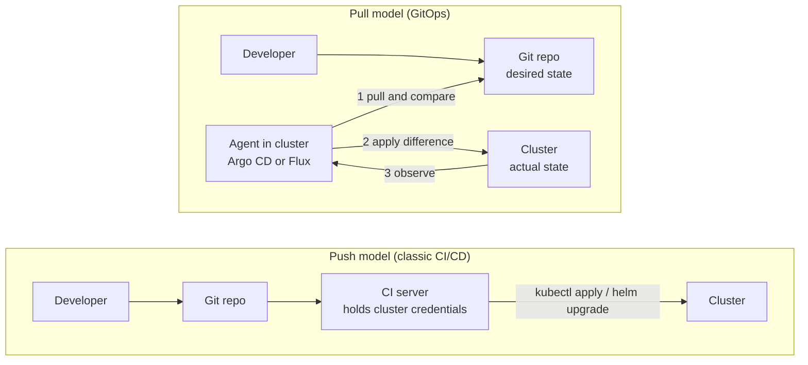
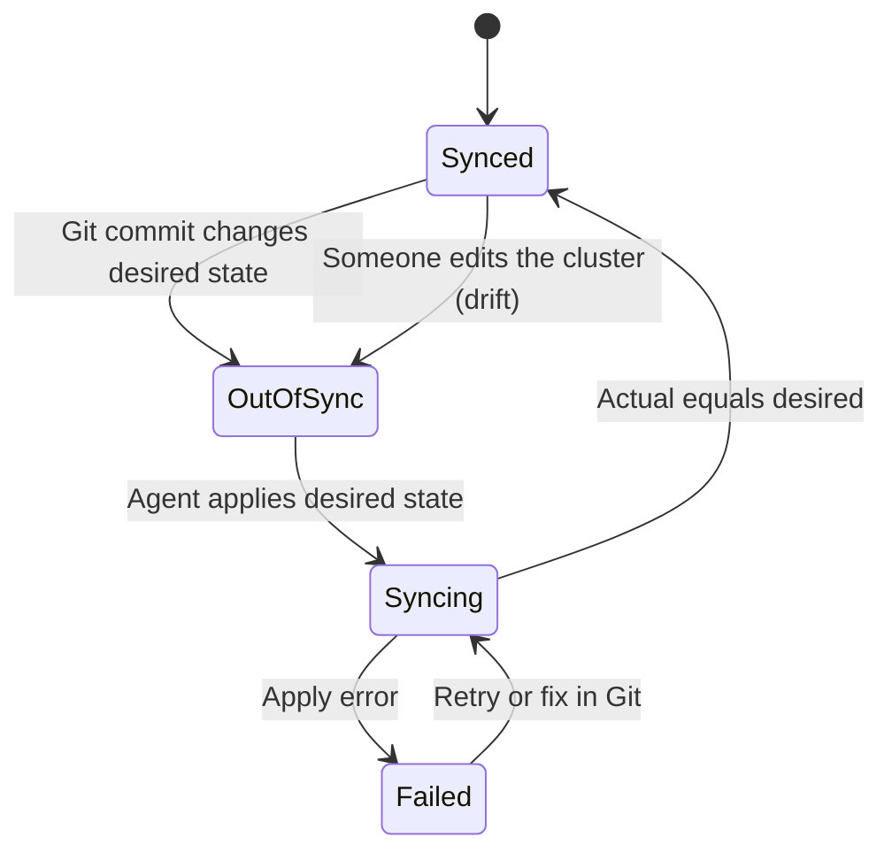

# L17.1 — Desired State Management

> **Level 17: GitOps** · Topic 1 of 7 · ⏱ ~4 hours · Difficulty: Intermediate

## 1. What it is

**GitOps** is a way of operating infrastructure and applications where a **Git repository is the single source of
truth for the *desired state*** of the system, and a software agent running next to the system continuously makes the
*actual state* match it. You do not run `kubectl apply` from your laptop or push a release from a CI server. You open a
pull request that changes a file; once it is merged, an agent inside the cluster notices and converges the cluster.

The term was popularised by Weaveworks around 2017. Today the vendor-neutral definition is the **OpenGitOps
principles** maintained by a CNCF (Cloud Native Computing Foundation) working group. A GitOps system is:

1. **Declarative** - the desired state is expressed as data ("3 replicas of image X"), not as a script of steps.
2. **Versioned and immutable** - the desired state is stored so every change is a versioned, auditable, revertible commit.
3. **Pulled automatically** - software agents automatically pull the desired state from the source.
4. **Continuously reconciled** - agents observe the actual state and keep trying to apply the desired state.

"Desired state management" is the underlying idea: describe *what* you want, store it somewhere durable, and let a
control loop (the same idea as Kubernetes controllers) deal with *how*.

## 2. Why it matters in DevOps

- **Auditability:** "who changed production, when and why?" becomes `git log` plus a pull-request review, not archaeology in shell history.
- **Rollback is a commit:** returning to the last good state is `git revert`, which is fast, reviewed and itself recorded (see [Rollback Through Git](06-rollback-through-git.md)).
- **No cluster credentials in CI:** in a push model the CI system holds admin credentials to production. In a pull model only the in-cluster agent holds them, and it only needs read access to Git.
- **Drift disappears:** someone who hand-edits a Deployment with `kubectl edit` at 2 a.m. gets reverted (or at least flagged) instead of silently creating a snowflake environment.
- **Disaster recovery:** a cluster that dies can be rebuilt by pointing a fresh agent at the same repo. See [Disaster Recovery](../level-00-what-devops-is/09-disaster-recovery.md).

## 3. Real-world system example

**Argo CD and Flux, the two CNCF GitOps engines.** Argo CD originated at Intuit and was open-sourced as part of the
Argo project; Flux was created at Weaveworks. Both are CNCF projects that have reached the **graduated** maturity
level, and both implement the pull model: a controller inside the cluster pulls from Git (or an OCI registry) and
reconciles. Red Hat ships Argo CD as "OpenShift GitOps", and many cloud vendors offer managed or add-on versions of
one of the two. Kubernetes itself is the original desired-state system: every controller, from the Deployment
controller to the kubelet, compares `spec` (desired) with `status` (actual) and acts on the difference. GitOps
extends the same loop one level up: the "spec" of your whole platform lives in Git.

## 4. Diagram

Push versus pull delivery:



The reconcile loop, as a state machine:



## 5. How it works

### Declarative versus imperative

| | Imperative | Declarative |
|---|---|---|
| You say | "run 3 more pods", "restart the service" | "there should be 5 pods running image `shop-api:1.4.2`" |
| Stored as | a runbook or shell history | YAML in Git |
| Re-running it | may duplicate or fail | idempotent - same input, same result |
| Detecting drift | impossible | diff desired against actual |

### Push versus pull

| | Push (CI deploys) | Pull (GitOps agent) |
|---|---|---|
| Who holds prod credentials | the CI system, outside the cluster | the agent, inside the cluster |
| Drift handling | none until the next deploy | continuous detection and correction |
| Network | cluster API must be reachable from CI | cluster only needs outbound access to Git |
| Failure mode | a failed pipeline leaves a half-applied state | the agent keeps retrying toward the same target |

Push is not "wrong": [CI/CD pipelines](../level-05-cicd/01-pipeline-design.md) still build, test and publish the artifact. GitOps changes
only the **last mile** - how the new version reaches the cluster.

### Two repositories, not one

Most teams separate the **application repo** (source code, Dockerfile, CI) from the **GitOps / environment repo**
(manifests that say which image version runs where). Reasons: different change cadence, different reviewers,
no CI loop where a manifest commit triggers a rebuild, and a clean audit trail of deployments.

### A repo layout with Kustomize overlays

[Kustomize](https://kustomize.io/) is built into `kubectl` (`kubectl apply -k`). A **base** holds the
common manifests; an **overlay** per environment patches only what differs. This layout is used throughout the level:

```text
shop-gitops/
├── apps/
│   └── shop-api/
│       ├── base/
│       │   ├── deployment.yaml
│       │   ├── service.yaml
│       │   └── kustomization.yaml
│       └── overlays/
│           ├── dev/
│           │   └── kustomization.yaml      # 1 replica, image tag = latest build
│           ├── staging/
│           │   └── kustomization.yaml      # 2 replicas, tag promoted from dev
│           └── prod/
│               └── kustomization.yaml      # 3 replicas, tag promoted from staging
├── clusters/
│   └── local/
│       └── root-app.yaml                   # the "app of apps" entry point (topic 5)
└── README.md
```

Key rules: **no environment-specific YAML copy-pasted into base**, **one directory per environment**, and the only
thing a promotion changes is a few lines (usually the image tag) in an overlay. Alternatives: Helm charts with a
`values-<env>.yaml` per environment (see [Values](../level-09-helm/02-values.md)), or a branch per environment
(generally discouraged because merges between branches become the deployment process and diverge over time).

### What belongs in the desired state

Everything you want reproducible: Deployments, Services, Ingresses, ConfigMaps, namespaces, RBAC, NetworkPolicies,
CRDs and operator custom resources, and the GitOps agent's own configuration. What does **not** belong in plain text:
secrets (covered in [The Full Flow](07-ci-to-gitops-flow.md)) and fast-changing runtime state such as the replica count that
an HPA controls.

## 6. Step-by-step guide

**Prerequisites:** a Linux/macOS shell, `git`, and `kubectl` (version 1.14 or newer ships Kustomize). No cluster needed in this topic;
we only build and render the repo layout. Cost: none.

1. **Create the repo skeleton.**
   ```bash
   mkdir -p shop-gitops/apps/shop-api/{base,overlays/dev,overlays/staging,overlays/prod}
   cd shop-gitops && git init -b main
   ```

2. **Write the base.**
   ```bash
   cat > apps/shop-api/base/deployment.yaml <<'EOF'
   apiVersion: apps/v1
   kind: Deployment
   metadata:
     name: shop-api
   spec:
     replicas: 1
     selector:
       matchLabels:
         app: shop-api
     template:
       metadata:
         labels:
           app: shop-api
       spec:
         containers:
           - name: shop-api
             image: ghcr.io/example/shop-api:1.0.0
             ports:
               - containerPort: 3000
   EOF
   cat > apps/shop-api/base/service.yaml <<'EOF'
   apiVersion: v1
   kind: Service
   metadata:
     name: shop-api
   spec:
     selector:
       app: shop-api
     ports:
       - port: 80
         targetPort: 3000
   EOF
   cat > apps/shop-api/base/kustomization.yaml <<'EOF'
   apiVersion: kustomize.config.k8s.io/v1beta1
   kind: Kustomization
   resources:
     - deployment.yaml
     - service.yaml
   EOF
   ```

3. **Write the `dev` and `prod` overlays.**
   ```bash
   cat > apps/shop-api/overlays/dev/kustomization.yaml <<'EOF'
   apiVersion: kustomize.config.k8s.io/v1beta1
   kind: Kustomization
   namespace: shop-dev
   resources:
     - ../../base
   images:
     - name: ghcr.io/example/shop-api
       newTag: 1.1.0
   EOF
   cat > apps/shop-api/overlays/prod/kustomization.yaml <<'EOF'
   apiVersion: kustomize.config.k8s.io/v1beta1
   kind: Kustomization
   namespace: shop-prod
   resources:
     - ../../base
   replicas:
     - name: shop-api
       count: 3
   images:
     - name: ghcr.io/example/shop-api
       newTag: 1.0.0
   EOF
   ```

4. **Render each environment (this is what an agent does before it applies).**
   ```bash
   kubectl kustomize apps/shop-api/overlays/dev  | grep -E 'namespace|replicas|image:'
   kubectl kustomize apps/shop-api/overlays/prod | grep -E 'namespace|replicas|image:'
   ```
   Expected (similar to): dev shows `namespace: shop-dev`, `replicas: 1`, `image: ghcr.io/example/shop-api:1.1.0`;
   prod shows `namespace: shop-prod`, `replicas: 3`, `image: ghcr.io/example/shop-api:1.0.0`.

5. **Commit it - this commit *is* the deployment record.**
   ```bash
   git add . && git commit -m "feat: shop-api base with dev and prod overlays"
   ```

6. **Diff desired state like an agent would.** If you have a cluster later, `kubectl diff -k apps/shop-api/overlays/dev`
   prints what would change. Practise reading that output; every GitOps tool shows you the same idea.

## 7. Real-world scenario

*Illustrative scenario, not a documented incident.* The `shop-api` team's production Deployment is edited by hand during a
late-night incident: someone runs `kubectl scale --replicas=10` and `kubectl set env` to add a debug flag. The incident ends, nobody
writes it down, and two weeks later a routine deploy from CI overwrites the replica count back to 3 and removes the flag - a
second outage during Black Friday traffic. After moving to GitOps, the same hand edit would have shown the application as
**OutOfSync** within minutes, and with self-heal enabled the cluster would have reverted it, forcing the engineer to put the
change (with a reason) into a pull request. **Lesson:** when the repo is the only way to change prod, production stops
containing undocumented state.

## 8. Common mistakes and best practices

**Don't**

- Keep application source and environment manifests in one repo where every manifest commit retriggers CI.
- Copy-paste whole manifests per environment; the copies drift apart.
- Commit plain-text secrets or kubeconfig files to the GitOps repo.
- Use long-lived branches per environment as your promotion mechanism.
- Let people keep `kubectl edit` access to production "just in case" without alerting on it.

**Do**

- Describe desired state declaratively and keep it small: base plus thin overlays.
- Protect the GitOps repo's main branch with required reviews ([Protected Branches](../level-03-git-and-github/08-protected-branches-and-pull-requests.md)) - the merge button is now your deploy button.
- Pin images by explicit tag (ideally immutable tags or digests), never `latest`.
- Render and validate manifests in CI on every pull request (`kubectl kustomize`, `kubeconform`).
- Treat the repo layout as an API: document it in the README.

## 9. Tasks

- [ ] **T1 — Build the layout** *(≈30 min, beginner)*
  - **Goal:** create the `shop-gitops` base plus `dev` and `prod` overlays from section 6.
  - **Steps:**
    1. Follow the guide through step 5.
    2. Run `kubectl kustomize` on both overlays and save the output to `/tmp/dev.yaml` and `/tmp/prod.yaml`.
    3. Run `diff /tmp/dev.yaml /tmp/prod.yaml`.
  - **Done when:** the diff shows only namespace, replicas and image tag differences.

- [ ] **T2 — Add a staging overlay** *(≈20 min, beginner)*
  - **Goal:** extend the pattern without copying the base.
  - **Steps:**
    1. Create `overlays/staging/kustomization.yaml` with namespace `shop-staging`, 2 replicas and tag `1.0.0`.
    2. Render it and check the values.
  - **Done when:** `kubectl kustomize apps/shop-api/overlays/staging` shows 2 replicas in `shop-staging`.

- [ ] **T3 — Add a config difference with a patch** *(≈30 min, intermediate)*
  - **Goal:** use a strategic-merge patch for something other than image or replicas.
  - **Steps:**
    1. Add a `patches:` entry in the prod overlay that sets `resources.requests` (CPU `200m`, memory `256Mi`) on the container.
    2. Render prod and confirm only prod has the requests.
  - **Done when:** dev renders without `resources:` and prod renders with them.

- [ ] **T4 — Break it and read the error** *(≈20 min, intermediate)*
  - **Goal:** learn what a failing render looks like before an agent shows it to you.
  - **Steps:**
    1. Misspell a resource path in `base/kustomization.yaml`.
    2. Run `kubectl kustomize apps/shop-api/overlays/dev` and read the error.
    3. Fix it and re-render.
  - **Done when:** you can explain, from the error text alone, which file and path was wrong.

- [ ] **T5 — Add a validation gate** *(≈45 min, advanced)*
  - **Goal:** automate "never merge unrenderable manifests".
  - **Steps:**
    1. Write a GitHub Actions workflow (see [GitHub Actions workflows](../level-03-git-and-github/11-github-actions-workflows.md)) that loops over `apps/*/overlays/*` and runs `kubectl kustomize` on each, failing on error.
    2. Push a deliberately broken overlay on a branch and confirm the check fails.
  - **Done when:** the pull request shows a red check for the broken overlay and green after your fix.

- [ ] **T6 — Prove it: push versus pull** *(≈30 min, advanced)*
  - **Goal:** explain GitOps to a teammate.
  - **Steps:**
    1. Without the guide, draw the push and pull flows and mark where cluster credentials live in each.
    2. List the four OpenGitOps principles and give one concrete example of each from the repo you built.
  - **Done when:** a teammate can say, from your drawing, why a compromised CI server is less dangerous in the pull model.

## 10. Self-check questions

1. What are the four OpenGitOps principles?
2. Why is a pull-based agent considered safer than a CI job that runs `kubectl apply`?
3. Why separate the application repository from the GitOps repository?
4. What is the difference between a Kustomize base and an overlay?
5. Why is "a branch per environment" a risky layout?

<details>
<summary>Answers</summary>

1. Declarative; versioned and immutable; pulled automatically; continuously reconciled.
2. Cluster credentials stay inside the cluster; CI only needs to write to Git. The agent also corrects drift continuously rather than only at deploy time.
3. Different change cadence and reviewers, no rebuild loops from manifest commits, and a clean deployment audit trail.
4. The base holds the common manifests; an overlay references the base and patches only what differs for one environment.
5. Promotion becomes branch merging, which causes conflicts, hidden divergence and cherry-pick chaos; directories keep every environment visible side by side.
</details>

## 11. Further reading

- OpenGitOps (opengitops.dev) - the four principles, maintained under the CNCF.
- Kustomize documentation (kubectl.docs.kubernetes.io and kustomize.io) - bases, overlays, patches, images.
- Argo CD documentation, "Best Practices" - separating config repo from source repo.
- *GitOps and Kubernetes* by Billy Yuen, Alexander Matyushentsev, Todd Ekenstam and Jesse Suen (Manning).

<!-- nav -->
---
← Previous level: [Level 16 — Advanced Kubernetes](../level-16-advanced-kubernetes/README.md) · [Level 17 index](README.md) · Next: [Argo CD and Flux](02-argo-cd-and-flux.md) →
