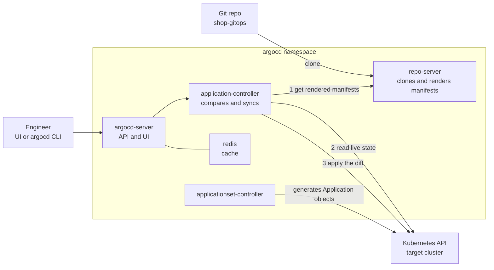
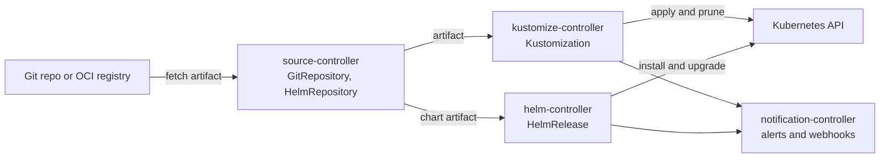

# L17.2 — Argo CD and Flux

> **Level 17: GitOps** · Topic 2 of 7 · ⏱ ~5 hours · Difficulty: Intermediate

## 1. What it is

**Argo CD** and **Flux** are the two mainstream open-source **GitOps controllers** for Kubernetes. Both run *inside* the
cluster, watch a Git repository (or Helm repository or OCI registry), render the manifests found there (plain YAML,
Kustomize, Helm) and apply them. Both are CNCF (Cloud Native Computing Foundation) graduated projects.

- **Argo CD** is an application-centric tool with a web UI, a CLI (`argocd`) and one central object, the **`Application`**
  custom resource ("take *this path* of *this repo* and deploy it to *this cluster/namespace*").
- **Flux** (version 2, also called the "GitOps Toolkit") is a set of small, composable controllers driven entirely by
  Kubernetes custom resources and the `flux` CLI. There is no built-in UI; you compose `GitRepository`, `Kustomization`
  and `HelmRelease` objects.

They solve the same problem with different philosophies, covered in the comparison below.

## 2. Why it matters in DevOps

- Picking and operating the controller is the core of a GitOps platform: its availability, RBAC (role-based access control) and upgrade story are now part of your production path.
- Argo CD's UI shows health and diff to non-experts (support engineers, product teams); Flux's toolkit approach fits platform teams who want to build their own abstractions. Choosing wrongly costs months.
- Both read Git with credentials you create (deploy keys or tokens). Mis-scoped credentials are a real supply-chain risk.
- Knowing the mechanism (pull, render, diff, apply, health check) lets you debug "why is it OutOfSync?" quickly, which is the most common GitOps ticket.

## 3. Real-world system example

**Intuit** created Argo CD and uses the Argo projects internally; the project's public `USERS.md` lists hundreds of
adopting organisations. **Red Hat OpenShift GitOps** packages Argo CD for OpenShift. **Flux** is used by many
organisations and is the engine behind several vendors' managed GitOps features (for example, Azure's Kubernetes
GitOps extension and the AKS/Arc offerings are built on Flux, according to Microsoft's documentation). Weaveworks, the
company that created Flux, wound down its commercial operations in early 2024; Flux continued as a community-governed CNCF project,
which is a reminder to evaluate a project's governance, not just its features. (Check the current project pages for the
latest status before you decide.)

## 4. Diagram

Argo CD architecture and sync flow:



Flux controllers and their objects:



## 5. How it works

### Argo CD

| Component | Job |
|---|---|
| `argocd-server` | API server, web UI, auth (can use Dex for SSO - single sign-on) |
| `argocd-repo-server` | clones repos and renders manifests (plain, Kustomize, Helm, plugins) |
| `argocd-application-controller` | continuously compares **desired** (rendered) with **live** and syncs |
| `argocd-applicationset-controller` | generates many `Application`s from templates (topic 5) |
| `argocd-redis` | cache |

Core objects: `Application` (what to deploy where), `AppProject` (guardrails: allowed repos, clusters, namespaces,
resource kinds) and cluster/repo credentials stored as labelled Secrets. By default the controller refreshes Git
roughly every **3 minutes** (configurable); webhooks from GitHub make it near-instant.

### Flux

| Controller | Objects | Job |
|---|---|---|
| source-controller | `GitRepository`, `HelmRepository`, `OCIRepository`, `Bucket` | fetch and package sources |
| kustomize-controller | `Kustomization` (Flux's, not Kustomize's `kustomization.yaml`) | build and apply manifests, prune, health-check |
| helm-controller | `HelmRelease` | install and upgrade Helm charts declaratively |
| notification-controller | `Provider`, `Alert`, `Receiver` | send alerts, receive webhooks |
| image-reflector / image-automation (optional) | `ImageRepository`, `ImagePolicy`, `ImageUpdateAutomation` | scan registries and commit new tags to Git |

Flux bootstraps itself: `flux bootstrap` installs the controllers **and commits their own manifests to your repo**, so Flux
manages Flux.

### Choosing between them

| | Argo CD | Flux |
|---|---|---|
| UI | rich built-in web UI (diff, tree, logs) | none built in (third-party UIs exist) |
| Core model | `Application` per deployable unit | `GitRepository` + `Kustomization` / `HelmRelease` |
| Multi-tenancy | `AppProject`, RBAC, SSO built in | Kubernetes RBAC and service-account impersonation |
| Multi-cluster | one control plane manages many clusters | typically one Flux per cluster, or remote kubeconfig |
| Helm | renders chart then applies it (not a Helm release in `helm ls`) | real Helm releases via helm-controller |
| Mass generation | `ApplicationSet` | Kustomization per directory, or templating tools |
| Image automation | Argo CD Image Updater (separate project) | built-in optional controllers |
| Drift correction | `selfHeal` option | on by default each reconcile interval |

Rule of thumb: choose **Argo CD** when you want a UI, a central multi-cluster view and an app-centric model for many teams;
choose **Flux** when you want a lightweight, Kubernetes-native toolkit with no extra API surface. Either is a sound choice; the
concepts in the rest of this level apply to both. This level's examples use Argo CD, with Flux equivalents shown where they differ.

## 6. Step-by-step guide

**Prerequisites:** Docker, [`kind`](https://kind.sigs.k8s.io/), `kubectl`, `git`. Optional: `argocd` CLI.
Cost: free (everything runs locally; allow ~4 GB RAM).

1. **Create a local cluster.**
   ```bash
   kind create cluster --name gitops
   kubectl cluster-info --context kind-gitops
   ```
   Expected: `Kubernetes control plane is running at https://127.0.0.1:...` (port varies).

2. **Install Argo CD.**
   ```bash
   kubectl create namespace argocd
   kubectl apply -n argocd --server-side --force-conflicts \
     -f https://raw.githubusercontent.com/argoproj/argo-cd/stable/manifests/install.yaml
   kubectl -n argocd rollout status deploy/argocd-server --timeout=300s
   kubectl -n argocd get pods
   ```
   `--server-side` is used because some Argo CD CRDs are too large for client-side apply annotations. Expect about seven pods
   (server, repo-server, application-controller, applicationset-controller, redis, dex-server, notifications-controller), all `Running`.
   Pod names will differ (illustrative).

3. **Open the UI and log in.**
   ```bash
   kubectl -n argocd get secret argocd-initial-admin-secret -o jsonpath='{.data.password}' | base64 -d; echo
   kubectl -n argocd port-forward svc/argocd-server 8080:443
   ```
   Browse to `https://localhost:8080` (accept the self-signed certificate), user `admin`, paste the password. Change it
   and delete the initial secret once you have set up real auth.

4. **Create your first `Application`.** This deploys the public `guestbook` example from the Argo CD project; replace the
   repo with your own `shop-gitops` later.
   ```yaml
   # guestbook-app.yaml
   apiVersion: argoproj.io/v1alpha1
   kind: Application
   metadata:
     name: guestbook
     namespace: argocd
   spec:
     project: default
     source:
       repoURL: https://github.com/argoproj/argocd-example-apps.git
       targetRevision: HEAD
       path: guestbook
     destination:
       server: https://kubernetes.default.svc
       namespace: guestbook
     syncPolicy:
       syncOptions:
         - CreateNamespace=true
   ```
   ```bash
   kubectl apply -f guestbook-app.yaml
   kubectl -n argocd get applications
   ```
   Expected (similar to): `guestbook   OutOfSync   Missing` at first, because no automated sync is configured.

5. **Sync it manually.**
   ```bash
   kubectl -n argocd patch application guestbook --type merge \
     -p '{"operation":{"sync":{}}}'
   kubectl -n argocd get applications
   ```
   After a few seconds expect `Synced   Healthy`. (With the CLI: `argocd app sync guestbook`.)

6. **Flux equivalent (read, or try on a second kind cluster).** A `GitRepository` plus a `Kustomization`:
   ```yaml
   apiVersion: source.toolkit.fluxcd.io/v1
   kind: GitRepository
   metadata:
     name: shop-gitops
     namespace: flux-system
   spec:
     interval: 1m
     url: https://github.com/example/shop-gitops
     ref:
       branch: main
   ---
   apiVersion: kustomize.toolkit.fluxcd.io/v1
   kind: Kustomization
   metadata:
     name: shop-api-dev
     namespace: flux-system
   spec:
     interval: 5m
     path: ./apps/shop-api/overlays/dev
     prune: true
     sourceRef:
       kind: GitRepository
       name: shop-gitops
     targetNamespace: shop-dev
   ```
   Installing Flux itself is `flux bootstrap github --owner=<YOUR_USER> --repository=<YOUR_REPO> --path=clusters/local`
   (needs a GitHub token in `GITHUB_TOKEN`). A `HelmRelease` follows the same shape, with `spec.chart.spec` naming a chart and a
   `sourceRef` to a `HelmRepository`.

7. **Clean up** (or keep the cluster for the next topics).
   ```bash
   kind delete cluster --name gitops
   ```

## 7. Real-world scenario

*Illustrative scenario.* A platform team of three supports 25 product teams. They first adopt Flux because it is "just
controllers". Within a quarter, support tickets pile up: "is my deploy done?", "why is it red?". Developers cannot see anything
without cluster access. The team adds Argo CD's UI for read-mostly visibility and `AppProject`s per team, keeping the same Git
repo layout. Alternatively, a team that starts with Argo CD finds the central control plane is a single point of concern and
moves to one lightweight controller per cluster. **Lesson:** the engine matters less than the repo structure, but the
*audience* (who needs to see state, how many clusters) should drive the choice, and a pilot with real users beats a feature table.

## 8. Common mistakes and best practices

**Don't**

- Leave the default `admin` account and `argocd-initial-admin-secret` in a real cluster.
- Point production `Application`s at `targetRevision: HEAD` of an unprotected branch.
- Give the Argo CD controller cluster-admin on every cluster without `AppProject` restrictions.
- Install from `stable` manifests in production without pinning a version.
- Grant the agent write access to Git when it only needs to read.

**Do**

- Pin the Argo CD/Flux version (for example, a release tag in the install URL) and upgrade deliberately.
- Use read-only deploy keys or fine-grained tokens, and webhooks to cut sync latency.
- Define `AppProject`s that restrict source repos, destination namespaces and resource kinds per team.
- Back up the controller's configuration: with GitOps this means "it is in Git", including the controller's own manifests.
- Monitor the controllers (they export Prometheus metrics) - see [Prometheus and PromQL](../level-10-observability/02-prometheus-and-promql.md).

## 9. Tasks

- [ ] **T1 — Install Argo CD on kind** *(≈45 min, beginner)*
  - **Goal:** a working Argo CD with UI access.
  - **Steps:**
    1. Follow section 6 steps 1-3.
    2. Log in at `https://localhost:8080`.
  - **Done when:** the UI loads and `kubectl -n argocd get pods` shows all pods `Running`.

- [ ] **T2 — Deploy the guestbook Application** *(≈30 min, beginner)*
  - **Goal:** see the Application custom resource drive a deployment.
  - **Steps:**
    1. Apply `guestbook-app.yaml` and sync it.
    2. Open the application tile in the UI and expand the resource tree.
    3. Run `kubectl -n guestbook get all`.
  - **Done when:** the app shows `Synced` and `Healthy` and the pods exist in namespace `guestbook`.

- [ ] **T3 — Point Argo CD at your own repo** *(≈45 min, intermediate)*
  - **Goal:** deploy the `shop-gitops` dev overlay from [Desired State Management](01-desired-state-management.md).
  - **Steps:**
    1. Push `shop-gitops` to a GitHub repository (public to start with).
    2. Write an `Application` with `path: apps/shop-api/overlays/dev` and `destination.namespace: shop-dev`.
    3. Apply and sync it.
  - **Done when:** `kubectl -n shop-dev get deploy shop-api` exists and Argo CD shows `Synced`.

- [ ] **T4 — Break it: bad path** *(≈20 min, intermediate)*
  - **Goal:** read an Argo CD error condition.
  - **Steps:**
    1. Change `path` to a directory that does not exist (`kubectl edit application ...`).
    2. Run `kubectl -n argocd describe application <name>` and look at `Conditions`.
    3. Fix the path.
  - **Done when:** you can quote the condition message and explain which component (repo-server) produced it.

- [ ] **T5 — Install Flux and compare** *(≈60 min, advanced)*
  - **Goal:** feel the difference between the tools.
  - **Steps:**
    1. Create a second kind cluster and run `flux check --pre`, then `flux bootstrap github` against a throwaway repo.
    2. Add a `GitRepository` and `Kustomization` for the dev overlay.
    3. Run `flux get kustomizations`.
  - **Done when:** `shop-api` runs in `shop-dev` and you have a 5-line written comparison (UI, objects, bootstrap, drift handling, image automation).

- [ ] **T6 — Prove it: choose and defend** *(≈30 min, advanced)*
  - **Goal:** justify a tool selection.
  - **Steps:**
    1. Without notes, draw the Argo CD component diagram and trace what happens between "git push" and "pods updated".
    2. For a fictional company (3 clusters, 12 teams, no platform staff), recommend Argo CD or Flux in one paragraph.
  - **Done when:** your trace names repo-server, application-controller and the Kubernetes API in order, and your recommendation states two trade-offs.

## 10. Self-check questions

1. Which Argo CD component renders manifests and which one applies them?
2. What does `flux bootstrap` commit to your repository?
3. Name two situations where Argo CD is the better fit and two where Flux is.
4. Why is `--server-side` apply recommended for installing Argo CD?
5. What is an `AppProject` for?

<details>
<summary>Answers</summary>

1. The repo-server renders; the application-controller compares live versus desired state and applies changes.
2. The Flux controllers' own manifests plus a sync configuration (a `GitRepository` and `Kustomization`), so Flux manages itself from Git.
3. Argo CD: need for a UI, central multi-cluster view, built-in SSO and project RBAC. Flux: Kubernetes-native toolkit, real Helm releases, built-in image automation, minimal footprint.
4. Some CRDs exceed the size limit of the annotation client-side apply uses to track state.
5. It restricts which repos, clusters, namespaces and resource kinds a group of Applications may use - multi-tenant guardrails.
</details>

## 11. Further reading

- Argo CD documentation (argo-cd.readthedocs.io) - "Getting Started", "Architecture", "Declarative Setup".
- Flux documentation (fluxcd.io) - "Get Started", "GitOps Toolkit components".
- OpenGitOps principles (opengitops.dev).
- See also: [Helm charts](../level-09-helm/01-charts.md) and [Namespaces](../level-08-kubernetes/08-namespaces.md).

<!-- nav -->
---
← Previous: [Desired State Management](01-desired-state-management.md) · [Level 17 index](README.md) · Next: [Continuous Reconciliation](03-continuous-reconciliation.md) →
