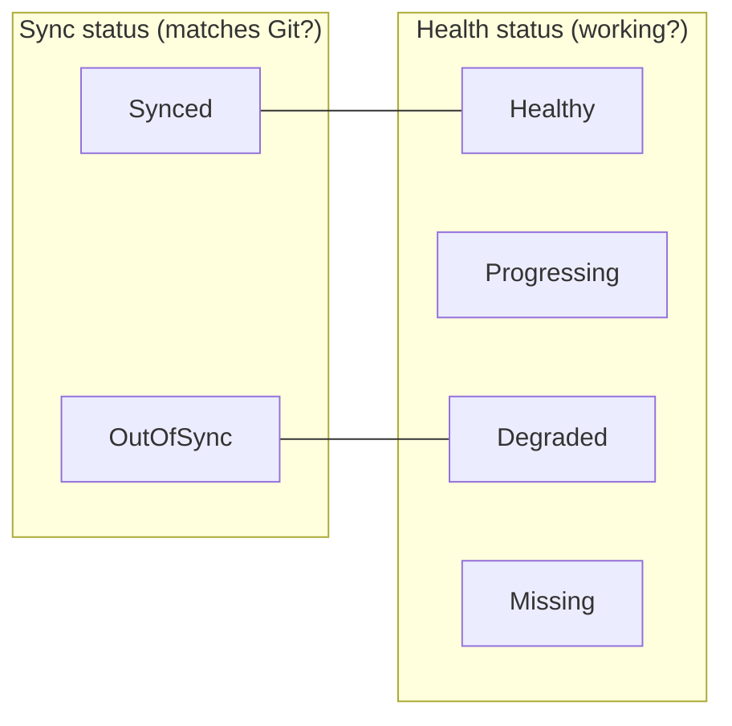

# L17.3 — Continuous Reconciliation

> **Level 17: GitOps** · Topic 3 of 7 · ⏱ ~4 hours · Difficulty: Intermediate

## 1. What it is

**Reconciliation** is the loop at the heart of GitOps: *observe* the actual state of the cluster, *compare* it with the
desired state in Git, and *act* to remove any difference. **Continuous** reconciliation means this never stops - it runs
on a timer and on events, not only when someone deploys.

Four ideas make up the topic:

- **Drift** - the cluster no longer matches Git (a manual `kubectl edit`, a controller mutating a field, a resource deleted by accident).
- **Self-heal** - the agent automatically reverts drift back to what Git says.
- **Prune** - the agent deletes cluster resources that were *removed from Git*, so deleting a file really deletes the object.
- **Sync loop** - the repeating cycle: fetch, render, diff, apply, check health, repeat.

## 2. Why it matters in DevOps

- Without self-heal, "GitOps" is just a nicer deploy button; production can still diverge silently.
- Without **prune**, deleted manifests leave orphan Deployments, Ingresses and Services behind, burning money and creating security holes.
- Over-aggressive reconcile can **fight other controllers** (HPA changing replicas, a mutating webhook injecting sidecars), producing endless "OutOfSync" noise or a sync loop that hammers the API server.
- Knowing which fields to ignore, and when to disable automation during an incident, separates a stable GitOps setup from a noisy one.

## 3. Real-world system example

**Kubernetes' own controllers** are the model: the Deployment controller keeps comparing `spec.replicas` with the number of
ReplicaSet pods and corrects it - see [Deployments and ReplicaSets](../level-08-kubernetes/03-deployments-and-replicasets.md). Argo CD and Flux
extend it to Git. Argo CD's documentation describes automated sync with the `prune` and `selfHeal` options, and
documents `ignoreDifferences` for fields managed by other controllers (a typical example is `spec.replicas` on a Deployment
managed by an HPA). Flux's `Kustomization` has `prune: true` and reconciles on its `interval`, and supports `force` to recreate
resources with immutable-field changes. Terraform's drift detection (see [Drift Detection](../level-07-terraform-iac/09-drift-detection.md))
is the same concept applied on demand; GitOps makes it continuous.

## 4. Diagram

```mermaid
sequenceDiagram
    participant G as Git repo
    participant C as GitOps controller
    participant K as Kubernetes API
    participant H as Human with kubectl
    loop every interval or on webhook
        C->>G: fetch revision
        G-->>C: manifests at commit abc123
        C->>C: render and compute desired state
        C->>K: read live state
        K-->>C: live objects
        alt live differs from desired
            C->>K: apply patch (self-heal)
            C->>K: delete removed objects (prune)
        else equal
            C->>C: mark Synced
        end
    end
    H->>K: kubectl scale deploy shop-api --replicas=10
    Note over K,C: drift introduced
    C->>K: next loop sets replicas back to 3
```



Sync status and health are two independent axes:



## 5. How it works

### Argo CD sync policy

```yaml
spec:
  syncPolicy:
    automated:        # without this block, syncs are manual
      prune: true     # delete resources removed from Git
      selfHeal: true  # revert out-of-band changes
    syncOptions:
      - CreateNamespace=true
      - PruneLast=true      # prune only after new resources are healthy
    retry:
      limit: 5
      backoff:
        duration: 5s
        factor: 2
        maxDuration: 3m
```

| Setting | What it does | Default |
|---|---|---|
| `automated` | sync automatically when Git changes | off (manual) |
| `automated.prune` | allow auto-sync to delete resources | off (safety) |
| `automated.selfHeal` | auto-sync when *live* state changes, not just Git | off |
| `PruneLast=true` | prune after other resources are healthy | off |
| `Prune=false` (annotation or option) | protect a specific resource from pruning | n/a |
| `ignoreDifferences` | tell the diff to skip fields owned by someone else | none |
| `retry` | retry failed syncs with back-off | no retry |

### Flux equivalents

| Concept | Flux |
|---|---|
| Sync loop period | `spec.interval` on `GitRepository` and `Kustomization` |
| Self-heal | automatic: each reconcile re-applies desired state (server-side apply) |
| Prune | `spec.prune: true` on the `Kustomization` |
| Ignore a field or resource | annotate with `kustomize.toolkit.fluxcd.io/reconcile: disabled`, or use `spec.patches` |
| Pause everything | `flux suspend kustomization <name>` / `flux resume ...` |
| Force a reconcile now | `flux reconcile kustomization <name> --with-source` |

### Why an object can be OutOfSync forever

- **Defaulted fields:** the API server adds defaults the manifest lacks (normally handled by the diff, but some CRDs cause noise).
- **Field owned by another controller:** HPA changes `replicas`; a service mesh injects a sidecar; cert-manager patches a CA bundle. Fix with `ignoreDifferences` (Argo) or by removing the field from the manifest.
- **Non-deterministic rendering:** Helm templates using `randAlphaNum`, or `now`, produce a different output each render. Make them stable.

### Refresh versus sync

A **refresh** means "re-read Git and recompute the diff". A **sync** means "apply the diff". Argo CD refreshes about every
3 minutes by default (or immediately via a Git webhook), and compares with the live cache continuously. Hard refresh also
invalidates the manifest cache.

## 6. Step-by-step guide

**Prerequisites:** the kind cluster with Argo CD from [Argo CD and Flux](02-argo-cd-and-flux.md) and your `shop-gitops` repo
on GitHub, with an `Application` named `shop-api-dev` pointing at `apps/shop-api/overlays/dev`. Cost: none.

1. **Turn on automated sync with prune and self-heal.**
   ```yaml
   # apps/shop-api-dev-app.yaml  (apply with kubectl, or keep it in Git under clusters/local/)
   apiVersion: argoproj.io/v1alpha1
   kind: Application
   metadata:
     name: shop-api-dev
     namespace: argocd
   spec:
     project: default
     source:
       repoURL: https://github.com/<YOUR_USER>/shop-gitops.git
       targetRevision: main
       path: apps/shop-api/overlays/dev
     destination:
       server: https://kubernetes.default.svc
       namespace: shop-dev
     syncPolicy:
       automated:
         prune: true
         selfHeal: true
       syncOptions:
         - CreateNamespace=true
   ```
   ```bash
   kubectl apply -f apps/shop-api-dev-app.yaml
   kubectl -n argocd get application shop-api-dev
   ```
   Expect `Synced   Healthy` within a minute or so.

2. **Create drift and watch it get reverted.**
   ```bash
   kubectl -n shop-dev scale deploy/shop-api --replicas=5
   kubectl -n shop-dev get deploy shop-api -w
   ```
   Within seconds the replica count returns to the value in Git (`1` for the dev overlay). Self-heal reacts to live-state
   changes quickly (it does not wait for the 3-minute Git poll). Press Ctrl-C to stop watching.

3. **Prove prune works.** Remove the Service from the repo and push.
   ```bash
   cd shop-gitops
   # remove service.yaml from the base kustomization resources list
   sed -i '/service.yaml/d' apps/shop-api/base/kustomization.yaml
   git commit -am "chore: drop shop-api service (prune test)" && git push
   kubectl -n shop-dev get svc shop-api -w
   ```
   After the next refresh (use `argocd app get shop-api-dev --refresh` or a UI Refresh to skip the wait) the Service is deleted.
   Restore it with `git revert HEAD && git push`.

4. **Disable self-heal and see the difference.**
   ```bash
   kubectl -n argocd patch application shop-api-dev --type merge \
     -p '{"spec":{"syncPolicy":{"automated":{"selfHeal":false}}}}'
   kubectl -n shop-dev scale deploy/shop-api --replicas=5
   kubectl -n argocd get application shop-api-dev
   ```
   Now the app shows `OutOfSync` and stays at 5 replicas until you sync. (Applying the patch to a live Application that is
   managed from Git will itself be reverted if the Application is also under GitOps - another reason to change policy in Git.)
   Re-enable `selfHeal: true` afterwards.

5. **Ignore a field owned by another controller.** Add an HPA-friendly ignore rule:
   ```yaml
   spec:
     ignoreDifferences:
       - group: apps
         kind: Deployment
         jsonPointers:
           - /spec/replicas
   ```
   With this rule, scaling by hand or by an HPA no longer shows as drift (and self-heal will not fight it).

6. **Watch the controller log the loop.**
   ```bash
   kubectl -n argocd logs deploy/argocd-repo-server --tail=5
   kubectl -n argocd logs statefulset/argocd-application-controller --tail=10
   ```
   Log wording varies by version; look for entries mentioning your application name and sync or comparison results.
   (In older releases the application controller is a Deployment rather than a StatefulSet.)

## 7. Real-world scenario

*Illustrative scenario.* After enabling HPA for `shop-api`, the on-call engineer sees the app flapping: HPA scales to 8 replicas for
a traffic spike, Argo CD sees `replicas: 3` in Git and "heals" back to 3, the pods get overloaded, the HPA scales again - a tug of war
visible as a sawtooth in the replica graph and rising latency. Investigation shows Git still has a hard-coded `replicas: 3`.
Fix: remove `replicas` from the Deployment manifest (or add `ignoreDifferences` for `/spec/replicas`), so the HPA owns that field.
**Lesson:** decide which controller owns each field; reconcilers that disagree will fight forever.
See [HPA, VPA and Cluster Autoscaler](../level-16-advanced-kubernetes/07-hpa-vpa-cluster-autoscaler.md).

## 8. Common mistakes and best practices

**Don't**

- Enable `prune: true` on a first sync of a namespace that also contains hand-made resources, without checking what would be deleted.
- Fight HPAs, service-mesh injectors or cert-manager over the same field.
- "Fix" drift by disabling auto-sync permanently; find out why the drift exists.
- Set a 10-second poll interval on dozens of apps; use webhooks instead.
- Forget that suspending reconciliation during an incident must be re-enabled afterwards.

**Do**

- Start with manual sync, review the diff, then turn on automated sync, then prune, then self-heal, in that order.
- Protect critical resources from deletion (`argocd.argoproj.io/sync-options: Prune=false`, PVCs and namespaces in particular).
- Alert on `OutOfSync` longer than N minutes and on sync failures.
- Use `ignoreDifferences` narrowly (a specific kind and JSON pointer), never broadly.
- Keep an incident procedure: suspend reconcile, fix, commit the fix to Git, resume.

## 9. Tasks

- [ ] **T1 — Trigger self-heal** *(≈20 min, beginner)*
  - **Goal:** watch drift correction happen.
  - **Steps:**
    1. Enable `automated.selfHeal: true` for `shop-api-dev`.
    2. Scale the Deployment by hand to 5 replicas.
    3. Watch it return to the Git value.
  - **Done when:** `kubectl get deploy shop-api -n shop-dev` shows the Git replica count again without you running a sync.

- [ ] **T2 — Observe a prune** *(≈30 min, beginner)*
  - **Goal:** confirm that deleting a file deletes the object.
  - **Steps:**
    1. Add a throwaway ConfigMap `scratch` to the base and let it sync.
    2. Delete the file and its entry in `kustomization.yaml`, commit, push.
    3. Refresh and watch the ConfigMap disappear.
  - **Done when:** `kubectl -n shop-dev get cm scratch` returns NotFound and the Argo CD tree no longer shows it.

- [ ] **T3 — Turn self-heal off and compare** *(≈30 min, intermediate)*
  - **Goal:** feel the behavioural difference.
  - **Steps:**
    1. Set `selfHeal: false` (in Git, not by `kubectl patch`), wait for sync.
    2. Make a manual change; observe `OutOfSync`.
    3. Click Sync (or run `argocd app sync`) to correct it.
  - **Done when:** you can show both states side by side and explain when each is appropriate.

- [ ] **T4 — Break it: the HPA tug of war** *(≈45 min, advanced)*
  - **Goal:** reproduce and fix a reconciliation conflict.
  - **Steps:**
    1. Install metrics-server on kind (or skip load) and create an HPA for `shop-api` with `minReplicas: 2`.
    2. Keep `replicas: 1` in the Deployment manifest and observe the conflict (`kubectl get hpa,deploy -w`).
    3. Fix it with `ignoreDifferences` on `/spec/replicas`, or remove the field from Git.
  - **Done when:** the replica count stays at the HPA's value and the app is `Synced`.

- [ ] **T5 — Protect a resource and add alerting** *(≈45 min, advanced)*
  - **Goal:** guard against accidental prune.
  - **Steps:**
    1. Add the annotation `argocd.argoproj.io/sync-options: Prune=false` to a PVC or ConfigMap in your overlay.
    2. Remove it from Git and confirm it is **not** deleted.
    3. Write (or sketch) a Prometheus alert on Argo CD's `argocd_app_info` metric where `sync_status="OutOfSync"` for 15 minutes.
  - **Done when:** the protected object survives the Git removal and your alert rule parses with `promtool check rules`.

- [ ] **T6 — Prove it: explain the loop** *(≈30 min, advanced)*
  - **Goal:** teach reconciliation to a teammate.
  - **Steps:**
    1. Without the guide, draw the sequence: Git -> controller -> API -> live state, including where drift enters.
    2. Explain refresh versus sync, prune, selfHeal and one case where you would turn each off.
  - **Done when:** a teammate can predict what happens when they `kubectl delete deploy shop-api` in a self-healing namespace.

## 10. Self-check questions

1. What is the difference between `prune` and `selfHeal`?
2. A resource is OutOfSync immediately after every sync. Name three possible causes.
3. How do HPA and GitOps conflict, and how do you resolve it?
4. Why is prune disabled by default in Argo CD automated sync?
5. How do you pause reconciliation of one Flux Kustomization during an incident?

<details>
<summary>Answers</summary>

1. Prune deletes live resources that no longer exist in Git; self-heal re-applies Git state when the live resource is changed out of band.
2. Another controller mutates a field (HPA, mesh injector, cert-manager), non-deterministic templating, or CRD defaulting differences.
3. HPA owns `replicas` while Git also declares it, so they fight. Remove `replicas` from Git or add `ignoreDifferences` for it.
4. Deleting is destructive; a mistaken path or empty render could delete a whole application, so it is an explicit opt-in.
5. `flux suspend kustomization <name>`, then `flux resume kustomization <name>` when done.
</details>

## 11. Further reading

- Argo CD documentation - "Automated Sync Policy", "Diffing Customization", "Sync Options".
- Flux documentation - "Kustomization" API reference (prune, interval, force) and `flux suspend`.
- Kubernetes documentation - "Controllers" and "Server-Side Apply" (field ownership).
- See also: [Continuous Reconciliation of cloud infrastructure with Terraform drift detection](../level-07-terraform-iac/09-drift-detection.md).

<!-- nav -->
---
← Previous: [Argo CD and Flux](02-argo-cd-and-flux.md) · [Level 17 index](README.md) · Next: [Environment Promotion](04-environment-promotion.md) →
