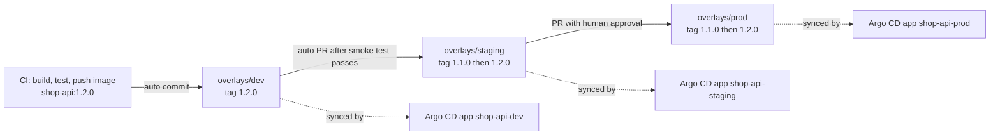
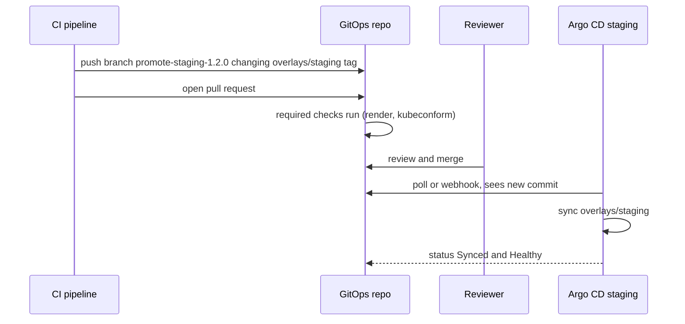

# L17.4 — Environment Promotion

> **Level 17: GitOps** · Topic 4 of 7 · ⏱ ~4 hours · Difficulty: Intermediate

## 1. What it is

**Promotion** is moving a *known-good version* of an application from one environment to the next - typically
**dev -> staging -> prod**. In GitOps, promotion is not a pipeline "deploy to prod" button; it is a **change to files in
the GitOps repository** (usually an image tag in an overlay), merged by pull request, which the agent for that environment
then reconciles.

The principle is **build once, promote the same artifact**: the container image built and tested for dev is the *identical*
image (same digest) that reaches prod. Only configuration differs per environment, and that difference lives in the
environment's overlay directory. See [Docker builds and registries in CI](../level-05-cicd/04-docker-builds-and-registries.md).

## 2. Why it matters in DevOps

- **Confidence:** prod runs exactly what staging validated. Rebuilding for each environment can produce different bits.
- **Control:** a promotion PR is a natural place for approvals, change records and automated checks (smoke test results, security scans).
- **Speed:** automating dev and staging promotion while keeping prod gated gives fast feedback without risk.
- **Traceability:** `git log apps/shop-api/overlays/prod` is a complete deployment history for production.
- A sloppy promotion model (copy-paste YAML, branch-per-environment, `latest` tags) is the most common reason GitOps repos turn into a mess.

## 3. Real-world system example

**Argo CD Image Updater and Flux image automation** are the publicly documented tools for automatic tag bumps. Flux's
`ImageRepository`, `ImagePolicy` and `ImageUpdateAutomation` objects scan a registry, choose the newest tag matching a policy
(for example semantic versioning range or timestamp), and **commit the change to Git**, so Git stays the source of truth. Argo CD
Image Updater does something similar for Argo CD applications, with a "write-back" method of either committing to Git or setting
parameters on the Application (the Git write-back is the GitOps-clean one). Many teams instead use their CI pipeline (GitHub
Actions, GitLab CI) to open a pull request against the environment repo. Kargo (an open-source promotion-orchestration
tool from Akuity, a company founded by Argo creators) exists specifically because promotion between stages is
a distinct problem from syncing. (Treat tool specifics as moving targets and check current docs.)

## 4. Diagram



PR-based promotion in sequence:



## 5. How it works

### Three ways to hold per-environment differences

| Approach | How | Verdict |
|---|---|---|
| **Directories + Kustomize overlays** | `overlays/dev`, `overlays/staging`, `overlays/prod` each with `images:` and patches | Recommended default: visible, diffable, no merge magic |
| **Helm values per environment** | `values-dev.yaml`, `values-prod.yaml` and the same chart | Good if you already use Helm |
| **Branch per environment** | `dev`, `staging`, `main` branches, promotion = merge | Avoid: drift, conflicts, hotfix confusion |

### What changes during promotion

Most promotions modify exactly one value: the image tag (or digest). Kustomize can do that without editing YAML by hand:

```bash
cd apps/shop-api/overlays/staging
kustomize edit set image ghcr.io/example/shop-api=ghcr.io/example/shop-api:1.2.0
```

(`kubectl kustomize` renders but cannot edit; `kustomize edit` needs the standalone `kustomize` binary.) Pin by **digest**
(`...@sha256:...`) for stronger immutability: tags can be re-pointed, digests cannot.

### Promotion strategies

| Strategy | Mechanism | Typical use |
|---|---|---|
| Manual PR | engineer edits tag, opens PR | simplest, good for prod |
| CI-generated PR | pipeline step opens PR on successful dev verification | common and auditable |
| Direct commit by bot | CI or Image Updater commits to the dev overlay | dev only |
| Image automation | Flux `ImageUpdateAutomation` / Argo CD Image Updater | fast-moving dev/staging |
| Orchestrator | Kargo or similar models "stages" and promotion rules | many services, many stages |

### Gates between environments

A promotion PR should carry evidence: tests that passed in the previous environment, vulnerability scan results,
and (for prod) a required approver. Protect the prod overlay path with CODEOWNERS so only a release owner can approve changes there.
See [Protected Branches and Pull Requests](../level-03-git-and-github/08-protected-branches-and-pull-requests.md).

### Argo CD Image Updater (concept)

An annotation-driven add-on that watches the registry and writes new tags back to Git. A typical configuration (annotation style
used by classic Image Updater versions; newer releases are moving towards a CRD-based configuration, so check the current docs):

```yaml
metadata:
  annotations:
    argocd-image-updater.argoproj.io/image-list: shop=ghcr.io/example/shop-api
    argocd-image-updater.argoproj.io/shop.update-strategy: semver
    argocd-image-updater.argoproj.io/write-back-method: git
    argocd-image-updater.argoproj.io/git-branch: main
```

## 6. Step-by-step guide

**Prerequisites:** the `shop-gitops` repo from [Desired State Management](01-desired-state-management.md), kind cluster with Argo CD
from [Argo CD and Flux](02-argo-cd-and-flux.md), `git`, and optionally the standalone `kustomize` and `gh` (GitHub CLI) binaries.
Cost: none.

1. **Add the staging overlay (if you skipped T2 earlier).**
   ```bash
   cat > apps/shop-api/overlays/staging/kustomization.yaml <<'EOF'
   apiVersion: kustomize.config.k8s.io/v1beta1
   kind: Kustomization
   namespace: shop-staging
   resources:
     - ../../base
   replicas:
     - name: shop-api
       count: 2
   images:
     - name: ghcr.io/example/shop-api
       newTag: 1.0.0
   EOF
   ```

2. **Create one Argo CD Application per environment.** Keep them in `clusters/local/`:
   ```yaml
   # clusters/local/shop-api-staging.yaml  (dev and prod are identical except name, path and namespace)
   apiVersion: argoproj.io/v1alpha1
   kind: Application
   metadata:
     name: shop-api-staging
     namespace: argocd
   spec:
     project: default
     source:
       repoURL: https://github.com/<YOUR_USER>/shop-gitops.git
       targetRevision: main
       path: apps/shop-api/overlays/staging
     destination:
       server: https://kubernetes.default.svc
       namespace: shop-staging
     syncPolicy:
       automated:
         prune: true
         selfHeal: true
       syncOptions:
         - CreateNamespace=true
   ```
   ```bash
   for e in dev staging prod; do sed "s/staging/$e/g" clusters/local/shop-api-staging.yaml | kubectl apply -f -; done
   kubectl -n argocd get applications
   ```
   Expect three applications. (For prod, consider leaving `automated` out so a human clicks Sync.)

3. **Promote dev to staging with a pull request.**
   ```bash
   git switch -c promote-staging-1.1.0
   cd apps/shop-api/overlays/staging
   kustomize edit set image ghcr.io/example/shop-api=ghcr.io/example/shop-api:1.1.0
   cd ../../../..
   git diff
   git commit -am "promote shop-api 1.1.0 to staging"
   git push -u origin promote-staging-1.1.0
   gh pr create --fill
   ```
   Expect a diff of a single `newTag` line. Merge the PR; Argo CD picks it up within the poll interval.

4. **Verify what is running in each environment.**
   ```bash
   for ns in shop-dev shop-staging shop-prod; do
     echo -n "$ns: "; kubectl -n $ns get deploy shop-api -o jsonpath='{.spec.template.spec.containers[0].image}'; echo
   done
   ```
   (Illustrative output: `shop-dev: ghcr.io/example/shop-api:1.1.0`, `shop-staging: ...:1.1.0`, `shop-prod: ...:1.0.0`.
   Note the images are fictional; use any public image such as `nginx` tags in your sandbox so pods actually start.)

5. **Automate the staging promotion in CI** (sketch, GitHub Actions in the *GitOps* repo, run after a dev smoke test):
   ```yaml
   name: promote-to-staging
   on:
     workflow_dispatch:
       inputs:
         tag:
           description: Image tag to promote
           required: true
   jobs:
     promote:
       runs-on: ubuntu-latest
       permissions:
         contents: write
         pull-requests: write
       steps:
         - uses: actions/checkout@v4
         - name: Bump tag
           run: |
             cd apps/shop-api/overlays/staging
             kustomize edit set image ghcr.io/example/shop-api=ghcr.io/example/shop-api:${{ inputs.tag }}
         - name: Open PR
           run: |
             git config user.name "promotion-bot"
             git config user.email "bot@example.com"
             git switch -c "promote-staging-${{ inputs.tag }}"
             git commit -am "promote shop-api ${{ inputs.tag }} to staging"
             git push -u origin HEAD
             gh pr create --fill
           env:
             GH_TOKEN: ${{ github.token }}
   ```
   Pass `inputs.tag` through an environment variable rather than inline `${{ }}` in `run:` if the value could be attacker-influenced (script injection).
   The runner image includes `kustomize`; confirm for your runner version.

6. **Protect production with CODEOWNERS.**
   ```text
   # .github/CODEOWNERS
   /apps/shop-api/overlays/prod/ @example/release-managers
   ```
   Combine with a branch protection rule requiring code-owner review.

## 7. Real-world scenario

*Illustrative scenario.* A team rebuilds the image separately for each environment from the `release` branch. A base-image
update lands between the staging and prod builds; prod gets a subtly different OpenSSL, and a TLS handshake bug appears only
in production. After switching to build-once-promote-by-digest, the prod overlay pins `sha256:...` identical to what staging ran,
and the release checklist becomes "open a PR that copies staging's digest into prod". **Lesson:** what you tested must be bit-for-bit what you ship.

## 8. Common mistakes and best practices

**Don't**

- Rebuild images per environment, or use `latest`/mutable tags in overlays.
- Promote by merging branches or copying whole directories.
- Let Image Updater write to prod automatically without a gate.
- Give the promotion bot more permissions than "open PR on the env repo".
- Put secrets or environment credentials inside the overlay as plain text.

**Do**

- Keep config differences minimal and explicit in each overlay.
- Promote through the same path every time: PR -> checks -> approval -> merge -> sync.
- Include evidence (links to test runs, scan results) in the promotion PR.
- Use digests where you can, and record the source tag in the commit message.
- Make the same promotion tooling work for hotfixes so nobody bypasses it at 3 a.m.

## 9. Tasks

- [ ] **T1 — Three environments from one base** *(≈45 min, beginner)*
  - **Goal:** run dev, staging and prod Applications side by side.
  - **Steps:**
    1. Follow steps 1-2 of the guide.
    2. Confirm three namespaces exist.
  - **Done when:** `kubectl get applications -n argocd` lists three Synced Applications and the Deployments differ in replicas.

- [ ] **T2 — Promote by pull request** *(≈30 min, beginner)*
  - **Goal:** move a version from dev to staging via PR.
  - **Steps:**
    1. Change the dev tag to `1.1.0` (use a real public image such as `nginx:1.27` so pods start).
    2. Promote it to staging with a PR as in step 3.
  - **Done when:** the merged PR is the only change and the staging Deployment runs the new tag.

- [ ] **T3 — Pin by digest** *(≈30 min, intermediate)*
  - **Goal:** use an immutable reference.
  - **Steps:**
    1. Find a digest (`docker buildx imagetools inspect nginx:1.27` or `crane digest nginx:1.27`).
    2. Set the overlay image `digest:` instead of `newTag:` (Kustomize `images` supports `digest`).
    3. Render and confirm `image: nginx@sha256:...`.
  - **Done when:** the pod runs from the digest reference and `kubectl describe pod` shows it.

- [ ] **T4 — Break it: promote a bad image** *(≈30 min, intermediate)*
  - **Goal:** see what a failed promotion looks like.
  - **Steps:**
    1. Promote a non-existent tag to staging.
    2. Watch the app go `Progressing`/`Degraded` with `ImagePullBackOff`.
    3. Fix by reverting the PR (preview of [Rollback Through Git](06-rollback-through-git.md)).
  - **Done when:** staging is Healthy again and the bad commit is visible in history next to its revert.

- [ ] **T5 — Automate promotion** *(≈60 min, advanced)*
  - **Goal:** a workflow that opens the staging PR for you.
  - **Steps:**
    1. Create the workflow from step 5 in your GitOps repo.
    2. Run it with a tag input.
    3. Add CODEOWNERS for the prod path and verify a PR touching prod requires the owner.
  - **Done when:** the workflow creates a PR with a one-line diff and the prod path shows "review required from code owners".

- [ ] **T6 — Prove it: design a promotion policy** *(≈30 min, advanced)*
  - **Goal:** write a short policy for a team.
  - **Steps:**
    1. Without notes, write which promotions are automatic, which need approval, and who may approve prod.
    2. Explain why branch-per-environment is avoided and how a hotfix flows.
  - **Done when:** your policy fits on half a page and names the gate, the evidence and the rollback path for each stage.

## 10. Self-check questions

1. What does "build once, promote the same artifact" mean, and why does it matter?
2. Why use overlay directories rather than branches per environment?
3. Where should automated tag bumps happen, and why must they be committed to Git?
4. Why pin a digest rather than a tag?
5. How do you require extra approval only for prod changes?

<details>
<summary>Answers</summary>

1. The same image digest moves through all environments; only config changes. What you tested is what you run.
2. Directories are visible side by side, diffable and never need merging; branches diverge and hide differences.
3. Automatically in dev (and maybe staging), as commits or PRs to the GitOps repo, so Git remains the source of truth and the change is auditable.
4. A tag can be re-pushed to point to different content; a digest is content-addressed and cannot change.
5. CODEOWNERS for `overlays/prod/` plus branch protection requiring code-owner review.
</details>

## 11. Further reading

- Kustomize documentation - `images`, `replicas`, `kustomize edit set image`.
- Argo CD Image Updater documentation (argocd-image-updater.readthedocs.io) and Flux "Automate image updates to Git" guide (fluxcd.io).
- Kargo documentation (kargo.io) - stage-based promotion for Argo CD.
- See also: [Deployment Strategies](../level-00-what-devops-is/07-deployment-strategies.md) and [Canary Deployments](../level-05-cicd/12-canary-deployments.md).

<!-- nav -->
---
← Previous: [Continuous Reconciliation](03-continuous-reconciliation.md) · [Level 17 index](README.md) · Next: [Application Synchronization](05-application-synchronization.md) →
