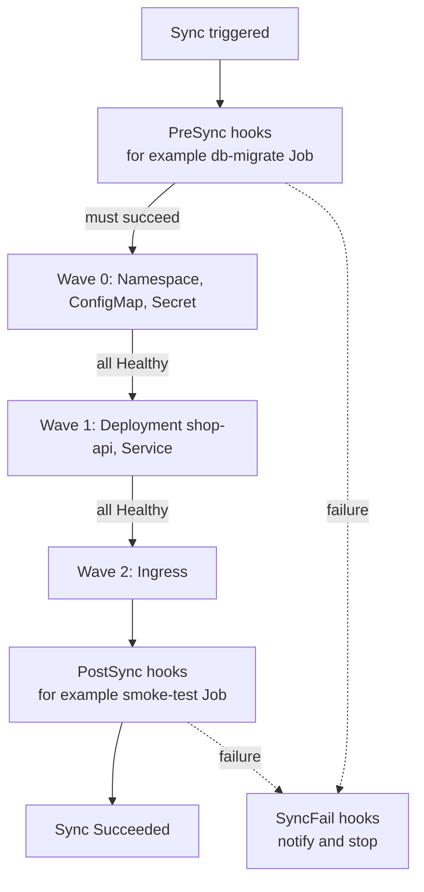
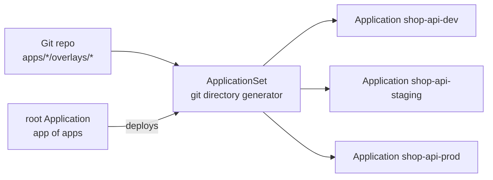

# L17.5 — Application Synchronization

> **Level 17: GitOps** · Topic 5 of 7 · ⏱ ~5 hours · Difficulty: Advanced

## 1. What it is

A **sync** is the act of making the cluster match the desired state for one application. Real applications are not a flat bag
of YAML: a database migration must finish before the new API starts, a CRD must exist before the custom resources that use it,
and a smoke test should run after everything is up. Argo CD gives you four tools to control this ordering and safety:

- **Sync waves** - numeric ordering of resources inside one sync (`argocd.argoproj.io/sync-wave`).
- **Resource hooks** - Jobs or Pods that run at a phase of the sync (`PreSync`, `Sync`, `PostSync`, `SyncFail`).
- **Sync policies and options** - when to sync automatically and how (`automated`, `retry`, `ServerSideApply`, `Replace`, ...).
- **Health assessment** - Argo CD's built-in (and custom) checks for whether a resource is actually working, not merely applied.

At fleet scale two more patterns matter: **App of Apps** (an Application whose contents are other Applications) and
**ApplicationSets** (a controller that *generates* Applications from a template and a list, directory or cluster generator).
Flux achieves ordering with `dependsOn` between Kustomizations and `healthChecks`.

## 2. Why it matters in DevOps

- Without ordering, first installs fail randomly: pods start before their ConfigMap, custom resources are rejected because the CRD is not there yet.
- Database migrations in the delivery flow need a safe, once-per-release home. A `PreSync` hook Job is the GitOps answer. See [Database Migrations in Pipelines](../level-05-cicd/09-database-migrations.md).
- "Applied" is not "working": an application that is `Synced` but `Degraded` must stop a promotion.
- A platform with 40 services and 3 environments is 120 Applications; hand-writing them does not scale, ApplicationSets do.

## 3. Real-world system example

Argo CD's own documentation uses **sync waves and hooks** for exactly these cases (CRD before CR, namespace before workloads,
`PreSync` DB migration, `PostSync` notification). The widely used pattern of bootstrapping a whole cluster -
ingress controller, cert-manager, monitoring stack, then business apps - with an **App of Apps** root is described in Argo CD's
"Cluster Bootstrapping" documentation. **ApplicationSets** are part of Argo CD itself (formerly a separate project) and are
used by platform teams to create one Application per directory in a repo, per cluster, or per pull request (the *pull request
generator* creates preview environments). Flux users get similar results with a layered set of `Kustomization` objects linked by `dependsOn`.

## 4. Diagram

Order of a sync with hooks and waves:



ApplicationSet generating Applications:



## 5. How it works

### Sync waves

Resources carry an integer annotation; lower waves apply first and Argo CD waits for each wave to be **Healthy** before
starting the next (default wave `0`, negative allowed). Within a wave, a built-in order applies (namespaces, then CRDs, then others).

```yaml
metadata:
  annotations:
    argocd.argoproj.io/sync-wave: "-1"   # before the default wave 0
```

### Hooks

```yaml
apiVersion: batch/v1
kind: Job
metadata:
  name: db-migrate
  annotations:
    argocd.argoproj.io/hook: PreSync
    argocd.argoproj.io/hook-delete-policy: BeforeHookCreation,HookSucceeded
spec:
  backoffLimit: 0
  template:
    spec:
      restartPolicy: Never
      containers:
        - name: migrate
          image: ghcr.io/example/shop-api:1.1.0
          command: ["node", "scripts/migrate.js"]
```

| Hook | Runs | Typical use |
|---|---|---|
| `PreSync` | before manifests are applied | DB migrations, backup |
| `Sync` | together with the apply (ordered by waves) | complex install steps |
| `PostSync` | after all resources are Healthy | smoke tests, notifications |
| `SyncFail` | when the sync fails | cleanup, alerting |
| `PostDelete` | after the app is deleted (recent versions) | cleanup of external resources |

Delete policies: `HookSucceeded`, `HookFailed`, `BeforeHookCreation` (recreate on every sync, the usual choice, avoids name clashes).
Make migrations **idempotent and backward compatible**: a PreSync Job can run again on a retry or rollback.

### Sync options worth knowing

| Option | Purpose |
|---|---|
| `CreateNamespace=true` | create the destination namespace |
| `ServerSideApply=true` | use server-side apply (needed for huge CRDs, helps co-ownership of fields) |
| `Replace=true` | `kubectl replace` instead of `apply` (careful; can disrupt) |
| `PruneLast=true` | prune after everything else is healthy |
| `ApplyOutOfSyncOnly=true` | only touch resources that differ (big apps, faster syncs) |
| `Validate=false` | skip schema validation (use only to work around CRD ordering) |
| `SkipDryRunOnMissingResource=true` | allow CRs whose CRD is created in the same sync |

### Health assessment

Argo CD ships health checks for built-in kinds (Deployment is Healthy when its rollout is complete, a Service of type
LoadBalancer when it has an address, a PVC when `Bound`, and so on). Statuses: `Healthy`, `Progressing`, `Degraded`, `Suspended`,
`Missing`, `Unknown`. For custom resources you can supply a **Lua health script** in the `argocd-cm` ConfigMap
(`resource.customizations.health.<group>_<kind>`). Wave advancement depends on health, so a good check makes ordering trustworthy.

### App of Apps

One "root" Application points to a directory containing other Application manifests. Deploying the root bootstraps everything.
It is simple and visible; its drawback is that adding the 30th app means writing another YAML file.

```yaml
# clusters/local/root-app.yaml
apiVersion: argoproj.io/v1alpha1
kind: Application
metadata:
  name: root
  namespace: argocd
spec:
  project: default
  source:
    repoURL: https://github.com/<YOUR_USER>/shop-gitops.git
    targetRevision: main
    path: clusters/local/apps        # contains Application manifests only
  destination:
    server: https://kubernetes.default.svc
    namespace: argocd
  syncPolicy:
    automated:
      prune: true
      selfHeal: true
```

### ApplicationSet with the Git directory generator

```yaml
apiVersion: argoproj.io/v1alpha1
kind: ApplicationSet
metadata:
  name: shop-api-envs
  namespace: argocd
spec:
  goTemplate: true
  goTemplateOptions: ["missingkey=error"]
  generators:
    - git:
        repoURL: https://github.com/<YOUR_USER>/shop-gitops.git
        revision: main
        directories:
          - path: apps/shop-api/overlays/*
  template:
    metadata:
      name: 'shop-api-{{ .path.basename }}'
    spec:
      project: default
      source:
        repoURL: https://github.com/<YOUR_USER>/shop-gitops.git
        targetRevision: main
        path: '{{ .path.path }}'
      destination:
        server: https://kubernetes.default.svc
        namespace: 'shop-{{ .path.basename }}'
      syncPolicy:
        automated:
          prune: true
          selfHeal: true
        syncOptions:
          - CreateNamespace=true
```

Add a directory `overlays/qa` and an Application `shop-api-qa` appears without touching anything else. Other generators:
`list`, `cluster` (one app per registered cluster), `matrix` and `merge` (combine generators), and `pullRequest` (preview environments).

### Flux equivalent of ordering

```yaml
apiVersion: kustomize.toolkit.fluxcd.io/v1
kind: Kustomization
metadata:
  name: shop-api
  namespace: flux-system
spec:
  interval: 5m
  path: ./apps/shop-api/overlays/prod
  prune: true
  sourceRef:
    kind: GitRepository
    name: shop-gitops
  dependsOn:
    - name: infrastructure      # ingress, cert-manager, CRDs
  healthChecks:
    - apiVersion: apps/v1
      kind: Deployment
      name: shop-api
      namespace: shop-prod
  timeout: 3m
```

## 6. Step-by-step guide

**Prerequisites:** kind cluster with Argo CD ([topic 2](02-argo-cd-and-flux.md)) and your `shop-gitops` repo on GitHub with the
three overlays from [topic 4](04-environment-promotion.md). Use a real public image (for example `nginx`) in the overlays so pods start. Cost: none.

1. **Add a PreSync hook and a PostSync smoke test to the base.** For the sandbox, use a harmless `busybox` image.
   ```bash
   cat > apps/shop-api/base/presync-job.yaml <<'EOF'
   apiVersion: batch/v1
   kind: Job
   metadata:
     name: db-migrate
     annotations:
       argocd.argoproj.io/hook: PreSync
       argocd.argoproj.io/hook-delete-policy: BeforeHookCreation,HookSucceeded
   spec:
     backoffLimit: 0
     template:
       spec:
         restartPolicy: Never
         containers:
           - name: migrate
             image: busybox:1.36
             command: ["sh", "-c", "echo running migrations && sleep 5"]
   EOF
   cat > apps/shop-api/base/postsync-job.yaml <<'EOF'
   apiVersion: batch/v1
   kind: Job
   metadata:
     name: smoke-test
     annotations:
       argocd.argoproj.io/hook: PostSync
       argocd.argoproj.io/hook-delete-policy: BeforeHookCreation,HookSucceeded
   spec:
     backoffLimit: 0
     template:
       spec:
         restartPolicy: Never
         containers:
           - name: smoke
             image: busybox:1.36
             command: ["sh", "-c", "echo smoke test passed"]
   EOF
   ```
   Add both files under `resources:` in `apps/shop-api/base/kustomization.yaml`, commit and push.

2. **Watch the ordered sync.**
   ```bash
   kubectl -n shop-dev get jobs -w
   ```
   Expected (similar to): `db-migrate` appears and completes first, then the Deployment rolls out, then `smoke-test` runs. In the UI the sync
   operation view lists hooks with their phase. Because of `HookSucceeded`, completed Jobs disappear.

3. **Order two resources with waves.** Create a `Namespace` with wave `-1` and a ConfigMap with wave `0`, or annotate the
   Deployment with wave `"1"` and a ConfigMap with wave `"0"`; then trigger a sync and confirm ordering in the sync result.

4. **Replace the three hand-written Applications with an ApplicationSet.** Delete `shop-api-dev/staging/prod`
   Applications (`kubectl -n argocd delete application ...`), save the ApplicationSet from section 5 as
   `clusters/local/shop-api-appset.yaml`, apply it:
   ```bash
   kubectl apply -f clusters/local/shop-api-appset.yaml
   kubectl -n argocd get applications
   ```
   Expect `shop-api-dev`, `shop-api-staging`, `shop-api-prod` to reappear, generated.
   (If you apply the ApplicationSet while the old Applications exist, ownership conflicts occur; delete the old ones first.)

5. **Bootstrap with App of Apps.** Put the ApplicationSet manifest under `clusters/local/apps/`, apply only `root-app.yaml`
   from section 5, and confirm the root app creates the ApplicationSet which creates the three Applications.
   ```bash
   kubectl apply -f clusters/local/root-app.yaml
   kubectl -n argocd get applications,applicationsets
   ```

6. **Add an environment by adding a directory.** Copy `overlays/staging` to `overlays/qa`, edit the namespace, push, and wait.
   An Application `shop-api-qa` appears. Delete the directory to see it (and, with prune, its resources) go away.
   Production note: set `preserveResourcesOnDeletion` or use a `deletionPolicy` carefully, since removing a generator entry deletes the generated Application.

## 7. Real-world scenario

*Illustrative scenario.* A release of `shop-api` adds a `NOT NULL` column. The CI/CD pipeline used to run `migrate` before
`kubectl apply`, but after the move to GitOps nobody owns that ordering: Argo CD rolls the new Deployment first, pods crash on the
missing column, and a sync loop of failing pods ensues. The team moves the migration into a `PreSync` Job with
`BeforeHookCreation`, makes the migration backward compatible (add nullable column first, enforce later), and adds a `PostSync` smoke
test. A failing migration now blocks the sync and leaves the old version serving. **Lesson:** express ordering in the sync
mechanism, and design migrations so old and new code both work for a release.

## 8. Common mistakes and best practices

**Don't**

- Put long-running or non-idempotent work in hooks without a `backoffLimit` and delete policy.
- Use waves as a substitute for readiness probes; waves wait on health, which depends on probes and health checks.
- Hand-write 100 Application YAMLs when a generator can produce them.
- Forget that deleting an ApplicationSet (or its generator entry) can delete the generated Applications and, via finalizers, their resources.
- Use `Replace=true` or `Validate=false` globally "to make errors go away".

**Do**

- Use `PreSync` for migrations and `PostSync` for verification, with `BeforeHookCreation` delete policy.
- Use `AppProject`s to restrict what generated Applications may deploy where.
- Write Lua health checks for custom resources that matter (databases, certificates).
- Keep the root app and ApplicationSets themselves in Git and reviewed.
- Roll out new generators on a test cluster first; a template bug fans out to every generated app.

## 9. Tasks

- [ ] **T1 — Observe hook ordering** *(≈30 min, beginner)*
  - **Goal:** see PreSync, apply and PostSync happen in order.
  - **Steps:**
    1. Add the two Jobs from step 1 to the base.
    2. Push and watch `kubectl -n shop-dev get jobs,pods -w`.
  - **Done when:** the sync result in the UI lists `db-migrate` (PreSync) completing before the Deployment and `smoke-test` (PostSync) after.

- [ ] **T2 — Order resources with waves** *(≈30 min, intermediate)*
  - **Goal:** control the apply order.
  - **Steps:**
    1. Annotate a ConfigMap with wave `"0"` and the Deployment with wave `"1"`, and a Namespace with wave `"-1"`.
    2. Delete the namespace and resync with `argocd app sync` (or UI).
    3. Review the order in the sync operation details.
  - **Done when:** the operation timeline shows wave -1 first, then 0, then 1.

- [ ] **T3 — Generate the environments** *(≈45 min, intermediate)*
  - **Goal:** replace hand-written Applications with an ApplicationSet.
  - **Steps:**
    1. Apply the ApplicationSet from section 5.
    2. Add `overlays/qa` and push.
    3. Observe `shop-api-qa` created automatically.
  - **Done when:** `kubectl -n argocd get applications` shows four generated Applications with no manual Application YAML.

- [ ] **T4 — Break it: failing PreSync** *(≈30 min, intermediate)*
  - **Goal:** confirm failed hooks block a release safely.
  - **Steps:**
    1. Change the migrate command to `exit 1`.
    2. Push a new image tag to dev in the same commit.
    3. Observe the sync fail and the old Deployment keep serving.
    4. Fix the command (or `git revert`).
  - **Done when:** the Application shows a failed operation with the hook error, the old pods are still running, and the fix restores sync.

- [ ] **T5 — Bootstrap with app of apps** *(≈45 min, advanced)*
  - **Goal:** rebuild the whole environment from one command.
  - **Steps:**
    1. Delete all your Applications and the ApplicationSet.
    2. Apply only `root-app.yaml`.
    3. Time how long until all environments are Healthy.
  - **Done when:** one `kubectl apply` restores everything, demonstrating cluster rebuild-from-Git.

- [ ] **T6 — Prove it: explain a sync** *(≈30 min, advanced)*
  - **Goal:** describe exactly how a release is applied.
  - **Steps:**
    1. Without notes, draw the sequence PreSync -> waves -> PostSync, marking where health gates apply.
    2. Say what happens if wave 1 never becomes Healthy, and what you would check first.
  - **Done when:** your explanation names probes and health assessment as the reason the sync waits (or fails).

## 10. Self-check questions

1. What decides when Argo CD moves from one sync wave to the next?
2. Why use `BeforeHookCreation` as a hook delete policy?
3. When would you choose ApplicationSet over App of Apps?
4. What is the difference between sync status and health status?
5. How do you express ordering between two Flux Kustomizations?

<details>
<summary>Answers</summary>

1. All resources in the current wave being applied and reporting Healthy.
2. It deletes the previous hook object before creating a new one, avoiding name collisions on re-sync.
3. When Applications follow a pattern (per directory, cluster, environment or pull request); App of Apps suits a small, hand-curated set and cluster bootstrap. They are often combined.
4. Sync status says whether live matches Git; health status says whether the resources are actually working.
5. `spec.dependsOn` on the dependent Kustomization, optionally with `healthChecks` on the dependency.
</details>

## 11. Further reading

- Argo CD documentation - "Sync Waves", "Resource Hooks", "Sync Options", "Resource Health", "Cluster Bootstrapping".
- Argo CD ApplicationSet documentation - generators (git, list, cluster, matrix, pullRequest).
- Flux documentation - Kustomization `dependsOn` and `healthChecks`.
- See also: [Jobs and CronJobs](../level-08-kubernetes/12-jobs-and-cronjobs.md) and [Liveness and Readiness Probes](../level-08-kubernetes/15-liveness-and-readiness-probes.md).

<!-- nav -->
---
← Previous: [Environment Promotion](04-environment-promotion.md) · [Level 17 index](README.md) · Next: [Rollback Through Git](06-rollback-through-git.md) →
