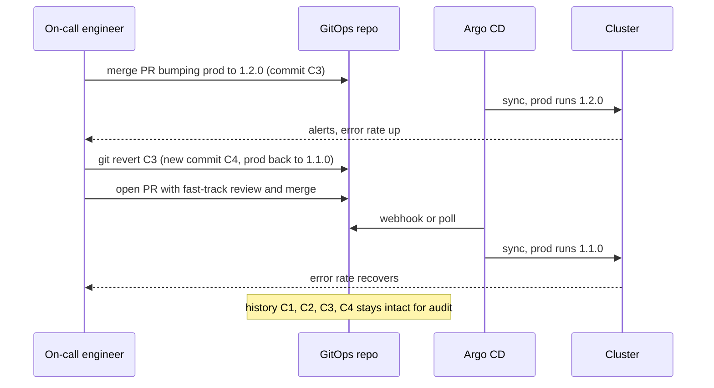
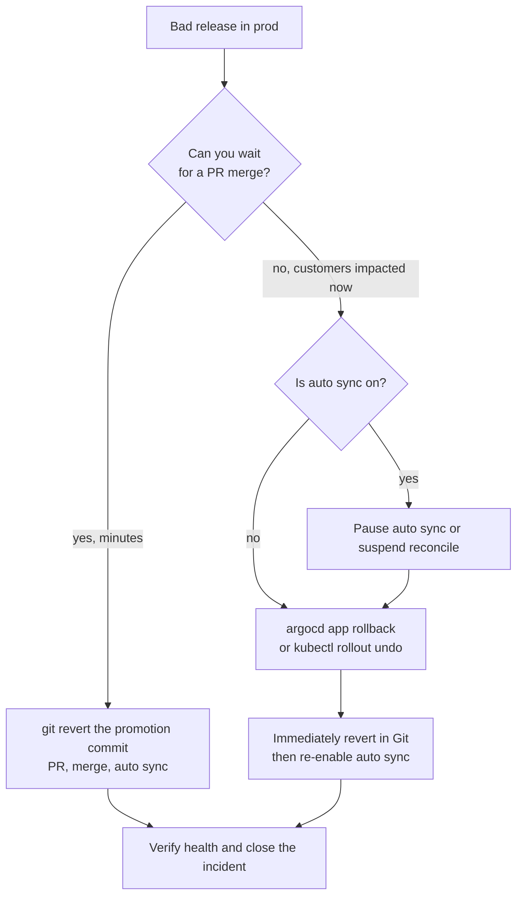

# L17.6 — Rollback Through Git

> **Level 17: GitOps** · Topic 6 of 7 · ⏱ ~3 hours · Difficulty: Intermediate

## 1. What it is

In GitOps the way you roll back production is the way you changed it: **with a commit**. Because the repo is the source of
truth, "go back to the last good version" means making the repo say the last good version again. The safest way is
**`git revert`**: it creates a *new* commit that undoes an earlier commit, leaving history intact. The agent then reconciles
the cluster to the reverted state, exactly as it would for any other change.

This contrasts with tool-level rollbacks (`kubectl rollout undo`, `helm rollback`, or Argo CD's UI **Rollback** button), which change the
cluster *without* changing Git. Under GitOps those are emergency measures that create **drift**, because Git still says the bad version.

## 2. Why it matters in DevOps

- A rollback you can do in under five minutes, with a review trail, is the best protection against a bad release. See [Rollback](../level-05-cicd/07-rollback.md) in CI/CD.
- If the cluster is rolled back but Git is not, the next sync (or self-heal) re-deploys the broken version, often at the worst moment.
- Auditors and post-incident reviews need to know who reverted what and why; a revert commit with a message and a PR answers that.
- A clear **emergency procedure** keeps people from making things worse under pressure.

## 3. Real-world system example

Argo CD documents that its UI/CLI rollback (`argocd app rollback`) **requires automated sync to be disabled**, because with
auto-sync on the controller would immediately re-apply Git's version. That is the tool telling you the intended model: Git is
authoritative, and a cluster-only rollback is a temporary override. Flux has no dedicated rollback command for Kustomizations as of this writing - you
revert in Git (its `HelmRelease` can also be configured to roll back automatically on failed upgrades via the `remediation`
settings of the upgrade). Teams that run GitOps at scale, as described in many conference talks and engineering blogs, treat "revert the
PR" as the standard rollback and measure it as part of their mean time to recovery (MTTR). The Git side relies on the primitives from
[reset and revert](../level-03-git-and-github/04-reset-and-revert.md).

## 4. Diagram



Choosing a rollback method:



## 5. How it works

### `git revert` versus `git reset`

| | `git revert <sha>` | `git reset --hard <sha>` + force push |
|---|---|---|
| History | adds a new inverse commit | rewrites history, drops commits |
| Safe on shared `main` | yes | no, breaks everyone's clones and the audit trail |
| Works with protected branches | yes (it is a normal PR) | blocked, and should be |
| Audit | shows "Revert X" with reason | evidence disappears |

Always revert on shared branches. For a merge commit use `git revert -m 1 <merge-sha>` (keep mainline parent 1).
If the promotion was a squashed PR, there is a single commit to revert.

### Revert one environment only

Because each environment is a directory, a revert of "promote 1.2.0 to prod" touches only `overlays/prod`. If a commit changed several
environments at once, create the inverse commit manually for just the path you need:

```bash
# restore just prod's files to their state before commit <sha>
git checkout <sha>~1 -- apps/shop-api/overlays/prod
git commit -m "revert: roll prod back to 1.1.0 (incident INC-1234)"
```

This is still a normal forward commit (history is not rewritten), so it works with protected branches and reviews.

### Emergency procedure (when the PR process is too slow)

1. **Stop the bleeding** in the cluster: pause auto-sync for the one app (`argocd app set shop-api-prod --sync-policy none`) or `flux suspend kustomization shop-api-prod`.
2. **Roll the cluster back**: `argocd app rollback shop-api-prod <ID>` (see `argocd app history`), or `kubectl rollout undo deploy/shop-api -n shop-prod`.
3. **Fix Git immediately**: revert the promotion commit and merge it, using a pre-approved break-glass path (an on-call admin may bypass review but the merge is still logged).
4. **Re-enable automation** so the cluster follows Git again: `argocd app set shop-api-prod --sync-policy automated --self-heal --auto-prune`, or `flux resume ...`.
5. **Write the post-mortem**: why the bad release got through and why rollback took as long as it did. See [Postmortems](../level-14-sre/07-postmortems.md).

Step 3 must happen before step 4, or re-enabling automation re-deploys the bad version.

### Rolling back data and migrations

Git can restore *manifests*, not *data*. If a release ran a destructive migration, reverting the Deployment does not restore dropped columns. Design
migrations as expand-then-contract and keep tested backups ([Backups and PITR](../level-13-databases-distributed-systems/05-backups-and-pitr.md)).

### Roll forward is often better

If the fix is a one-line change and CI is quick, a **forward fix** (new commit, new image) can beat a revert. A revert is
the right tool when you do not yet understand the problem; it has no unknowns.

## 6. Step-by-step guide

**Prerequisites:** the three Applications from earlier topics (from an ApplicationSet or by hand) with `shop-api-prod` using a real image such as
`nginx`, and your `shop-gitops` repo on GitHub. Cost: none. Output below is illustrative.

1. **Record the known-good state.**
   ```bash
   git switch main && git pull
   git log --oneline -n 5 -- apps/shop-api/overlays/prod
   kubectl -n shop-prod get deploy shop-api -o jsonpath='{.spec.template.spec.containers[0].image}'; echo
   ```
   Note the current prod tag (for example `nginx:1.26`).

2. **Ship a "bad" release by promotion.** Promote a tag that cannot start:
   ```bash
   git switch -c promote-prod-bad
   cd apps/shop-api/overlays/prod
   kustomize edit set image ghcr.io/example/shop-api=nginx:does-not-exist
   cd ../../../.. && git commit -am "promote shop-api to prod: broken tag" && git push -u origin HEAD
   gh pr create --fill && gh pr merge --squash --admin
   ```
   (The `--admin` flag is only so you can self-merge in a sandbox. Substitute your own tag handling.)

3. **Observe the failure.**
   ```bash
   kubectl -n shop-prod get pods
   kubectl -n argocd get application shop-api-prod
   ```
   Expect a new pod in `ErrImagePull` / `ImagePullBackOff`, the old pods still serving (a rolling update keeps the old ReplicaSet until the new one is ready),
   and the application `Degraded` or `Progressing`.

4. **Revert in Git.**
   ```bash
   git switch main && git pull
   git revert --no-edit HEAD        # HEAD is the squashed promotion commit
   git switch -c revert-prod-bad && git push -u origin HEAD
   gh pr create --fill --title "Revert: promote shop-api to prod (broken tag)" && gh pr merge --squash --admin
   ```

5. **Watch the cluster converge.**
   ```bash
   kubectl -n argocd get application shop-api-prod -w
   ```
   Expect `Synced` and `Healthy` once the sync runs (immediately if you use a webhook, otherwise within the poll interval; speed it with `argocd app get shop-api-prod --refresh`).

6. **Practise the emergency path.** Repeat steps 2-3, then without waiting for a PR:
   ```bash
   argocd app set shop-api-prod --sync-policy none        # stop auto sync
   argocd app history shop-api-prod                         # find the previous ID
   argocd app rollback shop-api-prod <ID>
   ```
   Now fix Git (step 4) and re-enable: `argocd app set shop-api-prod --sync-policy automated --self-heal --auto-prune`.
   Verify `git log` and the cluster agree.

7. **Show the audit trail.**
   ```bash
   git log --oneline --decorate -n 6 -- apps/shop-api/overlays/prod
   ```
   You should see the promotion, then `Revert "promote shop-api to prod: broken tag"`, each with an author and a PR number.

## 7. Real-world scenario

*Illustrative scenario.* At 14:05 the `shop-api` 1.2.0 promotion to production is merged. By 14:12 the checkout error rate alert
fires. The on-call does not touch the cluster: they run `git revert` on the promotion commit, open the PR, a second engineer approves in two
minutes, and Argo CD (with a webhook) syncs prod back to 1.1.0 at 14:19. The Slack incident channel links the revert PR as the
record of the action. Contrast with last year's incident, when someone ran `kubectl rollout undo`, Argo CD's self-heal "fixed" it by
redeploying the broken version ten minutes later, and the outage doubled. **Lesson:** do the rollback where the system is
authoritative; if you must act in the cluster first, pause the reconciler.

## 8. Common mistakes and best practices

**Don't**

- Run `kubectl rollout undo` or click Rollback in the UI with auto-sync/self-heal enabled and leave Git unchanged.
- Force-push or `git reset` the GitOps `main` branch to "remove" a bad commit.
- Forget to re-enable auto-sync after an emergency.
- Assume a revert undoes data or schema changes.
- Wait for a perfect post-mortem before reverting; recover first, analyse after.

**Do**

- Make `git revert` of a promotion PR the documented default rollback.
- Keep promotions small and single-purpose (one environment, one service) so reverts are clean.
- Define a break-glass role that can bypass review on the GitOps repo, with alerting when it is used.
- Practise rollbacks regularly (game days) - see [Failure Scenario Drills](../level-15-disaster-recovery/10-failure-scenario-drills.md).
- Record the incident or ticket ID in the revert commit message.

## 9. Tasks

- [ ] **T1 — Revert a bad promotion** *(≈30 min, beginner)*
  - **Goal:** do the standard GitOps rollback.
  - **Steps:**
    1. Promote a broken tag to the dev overlay by PR (or direct commit in the sandbox).
    2. Confirm the app degrades.
    3. `git revert` the commit and push.
  - **Done when:** the app returns to `Synced` / `Healthy` and `git log` shows the original commit and its revert.

- [ ] **T2 — Revert only one environment** *(≈30 min, intermediate)*
  - **Goal:** practise path-scoped rollback.
  - **Steps:**
    1. Make a commit that changes both staging and prod tags.
    2. Roll back prod only using `git checkout <sha>~1 -- apps/shop-api/overlays/prod`.
    3. Commit and push.
  - **Done when:** staging still runs the new tag and prod runs the old tag, with a clear commit message.

- [ ] **T3 — Feel the drift trap** *(≈30 min, intermediate)*
  - **Goal:** see why cluster-only rollback fails with self-heal.
  - **Steps:**
    1. With self-heal on, run `kubectl rollout undo` on a Deployment whose Git tag is wrong.
    2. Watch Argo CD revert your undo.
  - **Done when:** you can show the sequence in `kubectl rollout history` and the Argo CD event list and explain it in one sentence.

- [ ] **T4 — Execute the emergency procedure** *(≈45 min, advanced)*
  - **Goal:** follow the five-step break-glass runbook.
  - **Steps:**
    1. Break prod again with a bad promotion.
    2. Pause auto-sync, `argocd app rollback`, revert in Git, re-enable auto-sync.
    3. Time each step.
  - **Done when:** cluster and Git agree, auto-sync is back on, and you have a timeline with durations.

- [ ] **T5 — Automate a revert helper** *(≈45 min, advanced)*
  - **Goal:** shorten the rollback.
  - **Steps:**
    1. Write a small script `rollback-env.sh <env>` that finds the last commit touching `overlays/<env>`, reverts it, pushes a branch and opens a PR.
    2. Test it on dev.
  - **Done when:** running the script yields a ready-to-merge revert PR in under a minute.

- [ ] **T6 — Prove it: write the runbook** *(≈30 min, advanced)*
  - **Goal:** produce a rollback runbook for `shop-api`.
  - **Steps:**
    1. Without notes, write the decision tree: revert PR, forward fix, or emergency cluster rollback.
    2. Include what to do about database migrations and who may bypass review.
  - **Done when:** a teammate can execute your runbook on the sandbox without asking you questions.

## 10. Self-check questions

1. Why is `git revert` preferred over `git reset --hard` for rollbacks in a GitOps repo?
2. What happens if you `kubectl rollout undo` while self-heal is on?
3. Why must you fix Git before re-enabling auto-sync?
4. How do you roll back only production when one commit changed several environments?
5. What can Git not roll back?

<details>
<summary>Answers</summary>

1. Revert adds a new commit, keeping shared history and the audit trail; reset rewrites history and is blocked on protected branches.
2. The controller sees live state differ from Git and re-applies Git's (bad) version.
3. Otherwise the controller redeploys whatever Git currently says, which is the broken version.
4. Restore only that directory from the previous commit (`git checkout <sha>~1 -- <path>`) and commit, or revert and remove unrelated changes.
5. Data and schema changes, and anything outside Git such as external resources not managed declaratively.
</details>

## 11. Further reading

- Argo CD documentation - "argocd app rollback" and "Automated Sync Policy".
- Git documentation - `git revert` (including `-m` for merge commits).
- Flux documentation - `HelmRelease` remediation and `flux suspend`.
- *Site Reliability Engineering* (Google) - chapters on release engineering and incident response.

<!-- nav -->
---
← Previous: [Application Synchronization](05-application-synchronization.md) · [Level 17 index](README.md) · Next: [The Full Flow: CI to GitOps](07-ci-to-gitops-flow.md) →
