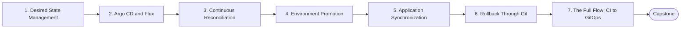

# Level 17 — GitOps

> **Goal:** Operate Kubernetes by declaring desired state in Git and letting a controller continuously reconcile it.

| | |
|---|---|
| **Recommended time** | 2-3 weeks |
| **Topics** | 7 |
| **Practice / capstone** | Install Argo CD (or Flux), deploy the app from a GitOps repo, promote dev -> staging -> prod via Git, and roll back with git revert. |

## Topics

| # | Topic | What you will learn |
|---|-------|---------------------|
| 1 | [Desired State Management](01-desired-state-management.md) | GitOps principles, declarative config, pull vs push deploys, repo layout |
| 2 | [Argo CD and Flux](02-argo-cd-and-flux.md) | architecture, install, Applications, Kustomization/HelmRelease, choosing between them |
| 3 | [Continuous Reconciliation](03-continuous-reconciliation.md) | drift correction, self-heal, prune, sync loops |
| 4 | [Environment Promotion](04-environment-promotion.md) | overlays, image tag bumps, PR-based promotion, Image Updater/Flux automation |
| 5 | [Application Synchronization](05-application-synchronization.md) | sync waves, hooks, sync policies, health assessment, ApplicationSets |
| 6 | [Rollback Through Git](06-rollback-through-git.md) | git revert as rollback, audit trail, emergency procedure |
| 7 | [The Full Flow: CI to GitOps](07-ci-to-gitops-flow.md) | Developer -> Git -> CI -> Docker image -> GitOps repo -> Argo CD -> Kubernetes, secrets in GitOps (Sealed Secrets/SOPS/ESO) |
| ★ | [Level capstone project](99-capstone-project.md) | Install Argo CD (or Flux), deploy the app from a GitOps repo, promote dev -> staging -> prod via Git, and roll back with git revert. |

## How to work through this level

1. Read each topic in order: *what it is → why it matters → real-world example → diagram → guide*.
2. Do **every task** in the topic's *Tasks* section and tick the box (`- [x]`) in your own fork or notes.
3. Answer the *Self-check questions* without looking, then reveal the answers.
4. Finish with the **capstone project**, which combines all topics of the level.
5. Move on only when you can do the capstone's *Prove it* task without the guide.

## Topic flow

---
← [Level 16 — Advanced Kubernetes](../level-16-advanced-kubernetes/README.md) · [Roadmap home](../README.md) · [Level 18 — Platform Engineering](../level-18-platform-engineering/README.md) →
