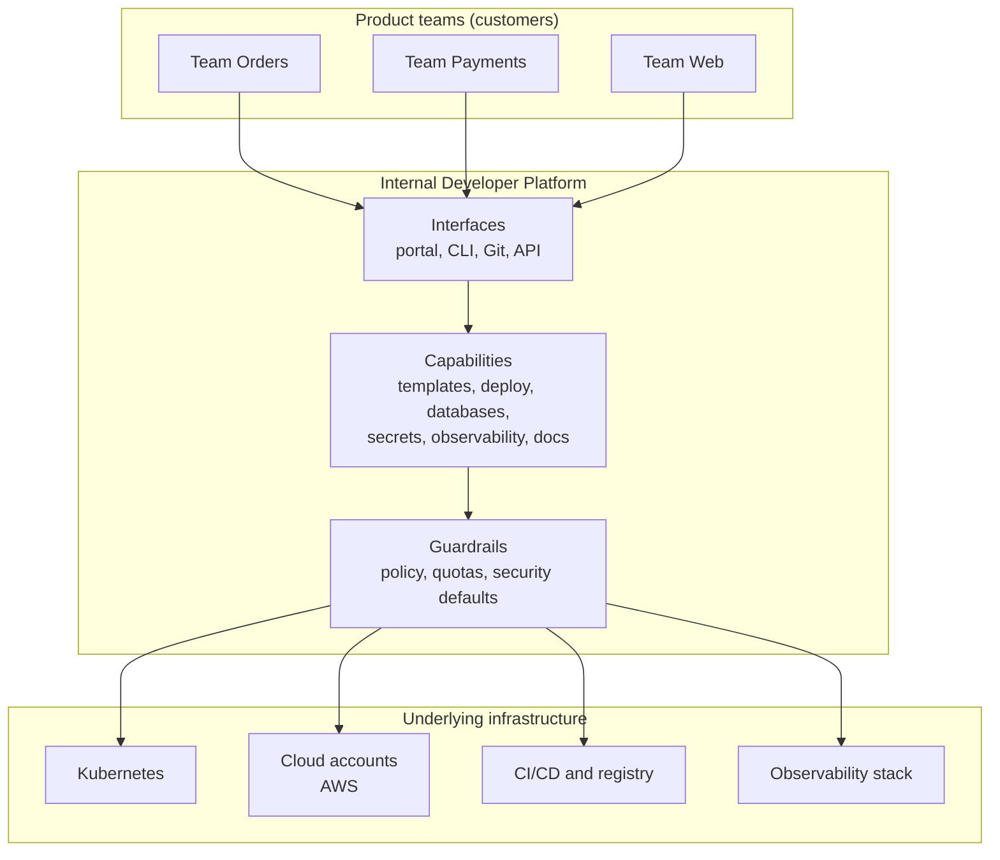
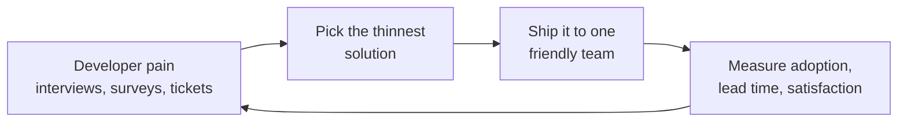

# L18.1 — Internal Developer Platforms

> **Level 18: Platform Engineering** · Topic 1 of 10 · ⏱ ~4 hours · Difficulty: Intermediate

## 1. What it is

An **Internal Developer Platform (IDP)** is the set of tools, workflows and documentation that a platform team builds
so that product teams can create, deploy and operate software **without becoming experts in every underlying system**. It is
the layer *between* developers and raw infrastructure (cloud accounts, Kubernetes, CI, observability, secrets).

An IDP is **not one product you buy**. It is a collection of capabilities - for example "create a new service from a template",
"get a database", "deploy to staging", "see my service's logs and alerts" - exposed through a few consistent interfaces:
a CLI, a Git workflow, APIs and usually a web portal ([Developer Portals](02-developer-portals.md)).

Two ideas make it work:

- **Platform as a product.** The platform team treats developers as *customers*: it researches their pain, has a roadmap, measures adoption and satisfaction, and
  supports its users. A platform nobody wants to use is a failed product, however elegant.
- **Thinnest Viable Platform (TVP).** The term comes from the book *Team Topologies* (Matthew Skelton and Manuel Pais): the smallest platform
  that removes the most friction - sometimes just a well-written wiki page and a template - and grows only when teams ask for more.

See [Platform Engineering](../level-00-what-devops-is/13-platform-engineering.md) for the introductory view.

## 2. Why it matters in DevOps

- **"You build it, you run it" has a cognitive-load limit.** Asking every product team to master Kubernetes, Terraform, IAM, networking and observability slows delivery and produces 20 slightly different, slightly insecure setups.
- **Consistency is a security and cost control.** One supported path for logging, secrets and deployment means one place to fix a vulnerability.
- **Toil moves to where it can be automated once.** Ticket queues ("please create a bucket") become APIs and templates.
- **Platform teams fail in predictable ways:** building a grand platform nobody asked for, mandating adoption without value, or becoming a ticket queue under a new name. Knowing the concept protects you from all three.

## 3. Real-world system example

**Spotify and Backstage.** Spotify built an internal portal to tame the sprawl of services, tools and docs, and open-sourced it
as **Backstage** in 2020; it later became a CNCF project (incubating level at the time of writing). Backstage is the best-known
building block for the *portal* part of an IDP, not an entire IDP by itself. **Netflix** has publicly described its "paved road": a
set of well-supported tools and defaults that most teams use because it makes them faster, while teams may still choose to go off-road at their own cost.
**The CNCF Platforms White Paper** and the *Team Topologies* book define platform teams as enabling teams that offer
self-service capabilities; the community "Platform Engineering" movement and conferences grew around the same idea. Many vendors
(Humanitec, Port, Cortex, OpsLevel and others) sell portal or orchestration components - pick the facts from each vendor's own documentation, since products change quickly.

## 4. Diagram



The product feedback loop that keeps a platform honest:



## 5. How it works

### What an IDP typically contains

| Layer | Examples | Question it answers |
|---|---|---|
| Interface | portal (Backstage), CLI, GitHub templates, chatops | "Where do I start?" |
| Orchestration | GitOps (Argo CD), CI workflows, Terraform/Crossplane | "How does it actually happen?" |
| Capabilities | service templates, database provisioning, secrets, preview environments | "What can I get?" |
| Guardrails | policy as code, quotas, default network policies | "What can't I accidentally break?" |
| Observability and feedback | dashboards per service, DORA metrics, platform usage stats | "Is it working, for them and for us?" |

### Platform as a product - the practices

- **Customers:** name them (the internal teams), interview them, keep a backlog based on their pain.
- **Roadmap and versioning:** announce changes, deprecate with notice, keep a changelog.
- **Support:** a channel, an on-call or office-hours rotation, an SLO for the platform itself ([SLOs](../level-14-sre/02-slos.md)).
- **Metrics:** adoption (% of services on the paved path), time-to-first-deploy for a new service, DORA metrics (deployment frequency, lead time, change failure rate, time to restore), developer satisfaction.
- **Optional, not mandatory:** the best platforms win by being the easiest path ([Golden Paths](04-golden-paths.md)).

### The Thinnest Viable Platform

Start with the highest-friction journey, usually "I need a new service in production". A TVP can be as small as:

1. a **template repo** with a Dockerfile, CI workflow, Kubernetes manifests and `catalog-info.yaml`;
2. a **README/wiki page** ("how we ship") and an owner list;
3. a **shared CI workflow** teams call instead of copying;
4. one **way to ask for help**.

Only add a portal, Crossplane or a fancy orchestrator when a measured problem justifies it. Platform projects fail more often from
over-building than from under-building.

### Maturity ladder

| Stage | Looks like | Risk |
|---|---|---|
| 0 Ad hoc | each team does its own thing | duplication, inconsistent security |
| 1 Documented | wiki and runbooks | docs rot |
| 2 Templated | template repos, shared CI | templates drift after creation |
| 3 Self-service | APIs, portal, Git-driven requests | over-engineering, low adoption |
| 4 Product | roadmap, metrics, SLOs for the platform | needs sustained staffing |

## 6. Step-by-step guide

**Prerequisites:** a Linux/macOS shell with `bash`, `git`, `sed`. Cost: none. We build a miniature TVP: a template plus a scaffolding script.

1. **Create the template repository layout.**
   ```bash
   mkdir -p tvp/template/.github/workflows tvp/template/k8s && cd tvp
   cat > template/README.md <<'EOF'
   # __NAME__

   Owner: __OWNER__
   EOF
   cat > template/catalog-info.yaml <<'EOF'
   apiVersion: backstage.io/v1alpha1
   kind: Component
   metadata:
     name: __NAME__
   spec:
     type: service
     lifecycle: experimental
     owner: __OWNER__
   EOF
   cat > template/Dockerfile <<'EOF'
   FROM node:22-alpine
   WORKDIR /app
   COPY package*.json ./
   RUN npm ci --omit=dev
   COPY . .
   USER node
   CMD ["node", "server.js"]
   EOF
   cat > template/.github/workflows/ci.yaml <<'EOF'
   name: ci
   on: [push]
   jobs:
     build:
       uses: example/platform-workflows/.github/workflows/node-service.yaml@v1
       with:
         service: __NAME__
   EOF
   ```
   The CI file calls a *shared* workflow owned by the platform team (a placeholder repo here); that is the leverage - fix it once, every service gets the fix.

2. **Write the scaffolding script - the first "platform API".**
   ```bash
   cat > new-service.sh <<'EOF'
   #!/usr/bin/env bash
   # usage: ./new-service.sh <name> <owner-team>
   set -euo pipefail
   name="${1:?service name required}"
   owner="${2:?owner team required}"
   [[ "$name" =~ ^[a-z][a-z0-9-]{2,30}$ ]] || { echo "invalid name: $name" >&2; exit 1; }
   dest="out/$name"
   [[ -e "$dest" ]] && { echo "$dest already exists" >&2; exit 1; }
   mkdir -p out
   cp -r template "$dest"
   grep -rl '__NAME__\|__OWNER__' "$dest" | xargs sed -i "s/__NAME__/$name/g; s/__OWNER__/$owner/g"
   echo "created $dest"
   find "$dest" -type f | sort
   EOF
   chmod +x new-service.sh
   ```
   (On macOS use `sed -i ''` or install GNU sed.)

3. **Scaffold a service and inspect the result.**
   ```bash
   ./new-service.sh orders-api team-payments
   cat out/orders-api/catalog-info.yaml
   ```
   Expected output (verified): `created out/orders-api`, then the file list (`.github/workflows/ci.yaml`, `Dockerfile`, `README.md`,
   `catalog-info.yaml`), and the catalog file with `name: orders-api` and `owner: team-payments`.

4. **See the guardrail work.**
   ```bash
   ./new-service.sh Bad team-x; echo "exit code: $?"
   ```
   Expect `invalid name: Bad` and exit code `1`. Small validation like this is the beginning of guardrails ([Self-service Infrastructure](03-self-service-infrastructure.md)).

5. **Write the platform's "front page" (one Markdown file).** Create `PLATFORM.md` with: what the platform offers today (one bullet per
   capability), how to ask for help, what is *not* supported, and the owner. This is your MVP documentation.

6. **Define success metrics before you build more.** Add to `PLATFORM.md`: "time from idea to first deploy of a new service" (measure it by timing T1 below),
   "% of services created from the template" and "developer satisfaction (1-5 survey)".

## 7. Real-world scenario

*Illustrative scenario.* A 60-engineer company forms a platform team of four. Their first plan is a year-long build: Backstage, Crossplane
and a custom deployment UI. A staff engineer instead interviews eight teams. The top complaint: *"it takes two weeks and five tickets to get a new service
to production"*. The team ships a template repo, a shared CI workflow and a Slack channel in three weeks; time-to-first-deploy falls to two days.
Adoption is measured by the number of new services created from the template (11 of 12 in the next quarter). Only then do they add a portal, because teams
started asking "where is the list of all services and who owns them?". **Lesson:** solve the measured pain with the thinnest thing; earn the right to build more.

## 8. Common mistakes and best practices

**Don't**

- Build the platform for an imagined user without interviewing real ones.
- Mandate adoption of an immature platform; you will get workarounds and resentment.
- Let the platform team become a ticket-driven ops team under a new name.
- Hide everything: if developers cannot see or escape the abstraction when it fails, they stop trusting it.
- Start with the tool ("let's install Backstage") instead of the problem.

**Do**

- Name your customers, keep a public roadmap and measure adoption and time-to-first-deploy.
- Start with a template, a shared workflow and good docs.
- Offer an escape hatch and document the cost of leaving the paved path.
- Give the platform an SLO and an on-call, like any production service.
- Staff it with product thinking: a product manager or platform owner, not only engineers.

## 9. Tasks

- [ ] **T1 — Build the miniature TVP** *(≈45 min, beginner)*
  - **Goal:** a template plus a scaffolding script.
  - **Steps:**
    1. Follow steps 1-3 of the guide.
    2. Time how long it takes from `./new-service.sh` to a committed repo (`git init && git add . && git commit`) inside `out/orders-api`.
  - **Done when:** you have a scaffolded service in Git and a recorded "time to first commit".

- [ ] **T2 — Add a guardrail** *(≈30 min, beginner)*
  - **Goal:** make the script safer.
  - **Steps:**
    1. Make the script reject owners that do not start with `team-`.
    2. Test both the success and failure cases.
  - **Done when:** `./new-service.sh foo bar` fails with a clear message and `./new-service.sh foo team-bar` succeeds.

- [ ] **T3 — Interview a customer (or role-play one)** *(≈60 min, intermediate)*
  - **Goal:** discover real pain before building.
  - **Steps:**
    1. Ask two developers "walk me through the last time you started a new service" and list every wait or ticket.
    2. Rank the steps by time lost.
  - **Done when:** you have a ranked list of at least five friction points with times, and a proposed TVP for the top one.

- [ ] **T4 — Write the platform front page** *(≈45 min, intermediate)*
  - **Goal:** the documentation product.
  - **Steps:**
    1. Write `PLATFORM.md` as in step 5, including a "what we do NOT support" section and your three metrics.
    2. Have a teammate attempt to scaffold a service using only that page.
  - **Done when:** the teammate succeeds without asking you a question (note every question they did ask and fix the page).

- [ ] **T5 — Break it: drift after scaffolding** *(≈30 min, advanced)*
  - **Goal:** understand the limit of templates.
  - **Steps:**
    1. Scaffold two services, then change the template's Dockerfile (for example add a `HEALTHCHECK`).
    2. Compare the Dockerfiles in both services and in the template.
    3. Write down two ways to keep existing services current (shared workflows, Renovate/Dependabot PRs, a re-sync tool).
  - **Done when:** you can show the drift with `diff` and name which of your two ways you would choose and why.

- [ ] **T6 — Prove it: pitch the platform** *(≈30 min, advanced)*
  - **Goal:** explain platform-as-a-product.
  - **Steps:**
    1. Without notes, explain in five minutes (to a teammate) what an IDP is, what a TVP is and why you would not start with a portal.
    2. Name three metrics and one anti-pattern.
  - **Done when:** the listener can restate the difference between a platform and a ticket queue.

## 10. Self-check questions

1. What problem does an IDP solve that "you build it, you run it" alone does not?
2. What is a Thinnest Viable Platform?
3. Name three signs a platform is being run as a product.
4. Why is mandating adoption early a risk?
5. Give two metrics you would use to judge a platform's success.

<details>
<summary>Answers</summary>

1. It reduces cognitive load by packaging infrastructure, security and delivery into self-service capabilities, so teams do not each rebuild them.
2. The smallest set of capabilities and documentation that removes the most developer friction; it grows only as needs are proven.
3. Named customers and interviews, a roadmap and changelog, support channels and SLOs, and adoption and satisfaction metrics.
4. An immature platform that is forced on teams causes workarounds and resentment; adoption should be earned by being the easiest path.
5. For example time-to-first-deploy, % of services on the paved path, DORA metrics (lead time, deployment frequency), and developer satisfaction score.
</details>

## 11. Further reading

- *Team Topologies* by Matthew Skelton and Manuel Pais - platform teams and the Thinnest Viable Platform.
- CNCF Platforms White Paper (tag-app-delivery.cncf.io) - what a platform is and how to measure it.
- Backstage documentation (backstage.io) - the open-source portal framework.
- *Accelerate* by Nicole Forsgren, Jez Humble and Gene Kim - the research behind DORA metrics.
- See also: [Developer Portals](02-developer-portals.md) and [Golden Paths](04-golden-paths.md).

<!-- nav -->
---
← Previous level: [Level 17 — GitOps](../level-17-gitops/README.md) · [Level 18 index](README.md) · Next: [Developer Portals](02-developer-portals.md) →
