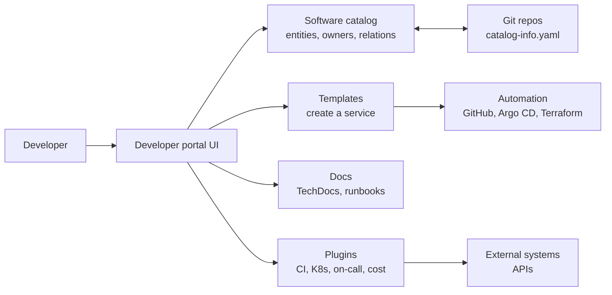
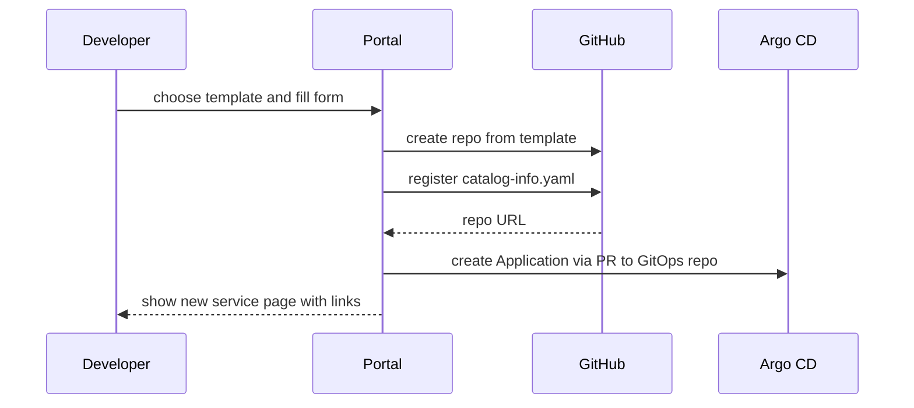

# L18.2 — Developer Portals

> **Level 18: Platform Engineering** · Topic 2 of 10 · ⏱ ~4 hours · Difficulty: Intermediate

## 1. What it is

A **developer portal** is the web front door to your internal developer platform ([Internal Developer Platforms](01-internal-developer-platforms.md)).
It gives engineers one place to answer questions like: *What services exist? Who owns this one? How do I create a new service? Where are
its docs, dashboards, on-call schedule and deployments?*

A portal is a **UI over metadata and actions**, not the platform itself. The metadata comes from the catalog (see [Service Catalogs](05-service-catalogs.md));
the actions come from templates and automation behind the portal ([Golden Paths](04-golden-paths.md), [Self-service Infrastructure](03-self-service-infrastructure.md)).
Backstage, Port, Cortex and OpsLevel are well-known examples of portal products or frameworks.

## 2. Why it matters in DevOps

- **Findability:** in an organisation with hundreds of services, "who owns the payments queue and where is the runbook?" costs minutes during an incident - minutes that become money.
- **Onboarding:** a new engineer can discover, create and deploy a service without knowing five tools' URLs.
- **Consistency by default:** the portal is where templates, docs and standards become visible and easy to follow.
- **Risk:** a portal that is out of date, slow or hard to use is worse than none - it teaches people not to trust it. Adoption and data freshness are the real work.

## 3. Real-world system example

**Backstage** was created at Spotify to address "too many tools, too little discoverability" and was open-sourced in 2020;
it is a CNCF project. Its core features, as documented on backstage.io, are the **Software Catalog**, **Software Templates** (the
"scaffolder"), **TechDocs** (docs-as-code rendered in the portal) and **Search**, extended by a plugin ecosystem
(for example Kubernetes, CI and on-call plugins). Many companies run Backstage themselves; others use hosted
versions or commercial portals such as Port, Cortex or OpsLevel, which offer catalogs, scorecards and self-service actions
as a service. Which suits you depends on staffing, as the build-vs-buy section explains. Check each vendor's documentation for current features and pricing.

## 4. Diagram



Where the portal sits in the "create a service" journey:



## 5. How it works

### What a good portal offers

| Capability | What it gives developers | Needs behind it |
|---|---|---|
| Catalog | searchable list of services, APIs, owners, lifecycle, dependencies | metadata in Git, ingestion |
| Templates / actions | "create service", "request database", "add pipeline" | automation and golden paths |
| Docs | docs-as-code, runbooks next to the service | Markdown in repos, a renderer |
| Scorecards | production-readiness and standards compliance | rules and data sources |
| Plugins / integrations | CI status, Kubernetes pods, alerts, costs, on-call in one page | APIs for each tool |
| Search | one search box across all of the above | indexing |

### Build versus buy

| | Build on Backstage (self-hosted OSS) | Buy a portal product (SaaS) |
|---|---|---|
| Upfront effort | high: it is a framework you assemble and maintain (TypeScript, React) | low: configure and integrate |
| Flexibility | very high: write your own plugins | high within the product's model |
| Ongoing cost | engineers to upgrade, patch, host and write plugins | subscription fees |
| Time to first value | weeks to months | days to weeks |
| Lock-in | low (open source, your data in Git YAML) | medium (data model and workflows are vendor-specific) |
| Good fit | large orgs with a dedicated platform team | small and mid teams, or teams that want results fast |

A common guideline from practitioners: unless you can dedicate roughly a small team to it, a framework-based portal will become a
side project that decays. Hybrid choices exist (hosted Backstage, or a SaaS portal reading the same `catalog-info.yaml` files).
Do not choose a portal first; choose the **problem** (discoverability? self-service? standards?) and evaluate against it.

### Adoption is the hard part

- **Start with one high-value use case** (catalog with owners, or the "create service" template), not 30 plugins.
- **Keep data fresh automatically:** ingest from Git, CI and cloud APIs. Hand-edited portals rot.
- **Put it in the workflow:** link to it from CI output, alerts ("owner: team-shop, runbook") and onboarding docs.
- **Measure:** weekly active users, % of services with an owner, searches with no result, template usage.
- **Make it fast.** A portal that takes 10 seconds to load will be abandoned.
- **Own it like a product:** release notes, feedback channel, a named maintainer.

### The minimal viable portal

The essence is small: collect metadata files from repos, render a list with owner and links. The guide builds exactly that in 40 lines
of Python so you understand what Backstage's catalog is doing at its core.

## 6. Step-by-step guide

**Prerequisites:** `python3` with PyYAML (`pip install pyyaml`). Optional for step 6: Node.js 20+ and `yarn`. Cost: none.

1. **Create catalog entries (as if collected from three repos).**
   ```bash
   mkdir -p portal/catalog && cd portal
   cat > catalog/shop-api.yaml <<'EOF'
   apiVersion: backstage.io/v1alpha1
   kind: Component
   metadata:
     name: shop-api
     description: Node.js API for the shop
     annotations:
       github.com/project-slug: example/shop-api
   spec:
     type: service
     lifecycle: production
     owner: team-shop
   EOF
   cat > catalog/shop-web.yaml <<'EOF'
   apiVersion: backstage.io/v1alpha1
   kind: Component
   metadata:
     name: shop-web
     description: Storefront frontend
   spec:
     type: website
     lifecycle: production
     owner: team-web
   EOF
   cat > catalog/orders-worker.yaml <<'EOF'
   apiVersion: backstage.io/v1alpha1
   kind: Component
   metadata:
     name: orders-worker
   spec:
     type: service
     lifecycle: experimental
     owner: team-shop
   EOF
   ```

2. **Write the portal generator.**
   ```bash
   cat > build_portal.py <<'EOF'
   #!/usr/bin/env python3
   """Tiny static 'developer portal': reads catalog/*.yaml and writes site/index.html."""
   import glob, html, pathlib, yaml

   rows = []
   for path in sorted(glob.glob("catalog/*.yaml")):
       doc = yaml.safe_load(open(path))
       meta, spec = doc["metadata"], doc.get("spec", {})
       slug = meta.get("annotations", {}).get("github.com/project-slug")
       rows.append({
           "name": meta["name"],
           "desc": meta.get("description", ""),
           "type": spec.get("type", "?"),
           "lifecycle": spec.get("lifecycle", "?"),
           "owner": spec.get("owner", "UNOWNED"),
           "repo": f"https://github.com/{slug}" if slug else "",
       })

   def cell(v): return f"<td>{html.escape(v)}</td>"
   body = "".join(
       "<tr>" + cell(r["name"]) + cell(r["type"]) + cell(r["lifecycle"]) + cell(r["owner"]) +
       (f'<td><a href="{html.escape(r["repo"])}">repo</a></td>' if r["repo"] else "<td>-</td>") + "</tr>"
       for r in rows)
   pathlib.Path("site").mkdir(exist_ok=True)
   pathlib.Path("site/index.html").write_text(
       "<!doctype html><meta charset=utf-8><title>Mini portal</title>"
       "<h1>Service catalog</h1><table border=1 cellpadding=6>"
       "<tr><th>Name</th><th>Type</th><th>Lifecycle</th><th>Owner</th><th>Source</th></tr>"
       + body + "</table>")
   print(f"wrote site/index.html with {len(rows)} entities")
   for r in rows: print(f"  {r['name']:<14} {r['type']:<8} {r['lifecycle']:<13} {r['owner']}")
   EOF
   python3 build_portal.py
   ```
   Expected output (verified):
   ```text
   wrote site/index.html with 3 entities
     orders-worker  service  experimental  team-shop
     shop-api       service  production    team-shop
     shop-web       website  production    team-web
   ```

3. **Serve and look at it.**
   ```bash
   python3 -m http.server 8000 --directory site
   ```
   Open `http://localhost:8000`. You now have a (very) basic catalog UI built from YAML in Git: the same idea Backstage uses, minus search, auth, plugins and scale.

4. **Add a freshness check.** Append to the script (or a second script) a check that fails if any entity has `owner: UNOWNED`:
   ```bash
   python3 - <<'EOF'
   import glob, sys, yaml
   bad = [p for p in glob.glob("catalog/*.yaml") if not yaml.safe_load(open(p)).get("spec", {}).get("owner")]
   print("unowned:", bad)
   sys.exit(1 if bad else 0)
   EOF
   ```
   Run it in CI so ownerless services cannot be registered - a first "governance in the portal" rule.

5. **Try the real thing (optional, ~20-30 min).** Backstage's quickstart:
   ```bash
   npx @backstage/create-app@latest      # prompts for an app name, e.g. dev-portal
   cd dev-portal && yarn start           # some versions use: yarn dev
   ```
   Open `http://localhost:3000`, browse the sample catalog and "Create" page. Requirements and commands change between releases - follow the
   current "Getting Started" page on backstage.io. We go deeper in [Backstage](08-backstage.md).

6. **Score a build-vs-buy decision.** Copy the table in section 5 into a doc and fill in your own numbers: people available, time to value required, number of services, existing integrations.

## 7. Real-world scenario

*Illustrative scenario.* A 120-engineer company launches a Backstage instance with 15 plugins after six months of work. Three months later weekly active
users are 9% of engineers: the catalog is half empty (entries hand-registered), the "create service" template is a week behind real standards, and nobody remembers the URL.
The platform team resets: they auto-ingest `catalog-info.yaml` from all repos with a GitHub discovery job, make PagerDuty-style alerts link to the service page, add an owner
field requirement to CI, and cut the plugin list to five. Active use passes 60% within two months. **Lesson:** a portal's value is the freshness and relevance of its data
and its placement in daily workflows, not the number of features.

## 8. Common mistakes and best practices

**Don't**

- Start a portal project before you know which developer problem it solves.
- Underestimate the upkeep of a self-hosted framework (upgrades, plugin maintenance, auth, hosting).
- Rely on manual data entry for the catalog.
- Launch with dozens of plugins; each is a maintenance promise.
- Treat the portal as the platform: if there is no automation behind the buttons, it is a directory.

**Do**

- Ingest metadata from Git (`catalog-info.yaml`) and other sources automatically.
- Pick one or two use cases for launch and measure them.
- Integrate the portal into incident, CI and onboarding workflows.
- Require ownership metadata and enforce it in CI.
- Decide build versus buy with a written comparison and a review date.

## 9. Tasks

- [ ] **T1 — Build the mini portal** *(≈45 min, beginner)*
  - **Goal:** turn catalog YAML into a browsable page.
  - **Steps:**
    1. Follow steps 1-3.
    2. Add a fourth entity (`payments-db`, `type: database`).
  - **Done when:** the new entity appears after re-running the script, and the page loads at `localhost:8000`.

- [ ] **T2 — Add a column and a filter** *(≈45 min, intermediate)*
  - **Goal:** extend the portal's usefulness.
  - **Steps:**
    1. Add a `docs` link column from an annotation (`backstage.io/techdocs-ref` or your own).
    2. Add a simple filter: accept `--owner team-shop` on the command line and list only that team's services.
  - **Done when:** `python3 build_portal.py --owner team-shop` outputs two entities.

- [ ] **T3 — Enforce ownership in CI** *(≈30 min, intermediate)*
  - **Goal:** a governance rule that prevents rot.
  - **Steps:**
    1. Create the freshness script from step 4 as `check_owners.py`.
    2. Write a GitHub Actions job that runs it on pull requests.
    3. Open a PR that adds an entity without an owner.
  - **Done when:** the PR check fails with the unowned file listed, and passes after you add an owner.

- [ ] **T4 — Run Backstage locally** *(≈60 min, intermediate)*
  - **Goal:** compare the real thing with your mini portal.
  - **Steps:**
    1. Run the Backstage quickstart (step 5).
    2. Register your three YAML files by adding them as `catalog.locations` in `app-config.yaml` (`type: file`, `target: ../../portal/catalog/shop-api.yaml`, and so on).
    3. Find them in the catalog.
  - **Done when:** your entities show up in the Backstage catalog UI, and you can list three things Backstage does that the mini portal does not.

- [ ] **T5 — Write a build-vs-buy memo** *(≈60 min, advanced)*
  - **Goal:** make a defensible decision.
  - **Steps:**
    1. For a fictional company (80 engineers, 150 services, 3 platform engineers), fill in the section 5 table.
    2. Recommend self-hosted Backstage, hosted Backstage, or a SaaS portal, and list the first 90-day adoption plan with three metrics.
  - **Done when:** the memo states the decision, the two strongest arguments against it and a review date.

- [ ] **T6 — Prove it: pitch the portal** *(≈30 min, advanced)*
  - **Goal:** explain what a portal is and is not.
  - **Steps:**
    1. Without notes, explain to a teammate the difference between a portal, a catalog and a platform.
    2. Describe how you would keep its data fresh and how you would know if it is being used.
  - **Done when:** the teammate can tell you which of the three is the UI, which is the data and which is the capability set.

## 10. Self-check questions

1. What is the difference between a developer portal and an internal developer platform?
2. Name four capabilities Backstage provides out of the box.
3. When does buying a portal product make more sense than building on Backstage?
4. Why do catalogs go stale and how do you prevent it?
5. Which metrics tell you whether a portal is succeeding?

<details>
<summary>Answers</summary>

1. The portal is the user interface (one of several interfaces); the platform is the full set of capabilities, automation and guardrails behind it.
2. Software Catalog, Software Templates, TechDocs and Search (plus the plugin framework).
3. When there is no dedicated team to maintain a TypeScript framework, when time-to-value matters, or when the vendor's data model fits your needs.
4. Manual registration and no owner for the data; prevent it by ingesting from Git automatically and enforcing metadata in CI.
5. Weekly active users, % of services with an owner and docs, template usage, search success, and developer satisfaction.
</details>

## 11. Further reading

- Backstage documentation (backstage.io) - "What is Backstage?", Software Catalog, Software Templates, TechDocs.
- CNCF Platforms White Paper (tag-app-delivery.cncf.io) - capabilities and interfaces of a platform.
- Vendor documentation for Port, Cortex and OpsLevel if evaluating SaaS options.
- *Team Topologies* by Skelton and Pais - platform teams and their interfaces.
- See also: [Service Catalogs](05-service-catalogs.md) and [Backstage](08-backstage.md).

<!-- nav -->
---
← Previous: [Internal Developer Platforms](01-internal-developer-platforms.md) · [Level 18 index](README.md) · Next: [Self-service Infrastructure](03-self-service-infrastructure.md) →
