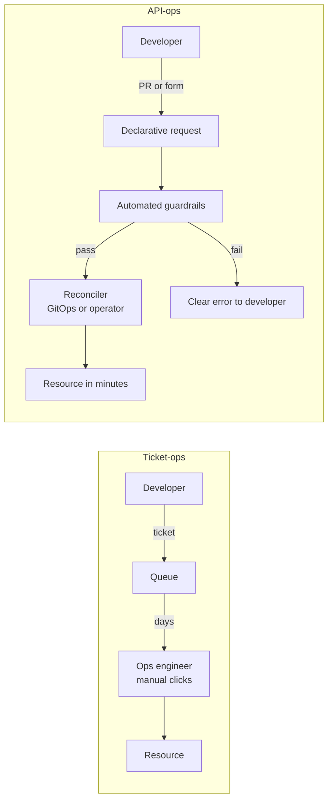
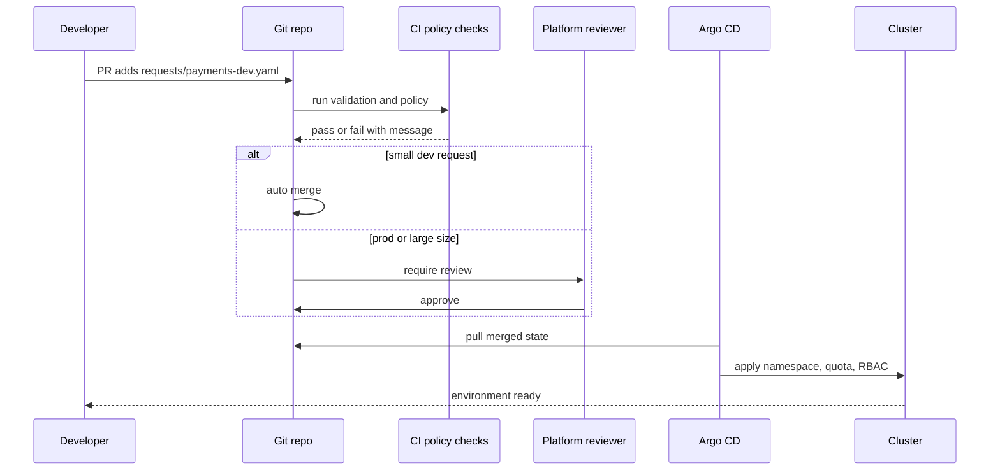

# L18.3 — Self-service Infrastructure

> **Level 18: Platform Engineering** · Topic 3 of 10 · ⏱ ~5 hours · Difficulty: Intermediate

## 1. What it is

**Self-service infrastructure** means a developer can obtain what they need - a namespace, a database, a queue, a DNS name, a preview
environment - by *themselves*, in minutes, through an interface (Git pull request, portal form, CLI or API), **without filing a ticket and waiting for
a human**. Crucially, it is **safe** self-service: requests are validated, sized, authorised and audited automatically by **guardrails**.

The shift is often described as **ticket-ops to API-ops**: from "email the infrastructure team and wait three days" to "submit a declarative request that the platform
fulfils through automation". The request is data (a YAML file, a form submission, a custom resource); the platform reconciles it into real infrastructure, the same way
GitOps reconciles manifests ([Desired State Management](../level-17-gitops/01-desired-state-management.md)).

## 2. Why it matters in DevOps

- **Wait time is the hidden cost.** A ticket that sits for two days to create a database is two days of a team's lead time, repeated hundreds of times a year.
- **Manual provisioning is inconsistent.** Different engineers create slightly different setups; nobody remembers which ones are encrypted or backed up.
- **Central teams don't scale.** If every request needs a human, the infrastructure team becomes the bottleneck - or developers bypass it ("shadow IT", personal cloud accounts).
- **But unguarded self-service is dangerous:** an unrestricted "create instance" button leads to 64-core instances left running over the weekend, public buckets and cost blowouts.
  Guardrails are what make self-service acceptable to security and finance.

## 3. Real-world system example

Several publicly documented tools exist to build this: **Backstage Software Templates** let a developer fill in a form that
creates a repository and opens pull requests; **Crossplane** exposes cloud resources as Kubernetes custom resources
and lets platform teams publish simplified "claims" (covered in [Crossplane](09-crossplane.md)); **Terraform Cloud/Enterprise,
Atlantis and similar tools** run `plan`/`apply` from pull requests; **AWS Service Catalog** offers pre-approved CloudFormation or Terraform products that users launch themselves under
IAM and budget constraints. On Kubernetes, **namespace-per-team with ResourceQuota, LimitRange, NetworkPolicy and Pod Security Standards** is the standard minimal guardrail set,
all documented in the Kubernetes docs. The hands-on below recreates that minimal pattern.

## 4. Diagram

From ticket-ops to API-ops:



A request flow with approval only where risk demands it:



## 5. How it works

### Anatomy of a self-service capability

1. **Interface:** how the developer asks (PR to a requests repo, portal form, `kubectl apply` of a custom resource, CLI).
2. **Request schema:** a small, opinionated, versioned contract (`size: small`, not 40 low-level parameters).
3. **Validation and policy:** reject bad input early with a helpful message (see [Policy as Code](07-policy-as-code.md)).
4. **Fulfilment:** automation that creates the resource (GitOps, Terraform, Crossplane, an operator).
5. **Approval (when needed):** automatic for low risk, human for high risk or high cost.
6. **Feedback and lifecycle:** status visible to the requester, ownership recorded, expiry or cleanup for temporary resources.

### Guardrails - the four families

| Guardrail | Examples | Where enforced |
|---|---|---|
| **Shape/size limits** | only `small`/`medium`/`large`; instance types allow-list | request schema, CI validation |
| **Security defaults** | encryption on, no public buckets, Pod Security Standards, default-deny network policy | templates, admission control |
| **Cost controls** | namespace ResourceQuota, budgets and alerts, TTL on dev environments | quotas, tags, FinOps tooling ([FinOps](../level-20-cost-optimization/01-finops.md)) |
| **Authorisation and audit** | RBAC per team, who-requested-what in Git history | RBAC ([RBAC](../level-08-kubernetes/18-rbac.md)), Git |

### Interface choices

| Interface | Strengths | Weaknesses |
|---|---|---|
| PR with a YAML request | auditable, reviewable, works with GitOps, no UI to build | needs Git fluency, slower feedback |
| Portal form | friendly, validates in the UI | UI is another system to build and keep in sync |
| Kubernetes custom resource (Crossplane claim) | one API for everything, native RBAC and reconciliation | need to run and understand the control plane |
| CLI or chatops | fast for power users | state and audit need extra work |

Prefer *data* (declarative) over *scripts* for requests: you can validate, diff, review, reconcile and roll back data.

### Measuring ticket-ops to API-ops

Track: median time from request to ready, % of requests fulfilled with no human touch, number of tickets per week for catalogued capabilities, and cost/security
incidents attributable to self-service. If the first falls and the last stays flat, it is working.

## 6. Step-by-step guide

**Prerequisites:** `python3` with PyYAML; optional `kind` and `kubectl` for the final apply. Cost: none. We build a "namespace as a service" request pipeline.

1. **Define the request format** (the API contract).
   ```bash
   mkdir -p selfsvc/requests && cd selfsvc
   cat > requests/payments-dev.yaml <<'EOF'
   apiVersion: platform.example.com/v1
   kind: EnvironmentRequest
   metadata:
     name: payments-dev
   spec:
     team: team-payments
     environment: dev
     size: small
   EOF
   ```

2. **Write the provisioner: validate then render.**
   ```bash
   cat > provision.py <<'EOF'
   #!/usr/bin/env python3
   """Validate an EnvironmentRequest and render the Kubernetes objects for it."""
   import sys, yaml

   SIZES = {  # guardrail: only these shapes exist
       "small":  {"cpu": "4",  "memory": "8Gi",  "pods": "20"},
       "medium": {"cpu": "8",  "memory": "16Gi", "pods": "40"},
   }
   ENVS = {"dev", "staging", "prod"}

   def validate(req):
       errors = []
       spec = req.get("spec", {})
       if req.get("kind") != "EnvironmentRequest":
           errors.append("kind must be EnvironmentRequest")
       if not str(spec.get("team", "")).startswith("team-"):
           errors.append("spec.team must start with 'team-'")
       if spec.get("environment") not in ENVS:
           errors.append(f"spec.environment must be one of {sorted(ENVS)}")
       if spec.get("size") not in SIZES:
           errors.append(f"spec.size must be one of {sorted(SIZES)} (larger sizes need a platform review)")
       if spec.get("environment") == "prod" and not spec.get("approvedBy"):
           errors.append("prod requires spec.approvedBy")
       return errors

   def render(req):
       spec = req["spec"]
       ns = f"{spec['team']}-{spec['environment']}"
       q = SIZES[spec["size"]]
       return [
           {"apiVersion": "v1", "kind": "Namespace",
            "metadata": {"name": ns, "labels": {
                "platform.example.com/team": spec["team"],
                "pod-security.kubernetes.io/enforce": "baseline"}}},
           {"apiVersion": "v1", "kind": "ResourceQuota",
            "metadata": {"name": "default-quota", "namespace": ns},
            "spec": {"hard": {"requests.cpu": q["cpu"], "requests.memory": q["memory"], "pods": q["pods"]}}},
           {"apiVersion": "v1", "kind": "LimitRange",
            "metadata": {"name": "default-limits", "namespace": ns},
            "spec": {"limits": [{"type": "Container",
                                 "defaultRequest": {"cpu": "100m", "memory": "128Mi"},
                                 "default": {"cpu": "500m", "memory": "512Mi"}}]}},
           {"apiVersion": "networking.k8s.io/v1", "kind": "NetworkPolicy",
            "metadata": {"name": "default-deny-ingress", "namespace": ns},
            "spec": {"podSelector": {}, "policyTypes": ["Ingress"]}},
           {"apiVersion": "rbac.authorization.k8s.io/v1", "kind": "RoleBinding",
            "metadata": {"name": "team-edit", "namespace": ns},
            "subjects": [{"kind": "Group", "name": spec["team"], "apiGroup": "rbac.authorization.k8s.io"}],
            "roleRef": {"kind": "ClusterRole", "name": "edit", "apiGroup": "rbac.authorization.k8s.io"}},
       ]

   if __name__ == "__main__":
       req = yaml.safe_load(open(sys.argv[1]))
       errs = validate(req)
       if errs:
           print("REJECTED:", *errs, sep="\n  - ", file=sys.stderr)
           sys.exit(1)
       print(yaml.safe_dump_all(render(req), sort_keys=False))
   EOF
   ```

3. **Render a valid request.**
   ```bash
   python3 provision.py requests/payments-dev.yaml
   ```
   Expect (verified) five YAML documents: `Namespace team-payments-dev` with the Pod Security `baseline` label, a `ResourceQuota` (4 CPU,
   8Gi, 20 pods), a `LimitRange` with defaults, a default-deny-ingress `NetworkPolicy` and a `RoleBinding` giving the team's group the `edit` role.

4. **Trigger the guardrails.**
   ```bash
   sed 's/size: small/size: huge/; s/environment: dev/environment: prod/' requests/payments-dev.yaml > requests/bad.yaml
   python3 provision.py requests/bad.yaml; echo "exit code: $?"
   ```
   Expect (verified):
   ```text
   REJECTED:
     - spec.size must be one of ['medium', 'small'] (larger sizes need a platform review)
     - prod requires spec.approvedBy
   exit code: 1
   ```
   Note the message tells the requester exactly what to fix - good guardrails teach.

5. **Apply to a cluster (optional).** With `kind create cluster --name platform`:
   ```bash
   python3 provision.py requests/payments-dev.yaml | kubectl apply -f -
   kubectl get ns team-payments-dev --show-labels
   kubectl -n team-payments-dev describe resourcequota default-quota
   ```
   Expect the namespace with its labels and a quota table (output similar to the Kubernetes docs; numbers match the `small` size).
   Test enforcement: `kubectl -n team-payments-dev create deployment burst --image=nginx --replicas=30` creates the Deployment, but the ReplicaSet cannot create more than 20 pods, and `kubectl -n team-payments-dev get events` shows `exceeded quota` errors.

6. **Wire it into Git (the API-ops loop).** Put `requests/` and `provision.py` in a repo. Add a CI job that runs `provision.py` on every changed request (validation on PR)
   and a commit step that writes the rendered output to a GitOps directory that Argo CD syncs ([Argo CD and Flux](../level-17-gitops/02-argo-cd-and-flux.md)).
   ```yaml
   # .github/workflows/validate-requests.yaml
   name: validate-requests
   on:
     pull_request:
       paths: ["requests/**"]
   jobs:
     validate:
       runs-on: ubuntu-latest
       steps:
         - uses: actions/checkout@v4
         - run: pip install pyyaml
         - name: Validate every request
           run: |
             for f in requests/*.yaml; do
               echo "== $f"
               python3 provision.py "$f" > /dev/null
             done
   ```

7. **Clean up** (if you created a cluster): `kind delete cluster --name platform`.

## 7. Real-world scenario

*Illustrative scenario.* Teams request staging environments by ticket; median wait is three working days and one in five tickets bounces back for missing information.
The platform team introduces the PR-based `EnvironmentRequest`. Validation catches the missing fields in seconds, quotas stop a runaway test from starving the cluster, and
a nightly job deletes environments labelled `ttl: 7d`. Median time-to-environment falls to under ten minutes for `small` requests; only `prod` and `large` still need a human. Two months
later finance notices a 30% drop in "orphaned" dev spend, a benefit nobody had planned for. **Lesson:** guardrails and lifecycle management turn self-service from a risk into a cost control.

## 8. Common mistakes and best practices

**Don't**

- Expose raw cloud APIs ("here's an admin role, go create anything") and call it self-service.
- Ask developers for 40 parameters when 3 would do; hide complexity behind sensible defaults and sizes.
- Auto-approve everything including production and high-cost requests.
- Create resources without recording an owner and an expiry for temporary ones.
- Make validation errors cryptic.

**Do**

- Use declarative requests that live in Git, are reviewed where risk demands and are reconciled automatically.
- Provide a small menu of supported options and an escape hatch with a review process.
- Bake security defaults (encryption, network policy, Pod Security) into every template.
- Tag/label everything with team and cost centre; expire what is temporary.
- Measure time-to-ready and % of requests with no human touch.

## 9. Tasks

- [ ] **T1 — Run the provisioner** *(≈30 min, beginner)*
  - **Goal:** render and inspect a request.
  - **Steps:**
    1. Create the request and script (steps 1-2).
    2. Render `payments-dev` and list the object kinds.
  - **Done when:** `python3 provision.py requests/payments-dev.yaml | grep '^kind:'` prints five kinds.

- [ ] **T2 — Hit every guardrail** *(≈30 min, beginner)*
  - **Goal:** understand the validation rules.
  - **Steps:**
    1. Create requests that violate each rule (bad team prefix, unknown environment, unknown size, prod without approval).
    2. Record the error message for each.
  - **Done when:** each rule produces its own clear error and exit code 1.

- [ ] **T3 — Add a new guardrail and size** *(≈45 min, intermediate)*
  - **Goal:** modify the platform contract.
  - **Steps:**
    1. Add a `large` size that is allowed only when `spec.approvedBy` is set.
    2. Add an optional `ttlDays` field (max 30 for `dev`) that renders as a label `platform.example.com/ttl-days`.
  - **Done when:** a `large` request without approval is rejected, with approval it renders, and `ttlDays: 90` for dev is rejected.

- [ ] **T4 — Prove enforcement on a cluster** *(≈45 min, intermediate)*
  - **Goal:** guardrails that actually bite.
  - **Steps:**
    1. Apply the rendered namespace to a kind cluster.
    2. Try to exceed the pod quota (`kubectl create deployment burst --image=nginx --replicas=30 -n team-payments-dev`) and read the `FailedCreate` events.
    3. Try a privileged pod and observe the Pod Security rejection.
  - **Done when:** both attempts fail with quota and Pod Security messages that you can quote.

- [ ] **T5 — Close the GitOps loop** *(≈90 min, advanced)*
  - **Goal:** PR in, namespace out, no human.
  - **Steps:**
    1. Create a repo with `requests/` and the CI validation workflow.
    2. Extend CI (on merge to main) to commit rendered manifests to `generated/` which an Argo CD Application syncs.
    3. Merge a PR adding `requests/orders-dev.yaml`.
  - **Done when:** `team-orders-dev` exists in the cluster within minutes of the merge, with no manual `kubectl`.

- [ ] **T6 — Prove it: from tickets to APIs** *(≈30 min, advanced)*
  - **Goal:** present the case for self-service.
  - **Steps:**
    1. Without notes, list the six anatomy elements of a self-service capability and map each to your implementation.
    2. Propose three metrics and one risk you would monitor.
  - **Done when:** a teammate understands why the validation script is "the API" and what stops a developer from requesting a huge environment.

## 10. Self-check questions

1. What do "ticket-ops" and "API-ops" mean?
2. Name the four families of guardrails with an example each.
3. Why prefer declarative requests over scripts?
4. When should a self-service request require human approval?
5. How do ResourceQuota and LimitRange differ?

<details>
<summary>Answers</summary>

1. Ticket-ops: humans fulfil requests from a queue. API-ops: requests are declarative data fulfilled by automation within minutes.
2. Shape limits (allowed sizes), security defaults (encryption, network policy), cost controls (quotas, TTLs) and authorisation/audit (RBAC, Git history).
3. Data can be validated, reviewed, diffed, reconciled and rolled back; scripts hide intent and are harder to audit.
4. When risk or cost is high: production, large sizes, public exposure, access to sensitive data.
5. ResourceQuota caps the aggregate resources for a namespace; LimitRange sets per-container defaults and min/max.
</details>

## 11. Further reading

- Kubernetes documentation - "Resource Quotas", "Limit Ranges", "Pod Security Standards", "Network Policies".
- Backstage documentation - Software Templates; Crossplane documentation - Composite Resources and Claims.
- CNCF Platforms White Paper - capabilities and self-service interfaces.
- See also: [Namespaces](../level-08-kubernetes/08-namespaces.md), [Pod Security](../level-16-advanced-kubernetes/03-pod-security.md) and [Infrastructure as Code](../level-00-what-devops-is/03-infrastructure-as-code.md).

<!-- nav -->
---
← Previous: [Developer Portals](02-developer-portals.md) · [Level 18 index](README.md) · Next: [Golden Paths](04-golden-paths.md) →
